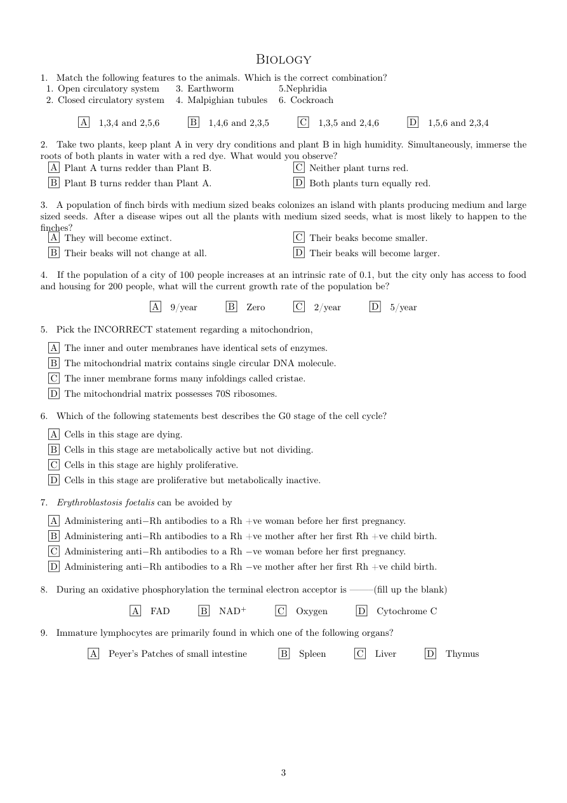
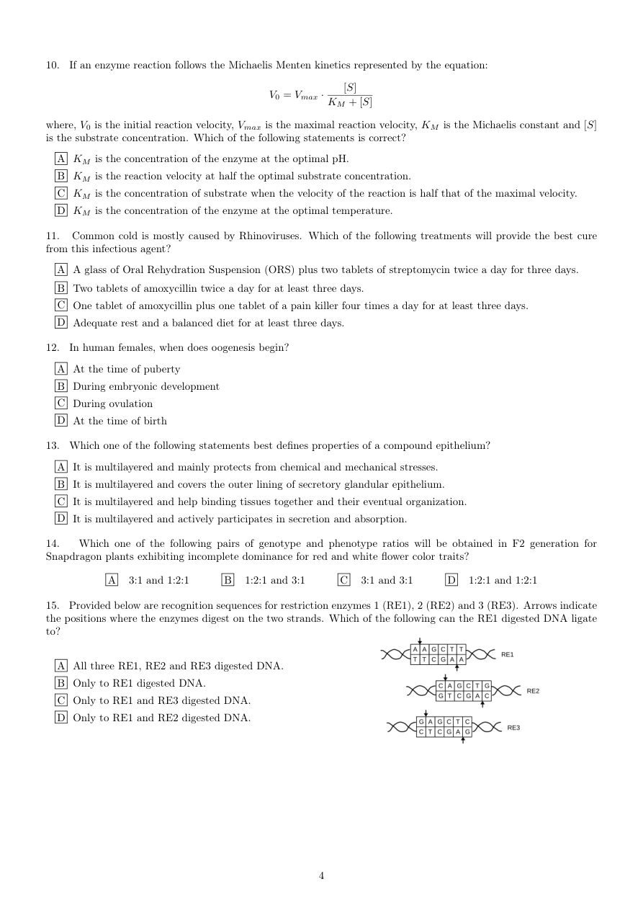
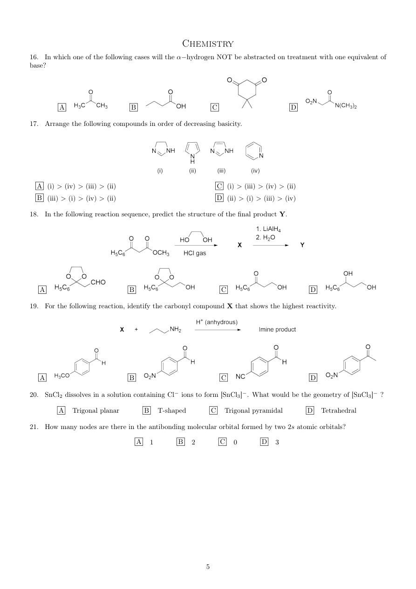
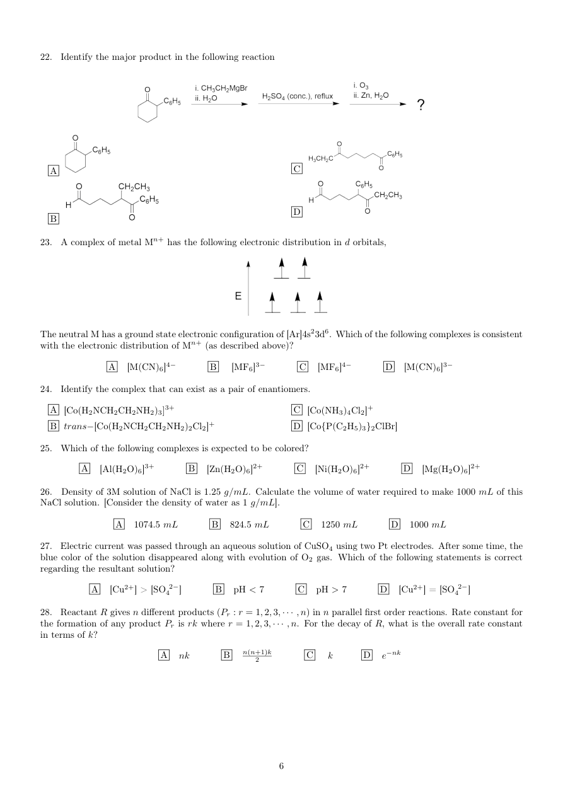
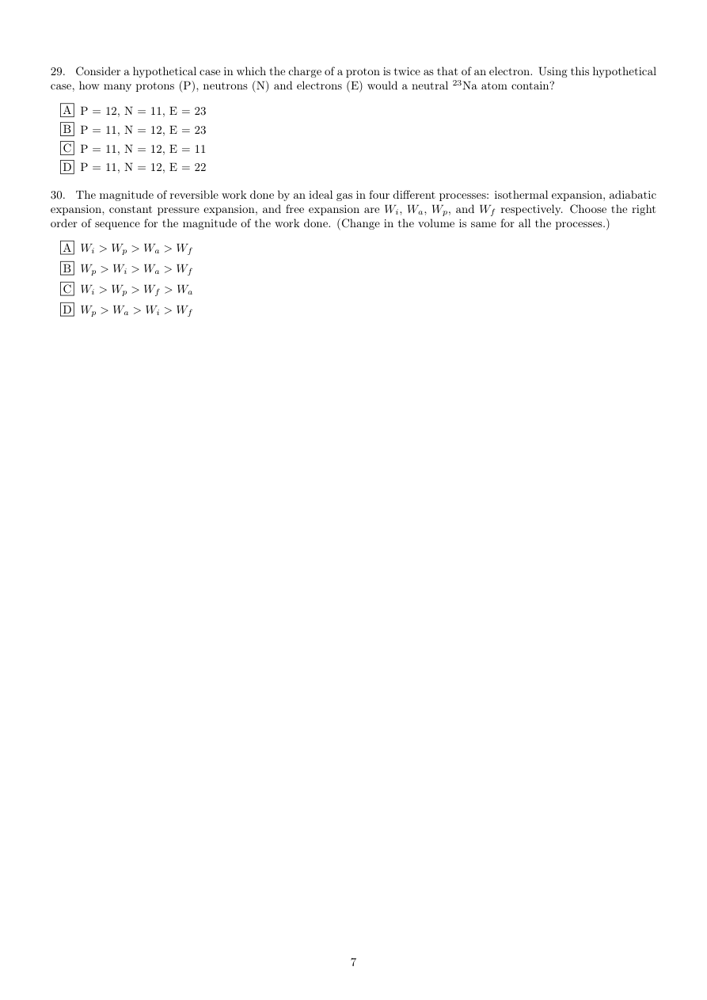
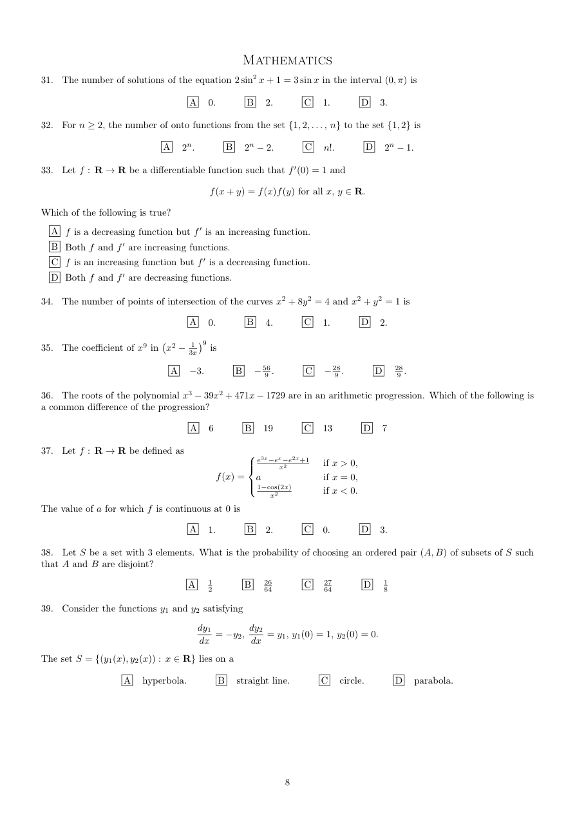
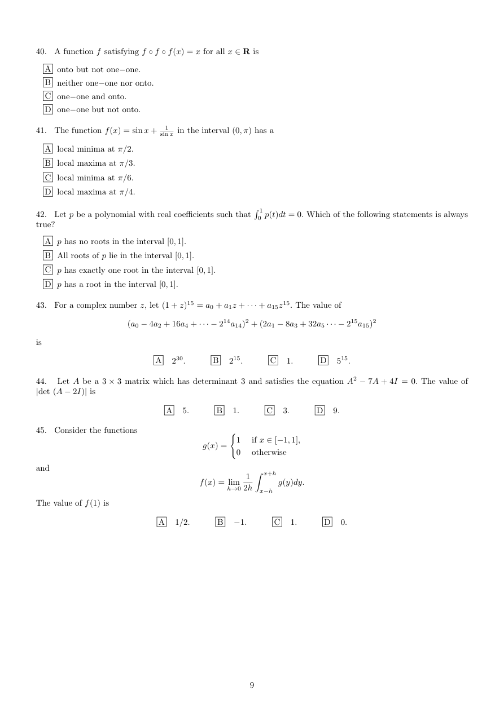
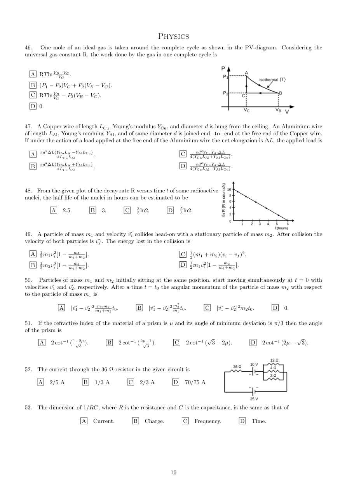
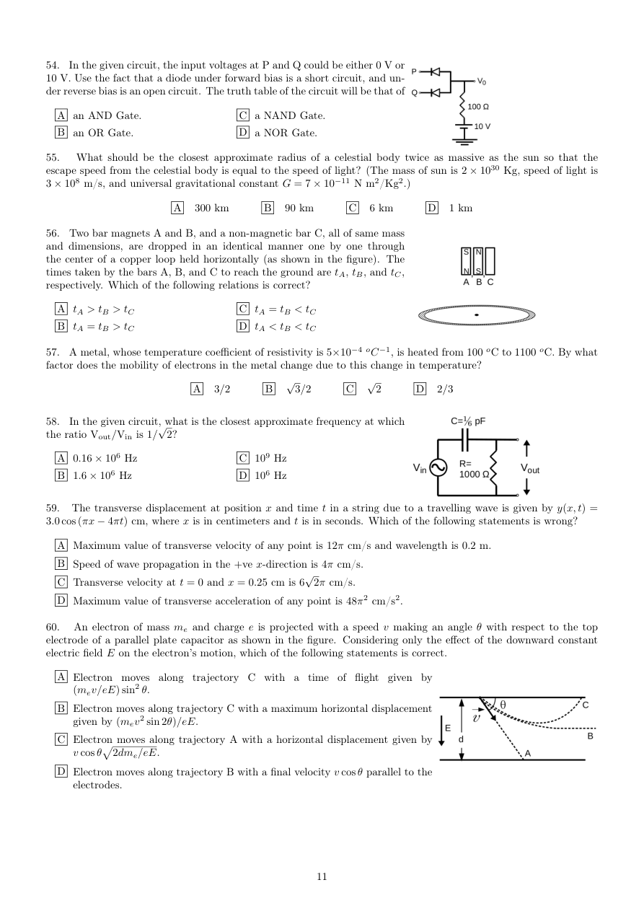

# IAT 2017 - English

Original PDF: [IAT_2017_English_paper.pdf](../pdf/IAT_2017_English_paper.pdf)

- Acquisition: SciAstra CloudFront mirror; not downloaded from the official server.
- Downloaded: 28 October 2026. PDF pages: 9.
- Exact download/source URL: https://d2aaa7ts7sm3bp.cloudfront.net/pdfs/01KMFRM9ZFNNVJ5J161BG7J39A.pdf
- PDF SHA-256: `71b6b6a4490396f55f236faea59fbc5e27eff5eb85167e7b6495a195ce83b0b6`
- This is a search/accessibility copy of an existing paper, not newly authored mock content.
- Text is mechanically extracted or OCR-derived and has not been proofread character by character. Equations, option letters, chemical bonds, tables and Hindi OCR can contain errors. The PDF and page images are authoritative.
- Figure descriptions are explanatory annotations, not official answers or complete structural/formula transcriptions. Use the linked image to resolve exact labels, values and stereochemistry.

## Visual guide

- [English PDF page 2](#pdf-page-2): Biology Q15: three double-stranded DNA recognition sites are labelled RE1, RE2 and RE3. Arrows mark the cuts on the two strands; compare the resulting ends, rather than treating the drawings as decorative DNA icons.
- [English PDF page 3](#pdf-page-3): Chemistry Q16-19: skeletal structures show several carbonyl compounds for alpha-hydrogen acidity, four nitrogen heterocycles for basicity, a protection/reaction/deprotection sequence and substituted aromatic aldehydes for imine formation. Bond positions, nitrogen protonation and substituent locations carry essential information; use the page image for the exact structures.
- [English PDF page 4](#pdf-page-4): Chemistry Q22: a cyclic ketone is taken through organometallic addition, dehydration and oxidative cleavage; the four options are drawn structures. Q23 shows an energy-level diagram with five singly occupied d orbitals and an upward energy axis.
- [English PDF page 8](#pdf-page-8): Physics Q46: a triangular closed path A-B-C-A is drawn on P-V axes; the curved A-B branch is labelled an isotherm at T. Q48 plots a straight decreasing logarithmic decay quantity against time. Q52 is a mixed series/parallel resistor-and-cell network with branch values marked on the diagram.
- [English PDF page 9](#pdf-page-9): Physics Q54: two diode inputs P and Q feed a common output with a resistor and a 10 V source. Q56 compares three equal-sized bars A, B and C falling through a horizontal copper loop. Q58 shows an AC source, a series capacitor and a shunt resistor with Vout marked across the resistor. Q60 draws alternative electron trajectories between parallel electrodes; the letter labels identify different paths.

## Page index

[p1](#pdf-page-1) | [p2](#pdf-page-2) | [p3](#pdf-page-3) | [p4](#pdf-page-4) | [p5](#pdf-page-5) | [p6](#pdf-page-6) | [p7](#pdf-page-7) | [p8](#pdf-page-8) | [p9](#pdf-page-9)

## PDF page 1

[Open original PDF at page 1](../pdf/IAT_2017_English_paper.pdf#page=1)

### Searchable text - PDF text layer

```text
Biology
1.  Match the following features to the animals. Which is the correct combination?
  1. Open circulatory system    3. Earthworm          5.Nephridia
  2. Closed circulatory system   4. Malpighian tubules   6. Cockroach

      A   1,3,4 and 2,5,6     B   1,4,6 and 2,3,5    C   1,3,5 and 2,4,6    D   1,5,6 and 2,3,4

2.  Take two plants, keep plant A in very dry conditions and plant B in high humidity. Simultaneously, immerse the
roots of both plants in water with a red dye. What would you observe?
 A  Plant A turns redder than Plant B.            C  Neither plant turns red.
 B  Plant B turns redder than Plant A.            D Both plants turn equally red.

3. A population of finch birds with medium sized beaks colonizes an island with plants producing medium and large
sized seeds. After a disease wipes out all the plants with medium sized seeds, what is most likely to happen to the
finches?
 A They will become extinct.                  C  Their beaks become smaller.
 B  Their beaks will not change at all.            D Their beaks will become larger.

4.   If the population of a city of 100 people increases at an intrinsic rate of 0.1, but the city only has access to food
and housing for 200 people, what will the current growth rate of the population be?

                A   9/year     B   Zero    C   2/year    D   5/year

5.  Pick the INCORRECT statement regarding a mitochondrion,

 A The inner and outer membranes have identical sets of enzymes.
 B The mitochondrial matrix contains single circular DNA molecule.
 C The inner membrane forms many infoldings called cristae.
 D The mitochondrial matrix possesses 70S ribosomes.

6.  Which of the following statements best describes the G0 stage of the cell cycle?

 A  Cells in this stage are dying.
 B  Cells in this stage are metabolically active but not dividing.
 C  Cells in this stage are highly proliferative.
 D  Cells in this stage are proliferative but metabolically inactive.

7.  Erythroblastosis foetalis can be avoided by
 A  Administering anti−Rh antibodies to a Rh +ve woman before her first pregnancy.
 B  Administering anti−Rh antibodies to a Rh +ve mother after her first Rh +ve child birth.
 C  Administering anti−Rh antibodies to a Rh −ve woman before her first pregnancy.
 D Administering anti−Rh antibodies to a Rh −ve mother after her first Rh +ve child birth.
8.  During an oxidative phosphorylation the terminal electron acceptor is ——–(fill up the blank)

             A  FAD     B  NAD+     C  Oxygen    D  Cytochrome C

9.  Immature lymphocytes are primarily found in which one of the following organs?

       A   Peyer’s Patches of small intestine     B   Spleen    C   Liver    D  Thymus


                                                   3
```

### Original page image



## PDF page 2

[Open original PDF at page 2](../pdf/IAT_2017_English_paper.pdf#page=2)

### Visual description

Biology Q15: three double-stranded DNA recognition sites are labelled RE1, RE2 and RE3. Arrows mark the cuts on the two strands; compare the resulting ends, rather than treating the drawings as decorative DNA icons.

### Searchable text - PDF text layer

```text
10.   If an enzyme reaction follows the Michaelis Menten kinetics represented by the equation:

                                                                    [S]
                                          V0 = Vmax · KM + [S]

where, V0 is the initial reaction velocity, Vmax is the maximal reaction velocity, KM is the Michaelis constant and [S]
is the substrate concentration. Which of the following statements is correct?

 A KM is the concentration of the enzyme at the optimal pH.
 B KM is the reaction velocity at half the optimal substrate concentration.
 C KM is the concentration of substrate when the velocity of the reaction is half that of the maximal velocity.
 D KM is the concentration of the enzyme at the optimal temperature.

11.  Common cold is mostly caused by Rhinoviruses. Which of the following treatments will provide the best cure
from this infectious agent?

 A A glass of Oral Rehydration Suspension (ORS) plus two tablets of streptomycin twice a day for three days.
 B Two tablets of amoxycillin twice a day for at least three days.
 C One tablet of amoxycillin plus one tablet of a pain killer four times a day for at least three days.
 D Adequate rest and a balanced diet for at least three days.

12.  In human females, when does oogenesis begin?

 A At the time of puberty
 B During embryonic development
 C During ovulation
 D At the time of birth

13.  Which one of the following statements best defines properties of a compound epithelium?

 A  It is multilayered and mainly protects from chemical and mechanical stresses.
 B  It is multilayered and covers the outer lining of secretory glandular epithelium.
 C  It is multilayered and help binding tissues together and their eventual organization.
 D  It is multilayered and actively participates in secretion and absorption.

14.   Which one of the following pairs of genotype and phenotype ratios will be obtained in F2 generation for
Snapdragon plants exhibiting incomplete dominance for red and white flower color traits?

        A   3:1 and 1:2:1     B   1:2:1 and 3:1    C   3:1 and 3:1    D   1:2:1 and 1:2:1

15.  Provided below are recognition sequences for restriction enzymes 1 (RE1), 2 (RE2) and 3 (RE3). Arrows indicate
the positions where the enzymes digest on the two strands. Which of the following can the RE1 digested DNA ligate
to?


 A  All three RE1, RE2 and RE3 digested DNA.
 B Only to RE1 digested DNA.
 C Only to RE1 and RE3 digested DNA.
 D Only to RE1 and RE2 digested DNA.


                                                   4
```

### Original page image



## PDF page 3

[Open original PDF at page 3](../pdf/IAT_2017_English_paper.pdf#page=3)

### Visual description

Chemistry Q16-19: skeletal structures show several carbonyl compounds for alpha-hydrogen acidity, four nitrogen heterocycles for basicity, a protection/reaction/deprotection sequence and substituted aromatic aldehydes for imine formation. Bond positions, nitrogen protonation and substituent locations carry essential information; use the page image for the exact structures.

### Searchable text - PDF text layer

```text
Chemistry
16.  In which one of the following cases will the ↵−hydrogen NOT be abstracted on treatment with one equivalent ofbase?


      A              B               C              D

17.  Arrange the following compounds in order of decreasing basicity.


 A  (i) > (iv) > (iii) > (ii)                    C  (i) > (iii) > (iv) > (ii)
 B  (iii) > (i) > (iv) > (ii)                   D  (ii) > (i) > (iii) > (iv)

18.  In the following reaction sequence, predict the structure of the final product Y.


  A                 B                 C                D

19.  For the following reaction, identify the carbonyl compound X that shows the highest reactivity.


  A                 B                 C                D

20.  SnCl2 dissolves in a solution containing Cl−ions to form [SnCl3]−. What would be the geometry of [SnCl3]−?

      A   Trigonal planar     B  T-shaped     C   Trigonal pyramidal     D   Tetrahedral

21. How many nodes are there in the antibonding molecular orbital formed by two 2s atomic orbitals?

                    A  1     B  2     C  0     D  3


                                                   5
```

### Original page image



## PDF page 4

[Open original PDF at page 4](../pdf/IAT_2017_English_paper.pdf#page=4)

### Visual description

Chemistry Q22: a cyclic ketone is taken through organometallic addition, dehydration and oxidative cleavage; the four options are drawn structures. Q23 shows an energy-level diagram with five singly occupied d orbitals and an upward energy axis.

### Searchable text - PDF text layer

```text
22.  Identify the major product in the following reaction


 A                                   C


                                   D
 B

23. A complex of metal Mn+ has the following electronic distribution in d orbitals,


The neutral M has a ground state electronic configuration of [Ar]4s23d6. Which of the following complexes is consistent
with the electronic distribution of Mn+ (as described above)?

          A  [M(CN)6]4−     B   [MF6]3−     C  [MF6]4−     D  [M(CN)6]3−

24.  Identify the complex that can exist as a pair of enantiomers.

 A [Co(H2NCH2CH2NH2)3]3+                 C [Co(NH3)4Cl2]+
 B trans−[Co(H2NCH2CH2NH2)2Cl2]+           D [Co{P(C2H5)3}2ClBr]
25.  Which of the following complexes is expected to be colored?

      A   [Al(H2O)6]3+     B  [Zn(H2O)6]2+     C   [Ni(H2O)6]2+     D  [Mg(H2O)6]2+

26.  Density of 3M solution of NaCl is 1.25 g/mL. Calculate the volume of water required to make 1000 mL of this
NaCl solution. [Consider the density of water as 1 g/mL].

           A   1074.5 mL     B   824.5 mL     C  1250 mL     D  1000 mL

27.  Electric current was passed through an aqueous solution of CuSO4 using two Pt electrodes. After some time, the
blue color of the solution disappeared along with evolution of O2 gas. Which of the following statements is correct
regarding the resultant solution?

       A   [Cu2+] > [SO42− ]     B  pH < 7     C  pH > 7     D  [Cu2+] = [SO42− ]

28.  Reactant R gives n different products (Pr : r = 1, 2, 3, · · · , n) in n parallel first order reactions. Rate constant for
the formation of any product Pr is rk where r = 1, 2, 3, · · · , n. For the decay of R, what is the overall rate constantin terms of k?

                 A  nk     B   n(n+1)k2       C   k    D  e−nk


                                                   6
```

### Original page image



## PDF page 5

[Open original PDF at page 5](../pdf/IAT_2017_English_paper.pdf#page=5)

### Searchable text - PDF text layer

```text
29.  Consider a hypothetical case in which the charge of a proton is twice as that of an electron. Using this hypothetical
case, how many protons (P), neutrons (N) and electrons (E) would a neutral 23Na atom contain?

 A P = 12, N = 11, E = 23
 B P = 11, N = 12, E = 23
 C P = 11, N = 12, E = 11
 D P = 11, N = 12, E = 22

30. The magnitude of reversible work done by an ideal gas in four different processes: isothermal expansion, adiabatic
expansion, constant pressure expansion, and free expansion are Wi, Wa, Wp, and Wf respectively. Choose the right
order of sequence for the magnitude of the work done. (Change in the volume is same for all the processes.)

 A Wi > Wp > Wa > Wf
 B Wp > Wi > Wa > Wf
 C Wi > Wp > Wf > Wa
 D Wp > Wa > Wi > Wf


                                                   7
```

### Original page image



## PDF page 6

[Open original PDF at page 6](../pdf/IAT_2017_English_paper.pdf#page=6)

### Searchable text - PDF text layer

```text
Mathematics

31.  The number of solutions of the equation 2 sin2 x + 1 = 3 sin x in the interval (0, ⇡) is

                     A   0.     B   2.    C   1.    D   3.

32.  For n ≥2, the number of onto functions from the set {1, 2, . . . , n} to the set {1, 2} is
                 A   2n.     B  2n −2.    C   n!.    D  2n −1.
33.  Let f : R ! R be a differentiable function such that f 0(0) = 1 and
                                  f(x + y) = f(x)f(y) for all x, y 2 R.
Which of the following is true?

 A f is a decreasing function but f 0 is an increasing function.
 B Both f and f 0 are increasing functions.
 C f is an increasing function but f 0 is a decreasing function.
 D Both f and f 0 are decreasing functions.

34.  The number of points of intersection of the curves x2 + 8y2 = 4 and x2 + y2 = 1 is

                     A   0.     B   4.    C   1.    D   2.

                           !                                       1 "9
                                    3x    is35.  The coefficient of x9 in  x2 −
                                                                             9 .    D   289 .                  A  −3.     B  −56                                                          9 .    C  −28
36.  The roots of the polynomial x3 −39x2 + 471x −1729 are in an arithmetic progression. Which of the following isa common difference of the progression?

                     A  6     B  19    C  13    D  7


                        837.  Let f : R ! R be defined as
                        >< e3x−ex−e2x+1x2             if x > 0,
                                     f(x) =  a                      if x = 0,
                        >:                                                         1−cos(2x)                                                            x2                if x < 0.
The value of a for which f is continuous at 0 is

                     A   1.     B   2.    C   0.    D   3.

38.  Let S be a set with 3 elements. What is the probability of choosing an ordered pair (A, B) of subsets of S such
that A and B are disjoint?

                    A   12     B   2664     C   2764    D   18

39.  Consider the functions y1 and y2 satisfying

                                   dy1        dy2
                       =      = y1, y1(0) = 1, y2(0) = 0.                              dx   −y2, dx
The set S = {(y1(x), y2(x)) : x 2 R} lies on a
           A   hyperbola.     B   straight line.    C   circle.    D   parabola.


                                                   8
```

### Original page image



## PDF page 7

[Open original PDF at page 7](../pdf/IAT_2017_English_paper.pdf#page=7)

### Searchable text - PDF text layer

```text
40. A function f satisfying f ◦f ◦f(x) = x for all x 2 R is
 A onto but not one−one.
 B  neither one−one nor onto.
 C one−one and onto.
 D one−one but not onto.
41.  The function f(x) = sin x + sin1 x in the interval (0, ⇡) has a

 A  local minima at ⇡/2.
 B  local maxima at ⇡/3.
 C  local minima at ⇡/6.
 D  local maxima at ⇡/4.

                                                       R 1
42.  Let p be a polynomial with real coefficients such that  0 p(t)dt = 0. Which of the following statements is always
true?

 A p has no roots in the interval [0, 1].
 B  All roots of p lie in the interval [0, 1].
 C p has exactly one root in the interval [0, 1].
 D p has a root in the interval [0, 1].

43.  For a complex number z, let (1 + z)15 = a0 + a1z + · · · + a15z15. The value of
                         (a0 −4a2 + 16a4 + · · · −214a14)2 + (2a1 −8a3 + 32a5 · · · −215a15)2
is

                   A   230.     B   215.    C   1.    D   515.

44.   Let A be a 3 ⇥3 matrix which has determinant 3 and satisfies the equation A2 −7A + 4I = 0. The value of
|det (A −2I)| is
                     A   5.     B   1.    C   3.    D   9.

45.  Consider the functions              (
                                               1     if x         1],                                          g(x) =       2 [−1,
                                               0   otherwise
and                                            Z x+h
                                                  1
                                        f(x) = lim          g(y)dy.
                                         h!0 2h  x−h
The value of f(1) is

                   A   1/2.     B  −1.    C   1.    D   0.


                                                   9
```

### Original page image



## PDF page 8

[Open original PDF at page 8](../pdf/IAT_2017_English_paper.pdf#page=8)

### Visual description

Physics Q46: a triangular closed path A-B-C-A is drawn on P-V axes; the curved A-B branch is labelled an isotherm at T. Q48 plots a straight decreasing logarithmic decay quantity against time. Q52 is a mixed series/parallel resistor-and-cell network with branch values marked on the diagram.

### Searchable text - PDF text layer

```text
Physics
46.  One mole of an ideal gas is taken around the complete cycle as shown in the PV-diagram.  Considering the
universal gas constant R, the work done by the gas in one complete cycle is

 A RTln VB−VCVC    .
 B  (P1 −P2)VC + P2(VB −VC).
 C RTln VBVC −P2(VB −VC).
 D  0.


47. A Copper wire of length LCu, Young’s modulus YCu, and diameter d is hung from the ceiling. An Aluminium wire
of length LAl, Young’s modulus YAl, and of same diameter d is joined end−to−end at the free end of the Copper wire.If under the action of a load applied at the free end of the Aluminium wire the net elongation is ∆L, the applied load is

 A  ⇡d2∆L(YCuLAl−YAlLCu)4LCuLAl           .                    C  4(YCuLAl+YAlLCu).⇡d2YCuYAl∆L
 B  ⇡d2∆L(YCuLAl+YAlLCu)4LCuLAl           .                   D  4(YCuLAl−YAlLCu).⇡d2YCuYAl∆L


48. From the given plot of the decay rate R versus time t of some radioactive
nuclei, the half life of the nuclei in hours can be estimated to be

      A   2.5.     B   3.    C   35ln2.    D   53ln2.


49. A particle of mass m1 and velocity ~vi collides head-on with a stationary particle of mass m2. After collision the
velocity of both particles is ~vf. The energy lost in the collision is


              m1+m2 A  12m1v2i [1 −                m1    ].                      C  12(m1 + m2)(vi −vf)2.
                                                                 m2    ].                                                            m1+m2              m1+m2                m1    ].                     D  12m1v2i [1 − B  12m2v2i [1 −
50.   Particles of mass m1 and m2 initially sitting at the same position, start moving simultaneously at t = 0 with
velocities ~v1 and ~v2, respectively. After a time t = t0 the angular momentum of the particle of mass m2 with respect
to the particle of mass m1 is

        A          m1+m2m1m2 t0.     B          m1m2                           |~v1 −~v2|2                                |~v1 −~v2|2   2 t0.    C    |~v1 −~v2|2m2t0.    D   0.

51.   If the refractive index of the material of a prism is µ and its angle of minimum deviation is ⇡/3 then the angle
of the prism is
                                      p 3        D  2 cot−1 (2µ p 3).   A  2 cot−1 ( 1−2µp 3  ).     B  2 cot−1 ( 2µ−1p 3  ).    C  2 cot−1 (                                                            −2µ).             −


52.  The current through the 36 ⌦resistor in the given circuit is

   A  2/5 A     B  1/3 A    C  2/3 A    D  70/75 A


53.  The dimension of 1/RC, where R is the resistance and C is the capacitance, is the same as that of

             A   Current.     B   Charge.    C   Frequency.    D  Time.


                                                  10
```

### Original page image



## PDF page 9

[Open original PDF at page 9](../pdf/IAT_2017_English_paper.pdf#page=9)

### Visual description

Physics Q54: two diode inputs P and Q feed a common output with a resistor and a 10 V source. Q56 compares three equal-sized bars A, B and C falling through a horizontal copper loop. Q58 shows an AC source, a series capacitor and a shunt resistor with Vout marked across the resistor. Q60 draws alternative electron trajectories between parallel electrodes; the letter labels identify different paths.

### Searchable text - PDF text layer

```text
54.  In the given circuit, the input voltages at P and Q could be either 0 V or
10 V. Use the fact that a diode under forward bias is a short circuit, and un-
der reverse bias is an open circuit. The truth table of the circuit will be that of

 A an AND Gate.             C a NAND Gate.
 B an OR Gate.             D a NOR Gate.

55.  What should be the closest approximate radius of a celestial body twice as massive as the sun so that the
escape speed from the celestial body is equal to the speed of light? (The mass of sun is 2 ⇥1030 Kg, speed of light is
3 ⇥108 m/s, and universal gravitational constant G = 7 ⇥10−11 N m2/Kg2.)
                A  300 km     B  90 km    C  6 km    D  1 km

56. Two bar magnets A and B, and a non-magnetic bar C, all of same mass
and dimensions, are dropped in an identical manner one by one through
the center of a copper loop held horizontally (as shown in the figure). The
times taken by the bars A, B, and C to reach the ground are tA, tB, and tC,
respectively. Which of the following relations is correct?

 A tA > tB > tC              C  tA = tB < tC
 B  tA = tB > tC             D tA < tB < tC

57. A metal, whose temperature coefficient of resistivity is 5⇥10−4 oC−1, is heated from 100 oC to 1100 oC. By whatfactor does the mobility of electrons in the metal change due to this change in temperature?
                  A  3/2     B p 3/2    C p 2    D  2/3

58.  In the given circuit, what is the closest approximate frequency at which
the ratio Vout/Vin is 1/p 2?

 A  0.16 ⇥106 Hz             C  109 Hz
 B  1.6 ⇥106 Hz             D  106 Hz

59.  The transverse displacement at position x and time t in a string due to a travelling wave is given by y(x, t) =
3.0 cos (⇡x −4⇡t) cm, where x is in centimeters and t is in seconds. Which of the following statements is wrong?
 A Maximum value of transverse velocity of any point is 12⇡cm/s and wavelength is 0.2 m.
 B Speed of wave propagation in the +ve x-direction is 4⇡cm/s.
 C  Transverse velocity at t = 0 and x = 0.25 cm is 6p 2⇡cm/s.
 D Maximum value of transverse acceleration of any point is 48⇡2 cm/s2.

60.  An electron of mass me and charge e is projected with a speed v making an angle ✓with respect to the top
electrode of a parallel plate capacitor as shown in the figure. Considering only the effect of the downward constant
electric field E on the electron’s motion, which of the following statements is correct.

 A  Electron  moves  along  trajectory C  with  a  time  of  flight  given  by
     (mev/eE) sin2 ✓.
 B  Electron moves along trajectory C with a maximum horizontal displacement
     given by (mev2 sin 2✓)/eE.
 C  Electronp moves along trajectory A with a horizontal displacement given by
     v cos ✓  2dme/eE.
 D  Electron moves along trajectory B with a final velocity v cos ✓parallel to the
      electrodes.


                                                  11
```

### Original page image


