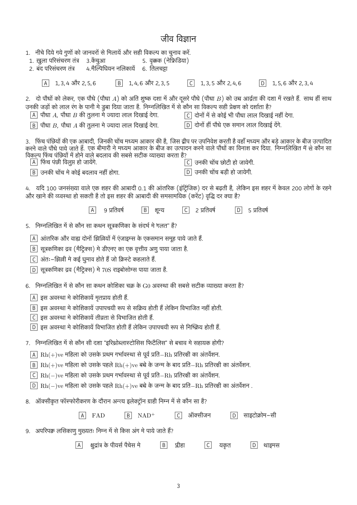
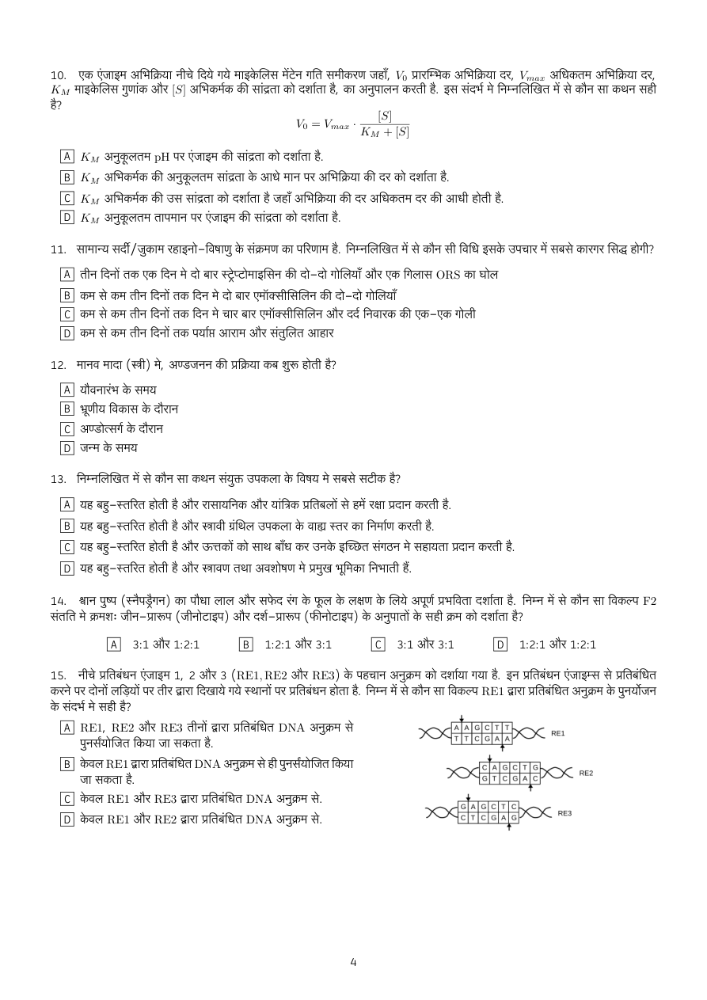
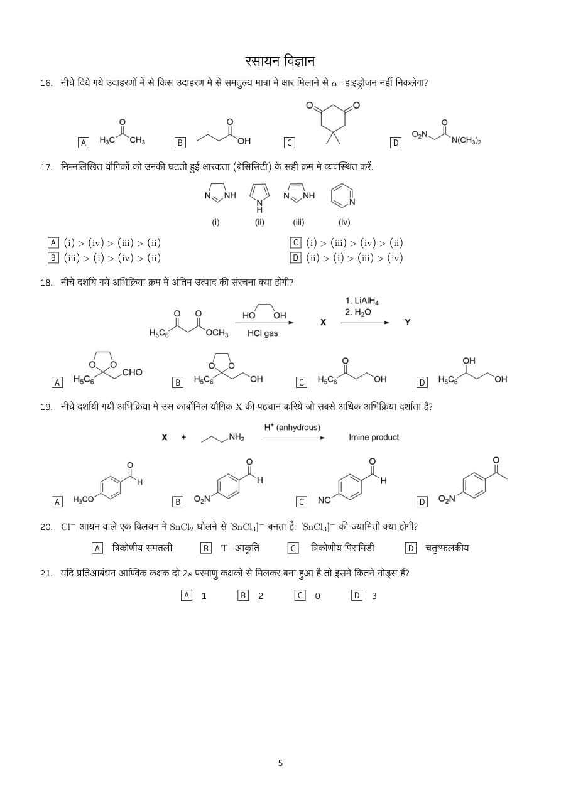
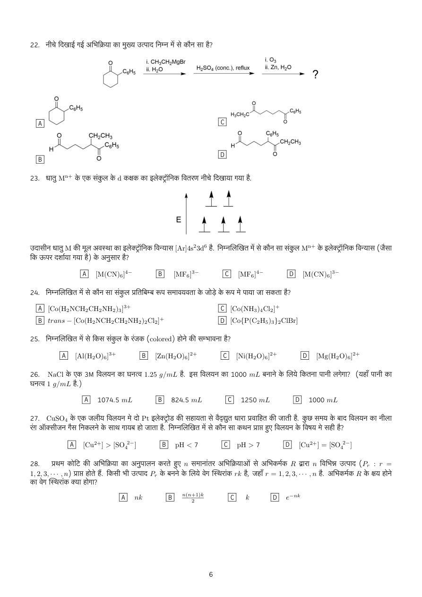
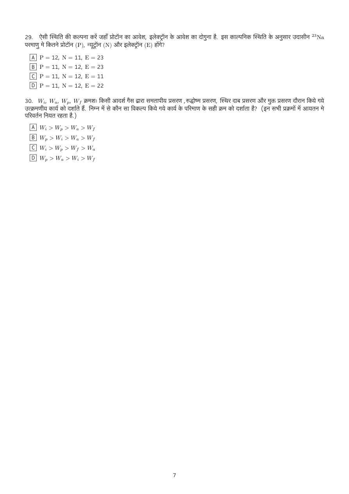
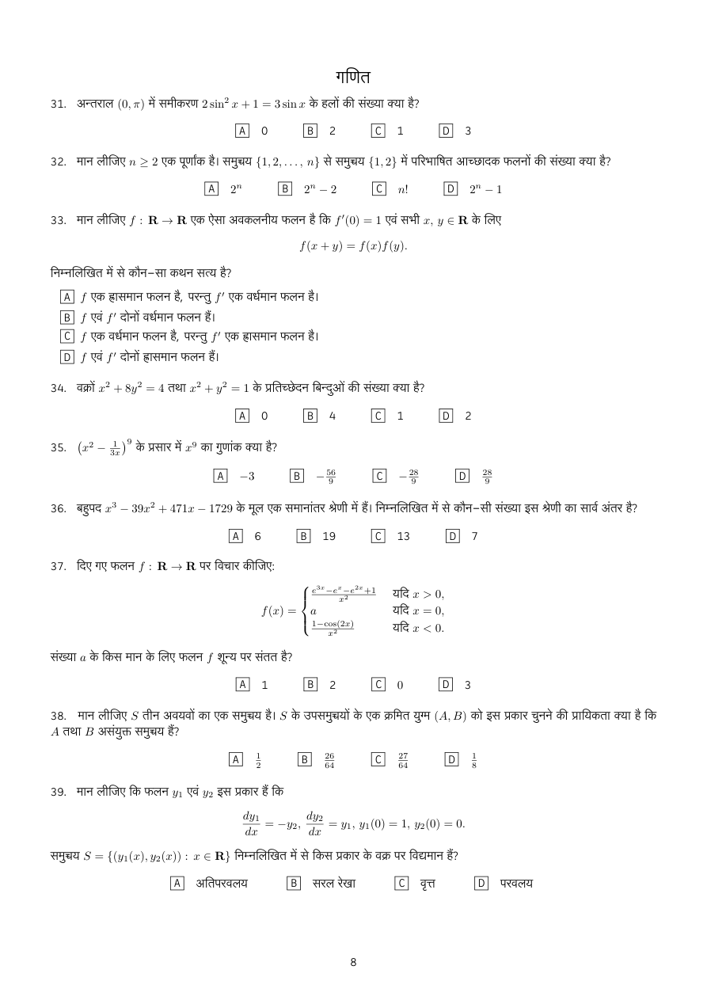
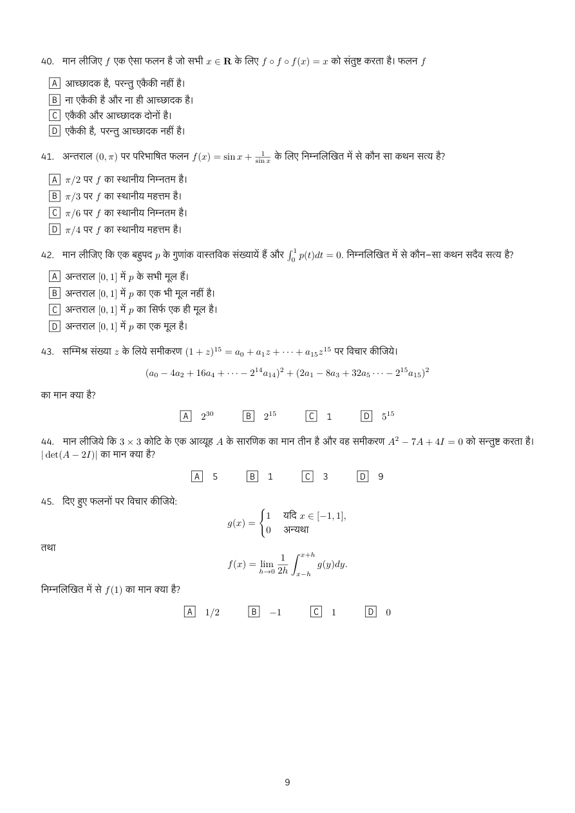
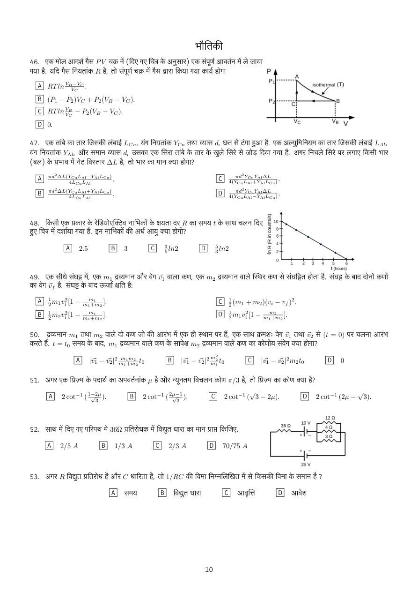
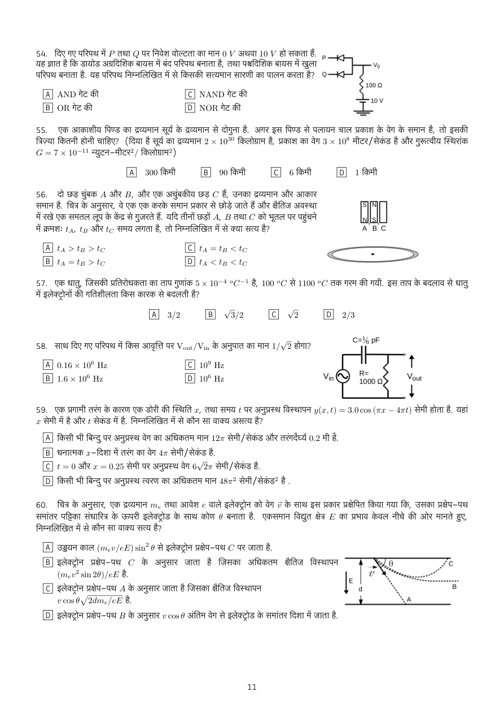

# IAT 2017 - Hindi

Original PDF: [IAT_2017_Hindi_paper.pdf](../pdf/IAT_2017_Hindi_paper.pdf)

- Acquisition: SciAstra CloudFront mirror; not downloaded from the official server.
- Downloaded: 28 October 2026. PDF pages: 9.
- Exact download/source URL: https://d2aaa7ts7sm3bp.cloudfront.net/pdfs/01KMFRKQRPW90V596WPT7MPDX1.pdf
- PDF SHA-256: `c9eb54fe66832577b8a7d40df26bc29d6b804ba54fb35280b45721a379d0262a`
- This is a search/accessibility copy of an existing paper, not newly authored mock content.
- Text is mechanically extracted or OCR-derived and has not been proofread character by character. Equations, option letters, chemical bonds, tables and Hindi OCR can contain errors. The PDF and page images are authoritative.
- Figure descriptions are explanatory annotations, not official answers or complete structural/formula transcriptions. Use the linked image to resolve exact labels, values and stereochemistry.

## Visual guide

The following descriptions refer to **PDF page numbers in the English companion**, because Hindi pagination can differ. The Hindi page images below retain every original diagram; identical embedded images are additionally cross-linked where matched by image digest.

- [English PDF page 2](IAT_2017_English_paper.md#pdf-page-2): Biology Q15: three double-stranded DNA recognition sites are labelled RE1, RE2 and RE3. Arrows mark the cuts on the two strands; compare the resulting ends, rather than treating the drawings as decorative DNA icons.
- [English PDF page 3](IAT_2017_English_paper.md#pdf-page-3): Chemistry Q16-19: skeletal structures show several carbonyl compounds for alpha-hydrogen acidity, four nitrogen heterocycles for basicity, a protection/reaction/deprotection sequence and substituted aromatic aldehydes for imine formation. Bond positions, nitrogen protonation and substituent locations carry essential information; use the page image for the exact structures.
- [English PDF page 4](IAT_2017_English_paper.md#pdf-page-4): Chemistry Q22: a cyclic ketone is taken through organometallic addition, dehydration and oxidative cleavage; the four options are drawn structures. Q23 shows an energy-level diagram with five singly occupied d orbitals and an upward energy axis.
- [English PDF page 8](IAT_2017_English_paper.md#pdf-page-8): Physics Q46: a triangular closed path A-B-C-A is drawn on P-V axes; the curved A-B branch is labelled an isotherm at T. Q48 plots a straight decreasing logarithmic decay quantity against time. Q52 is a mixed series/parallel resistor-and-cell network with branch values marked on the diagram.
- [English PDF page 9](IAT_2017_English_paper.md#pdf-page-9): Physics Q54: two diode inputs P and Q feed a common output with a resistor and a 10 V source. Q56 compares three equal-sized bars A, B and C falling through a horizontal copper loop. Q58 shows an AC source, a series capacitor and a shunt resistor with Vout marked across the resistor. Q60 draws alternative electron trajectories between parallel electrodes; the letter labels identify different paths.

## Page index

[p1](#pdf-page-1) | [p2](#pdf-page-2) | [p3](#pdf-page-3) | [p4](#pdf-page-4) | [p5](#pdf-page-5) | [p6](#pdf-page-6) | [p7](#pdf-page-7) | [p8](#pdf-page-8) | [p9](#pdf-page-9)

## PDF page 1

[Open original PDF at page 1](../pdf/IAT_2017_Hindi_paper.pdf#page=1)

### Searchable text - OCR draft (hin+eng)

```text
जीव विज्ञान

4. नीचे दिये गये गुणों को जानवरों से मिलायें और सही विकल्प का चुनाव करें.
L. ख़ुला परिसंचरण तंत्र 3.केंचुआ 5. gan (नेफ्रिडिया)
2. बंद परिसंचरण तंत्र. 4.मैल्पिघियन नलिकायें 6. तिलचट्टा

A] व,3,4 और 2, 5, 6 [8] 2,4,6 और 2,3,5 €] 4,3३,5 और 2,4, 6 [0] 4,5,6 और 2, 3, 4

2. दो पौधों को लेकर, एक पौधे (पौधा A) को अति शुष्क दशा में और दूसरे पौधे (पौधा B) को उच्च आर्द्रता की दशा में रखते हैं. साथ हीं साथ
उनकी जड़ों को लाल रंग के पानी मे gar दिया जाता है. निम्नलिखित में से कौन सा विकल्प सही प्रेक्षण को दर्शाता है?
A] पौधा A, पौधा B की तुलना मे ज्यादा लाल दिखाई देगा. ८] दोनों में से कोई भी पौधा लाल दिखाई नहीं देगा.

[8] पौधा 5, पौधा 4 की तुलना मे ज्यादा लाल दिखाई देगा. [0] दोनों हीं पौधे एक समान लाल दिखाई देंगे.

3. फिंच पंछियों की एक आबादी, जिनकी चोंच मध्यम आकार की है, जिस द्वीप पर उपनिवेश करती है वहाँ मध्यम और बड़े आकार के बीज उत्पादित
करने वाले पौधे पाये जाते हैं. एक बीमारी ने मध्यम आकार के बीज का उत्पादन करने वाले पौधों का विनाश कर दिया. निम्नलिखित में से कौन सा
विकल्प फिंच पंछियों में होने वाले बदलाव की सबसे सटीक व्याख्या करता है?
A] फिंच पंछी विलुप्त हो जायेंगे. ८] उनकी चोंच छोटी हो जायेगी.

[B] उनकी चोंच मे कोई बदलाव नहीं होगा. [0] उनकी चोंच बड़ी हो जायेगी.

4. यदि L00 जनसंख्या वाले एक शहर की आबादी 0.4 की आंतरिक (ंट्रिंजिक) दर से बढ़ती है, लेकिन इस शहर में केवल 200 लोगों के रहने
और खाने की व्य्वस्था हो सकती है तो इस शहर की आबादी की समसामयिक (करेंट) वृद्धि दर क्या है?

A] 9 प्रतिवर्ष [8| शून्य C] 2 प्रतिवर्ष [D] 5 प्रतिवर्ष

5. निम्नलिखित में से कौन सा कथन सूत्रकणिका के संदर्भ मे गलत" है?

आंतरिक और वाद्य दोनों झिल्लियों में एंजाइम्स के एकसमान समूह पाये जाते हैं.
सूत्रकणिका द्रव (मैट्रिक्स) मे डीएनए का एक वृत्तीय अणु पाया जाता है.
अंतः-झिल्ली मे कई घुमाव होते हैं जो क्रिस्टे कहलाते हैं.

[0] सूत्रकणिका द्रव (मैट्रिक्स) मे 705 राइबोसोम्स पाया जाता है.

] fo] [ow] [>]

6. निम्नलिखित में से कौन सा कथन कोशिका चक्र GO अवस्था की सबसे सटीक व्याख्या करता है?

A] इस अवस्था मे कोशिकायें मृतप्राय होती हैं.

[8] इस अवस्था मे कोशिकायें उपापचयी रूप से सक्रिय होती हैं लेकिन विभाजित नहीं होती.
C] इस अवस्था मे कोशिकायें तीव्रता से विभाजित होती हैं.

[D] इस अवस्था मे कोशिकायें विभाजित होती हैं लेकिन उपापचयी रूप से निष्क्रिय होती हैं.

7. निम्नलिखित में से कौन सी दशा "इरिश्रोब्लास्टोसिस फिटैलिस" से बचाव मे सहायक होगी?

Rh(+)ve महिला को उसके प्रथम गर्भावस्‍था से पूर्व wa—Rh प्रतिरक्षी का अंतर्वेशन,
Rh(+)ve महिला को उसके पहले Rh(+)ve बच्चे के जन्म के बाद WA—Rh प्रतिरक्षी का अंतर्वेशन.
Rh(—)ve महिला को उसके प्रथम गर्भावस्‍था से पूर्व wa—Rh प्रतिरक्षी का अंतर्वेशन,
Rh(—)ve महिला को उसके पहले Rh(+)ve बच्चे के जन्म के बाद प्रति-॥ प्रतिरक्षी का अंतर्वेशन .

DO] Jo} |m] |>}

8. ऑक्सीकृत फॉस्फोरीकरण के दौरान अन्त्य इलेक्ट्रॉन ग्राही निम्न में से कौन सा है?
A] FAD [B] NAD+ C] ऑक्सीजन [0] साइटोक्रोम-सी
9. अपरिपक्क लसिकाणु मुख्यतः निम्न में से किस अंग मे पाये जाते हैं?
Al छुद्रांत्र के पीयर्स पैचेस मे [8] ster Cl] यकृत [0] थाइमस
```

### Original page image



## PDF page 2

[Open original PDF at page 2](../pdf/IAT_2017_Hindi_paper.pdf#page=2)

**Matching embedded figure, English PDF page 2:** Biology Q15: three double-stranded DNA recognition sites are labelled RE1, RE2 and RE3. Arrows mark the cuts on the two strands; compare the resulting ends, rather than treating the drawings as decorative DNA icons.

### Searchable text - OCR draft (hin+eng)

```text
40. एक एंजाइम अभिक्रिया नीचे दिये गये माइकेलिस मेंटेन गति समीकरण जहाँ, Vy प्रारम्भिक अभिक्रिया दर, Vina अधिकतम अभिक्रिया दर,
7८५ माइकेलिस गुणांक और [5] अभिकर्मक की सांद्रता को दर्शाता है, का अनुपालन करती है. इस संदर्भ मे निम्नलिखित में से कौन सा कथन सही
है?

[3]

Vo = Vinax * = 5
° Ku + [5]

Ky अनुकूलतम pH पर एंजाइम की सांद्रता को दर्शाता है.
Ky अभिकर्मक की अनुकूलतम सांद्रता के आधे मान पर अभिक्रिया की दर को दर्शाता है.

Ky अभिकर्मक की उस सांद्रता को दर्शाता है जहाँ अभिक्रिया की दर अधिकतम दर की आधी होती है.
Ky अनुकूलतम तापमान पर एंजाइम की सांद्रता को दर्शाता है.

O} | jw] |

गा
am

. सामान्य सर्दी/जुकाम रहाइनो-विषाणु के संक्रमण का परिणाम है. निम्नलिखित में से कौन सी विधि इसके उपचार में सबसे कारगर सिद्ध होगी?

तीन दिनों तक एक दिन मे दो बार स्ट्रेप्टोमाइसिन की दो-दो गोलियाँ और एक गिलास ORS का घोल
कम से कम तीन दिनों तक दिन मे दो बार एमॉक्सीसिलिन की दो-दो गोलियाँ

कम से कम तीन दिनों तक दिन मे चार बार एमॉक्सीसिलिन और दर्द निवारक की एक-एक गोली

कम से कम तीन दिनों तक पर्याप्त आराम और संतुलित आहार

3] [=] [=]

=}

भर
ND

. मानव मादा (स्त्री) मे, अण्डजनन की प्रक्रिया कब शुरू होती है?
यौवनारंभ के समय
भ्रूणिय विकास के दौरान

अण्डोत्सर्ग के दौरान
जन्म के समय

9] [0] [=] [>]

bh
w

. निम्नलिखित में से कौन सा कथन संयुक्त उपकला के विषय मे सबसे सटीक है?

A] यह बहु-स्तरित होती है और रासायनिक और यांत्रिक प्रतिबलों से हमें रक्षा प्रदान करती है.

यह बहु-स्तरित होती है और स्त्रावी ग्रंथिल उपकला के वाद्य स्तर का निर्माण करती है.

यह बहु-स्तरित होती है और ऊत्तकों को साथ बाँध कर उनके इच्छित संगठन मे सहायता प्रदान करती है.
यह बहु-स्तरित होती है और स्त्रावण तथा अवशोषण मे प्रमुख भूमिका निभाती हैं.

A
[8]
८
[0]

4. शान पुष्प (स्नैपड्रैगन) का पौधा लाल और सफेद रंग के फूल के लक्षण के लिये अपूर्ण प्रभविता दर्शाता है. निम्न में से कौन सा विकल्प F2
संतति मे क्रमशः जीन-प्रारूप (जीनोटाइप) और दर्श-प्रारूप (फीनोटाइप) के अनुपातों के सही क्रम को दर्शाता है?

A] 3: और 2:2:2 [8] 2:2:4 और 3:2 C] 3: और 3a [D] 2:2:2 और 4:2:2

is. नीचे प्रतिबंधन एंजाइम 2, 2 और 3 (REI, RE2 और RE3) के पहचान अनुक्रम को दर्शाया गया है. इन प्रतिबंधन एंजाइम्स से प्रतिबंधित
करने पर दोनों लड़ियों पर तीर द्वारा दिखाये गये स्थानों पर प्रतिबंधन होता है. निम्न में से कौन सा विकल्प REL arr प्रतिबंधित अनुक्रम के पुनर्योजन
के संदर्भ मे सही है?

A] REL, RE2 और RE3 तीनों द्वारा प्रतिबंधित DNA अनुक्रम से AlAys[o[r | है
पुनर्सयोजित किया जा सकता है. OrlelslafaPOS *

[8] केवल REL are प्रतिबंधित DNA अनुक्रम से ही पुनर्सयोजित किया ारातानागाति
जा सकता है. OGetrtcfefatePOR क्ः

केवल RE] और RE3 द्वारा प्रतिबंधित DNA अनुक्रम से.
केवल RE] और RE2 द्वारा प्रतिबंधित DNA अनुक्रम से.

०
०

[A[s[c[t[c
OG c|t]clcfa|c < RES

८
[0]
```

### Original page image



## PDF page 3

[Open original PDF at page 3](../pdf/IAT_2017_Hindi_paper.pdf#page=3)

### Searchable text - OCR draft (hin+eng)

```text
रसायन विज्ञान
l6. नीचे दिये गये उदाहरणों में से किस उदाहरण मे से समतुल्य मात्रा मे क्षार मिलाने से «-हाइड्रोजन नहीं निकलेगा?

fe) 0
0 ० हि
A ६०” "छा BI] >> ट ण ON cts
7. निम्नलिखित यौगिकों को उनकी घटती हुई क्षारकता (बेसिसिटी) के सही क्रम मे व्यवस्थित करें.
(3 [-\ Q
yo फिल्म LO
(i) (ii) (iii) (iv)
(i) > (iii) > (iv) > Gi)

A] (i) > (iv) > (iii) > Gi) Cc
[B] (iii) > (i) > (iv) > (ii) [0] (ii) > (i) > (iii) > (iv)
48. नीचे cat गये अभिक्रिया क्रम में अंतिम उत्पाद की संरचना gar होगी?
क्र 4. LiAIH,
00 HO OH 2. H20
AM x sy
HsCg 0603. HCl gas
/
ah ono fg or OH
A] HsCe [8] ०६2 OH Cc] HsCe ‘OH [6] "४० OH
49. नीचे दर्शायी गयी अभिक्रिया मे उस कार्बोनिल यौगिक x की पहचान HRA जो सबसे अधिक अभिक्रिया दर्शाता है?
H* (anhydrous)
X + YA_NH2 Imine product
0

wl ol TT

20. Cl- आयन वाले एक विलयन मे SnCly घोलने B [SnCly]~ बनता है. [SnCly]~ की ज्यामिती gar होगी?
€| त्रिकोणीय पिरामिडी [0] चतुष्फलकीय

A] feria समतली [8] आकृति
27. यदि प्रतिआबंधन आण्विक कक्षक दो 25 परमाणु कक्षकों से मिलकर बना हुआ है तो इसमे कितने नोड्स हैं?

A] 4 [8] 2 C] o [D] 3
```

### Original page image



## PDF page 4

[Open original PDF at page 4](../pdf/IAT_2017_Hindi_paper.pdf#page=4)

### Searchable text - OCR draft (hin+eng)

```text
22. नीचे दिखाई गई अभिक्रिया का मुख्य उत्पाद निम्न में से कौन सा है?

ro) i. CH3CH)MgBr i. 03

ii H2SO, (conc.), reflux ii. Zn, HO
CY Ces 0 2904 ( M2804 (cone), reflux AN MLO n

tT 0
CeHs
CY 7 कण Nr
A c ०
0 CH,CH3 ° CoHs
4 CeHs H CH,CH3
जे [0] ०0
Bl ० 2

23. धातु '४०+ के एक संकुल के १ कक्षक का इलेक्ट्रॉनिक वितरण नीचे दिखाया गया है.

tt
और

उदासीन धातु M की मूल अवस्था का इलेक्ट्रॉनिक विन्यास [Ar]4s?3d° है. निम्नलिखित में से कौन सा संकुल M+ के इलेक्ट्रॉनिक farses (जैसा
कि ऊपर दर्शाया गया है) के अनुसार है?

A] [M(CN)¢]*~ [8] [MF¢]°~ 6] [MF6|‘~ [0] [M(CN)6]*

24. निम्नलिखित में से कौन सा संकुल प्रतिबिम्ब रूप समावयवता के जोड़े के रूप मे पाया जा सकता है?

>|

a C] [Co(NH3)4Clo]*
[B] trans — [Co(H2NCH2CH2NH2)2Clo]* [D] [Co{P(C2Hs)s}2CIBy]

[Co(H2NCH,CH,NH2);

25. निम्नलिखित में से किस संकुल के रंजक (colored) होने की सम्भावना है?
A] [Al(H20)6]** [8] [Zn(H20)6]?* C] [Ni(H20)6]?* [0] [Mg(H20)¢]?+

26. NaCl के एक 3॥/ विलयन का घनत्व .25 g/mL है. इस विलयन का 000 mL बनाने के लिये कितना पानी लगेगा? (यहाँ पानी का
घनत्व  ७/#४7. है.)

A] 2074.5 mL [B] 824.5 mL C] 4250 mL [0] 4000 mL

27. CuSO, के एक जलीय विलयन मे दो Pt इलेक्ट्रोड की सहायता से वैद्द्युत धारा प्रवाहित की जाती है. कुछ समय के बाद विलयन का नीला
रंग ऑक्सीजन गैस निकलने के साथ गायब हो जाता है. निम्नलिखित में से कौन सा कथन प्राप्त हुए विलयन के विषय मे सही है?

A] [Cu?+] > [50.7] [8] pH<7 C} pH>7 [0] [07४] = [S07]
28. प्रथम कोटि की अभिक्रिया का अनुपालन करते हुए n समानांतर अभिक्रियाओं से अभिकर्मक R द्वारा n विभिन्न उत्पाद (70, : + =

4,2,3,---,n) We होते हैं. किसी भी उत्पाद Pp, के बनने के लिये वेग स्थिरांक rk है, जहाँ + = ,2,3,--- nd. अभिकर्मक Re क्षय होने
का वेग स्थिरांक कया होगा?

Al nk [8] n(n ik Cl k छ] e-”*
```

### Original page image



## PDF page 5

[Open original PDF at page 5](../pdf/IAT_2017_Hindi_paper.pdf#page=5)

### Searchable text - OCR draft (hin+eng)

```text
29. ऐसी स्थिति की कल्पना करें जहाँ Ic oT side, इलेक्ट्रॉन के आवेश का दोगुना है. इस काल्पनिक स्थिति के अनुसार उदासीन Na
परमाणु मे कितने प्रोटॉन (7), न्यूट्रॉन (N) और इलेक्ट्रॉन (E) होंगे?

>|

P=i2,N=l, E= 23
ह - 4], ' -१2, E= 23
ह - ,  -१2, ह - 44
+ - ], ' -१2, E= 22

एछ||9|[[प०

30. Wi, Wa, Wy, We क्रमशः किसी आदर्श गैस द्वारा समतापीय प्रसरण ,रुद्धोष्म प्रसरण, स्थिर दाब प्रसरण और मुक्त प्रसरण दौरान किये गये
उत्क्रमणीय कार्य को दशति हैं. निम्न में से कौन सा विकल्प किये गये कार्य के परिमाण के सही क्रम को दर्शाता है? (इन सभी प्रक्रमों में आयतन मे
परिवर्तन नियत रहता है.)

A] Wi > Wy > Wa > Wy
[8] W, >Wi> Wa > Wy
C] Wi > W, > Wy > Wa
[0] > Wa >Wi > Wy
```

### Original page image



## PDF page 6

[Open original PDF at page 6](../pdf/IAT_2017_Hindi_paper.pdf#page=6)

### Searchable text - OCR draft (hin+eng)

```text
गणित

34. अन्तराल (0,9) में समीकरण 2 sin? x +  - 3sin » के हलों की संख्या क्या है?

A] 0 [8] 2 न॥ [0] 3

32. मान लीजिए n > 2 एक पूर्णाक है। समुच्चय {,2,..., n} समुच्चय {,2} में परिभाषित आच्छादक फलनों की संख्या क्या है?
A] 2” [8] 2"-2 C] nl [0] ?-]

33. मान लीजिए / : & -> RWS ऐसा अवकलनीय फलन है कि /“(0) - एवं सभी », ye RH लिए

(४ + 8) = f(x) f(y).

निम्नलिखित में से कौन-सा कथन सत्य है?

>

/ एक हासमान फलन है, परन्तु /” एक वर्धमान फलन है।
[8] / एवं /' दोनों वर्धमान फलन हैं।
८] / एक वर्धमान फलन है, परन्तु // एक RAM फलन है।
[0] / एवं / दोनों हासमान फलन हैं।

34. वक्रों a? + 8y? = 4 तथा a? + ४? - । के प्रतिच्छेदन बिन्दुओं की संख्या क्या है?
A] 0 [8] 4 C] 2 [D] 2

35. (22 - हु) के प्रसार में »? का गुणांक क्‍या है?

A] -3 [8] -%6 cq] -F एि F

36. बहुपद x? - 39%? + 47a — 729 के मूल एक समानांतर श्रेणी में हैं। निम्नलिखित में से कौन-सी संख्या इस श्रेणी का ard अंतर है?

A] 6 [8] 49 | 33 [0] 7

37. दिए गए फलन / : ROR पर विचार कीजिए:

यदि x > 0 ;
यदि x =0. ;
यदि # < 0.

संख्या a के किस मान के लिए फलन | शून्य पर संतत है?
A] 7 [B] 2 C] 0 [0] 3

38. मान लीजिए & तीन अवयवों का एक समुच्य है। S के उपसमुच्नयों के एक क्रमित युग्म (4, B) को इस प्रकार चुनने की प्रायिकता क्‍या है कि
4 तथा B असंयुक्त Ma हैं?

A] 3 8] हैं C] & [०] §

39. मान लीजिए कि फलन 9 एवं yo इस प्रकार हैं कि

dy: dy2
हा = 789, Ge = 27 0 (0) = 4, y2(0) = 0.

समुच्चय S = {(y:(x),yo(x)) : » € R} निम्नलिखित में से किस प्रकार के वक्र पर विद्यमान हैं?

8] अतिपरवलय [8] सरल रेखा Cc] ga [0] परवलय
```

### Original page image



## PDF page 7

[Open original PDF at page 7](../pdf/IAT_2017_Hindi_paper.pdf#page=7)

### Searchable text - OCR draft (hin+eng)

```text
40. मान लीजिए / एक ऐसा फलन है जो सभी # € RG fay fo fo f(x) = » को संतुष्ट करता है। फलन f

आच्छादक है, परन्तु एकैकी नहीं है।
ना एकैकी है और ना ही आच्छादक है।
एकैकी और आच्छादक दोनों है।
एकैकी है, परन्तु आच्छादक नहीं है।

9] [9] [=] [>]

47. अन्तराल (0,7) पर परिभाषित फलन f(x) = sine + SL. के लिए निम्नलिखित में से कौन सा कथन सत्य है?

A] #/2 पर f का स्थानीय निम्नतम है।
[8] #/3 पर f का स्थानीय महत्तम है।
C] #/6 पर / का स्थानीय निम्नतम है।
[0] #/4 पर f का स्थानीय महत्तम है।

42. मान लीजिए कि एक बहुपद p & गुणांक वास्तविक संख्यायें हैं और |, #(४)०४ = 0. निम्नलिखित में से कौन-सा कथन सदैव सत्य है?

में # का एक भी मूल नहीं है।
में # का सिर्फ एक ही मूल है।
में # का एक मूल है।

43. सम्मिश्र संख्या 2 के लिये समीकरण (2 + 2)! = ay tae +: + ai52!® पर विचार कीजिये।
(ao — daz + I6a4 +++» — 2!@ay4)? + (2ar — 8a3 + 3265 ++» — 2" a5)?
का मान क्या है?
Al 230 [B] gis Cc] 2 [D] 5 ls

44. मान लीजिये कि 3 x 3 कोटि के एक आव्यूह A के सारणिक का मान तीन है और वह समीकरण 4? - 7A + 47 = 0 को सन्तुष्ट करता है।
|det(A - 27)| का मान क्या है?

A] 5 [8] 4 C] 3 [0] 9
45. दिए हुए फलनों पर विचार कीजिये:

_ fi aa € [-2,]],
gx) = {i अन्यथा

तथा

ah
४) jim 3 [ 8(9)49

निम्नलिखित में से f(l) का मान क्या है?
A] 4/2 [8] -। ar [0] ०
```

### Original page image



## PDF page 8

[Open original PDF at page 8](../pdf/IAT_2017_Hindi_paper.pdf#page=8)

**Matching embedded figure, English PDF page 8:** Physics Q46: a triangular closed path A-B-C-A is drawn on P-V axes; the curved A-B branch is labelled an isotherm at T. Q48 plots a straight decreasing logarithmic decay quantity against time. Q52 is a mixed series/parallel resistor-and-cell network with branch values marked on the diagram.

### Searchable text - OCR draft (hin+eng)

```text
भौतिकी

46. एक मोल आदर्श गैस PV चक्र में (दिए गए चित्र के अनुसार) एक संपूर्ण आवर्तन में ले जाया
गया है. यदि गैस नियतांक R है, तो संपूर्ण चक्र में गैस द्वारा किया गया कार्य होगा [ss

A] RTInYa=¥e, Papo heer Sothern (0)
[8] (Pi - 7५)४८ + Po(Vp - Vo). | )8

C] RTIn¥ - 7५09 - Vo). H !

[D] 0. Ye “ev

47. एक तांबे का तार जिसकी लंबाई Loy, यंग नियतांक You तथा व्यास d, छत से टंगा हुआ है. एक अल्युमिनियम का तार जिसकी लंबाई Lar,
यंग नियतांक Yuu, और समान व्यास 4, उसका एक सिरा तांबे के तार के खुले सिरे से जोड़ दिया गया है. अगर निचले सिरे पर लगाए किसी भार
(बल) के प्रभाव में नेट विस्तार AL है, तो भार का मान क्या होगा?

A) PP AL WeuLar~Yar Lou) C) re? ¥ouYar AL

A ALouLal . (¢] Toul art ¥aiLou)"

[8] te AL WoukartYailou) [D] td YouYaAL
ALGuLal : FVeuLar-YaiLou)’

48._ किसी एक प्रकार के रेडियोएक्टिव नाभिकों के क्षयता RR का समय # के साथ चलन दिए 2 w0

हुए चित्र में दर्शाया गया है. इन नाभिकों की अर्ध आयु क्या होगी? 8°
%

Al 25 [8] 3 C] इक. ०] Sime z)

०

2 3 4 5 6
t (hours)

49. एक सीधे संघट्ट में, एक m, द्रव्यमान और ITH, वाला कण, एक my SIAM वाले स्थिर कण से Wasa होता है. संघट्ट के बाद दोनों कणों
का वेग 6/ है. संघट्ट के बाद ऊर्जा क्षति है:

A zmyv7[L - mim! C 3 (m, + m2)(v; — ve )2,
[8] }mov7[l - mim! [D] gma; [L - mim!

50. द्रव्यमान my तथा my वाले दो कण जो की आरंभ में एक ही स्थान पर हैं, एक साथ क्रमशः वेग 6 तथा w से (# = 0) पर चलना आरंभ
करते हैं. # = to समय के बाद, m, SAAM वाले कण के सापेक्ष my द्रव्यमान वाले कण का कोणीय संवेग क्या होगा?

A) iw emto हि pm — wHPMty C] | -wl%msto [9] 0

mitms2 my

5. अगर एक प्रिज़्म के पदार्थ का अपवर्तनांक ps है और न्यूनतम विचलन कोण #/3 है, तो प्रिज़्म का कोण कया है?

A] 26०० 7 ( महा ) [8] 2cot-!( कि €| 2८ण (५३3 - 2p). [0] 2८०77 (2॥ - V3)
22Q
में में i0V
52. साथ में दिए गए परिपथ मे 360 प्रतिरोधक में विद्युत धारा का मान प्राप्त किजिए. aA Dae

A] 2/5 A [8] /3A C] 2/34 [D] 70/75 A

53. अगर R विद्युत प्रतिरोध है और ८' धारिता है, तो /RC की विमा निम्नलिखित में से किसकी विमा के समान है ?
A] समय [8] विद्युत धारा €| थवृत्ति [0] आवेश

i0
```

### Original page image



## PDF page 9

[Open original PDF at page 9](../pdf/IAT_2017_Hindi_paper.pdf#page=9)

**Matching embedded figure, English PDF page 9:** Physics Q54: two diode inputs P and Q feed a common output with a resistor and a 10 V source. Q56 compares three equal-sized bars A, B and C falling through a horizontal copper loop. Q58 shows an AC source, a series capacitor and a shunt resistor with Vout marked across the resistor. Q60 draws alternative electron trajectories between parallel electrodes; the letter labels identify different paths.

### Searchable text - OCR draft (hin+eng)

```text
54. दिए गए परिपथ में 7? तथा Q पर निवेश वोल्टता का मान 0 V अथवा l0 V हो सकता हैं.
यह ज्ञात है कि डायोड अग्रदिशिक बायस में बंद परिपथ बनाता है, तथा पश्चदिशिक बायस में खुला Vo

परिपथ बनाता है. यह परिपथ निम्नलिखित में से किसकी सत्यमान सारणी का पालन करता है? ९
aT. Q

A] AND गेट की C] NAND गेट की tov
[8] OR गेट की [0] Nor गेट की हि

55. एक आकाशीय पिण्ड का द्रव्यमान सूर्य के द्रव्यमान से दोगुना है. अगर इस पिण्ड से पलायन चाल प्रकाश के वेग के समान है, तो इसकी
त्रिज़्या कितनी होनी चाहिए? (दिया है सूर्य का द्रव्यमान 2 x 0%° किलोग्राम है, प्रकाश का वेग 3 x 08 मीटर /सेकंड है और गुरूत्वीय स्थिरांक
G=7x 07!! न्युटन-मीटर”/ किलोग्राम?)

A] 300 किमी [8] 90 किमी C] 6 किमी [0] । किमी

56. दो छड़ चुंबक A और B, और एक अचुंबकीय छड़ C हैं, उनका द्रव्यमान और आकार

समान है. चित्र के अनुसार, वे एक एक करके समान प्रकार से छोड़े जाते हैं और क्षैतिज अवस्था 3][N

में रखे एक समतल लूप के केंद्र से गुज़रते हैं. यदि तीनों छड़ों A, BTA C को भूतल पर पहुंचने

में क्रमशः ty, ty और ४० समय लगता है, तो निम्नलिखित में से क्या सत्य है? ABC
Al ta>tp>te C =tp<to
[8 | 8५ ८ 68 > 2 [0] ta <tp<to

57. एक धातु, जिसकी प्रतिरोधकता का ताप गुणांक 5 x i0-4 °C-2 है, 00 °C से 00 °C तक गरम की गयी. इस ताप के बदलाव से धातु
में इलेक्ट्रोनों की गतिशीलता किस कारक से बदलती है?

A] 3/2 [8] v3/2 Cc] v2 [0] 2/3

में B c=% pF
58. साथ fey गए परिपथ में किस आवृत्ति पर Vout/Vin के अनुपात का मान //2 होगा? 6 P
A] 0.6 x l0° Hz C] 0° Hz t
पल ् [5] 3 0
[B] .6 x 0° Hz D] 0° Hz Vin 4000 0 Vout

59. एक प्रगामी तरंग के कारण एक डोरी की स्थिति x, तथा समय ¢ पर अनुप्रस्थ विस्थापन y (a, t) = 3.0 ८०5 (wa - 47) सेमी होता है. यहां
» सेमी में है और ६ सेकंड में है. निम्नलिखित में से कौन सा वाक्य असत्य है?

A] किसी भी बिन्दु पर अनुप्रस्थ वेग का अधिकतम मान L207 सेमी/सेकंड और तरंगदैर्घ्य 0.2 मी है.
[8| धनात्मक #-दिशा में तरंग का वेग An सेमी /सेकंड है.

Cl ४८ 0 और a = 0.25 सेमी पर अनुप्रस्थ वेग 6/20 सेमी /सेकंड है.

[0] किसी भी बिन्दु पर अनुप्रस्थ त्वरण का अधिकतम मान 48% सेमी /सेकंडः है .

60. चित्र के अनुसार, एक द्रव्यमान m, तथा आवेश ८ वाले इलेक्ट्रोन को वेग ह के साथ इस प्रकार प्रक्षेपित किया गया कि, उसका प्रक्षेप-पथ
समांतर पट्टिका संधारित्र के ऊपरी इलेक्ट्रोड के साथ कोण बनाता है. एकसमान विद्युत क्षेत्र 77 का प्रभाव केवल नीचे की ओर मानते हुए,
निम्नलिखित में से कौन सा वाक्य सत्य है?

A] SSAA काल (mev/eE) sin? # से इलेक्ट्रोन प्रक्षेप-पथ ८? पर जाता है.
[8]

इलेक्ट्रोन प्रक्षेप-पथ €” के अनुसार जाता है जिसका अधिकतम क्षैतिज विस्थापन जल हा ८
(m.v* sin 20) /८7 है. ह | v हु |
C] इलेक्ट्रोन प्रक्षेप-पथ 4 के अनुसार जाता है जिसका क्षैतिज विस्थापन | d 8

[0] इलेक्ट्रोन प्रक्षेप-पथ 79 के अनुसार ४८०४७ अंतिम वेग से इलेक्ट्रोड के समांतर दिशा में जाता है.

वव
```

### Original page image


