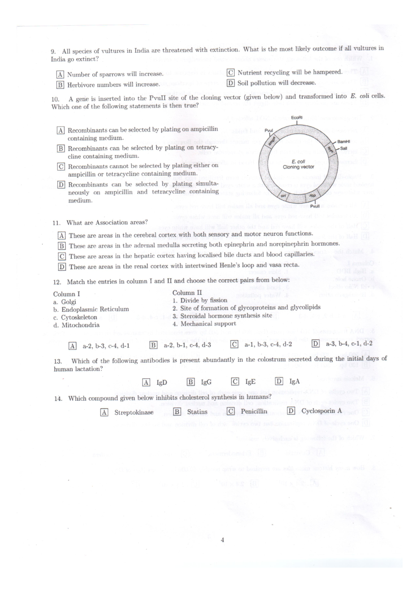
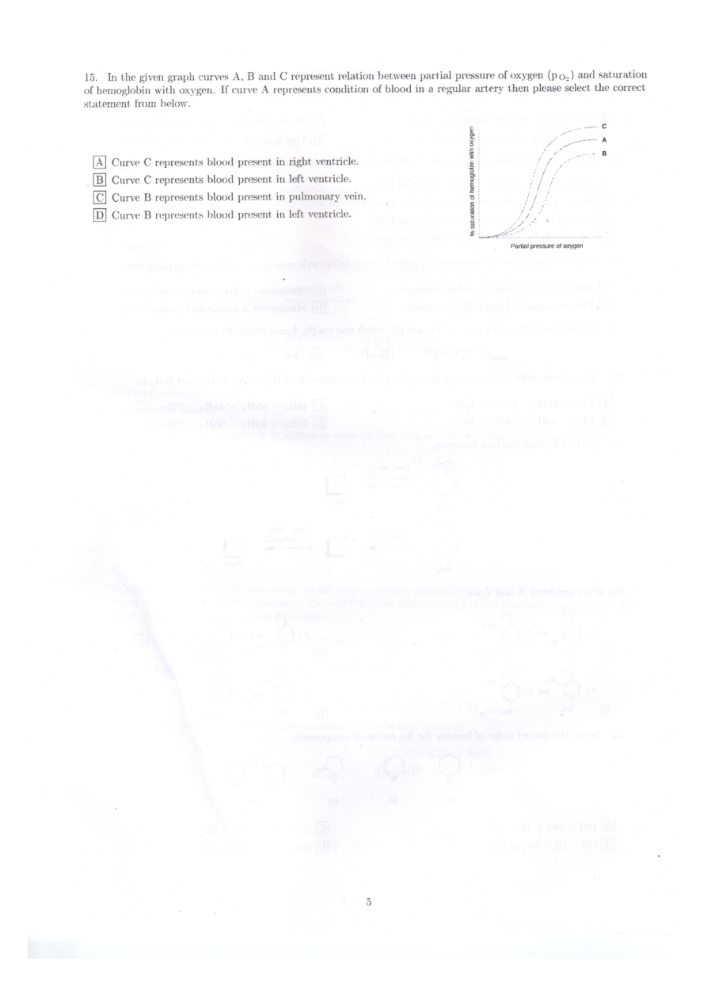
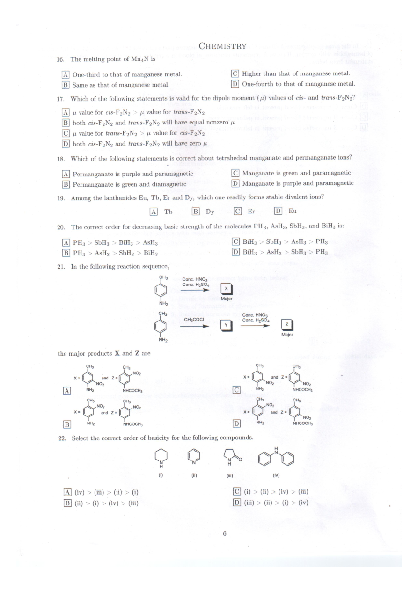
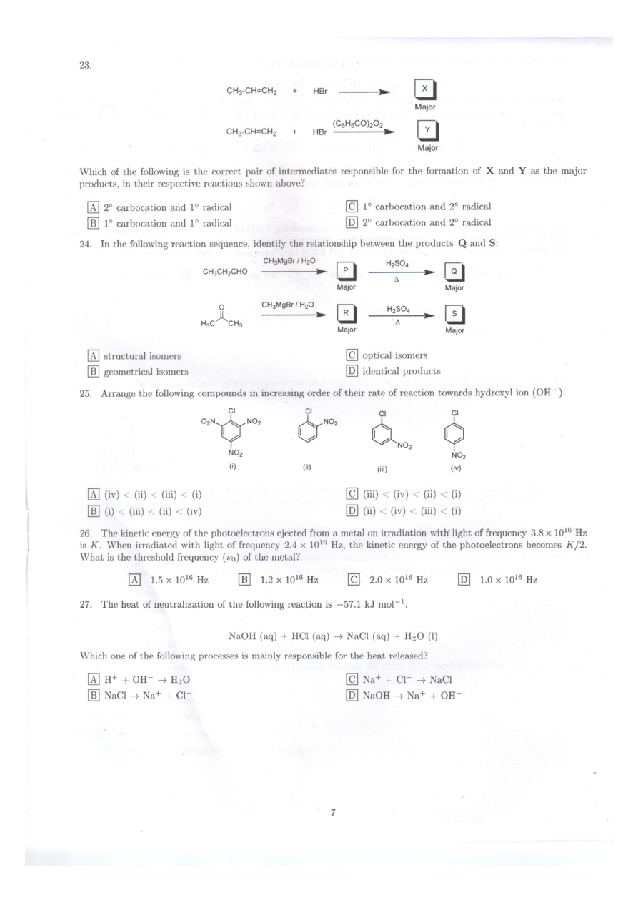
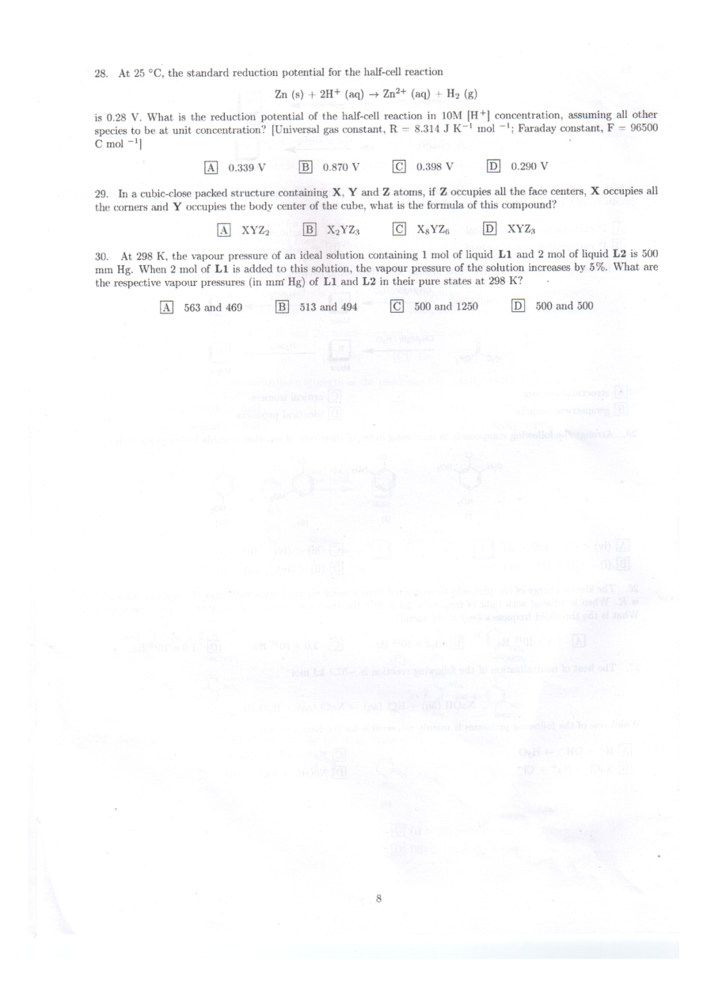
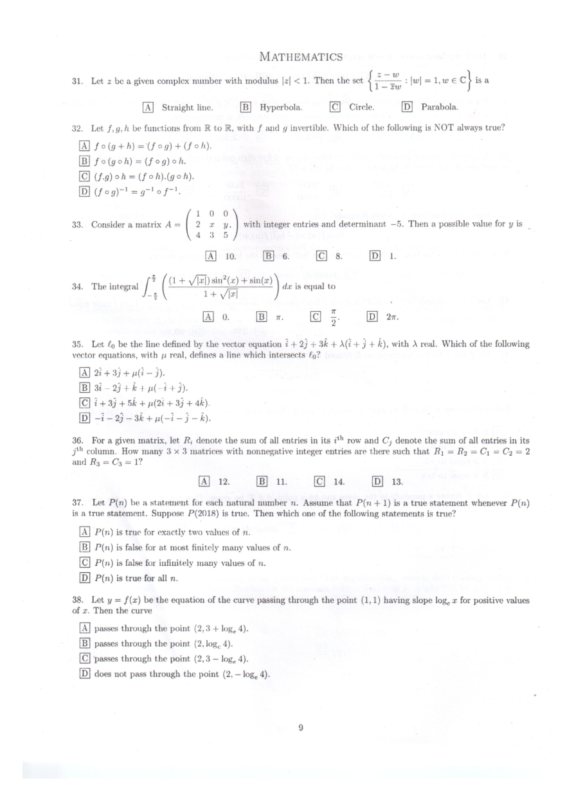
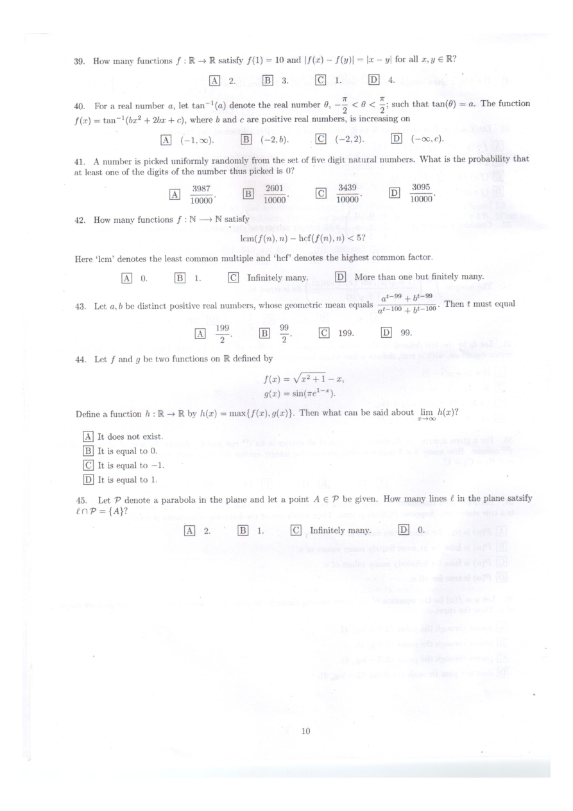
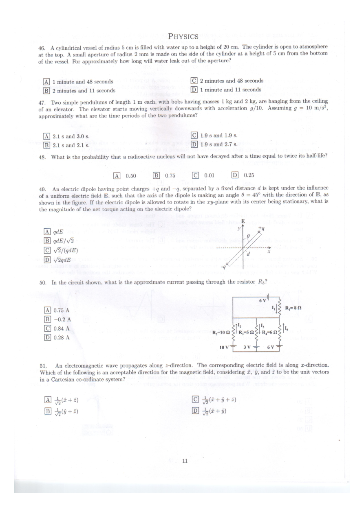
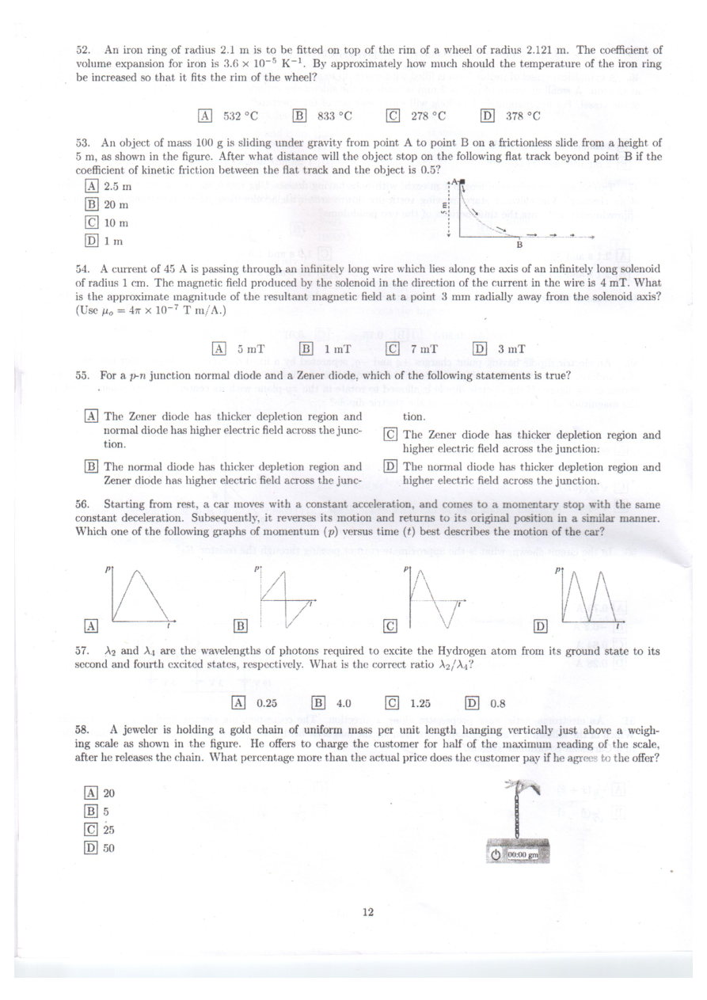
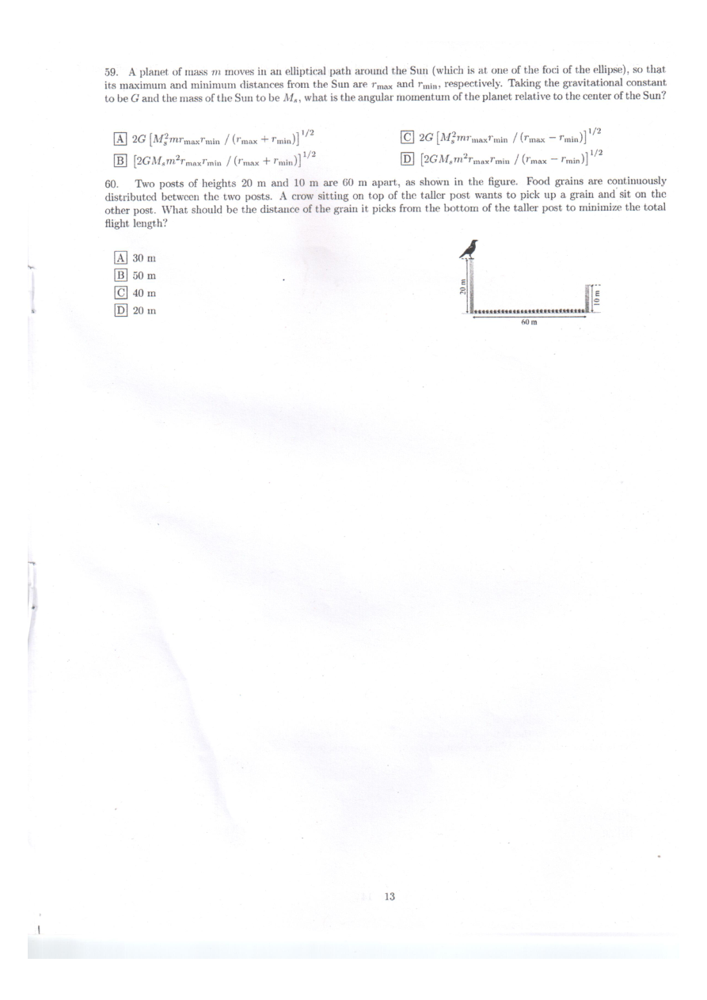

# IAT 2018 - English

Original PDF: [IAT_2018_English_paper.pdf](../pdf/IAT_2018_English_paper.pdf)

- Acquisition: SciAstra CloudFront mirror; not downloaded from the official server.
- Downloaded: 28 October 2026. PDF pages: 11.
- Exact download/source URL: https://d2aaa7ts7sm3bp.cloudfront.net/pdfs/01KMFRJYJSPWYKC4YZMYPS951M.pdf
- PDF SHA-256: `35bf3a24b7b131da1ad0d3c96f2aefe9d28496c39fdfd71c1f3de5f0686b9f81`
- This is a search/accessibility copy of an existing paper, not newly authored mock content.
- Text is mechanically extracted or OCR-derived and has not been proofread character by character. Equations, option letters, chemical bonds, tables and Hindi OCR can contain errors. The PDF and page images are authoritative.
- Figure descriptions are explanatory annotations, not official answers or complete structural/formula transcriptions. Use the linked image to resolve exact labels, values and stereochemistry.

## Visual guide

- [English PDF page 1](#pdf-page-1): Biology Q4 presents a matching list of blood components and associated properties. This is a scanned page; OCR can lose option letters and column alignment, so the original table remains available below.
- [English PDF page 2](#pdf-page-2): Biology Q10: a circular E. coli cloning-vector map marks the origin, antibiotic-resistance regions and restriction sites, including BamHI. The insert position relative to the selectable markers is part of the problem. Q12 is a second matching table, linking cell types with secretions or functions.
- [English PDF page 3](#pdf-page-3): Biology Q15: three oxygen-dissociation curves A, B and C rise sigmoidally and reach different plateaus. The horizontal axis is oxygen partial pressure and the vertical axis is percentage haemoglobin saturation; compare both curve position and maximum saturation.
- [English PDF page 4](#pdf-page-4): Chemistry Q21 shows two aromatic-amine reaction routes, intermediate boxes and drawn product pairs X and Z. Q22 displays four nitrogen-containing ring compounds with their bonding and lone-pair environments implied by the skeletal structures. Exact bond orders and substitution patterns are retained in the source image.
- [English PDF page 5](#pdf-page-5): Chemistry Q23 contrasts two reaction routes from ethanol, one involving HBr and one an oxidising reagent, with intermediates X and Y. Q24 compares two routes through labelled intermediates to final organic products. Q25 shows substituted aromatic compounds to be compared for hydroxide-ion reactivity; nitro-group positions differ.
- [English PDF page 9](#pdf-page-9): Physics Q49: an electric dipole is shown at angle theta in a uniform vertical electric field. Q50: a branched resistor network is driven by a 6 V source; read the individual resistance labels and the indicated branch rather than collapsing the drawing into a single resistor.
- [English PDF page 10](#pdf-page-10): Physics Q53 draws a descending track from A to a horizontal launch point B. Q56 presents four alternative position-time histories for an elastically bouncing ball, with changes at collisions. Q58 shows a person's eye a distance above a plane mirror and an upright wall, fixing the geometry for the visible wall height.
- [English PDF page 11](#pdf-page-11): Physics Q60: two vertical posts of unequal height stand on level ground, with a wire tied between their tops. A crow is initially on the taller post. The labelled heights and the horizontal separation define the light-travel/relative-position geometry; consult the image for exact dimensions.

## Page index

[p1](#pdf-page-1) | [p2](#pdf-page-2) | [p3](#pdf-page-3) | [p4](#pdf-page-4) | [p5](#pdf-page-5) | [p6](#pdf-page-6) | [p7](#pdf-page-7) | [p8](#pdf-page-8) | [p9](#pdf-page-9) | [p10](#pdf-page-10) | [p11](#pdf-page-11)

## PDF page 1

[Open original PDF at page 1](../pdf/IAT_2018_English_paper.pdf#page=1)

### Visual description

Biology Q4 presents a matching list of blood components and associated properties. This is a scanned page; OCR can lose option letters and column alignment, so the original table remains available below.

### Searchable text - OCR draft (eng)

```text
BIOLOGY

1. Which one of the following statements about second messengers is correct?

These are secondary metabolites produced by plants in response to an infection.

These are molecules generated during secondary steps of hormone signaling.

These are signaling molecules generated during secondary infections in animals.

Se CIIES

These are proteins which help digest the secondary metabolites from plants.

2. The glomerular filtration rate is NOT affected by

increased dietary uptake of water and fluids.

total volume of the blood flowing per minute through the Bowman’s capsule. x

increased Renin production from Juxta glomerular cells.

OQ] [Oo] fe!

increased supply of nutrients to the blood in afferent arteriole.

3. Haplo-diploid insects have diploid females from fertilized eggs but haploid males from unfertilized ones. Such a
haploid male with red eyes is crossed with a white eyed female. Assuming that the red-eye colour mutation is dominant
over white-eye colour, which one of the following statements is true?

All females will have white eyes and all males will have red eyes.

All females will have red eyes and all males will have white eyes.

A

B

C] Half of the males will have red and the other half will have white eyes.
D] Half of the females will have red and the other half will have white eyes.

4. Match the entries in column I and II and choose the correct pairs from the choices below.

Column T Column IT
a. High BOD 1. Skin cancer
b. Ozone hole 2. Greenhouse gas
c. El Nifio effect 3. Food chain
d. Biomagnification 4, Water pollution
A] a-1, b-2, c-4, d-3 B] a-2, b-3, c-1, d-4 C} a-3, b-1, c-4, d-3 D| a-4, b-1, c-2, d-3

5. DNA fragments of 100 base pairs (bp), 300 bp and 500 bp were separated by agarose gel electrophoresis. Pick the
correct arrangement of the fragments separated on the gel in the increasing order of their migration from the wells.

A] 500 bp < 300 bp < 100 bp CE] 100 bp > 300 bp > 500 bp
B] 100 bp < 300 bp < 500 bp D] 500 bp > 300 bp > 100 bp

6. Meiosis involves:

Two cycles of DNA replication but one cycle each of cell division and nuclear division.

Two cycles each of DNA replication, cell division and nuclear division.

A

B

C] One cycle each of DNA replication, cell division and nuclear division.

D] One cycle of DNA replication but two cycles each of cell division and nuclear division.

7. Which of the following is exclusively marine?

[A] Cnidaria B} Echinodermata C} Annelida D) Porifera

8. How many histone molecules are required to wrap roughly 60,000 base pairs (bp) of DNA?

A] 2.4x 10! B] 2.4 x 10% C] 2.4 x 10? D] 2.4x 104
```

### Original page image


## PDF page 2

[Open original PDF at page 2](../pdf/IAT_2018_English_paper.pdf#page=2)

### Visual description

Biology Q10: a circular E. coli cloning-vector map marks the origin, antibiotic-resistance regions and restriction sites, including BamHI. The insert position relative to the selectable markers is part of the problem. Q12 is a second matching table, linking cell types with secretions or functions.

### Searchable text - OCR draft (eng)

```text
9. All species of vultures in India are threatened with extinction. What is the most likely outcome if all vultures in
India go extinct?

A] Number of sparrows will increase. CG] Nutrient recycling will be hampered.

B| Herbivore numbers will increase. D| Soil pollution will decrease.

10. A gene is inserted into the Pvull site of the cloning vector (given below) and transformed into E. coli cells.
Which one of the following statements is then true?

A] Recombinants can be selected by plating on ampicillin
containing medium.

B] Recombinants can be selected by plating on tetracy-
cline containing medium.

CG] Recombinants cannot be selected by plating either on
ampicillin or tetracycline containing medium.

D] Recombinants can be selected by plating simulta-
neously on ampicillin and tetracycline containing
medium.

11. What are Association areas?

These are areas in the cerebral cortex with both sensory and motor neuron functions.

These are areas in the adrenal medulla secreting both epinephrin and norepinephrin hormones.

27>F [LB] =

These are areas in the hepatic cortex having localised bile ducts and blood capillaries.

[=]

These are areas in the renal cortex with intertwined Henle’s loop and vasa recta.

12. Match the entries in column I and II and choose the correct pairs from below:

Column I Column IIT
a. Golgi 1. Divide by fission
b. Endoplasmic Reticulum 2. Site of formation of glycoproteins and glycolipids
c. Cytoskeleton 3. Steroidal hormone synthesis site
d. Mitochondria 4. Mechanical support
A] a-2, b-3, c-4, d-1 B] a-2, b-1, c-4, d-3 C] arl, b-3, c-4, d-2 D] a-3, b-4, c-1, d-2

13. Which of the following antibodies is present abundantly in the colostrum secreted during the initial days of
human lactation?

A} IgD B) IgG C) IgE D} IgA

14. Which compound given below inhibits cholesterol synthesis in humans?

A] Streptokinase B} Statins C} Penicillin D} Cyclosporin A
```

### Original page image



## PDF page 3

[Open original PDF at page 3](../pdf/IAT_2018_English_paper.pdf#page=3)

### Visual description

Biology Q15: three oxygen-dissociation curves A, B and C rise sigmoidally and reach different plateaus. The horizontal axis is oxygen partial pressure and the vertical axis is percentage haemoglobin saturation; compare both curve position and maximum saturation.

### Searchable text - OCR draft (eng)

```text
15. In the given graph curves A, B and C represent relation between partial pressure of oxygen (po,) and saturation
of hemoglobin with oxygen. If curve A represents condition of blood in a regular artery then please select the correct
statement. from below.

Curve € represents blood present in right ventricle.

Curve C represents blood present in left ventricle.

Curve B represents blood present in pulmonary vein.

BY] IQ] [OO]

Curve B represents blood present in left ventricle.

‘% saturation of hemoglobin with oxygen

or
```

### Original page image



## PDF page 4

[Open original PDF at page 4](../pdf/IAT_2018_English_paper.pdf#page=4)

### Visual description

Chemistry Q21 shows two aromatic-amine reaction routes, intermediate boxes and drawn product pairs X and Z. Q22 displays four nitrogen-containing ring compounds with their bonding and lone-pair environments implied by the skeletal structures. Exact bond orders and substitution patterns are retained in the source image.

### Searchable text - OCR draft (eng)

```text
CHEMISTRY

16. The melting point of Mn4N is

A] One-third to that of manganese metal.

B] Same as that of manganese metal.

A] ps value for cis-F2N2 » je value for trans-F2N2

[es]

(e)

y. value for trans-F2N2 > py value for cis-F2N2

[=]

both cis-F2Nz and trans-F2N2 will have zero pt

A| Permanganate is purple and paramagnetic

B] Permanganate is green and diamagnetic

Cc
D

both cis-FygNg and trans-F2N2 will have equal nonzero’ jz

Cc
D

Higher than that of manganese metal.

One-fourth to that of manganese metal.

17. Which of the following statements is valid for the dipole moment (;1) values of cis- and trans-F2N2?

18. Which of the following statements is correct about tetrahedral manganate and permanganate ions?

Manganate is green and paramagnetic
Manganate is purple and paramagnetic

19. Among the lanthanides Eu, Tb, Er and Dy, which one readily forms stable divalent ions?

A| Tb B| Dy

Cc

Er D} Eu

20. The correct, order for decreasing basic strength of the molecules PH, AsH3, SbH3, and BiHs is:

A] PH, > SbHy > BiH > AsHy
B] PH, > AsHy > SbHy > BiHy

21. In the following reaction sequence,

a) Conc. HNOs
Conc. H2SO,
—>
NH,
CH3
CHcocl
—_>
NH2

the major products X and Z are

Qo

A NHCOCH3
CH CHy
NOz NO2
X= and Z=
B NH2 NHCOCH3

BiH; > SbH3 > AsHy > PHg
BiH; > AsHy > SbH3 > PH3

a
Major
Conc. HNO3
Conc. H2SO4
vt. z )
Major
CHs CH3
X= and Z= *
NOz NO2
Cc NH, NHCOCH;
Hs CH
NO
xe and Z=
NO
D NH2 NHCOCH3

22. Select the correct order of basicity for the following compounds.

2 & & oo

10) (i)

Al (iv) > (iii) > (ii) > @)
(ii) > (i) > (iv) > (iii)

es]

i

e)

(i) > (ii) > Gv) > (ii)
(iii) > (ii) > @ > (iv)
```

### Original page image



## PDF page 5

[Open original PDF at page 5](../pdf/IAT_2018_English_paper.pdf#page=5)

### Visual description

Chemistry Q23 contrasts two reaction routes from ethanol, one involving HBr and one an oxidising reagent, with intermediates X and Y. Q24 compares two routes through labelled intermediates to final organic products. Q25 shows substituted aromatic compounds to be compared for hydroxide-ion reactivity; nitro-group positions differ.

### Searchable text - OCR draft (eng)

```text
23.

CH3-CH=CH2 + HBr ————p= x]

Major

(CeHsCO)20.
CH3-CH=CH, + HBr —

Major

Which of the following is the correct pair of intermediates responsible for the formation of X and Y as the major
products, in their respective reactions shown above?

A| 2° carbocation and 1° radical C} 1° carbocation and 2° radical

B} 1° carbocation and 1° radical D] 2° carbocation and 2° radical

24. In the following reaction sequence, identify the relationship between the products Q and S:

CHgMgBr / HO. —s HpSO,
CH3CH CHO a } =» |a }
A
Major Major
° CH3MgBr / H20
R — (a HySOq [ 3 }
H3C~ CH: A
a . Major Major
A] structural isomers C} optical isomers
B} geometrical isomers D} identical products

25. Arrange the following compounds in increasing order of their rate of reaction towards hydroxyl ion (OH ~).
cl cl
oy ‘om
NO
i)

(i (ii)

A

(i) < Gi) < (i) < (iv)

26. The kinetic energy of the photoelectrons ejected from a metal on irradiation with light of frequency 3.8 x 10!° Hz
is K. When irradiated with light of frequency 2.4 x 10'° Hz, the kinetic energy of the photoelectrons becomes K/2.

What is the threshold frequency (vo) of the metal?

A] 1.5 x 10'° Hz B] 1.2 x 10!° Hz C] 2.0 x 10!° Hz D] 1.0 x 10'° Hz

27. The heat of neutralization of the following reaction is —57.1 kJ mol?.

NaOH (aq) + HCl (aq) -» NaCl (aq) + H2O (1)

Which one of the following processes is mainly responsible for the heat released?

A] H* + OH- > H20 C} Nat + Cl” > NaCl
B] NaCl -+ Nat + Cl- D| NaOH -+ Nat + OH-
```

### Original page image



## PDF page 6

[Open original PDF at page 6](../pdf/IAT_2018_English_paper.pdf#page=6)

### Searchable text - OCR draft (eng)

```text
28. At 25 °C, the standard reduction potential for the half-cell reaction
Zn (s) + 2H+ (aq) - Zn? (aq) + He (g)

is 0.28 V. What is the reduction potential of the half-cell reaction in 10M [H+] concentration, assuming all other
species to be at unit concentration? [Universal gas constant, R = 8.314 J K~! mol ~!; Faraday constant, F = 96500
C mol ~}] ,

A] 0.339 V B] 0.870 V C} 0.398 V D} 0.290 V

29. In acubic-close packed structure containing X, Y and Z atoms, if Z occupies all the face centers, X occupies all
the corners and Y occupies the body center of the cube, what is the formula of this compound?

A] XYZ» B] X2YZ3 Cl] XsYZo D) XYZs

30. At 298 K, the vapour pressure of an ideal solution containing 1 mol of liquid L1 and 2 mol of liquid L2 is 500
mm Hg. When 2 mol of L1 is added to this solution, the vapour pressure of the solution increases by 5%. What are
the respective vapour pressures (in mnt Hg) of L1 and L2 in their pure states at 298 K?

A} 563 and 469 B} 513 and 494 C} 500 and 1250 D} 500 and 500
```

### Original page image



## PDF page 7

[Open original PDF at page 7](../pdf/IAT_2018_English_paper.pdf#page=7)

### Searchable text - OCR draft (eng)

```text
MATHEMATICS

tow

31. Let z be a given complex number with modulus |z| < 1. Then the sct { i

: wl=1wee} isa

A] Straight line. B| Hyperbola. C} Circle. D|  Parabola.

32. Let f,g,h be functions from R to R, with f and g invertible. Which of the following is NOT always true?

AJ fo(g +h) =(fog) + (foh).
B) fo(goh) =(fog)oh.
C] (f.g) oh =(foh).(gonh).
D] (fog)"t=g"' of".
100
33. Consider a matrix A= | 2 x y. | with integer entries and determinant —5. Then a possible value for y is _
43 5
A} 10. B} 6. C} 8. Dyiate

$ Fs ee) j
34. The integral [. (2a eeu) diz is equal to
-5 1+ Viz]

A} 0. B] z. Cc

Dj] 2z.

Nia

35. Let: £o be the line defined by the vector equation i + 2j + 3k + \(i+ j +k), with d real. Which of the following
vector equations, with j: real, defines a line which intersects 9?

A] 21+ 37+ p(i— J).

B] 38-23 +k + u(-1 +39).

C] 1439 + 5k + pu(2i + 37 + 4k).
D] -i - 23 - 3k + w(-i -j - &).

36. For a given matrix, let R; denote the sum of all entries in its i” row and Cj denote the sum of all entries in its
j™ column. How many 3 x 3 matrices with nonnegative integer entries are there such that R,; = Ry = C, = C2 = 2
and R3 = C3 = 1?

Aj 12. B} 11. C} 14. D} 13.

37. Let P(n) be a statement for each natural number n. Assume that P(n + 1) is a true statement whenever P(n)
is a true statement. Suppose P(2018) is true. Then which one of the following statements is true?

A} P(n) is true for exactly two values of n.

P(n) is false for at most finitely many values of n.

B
C} P(n) is false for infinitely many values of n.
D] P(n) is true for all n.

Let y = f(x) be the equation of the curve passing through the point (1,1) having slope log, « for positive values
Then the curve

4

S] [A] [=] FE] 8°

passes through the point (2,3 + log, 4).

passes through the point (2, log, 4).

‘passes through the point (2,3 — log, 4).

does not pass through the point (2, —log, 4).
```

### Original page image



## PDF page 8

[Open original PDF at page 8](../pdf/IAT_2018_English_paper.pdf#page=8)

### Searchable text - OCR draft (eng)

```text
39. How many functions f :R > R satisfy f(1) = 10 and |f(x) — f(y)| = |x — y| for all x,y € R?

AJ 2. B) 3. Cc} 1. Di 4.

40. For a real number a, let tan~!(a) denote the real number 0, -5 <0< z such that tan(@) = a. The function

f(a) = tan7!(ba? + 2bx +c), where b and ¢ are positive real numbers, is increasing on

A] (-1,0). B] (—2,6). (ola) D] (—o0,¢).

41. A number is picked uniformly randomly from the set: of five digit natural numbers. What is the probability that
at least. one of the digits of the number thus picked is 0?
3987 2601 3439 3095

A 10000° B 10000° c 10000° D 10000"

42. How many functions f : N — N satisfy
lem(f(n), n) — hef(f(n),n) < 5?

Here ‘lem’ denotes the least common multiple and ‘hef’ denotes the highest common factor.

AJ 0. B] 1. C| Infinitely many. D| More than one but finitely many.

at-99 ae bf-99

qt—100 4 he 100°

43. Let a,b be distinct positive real numbers, whose geometric mean equals Then ¢ must equal

199 99
3 B 3 C} 199 D} 99.

44. Let f and g be two functions on R defined by
f(z) =V¥27+1—2,
g(x) = sin(ze!~*).

Define a function h : R + R by h(x) = max{ f(x), 9(x)}. Then what can be said about lim h(x)?

200

A] It does not exist.

B} It is equal to 0.
C} It is equal to —1.

D| It is equal to 1.

45. Let P denote a parabola in the plane and let a point A € P be given. How many lines ¢ in the plane satsify
enP={A}y?

A} 2. Blok C} Infinitely many. D} 0.

10
```

### Original page image



## PDF page 9

[Open original PDF at page 9](../pdf/IAT_2018_English_paper.pdf#page=9)

### Visual description

Physics Q49: an electric dipole is shown at angle theta in a uniform vertical electric field. Q50: a branched resistor network is driven by a 6 V source; read the individual resistance labels and the indicated branch rather than collapsing the drawing into a single resistor.

### Searchable text - OCR draft (eng)

```text
PHYSICS

46. A cylindrical vessel of radius 5 cm is filled with water up to a height of 20 cm. The cylinder is open to atmosphere
at the top. A small aperture of radius 2 mm is made on the side of the cylinder at a height of 5 cm from the bottom
of the vessel. For approximately how long will water leak out of the aperture?

A] 1 minute and 48 seconds C} 2 minutes and 48 seconds

B] 2 minutes and 11 seconds D] 1 minute and 11 seconds

47. Two simple pendulums of length 1 m each, with bobs having masses 1 kg and 2 kg, are hanging from the ceiling
of an elevator. The clevator starts moving vertically downwards with acceleration g/10. Assuming g = 10 m/s”,
approximately what are the time periods of the two pendulums?

Aj 2.1s and 3.0 s. C} 1.9 and 1.9 s.
B] 2.1 s and 2.1 s. Z D| 1.9 s and 2.7 s.

48. What is the probability that a radioactive nucleus will not have decayed after a time equal to twice its half-life?

Al 0.50 B] 0.75 C} 0.01 DI 0.25

49. An electric dipole having point charges +q and ~q, separated by a fixed distance d is kept under the influence
of a uniform electric field E, such that the axis of the dipole is making an angle @ = 45° with the direction of B, as
shown in the figure. If the electric dipole is allowed to rotate in the ry-plane with its center being stationary, what is
the magnitude of the net torque acting on the electric dipole?

qdE

qd E//2
v2/(qdE)
V2qdE

QD] [oe] |

[=]

0.75 A
-0.2A
0.84 A
0.28 A

elite

[=

51. An electromagnetic wave propagates along z-direction. The corresponding electric field is along z-direction.
Which of the following is an acceptable direction for the magnetic field, considering #, y, and 2 to be the unit vectors
in a Cartesian co-ordinate system?

(€+9+2)

a

BS
+ +
&
a

Sk Sk

(@+9)

au
io)
Se

i
```

### Original page image



## PDF page 10

[Open original PDF at page 10](../pdf/IAT_2018_English_paper.pdf#page=10)

### Visual description

Physics Q53 draws a descending track from A to a horizontal launch point B. Q56 presents four alternative position-time histories for an elastically bouncing ball, with changes at collisions. Q58 shows a person's eye a distance above a plane mirror and an upright wall, fixing the geometry for the visible wall height.

### Searchable text - OCR draft (eng)

```text
52. An iron ring of radius 2.1 m is to be fitted on top of the rim of a wheel of radius 2.121 m. The coefficient of
volume expansion for iron is 3.6 x 10-5 K~}. By approximately how much should the temperature of the iron ring
be increased so that it fits the rim of the wheel?

A] 532°C B] 833°C C} 278°C D} 378°C

53. An object of mass 100 g is sliding under gravity from point A to point B on a frictionless slide from a height of
5 m, as shown in the figure. After what distance will the object stop on the following flat track beyond point B if the
coefficient of kinetic friction between the flat track and the object is 0.5?

Aj 2.5m
B} 20m
C} 10m
D

lm

54. A current of 45 A is passing through an infinitely long wire which lies along the axis of an infinitely long solenoid
of radius 1 cm. The magnetic field produced by the solenoid in the direction of the current in the wire is 4 mT. What

is the approximate magnitude of the resultant magnetic field at a point 3 mm radially away from the solenoid axis?
(Use po = 4a x 1077 T m/A.)

A} SmT B] 1mT el? mT D} 3mT

55. For a p-n junction normal diode and a Zener diode, which of the following statements is true?

A] The Zener diode has thicker depletion region and tion.
normal diode has higher electric field across the junc- CG] The Zener diode has thicker depletion region and
tion. higher electric field across the junction:

B} The normal diode has thicker depletion region and D} The normal diode has thicker depletion region and
Zener diode has higher electric field across the junc- higher electric field across the junction.

56. Starting from rest, a car moves with a constant acceleration, and comes to a momentary stop with the same
constant deceleration. Subsequently, it reverses its motion and returns to its original position in a similar manner.
Which one of the following graphs of momentum (p) versus time (t) best describes the motion of the car?

WV

D T

/

=

)
|
[A] t B Y

57. Ag and A, are the wavelengths of photons required to excite the Hydrogen atom from its ground state to its
second and fourth excited states, respectively. What is the correct ratio A2/A4?

P rt

Cc

0.25 B] 4.0 C) 1.25 D] 08

58. A jeweler is holding a gold chain of uniform mass per unit length hanging vertically just above a weigh-
ing scale as shown in the figure. He offers to charge the customer for half of the maximum reading of the scale,
after he releases the chain. What percentage more than the actual price does the customer pay if he agrees to the offer?

20
5

25
50

Dy [QQ] [oo]

12
```

### Original page image



## PDF page 11

[Open original PDF at page 11](../pdf/IAT_2018_English_paper.pdf#page=11)

### Visual description

Physics Q60: two vertical posts of unequal height stand on level ground, with a wire tied between their tops. A crow is initially on the taller post. The labelled heights and the horizontal separation define the light-travel/relative-position geometry; consult the image for exact dimensions.

### Searchable text - OCR draft (eng)

```text
59. A planet of mass m moves in an elliptical path around the Sun (which is at one of the foci of the ellipse), so that
its maximum and minimum distances from the Sun are rmax and Tin, respectively. Taking the gravitational constant
to be G and the mass of the Sun to be M,, what is the angular momentum of the planet relative to the center of the Sun?

“9 2
A] 2G [M2mrmaxrmin / (max + Tmin)} ” C] 26 [M2 mrinaxtnin / (Minax — Pinin))
2 P "
B] [2GMym?rimaxtmin / (max + Tmin)) D] (2GM,m2rinaxtmin / (Tmax — Pmnin)]

60. Two posts of heights 20 m and 10 m are 60 m apart, as shown in the figure. Food grains are continuously
distributed between the two posts. A crow sitting on top of the taller post wants to pick up a grain and sit on the
other post. What should be the distance of the grain it picks from the bottom of the taller post to minimize the total

flight length?

30 m A

A

B| 50m : |

C} 40 m aI z
D} 20m 2 pa |:

60m

13
```

### Original page image


