# IAT 2019 - English

Original PDF: [IAT_2019_English_paper.pdf](../pdf/IAT_2019_English_paper.pdf)

- Acquisition: SciAstra CloudFront mirror; not downloaded from the official server.
- Downloaded: 28 October 2026. PDF pages: 16.
- Exact download/source URL: https://d2aaa7ts7sm3bp.cloudfront.net/pdfs/01KMFRHM16CP3ZRQ5BW0GRAYBQ.pdf
- PDF SHA-256: `e81dff563290061cfac6c7e934e982e19044f155562d96c554278a4798465fc8`
- This is a search/accessibility copy of an existing paper, not newly authored mock content.
- Text is mechanically extracted or OCR-derived and has not been proofread character by character. Equations, option letters, chemical bonds, tables and Hindi OCR can contain errors. The PDF and page images are authoritative.
- Figure descriptions are explanatory annotations, not official answers or complete structural/formula transcriptions. Use the linked image to resolve exact labels, values and stereochemistry.

## Visual guide

- [English PDF page 2](#pdf-page-2): Biology Q8: a typical ECG trace is labelled P, Q, R, S and T. The P wave precedes the tall QRS complex, followed by the broader T wave; the question changes AV-node function.
- [English PDF page 3](#pdf-page-3): Biology Q10: a multigeneration pedigree uses squares for males, circles for females, and shading for affected individuals. Q12 presents three candidate body-size frequency distributions, each contrasting an ancestral dashed curve with a later solid curve; the fourth alternative continues on the next page.
- [English PDF page 4](#pdf-page-4): Continuation of Biology Q12, option D: a body-size frequency plot shows two peaks in the later population, contrasted with the ancestral distribution. This option belongs to the question on the preceding page.
- [English PDF page 6](#pdf-page-6): Chemistry Q22 and Q23 contain aromatic starting structures, reagent-labelled arrows and four possible drawn products. The first route includes alcoholic KOH followed by NaNH2; the second starts from benzamide and compares differently brominated or rearranged products. Do not infer connectivity from OCR alone.
- [English PDF page 7](#pdf-page-7): Chemistry Q24 shows an aromatic diazonium salt reacting with ethanol on heating, with a benzene product and a missing coproduct X. Q25 compares four cyclic structures for aromaticity, including charged rings; the charge marks and double-bond positions are essential.
- [English PDF page 12](#pdf-page-12): Mathematics Q43: parallelogram ABCD contains a diagonal and two internal segments joining marked points E and F on opposite sides. Their intersections with the diagonal are X and Y. The given side-division ratios determine the requested segment length.
- [English PDF page 13](#pdf-page-13): Physics Q47: a cube is drawn in perspective, with charge Q at one vertex and a shaded square face ABCD. The selected face and the location of the charge determine the flux being requested.
- [English PDF page 14](#pdf-page-14): Physics Q50: two long straight wires lie along perpendicular axes, meeting near the origin. Their current directions and the labels A and B are shown, so forces or torques must be interpreted in three dimensions.
- [English PDF page 15](#pdf-page-15): Physics Q53: a block on a frictionless horizontal line is attached to left and right fixed walls by springs labelled k and 4k. Q55: a capacitor is the middle branch of a diamond-shaped circuit, with resistors and a source on its outer sides; branch topology matters.
- [English PDF page 16](#pdf-page-16): Physics Q60: an isosceles triangle has apex A and base vertices B and C carrying equal charges q. The base has length a, the full altitude is h, and an internal horizontal level is marked at height h/3 above the base.

## Page index

[p1](#pdf-page-1) | [p2](#pdf-page-2) | [p3](#pdf-page-3) | [p4](#pdf-page-4) | [p5](#pdf-page-5) | [p6](#pdf-page-6) | [p7](#pdf-page-7) | [p8](#pdf-page-8) | [p9](#pdf-page-9) | [p10](#pdf-page-10) | [p11](#pdf-page-11) | [p12](#pdf-page-12) | [p13](#pdf-page-13) | [p14](#pdf-page-14) | [p15](#pdf-page-15) | [p16](#pdf-page-16)

## PDF page 1

[Open original PDF at page 1](../pdf/IAT_2019_English_paper.pdf#page=1)

### Searchable text - PDF text layer

```text
IISER Aptitude Test 2019
  Biology


1. Which of the following produces a dikaryotic phase in Basidiomycetes?
        A. Karyogamy
        B. Plasmogamy
        C. Apogamy
        D. Karyokinesis
2. In the standard nomenclature used for depicting floral formula, which type of flower is represented
  by K(5)?
        A. Polysepalous
        B. Syncarpous
        C. Gamosepalous
        D. Gamopetalous
3. Which one of the following statements is TRUE?
        A. Blood is a connective tissue which does not secrete collagen
        B. Tendons are a type of dense, irregular connective tissue
        C. Adipose tissue is an example of a fluid connective tissue
        D. Saliva is secreted by an endocrine gland
4. Match the entries in column I and column II. Which one of the following choices is correct?
                           Column I  Column II
                                    (a) Haem   (1) Cofactor
                                   (b) NAD    (2) Vitamin
                                      (c) Zinc     (3) Coenzyme
                                   (d) Niacin  (4) Prosthetic group
        A. a-3, b-1, c-4, d-2
        B. a-4, b-3, c-1, d-2
        C. a-2, b-1, c-3, d-4
        D. a-4, b-1, c-3, d-2
5. Which one of the following helps in bacterial motility?
        A. Centrioles
        B. Fimbriae
        C. Microtubules
        D. Flagella


                                       Page 1
```

### Original page image

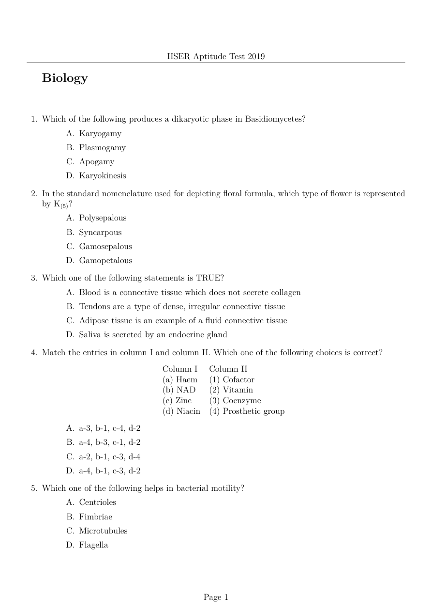

## PDF page 2

[Open original PDF at page 2](../pdf/IAT_2019_English_paper.pdf#page=2)

### Visual description

Biology Q8: a typical ECG trace is labelled P, Q, R, S and T. The P wave precedes the tall QRS complex, followed by the broader T wave; the question changes AV-node function.

### Searchable text - PDF text layer

```text
IISER Aptitude Test 2019

6. During light reaction in chloroplasts of tobacco plants, where is the proton gradient generated?
        A. Between stroma and intermembrane space of chloroplasts
        B. Between thylakoid lumen and intermembrane space of chloroplasts
        C. Between stroma and thylakoid lumen
        D. Between inner and outer chloroplast membranes
7. Which of the following will NOT be triggered by the release of acetyl choline in the synapse at the
   neuromuscular junction during muscle contraction?
        A. Generation of an action potential in the muscles
        B. Release of Ca2+ from the sarcoplasmic reticulum
        C. Binding of ATP molecules to the myosin head
        D. Shifting of tropomyosin to expose the myosin binding sites on actin filaments
8. The diagram below shows a typical ECG.


    If the AV node is not functional, which of the following options correctly represents the changes
   seen in the ECG?
        A. P wave will sustain longer with smaller amplitude
        B. The QRS complex will be absent
        C. The T wave will sustain longer with smaller amplitude
        D. The distance between the P wave and the QRS complex will be smaller
9. Listed below are different plant reproductive strategies.
    I. Parthenocarpy
    II. Syngamy
    III. Apomixis
   IV. Polyembryony
  Which of them can give rise to a clonal progeny having the same genotype as that of the mother
   plant?
        A. III and IV
        B. I and II
        C. II and III
        D. I and IV


                                       Page 2
```

### Original page image

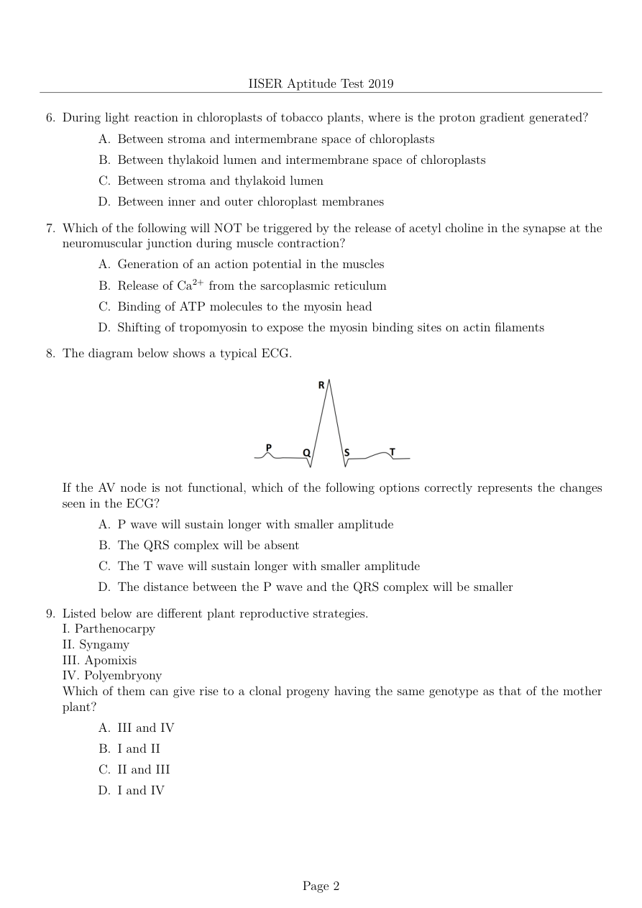

## PDF page 3

[Open original PDF at page 3](../pdf/IAT_2019_English_paper.pdf#page=3)

### Visual description

Biology Q10: a multigeneration pedigree uses squares for males, circles for females, and shading for affected individuals. Q12 presents three candidate body-size frequency distributions, each contrasting an ancestral dashed curve with a later solid curve; the fourth alternative continues on the next page.

### Searchable text - PDF text layer

```text
IISER Aptitude Test 2019

10. The diagram below represents the pedigree of a certain genetic disease (affected individuals are
    shaded). What is the mode of inheritance of the gene responsible for this disease?


         A. X-linked recessive
         B. Y-linked
         C. X-linked dominant
         D. Mitochondrial
11. An E. coli whose DNA is fully labeled by 15N is grown in a medium containing 14NH4Cl. What
     will be the percentage of hybrid (15N/14N) and light (14N/14N) DNA molecules at the end of 80
    minutes (assume that doubling time of E. coli is 20 minutes)?
         A. 25% hybrid and 75% light
         B. 50% hybrid and 50% light
         C. 0% hybrid and 100% light
         D. 12.5% hybrid and 87.5% light
12. The following plots represent the body size distributions of a fruit fly population. Dashed lines
    represent the ancestral distributions and continuous lines represent the distributions after a few
    generations.  If the larger individuals have better survival as well as higher reproductive rates,
    which diagram below best represents the expected change in the distribution of body size (X-axis
    represents body size while Y-axis represents frequency)?


         A.


         B.


         C.

                                        Page 3
```

### Original page image

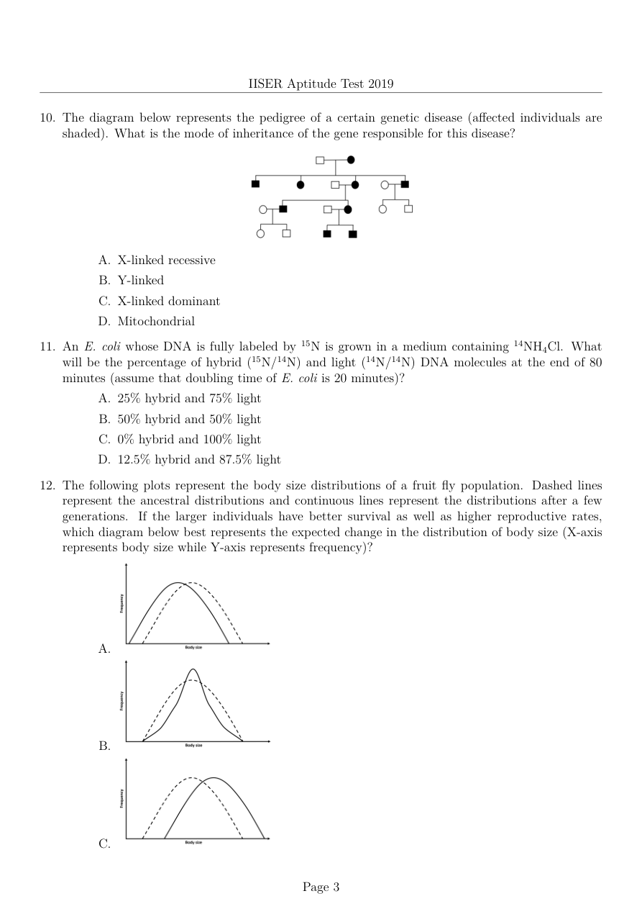

## PDF page 4

[Open original PDF at page 4](../pdf/IAT_2019_English_paper.pdf#page=4)

### Visual description

Continuation of Biology Q12, option D: a body-size frequency plot shows two peaks in the later population, contrasted with the ancestral distribution. This option belongs to the question on the preceding page.

### Searchable text - PDF text layer

```text
IISER Aptitude Test 2019


         D.
13. What are the types of immunity acquired by i) transfer of antibodies to the foetus via the placenta
   and ii) vaccination of an infant?
         A. Both are active immunity
         B. Both are passive immunity
         C. Active and passive immunity, respectively
         D. Passive and active immunity, respectively
14. Which among the following correctly represents the sequence of events for a normal polymerase
    chain reaction?
         A. Denaturation, annealing, extension
         B. Annealing, denaturation, extension
         C. Extension, annealing, denaturation
         D. Denaturation, extension, annealing
15. Loss of biodiversity occurs due to the growth of carrot grass (Parthenium sp.). This is an example
    of?
         A. Alien-species invasion
         B. Co-extinction
         C. Over-exploitation
         D. Habitat loss and fragmentation


                                        Page 4
```

### Original page image

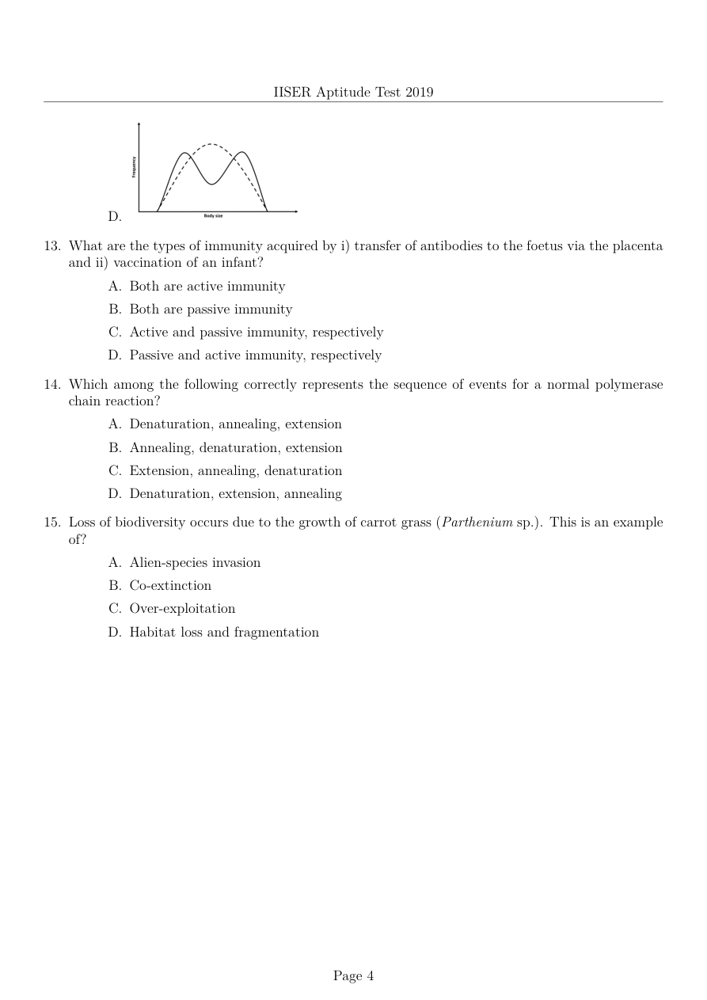

## PDF page 5

[Open original PDF at page 5](../pdf/IAT_2019_English_paper.pdf#page=5)

### Searchable text - PDF text layer

```text
IISER Aptitude Test 2019
  Chemistry


16. What are the correct orders of bond lengths dX−X and bond dissociation enthalpies BDEX−X for
    F2 and Cl2? (where X = F or Cl)

           <                         <         A. dF−F                      dCl−Cl and BDEF−F                                      BDECl−Cl
           >                         >         B. dF−F                      dCl−Cl and BDEF−F                                      BDECl−Cl
           <                         >         C. dF−F                      dCl−Cl and BDEF−F                                      BDECl−Cl
           >                         <         D. dF−F                      dCl−Cl and BDEF−F                                      BDECl−Cl
17. Which is the appropriate combination of spin configuration and colour for the anionic complex
    [Co(L)6]3−(L is a monodentate and monoanionic ligand)?
         A. high-spin and green
         B. low-spin and green
         C. low-spin and blue
         D. high-spin and yellow
18. Which of the following combination of elements forms interstitial hydrides?
         A. Na and Mg
         B. Yb and Ti
         C. Fe and Mn
         D. B and Al
19. How many geometrical isomers are possible for the square planar complex [Pd(py)(Cl)(Br)(NH3)]
    (py = pyridine)?
         A. 2
         B. 4
         C. 5
         D. 3
20. A molecular adduct is formed between BF3 and Et2O. Which of the following values describe the
    coordination number (CN), valency (V) and oxidation state (OS) of B atom in this adduct?
         A. CN = 4, V = 4 and OS = +3
         B. CN = 4, V = 3 and OS = +4
         C. CN = 4, V = 3 and OS = +3
         D. CN = 3, V = 3 and OS = +4


                                        Page 5
```

### Original page image

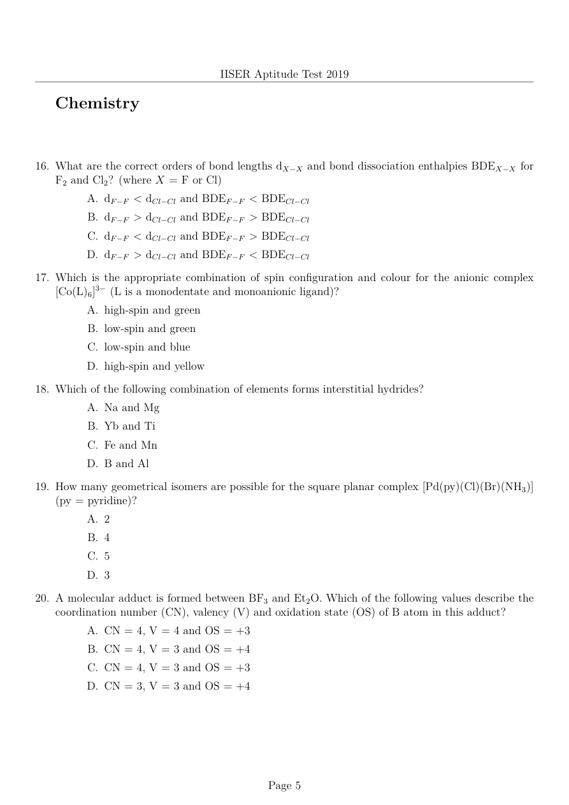

## PDF page 6

[Open original PDF at page 6](../pdf/IAT_2019_English_paper.pdf#page=6)

### Visual description

Chemistry Q22 and Q23 contain aromatic starting structures, reagent-labelled arrows and four possible drawn products. The first route includes alcoholic KOH followed by NaNH2; the second starts from benzamide and compares differently brominated or rearranged products. Do not infer connectivity from OCR alone.

### Searchable text - PDF text layer

```text
IISER Aptitude Test 2019

21. While making paneer (cottage cheese) from milk by adding dilute acetic acid, the milk proteins
    undergo
         A. solubilization
         B. degradation
         C. denaturation
         D. polymerization
22. What is the final major product of the following reaction?


         A.


         B.


         C.

         D.
23. Identify the final major product in the following reaction sequence.


         A.


         B.


         C.


         D.


                                        Page 6
```

### Original page image

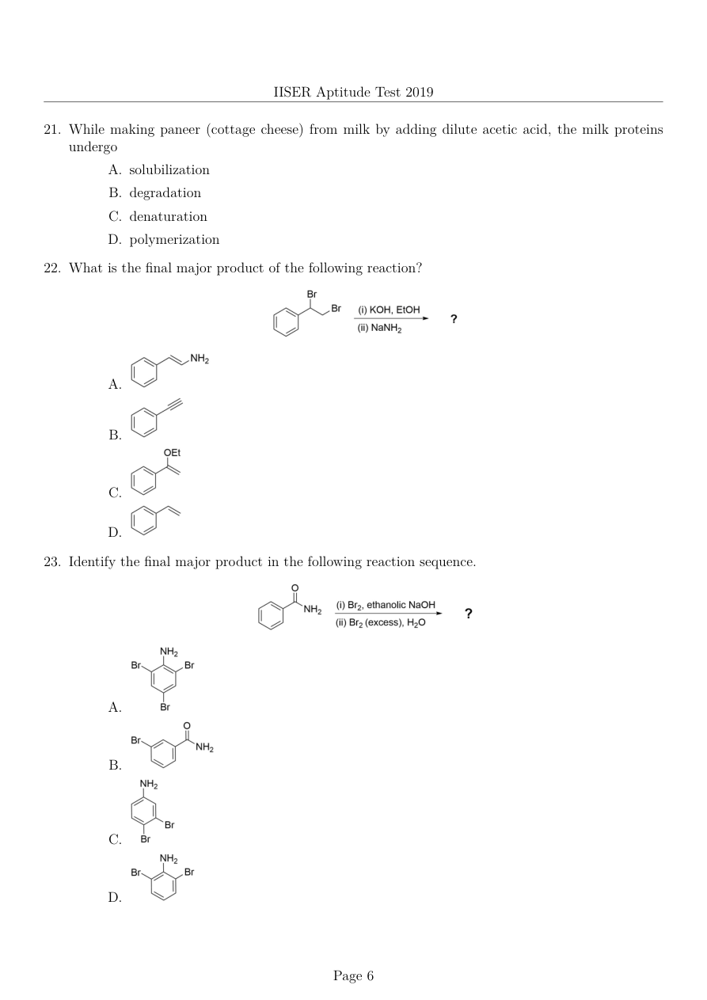

## PDF page 7

[Open original PDF at page 7](../pdf/IAT_2019_English_paper.pdf#page=7)

### Visual description

Chemistry Q24 shows an aromatic diazonium salt reacting with ethanol on heating, with a benzene product and a missing coproduct X. Q25 compares four cyclic structures for aromaticity, including charged rings; the charge marks and double-bond positions are essential.

### Searchable text - PDF text layer

```text
IISER Aptitude Test 2019

24. Identify the compound [X] in the following reaction.


         A. CH3COOH
         B. OHC-CHO
         C. CH3CH2OCH2CH2Cl
         D. CH3CHO
25. Which one among the following compounds is aromatic?


         A.


         B.


         C.

         D.
26. Using the Arrhenius equation, find out the value of k at T→∞?
         A. A
         B. -A
         C. eA
         D. e−A
27. Which one of the following is NOT an example of heterogeneous equilibrium?
         A. Equilibrium between water vapour and liquid water in a closed container
         B. Equilibrium attained during acid catalysed hydrolysis of ethyl acetate
         C. Equilibrium between solid Ca(OH)2 and its saturated solution
         D. Equilibrium attained on heating solid CaCO3 in a closed container
28. At 60 ◦C, 50% of N2O4 (g) is dissociated to NO2 (g). What is the standard Gibbs free energy
    change at 60 ◦C and 1 atm pressure for this process? (R = 8.314 JK−1mol−1)
         A. 763 Jmol−1
         B. -790 Jmol−1
         C. -863 Jmol−1
         D. 500 Jmol−1


                                        Page 7
```

### Original page image

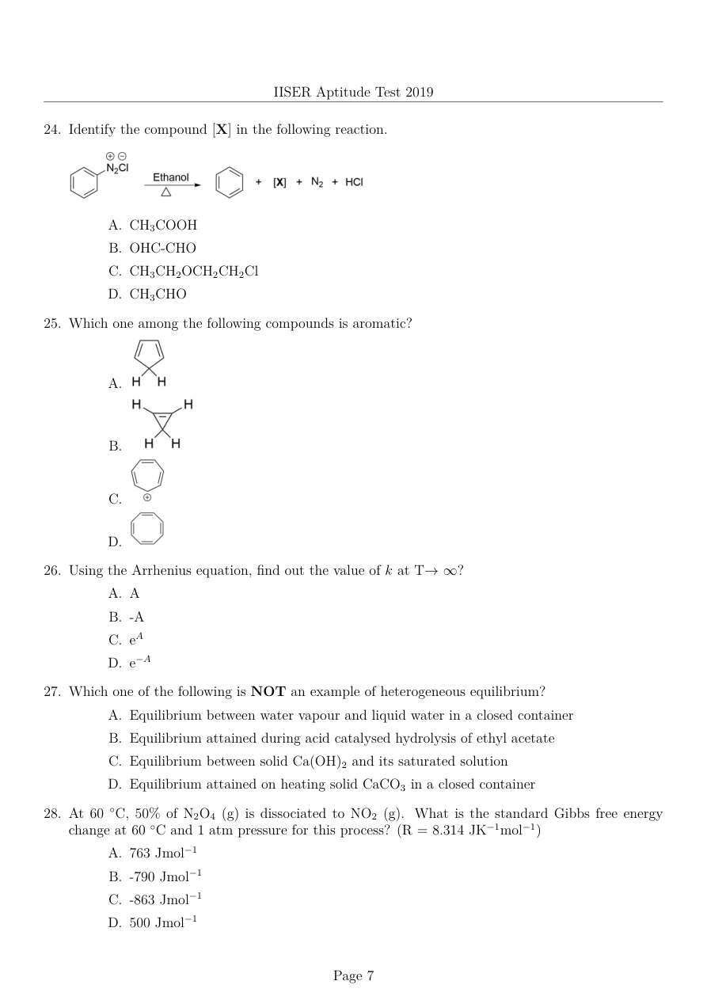

## PDF page 8

[Open original PDF at page 8](../pdf/IAT_2019_English_paper.pdf#page=8)

### Searchable text - PDF text layer

```text
IISER Aptitude Test 2019

29. For a cell Ag|Ag+,Cl−|AgCl(s)|Ag, E◦Red for the half cells are given as:  E◦Ag+|Ag = 0.79 V,   E◦       = 0.22 V at 25 ◦C. What is the value of lnK, where K is the equilibrium constant
       Cl−|AgCl(s)|Ag
    for the reaction AgCl(s) ⇌Ag+ + Cl−? Given, 1 F = 96485 C.
         A. -22.2
         B. -18.5
         C. -29.3
         D. -26.8
30. Match the following:
       i) Ge doped with In   1. n-type semiconductor
       ii) Si doped with N   2. Schottky defect
        iii) ZnS                 3. p-type semiconductor
      iv) CsCl                4. Frenkel defect
         A. i−1, ii−3, iii−2, iv−4
         B. i−1, ii−3, iii−4, iv−2
         C. i−3, ii−1, iii−2, iv−4
         D. i−3, ii−1, iii−4, iv−2


                                        Page 8
```

### Original page image

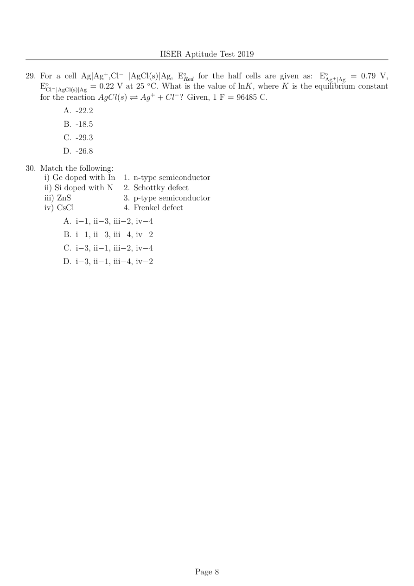

## PDF page 9

[Open original PDF at page 9](../pdf/IAT_2019_English_paper.pdf#page=9)

### Searchable text - PDF text layer

```text
IISER Aptitude Test 2019
  Mathematics


31. Let 1, ζ2, ζ3, . . . , ζn be the roots of the equation xn = 1, for n ≥3. Then, the sum
                                   1       1            1
                         +    +  +                                 2       2            · · ·   2                             −ζ2    −ζ3       −ζn
    equals to
         A.  1+(n−2)2n .
                 2n−1
         B. 1+n2n−1−2n .
                  2n−1
         C. 1+n2n−1−2n .                 2n−1+1
         D. 1+(n−1)2n−2n−1 .                   2n−1+1
32. How many solutions does the equation

                                       sin2 x −15 sin x cos x + 50 cos2 x = 0
    have in the interval [0, 2π]?
         A. 4.
         B. 0.
         C. 1.
         D. 2.
33. Let A be a 4   4 matrix with real entries. Consider the sets          ×                      
               x1        x1      0                                                                                         x2    x2    0           K =       A                            ,                :  =                              x3        x3      0                          
                              x4        x4      0
                                   
               c1       c1          y1                                                                                                                                   c2   c2     y2                 J =            A          for some y1, y2, y3, y4            .                :  =  ,                                                                    c3       c3          y3             ∈R                                                                               
                                   c4       c4          y4

   Suppose K = J. Then, which one of the following statements is necessarily true?
         A. A2 = 0.
         B. A is symmetric.
         C. A is skew symmetric.
         D. A2 = A.


                                        Page 9
```

### Original page image

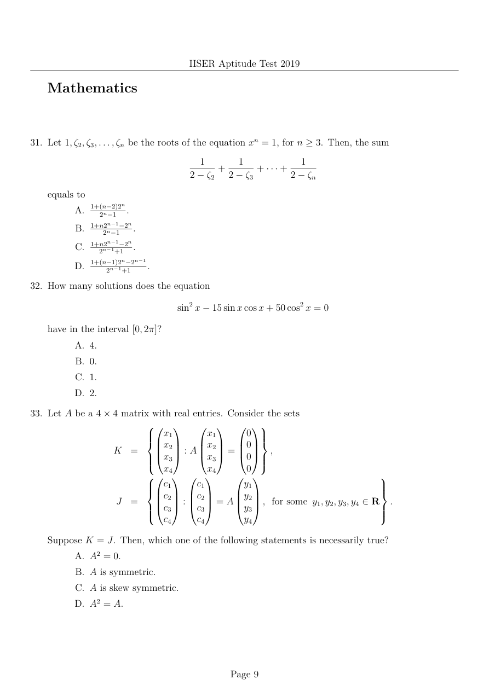

## PDF page 10

[Open original PDF at page 10](../pdf/IAT_2019_English_paper.pdf#page=10)

### Searchable text - PDF text layer

```text
IISER Aptitude Test 2019

34. Consider 5 straight lines in a plane such that no two of them are parallel and no three of them
    intersect at a point. Then, the number of disjoint regions into which the plane is divided by these
     lines equals to
         A. 17.
         B. 18.
         C. 16.
         D. 20.
35. Consider the circle C that passes through the points (1, 0) and (0, 1) having the smallest area.
    Then, the equation of the tangent to the circle C at (0, 1) is
         A. y =  + 1.            −x
         B. y = x −1.
         C. y = x.
         D. y = x + 1.
36. Let f :      1]     be a continuous function. Consider the region           [−1, →R
                         .                            /
                     S =  (x, y) :           and 0                     .                             −1 ≤x ≤1    ≤y ≤f(x)
    For which one of the following functions f, the area of the region S is the largest?
         A. f(x) =    sin                     πx|    πx|.
         B. f(x) =    cos                     πx|0   πx|.                                   πx 112         C. f(x) = πx 1 + 11tan 10    .
         D. f(x) = |x|+1.πx
37. Let f : R     be a continuous function. Then, f is surjective if      →R
                                 lim    =         A.  lim   = ∞and                                ∞.           x→∞f(x)        x→−∞f(x)
         B.  lim   = 0 and  lim    = ∞.           x→∞f(x)       x→−∞f(x)
         C.  lim   = 0 and  lim    = −∞.           x→∞f(x)       x→−∞f(x)
                                   lim    =         D.  lim   = −∞and                                 ∞.           x→∞f(x)          x→−∞f(x)
                   n3
                             k201938. The limit lim  n20201
          n→∞     k=1
         A.  is 2018.1
         B.  is 2020.1
         C.  is 2019.1
         D. does not exist.


                                       Page 10
```

### Original page image

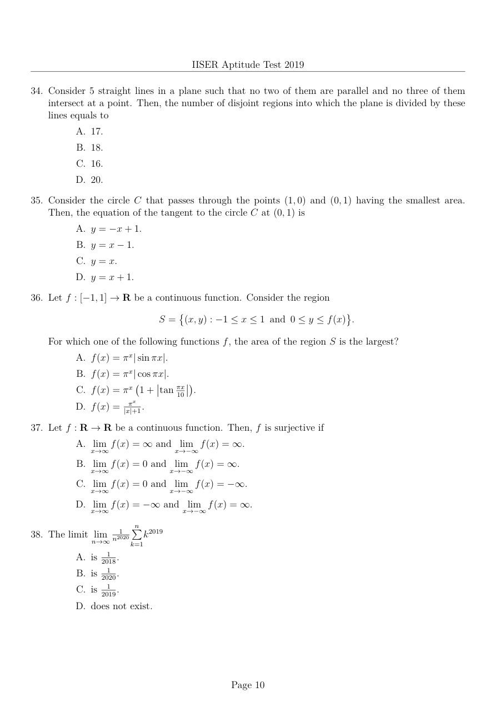

## PDF page 11

[Open original PDF at page 11](../pdf/IAT_2019_English_paper.pdf#page=11)

### Searchable text - PDF text layer

```text
IISER Aptitude Test 2019

39. The sum of n consecutive terms of an arithmetic progression consisting of integers is 161. Then, a
    possible value of n is
         A. 5.
         B. 7.
         C. 6.
         D. 8.
40. Let f : R     be a non-zero even function such that      →R
                                   4 1
                                          f(x)dx = α.
                                            −1
    Then, the value of the integral                                    4 1
                                              f(x)
                                            1 + exdx
                                             −1
     is
         A. α.
         B. αe−α.
         C. α2 .
         D. e−α2  .
41. What is the mean deviation about the mean for the following data?

                                              xi  1   2   3   4
                                                   fi   5  10  15  20

         A.  45.
         B.  35.
         C.  25.
         D. 1.
42. Let S be a non-empty set such that the total number of subsets of S containing at most two
    elements is equal to 16. Then, the number of elements in S equals to
         A. 5.
         B. 6.
         C. 16.
         D. 7.


                                       Page 11
```

### Original page image

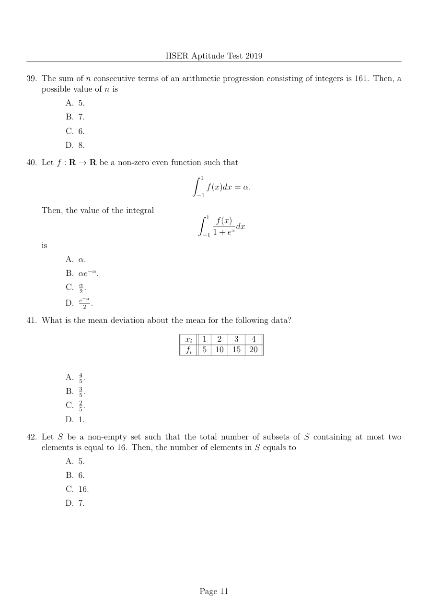

## PDF page 12

[Open original PDF at page 12](../pdf/IAT_2019_English_paper.pdf#page=12)

### Visual description

Mathematics Q43: parallelogram ABCD contains a diagonal and two internal segments joining marked points E and F on opposite sides. Their intersections with the diagonal are X and Y. The given side-division ratios determine the requested segment length.

### Searchable text - PDF text layer

```text
IISER Aptitude Test 2019


                                         =43. Consider the parallelogram ABCD as shown in the figure, where ABAE                                                          CD                                                                 CF = n,1  for some positive
    integer n.

                         D     F   C

                                           Y                         X

                        A   E    B
   Suppose the length of AC is a, then the length of XY  is
         A. n.a
         B. n+1.na
         C.  (n−1)an+1  .
         D.  (n−1)an    .
44. Let5i, 5j and 5k denote the standard unit vectors in R3 along the x-axis, y-axis and z-axis, respectively.
    Consider the sets
          6                    7
    X =     a5i + b5j + c5k : a, b, c         0,     and                          ∈{−1,  1}
      Y =                      : ⃗v1,⃗v2,⃗v3     and ⃗v1,⃗v2,⃗v3 are mutually perpendicular unit                   {(⃗v1,⃗v2,⃗v3)     ∈X                                                 vectors}.
    Then, the number of elements in Y  is
         A. 27.
         B. 24.
         C. 36.
         D. 48.
45. What is the probability that 3 randomly chosen elements x, y, z from the set     2, . . . ,     satisfy                                                                                   {1,      10}   x + y + z = 5?
         A.  1000.3
         B.  200.1
         C.  1000.1
         D.  500.3


                                       Page 12
```

### Original page image

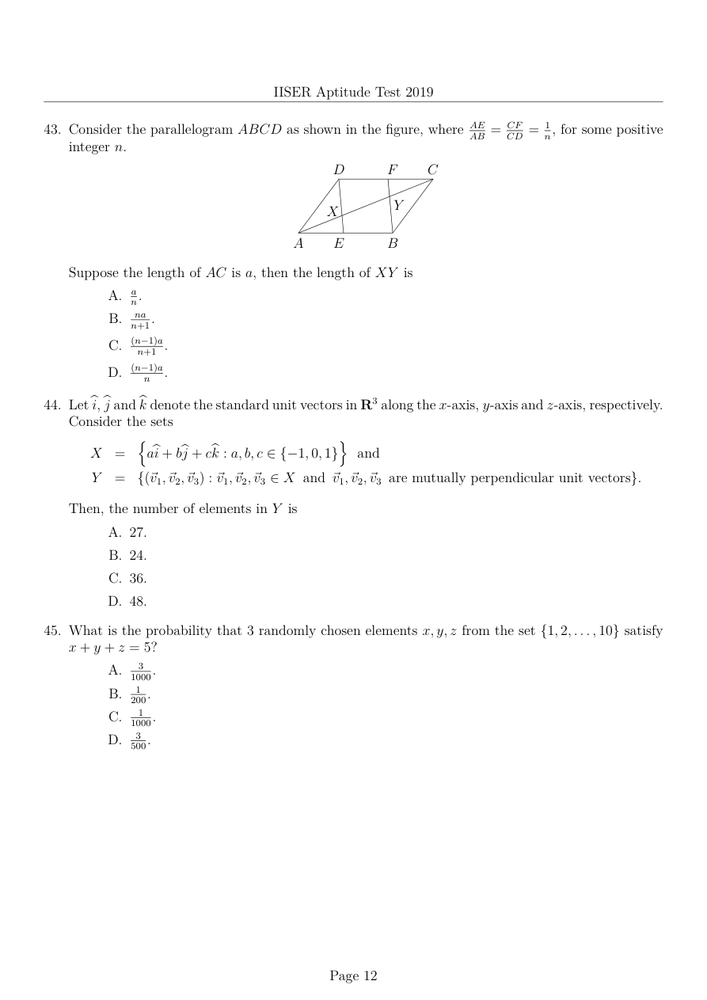

## PDF page 13

[Open original PDF at page 13](../pdf/IAT_2019_English_paper.pdf#page=13)

### Visual description

Physics Q47: a cube is drawn in perspective, with charge Q at one vertex and a shaded square face ABCD. The selected face and the location of the charge determine the flux being requested.

### Searchable text - PDF text layer

```text
IISER Aptitude Test 2019
  Physics


46. A particle of mass m is rotating in a circular orbit of radius r under the action of gravity in
    the presence of another stationary particle of very large mass M (M ≫m). Consider that the    gravitational potential energy is zero at infinite separation.  If the total energy of the rotating
    particle is E, then, which of the following expressions correctly represents the angular momentum
    of the particle?
         A. r √ 2Em
         B. r √      8−2Em
         C. r      8−Em/2
         D. r  Em/2
47. A point electric charge Q is placed at a corner of a cube as shown in the figure. What is the electric
    flux passing through the shaded surface ABCD of the cube? (ϵ◦is permittivity of free space)


         Q
         A.
              18ϵ◦
         Q
         B.
              12ϵ◦
        Q
         C.
               6ϵ◦
         Q
         D.
              24ϵ◦
48. Neutral gas molecules, each of mass m, are at a temperature T in a container at zero gravity. How
    does the average de Broglie wavelength λ of a molecule depend on T?
         A. λ  √ T         ∝       3
                                2         B. λ           ∝1/T         C. λ   √ T          ∝1/3
                             2         D. λ        ∝T


                                       Page 13
```

### Original page image

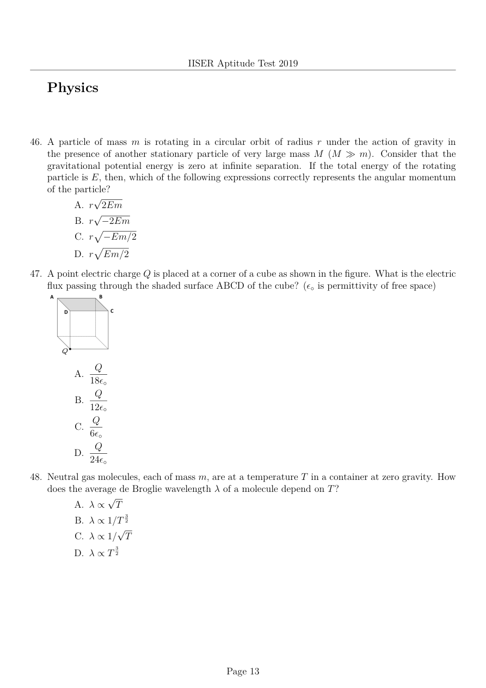

## PDF page 14

[Open original PDF at page 14](../pdf/IAT_2019_English_paper.pdf#page=14)

### Visual description

Physics Q50: two long straight wires lie along perpendicular axes, meeting near the origin. Their current directions and the labels A and B are shown, so forces or torques must be interpreted in three dimensions.

### Searchable text - PDF text layer

```text
IISER Aptitude Test 2019

                                                                      φ with49. Consider a particle of unit mass being thrown with an initial velocity v◦making an angle    the horizontal ground. What is the magnitude of the angular momentum of the particle about the
    point of projection at a time t after its projection while it is in flight?
         A.        φ             2gt2v◦cos
         B.  1       φ              2gt2v◦cos
         C.        φ              2gt2v◦sin
         D.  1      φ              2gt2v◦sin
50. Consider two long thin conductors A and B each carrying current I as shown in the figure. Con-
    sidering A to be fixed, which of the following statements is correct?


         A. B experiences a net force along +x axis.
         B. B experiences a net anticlockwise torque.
         C. B experiences a net force along     axis.                              −x
         D. B experiences a net clockwise torque.
51. What is the average kinetic energy of molecules of an ideal gas leaking freely through an orifice of
    a container which has N molecules at pressure P in volume V ?
          3PV
         A.
          2N
         PV
         B.
          2N
          3PV
         C.
         N
          2PV
         D.
          3N
52. Which of the following is an expression for energy in terms of the Planck’s constant h, the velocity
    of light c and the Gravitational constant G?
      9
           hG
         A.
                   c3
      9
                hc5
         B.
          G
              hc5
         C.
        G      9
          G
         D.
                hc5

                                       Page 14
```

### Original page image

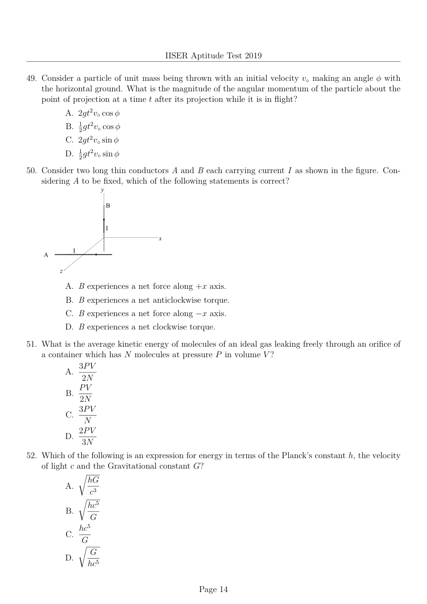

## PDF page 15

[Open original PDF at page 15](../pdf/IAT_2019_English_paper.pdf#page=15)

### Visual description

Physics Q53: a block on a frictionless horizontal line is attached to left and right fixed walls by springs labelled k and 4k. Q55: a capacitor is the middle branch of a diamond-shaped circuit, with resistors and a source on its outer sides; branch topology matters.

### Searchable text - PDF text layer

```text
IISER Aptitude Test 2019

53. A solid block on a frictionless surface is connected to two rigid supports on the left and right side
   by springs of spring constants k and 4k respectively as shown in the figure. The time spent by the
    block in a complete cycle of oscillation on the left and the right side of the equilibrium position are
    tL and tR, respectively. Which of the following is correct?


         A. tL = 2tR
         B. tL = tR/2
         C. tL = tR
         D. tL = 4tR
54. A capacitor with capacitance C◦consists of two concentric spherical conductors. If the radii of the    inner and the outer spherical conductors are halved, what is the new capacitance?
         A.            C◦/2
         B.            4C◦
         C.           C◦
         D.   √ 2           C◦/
55. What is the time t taken by the capacitor in the given circuit to charge to 1/√ 2π of its full capacity?


         A. t      →∞
         B. t = 1/RC
         C. t = 2πRC
         D. t = RC
56. The allowed energy levels of electrons in a Hydrogen atom are given by En =          eV. For                                                                         −13.6/n2    electronic transition in Hydrogen atom, what is the maximum frequency of the emitted photon?
    (h = 6.62   10−34 Js; e = 1.6   10−19 C)        ×          ×
         A. 2.1   106 GHz          ×
         B. 5.5   106 GHz          ×
         C. 3.3   106 GHz          ×
         D. 1.7   106 GHz          ×


                                       Page 15
```

### Original page image

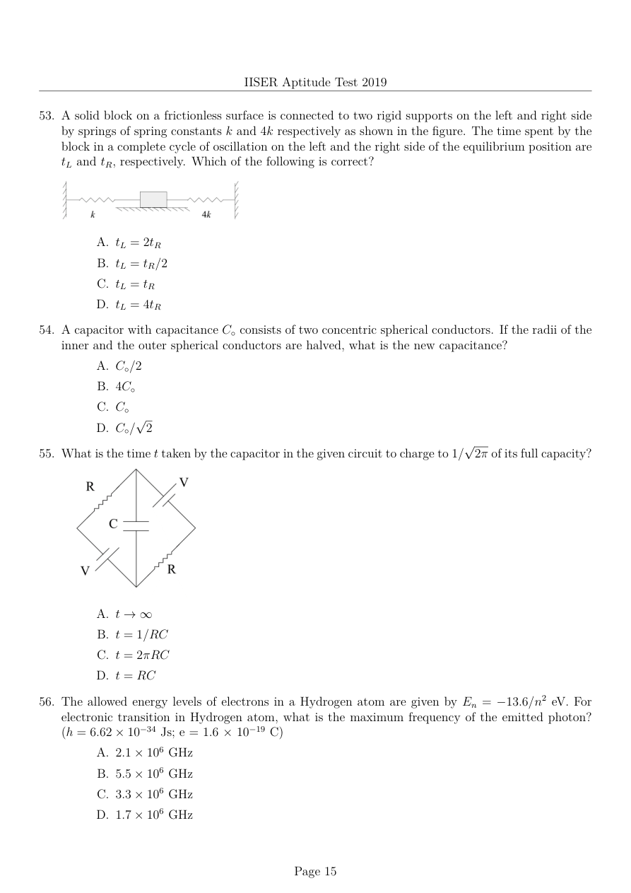

## PDF page 16

[Open original PDF at page 16](../pdf/IAT_2019_English_paper.pdf#page=16)

### Visual description

Physics Q60: an isosceles triangle has apex A and base vertices B and C carrying equal charges q. The base has length a, the full altitude is h, and an internal horizontal level is marked at height h/3 above the base.

### Searchable text - PDF text layer

```text
IISER Aptitude Test 2019

57. Which of the following statements about the P-V diagram of an ideal gas of fixed number of
    particles is incorrect?
         A. Two distinct adiabats never cross each other.
         B. Two distinct isotherms never cross each other.
         C. An isotherm and an adiabat intersect at one point.
         D. An isotherm and an adiabat intersect at more than one point.
58. A cube, a cylinder (of height equal to its diameter) and a sphere, all solid, are made of a metal
   and are of identical mass. If all the three shapes having initial temperature 50◦C are put in a large
    reservoir of water at 10◦C. Which of the above three shapes cools the fastest?
         A. The cylinder.
         B. The sphere.
         C. The cube.
         D. All three at the same rate.
59. An LED display consists of 100 pixels per cm2. Consider that the diameter of the pupil of the eye
     is 5 mm and the average wavelength of the display is 575 nm. What is the nearest distance from
    the display one can be at, such that the display does not appear pixelated?
         A. 30.23 m
         B. 7.12 m
         C. 4.52 m
         D. 20.32 m
60. Two equal positive charges (q) are placed at the vertices B and C of an isosceles triangle of base
   a and height h = 3 √ 3a/2, as shown in the adjacent figure. When a charge q′ is placed at A, it is
    found that at a point inside the triangle, the net electric field due to the three charges vanishes. If
    this point is at a height h/3, then what is q′?


         A.  q′ =  √ 3q             −3         B.  q′ = +3 √ 3q
         C.  q′ = + √ 3q
         D.  q′ = √ 3q          −

                                       Page 16
```

### Original page image

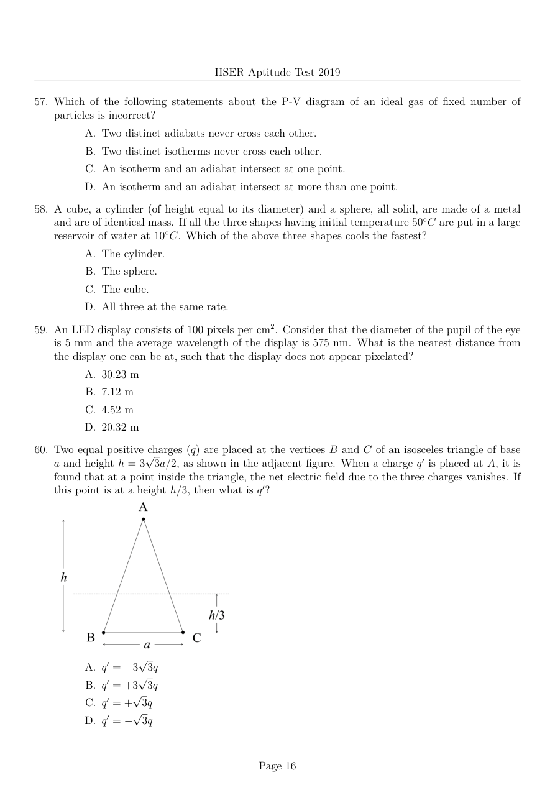
