# IAT 2019 - Hindi

Original PDF: [IAT_2019_Hindi_paper.pdf](../pdf/IAT_2019_Hindi_paper.pdf)

- Acquisition: SciAstra CloudFront mirror; not downloaded from the official server.
- Downloaded: 28 October 2026. PDF pages: 18.
- Exact download/source URL: https://d2aaa7ts7sm3bp.cloudfront.net/pdfs/01KMFRH2FTEZR88BQ5PVEQBXPB.pdf
- PDF SHA-256: `6abaa9e8e63125788cc5063a10754a7ba6507191c1bef62e9bd670d1bbe7dfd3`
- This is a search/accessibility copy of an existing paper, not newly authored mock content.
- Text is mechanically extracted or OCR-derived and has not been proofread character by character. Equations, option letters, chemical bonds, tables and Hindi OCR can contain errors. The PDF and page images are authoritative.
- Figure descriptions are explanatory annotations, not official answers or complete structural/formula transcriptions. Use the linked image to resolve exact labels, values and stereochemistry.

## Visual guide

The following descriptions refer to **PDF page numbers in the English companion**, because Hindi pagination can differ. The Hindi page images below retain every original diagram; identical embedded images are additionally cross-linked where matched by image digest.

- [English PDF page 2](IAT_2019_English_paper.md#pdf-page-2): Biology Q8: a typical ECG trace is labelled P, Q, R, S and T. The P wave precedes the tall QRS complex, followed by the broader T wave; the question changes AV-node function.
- [English PDF page 3](IAT_2019_English_paper.md#pdf-page-3): Biology Q10: a multigeneration pedigree uses squares for males, circles for females, and shading for affected individuals. Q12 presents three candidate body-size frequency distributions, each contrasting an ancestral dashed curve with a later solid curve; the fourth alternative continues on the next page.
- [English PDF page 4](IAT_2019_English_paper.md#pdf-page-4): Continuation of Biology Q12, option D: a body-size frequency plot shows two peaks in the later population, contrasted with the ancestral distribution. This option belongs to the question on the preceding page.
- [English PDF page 6](IAT_2019_English_paper.md#pdf-page-6): Chemistry Q22 and Q23 contain aromatic starting structures, reagent-labelled arrows and four possible drawn products. The first route includes alcoholic KOH followed by NaNH2; the second starts from benzamide and compares differently brominated or rearranged products. Do not infer connectivity from OCR alone.
- [English PDF page 7](IAT_2019_English_paper.md#pdf-page-7): Chemistry Q24 shows an aromatic diazonium salt reacting with ethanol on heating, with a benzene product and a missing coproduct X. Q25 compares four cyclic structures for aromaticity, including charged rings; the charge marks and double-bond positions are essential.
- [English PDF page 12](IAT_2019_English_paper.md#pdf-page-12): Mathematics Q43: parallelogram ABCD contains a diagonal and two internal segments joining marked points E and F on opposite sides. Their intersections with the diagonal are X and Y. The given side-division ratios determine the requested segment length.
- [English PDF page 13](IAT_2019_English_paper.md#pdf-page-13): Physics Q47: a cube is drawn in perspective, with charge Q at one vertex and a shaded square face ABCD. The selected face and the location of the charge determine the flux being requested.
- [English PDF page 14](IAT_2019_English_paper.md#pdf-page-14): Physics Q50: two long straight wires lie along perpendicular axes, meeting near the origin. Their current directions and the labels A and B are shown, so forces or torques must be interpreted in three dimensions.
- [English PDF page 15](IAT_2019_English_paper.md#pdf-page-15): Physics Q53: a block on a frictionless horizontal line is attached to left and right fixed walls by springs labelled k and 4k. Q55: a capacitor is the middle branch of a diamond-shaped circuit, with resistors and a source on its outer sides; branch topology matters.
- [English PDF page 16](IAT_2019_English_paper.md#pdf-page-16): Physics Q60: an isosceles triangle has apex A and base vertices B and C carrying equal charges q. The base has length a, the full altitude is h, and an internal horizontal level is marked at height h/3 above the base.

## Page index

[p1](#pdf-page-1) | [p2](#pdf-page-2) | [p3](#pdf-page-3) | [p4](#pdf-page-4) | [p5](#pdf-page-5) | [p6](#pdf-page-6) | [p7](#pdf-page-7) | [p8](#pdf-page-8) | [p9](#pdf-page-9) | [p10](#pdf-page-10) | [p11](#pdf-page-11) | [p12](#pdf-page-12) | [p13](#pdf-page-13) | [p14](#pdf-page-14) | [p15](#pdf-page-15) | [p16](#pdf-page-16) | [p17](#pdf-page-17) | [p18](#pdf-page-18)

## PDF page 1

[Open original PDF at page 1](../pdf/IAT_2019_Hindi_paper.pdf#page=1)

### Searchable text - OCR draft (hin+eng)

```text
आईआईएसईआर अभिरुचि परीक्षण 20i9

जीव विज्ञान

. निम्नलिखित में से कौन सी प्रक्रिया बेसिडियोमाइसिटीज में द्विकेंद्रक (डाइकैरियोटिक) प्रावस्था उत्पादित
करती है?

A. केंद्र Goat

8. प्लाज्मोगैमी

८. एपोगैमी

9. केंद्रक विभाजन (कैरियोकाइनेसिस)

2. पुष्पी सूत्र की मानक पद्दति का अनुपालन करने पर Ko) किस प्रकार के पुष्प को निरूपित करता है?
A. पृथक वाह्मदली
B. Garett
८. संयुक्त वाह्मदली
9. संयुक्त दली

5. निम्नलिखित मे से कौन सा कथन सही है?

A. रक्त एक ऐसा संयोजी उत्तक है जो कोलैजन का स्रावण नहीं करता है।
9. कंडरायें सघन, अनियमित संयोजी उत्तक का एक प्रकार है।

C. वसीय उत्तक, तरल BASH उत्तक का उदाहरण है।

9. OR का SAT अन्तःखावी ग्रंथियाँ करती है।

4. स्तंभ और a उपस्थित प्रविष्टियों को मिलायें। इस आधार पर निम्न में से कौन सा विकल्प सही है?

स्तंभ I स्तंभ ता
(a) हीम () कोफ़ैक्टर
(9) NAD (2) विटामिन
(0 Rie (5) कोएंजाइम
(१9) नियासीन (4 प्रोस्थेटिक समूह

A. 8-35, b-l, ९-4, 6-2

8. 8-4, b-3, c-l, 6-2

C. 8-2, b-l, c-3, 6-4

D. a-4, b-l, c-3, d-2

WS
```

### Original page image

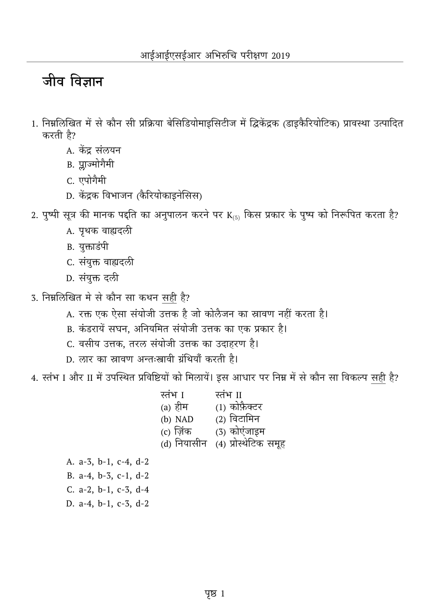

## PDF page 2

[Open original PDF at page 2](../pdf/IAT_2019_Hindi_paper.pdf#page=2)

**Matching embedded figure, English PDF page 2:** Biology Q8: a typical ECG trace is labelled P, Q, R, S and T. The P wave precedes the tall QRS complex, followed by the broader T wave; the question changes AV-node function.

### Searchable text - OCR draft (hin+eng)

```text
आईआईएसईआर अभिरुचि परीक्षण 20i9

5. निम्नलिखित में से कौन सी संरचना जीवाणुओं के गमन मे सहायक होती है?
A. तारककाय

B. फिम्ब्री
८. माइक्रोट्यूब्यूल्स
9. कशाभिका

6. तम्बाकू के पौधों के हरित लवक मे होने वाली प्रकाश अभिक्रिया में प्रोटॉन की प्रवणता निम्न में से कहाँ
निर्मित होती है?

A. पीठिका और हरित लवक की अंतरझिल्ली स्थान के बीच

8. थाइलाक्वायड गुहा और हरित लवक की अंतरझिल्ली स्थान के बीच
८. पीठिका और थाइलाक्वायड गुहा के बीच

9. हरित लवक की आंतरिक और वाह्म झिल्ली स्थान के बीच

7. निम्नलिखित में से कौन सी दशा माँसपेशियों के संकुचन के दौरान किसी माँसपोशी और तंत्रिकाक्ष शिरा
के सिनेप्स में एसिटिल कोलिन के स्रावण से उद्दीपित नहीं होती है?

A. माँसपेशियों में क्रियात्मक विभव का उत्पादन
8. सार्कोप्नाज्मिक जालिका से ८४” का निर्मुक्त होना
८. मायोसिन के सिरे से ATP अणु का बंधना

9. ट्रोपोमायोसिन के खिसकने से एक्टिन तंतुओं (फिलामेंट) पर मायोसिन के बंधन स्थान का
उचड़ना

8. नीचे एक मानक ECG दर्शाया गया है।

A. Q 5 T

AV नोड के अक्रियता की cen मे निम्नलिखित में से कौन सा कथन ECG मे होने वाले परिवर्तन के
विषय में सही है?

A. 7? तरंग छोटे आयाम के साथ देर तक जारी रहेगा
8. ORS संकुल अनुपस्थित रहेगा

C. Tae छोटे आयाम के साथ देर तक जारी रहेगा
9. P और ors संकुल के बीच की दूरी घट जायेगी

पृष्ठ 2
```

### Original page image

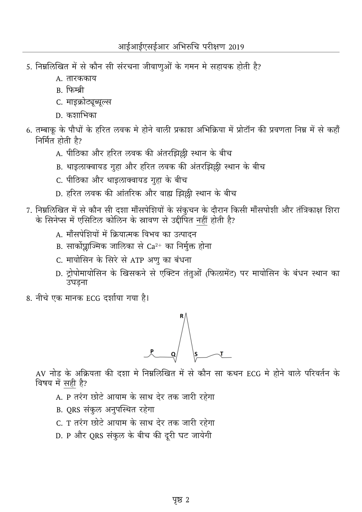

## PDF page 3

[Open original PDF at page 3](../pdf/IAT_2019_Hindi_paper.pdf#page=3)

**Matching embedded figure, English PDF page 3:** Biology Q10: a multigeneration pedigree uses squares for males, circles for females, and shading for affected individuals. Q12 presents three candidate body-size frequency distributions, each contrasting an ancestral dashed curve with a later solid curve; the fourth alternative continues on the next page.

### Searchable text - OCR draft (hin+eng)

```text
आईआईएसईआर अभिरुचि परीक्षण 20i9

9. नीचे पौधों मे पाई जाने वाली प्रजनन की विभिन्न विधियों को सूचीबद्ध किया गया है।

lL अनिषेकजनित (पार्थनोकार्पी)

ए: सिनगैमी (युग्मक संलूयन)

Ill: असंगजनन

IV: बहुभ्रूणता

इस आधार पर उपर्युक्त विधियों का कौन सा नीचे दिया गया संकलन, मादा पौधे के जीन प्रारूप वाली
gre संततियाँ उत्पन्न करने मे सक्षम है?

A. ता और Iv
Bae

८०. तर और
D.IaRIV

l0. नीचे दर्शाया गया चित्र किसी आनुवांशिक बीमारी के वंशावली वृक्ष को निरूपित करता है (यहाँ प्रभावित
व्यष्टियों को भरे हुए गोलों और चौकोरों से दिखाया गया है)। वंशावली वृक्ष के आधार पर इस बीमारी
की वंशानुगतता का तरीका निम्न में से कौन सा है?

ae
a ७ oe oF
Oy oe OG
60 बढ. w

A. ह-सहलग्न अप्रभावी

B. श-सहलग्न

C. ह-सहलग्न प्रभावी

9. सूत्रकणिकीय (माइटोकॉप्ड्रियल)

Ll. एक E.coli, जिसका DNA पूर्णतः ON से चिन्हित (लेबल्ड) है, को “NHC वाले माध्यम मे वर्थित

करते हैं। इस वर्धन माध्यम मे 80 मिनट पश्चात (ON/4N) वाले संकर और (MN/N) वाले हल्के DNA
अणुओं के मध्य अनुपात कितना होगा (मान लीजिये की #.0०४ का द्विगुणन समय 20 मिनट है)?

A. 25% संकर और 75% हल्का

B. 50% संकर और 50% हल्का

C. 00% केवल हल्का

9. 2.5% संकर और 87.5% हल्का

पृष्ठ 5
```

### Original page image

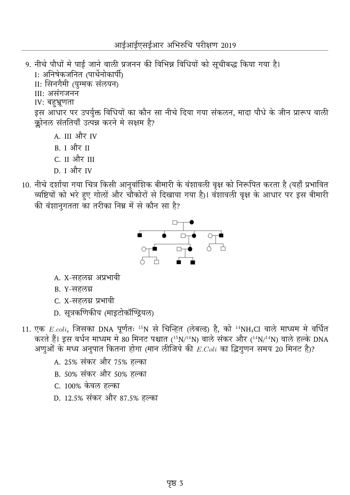

## PDF page 4

[Open original PDF at page 4](../pdf/IAT_2019_Hindi_paper.pdf#page=4)

**Matching embedded figure, English PDF page 3:** Biology Q10: a multigeneration pedigree uses squares for males, circles for females, and shading for affected individuals. Q12 presents three candidate body-size frequency distributions, each contrasting an ancestral dashed curve with a later solid curve; the fourth alternative continues on the next page.

**Matching embedded figure, English PDF page 4:** Continuation of Biology Q12, option D: a body-size frequency plot shows two peaks in the later population, contrasted with the ancestral distribution. This option belongs to the question on the preceding page.

### Searchable text - OCR draft (hin+eng)

```text
आईआईएसईआर अभिरुचि परीक्षण 20i9

2. निम्नलिखित रेखाचित्र फल-मक्खी (फ्रूट Gers) की किसी आबादी मे शारीरिक आकार (बॉडी साइज़) के
वितरण को दर्शाता है। खंडित रेखाएँ पूर्वजों के प्रकार के वितरण को और सतत रेखाएँ कुछ पीढ़ियों बाद
के वितरण को दर्शाती हैं। यदि वृहद आकार के व्यष्टियों की उत्तरजीविता बेहतर और प्रजनन दर उच्च

हो तो निम्न में से कौन सा रेखाचित्र शारीरिक आकार मे होने वाले संभावी परिवर्तन को सबसे सटीक
रूप से निरूपित करता है? (७-अक्ष, शारीरिक आकार को और ५-अक्ष आवृत्ति को दर्शाता है)

B.
i
Cc . Body size
:
D . Body aie

3. निम्न दशाओं 06) एक गर्भस्थ शिशु (फीटस) मे अपरा से प्रतिरक्षियों के स्थानांतरण, और 0) नवजातों
के टीकाकरण से उपार्जित प्रतिरक्षा किस प्रकार की होती है?

A. दोनों हीं सक्रिय प्रतिरक्षा के उदाहरण हैं

B. दोनों हीं निष्क्रिय प्रतिरक्षा के उदाहरण हैं

८. क्रमशः सक्रिय और निष्क्रिय प्रतिरक्षा के उदाहरण हैं
9. क्रमशः निष्क्रिय और सक्रिय प्रतिरक्षा के उदाहरण हैं

पृष्ठ 4
```

### Original page image

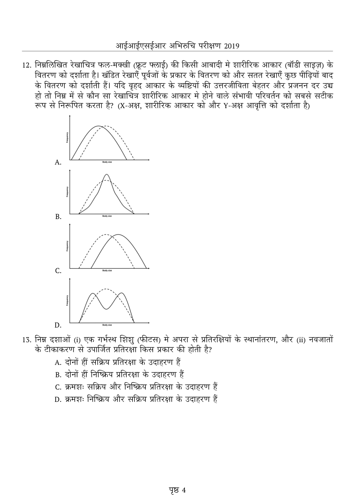

## PDF page 5

[Open original PDF at page 5](../pdf/IAT_2019_Hindi_paper.pdf#page=5)

### Searchable text - OCR draft (hin+eng)

```text
आईआईएसईआर अभिरुचि परीक्षण 20i9

4. निम्नलिखित मे से कौन सा विकल्प एक सामान्य पॉलीमेरेज श्रंखला अभिक्रिया के विभिन्न घटना क्रमों
के सही क्रम को दर्शाता है?

A. निष्क्रियकरण, तापानुशीलन, प्रसार
B. तापानुशीलन, निष्क्रियकरण, प्रसार
८. प्रसार, तापानुशीलन, निष्क्रियकरण
9. निष्क्रियकरण, प्रसार, तापानुशीलन
I5. गाजर घास (Parthenium sp.) की अति-वृद्धि से जैव-विविधता का हास होता है। यह निम्नलिखित में
से किसका उदाहरण है?
A. विदेशी प्रजाति का अतिक्रमण
8. सह-विलुप्तता
८. अति-शोषण
9. निवास स्थान का हनन और विघटन

पृष्ठ 5
```

### Original page image

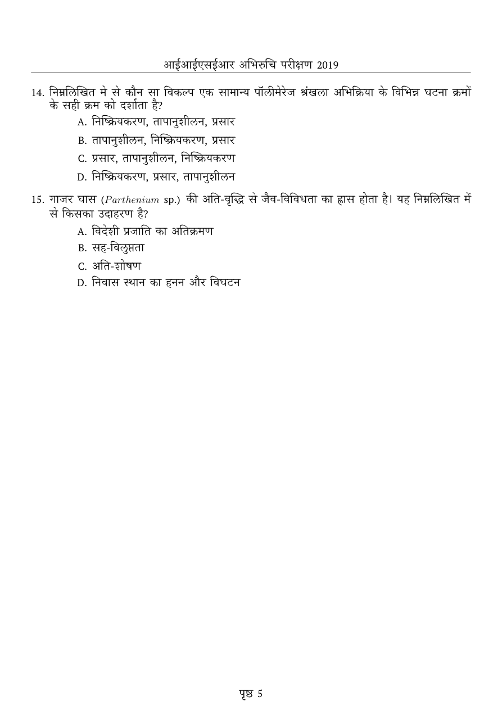

## PDF page 6

[Open original PDF at page 6](../pdf/IAT_2019_Hindi_paper.pdf#page=6)

### Searchable text - OCR draft (hin+eng)

```text
आईआईएसईआर अभिरुचि परीक्षण 20i9

l6.

I7.

I8.

I9.

20.

रसायन विज्ञान

09 तथा Cl, अणुओं की आबंध लंबाई (bond lengths) १५. तथा आबंध विघटन एन्थैल्पी (00
dissociation enthalpy) 872५ ५ का सही क्रम निम्न मे से कौन सा होगा? (यहाँ X = Fach

A. dp_r < 6-० तथा BDEp_p < BDEci-ci

B. 6७ #& > १८-०७ तथा BDEp_p > BDEci_c

C. dp_r < dey_cr तथा BDEp_p > BDEci_cr

D. 4७ #» > der-cr TM BDEp_p < BDEoi_c

निम्न में से कौन सा कथन ऋ्रणावेशित संकुल [८०6)॥%* के लिए उपयुक्त है? (यहाँ L एक एकदंतुर
(monodentate) तथा ऋणावेशित (monoanionic) लिगन्ड है l)

A. उच्च Waals (high-spin) तथा हरा

B. निम्न WashrT (low-spin) तथा हरा

८. निम्न washes (low-spin) तथा नीला

9. उच्च प्रचक्रीय (high-spin) तथा पीला

निम्न में से कौन से ace (elements) अंतराकाशी 67/श४778)) हाइड्राइड बनाते हैं?
A. Na एवं Mg
B. Yb एवं Ti
C. Fe एवं Mn
9. 8 एवं Al
एक वर्ग समतलीय संकुल (square planar complex) [Pd(py)(Cl)\(Br(NH3)] के लिए कितने ज्यामितीय
समावयव (geometrical isomers) संभव हैं? (py = पिरिडीन)
A. 2
B. 4
C.5
D. 3
BF, तथा ४७७0 परस्पर एक आण्विक FF (molecular adduct) Tard हैं। निम्न में से कौन सा विकल्प

उनके समन्वय संख्या [coordination number (CN)], संयोजकता [valency (V)] तथा ऑक्सीकरण
अवस्था [oxidation state (OS)] का सही वर्णन प्रस्तुत करता हैं?

A. CN = 4, V = 4 तथा OS = +3
8. CN = 4, V = 3 तथा OS = +4
C. CN = 4, V = 3 तथा OS = +3
D. CN = 3, V = 3 तथा OS = +4

पृष्ठ 6
```

### Original page image

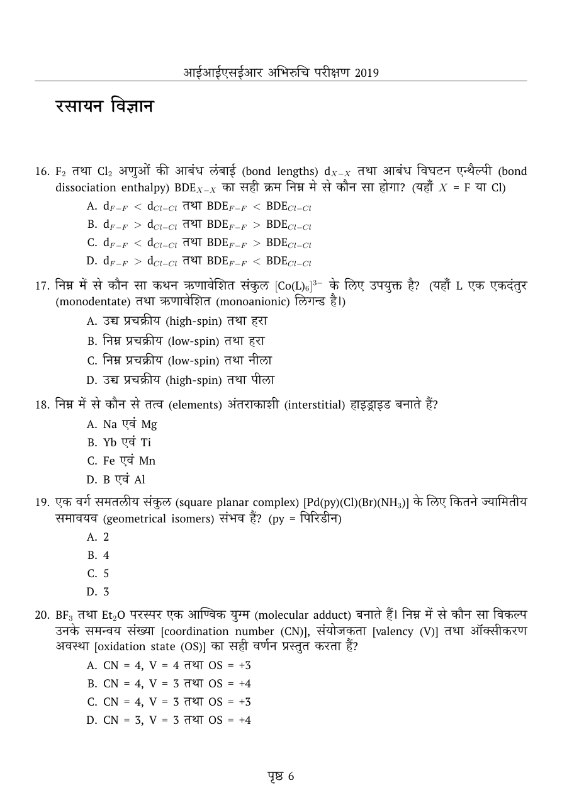

## PDF page 7

[Open original PDF at page 7](../pdf/IAT_2019_Hindi_paper.pdf#page=7)

**Matching embedded figure, English PDF page 6:** Chemistry Q22 and Q23 contain aromatic starting structures, reagent-labelled arrows and four possible drawn products. The first route includes alcoholic KOH followed by NaNH2; the second starts from benzamide and compares differently brominated or rearranged products. Do not infer connectivity from OCR alone.

### Searchable text - OCR draft (hin+eng)

```text
आईआईएसईआर अभिरुचि परीक्षण 20i9

2. दूध से पनीर बनाते समय दूध में तनु एसिटिक as (dilute acetic acid) मिलाते हैं। इस दौरान दूध
के प्रोटीन निम्न में से किस प्रक्रिया से गुजरते हैं?

A. चुलनीकरण (Solubilisation)
B. विघटीकरण (Degradation)
C. विकृतीकरण (Denaturation)

9. बहुलकीकरण (Polymerisation)
22. नीचे दिखाई गई अभिक्रिया का मुख्य अंतिम उत्पाद निम्न में से कौन सा है?

Br
cr~ Br (i) KOH, EtOH
oe

(ii) NaNH
om SNH
A fm
on
S
B ZA
OEt
om
C. ४
Co S
D Za

25. नीचे दिखाई गई अभिक्रिया का मुख्य अंतिम उत्पाद निम्न में से कौन सा है?

0

NH, (i) 82, ethanolic NaOH >
(ii) Brz (excess), HxO हु

पृष्ठ 7
```

### Original page image

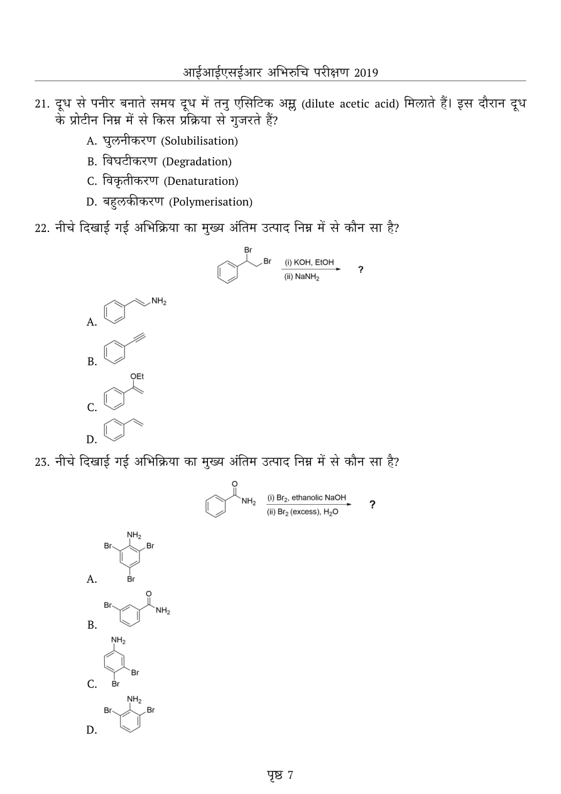

## PDF page 8

[Open original PDF at page 8](../pdf/IAT_2019_Hindi_paper.pdf#page=8)

**Matching embedded figure, English PDF page 7:** Chemistry Q24 shows an aromatic diazonium salt reacting with ethanol on heating, with a benzene product and a missing coproduct X. Q25 compares four cyclic structures for aromaticity, including charged rings; the charge marks and double-bond positions are essential.

### Searchable text - OCR draft (hin+eng)

```text
आईआईएसईआर अभिरुचि परीक्षण 20i9

24. निम्नलिखित अभिक्रिया में यौगिक (x) को पहचानें?

७06

NCI
Ethanol CO + DJ + Np + HCl
A

A. CH;COOH
B. OHC-CHO
९. CH,CH,OCH>CH,Cl
D. CH;CHO
25. निम्नलिखित यौगिकों में से कौन सा यौगिक एरोमैटिक (aromatic) है?
62 \

A. HOH

yr __H

B. HOH

26. आहिनियस समीकरण द्वारा T> ०० पर # का मान क्या होगा?
AA
B. -A
0. e4

D. e4

27. निम्नलिखित में से कौन सा एक विषमांग साम्यावस्था (heterogeneous equilibrium) का उदाहरण नहीं
है?
A. एक बंद We (closed container) ¥ द्रव जल तथा जल वाष्प के बीच साम्यावस्था

8. एथिल एसीटेट के ay उत्प्रेरित जलीय अपचटन (acid catalysed hydrolysis) के दौरान प्राप्त
साम्यावस्था

८. ठोस Ca(OH), तथा उसके संतृप्त विछयन (saturated solution) के बीच साम्यावस्था
9. ठोस Caco; को गरम करने पर प्राप्त साम्यावस्था

पृष्ठ 8
```

### Original page image

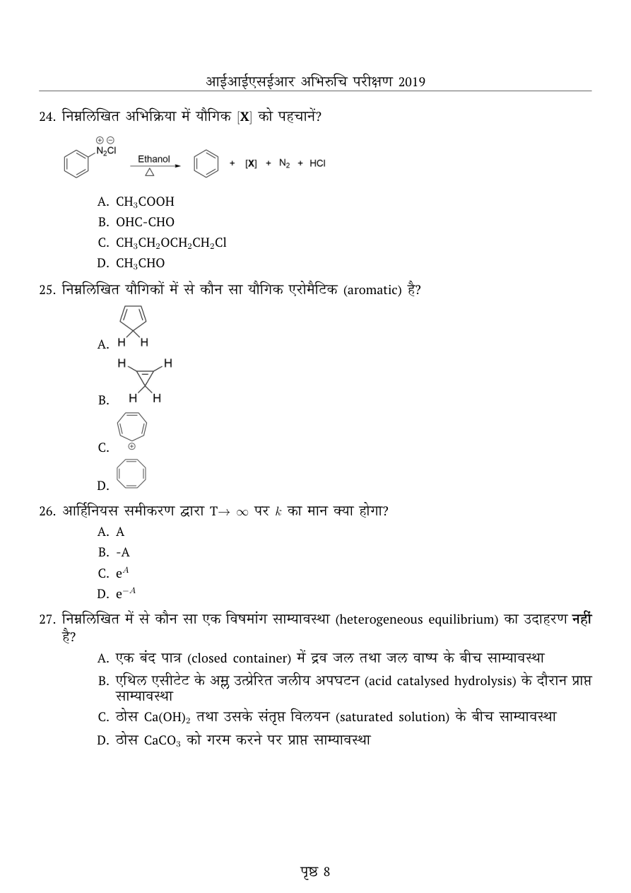

## PDF page 9

[Open original PDF at page 9](../pdf/IAT_2019_Hindi_paper.pdf#page=9)

### Searchable text - OCR draft (hin+eng)

```text
आईआईएसईआर अभिरुचि परीक्षण 20i9

28. 60 °C तापमान पर 50% |५५०,(४) वियोजित होकर NO.(g) बन जाता है। इस परिवर्तन के लिए तापमान
60 °C तथा  ॥7॥ दाब पर मानक गिन्ज़ मुक्त ऊर्जा परिवर्तन (standard Gibbs free energy change)
का मान कितना होगा? (R = 8.3I4 JK mol")

A. 763 Jmol-
B. -790 Jmol-?
C. -863 Jmol-!
D. 500 Jmol"!
29. एक सेल Agl|Agt,Cl- |AgCl(s)|Ag, जिसके लिए अर्ध-सेल Be, के मान 25 -c पर नीचे दिये गए हैं
है. = 0.79 V
CI- |AgCl(s)|Ag = 0.22 V

तो इसमें Ink का मान क्‍या होगा? जहाँ अभिक्रिया AgCl(s) = Agt +Cl- के लिए # साम्य स्थिरांक
(equilibirum constant) है। (l F = 96485 0).

A.
B.
Cc.
9.

-22.2
-8.5
-29.3
-26.8

50. नीचे दी गई प्रविष्टियों का मिलान करें और सही विकल्प का चुनाव करें

i) In अपमिश्रित Ge (Ge doped with In) l. 7#-प्रकार का अर्धचालक (n-type semiconductor)
ii) N अपमिश्रित Si (Si doped with N) 2. शॉटकी दोष (Schottky defect)

iii) ZnS
iv) CsCl
A.

B
Cc.
D

3. p-UHI का अर्धचालक (p-type semiconductor)
4. फ्रेंकेल दोष (Frenkel defect)

i—], ii—3, iii-2, iv—4

. 7, ii—3, iii-4, iv—-2

i—3, -, iii-2, iv—4

. i-3, ॥-, iii-4, iv—-2

पृष्ठ 9
```

### Original page image

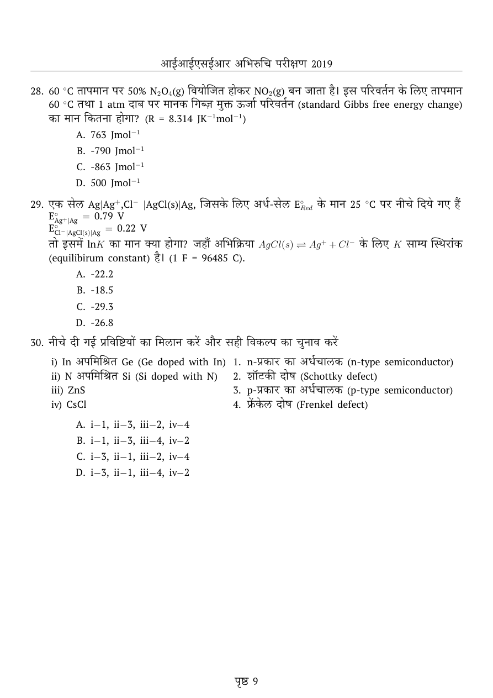

## PDF page 10

[Open original PDF at page 10](../pdf/IAT_2019_Hindi_paper.pdf#page=10)

### Searchable text - OCR draft (hin+eng)

```text
आईआईएसईआर अभिरुचि परीक्षण 20i9

गणित

BL. मान लीजिये GG... Gy समीकरण oc" - ,# > 3, के मूल हैं, तो

! + ! + + !
2-G'2-G 2-6,

का मान क्‍या है?

L4(n—2)2”
A. >So

l+n2r—t_2”
B, tena"

l+n2r—t_2”
C. ar-T4L
I+(n—)2"-2"- 7
D. ~ कक

32. निम्नलेखित समीकरण के अंतराल [0,20] में कुल कितने हल हैं?

sin’ x — l5sinxcos z+ 50 ९0$7 x = 0

aw Pp
Fr Oo fF

uo
wo

33. मान लीजिये 4 एक वास्तविक संख्यांओं का 4x 4 कोटि का आव्यूह है। मान लीजिये

व |] 0
K = v2 A x2 _ 0
x3 x3 0
24 La 0
a ia Yi
C2 ८2 Yo जहाँ हु
J = =A , जहाँ ५, ७०, 43,44 ER
८3 C3 ys |? हो Yi, ४०, ४3, ४4
C4 C4 Ya
यदि K - ०, तो निम्नलिखित में से कौन सा कथन सदैव सत्य है?
A. 4? - 0.
B. A सममित है।
८. A विषम सममित है।
9. 4? - 4.

पृष्ठ 0
```

### Original page image

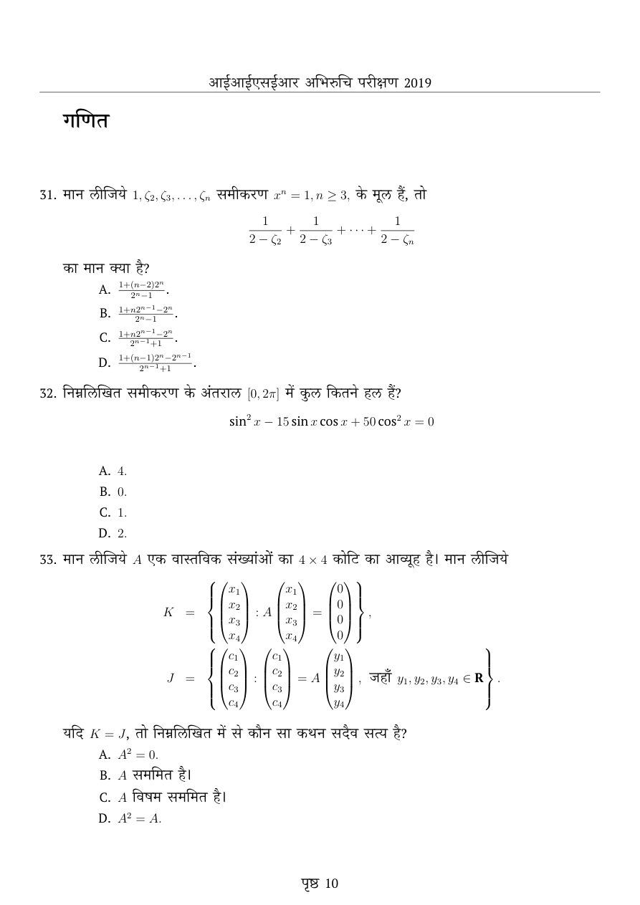

## PDF page 11

[Open original PDF at page 11](../pdf/IAT_2019_Hindi_paper.pdf#page=11)

### Searchable text - OCR draft (hin+eng)

```text
आईआईएसईआर अभिरुचि परीक्षण 20i9

34.

35.

36.

37.

38.

एक समतल में 5 सरल रेखायें इस प्रकार हैं कि उन में से कोई भी दो रेखायें समांतर नहीं हैं और
कोई भी तीन एक बिंदु पर प्रतिच्छेद नहीं करती हैं। तो ये रेखायें समतल को कितने असंयुक्त क्षेत्रों में
विभाजित करती हैं?

A. 7.
8. 8.
C. 6.
9. 20.

मान लीजिये बिंदुओं (,0) एवं 0,i) से गुजरने वाला लघुत्तम (smallest) AIH का वृत्त C है। तो
बिंदु (0,) पर वृत्त C की स्पर्शरेखा का समीकरण क्‍या है?

2. y=-a4+l.
8. y=a-l.
C. ३ ८5०.
90. y=a+.
मान लीजिये / :(-L.) oR एक सतत फलन है। निम्नलिखित क्षेत्र पर विचार कीजिये
S= {(« y):-l<a<l एव 0<y< fi )}
निम्नलिखित में से किस फलन fh लिये क्षेत्र 5 का क्षेत्रफल महत्तम है?
(x) = n*|sin r2|
(x) = ग | cos 72
(2) = n* (l + |tan 22]).
(x)

xu

jz|+l

r लीजिये कि / : ROR एक सतत फलन है, तो निम्नलिखित में से किस परिस्थिति में / आच्छादक
?

A. lim f(x) = ०० एवं lim f(r) =

00 @—>—00

8. lim f(a) =0 एवं lim f(x) =

00 @—>—00

C. lim f(a) =0 एवं lim f(x) =—oo.

00 @—>—00

9. lim f(x) = —co UF lim f(z) =

00 @—>—00

सीमा im ag Yo RO

noo k=l

A. का मान st Bl
8. का मान 5 है।

८. का मान sty है।
9. का अस्तित्व नहीं है।

पृष्ठ ll
```

### Original page image

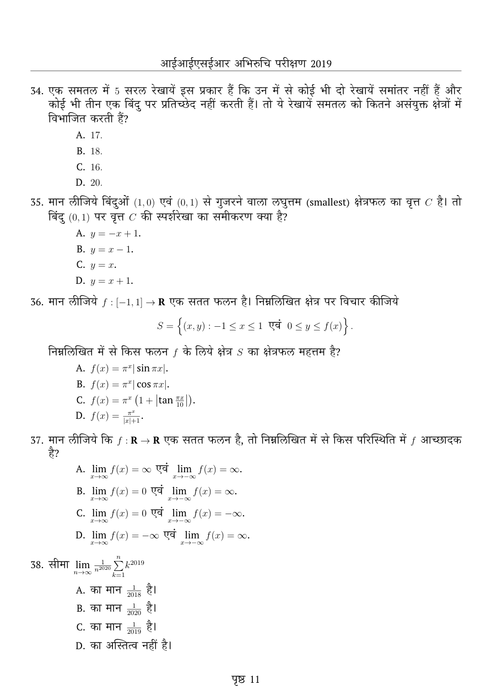

## PDF page 12

[Open original PDF at page 12](../pdf/IAT_2019_Hindi_paper.pdf#page=12)

### Searchable text - OCR draft (hin+eng)

```text
आईआईएसईआर अभिरुचि परीक्षण 20i9

59. पूर्णाक संख्याओं की एक समांतर श्रेणी के # क्रमागत पदों का योग i6i है, तो n का संभावित मान
क्या है?

A.

B. 7.

C. 6.

D. 8

ol

40. मान लीजिये कि एक अश्यून्य सम फलन f: ROR इस प्रकार है कि

f(x)dz =a,
[,
तो समाकल ।
[ (०) 4,
झट
का मान क्‍या है?
A. a.
B. ae.
८. $.
D. =

2

लिए

4\. निम्नलिखित आँकड़ों के लिए arg के सापेक्ष माध्य विचलन क्या है?

a | l|2)|3)4
fi || 5 | 70] 5 | 20

0 एए एड
cules जन

cue

9.

=

42. मान लीजिये s एक ऐसा अरिक्त समुच्यय है कि जिसके 2 या 2 से कम अवयवों वाले उपसमुचयों की
कुल संख्या 6 है। तो 9 में अवयवों की कुल संख्या कितनी है?
A. 5.
B. 6.
८. 6.
D. 7.

पृष्ठ 2
```

### Original page image

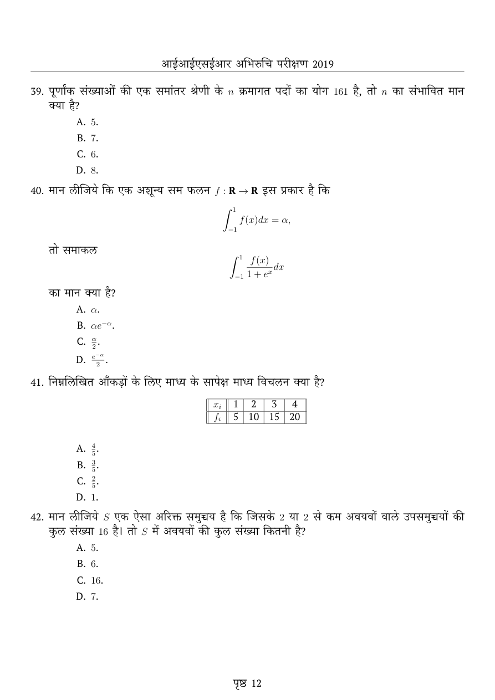

## PDF page 13

[Open original PDF at page 13](../pdf/IAT_2019_Hindi_paper.pdf#page=13)

### Searchable text - OCR draft (hin+eng)

```text
आईआईएसईआर अभिरुचि परीक्षण 20i9

45. निम्नलिखित चित्र में दर्शाये गये समांतर चतुर्भुज ABCD में 46६ = CR - 2, जहाँ # एक धनात्मक पूर्णाक

AB CD” 7n

al
D F Ven
x Y
AE B
यदि भुजा AC की लंबाई ७ है, तो भुजा XY की लंबाई कितनी है?
A. 5.
B. हर:
९. “री.
Dp, wave,

n

44. मान लीजिये कि ४१ में $, 9 एवं £ क्रमशः », y एवं 2-HeT के अनुदिश इकाई सदिश (unit vectors)
हैं। निम्नलिखित समुच्चयों पर विचार कीजिये

X = (लक bp + ck: a,b,c € {-,0, uy} एव
Y = [(0,०,,०७) : 0, ०), 0; EX तथा ०,,०,, ० परस्पर लम्बवत्‌ इकाई सदिश (प्रापा। ए९८०5) हैं).
तो ४ में कितने अवयव हैं?

A. 27.
8. 24.
C. 36.
9. 48.

45. समुचय {,2,...,l0} में से यादच्छिक तरीके से चुने गए 3 अवयवों #», 9,» के प्रतिबंध ety +2 =5
को संतुष्ट करने की प्रायिकता क्‍या है?

3
000°

a
200°

B.
C. a
9.

>

000°

3
500°

पृष्ठ 3
```

### Original page image

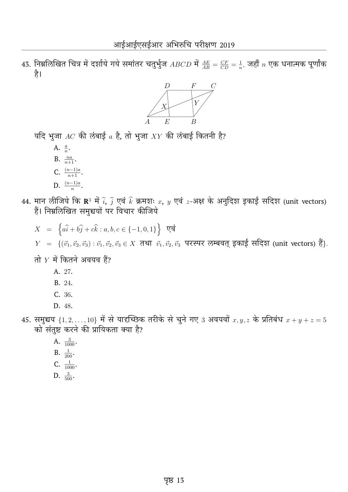

## PDF page 14

[Open original PDF at page 14](../pdf/IAT_2019_Hindi_paper.pdf#page=14)

**Matching embedded figure, English PDF page 13:** Physics Q47: a cube is drawn in perspective, with charge Q at one vertex and a shaded square face ABCD. The selected face and the location of the charge determine the flux being requested.

### Searchable text - OCR draft (hin+eng)

```text
आईआईएसईआर अभिरुचि परीक्षण 20i9

भौतिकी

46. एक # द्रव्यमान का कण, M (॥४ > #0 द्रव्यमान के दूसरे स्थिर कण के परितः गुरुत्वाकर्षण बल के
प्रभाव मे » त्रिज्या के वृत्ताकार कक्षा मे परिक्रमा कर रहा है। अनंत दूरी पर गुरुत्वाकर्षण के कारण

स्थैतिक ऊर्जा शून्य है। यदि परिक्रमा करने वाले कण की सम्पूर्ण ऊर्जा # है, तो उसका कोणीय संवेग
कितना होगा?

A. rV2Em
B. r/—2Em
८. r\/—Em/2
Dz r/Em/2

47. चित्रानुसार, एक वैद्युत आवेश Q घन के एक कोने में रखा है। घन के इयाम YS ABCD से गुजरने वाला
age फ्लक्स कितना होगा? (c, Prater की विद्युतशीलता है)

im 7 c

Q
C. Bc,
9. हि
2465

48. द्र॒व्यमान m के उदासीन गैस अणु, जिनका तापमान 7 है, एक पात्र में रखे हैं जहां गुरुत्वाकर्षण शून्य

Sl इन गैस अणुओं की औसत दे ब्रोग्ली तरंगदैर्ष्य (6९ Broglie wavelength) \ उनके तापमान 7' पर
कैसे निर्भर करती है?

A. \« VT
B. \xl/T?
C. Ax I/VT
D. Ax T?

पृष्ठ 4
```

### Original page image

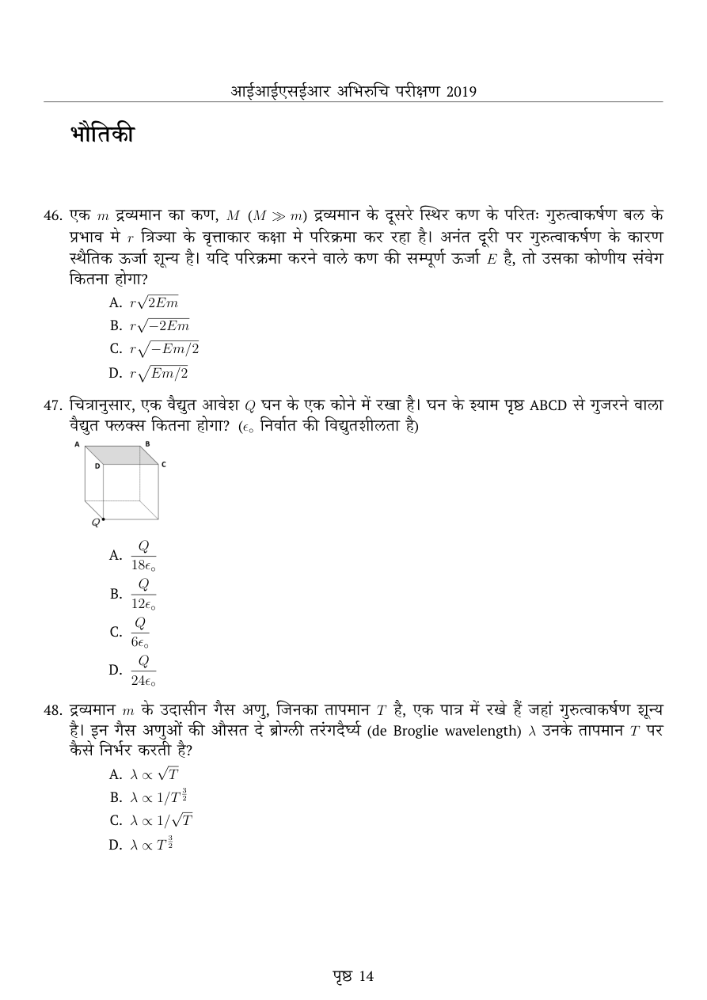

## PDF page 15

[Open original PDF at page 15](../pdf/IAT_2019_Hindi_paper.pdf#page=15)

**Matching embedded figure, English PDF page 14:** Physics Q50: two long straight wires lie along perpendicular axes, meeting near the origin. Their current directions and the labels A and B are shown, so forces or torques must be interpreted in three dimensions.

### Searchable text - OCR draft (hin+eng)

```text
आईआईएसईआर अभिरुचि परीक्षण 20i9

49. ऐकिक द्रव्यमान वाले एक कण को प्रारम्भिक चाल ७ तथा Afast तल से ७ कोण बनाते हुए फेंका
जाता है। इस कण के कोणीय संवेग का परिमाण इसके प्रक्षेप्प बिन्दु के संदर्भ से / समय पर, जबकि
वह प्रक्षेपण अवस्था में है, क्या होगा ?

A. 2gt?u. cos @

L 42 ,
B. 5gtv. cos ९
C. 2gt?v, sind

D. 3gt?v. sind

50. चित्रानुसार, दो लंबे तथा पतले चालक A और 8, जो क्रमश: क्षैतिज और Hate हैं, उनमें वैद्युत

धारा 7 प्रवाहित हो रही है। यदि चालक A को स्थिर माना जाए तो निम्नलिखित विकल्पों में से कौन सा
विकल्प सही है?

—

A.B +a अक्ष की fear में नेट बल का अनुभव करता है।
8. 8 नेट वामावर्त बल ATT का अनुभव करता zl

८. 8 -» अक्ष की fear में नेट बल का अनुभव करता है।
9. 8 नेट दक्षिणावर्त बल आघूर्ण का अनुभव करता है।

5l. दाब P तथा आयतन ४ के पात्र में आदर्श गैस के ON अणु हैं। इस पात्र में हुए एक छिद्र से आसानी से
रिसते अणुओं की औसत गतिज ऊर्जा क्‍या होगी?

3727

PV

3PV

2PV

A.

B.

पृष्ठ 5
```

### Original page image

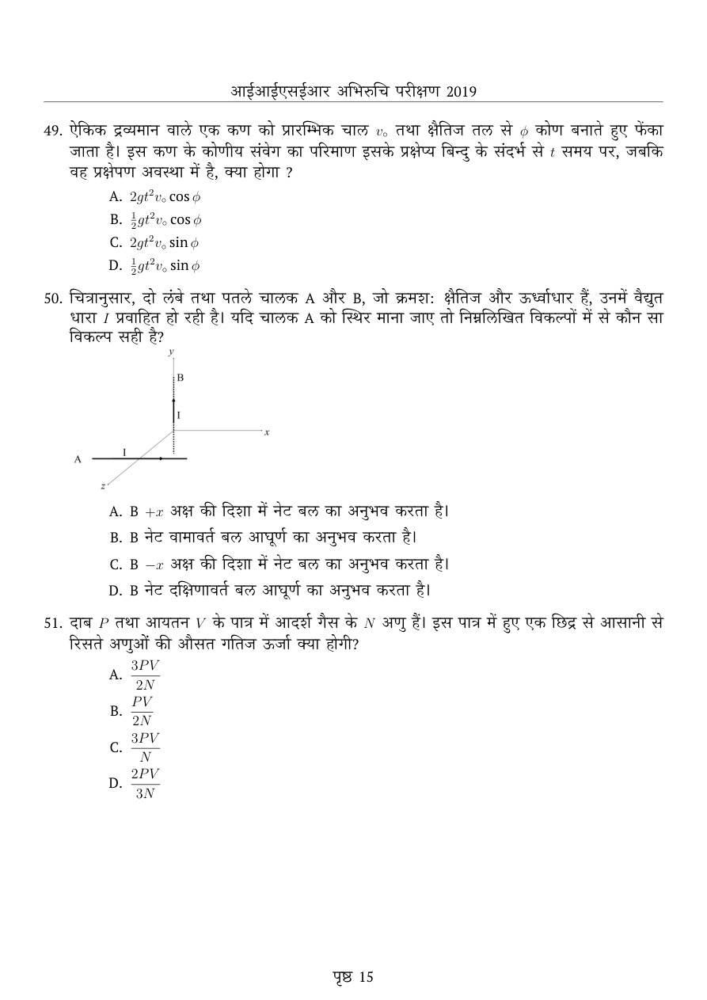

## PDF page 16

[Open original PDF at page 16](../pdf/IAT_2019_Hindi_paper.pdf#page=16)

**Matching embedded figure, English PDF page 15:** Physics Q53: a block on a frictionless horizontal line is attached to left and right fixed walls by springs labelled k and 4k. Q55: a capacitor is the middle branch of a diamond-shaped circuit, with resistors and a source on its outer sides; branch topology matters.

### Searchable text - OCR draft (hin+eng)

```text
आईआईएसईआर अभिरुचि परीक्षण 20i9

52. यदि #, ८ तथा 6 क्रमशः प्लांक स्थिरांक, प्रकाश की चाल तथा गुरुत्वाकर्षण स्थिरांक हैं तो निम्न में से
कौन सी अभिव्यक्ति ऊर्जा को दर्शाती है?

aS
Cc 3
/'s
G

he
G

lS
9. =
he

53. चित्रानुसार, एक ठोस खंड को घर्षण रहित सतह पर बाँयीं और दाहिनी तरफ से दो कमानियों, जिनके
कमानी नियतांक क्रमश: # और 4 हैं, के सहारे दो दृढ़ दीवारों से जोड़ा गया है। यदि खंड द्वारा
साम्यावस्था के इर्द गिर्द दोलन के दौरान बाँयीं ओर तथा दाहिनी ओर में व्यतीत समय t, तथा te हैं तो
निम्न में से कौन सा कथन सत्य है?

B.

C.

wf ew
k 4k
A. t, =2tr
B. t, =tr/2
C. th =tr
9. t, =4tr

54. दो सकेंद्रित गोलीय खोलों से निर्मित एक संधारित्र की धारिता ०, है | यदि दोनों खोलों की त्रिज्याओं
को आधा कर दिया जाए तो नयी धारिता क्‍या होगी?

A. C./2
B. 42५
९०.०५

9. C./Vv2

पृष्ठ 6
```

### Original page image

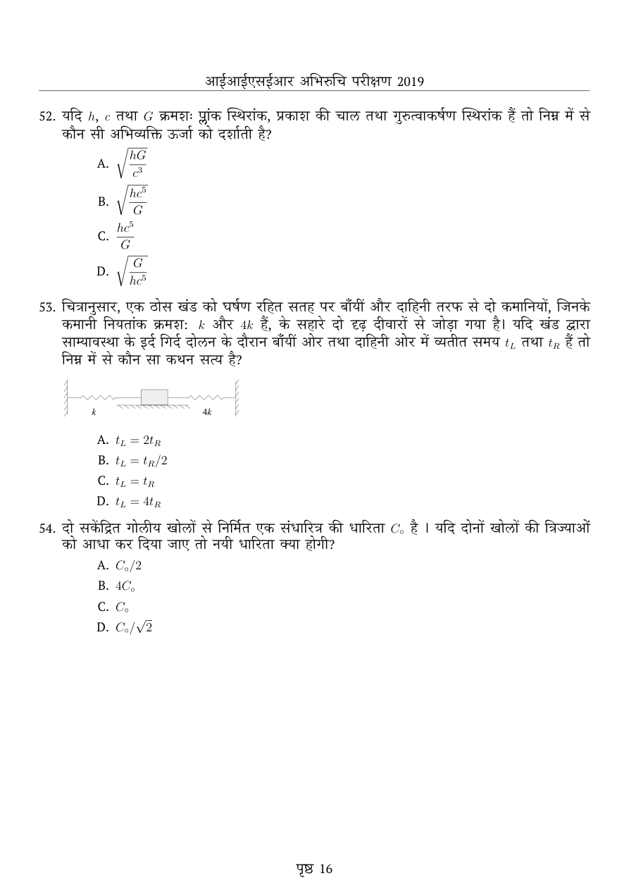

## PDF page 17

[Open original PDF at page 17](../pdf/IAT_2019_Hindi_paper.pdf#page=17)

**Matching embedded figure, English PDF page 15:** Physics Q53: a block on a frictionless horizontal line is attached to left and right fixed walls by springs labelled k and 4k. Q55: a capacitor is the middle branch of a diamond-shaped circuit, with resistors and a source on its outer sides; branch topology matters.

### Searchable text - OCR draft (hin+eng)

```text
आईआईएसईआर अभिरुचि परीक्षण 20i9

55. चित्र में दिये गए परिषथ में संधारित्र को पूर्ण धारिता के 20 गुना आवेशित होने में लगने वाला
समय # कितना होगा?

A. t > co
8. ४-८ /7९८
C. t =27RC
D. t= RC

56. हाइड्रोजन परमाणु में इलेक्ट्रॉन की नियत कक्षाओं में ऊर्जा #,, = -i3.6/n? ev होती है। हाइड्रोजन
परमाणु की इन कक्षाओं में इलेक्ट्रॉनिक संक्रमणों से उत्सर्जित होने वाले फोटॉन की अधिकतम आवृत्ति
कितनी होगी? (h = 6.62 x 0-84 Js; ९ = .6 x 0-!9 ©)

A. 2.l x 0° GHz
8. 5.5 x 0° GHz
C. 3.3 x 0° GHz

D. i.7 x 0° GHz
57. निम्न में से कौन सा कथन नियत संख्या के आदर्श गैस कणों & P-v ARS (P-V diagram) के लिये

सही नहीं है?
A. दो रूद्धोष्म वक्र एक दूसरे को कभी नही काटते।
8. दो समतापीय वक्र एक दूसरे को कभी नही काटते।
८. एक समतापीय वक्र और Uh Ree वक्र एक दूसरे को एक ही बिंदु पर काठते हैं।
9. एक समतापीय वक्र और एक रूद्धोष्म वक्र॒ एक दूसरे को एक से ज्यादा बिंदुओं पर काटते

हैं।

58. एक ही धातु से निर्मित एकसमान द्रव्यमान के ठोस घन, बेलन (जिसका व्यास उसकी ऊँचाई के बराबर
है) तथा गोले का प्रारम्भिक तापमान 50*2' है। यदि इन तीनों को icc तापमान के पानी के विशाल
भंडार में डाला जाए तो इनमें से कौन सबसे जल्दी ठंडा होगा?

A. बेलन
8. गोला

०. घन
9. तीनों एक ही दर से

पृष्ठ 7
```

### Original page image

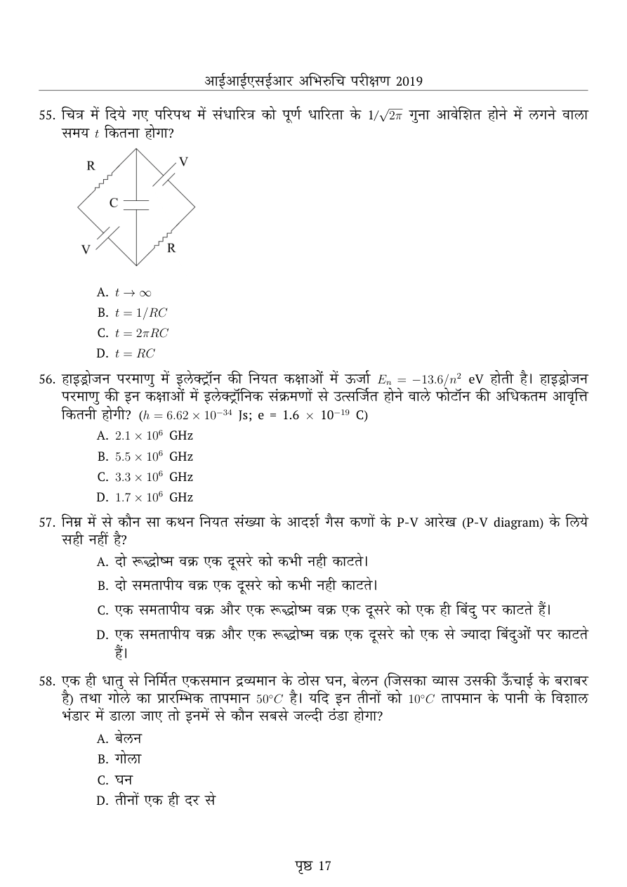

## PDF page 18

[Open original PDF at page 18](../pdf/IAT_2019_Hindi_paper.pdf#page=18)

**Matching embedded figure, English PDF page 16:** Physics Q60: an isosceles triangle has apex A and base vertices B and C carrying equal charges q. The base has length a, the full altitude is h, and an internal horizontal level is marked at height h/3 above the base.

### Searchable text - OCR draft (hin+eng)

```text
आईआईएसईआर अभिरुचि परीक्षण 20i9

59.

60.

एक UES. प्रदर्शन पटल (LED display) में 00 पिक्सेल प्रति cm? हैं। यदि आँखों की पुतलियों
का व्यास 5 mm है तथा एल.ई.डी. प्रदर्शन पटल का औसत तरंगदैर्घ्य 575 nm है तो किसी व्यक्ति को
पटल से कितनी निकटतम दूरी पर होना होगा जिससे एल.ई.डी. प्रदर्शन पटल पिक्सेलेटेड (pixelated)

ना दिखे?
A. 30.23 m
B. 7.2 m
C. 4.52 m
D. 20.32 m

चित्रानुसार, आधार ७ तथा ऊँचाई h = 3V3a/2 वाले एक समकद्विबाहु त्रिभुज के शीर्षों 9 तथा cu
दो समान धनावेश (५) रखे गये हैं। यदि शीर्ष 4 पर # आवेश रखा जाए, तो त्रिभुज के अंदर एक बिंदु
पर इन तीनों आवेशों के कारण वैद्युत क्षेत्र की तीव्रता शून्य पायी जाती है। यदि यह बिंदु त्रिभुज की
ऊँचाई के एक तिहाई ऊँचाई पर है तो og! आवेश का मान क्‍या होगा?

A

—
ao

/ h3
/_ |
B Cc
a
A. ६ = —3V3q
B. d = +3V3q
C. ६ =4+V3¢
9. ¢ =—v3q

पृष्ठ 8
```

### Original page image

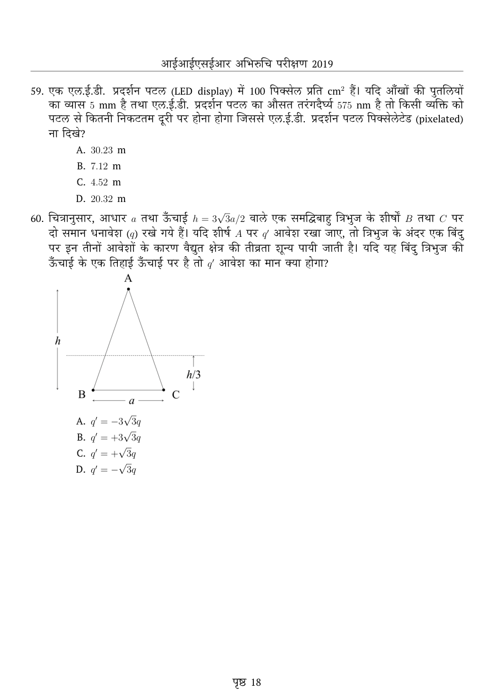
