# IAT 2021 - English

Original PDF: [IAT_2021_English_paper.pdf](../pdf/IAT_2021_English_paper.pdf)

- Acquisition: PYQP public Google Drive mirror; not downloaded from the official server.
- Downloaded: 28 October 2026. PDF pages: 20.
- Exact download/source URL: https://drive.google.com/file/d/1s25yA7z0fjypzMoIImCZVr8RecSXMDnk/view?usp=share_link
- PDF SHA-256: `e0f277c192388af22011aaac3e6190ffd7f6c991f3f3559c6aa259007ee02d71`
- This is a search/accessibility copy of an existing paper, not newly authored mock content.
- Text is mechanically extracted or OCR-derived and has not been proofread character by character. Equations, option letters, chemical bonds, tables and Hindi OCR can contain errors. The PDF and page images are authoritative.
- Figure descriptions are explanatory annotations, not official answers or complete structural/formula transcriptions. Use the linked image to resolve exact labels, values and stereochemistry.

## Visual guide

- [English PDF page 2](#pdf-page-2): Biology Q6: a two-column table lists treatments T1-T6 and experimental conditions involving heat-killed S bacteria, live R bacteria, RNase or DNase and injection into mice. Each row must remain paired with its treatment label.
- [English PDF page 3](#pdf-page-3): Biology Q8: circular plasmid XYZ21 is 4000 bp, with PstI at 800, EcoRI at 1700, HindIII at 1920 and SalI at 2460. Q9: rate of photosynthesis versus leaf temperature compares dotted curve P1, with a lower-temperature peak, against solid curve P2, with a higher peak at a higher temperature.
- [English PDF page 4](#pdf-page-4): Biology Q10: panel (i) plots internal versus external temperature, with X approximately horizontal and Y increasing. Panel (ii) plots surface-area-to-volume observations for animal types a and b, with a above b. These labels must be interpreted together.
- [English PDF page 5](#pdf-page-5): Biology Q13: a table matches interacting species with interaction categories. Q15: floral-formula options A and B use symmetry/sex symbols, parentheses around organ numbers and a gynoecium position mark; the remaining options continue on the next page.
- [English PDF page 6](#pdf-page-6): Continuation of Biology Q15: floral-formula options C and D. Preserve the distinctions between organ fusion, organ number, symmetry and ovary-position notation; OCR frequently flattens these symbols.
- [English PDF page 8](#pdf-page-8): Chemistry Q21 shows four sawhorse conformations labelled I-IV. Q22 compares four substituted chlorobenzenes, including differently placed nitro and methoxy groups. Q23 gives a multistep route from an acyl chloride through labelled intermediates P, Q, R and S with reagents above the arrows.
- [English PDF page 9](#pdf-page-9): Chemistry Q24: four drawn candidate products of salicylaldehyde treated with one equivalent of methylmagnesium bromide. The options vary the phenolic and aldehyde-derived groups, so their exact connectivity matters.
- [English PDF page 10](#pdf-page-10): Chemistry Q30: a reversible X-Y-Z reaction scheme gives forward and reverse rate multipliers. Candidate free-energy profiles A and B show two activation barriers and different relative levels of X, Y and Z. More options continue on page 11.
- [English PDF page 11](#pdf-page-11): Continuation of Chemistry Q30: free-energy versus reaction-coordinate profiles C and D. Both have two barriers, but the relative well depths and barrier heights differ.
- [English PDF page 16](#pdf-page-16): Physics Q46: four plots of angular speed versus distance from a door's hinge are offered for a pellet hitting a freely hinged door. They include linear and curved rising branches over the door width L; examine the axes and branch shapes in the source.
- [English PDF page 17](#pdf-page-17): Physics Q50: a rectangular three-branch circuit includes 4 kOhm and 2 kOhm resistors on the top branch, 2 and 4 microfarad capacitors in the middle, and a 12 V cell with additional resistors below. Two keys K1 and K2 control the connections.
- [English PDF page 18](#pdf-page-18): Physics Q54: a logic circuit sends an XOR result from inputs 1 and P and an AND result from inputs 1 and Q into a final NAND gate. The output is marked 0; gate type and fixed input labels are essential.

## Page index

[p1](#pdf-page-1) | [p2](#pdf-page-2) | [p3](#pdf-page-3) | [p4](#pdf-page-4) | [p5](#pdf-page-5) | [p6](#pdf-page-6) | [p7](#pdf-page-7) | [p8](#pdf-page-8) | [p9](#pdf-page-9) | [p10](#pdf-page-10) | [p11](#pdf-page-11) | [p12](#pdf-page-12) | [p13](#pdf-page-13) | [p14](#pdf-page-14) | [p15](#pdf-page-15) | [p16](#pdf-page-16) | [p17](#pdf-page-17) | [p18](#pdf-page-18) | [p19](#pdf-page-19) | [p20](#pdf-page-20)

## PDF page 1

[Open original PDF at page 1](../pdf/IAT_2021_English_paper.pdf#page=1)

### Searchable text - PDF text layer

```text
IISER Aptitude Test 2021

                               Biology

1. Which one of the following epithelial cell types is commonly found in the inner surface of the fallopian
   tubes?

        A. Ciliated

        B. Columnar

        C. Squamous

        D. Cuboidal

2. Which of the following is not an asexual reproductive structure?

        A. Isogametes of Cladophora

        B. Conidia of Penicillium

        C. Zoospores of Chlamydomonas

        D. Gemmules in a sponge

3. Which one of the following is an example of palindromic DNA sequence?
        A. 5′ GAATTC 3′
                3′ CTTAAG 5′
        B. 5′ GACTTC 3′
                3′ CTGAAG 5′
        C. 5′ GAAGTC 3′
                3′ CTTCAG 5′
        D. 5′ GACCAG 3′
                3′ CTGGTC 5′

4. Some individuals start sneezing when the pollen content is high in the air. Primarily which Ig isotype
   will these individuals produce as an immune response?

        A. IgE

        B. IgA

        C. IgM

        D. IgG1

5. Which of these factors is least likely to cause deviation from the Hardy-Weinberg equilibrium?

        A. Reduction in population size

        B. Mutation

        C. Gene flow

        D. Genetic drift
```

### Original page image

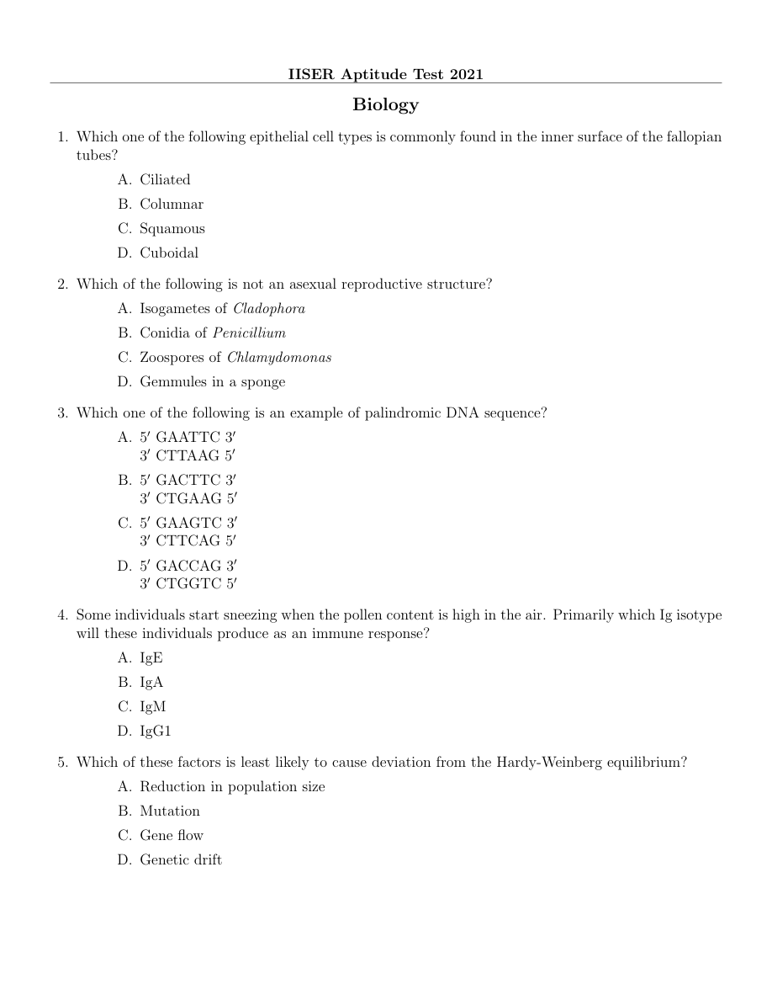

## PDF page 2

[Open original PDF at page 2](../pdf/IAT_2021_English_paper.pdf#page=2)

### Visual description

Biology Q6: a two-column table lists treatments T1-T6 and experimental conditions involving heat-killed S bacteria, live R bacteria, RNase or DNase and injection into mice. Each row must remain paired with its treatment label.

### Searchable text - PDF text layer

```text
6. Motivated by the classic experiment by Frederick Griffith and the work of Avery, Macleod and
  McCarty to identify the transforming principle, a scientist redesigned and performed the experiment
   with S-strain and R-strain of Streptococcus pneumonae as summarized in the table below.

   Treatment                 Experimental Condition
      T1                     S-strain (heat-killed) injected into mice
      T2       S-strain (heat-killed) + R-strain (live) together injected into mice
      T3       Nucleic acids isolated from S-strain (heat-killed) + R-strain (live),
                          incubated with RNase, and injected into mice
      T4       Nucleic acids isolated from S-strain (heat-killed) + R-strain (live),
                          incubated with DNase, and injected into mice
      T5                         S-strain (live) injected into mice
      T6                       R-strain (live) injected into mice

  From the options below, identify the outcomes of the treatments (T1 to T6) on the viability of the
   mice.

        A. T1: live, T2: die, T3: die, T4: live, T5: die, T6: live

        B. T1: live, T2: live, T3: die, T4: live, T5: live, T6: live

        C. T1: live, T2: die, T3: die, T4: die, T5: live, T6: die

        D. T1: live, T2: die, T3: live, T4: die, T5: die, T6: live

7. Which of the following is/are produced by a plant during photosynthesis with far-red light?

        A. Only ATP
        B. ATP, NADPH and H+
        C. NADPH and H+

        D. Only NADPH

8. The map of a 4000 base pair (bp) plasmid DNA marking the locations of different restriction enzyme
   cut sites is shown in the figure below. The numbers in brackets indicate the base pair positions
   where the enzymes cut. This plasmid is completely digested first with the combination of restriction
  enzymes PstI and HindIII, and then with EcoRI and SalI. The final digested plasmid is analyzed by
   agarose gel electrophoresis.


                                        Page 2
```

### Original page image

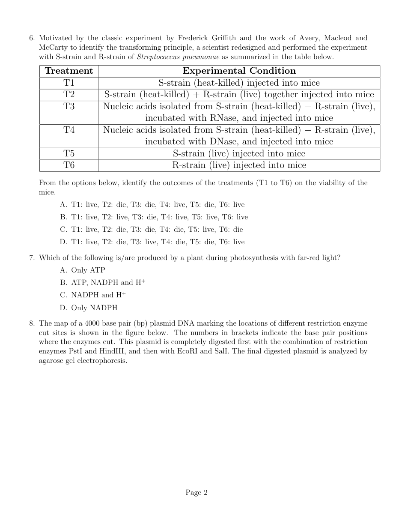

## PDF page 3

[Open original PDF at page 3](../pdf/IAT_2021_English_paper.pdf#page=3)

### Visual description

Biology Q8: circular plasmid XYZ21 is 4000 bp, with PstI at 800, EcoRI at 1700, HindIII at 1920 and SalI at 2460. Q9: rate of photosynthesis versus leaf temperature compares dotted curve P1, with a lower-temperature peak, against solid curve P2, with a higher peak at a higher temperature.

### Searchable text - PDF text layer

```text
Which one of the following options correctly represents the bands sizes (in bp) obtained on the gel?

        A. 220, 540, 900 and 2340

        B. 220, 540, 1200 and 2040

        C. 540, 760, 1200 and 1500

        D. 320, 540, 800 and 2340

9. The following plot represents the change in the rate of photosynthesis with leaf temperature for two
   plants, P1 and P2.


  Which one of the following statements correctly describes the characteristics of P1 and P2 plants?

        A. Plant P1 is a C3 plant having temperate adaptation whereas Plant P2 is a C4 plant with
             tropical adaptation


                                        Page 3
```

### Original page image

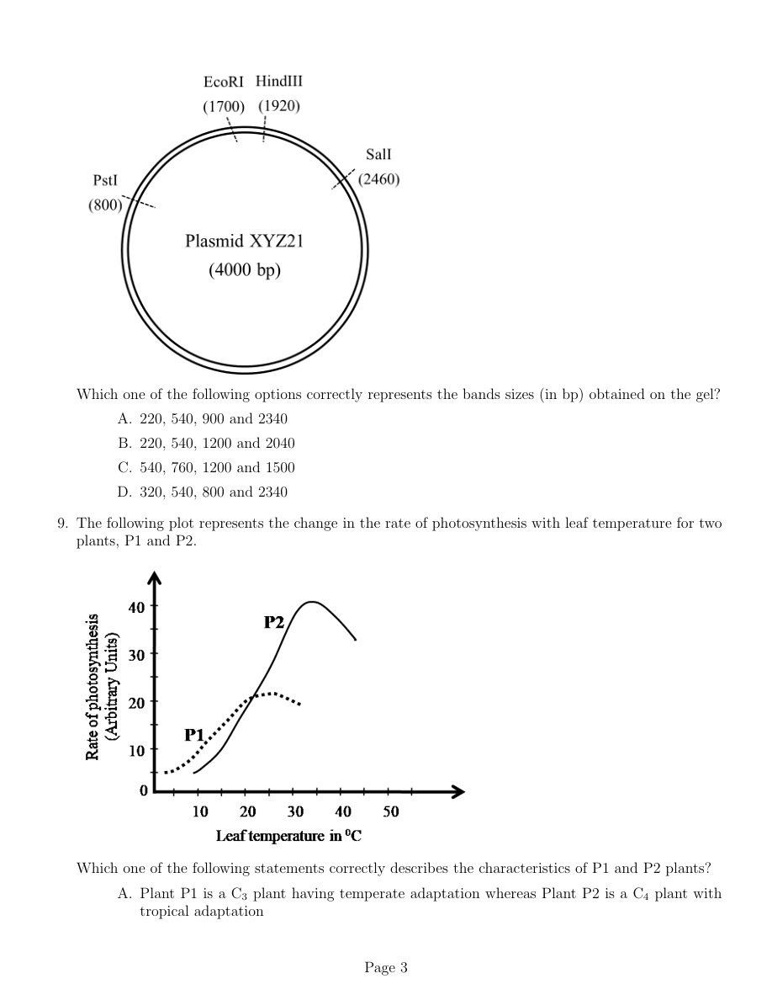

## PDF page 4

[Open original PDF at page 4](../pdf/IAT_2021_English_paper.pdf#page=4)

### Visual description

Biology Q10: panel (i) plots internal versus external temperature, with X approximately horizontal and Y increasing. Panel (ii) plots surface-area-to-volume observations for animal types a and b, with a above b. These labels must be interpreted together.

### Searchable text - PDF text layer

```text
B. Plant P1 is a C4 plant having temperate adaptation whereas Plant P2 is a C3 plant with
               tropical adaptation

         C. Plant P1 is a C4 plant having tropical adaptation whereas Plant P2 is a C3 plant with
            temperate adaptation

         D. Plant P1 is a C3 plant having tropical adaptation whereas Plant P2 is a C4 plant with
            temperate adaptation

10. The figure (i) represents two categories of animals (X and Y) with respect to their response to the
    external environment. The figure (ii) represents two broad categories of animals (Type a and Type
    b) with respect to their body surface area to volume ratio.


   Which combination most suitably represents the following animals in the order: humming bird;
    crocodile; frog; polar bear?

         A. Xa; Yb; Ya; Xb

         B. Xb; Ya; Yb; Xa

         C. Ya; Yb; Xa; Xb

         D. Yb; Xb; Xa; Ya

11. In plants, ammonium ions are produced by protonation of ammonia.  Which enzyme uses these
   ammonium ions to convert an alpha-keto acid into an amino acid?

         A. Glutamate dehydrogenase

         B. Nitrogenase

         C. Transacetylase

         D. Lactate dehydrogenase

12. Which one of the following physiological functions is common between the small intestine and the
    renal tubules?


                                         Page 4
```

### Original page image

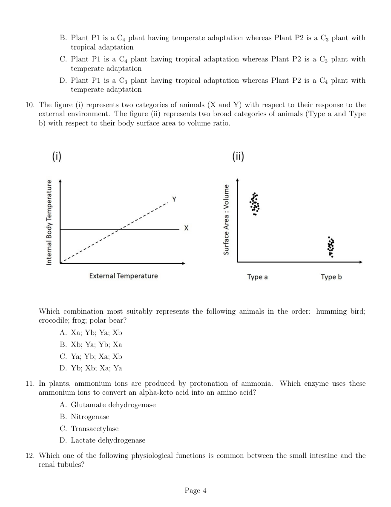

## PDF page 5

[Open original PDF at page 5](../pdf/IAT_2021_English_paper.pdf#page=5)

### Visual description

Biology Q13: a table matches interacting species with interaction categories. Q15: floral-formula options A and B use symmetry/sex symbols, parentheses around organ numbers and a gynoecium position mark; the remaining options continue on the next page.

### Searchable text - PDF text layer

```text
A. Absorption of glucose

         B. Excretion of waste materials

         C. Excretion of water

         D. Absorption of proteins

13. Match the following pairs of interating species to the corresponding names of the interactions.

       Name of interacting species      Name of interaction
        i          Herbivores and Plants           a       Mutualism
       ii          Cuckoo and Crow           b        Predation
       iii      Sea anemone and Clown fish         c        Parasitism
     iv  Fungus and Cyanobacteria (Lichens)    d     Commensalism

    Pick the correct option from below.

         A.  i and b; ii and c; iii and d; iv and a

         B.  i and c; ii and b; iii and d; iv and a

         C.  i and b; ii and d; iii and c; iv and a

         D.  i and b; ii and a; iii and c; iv and d

14. The following events are associated with meiosis:

     i) appearance of recombinant nodules

      ii) formation of meiotic spindle

      iii) formation of chiasmata

    iv) formation of synaptonemal complex

   Which of the following is the correct sequence of these events during meiosis?

         A. iv →i →iii →ii

         B.  iii →iv →ii →i

         C. iv →iii →i →ii

         D.  i →iii →iv →ii

15. Which of the following floral formulae represents a zygomorphic flower with diadelphous androecium
   and superior ovary?


         A.


         B.


                                         Page 5
```

### Original page image

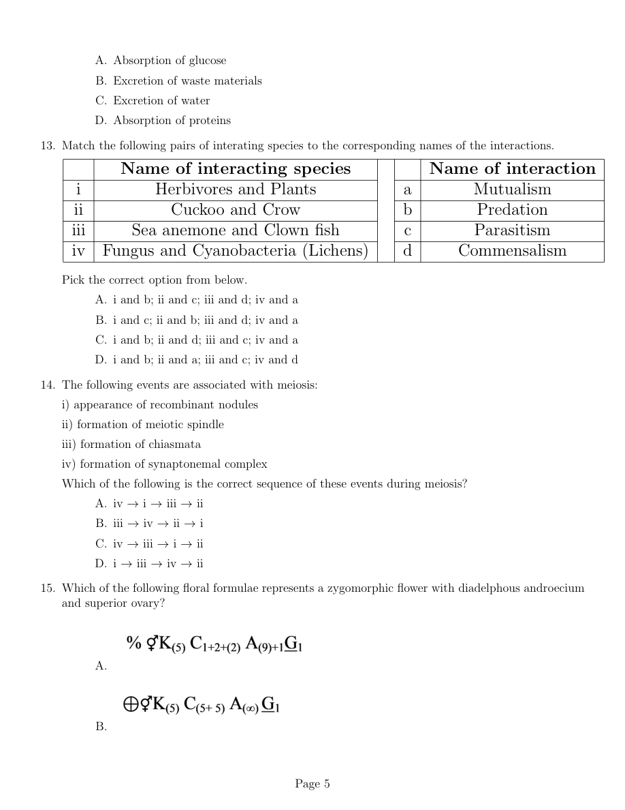

## PDF page 6

[Open original PDF at page 6](../pdf/IAT_2021_English_paper.pdf#page=6)

### Visual description

Continuation of Biology Q15: floral-formula options C and D. Preserve the distinctions between organ fusion, organ number, symmetry and ovary-position notation; OCR frequently flattens these symbols.

### Searchable text - PDF text layer

```text
C.


D.


                                Page 6
```

### Original page image

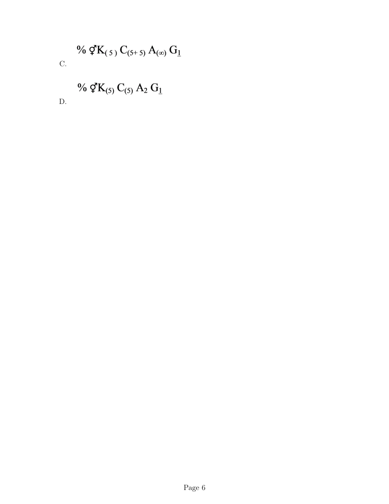

## PDF page 7

[Open original PDF at page 7](../pdf/IAT_2021_English_paper.pdf#page=7)

### Searchable text - PDF text layer

```text
Chemistry

16. The F-P-Cl bond angles in the most stable structure of PF3Cl2 are close to
         A. 90◦and 120◦.
         B. 90◦, 120◦, and 180◦.
         C. 90◦only.
         D. 90◦and 180◦.

17. The correct statement about the bond angles and bond lengths in Al2Cl6 is
    (Clt = terminal Cl; Clb = bridging Cl)
         A. ∠Clt–Al–Clt > ∠Clb–Al–Clb and Al–Clb > Al–Clt.
         B. ∠Clt–Al–Clt > ∠Clb–Al–Clb and Al–Clt > Al–Clb.
         C. ∠Clt–Al–Clt = ∠Clb–Al–Clb and Al–Clt > Al–Clb.
         D. ∠Clb–Al–Clb > ∠Clt–Al–Clt and Al–Clb > Al–Clt.

18. Among CH3SiCl3, (CH3)2SiCl2 and (CH3)3SiCl, which one is used to synthesize straight chain (linear)
   and which one is used to prepare branched chain (cross-linked) silicone polymer, respectively?

         A. (CH3)2SiCl2 and (CH3)SiCl3

         B. (CH3)SiCl3 and (CH3)2SiCl2

         C. (CH3)2SiCl2 and (CH3)3SiCl

         D. (CH3)3SiCl and (CH3)2SiCl2

19. Which one of the following statements is INCORRECT about a complex of a divalent ion with
    atomic number 25?
   (BM = Bohr Magneton)

         A. Complex with weak field ligands in tetrahedral geometry has a magnetic moment of 1.73
          BM.

         B. Complex with weak field ligands in tetrahedral geometry has a magnetic moment of 5.92
          BM.

         C. Complex with strong field ligands in octahedral geometry has a magnetic moment of 1.73
          BM.

         D. Complex with weak field ligands in octahedral geometry has a magnetic moment of 5.92
          BM.

20. Ni(CO)4 is diamagnetic because

         A. Ni has completely filled 3d orbitals.

         B.  it is a square planar complex.

         C. CO is a strong field ligand.

         D.  it has synergic bonding.


                                         Page 7
```

### Original page image

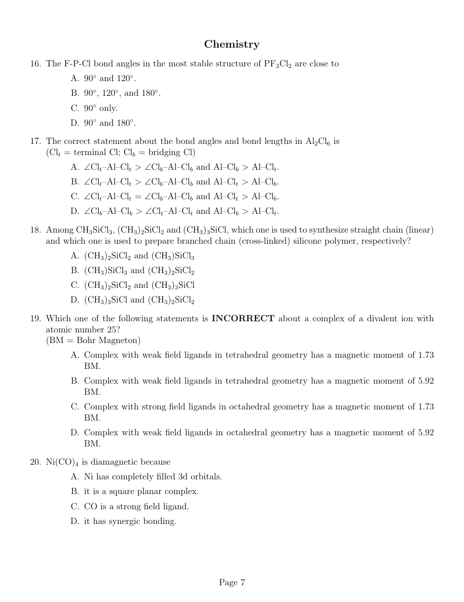

## PDF page 8

[Open original PDF at page 8](../pdf/IAT_2021_English_paper.pdf#page=8)

### Visual description

Chemistry Q21 shows four sawhorse conformations labelled I-IV. Q22 compares four substituted chlorobenzenes, including differently placed nitro and methoxy groups. Q23 gives a multistep route from an acyl chloride through labelled intermediates P, Q, R and S with reagents above the arrows.

### Searchable text - PDF text layer

```text
21. The correct order for the relative energies of the following sawhorse conformations is


         A. IV > III = II > I.

         B. IV > III > II > I.

         C. II ≈III > IV > I.

         D. I > II = III > IV.

22. Among the haloarenes (I–IV) shown below, the correct order of reactivity for the substitution reaction
    with NaOH is


         A. II > III ≈I > IV.

         B. I > IV > III > II.

         C. II > III > IV > I.

         D. IV > I ≈III > II.

23. Consider the following reaction sequence,


   and identify the correct statements:

     (i) The products P and R can form addition product with HCN.
     (ii) The product Q has no chiral center.
      (iii) The product R can undergo Cannizzaro reaction.
    (iv) The product S is a saturated hydrocarbon.

         A. (i) and (iv)

         B.  (iii) and (iv)

         C. (i) and (ii)


                                         Page 8
```

### Original page image

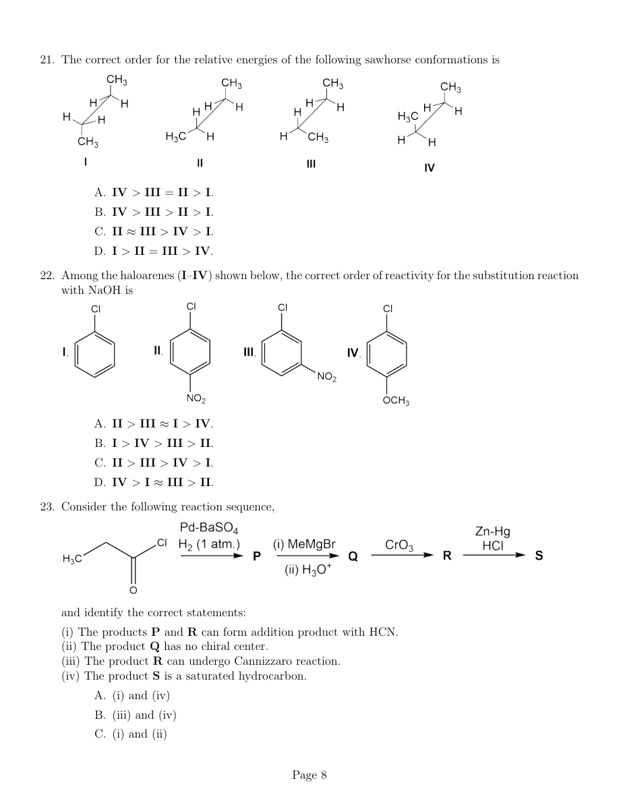

## PDF page 9

[Open original PDF at page 9](../pdf/IAT_2021_English_paper.pdf#page=9)

### Visual description

Chemistry Q24: four drawn candidate products of salicylaldehyde treated with one equivalent of methylmagnesium bromide. The options vary the phenolic and aldehyde-derived groups, so their exact connectivity matters.

### Searchable text - PDF text layer

```text
D.  (ii) and (iii)

24. The major product of the reaction of salicylaldehyde with one equivalent of MeMgBr, followed by
    acid neutralization is


         A. II.

         B. I.

         C. IV.

         D. III.

25. The total number of stereoisomers possible for the following structure is


         A. 8 .

         B. 4 .

         C. 2 .

         D. 6 .

26. For a homogeneous reaction involving ideal gases, equilibrium constants at 27 ◦C are Kp = 9.98 ×
    1027 and Kc = 4.0 × 1024.  If the enthalpy change of the reaction is −18.4 kJmol−1, the internal
    energy change is
    [Use R= 8.314 JK−1mol−1]
         A. −20.89 kJmol−1.
         B. −15.91 kJmol−1.
         C. −13.41 kJmol−1.
         D. −23.39 kJmol−1.

27. The probability density of an electron in 1s orbital for an H atom is maximum

         A. at the nucleus.

         B. at the Bohr radius.

         C. at twice the Bohr radius.

         D. at infinite distance.

28. Which of the following statements is INCORRECT?

         A. Half-life of a zero order reaction is proportional to the rate constant.


                                         Page 9
```

### Original page image

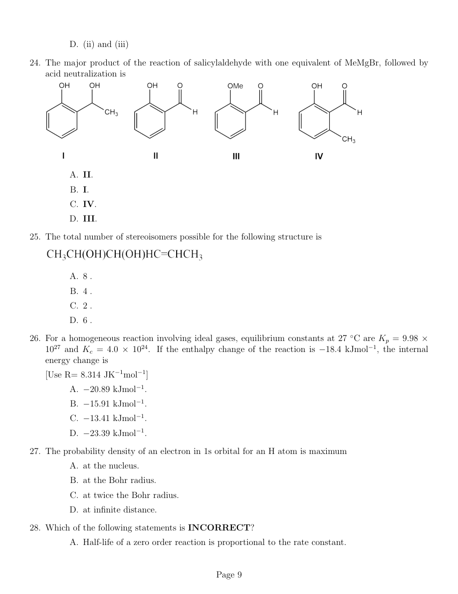

## PDF page 10

[Open original PDF at page 10](../pdf/IAT_2021_English_paper.pdf#page=10)

### Visual description

Chemistry Q30: a reversible X-Y-Z reaction scheme gives forward and reverse rate multipliers. Candidate free-energy profiles A and B show two activation barriers and different relative levels of X, Y and Z. More options continue on page 11.

### Searchable text - PDF text layer

```text
B. Half-life of a zero order reaction is proportional to the initial concentration of reactant.

         C. Half-life of a first order reaction is independent of the initial concentration of reactant.

         D. Half-life of a first order reaction is inversely proportional to the rate constant.

29. The time required for reducing 1 mole of MnO4 −(aq.)  to Mn2+(aq.) when a current of 2.5 A is
    passed during electrolysis is

         A. 53.6 hours.

         B. 12.9 microeconds.

         C. 10.7 hours.

         D. 64.8 microseconds.

30. Based on the relative stabilities and barriers, which among the following schematic energy diagrams
   would best correspond to the reaction scheme shown below? [k and k ′ are similar in magnitude]


         A.


         B.


                                        Page 10
```

### Original page image

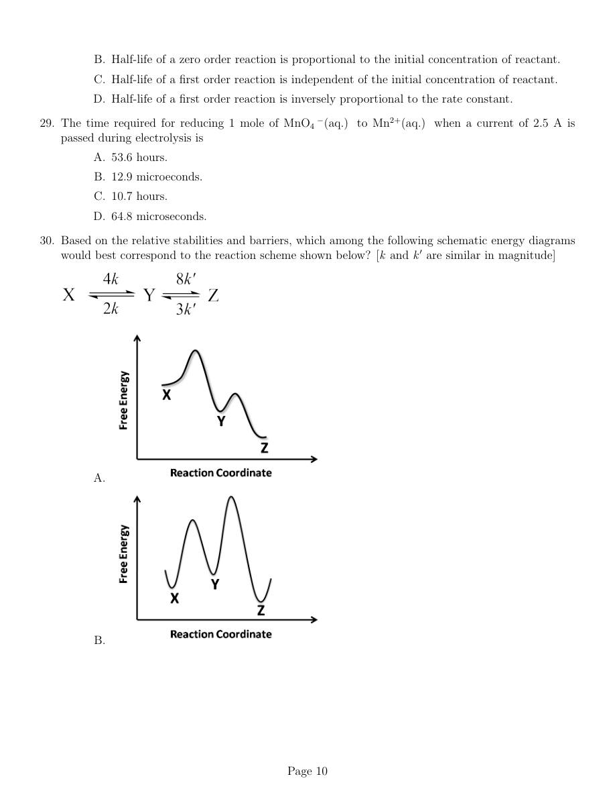

## PDF page 11

[Open original PDF at page 11](../pdf/IAT_2021_English_paper.pdf#page=11)

### Visual description

Continuation of Chemistry Q30: free-energy versus reaction-coordinate profiles C and D. Both have two barriers, but the relative well depths and barrier heights differ.

### Searchable text - PDF text layer

```text
C.


D.


                               Page 11
```

### Original page image

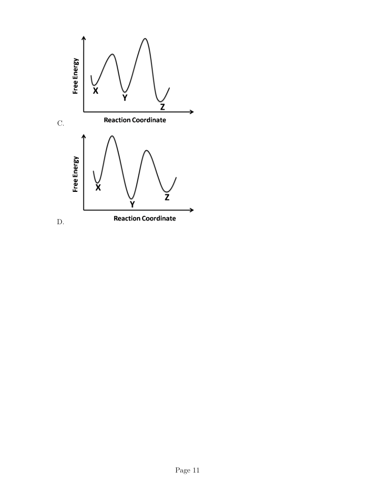

## PDF page 12

[Open original PDF at page 12](../pdf/IAT_2021_English_paper.pdf#page=12)

### Searchable text - PDF text layer

```text
Mathematics

31. What is the maximum value of cos4(x) + sin2(x) + cos(x), when x ≥0?

         A. 2

         B. 1
       √
         C.   2
        √
         D. 2  2

32. Out of a pack of ten cards numbered 1 to 10, a boy draws a card at random and keeps it back. Then
    a girl draws a card at random from the same pack.  If the boy’s card reads m, and the girl’s card
    reads n, then what is the probability that m > n, given that m is even?
            1
         A.
            2
            1
         B.
            3
            1
         C.
            4
            1
         D.
            5

33. Suppose a, b ∈R are such that the points (a, b), (a2, b2), and (a3, b3) in the coordinate plane are
    distinct, collinear, and the line passing through these points is not parallel to the y-axis. Then, for
     all such choices of (a, b), the slope of the line passing through these three points can take

         A. exactly two values.

         B. infinitely many values.

         C. exactly three values.

         D. exactly one value.

34. Define f : [2, 22] →R by f(x) = max{n(1 −|x −(2n + 1)|) : n = 1, 2, . . . , 10}. The area of the region
    {(x, y) : 0 ≤y ≤f(x), x ∈[2, 22]} is

         A. 55.

         B. 60.

         C. 5.

         D. 10.

                                                                    135. The value of the limit lim    x)√x(ex + x)                         x→0+(sin                x is
         A. e2.

         B. 1.

         C. e.

         D. 0.


                                        Page 12
```

### Original page image

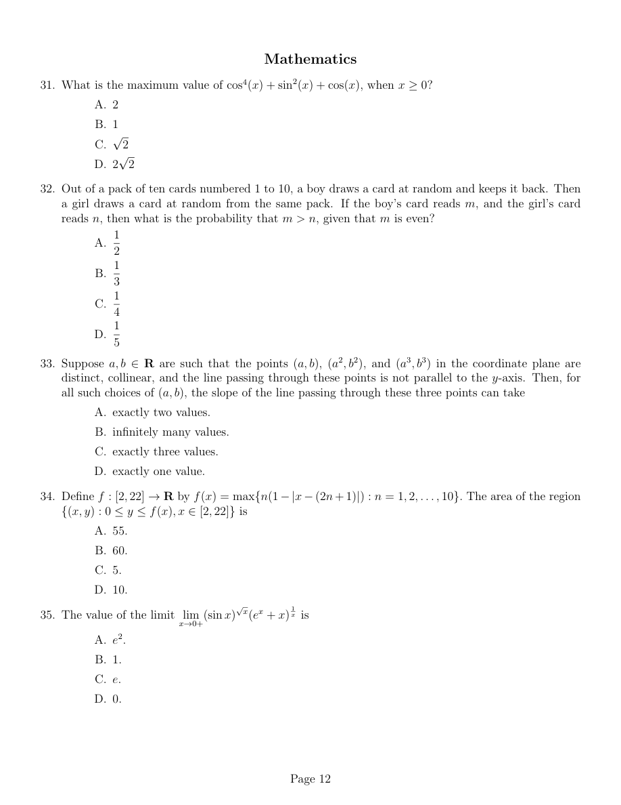

## PDF page 13

[Open original PDF at page 13](../pdf/IAT_2021_English_paper.pdf#page=13)

### Searchable text - PDF text layer

```text
36. Let f : R →R be a continuous function satisfying

                                       Z x
                                f(x) = ex2/2 +    tf(t)dt   for all x.
                                                               0

   Then which of the following is correct?
          √
         A. 5 < f(  2) < 6
          √
         B. 2 < f(  2) < 3
          √
         C. 3 < f(  2) < 4
          √
         D. 4 < f(  2) < 5

37. For each a ∈R, define

                                       pa(z) = z2 + 2ea−eaz + ea−ea.

   Then, which one of the followings is true?

         A. pa has only non-real complex roots for all a ∈R.
         B. pa has a real root for all a ∈R.
         C. pa has a real root if and only if a ≥1.
         D. pa has a real root if and only if a ≤−1.

38. The number of functions f  : {1, 2, 3, 4, 5} −→{1, 2, 3, 4, 5} such that f (f(n)) = n for all n ∈
    {1, 2, 3, 4, 5}, is

         A. 41.

         B. 25.

         C. 31.

         D. 120.

39. Let P1 : x + y + z = 1, P2 : 2x + y + z = 3 be two planes, and let L denote the line of intersection
    of P1 and P2. Let P be the plane passing through the point (1, 2, 1), and normal to L. Which of the
    following equations represents P?

         A. y −z = 1

         B. x + z = 2

         C. x + 2y + z = 6

         D. x + y + 2z = 5

40. Let f(x) = ln(1 + x) for x ≥0. The value of
                                                 π          3√
                              Z  2      f(  cos θ)
                                               3√           3√     dθ
                                                 0  f(  sin θ) + f(  cos θ)

     is
           π
         A.     .
            4


                                        Page 13
```

### Original page image

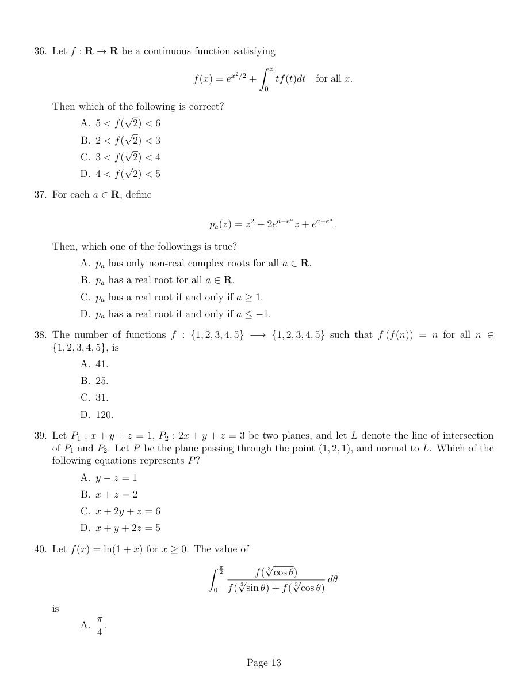

## PDF page 14

[Open original PDF at page 14](../pdf/IAT_2021_English_paper.pdf#page=14)

### Searchable text - PDF text layer

```text
π
         B.     .
            6
           π
         C.     .
            3
           π
         D.     .
            2

41. The area enclosed by the curves y = 1 + | sin x|, y = −| sin x| and the lines x = 0, x = 2π is

         A. 8 + 2π.

         B. 8 + 4π.

         C. 8 + 6π.

         D. 8 + 8π.

42. Consider the function f : R →R defined by

                                           f(x) = x2|x|.

   Then, which of the following statements is correct?
         A. f ′ is differentiable but f ′′ is not differentiable.

         B. f is continuous but not differentiable.
         C. f is differentiable but f ′ is not differentiable.
         D. f ′′ is differentiable.

43. Let A be a 2 × 2 matrix such that

                                            0  1       0  0
                             A2 + A +      =                 .
                                            1  0       0  0

    Let I denote the 2 × 2 identity matrix. Which of the following statements is correct?

         A. Both A and A + I are invertible.

         B. A is invertible but A + I may not be invertible.

         C. A + I is invertible but A may not be invertible.

         D. Neither A + I nor A may be invertible.

44. If three real numbers a, b, c are in arithmetic progression, the value of the determinant

                                        x2 + 3  x2 + 4  x2 + 5
                                        x2 + 4  x2 + 5  x2 + 6
                                        x2 + a  x2 + b  x2 + c

     is

         A. 0.

         B. 2a.

         C. a + c −b.
         D. x2 + 2b.


                                        Page 14
```

### Original page image

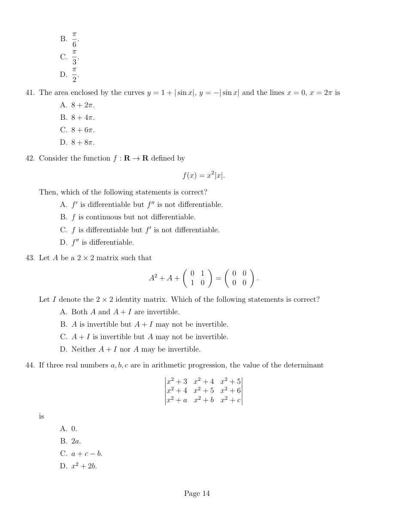

## PDF page 15

[Open original PDF at page 15](../pdf/IAT_2021_English_paper.pdf#page=15)

### Searchable text - PDF text layer

```text
45. Consider the two data sets

                            S1 =  {1, 2, 4, 8, 9, 11, 15, 20, 27, 29, 33},
                            S2 =  {51, 52, 54, 58, 59, 61, 65, 70, 77, 79, 83}.

    Let m1, m2 and v1, v2 be the means and the variances of S1 and S2, respectively. Then, which of the
    following relations is correct?

         A. m2 = m1 + 50, v2 = v1.

         B. m2 = m1 + 50, v2 = v1 + 50.

         C. m2 = m1, v2 = v1.

         D. m2 = m1 + 50, v2 < v1.


                                        Page 15
```

### Original page image

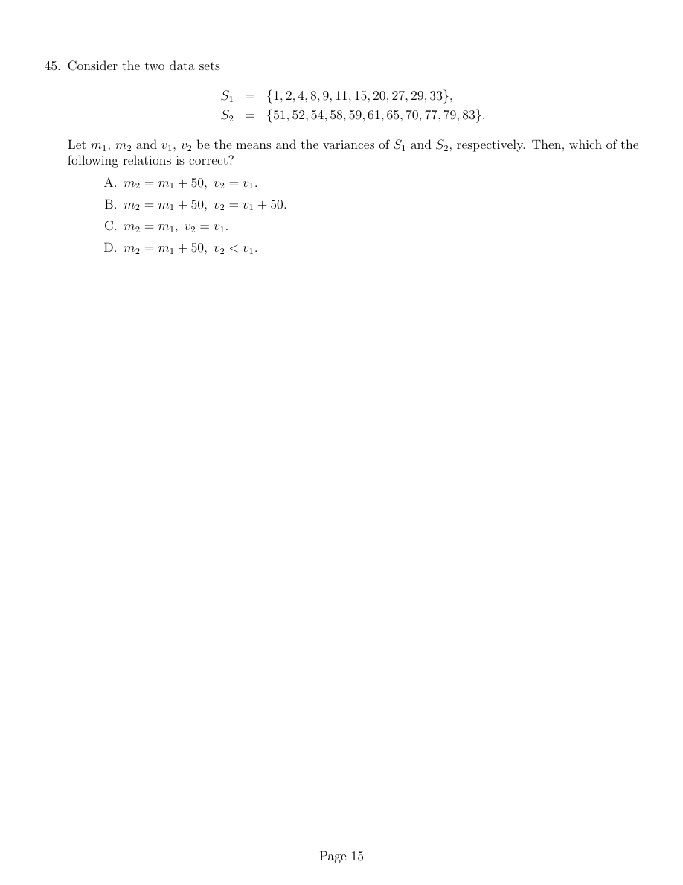

## PDF page 16

[Open original PDF at page 16](../pdf/IAT_2021_English_paper.pdf#page=16)

### Visual description

Physics Q46: four plots of angular speed versus distance from a door's hinge are offered for a pellet hitting a freely hinged door. They include linear and curved rising branches over the door width L; examine the axes and branch shapes in the source.

### Searchable text - PDF text layer

```text
Physics

46. A door of mass M and width L is hinged at one end and rotates about a vertical axis without friction.
  A bullet of mass m (m ≪M) fired perpendicularly to the door at a speed v gets embedded in it
    at a distance x from its axis of rotation. Assuming the door was stationary initially, how does the
    resultant angular speed ω of the door vary as a function of x?
          ω


                         x                L         A.
          ω


                         x                L         B.
          ω


                         x                L         C.
          ω


                         x            L   L
                 3         D.

47. A body of mass m executes simple harmonic motion along a line with time period T and energy E.
   What is the magnitude of the maximum acceleration of the body?
        √
            2  2π r E
         A.
            T   m
            2π r E
         B.
           T  m
       √
              2 r E
         C.
           T  m
           π r E
         D.
           T  m

48. An athlete runs on a straight track. She starts from rest and runs with a constant acceleration for
    the first 2 seconds, reaching a speed of 9 m s−1. She then continues at this constant speed for some
    time before slowing down to a halt at a constant deceleration. The total time taken, from start to


                                        Page 16
```

### Original page image

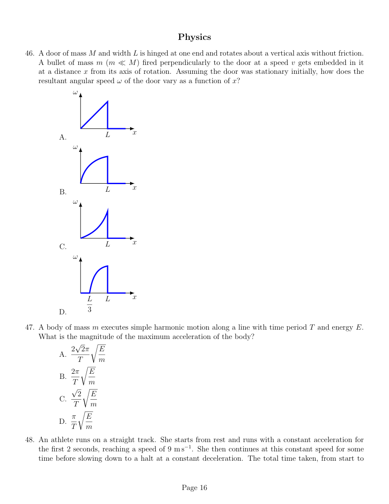

## PDF page 17

[Open original PDF at page 17](../pdf/IAT_2021_English_paper.pdf#page=17)

### Visual description

Physics Q50: a rectangular three-branch circuit includes 4 kOhm and 2 kOhm resistors on the top branch, 2 and 4 microfarad capacitors in the middle, and a 12 V cell with additional resistors below. Two keys K1 and K2 control the connections.

### Searchable text - PDF text layer

```text
finish, is 12 seconds. If the magnitude of her acceleration is twice the magnitude of deceleration, then
   what is the total distance covered by her?

         A. 81 m

         B. 108 m

         C. 90 m

         D. 72 m

49. A capacitor of capacitance C consists of two large parallel metal plates. The coefficient of linear
    expansion of the metal is α. What is the change in capacitance if the temperature of the plates rises
   by ∆T, while the gap between the plates is kept fixed?

         A. 2α∆TC

         B. α∆TC

         C. −α∆TC

         D. −2α∆TC

50. What are the charges stored in the 2 µF and 4 µF capacitors in the given circuit a long time after the
    key K is closed?

             4 k            2 k


            2 µF           4 µF


  K


           2 k                 4 k
                    12 V

         A. 8 µC and 8 µC respectively

         B. 18 µC and 18 µC respectively
            16        8
         C.   µC and  µC respectively
             3        3
            8        16
         D. 3µC and 3 µC respectively
51. Consider a point charge +q moving with a constant velocity ⃗v = vˆk in vacuum in the presence of an
     electric field ⃗E = Exˆi + Eyˆj and a magnetic field ⃗B = Bxˆi + Byˆj. Unit vectors ˆi, ˆj, and ˆk are in the
    directions of x, y, and z axes, respectively. Which of the following relations is correct?

         A. Ex = v By, Ey = −v Bx
         B. Ex = −v Bx, Ey = −v By
         C. Ex = −v By, Ey = v Bx
         D. Ex = v Bx, Ey = v By


                                        Page 17
```

### Original page image

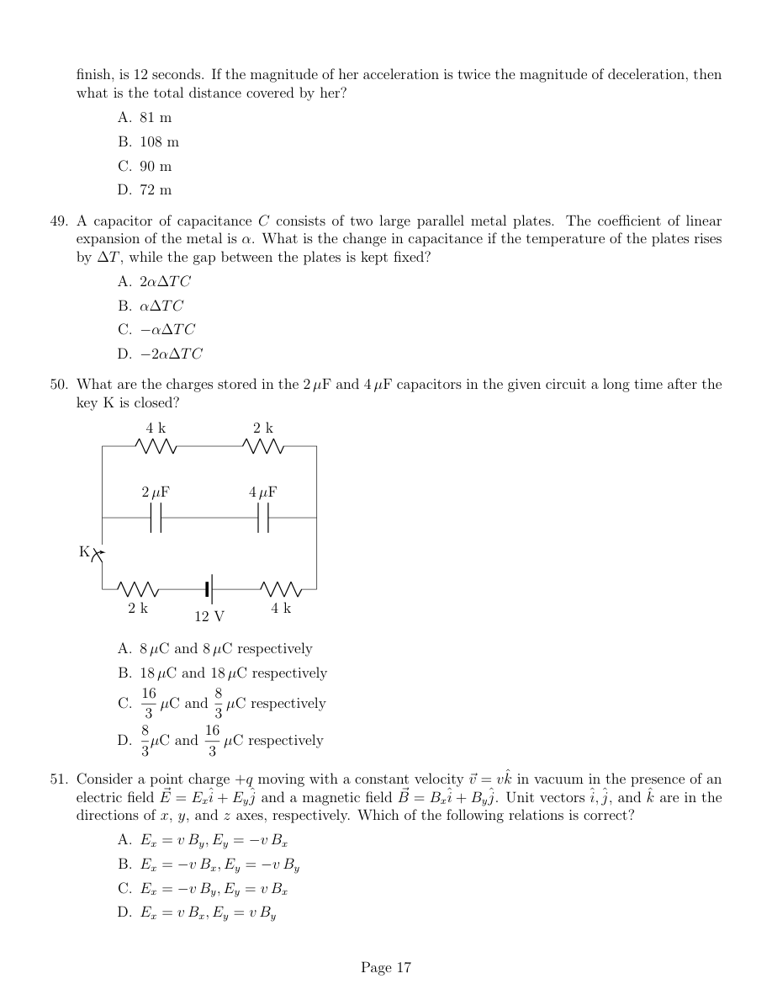

## PDF page 18

[Open original PDF at page 18](../pdf/IAT_2021_English_paper.pdf#page=18)

### Visual description

Physics Q54: a logic circuit sends an XOR result from inputs 1 and P and an AND result from inputs 1 and Q into a final NAND gate. The output is marked 0; gate type and fixed input labels are essential.

### Searchable text - PDF text layer

```text
52. Four point charges q, −2q, −3q and 4q are placed at the four vertices of a regular tetrahedron of side
    L, while a charge 5q is placed at its center. What is the total electrostatic energy of the system?
   (Vacuum permittivity is denoted by ε0.)
         A. −15q2
             4πε0L
              15q2
         B.
            4πε0L
         C. −30q2
             4πε0L
              30q2
         D.
            4πε0L

53. The half life of a radioactive element is 2000 hours. Approximately how much time is required for
    the decay of 2/3 of its nuclei?

         A. 3170 hours

         B. 3000 hours

         C. 1170 hours

         D. 2830 hours

54. A 2-input exclusive OR (XOR) gate with inputs X and Y produces the output ¯XY + X ¯Y . In the
    Boolean circuit shown below, which values of the inputs P and Q will produce the output 0?

       XOR
     1
   P          NAND

                             0       AND
     1
   Q

         A. P = 0, Q = 1

         B. P = 0, Q = 0

         C. P = 1, Q = 0

         D. P = 1, Q = 1

55. In an experiment on the photoelectric effect, the de Broglie wavelength of the emitted electron is
    λB. The energy of the photon incident on the metal is five times the work function. If h is Planck’s
    constant and me is the electron mass, then what is the work function?
               h2
         A.
           8meλ2B
                h2
         B.
            10meλ2B
                h2
         C.
            12meλ2B


                                        Page 18
```

### Original page image

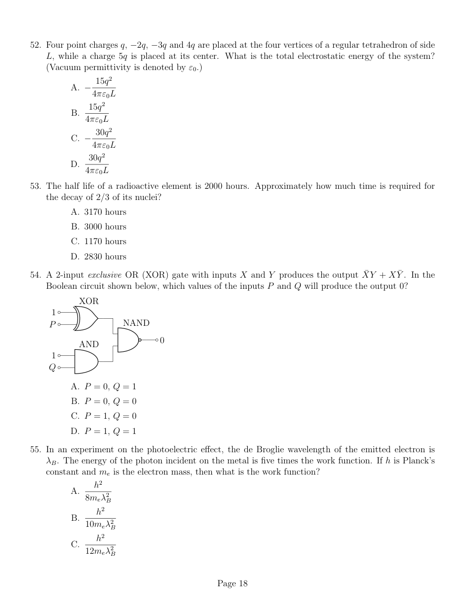

## PDF page 19

[Open original PDF at page 19](../pdf/IAT_2021_English_paper.pdf#page=19)

### Searchable text - PDF text layer

```text
h2
         D.
           4meλ2B

56. An ambulance traveling at a speed 20 m s−1 emits a sound of frequency 540 Hz from its siren. Sunanda
     is driving a car which approaches the ambulance from the opposite direction at a speed of 20 m s−1.
   What will be the change in detected frequency by Sunanda, as she crosses the ambulance? (Given,
    the speed of sound in air is 340 m s−1.)

         A. 127.5 Hz

         B. 128.8 Hz

         C. 135.5 Hz

         D. 72.00 Hz

57. Consider a Young’s double slit experiment with monochromatic light of wavelength 600 nm. The
    intensity of the light is I0 at a point on the screen where the path difference is 600 nm. What would
   be the intensity of light at a point on the screen where the path difference is 100 nm?
            3
         A. 4I0
            1
         B. 4I0
            1
         C. 2I0
       √
              3
         D.     I0
             2
58. Consider a mixture of O2 and N2 gases at temperature 27 ◦C. Which of the following relations is
    correct?

         A. RMS speed of O2 molecules < RMS speed of N2 molecules

         B. Average kinetic energy of O2 molecules < Average kinetic energy of N2 molecules

         C. Average kinetic energy of O2 molecules > Average kinetic energy of N2 molecules

         D. RMS speed of O2 molecules > RMS speed of N2 molecules

59. Two identical objects A and B are at initial temperatures TA and TB (TA > TB), respectively. The
    specific heat capacity of the material of these objects increases with temperature. If these two objects
    are brought in contact then their final equilibrium temperature is T. Assuming that there is no heat
    exchange with the surroundings, then
               TA + TB
         A. T >               .
                    2
         B. T > TA.
               TA + TB
         C. T =               .
                    2
               TA + TB
         D. T <               .
                    2

60. Which one of the following expressions has the dimension of electrical resistance where e is the charge
    of an electron and h is Planck’s constant?


                                        Page 19
```

### Original page image

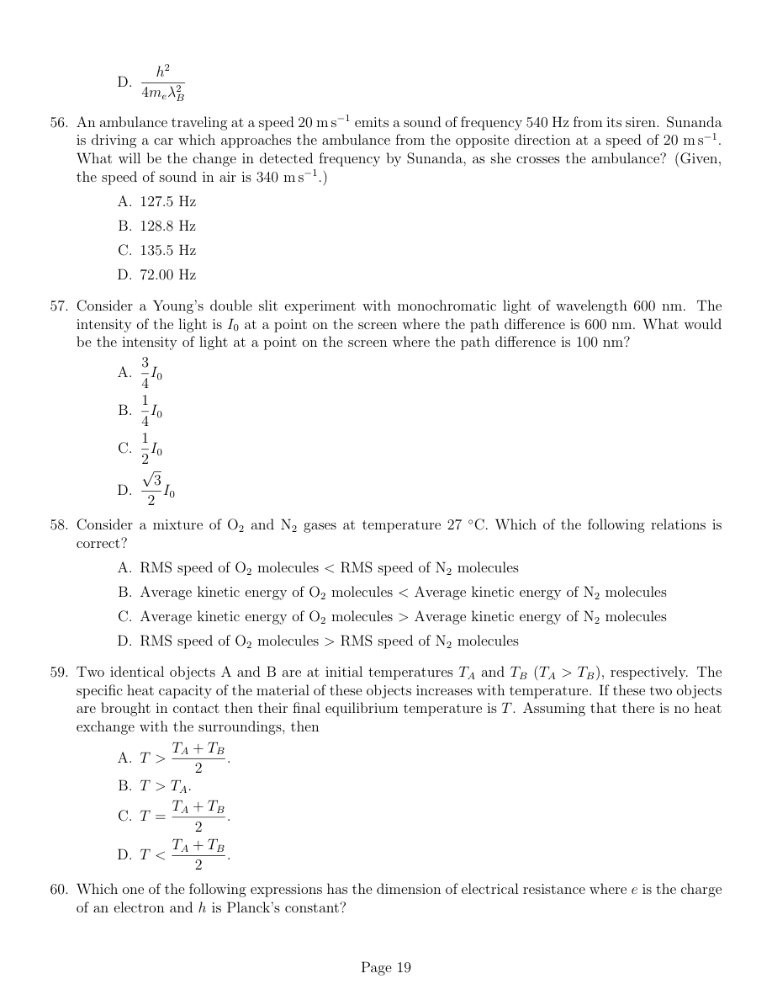

## PDF page 20

[Open original PDF at page 20](../pdf/IAT_2021_English_paper.pdf#page=20)

### Searchable text - PDF text layer

```text
h
A.
    e2
    e2
B.
   h
    e
C.
   h
   h
D.
    e


                               Page 20
```

### Original page image


