# IAT 2021 - Hindi

Original PDF: [IAT_2021_Hindi_paper.pdf](../pdf/IAT_2021_Hindi_paper.pdf)

- Acquisition: PYQP public Google Drive mirror; not downloaded from the official server.
- Downloaded: 28 October 2026. PDF pages: 20.
- Exact download/source URL: https://drive.google.com/file/d/1ogo2EZnDepBPUUVTmsoc5MztYeLU-B0b/view?usp=share_link
- PDF SHA-256: `0bd4534b3a823fca5342ad5a828f380c0d8ce31d123eb8378a9a01fcd6397d40`
- This is a search/accessibility copy of an existing paper, not newly authored mock content.
- Text is mechanically extracted or OCR-derived and has not been proofread character by character. Equations, option letters, chemical bonds, tables and Hindi OCR can contain errors. The PDF and page images are authoritative.
- Figure descriptions are explanatory annotations, not official answers or complete structural/formula transcriptions. Use the linked image to resolve exact labels, values and stereochemistry.

## Visual guide

The following descriptions refer to **PDF page numbers in the English companion**, because Hindi pagination can differ. The Hindi page images below retain every original diagram; identical embedded images are additionally cross-linked where matched by image digest.

- [English PDF page 2](IAT_2021_English_paper.md#pdf-page-2): Biology Q6: a two-column table lists treatments T1-T6 and experimental conditions involving heat-killed S bacteria, live R bacteria, RNase or DNase and injection into mice. Each row must remain paired with its treatment label.
- [English PDF page 3](IAT_2021_English_paper.md#pdf-page-3): Biology Q8: circular plasmid XYZ21 is 4000 bp, with PstI at 800, EcoRI at 1700, HindIII at 1920 and SalI at 2460. Q9: rate of photosynthesis versus leaf temperature compares dotted curve P1, with a lower-temperature peak, against solid curve P2, with a higher peak at a higher temperature.
- [English PDF page 4](IAT_2021_English_paper.md#pdf-page-4): Biology Q10: panel (i) plots internal versus external temperature, with X approximately horizontal and Y increasing. Panel (ii) plots surface-area-to-volume observations for animal types a and b, with a above b. These labels must be interpreted together.
- [English PDF page 5](IAT_2021_English_paper.md#pdf-page-5): Biology Q13: a table matches interacting species with interaction categories. Q15: floral-formula options A and B use symmetry/sex symbols, parentheses around organ numbers and a gynoecium position mark; the remaining options continue on the next page.
- [English PDF page 6](IAT_2021_English_paper.md#pdf-page-6): Continuation of Biology Q15: floral-formula options C and D. Preserve the distinctions between organ fusion, organ number, symmetry and ovary-position notation; OCR frequently flattens these symbols.
- [English PDF page 8](IAT_2021_English_paper.md#pdf-page-8): Chemistry Q21 shows four sawhorse conformations labelled I-IV. Q22 compares four substituted chlorobenzenes, including differently placed nitro and methoxy groups. Q23 gives a multistep route from an acyl chloride through labelled intermediates P, Q, R and S with reagents above the arrows.
- [English PDF page 9](IAT_2021_English_paper.md#pdf-page-9): Chemistry Q24: four drawn candidate products of salicylaldehyde treated with one equivalent of methylmagnesium bromide. The options vary the phenolic and aldehyde-derived groups, so their exact connectivity matters.
- [English PDF page 10](IAT_2021_English_paper.md#pdf-page-10): Chemistry Q30: a reversible X-Y-Z reaction scheme gives forward and reverse rate multipliers. Candidate free-energy profiles A and B show two activation barriers and different relative levels of X, Y and Z. More options continue on page 11.
- [English PDF page 11](IAT_2021_English_paper.md#pdf-page-11): Continuation of Chemistry Q30: free-energy versus reaction-coordinate profiles C and D. Both have two barriers, but the relative well depths and barrier heights differ.
- [English PDF page 16](IAT_2021_English_paper.md#pdf-page-16): Physics Q46: four plots of angular speed versus distance from a door's hinge are offered for a pellet hitting a freely hinged door. They include linear and curved rising branches over the door width L; examine the axes and branch shapes in the source.
- [English PDF page 17](IAT_2021_English_paper.md#pdf-page-17): Physics Q50: a rectangular three-branch circuit includes 4 kOhm and 2 kOhm resistors on the top branch, 2 and 4 microfarad capacitors in the middle, and a 12 V cell with additional resistors below. Two keys K1 and K2 control the connections.
- [English PDF page 18](IAT_2021_English_paper.md#pdf-page-18): Physics Q54: a logic circuit sends an XOR result from inputs 1 and P and an AND result from inputs 1 and Q into a final NAND gate. The output is marked 0; gate type and fixed input labels are essential.

## Page index

[p1](#pdf-page-1) | [p2](#pdf-page-2) | [p3](#pdf-page-3) | [p4](#pdf-page-4) | [p5](#pdf-page-5) | [p6](#pdf-page-6) | [p7](#pdf-page-7) | [p8](#pdf-page-8) | [p9](#pdf-page-9) | [p10](#pdf-page-10) | [p11](#pdf-page-11) | [p12](#pdf-page-12) | [p13](#pdf-page-13) | [p14](#pdf-page-14) | [p15](#pdf-page-15) | [p16](#pdf-page-16) | [p17](#pdf-page-17) | [p18](#pdf-page-18) | [p19](#pdf-page-19) | [p20](#pdf-page-20)

## PDF page 1

[Open original PDF at page 1](../pdf/IAT_2021_Hindi_paper.pdf#page=1)

### Searchable text - OCR draft (hin+eng)

```text
____..-.-.-.-509090[0 5607 Aptitude Test 2020000 Uh

Biology
L. निम्न वाह्मत्वचीय कोशिकाओं का कौन सा प्रकार डिंबवाहिनी नलिका के आंतरिक सतह पर सामान्य रूप से पाया जाता है?
A. पक्ष्माभधारी
B. स्तंभाकार
C. शल्कीय
D. घनाकार

2. निम्न में से कौन एक अलैंगिक प्रजनन संरचना नहीं है?
A. क्लैडोफोरा के समयुग्मक (Isogametes of Cladophora)

B. पैनीसीलियम की कोनिडिया (Conidia of Penicillium)
C. SASHA के चल बीजाणू (Zoospores of Chlamydomonas)

D. स्पंज में जेम्यूल्स (Gemmules in a sponge)

3. निम्न में से 08 का कौन सा अनुक्रम पैलिंड्रोमिक है?
A. 5! GAATTC 3!
3! CTTAAG 5
B. 5 GACTTC 3!
3! CTGAAG 5
C. 8 GAAGTC 3!
3! CTTCAG 5’
D. 5! GACCAG 3!
3! CTGGTC 5!
4. जब वायु मे परागकणों की प्रचुरता होती है तो कुछ व्यक्तियों को छींक आने लगती है। ये व्यक्ति प्रतिरक्षी अनुक्रिया के रूप मे
निम्न में से किस ig उप-प्रकार (सब-टाईप) का उत्पादन करेंगे?
A. IgE
B. IgA
C. IgM
D. IgGl

5. निम्न में से किस कारक की हार्डी-वीनबर्ग साम्य को विचलित करने की संभावना सबसे कम है?
A. जनसंख्या के आकार में कमी
B. उत्परिवर्तन
८. जीन प्रवाह
D. जीनी विचलन (genetic drift)
```

### Original page image

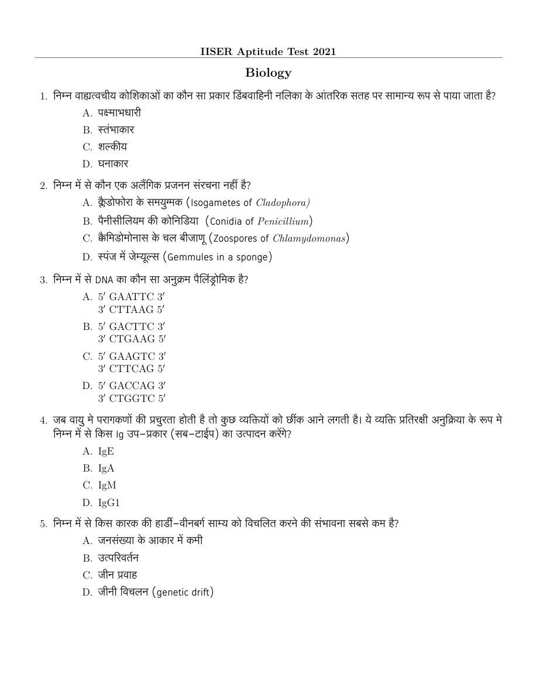

## PDF page 2

[Open original PDF at page 2](../pdf/IAT_2021_Hindi_paper.pdf#page=2)

### Searchable text - OCR draft (hin+eng)

```text
6. Frederick 6770 के प्रयोगों और Avery, Macleod और McCarty & स्थानांतरण सिद्धांतों को स्थापित करने वाले कार्यों
से प्रभावित होकर किसी वैज्ञानिक ने Streptococcus pneumonae के 5-प्रकार और R-TER पर कुछ पुनर्गठित प्रयोग

किए जो नीचे सारणीबद्ध हैं।
उपचार प्रायोगिक दशा

Tl ऊष्मा-मृत S—WHR चूहे में अंतर्वेशि
T2 ऊष्मा-मृत S-WHR + सजीव २-प्रकार चूहे में अंतर्वेशि
T3 | ऊष्मा-मृत 5-प्रकार + सजीव ₹१-प्रकार, राइबोन्यूक्रिएज से अभिकृत करा कर चूहे में अंतर्वशि
T4 ऊष्मा-मृत 5-प्रकार + सजीव २-प्रकार, DNase से अभिकृत करा कर चूहे में अंतर्वेशि
T5 सजीव 5-प्रकार चूहे में अंतर्वशित
T6 सजीव -प्रकार चूहे में अंतर्वेशि

नीचे दिए गए विकल्पों में से सही विकल्प का चुनाव कीजिए।
A. 77: जीवित, T2: मृत, 73: मृत, 4: जीवित, TS: मृत, T6: जीवित
B. 72: जीवित, 72: जीवित, 73: मृत, 74: जीवित, 75: जीवित, 6: जीवित
C. Ti: जीवित, T2: मृत, 73: मृत, T4: मृत, TS: जीवित, Té: मृत
9. 77: जीवित, T2: मृत, 73: जीवित, T4: मृत, TS: मृत, T6: जीवित

7. निम्न में से कौन सा उत्पाद अवरक्त प्रकाश मे पौधों के प्रकाश संश्लेषण से उत्पन्न होता/होते हैं?
A. केवल ATP
B. ATP, NADPH और H+
C. NADPH 3i H+
D. केवल NADPH
8. नीचे चित्र मे एक 4000 क्षार BA (bp) माप वाले प्लाज़्मिड को चित्र पर चिन्हित विभिन्न प्रतिबंधन एंज़ाइम्स के स्थलों के
साथ दर्शाया गया है। कोष्ठकों मे लिखी संख्या, क्षार युग्म के उस स्थान को दर्शाती है जहाँ एंजाइम प्लाज़्मिड को काटता है |
इस प्लाज़्मिड का पाचन पूर्ण रूप Pst! और ।॥॥0॥ एंज़ाइम्स के युम्म से कराने के बाद प्राप्त मिश्रण को पुनः EcoRI और

58॥ एंज़ाइम्स से पूर्ण रूप से पाचित करते हैं। अभिक्रियायों के उपरांत प्राप्त मिश्रण का एगैरोज जेल वैद्युतसंचलन पर विश्लेषित

शक हैं। निम्न में से कौन सा विकल्प जेल पर प्राप्त Feit (bands) के आकार को (bp में) को सबसे सटीक रूप से दर्शाता
?

Page 2
```

### Original page image

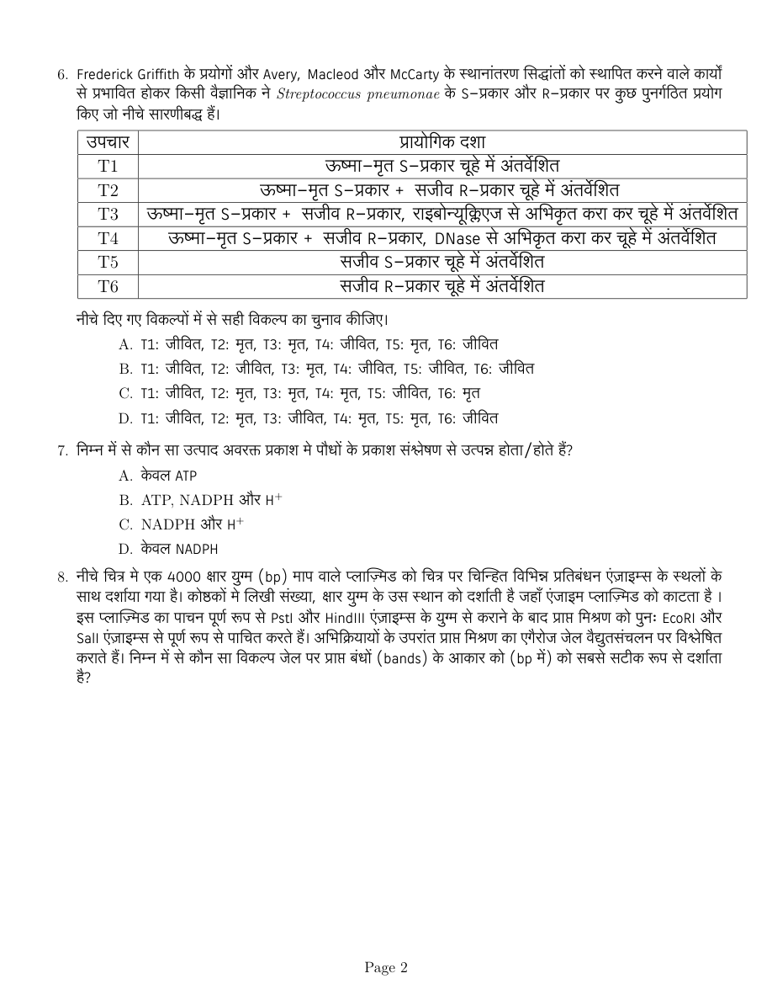

## PDF page 3

[Open original PDF at page 3](../pdf/IAT_2021_Hindi_paper.pdf#page=3)

**Matching embedded figure, English PDF page 3:** Biology Q8: circular plasmid XYZ21 is 4000 bp, with PstI at 800, EcoRI at 1700, HindIII at 1920 and SalI at 2460. Q9: rate of photosynthesis versus leaf temperature compares dotted curve P1, with a lower-temperature peak, against solid curve P2, with a higher peak at a higher temperature.

### Searchable text - OCR draft (hin+eng)

```text
EcoRI HindIII
(700) (4920)

Sall
Pstl > ( (2460)

(800) #/--

Plasmid XYZ2]
(4000 bp)

220, 540, 900 और 2340
220, 540, 200 और 2040
540, 760, 200 और 500
D. 320, 540, 800 और 2340

Qn

9. नीचे दिया गया रेखाचित्र दो chet Pp और p2 की पत्तियों के तापमान से उनके प्रकाश संश्लेषण की दर मे होने वाले परिवर्तन
को निरूपित करता है।

w ~
o So

Rate of photosynthesis
(Arbitrary Units)
i)
o

—_
So

0 20 30 40 50
Leaf temperature in °C

निम्नलिखित में से कौन सा कथन इन पौधों के गुणों को सबसे सटीक रूप से व्यक्त करता है?
A. PI, एक C, पौधा है जिसमे समशीतोष्ण अनुकूलन है जबकि ?2, एक ८, पौधा है जिसमे उष्णटिबंधीय अनुकूलन
है।

8. Pl, एक ८, पौधा है जिसमे समशीतोष्ण अनुकूलन है जबकि ?2, एक ८४ पौधा है जिसमे उष्णटिबंधीय अनुकूलन
है।

Page 3
```

### Original page image

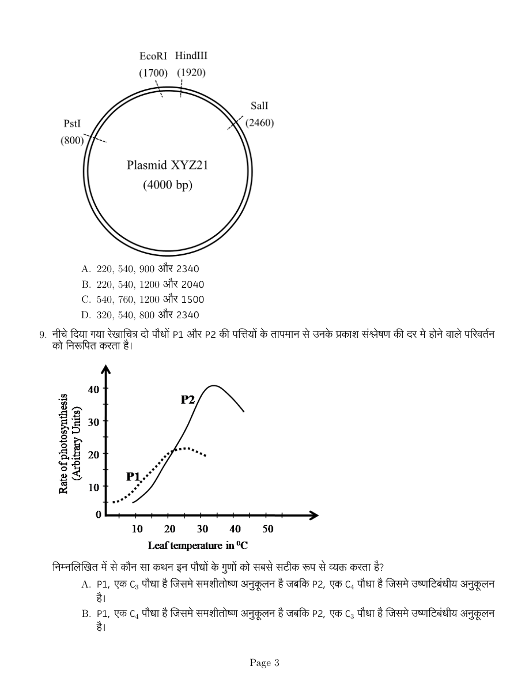

## PDF page 4

[Open original PDF at page 4](../pdf/IAT_2021_Hindi_paper.pdf#page=4)

**Matching embedded figure, English PDF page 4:** Biology Q10: panel (i) plots internal versus external temperature, with X approximately horizontal and Y increasing. Panel (ii) plots surface-area-to-volume observations for animal types a and b, with a above b. These labels must be interpreted together.

### Searchable text - OCR draft (hin+eng)

```text
C. Pl, एक ८, पौधा है जिसमे उष्णटिबंधीय अनुकूलन है जबकि P2, एक Cy पौधा है जिसमे समशीतोष्ण अनुकूलन
है।
D. Pl, एक ८४ पौधा है जिसमे उष्णटिबंधीय अनुकूलन है जबकि 72, एक ८, पौधा है जिसमे समशीतोष्ण अनुकूलन
है।
0. चित्र (i), दो प्रकार के जंतुओं (x और ५) के areal वातावरण के अनुरूप उनकी अनुक्रियाओं को दर्शाता है। वहीं fas (ii),
अन्य दो प्रकार के जंतुओं (टाइप a और टाइप ४) के शारीरिक क्षेत्रफल और आयतन के अनुपात को दर्शाता है।

(i) (ii)

Surface Area : Volume

Internal Body Temperature

External Temperature Typea Type b

निम्न में से कौन सा विकल्प हमिंग बर्ड, मगरमच्छ, मेंढक और ध्रुवीय भालू के लिए संयोजन के सही क्रम को दर्शाता है?
A. Xa; Yb; Ya; Xb
B. Xb; Ya; Yb; Xa
C. Ya; Yb; Xa; Xb
D. Yb; Xb; Xa; Ya
LL. पौधों में अमोनियम आयन का उत्पादन अमोनिया के प्रोटोनेशन से होता है। निम्न में से कौन सा एंजाइम इन अमोनियम आयन्स
का उपयोग करके अल्फा-कीटो अम्ल को एक अमीनो अम्ल में परिवर्तित करता है?
A. ग्लूटामेट डीहाइड्रोजीनेज
8. नाइट्रोजिनेज
०. ट्रांसससीटाइलेज
9. cece डीहाइड्रोजीनेज
2. निम्न में से कौन सा कायिक कार्य छोटी आँत और वृक्क नलिकाओं के मध्य उभनिष्ठ है?
A. ग्लूकोज का अवशोषण
B. अपशिष्ट पदार्थों का उत्सर्जन
C. जल का उत्सर्जन

Page 4
```

### Original page image

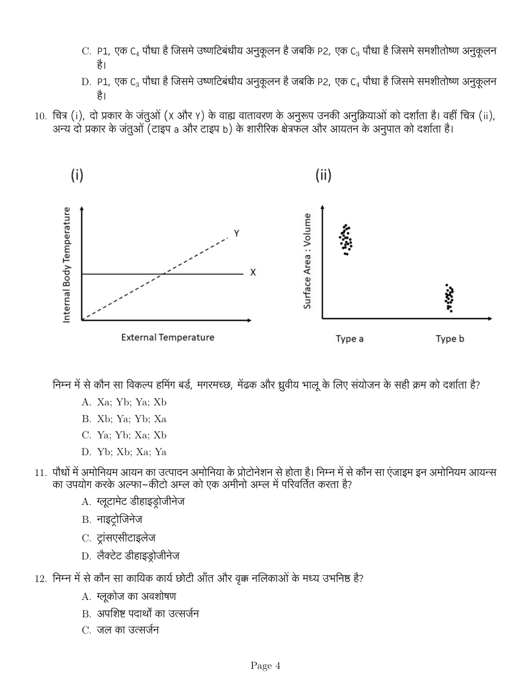

## PDF page 5

[Open original PDF at page 5](../pdf/IAT_2021_Hindi_paper.pdf#page=5)

**Matching embedded figure, English PDF page 5:** Biology Q13: a table matches interacting species with interaction categories. Q15: floral-formula options A and B use symmetry/sex symbols, parentheses around organ numbers and a gynoecium position mark; the remaining options continue on the next page.

**Matching embedded figure, English PDF page 6:** Continuation of Biology Q15: floral-formula options C and D. Preserve the distinctions between organ fusion, organ number, symmetry and ovary-position notation; OCR frequently flattens these symbols.

### Searchable text - OCR draft (hin+eng)

```text
9. प्रोटीन का अवशोषण
3. नीचे सारणी मे लिखित अंतर्जातीय अन्योन्यक्रियाओं को अन्योन्यक्रियाओं के नाम से मिलाएँ।

अंतर्जातीय अन्योन्यक्रिया का नाम अन्योन्यक्रिया का नाम

i शाकाहारी और प | सहोपकारिता |

ii कोयल और कौआ परभक्षण

| समुद्री एनिमोन और क्राऊन मछली परजीविता

orem ||»

iv | कवक और सायनोबैक्टीरिया (लाईकेन) | सहभोजि

और निम्न में से सबसे सटीक विकल्प का चुनाव करें।
A. i और b; ii और ८; ॥ और 6; iv और ७
B. i और c; ii और b; ॥ और 0; iv और 8
0. i और b; ॥ और 0; iii और ८ iv और 8
D. i और b; ii और a; ii और ८; iv और 0

4, निम्नलिखित घटनाएँ अर्धसूत्री विभाजन से जुड़ी हुई हैं:

) पुनर्सन्योजित नोड्यूल का प्रकटन

ii) अर्धसूत्री isa का बनना

iii) कियाज्मेटा का बनना

iv) साइनेप्टोनीमल संकुल का बनना

निम्न में से कौन सा विकल्प अर्धसूत्री विभाजन की इन घटनाओं के सही क्रम को दर्शाता है?
A. iv >i iii > ii
B. iii iv > iii
C. iv > iii 9 iS ii
D.i-iti-iv-ii

5. निम्न में से कौन सा पुष्प सूत्र द्विसंघी पुमंग और ऊर्ध्ववर्ती अंडाशय वाले एकव्यास सममित वाले पुष्प का है ?

% ९५) (4240) Avy Gi

A.

BFK os) C+ 5) (०) Gi
B.

% ९५) (७-5) Aco) Ga
C.

Page 5
```

### Original page image

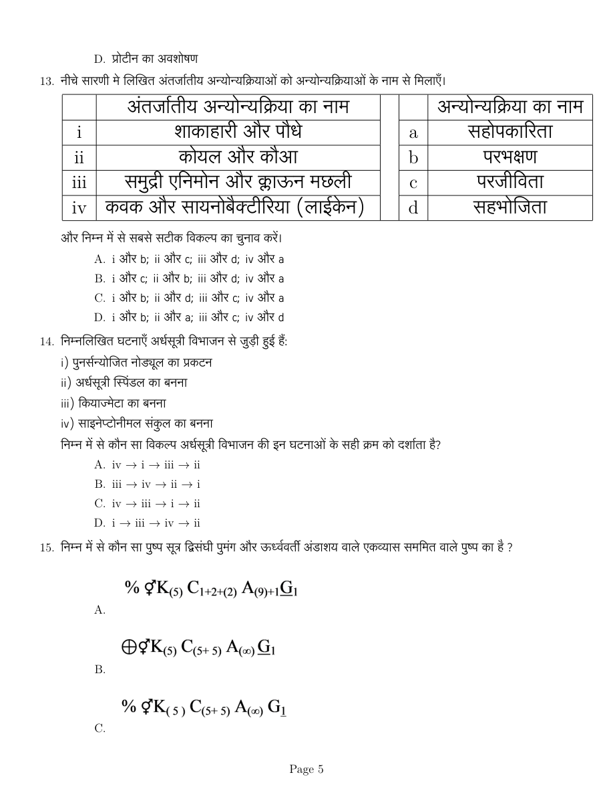

## PDF page 6

[Open original PDF at page 6](../pdf/IAT_2021_Hindi_paper.pdf#page=6)

**Matching embedded figure, English PDF page 6:** Continuation of Biology Q15: floral-formula options C and D. Preserve the distinctions between organ fusion, organ number, symmetry and ovary-position notation; OCR frequently flattens these symbols.

### Searchable text - OCR draft (hin+eng)

```text
[No text recovered; use the original page image below.]
```

### Original page image

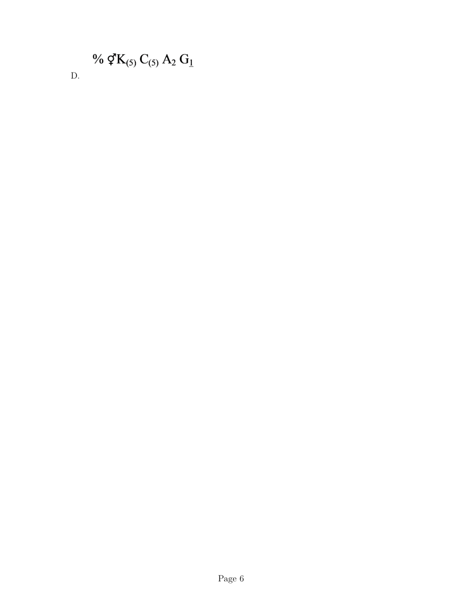

## PDF page 7

[Open original PDF at page 7](../pdf/IAT_2021_Hindi_paper.pdf#page=7)

**Matching embedded figure, English PDF page 8:** Chemistry Q21 shows four sawhorse conformations labelled I-IV. Q22 compares four substituted chlorobenzenes, including differently placed nitro and methoxy groups. Q23 gives a multistep route from an acyl chloride through labelled intermediates P, Q, R and S with reagents above the arrows.

### Searchable text - OCR draft (hin+eng)

```text
l6.

7.

8.

l9.

20.

2i.

Chemistry
PF3;Cly के सबसे स्थायी संरचना F F-P-cl आबन्ध कोंणो के निकटतम्‌ मान
A. 90° तथा 20° है।
B. 90°, 20° तथा 80° है।

C. 90° केवल है।
D. 90° तथा i80° है।
AlCl के आबन्ध कोणो तथा आबन्ध लम्बाइयों के बारे में सही कथन हैं:
(cl, = सिरेवाले cl; Ch, = सेतबंधु cl)
A. ZCl-AL-Ch, > ZCh-ALCh, तथा AI-Cly > AI-Cly
B. ZCl,-AL-Cl, > ZCly-Al-Cl, तथा AI-Cl, > AI-Cly
C. ZCl-ALCl, = ZCly-Al-Cl, तथा AI-Cl, > Al-Cly
D. ZCl-AL-Cl, > ZCl-Al-Cl, तथा AI-Cl, > AI-Cly
CH,SiCly, (CHs)2SiCly तथा (CHs),SiC] 4 से कौन से क्रमश: रेखीय तथा शाखीय (पारण-जुणित) सिलिकॉन बहुलक
बनाने में उपयुक्त होते हैं?
A. (CH3)oSiCl, तथा (CHs)SiCls
B. (CHs)SiCl; तथा (CHs)2SiCly
C. (CHg)2SiCly तथा (CHy)3SiCl
D. (CHs)3SiCl तथा (CHs)SiCly
Z = 25 वाले एक द्विसंयोजी आयन के संकुल के बारे में कौन सा कथन असत्य है?
(BM = Bohr Magneton)
A. चतुष्फलकीय ज्यामिती वाले संकुल जिसमे दुर्बल क्षेत्र लिगन्ड है उसका चुम्बकीय आधघूर्ण 4.73 BM होगा।
8. चतुष्फलकीय ज्यामिती वाले संकुल जिसमे दुर्बल क्षेत्र लिगन्ड है उसका चुम्बकीय sre 5.92 BM होगा।
0. अष्टफलकीय ज्यामिती वाले संकुल जिसमे प्रबल क्षेत्र लिगन्ड है उसका चुम्बकीय आधघूर्ण 4.73 BM होगा।
9. अष्टफलकीय ज्यामिती वाले संकुल जिसमे दुर्बल क्षेत्र लिगन्‍्ड है उसका चुम्बकीय आघूर्ण 5.92 BM होगा।

Ni(CO), प्रतिचुम्बकीय है क्योकि
A. Nid 3d कक्ष पूर्ण रूप से भरे है।
8. यह एक वर्ग-समतलीय संकुल है।
C. CO एक प्रबल क्षेत्र लीगन्ड है।
D. इसमे समन्वित बंधन है।
नीचे दिये गये Gent veut के सापेक्ष ऊर्जा के बारे मे सही क्रम है:

CH CHs CH, CH;
Ke H we H we H ve
H Zu H 4 H3C H
CH, H3C~ ~H H~ CH; Hoy
॥ ॥ ॥॥ IV

Page 7
```

### Original page image

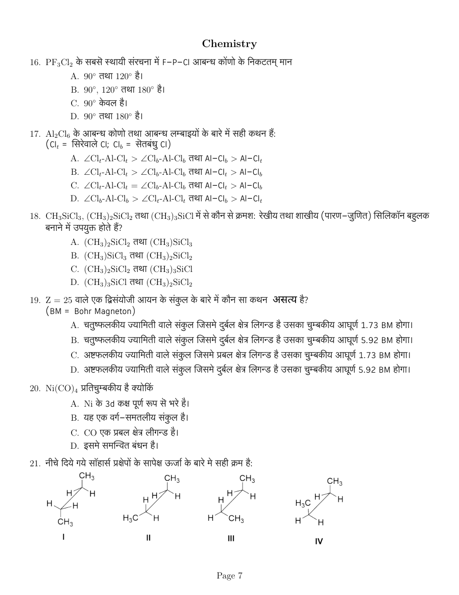

## PDF page 8

[Open original PDF at page 8](../pdf/IAT_2021_Hindi_paper.pdf#page=8)

**Matching embedded figure, English PDF page 8:** Chemistry Q21 shows four sawhorse conformations labelled I-IV. Q22 compares four substituted chlorobenzenes, including differently placed nitro and methoxy groups. Q23 gives a multistep route from an acyl chloride through labelled intermediates P, Q, R and S with reagents above the arrows.

**Matching embedded figure, English PDF page 9:** Chemistry Q24: four drawn candidate products of salicylaldehyde treated with one equivalent of methylmagnesium bromide. The options vary the phenolic and aldehyde-derived groups, so their exact connectivity matters.

### Searchable text - OCR draft (hin+eng)

```text
2. IV > वात > वा > 4
B. IV > वा > II>I
C. Ws iIi>Iv>i
D.I>I=I>Iv

22. निम्नांकित हैलोएरीन्स (I-IV) के NaOH के साथ प्रतिस्थापन अभिक्रिया की गति का सही क्रम है:
cl Cl Cl cl

NO;

NO, OCH;

A. वा > WileiI>Iv
B.I>IV >IT > II
C.Il>TWI>Iv>iI
D.IV>IeI> Il

23. निम्न अभिक्रिया अनुक्रम,
Pd-BaSO,

Zn-Hg
Cl Hp, (4 atm.) (i) MeMgBr CrO. HCl
HC 2 > p ——“s a — + rR  >++ >> 5
(ii) H30*
०
के बारे मे सही कथन है:

())उत्पाद P तथा R, HCN के साथ सन्धि उत्पाद बना सकते है
(ii) उत्पाद 0 में कोई काईरल केन्द्र नही है
(॥)उत्पाद R कैनिजारो अभिक्रिया कर सकता है
(iv) उत्पाद 8 एक संतृप्त हाईड्रोकार्बन है
A. (i) तथा (iv)
B. (iii) तथा (iv)
C. (i) तथा (ii)
D. (ii) तथा (iii)

24. सैलिसिलडिहाईड के एक तुल्यांक MemgBr से अभिक्रिया करने तत्पश्चात अम्लीय उदासीनीकरण करने पर प्रमुख उत्पाद है:
OH OH OH 0 OMe Oo OH fe}
cr CH; cr H cr H oe H
CH3
| ll ull IV

Page 8
```

### Original page image

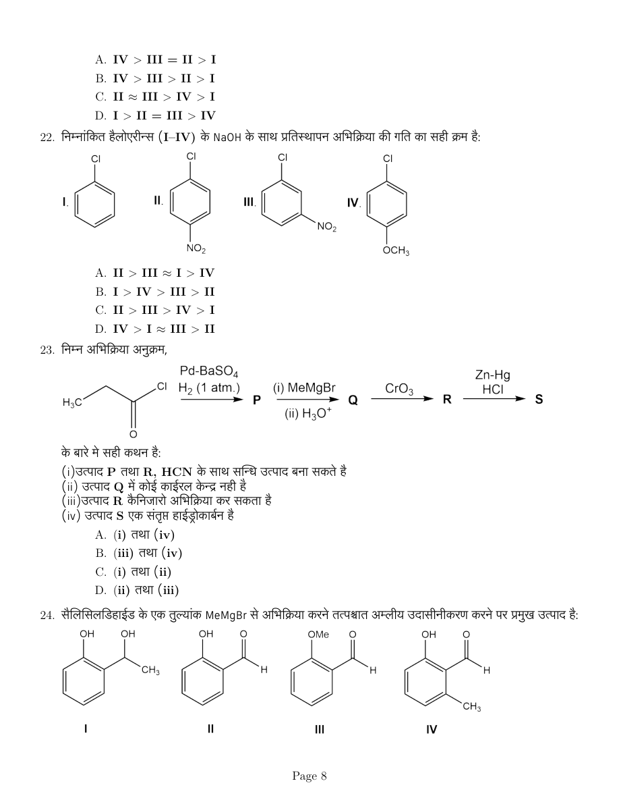

## PDF page 9

[Open original PDF at page 9](../pdf/IAT_2021_Hindi_paper.pdf#page=9)

**Matching embedded figure, English PDF page 9:** Chemistry Q24: four drawn candidate products of salicylaldehyde treated with one equivalent of methylmagnesium bromide. The options vary the phenolic and aldehyde-derived groups, so their exact connectivity matters.

### Searchable text - OCR draft (hin+eng)

```text
26.

27.

28.

29.

A. II
B. I

C. IV
D. TI

. निम्नांकित संरचना के कुल कितने त्रिविम समावयवी सम्भव है?

CH;CH(OH)CH(OH)HC=CHCH;

A. 8
B. 4
C. 2
D. 6

एक आदर्श गैस का समांगी माध्यम मे अभिक्रिया के साम्य नियतांक, 27 °C ताप पर, K, = 9.98 x 0?7 तथा K, =

9.98 98 x l0% है। यदि अभिक्रिया का एन्थैलपी परिवर्तन -48.4 Kimol-! है, तो आन्तरिक ऊर्जा मे परिवर्तन कितना
?

[R= 8.324 JK mol“! उपयोग कीजिए]
A. —20.89 kJmol~! होगा।
8. —5.9] kJmol~! होगा।
C. -3.4] kJmol~! होगा।
D. —23.39 kJmol~! होगा।

हाइड्रोजन परमाणु  s कक्षक मे इलेक्ट्रान की प्रायिकता घनत्व अधिक्तम

A. नाभि पे है।
B. बोर त्रिज्या पे है।
८. बोर त्रिज्या के दुगुने पे है।

9. अनन्त दूरी पे है।

निम्न मे से कौन सा कथन असत्य है?
A. शुन्य कोटि अभिक्रिया की अर्धायु उसके वेग नियतांक के समानुपाती होता है।
8. grr कोटि अभिक्रिया की अर्धायु अभिकारको के प्रारम्भिक सांन्द्रता के समानुपाती होता है।
C. प्रथम कोटि अभिक्रिया की अर्धायु अभिकारको के प्रारम्भिक सांन्द्रता पर निर्भर नही करता है।
D. प्रथम कोटि अभिक्रिया की अर्धायु उसके वेग नियातांक के व्युत्क्रमानुपाती होता है।

2.5 » वैद्युत धारा से अपघटन के द्वारा MnO, (9५.) के एक मोल का Mn2+(aq.) मे अपचयन करने मे समय लगेगा:
A. 53.6 घंटे
B. 2.9 माईक्रोसकेन्ड
0. 0.7 8
D. 64.8 माईक्रोसकेन्ड

Page 9
```

### Original page image

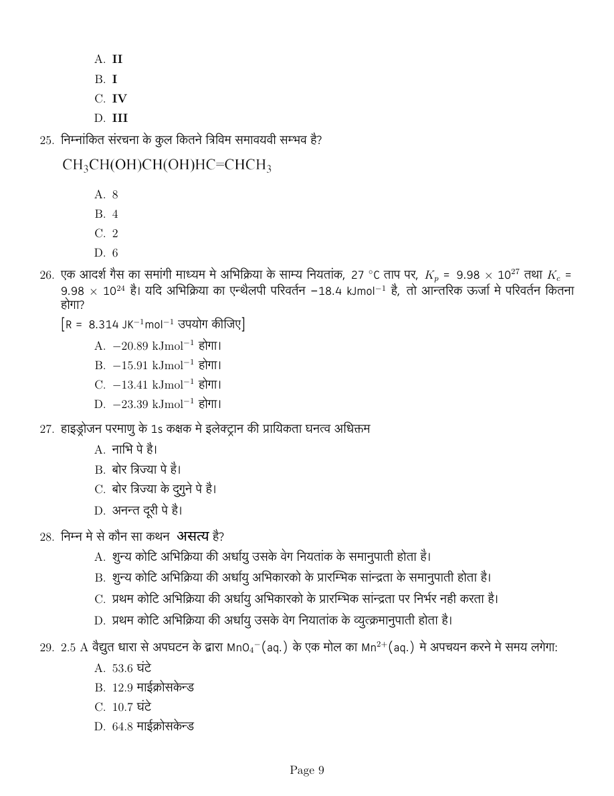

## PDF page 10

[Open original PDF at page 10](../pdf/IAT_2021_Hindi_paper.pdf#page=10)

**Matching embedded figure, English PDF page 10:** Chemistry Q30: a reversible X-Y-Z reaction scheme gives forward and reverse rate multipliers. Candidate free-energy profiles A and B show two activation barriers and different relative levels of X, Y and Z. More options continue on page 11.

**Matching embedded figure, English PDF page 11:** Continuation of Chemistry Q30: free-energy versus reaction-coordinate profiles C and D. Both have two barriers, but the relative well depths and barrier heights differ.

### Searchable text - OCR draft (hin+eng)

```text
30. सापेक्ष स्थिरता तथा बाधा के आधार पर, निम्न में से कौन सा ऊर्जा आरेख निचे दिये गये अभिक्रिया क्रम को सबसे सटीक
रूप से दर्शाता है? [#तथा #/ के परिमाण लगभग बराबर है। Free Energy: मुक्त ऊर्जा, Reaction Coordinate: अभिक्रिया
पथ]

4k 8k'
xX —— Y = 7
2k 3k"
&
2 AW
ad
$
E Y
Z
A. Reaction Coordinate
&
ao
¢
ad
ov
2
* Vi
xX
Z
B. Reaction Coordinate
&
ao
¢
ad
o
z WwW
Y
2
Cc. Reaction Coordinate

Page 0
```

### Original page image

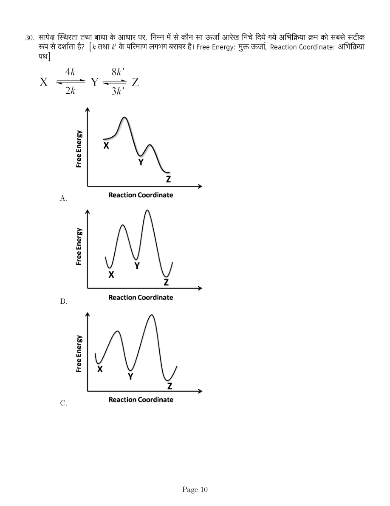

## PDF page 11

[Open original PDF at page 11](../pdf/IAT_2021_Hindi_paper.pdf#page=11)

**Matching embedded figure, English PDF page 11:** Continuation of Chemistry Q30: free-energy versus reaction-coordinate profiles C and D. Both have two barriers, but the relative well depths and barrier heights differ.

### Searchable text - OCR draft (hin+eng)

```text
Free Energy

x

WWW
Y

Reaction Coordinate

Page IL
```

### Original page image

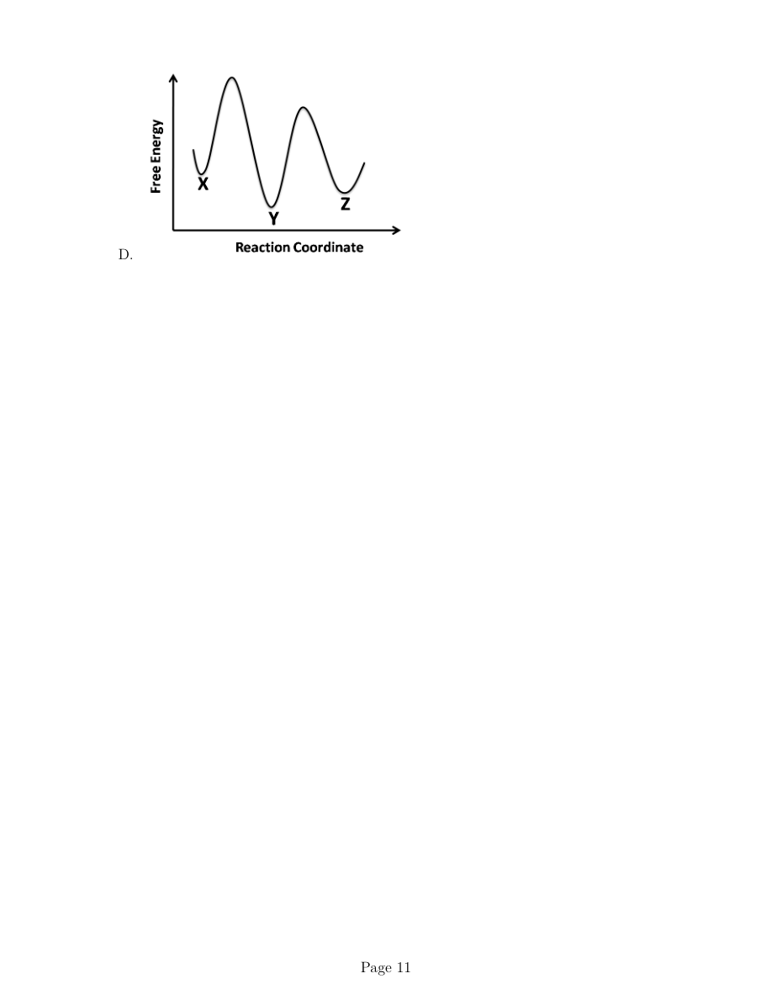

## PDF page 12

[Open original PDF at page 12](../pdf/IAT_2021_Hindi_paper.pdf#page=12)

### Searchable text - OCR draft (hin+eng)

```text
3l.

32.

33.

34.

Mathematics

यदि x > 0 हो FH cos!(x) + sin?(x) + cos(x) का अधिकतम मान कितना होगा?
A.2
B.
C. V2
9. 2५8
संख्या । से 0 तक अंकित l0 कार्ड के किसी समूह से एक बालक एक कार्ड यादृच्छिक रूप से निकाल कर उन्हें वापस रख

देता है। फिर एक बालिका इस समूह से एक कार्ड यादृच्छिक रूप से निकाल लेती है। यदि बालक के कार्ड पर % तथा बालिका
के कार्ड पर ART और m एक सम संख्या है तो m > # की प्रायिकता कितनी है?

A.

B.

C.

our BIR WIR NIE

Dz.

मान लीजिए की a,b € छ इस प्रकार से है कि कार्तीय तल के बिन्दु (७, ७), (a2, ४?) एवं (८१, ४४) विभिन्न और संरेखीय हैं
और इन बिंदुओं से हो कर जाने वाली रेखा ५-अक्ष के समांतर नहीं है। तब (a,b) के सभी चयनों के लिए इन बिन्दुओं से
होकर गुजरने वाली रेखा के ढाल का/के

A. केवल दो मान होंगे।

B. अपरिमित कई मान होंगे।

C. केवल तीन मान होंगे।

D. केवल एक मान होगा।
फलन f : [2, 22] + R, को f(x) = max{n(I - |x - (2४ +)|):n 5 , 2, ... ,0). से परिभाषित कीजिए क्षेत्र
{(x,y):0<y < /(७),» € [2, 22]) का क्षेत्रफल कितना है?
55
60
5
D. 0

Qn श

. सीमा lim (sinx)¥?(e* + 2)? का मान क्या है?

20+

A. ८
B. l
C.e
D. 0

Page 2
```

### Original page image

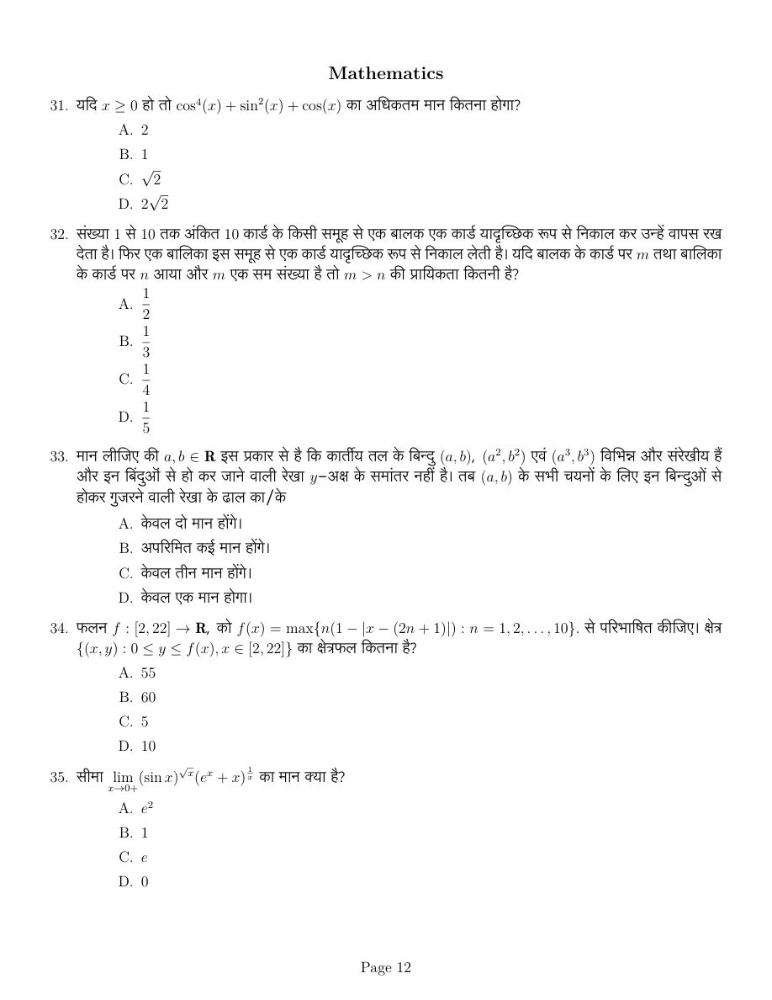

## PDF page 13

[Open original PDF at page 13](../pdf/IAT_2021_Hindi_paper.pdf#page=13)

### Searchable text - OCR draft (hin+eng)

```text
36.

37.

38.

39.

40.

फलन / : छ -> छे को एक सतत फलन मान लीजिए जो सभी 2 के लिए

f(x) =eP P+ [ tf (t)dt

JO

को संतुष्ट करता है। इस आधार पर निम्न में से कौन सा सही है?
A. 5 < f(V2) <6
B. 2< f(V2) <3
C. 3 < f(v2) <4
D. 4< f(V2) <5

प्रत्येक ७ € 8, के लिए

Dalz) = 2 के 2८००५ + er

को परिभाषित कीजिए। तब, निम्न में से कौन सा विकल्प सही है?
A. सभी ७ € & के लिए % के केवल अवास्तविक सम्मिश्र मूल हैं।
B. सभी ७ € छे के लिए p, के वास्तविक मूल हैं।
C. केवल और केवल a > । के लिए % के वास्तविक मूल हैं।
D. केवल और केवल a < - के लिए p, & वास्तविक मूल हैं।
ऐसे फलन / : {2,2,3,4,5} --+ {4,2,3,4,5}, जो की सभी # © {7,2,3, 4, 5) के लिए / (f(n)) =n, की शर्त को
संतुष्ट करते है, उनकी संख्या है
A. 4
B. 25
०.3
D. 420
मान लीजिए कि Pet ४+ » 5 तथा Py: 27 + ४+ » -- 3 दो समतल हैं और L समतलों की प्रतिच्छेद रेखा को

दर्शाता है। बिंदु (4,2, ) से होकर गुजरने वाले समतल को यदि PAM लें जो रेखा ॥, के अभिलंबवत है। तब, निम्न में से
कौन सा समीकरण P को दर्शाता है?

2. y-z=
B.a+z=2

C. e+2y+2=6
D. c+yt+2z=5

» > 0 के लिए f(x) = In(l + ») फलन मान लीजिए। तब

3 f(W/cos8) 0
५ | f(Wsin 0) + /(४/८००४४)

का मान है

Page 3
```

### Original page image

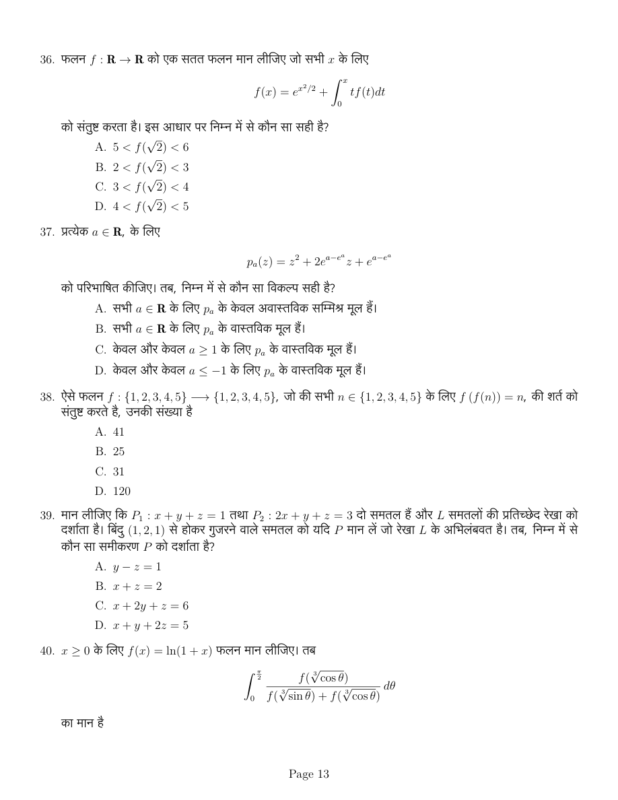

## PDF page 14

[Open original PDF at page 14](../pdf/IAT_2021_Hindi_paper.pdf#page=14)

### Searchable text - OCR draft (hin+eng)

```text
छएफए कफ
|

4. वक्रों y - । + |आ। 2|, y = —|sina| और रेखाओं x = 0, x = 2 से घिरे क्षेत्र का क्षेत्रफल कितना है?
A. 8427.
8. 8+4n.
C. 84+ 6n.
D. 84+ 87.

42.
F(a) = ४०

से परिभाषित फलन f : छ > R का विचार कीजिए। तब निम्न में से कौन सा कथन सही है?
A. / अवकलनीय है परन्तु /” अवकलनीय नहीं।
8. f सतत है परन्तु अवकलनीय नहीं।
0. f अवकलनीय है परन्तु // अवकलनीय नहीं।
D. /” अवकलनीय है।

43. एक 2» 2 आव्यूह A, जिसके लिए
2 0i\_/00
4+4+ (१ 8 )-(0 0)
है। यदि / के द्वारा x 2 तत्समक आव्यूह को निरूपित किया जाए तो निम्नलिखित में से कौन सा कथन सही है?
A. 4 व 4 +/ दोनों व्युत्क्रमणीय हैं।
8. 4 व्युत्क्रमणीय है परन्तु .4 + का व्युत्क्रमणीय होना आवश्यक नही है।

0. A+ ४ व्युत्क्रमणीय है परन्तु A का व्युत्क्रमणीय होना आवश्यक नही है।
9. 4+/ और 4 दोनों का व्युत्क्ररणीय होना आवश्यक नही है।

44. यदि तीन संख्याएं ७, b,c समांतर श्रेणी में हैं तो सारणिक

४2 +3 &+4 a? +5
४2 +4 a?+5 2? +6
eta w+b arte
का मान होगा

A. 0.

8. 26.

(7. 6+८- 09.

D. a? + 20.

Page 4
```

### Original page image

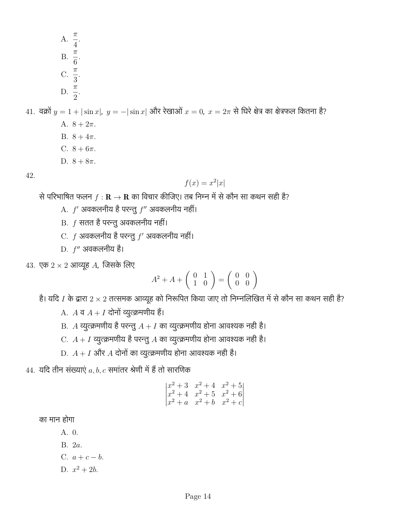

## PDF page 15

[Open original PDF at page 15](../pdf/IAT_2021_Hindi_paper.pdf#page=15)

### Searchable text - OCR draft (hin+eng)

```text
45. आंकड़ो के दो समुच्नयों

S, = {2,2,4,8,9,I,5, 20, 27, 29, 33},
5, = {5I,52,54,58, 59, 6, 65, 70, 77, 79, 83}.

पर विचार कीजिए। यदि mi, me और ०, ve, क्रमशः 5, और 5,,की माध्यिकाएं और प्रसरण हैं, तब निम्न में से कौन सा
सम्बंध सही है?
A. mg =m, क॑ 30, vg = vy.

Mme =m, + 50, ve = vi + 50.

Q w

Mz = M4, Vo = Vy.

प्‌

Mz =m, + 50, ve < V4.

Page 5
```

### Original page image

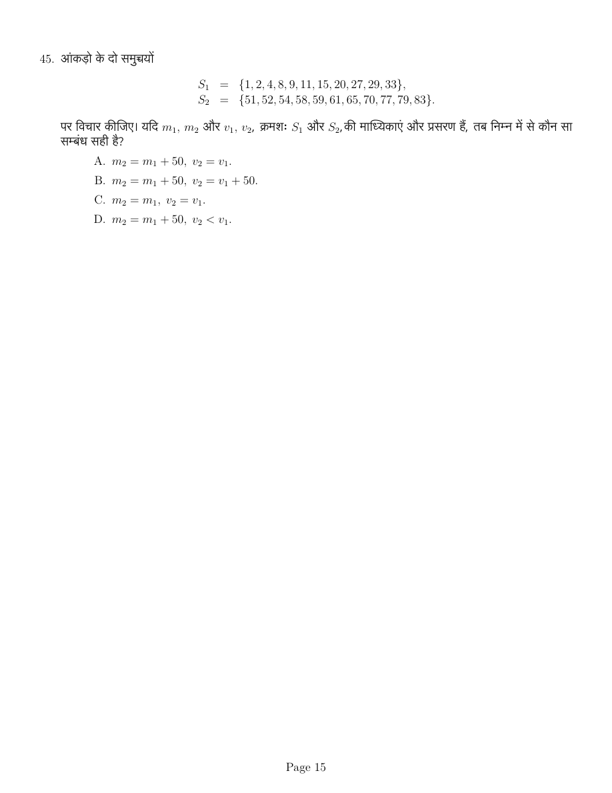

## PDF page 16

[Open original PDF at page 16](../pdf/IAT_2021_Hindi_paper.pdf#page=16)

### Searchable text - OCR draft (hin+eng)

```text
Physics

46. एक सिरे पर कब्जों से जुड़ा, M द्रव्यमान तथा L चौड़ाई का एक दरवाजा, कब्जों से गुजरती एक ऊर्ध्वाधर अक्ष के परित:
बिना घर्षण के घूमता Sl m (m < M) SIAM और v चाल वाली एक गोली इस दरवाजे पर लबंवत चलायी जाती है जो
दरवाजे पर घूर्णन अक्ष से & दूरी पर टकराकर उसमे अंतःस्थापित हो जाती है। ऐसा मानते हुए कि दरवाजा प्रारम्भ में गतिमान
नहीं था, गोली के दरवाजे में अंतःस्थापन के ठीक बाद इसके कोणीय चाल w का फलन x के साथ कैसा होगा?

D.

47. द्रव्यमान m का एक पिंड एक सरल रेखा में सरल आवर्त्त गति करता है, जिसका आवर्त्त-काल 7' एवं कुल ऊर्जा # है। इस
पिंड के अधिकतम त्वरण का परिमाण क्या होगा?

A 2 2V2n vz E
T m

2a Ee

8. —=4/—
TVm
v2 Vz

c. Y,/=
T Vm

D T ‘E
“TVm

48. एक धाविका किसी सीधे पथ पर दौडती है। वह शून्य वेग से आरम्भ कर, पहले 2 सेकन्ड तक नियत त्वरण से दौड़कर
9 ms~! की गति प्राप्त करती है। फिर कुछ देर तक नियत गति से दौड़ने के बाद वह एक नियत अवत्वरण से धीमे होते हुए

Page 6
```

### Original page image

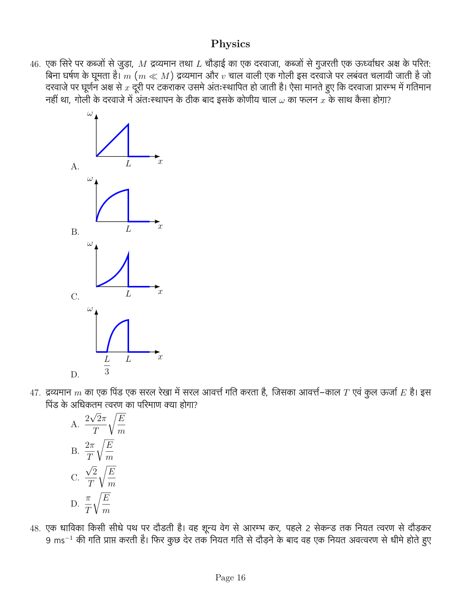

## PDF page 17

[Open original PDF at page 17](../pdf/IAT_2021_Hindi_paper.pdf#page=17)

### Searchable text - OCR draft (hin+eng)

```text
आरम्भ से कुल 2 सेकन्ड बाद रुक जाती है। यदि त्वरण का परिमाण अवत्वरण का दोगुना है, तो धाविका ने कुल कितनी
दूरी तय की?

A. 8lm
B. 08 m
C. 90 m
D. 72m

49. धारिता C का एक संधारित्र धातु की दो विशाल समांतर पट्टियों से बना है। धातु का रैखिक प्रसार गुणांक ७ है। पट्टियों के बीच
की दूरी नियत रखते हुये यदि पट्टियों के तापमान को AT से बढाया जाये तब संधारित्र की धारिता मे क्या बदलाव होगा?

A. 2aATC

B. aATC

0. -aATC

D. —2aATC

50. नीचे दिए गए परिपथ में कुंजी k चालु करने के काफी समय बाद 2 vk और 4 wr संधारित्रों में संग्रहीत आवेश कितना होगा?
4k 2k
can AVAVAY;

2 pF 4 uF

i2V

A. क्रमश: 8 uC एवं 8 yc
B. क्रमश: 8 ॥0 एवं I8 pC
6 8

C. क्रमश: 3 wc एवं 3 yc

- i
D. क्रमश: Suc एव * uC

bl. निर्वात में विद्युत क्षेत्र £ = £,i+ 75, एवं चुम्बकीय क्षेत्र B = B,i + B,j की उपस्थिति में एक बिन्दु आवेश +q नियत वेग
४ =vk से गतिमान है। यहाँ i,j एवं £ क्रमश: », y एवं z Hel में इकाई सदिश हैं। निम्न में से कौन सा संबंध सही है?
A. E, =v By, Ey = —v By
B. E, = -vB,, Ey, =—-vB,
C. E, = —vB,, E,=vB,
D. E, =v B,, E, =vB,

52. चार आवेश, जिनका मान g, —2q, —3q और 4q है, L भुजा के एक सामान्य चतुष्फलक (regular tetrahedron) के चार
शीर्षों पर रखें हैं एवं 57 मान का एक आवेश इस चतुष्फलक के केंद्र में रखा है। इस निकाय की कुल स्थिर-वैद्युत ऊर्जा क्या
होगी? (निर्वात का परावैद्युतांक ey है।)

Page 47
```

### Original page image

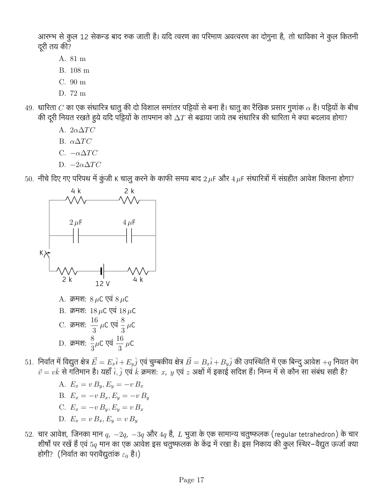

## PDF page 18

[Open original PDF at page 18](../pdf/IAT_2021_Hindi_paper.pdf#page=18)

### Searchable text - OCR draft (hin+eng)

```text
5q?
“4 Teg Lh
5¢?
45044
3047
“4 Teg Lh
3047
4॥र50 44

53. एक रेडियोऐक्टिव तत्व की अर्ध-आयु 2000 घंटे है। दो तिहाई (2/3) नाभिकों के क्षय होने में लगभग कितना समय लगेगा?
A. 3l70 घंटा
B. 3000 घंटा

C. 70 घंटा
D. 2830 घंटा

54. दो इनपुट वाले fafere—or (१07) गेट के इनपुट X एवं Y के लिये आउटपुट (XY + XY) होता है। नीचे दिखाय गए
बूलियन (Boolean) परिपथ में इनपुट P एवं (? के कौन से मान 0 आउटपुट उत्पन्न करेंगे?

॥॥ re
P NAND

C.

Dz.

55. एक प्रकाश-विद्युत प्रभाव के प्रयोग में उत्सर्जित इलेक्ट्रॉन की de Broglie Tet >> है। धातु पर आपतित फ़ोटॉन की
ऊर्जा कार्य-फलन की पाँच गुना है। यदि # प्लांक स्थिरांक है और m, इलेक्ट्रॉन का द्रव्यमान है, तो कार्य-फलन क्या
होगा?

h 2
A.
8m, A}
h 2
l0m.A हि
h 2
2m,A?,
h 2
AmeX a

B.

Page 8
```

### Original page image

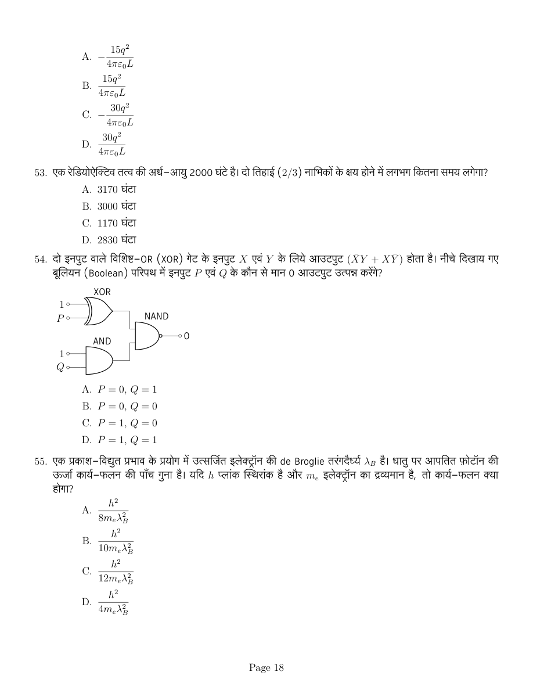

## PDF page 19

[Open original PDF at page 19](../pdf/IAT_2021_Hindi_paper.pdf#page=19)

### Searchable text - OCR draft (hin+eng)

```text
56. एक एम्बुलेंस 20 ms! की चाल से गतिमान है तथा इसका सायरन 540 Hz की आवृत्ति की ध्वनि उत्पन्न करता है। सुनंदा
20 ms“! की चाल से एम्बुलेंस की ओर उल्टी दिशा से कार चला रहीं हैं। जब सुनंदा एम्बुलेंस को पार करेंगीं तब वो ध्वनि
की अवृत्तियों में कितना अंतर पायेंगी? (वायु में ध्वनि की गति 340 ms! मान लें।)

A.
B.
C.
D.

27.5 Hz
28.8 Hz
35.5 Hz
72.00 Hz

57. 600 nm तरंगदैर्घ्य के एकवर्णी प्रकाश का उपयोग यंग के द्विझिरी (Young's double slit) Hart में किया जाता है। परदे के
किसी बिन्दु पर पथ-अंतराल 600 nm है तथा प्रकाश की तीव्रता Ip है। परदे के उस बिन्दु पर, जहां पथ-अंतराल L00 nm

है, प्रकाश की तीव्रता कितनी होगी?

A.

B.

C.

Dz.

58. 27°C तापमान पर 0, एवं No गैसों के एक मिश्रण की कल्पना करें। निम्नलिखित में से कौन सा संबंध सही है?

A.
B.
C.
D.

Oo अणुओं का मूल माध्य वर्ग गति < Ny अणुओं का मूल माध्य वर्ग गति
Oo अणुओं का औसत गतिज ऊर्जा < No अणुओं का औसत गतिज ऊर्जा
Oo अणुओं का औसत गतिज ऊर्जा > Ny अणुओं का औसत गतिज ऊर्जा
Oo अणुओं का मूल माध्य वर्ग गति > No अणुओं का मूल माध्य वर्ग गति

59. दो समान वस्तुयें, 8 एवं 8, जिनका प्रारम्भिक तापमान क्रमश: Ty एवं 7५ है। इन पदार्थों की विशिष्ट ऊष्मा धारितांए तापमान
के साथ बढतीं हैं। जब इन दो वस्तुओं को सम्पर्क में लाया जाता है तब उनका अन्तिम साम्य तापमान 7' है। यदि इन वस्तुओं
ने वातावरण के साथ ऊष्मा का आदान-प्रदान ना किया हो तब निम्न में से कौन सा विकल्प सही है?

a. T> tts
2
छ. 7 > 7५

Ta + Tp
2

Ta+Tp
2

C.T=

DT<

60. निम्न मे से कौन सा विकल्प इलेक्ट्रिकल प्रतिरोध की विमा को प्रकट करता है जब ८ इलेक्ट्रॉन का आवेश तथा # प्लांक

नियतांक है?
A.

B.

=I % Bl

Page 9
```

### Original page image

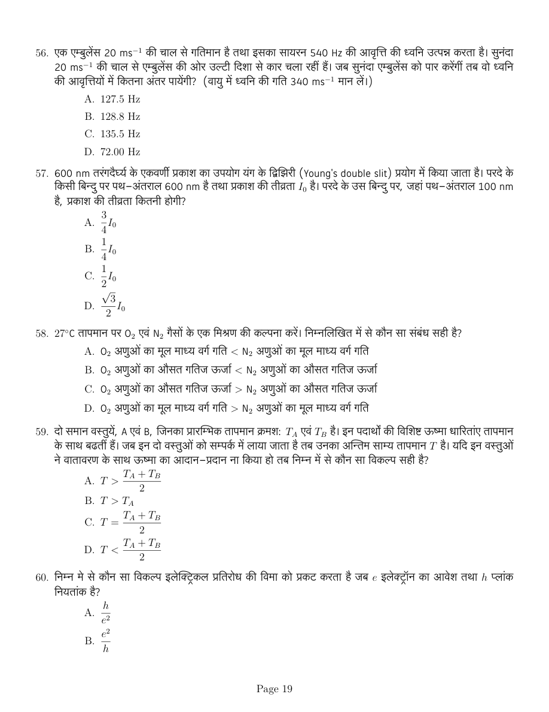

## PDF page 20

[Open original PDF at page 20](../pdf/IAT_2021_Hindi_paper.pdf#page=20)

### Searchable text - OCR draft (hin+eng)

```text
0७ | ७ s/o

Page 20
```

### Original page image


