# IAT 2022 - English

Original PDF: [IAT_2022_English_paper.pdf](../pdf/IAT_2022_English_paper.pdf)

- Acquisition: SciAstra CloudFront mirror; not downloaded from the official server.
- Downloaded: 28 October 2026. PDF pages: 30.
- Exact download/source URL: https://d2aaa7ts7sm3bp.cloudfront.net/pdfs/01KMFRNVQFV9H8R4NB9DE10TD3.pdf
- PDF SHA-256: `b7f51a2e02cfd10935e880fa96f0336e3e29a69628a58b44aafc3399196f5335`
- This is a search/accessibility copy of an existing paper, not newly authored mock content.
- Text is mechanically extracted or OCR-derived and has not been proofread character by character. Equations, option letters, chemical bonds, tables and Hindi OCR can contain errors. The PDF and page images are authoritative.
- Figure descriptions are explanatory annotations, not official answers or complete structural/formula transcriptions. Use the linked image to resolve exact labels, values and stereochemistry.

**Source correction:** SciAstra table says 2021, but PDF content identifies IAT 2022; independently corroborated by PYQP 2022 Drive file names and matching reported byte sizes.

## Visual guide

- [English PDF page 1](#pdf-page-1): Biology Q1: a two-column matching table compares plant-cell features with examples. Q2: four reaction arrows labelled i-iv represent individual steps involving pyruvate/acetyl-CoA, triose phosphates, oxaloacetate/citrate and fumarate/malate; the task is to order them in glucose oxidation.
- [English PDF page 3](#pdf-page-3): Biology Q14 introduces four mitochondrial chemiosmosis diagrams printed on the next page. The abbreviations IMS, IMM and MM denote intermembrane space, inner mitochondrial membrane and mitochondrial matrix; ETC is the electron-transport chain.
- [English PDF page 4](#pdf-page-4): Biology Q14: alternatives A-D show proton arrows across a horizontal IMM, an ETC block, ATP synthase, and ATP/ADP labels. The choices differ in proton direction and in the side where ATP synthesis is drawn. Q15 follows below the figures.
- [English PDF page 5](#pdf-page-5): Chemistry Q4: a numerical table gives the first five successive ionisation energies, in eV, for elements X and Y. The abrupt changes between columns are the visual data; the table must be read by element row and ionisation-order column.
- [English PDF page 6](#pdf-page-6): Chemistry Q5: a radial wavefunction psi(r) is plotted against radius r/a0; it begins positive, crosses zero, has a negative trough, then tends back toward zero. Q6 shows four nitrogen-containing rings M, N, O and P with different charges and bonding for an aromaticity comparison.
- [English PDF page 7](#pdf-page-7): Chemistry Q7 displays four bromine-containing skeletal structures M-P, distinguishing aromatic from non-aromatic carbon-bromine bonds. Q8 has four benzene-based product alternatives: benzene, ethoxybenzene, aniline and ethylbenzene.
- [English PDF page 8](#pdf-page-8): Chemistry Q9: phenol proceeds through reagent-labelled steps to M, N and O. Four answer rows contain different triplets of aromatic structures; substitution positions and the terminal sodium salt groups differ.
- [English PDF page 9](#pdf-page-9): Chemistry Q10: HBr is added to a phenyl-substituted alkene. Four drawn products place bromine or change connectivity differently. The image preserves the alkene position, branching and the bromine position in each candidate.
- [English PDF page 10](#pdf-page-10): Chemistry Q12: four qualitative plots of Kp/Kc against absolute temperature T. They are, respectively, a convex rising curve, a horizontal line, a descending straight line and an ascending straight line.
- [English PDF page 11](#pdf-page-11): Chemistry Q15: four rows order fluorinated and chlorinated benzene derivatives by dipole moment. The relative positions of halogens on the rings, not simply the element names, determine the comparison.
- [English PDF page 19](#pdf-page-19): Physics Q4: a horizontal spring fixed at the left is attached to a block on a smooth floor. A wall to the right is separated from the equilibrium block position by distance d; different spring compressions may cause a wall collision.
- [English PDF page 20](#pdf-page-20): Physics Q5: an externally pushed cube is fully submerged in liquid inside a vessel resting on a weighing scale. The stick acts from above; the cube does not touch the bottom. The external support and the scale must be distinguished.
- [English PDF page 22](#pdf-page-22): Physics Q7: a taut string spans two pulleys separated by L, with charges +q and -q on the hanging ends. A horizontal reference separation L/2 is indicated between the hanging charge positions.
- [English PDF page 23](#pdf-page-23): Physics Q8: two concentric shells have radii r1 and r2 and charges +Q and -Q. Four potential-versus-radius alternatives differ in their inner plateau, middle-region shape and value outside the outer shell.
- [English PDF page 24](#pdf-page-24): Physics Q9: a circular/spherical cavity of radius a has been removed from a positively charged cylindrical region. The shaded remaining material is labelled with charge density rho; x is measured radially outward from the cavity centre.
- [English PDF page 25](#pdf-page-25): Physics Q10: a switched source, resistor R, ammeter and mystery box B form a series circuit. Three I-versus-t plots a1, a2 and a3 show a constant current, a decay to zero and a rise to a plateau, respectively.
- [English PDF page 26](#pdf-page-26): Physics Q11: a cube-shaped electrical network has vertices A-H, resistors on several edges, capacitors on other edges and a 5 V supply between the marked lower vertices. The capacitor between B and F is the requested one; trace edges in the page image to avoid confusing perspective crossings with junctions.
- [English PDF page 27](#pdf-page-27): Physics Q12: a convex lens lies on a horizontal optical axis. Object O and image I are marked along with candidate positions A, B, C and D. Two rays are shown through the lens, and the surrounding medium has refractive index nm.
- [English PDF page 28](#pdf-page-28): Physics Q13: a shaded charged sphere of radius a overlaps a larger spherical Gaussian surface of radius 2a. The larger sphere is centred at a point on the smaller sphere's surface, rather than sharing its centre.
- [English PDF page 29](#pdf-page-29): Physics Q14: alternatives A-D plot photocurrent J versus frequency f for intensities I1, I2 and I3. Some show saturation-like plateaus with different heights; others are straight rising branches with shifted intercepts. Preserve the curve labels and their intensity order.

## Page index

[p1](#pdf-page-1) | [p2](#pdf-page-2) | [p3](#pdf-page-3) | [p4](#pdf-page-4) | [p5](#pdf-page-5) | [p6](#pdf-page-6) | [p7](#pdf-page-7) | [p8](#pdf-page-8) | [p9](#pdf-page-9) | [p10](#pdf-page-10) | [p11](#pdf-page-11) | [p12](#pdf-page-12) | [p13](#pdf-page-13) | [p14](#pdf-page-14) | [p15](#pdf-page-15) | [p16](#pdf-page-16) | [p17](#pdf-page-17) | [p18](#pdf-page-18) | [p19](#pdf-page-19) | [p20](#pdf-page-20) | [p21](#pdf-page-21) | [p22](#pdf-page-22) | [p23](#pdf-page-23) | [p24](#pdf-page-24) | [p25](#pdf-page-25) | [p26](#pdf-page-26) | [p27](#pdf-page-27) | [p28](#pdf-page-28) | [p29](#pdf-page-29) | [p30](#pdf-page-30)

## PDF page 1

[Open original PDF at page 1](../pdf/IAT_2022_English_paper.pdf#page=1)

### Visual description

Biology Q1: a two-column matching table compares plant-cell features with examples. Q2: four reaction arrows labelled i-iv represent individual steps involving pyruvate/acetyl-CoA, triose phosphates, oxaloacetate/citrate and fumarate/malate; the task is to order them in glucose oxidation.

### Searchable text - PDF text layer

```text
1. Match the features of a plant cell listed in Column I with their corresponding examples in Column
    II.


  Choose the CORRECT combination from the options below.

        A.  i and t; ii and r; iii and s; iv and q

        B.  i and u; ii and r; iii and s; iv and p

        C.  i and u; ii and r; iii and q; iv and p

        D.  i and r; ii and t; iii and s; iv and q

2. Shown below are some of the reactions that occur in the metabolic pathway leading to complete
   oxidation of glucose during aerobic respiration.


  Choose the CORRECT sequence of reactions during the complete oxidation of glucose.

        A.  ii; i; iii; iv

        B.  i; iii; iv; ii

        C.  i; ii; iii; iv

        D.  ii; iii; i; iv

3. In a given species of flowering plant, the colour of the seeds is exclusively determined by the colour
   of its seed coat.  Seed coat colour in this species is governed by a nuclear gene with two alleles.
  TheWHITE (W) allele is dominant over brown (w) allele. If a plant with brown seeds (ww) is crossed
   as a female with pollen from a white seed (WW) plant, what will be the seed colour and the genotype
   of the embryo in the resultant seeds obtained from this cross?

        A. Brown seeds with Ww embryo
```

### Original page image

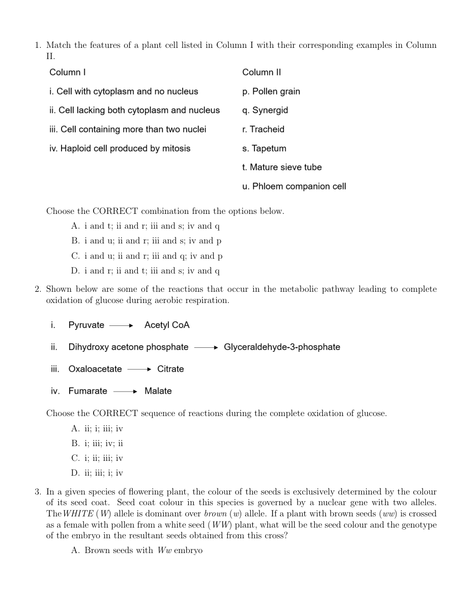

## PDF page 2

[Open original PDF at page 2](../pdf/IAT_2022_English_paper.pdf#page=2)

### Searchable text - PDF text layer

```text
B. White seeds with Ww embryo

        C. Brown seeds with ww embryo

        D. White seeds with ww embryo

4. During the CoVID-19 pandemic, SARS-CoV2 virus mutated multiple times giving rise to many
   variants. What is the genetic material of the SARS-CoV2 virus?

        A. Single stranded RNA

        B. Double stranded RNA

        C. Single stranded DNA

        D. Double stranded DNA

5. Lymph is an important body fluid. Choose the INCORRECT statement about the lymph.

        A. It remains as an interstitial fluid and is never put back into circulation.

        B. It is the interstitial fluid generated by the passage of liquid between the cells of the capillary.

        C. It is colourless and has similar mineral composition as of plasma.

        D. Fat digested in the intestine is absorbed through the lymph.

6. Interneurons play an important role in the execution of spinal cord-mediated reflex action. Where
   are these interneurons located?

        A. Gray matter

        B. White matter

        C. Dorsal root ganglion

        D. Muscle spindle

7. Osmoreceptors are sensitive to changes in ionic concentrations and volumes of body fluids. Which
  among the following best describes the function of these osmoreceptors?

        A. They stimulate hypothalamus to facilitate the release of the anti-diuretic hormone and
             increase water reabsorption.

        B. They stimulate pituitary gland to facilitate the secretion of mineralocorticoids to adjust
            the changes in mineral composition of the body fluid.

        C. They stimulate atrial wall to release atrial natriuretic factor to induce vasodilation and
            reduce blood pressure.

        D. They stimulate renin production to induce vasoconstriction and increase blood pressure.

8. A single point mutation in gene ‘X’ results in breathing difficulty, hypertension as well as partial
    sterility. Which among the following phenomenon best explains the observed phenotypes?

        A. Pleiotropy

        B. Incomplete dominance

        C. Linkage

        D. Partial dominance


                                        Page 2
```

### Original page image

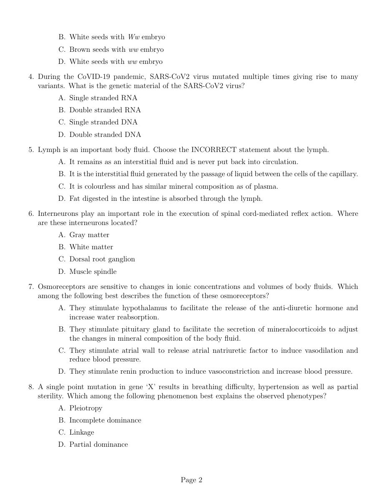

## PDF page 3

[Open original PDF at page 3](../pdf/IAT_2022_English_paper.pdf#page=3)

### Visual description

Biology Q14 introduces four mitochondrial chemiosmosis diagrams printed on the next page. The abbreviations IMS, IMM and MM denote intermembrane space, inner mitochondrial membrane and mitochondrial matrix; ETC is the electron-transport chain.

### Searchable text - PDF text layer

```text
9. In a cross between individuals of the genotypes PpQQRrSS and ppqqRrSS, what will be the expected
   number of progenies with the genotype ppQQRrSS in a population of 400 individuals, assuming
    independent assortment?

         A. 0

         B. 100

         C. 200

         D. 25

10. Organisms in which of the following phyla are triploblastic, acoelomate and have bilateral symmetry?

         A. Platyhelminthes

         B. Mollusca

         C. Arthropoda

         D. Hemichordata

11. Consider the following biomes: Tropical Rainforest (P); Tundra (Q); Desert (R) and Coastal zone
    (S). Choose the most probable descending order of Net Primary Productivity of these biomes.

         A. P > S > Q > R

         B. P > Q > S > R

         C. Q > P > S > R

         D. R > Q > S > P

12. Nine percent of a population cannot taste a certain food item because of a recessive allele of the
    gene IAT. Assuming the population is in Hardy-Weinberg equilibrium, what will be the frequency of
   dominant and recessive alleles, respectively?

         A. 0.7 and 0.3

         B. 0.9 and 0.1

         C. 0.3 and 0.7

         D. 0.1 and 0.9

13. As opposed to DNA replication within the cell, discontinuous synthesis of DNA does NOT occur in
    a polymerase chain reaction (PCR). Why?

         A. Denaturation step in PCR substitutes for the replication fork and Taq polymerase extends
        DNA only in the 5′ to 3′ direction.
         B. The replication fork is formed and Taq polymerase extends DNA in both 3′ to 5′ and 5′ to
                 3′ direction.

         C. Denaturation step in PCR substitutes for the replication fork and Taq polymerase extends
        DNA only in the 3′ to 5′ direction.

         D. The replication fork is formed and DNA ligase activity of the Taq polymerase joins the
             discontinuous fragments.

14. Which of the following figures CORRECTLY represents the chemiosmotic hypothesis of ATP syn-
    thesis occuring in a mitochondrion in a cell? (Keys for the figure; IMS: Intermembrane space, IMM:
    Inner mitochondrial membrane, MM: Mitochondrial matrix, ETC: Electron transport chain)


                                         Page 3
```

### Original page image

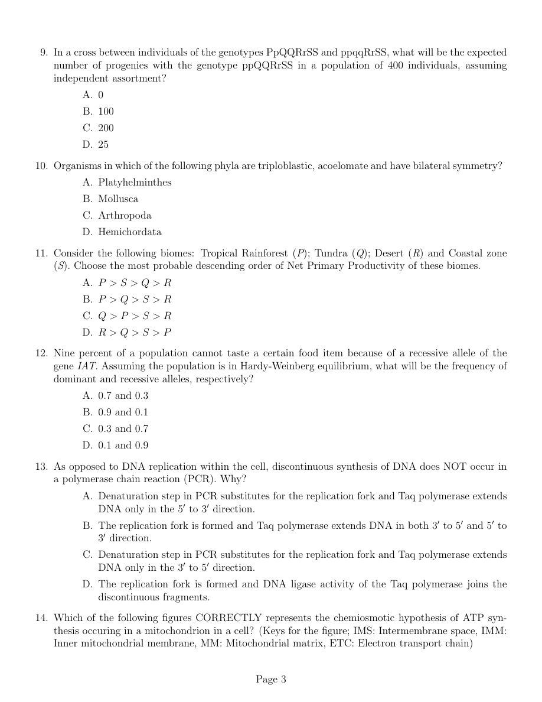

## PDF page 4

[Open original PDF at page 4](../pdf/IAT_2022_English_paper.pdf#page=4)

### Visual description

Biology Q14: alternatives A-D show proton arrows across a horizontal IMM, an ETC block, ATP synthase, and ATP/ADP labels. The choices differ in proton direction and in the side where ATP synthesis is drawn. Q15 follows below the figures.

### Searchable text - PDF text layer

```text
A.


         B.


         C.


         D.


15. Let ‘X’ be the perpendicular distance from the centromere of each chromosome to the equatorial
    plane of a human cell. Which of the following stages of the cell cycle is most likely to have the
   HIGHEST average value of ‘X’?

         A. Late anaphase

         B. Metaphase

         C. Early anaphase

         D. Early metaphase


                                         Page 4
```

### Original page image

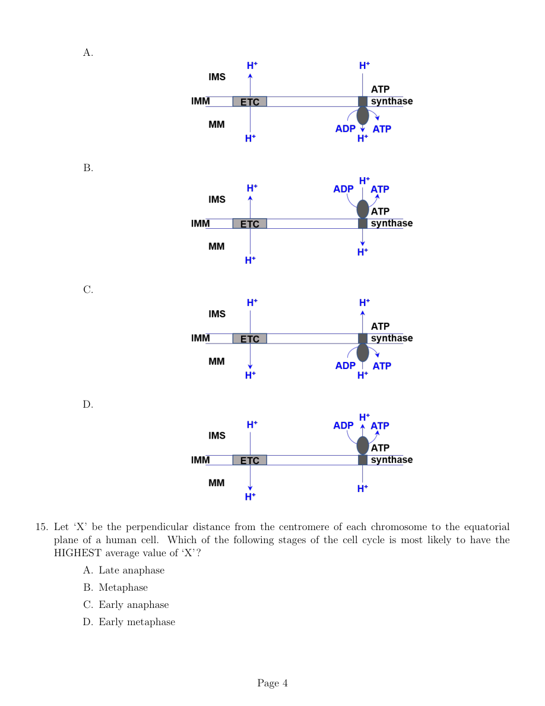

## PDF page 5

[Open original PDF at page 5](../pdf/IAT_2022_English_paper.pdf#page=5)

### Visual description

Chemistry Q4: a numerical table gives the first five successive ionisation energies, in eV, for elements X and Y. The abrupt changes between columns are the visual data; the table must be read by element row and ionisation-order column.

### Searchable text - PDF text layer

```text
IISER Aptitude Test 2022
                           Chemistry

1. The products of the reaction between aqueous solutions of K4[Fe(CN)6] and 12 H2O2 are
        A. K3[Fe(CN)6] and KOH

        B. K3[Fe(CN)6] and H2O

        C. K3[Fe(CN)6], H2O and O2

        D. K4[Fe(CN)5(OH)] and HCN

2. For the colourless complex [M(H2O)6]n+, where M is a 3d transition metal, the CORRECT ground
   state d-electron configuration of M is
        A. (t2g)6(eg)4
        B. (t2g)3(eg)0
        C. (t2g)6(eg)2
        D. (t2g)4(eg)2

3. Choose the correct statement about the structure of C60 fullerene.

        A. 5-membered rings are fused with 6-membered rings ONLY.

        B. 6-membered rings are fused with 5-membered rings ONLY.

        C. 6-membered rings are fused with 6-membered rings ONLY.

        D. 5-membered rings are fused with both 5-membered and 6-membered rings.

4. The first to fifth ionization energies (IE) of two p-block elements X and Y are given below.

                           IE1 (eV)  IE2 (eV)  IE3 (eV)  IE4 (eV)  IE5 (eV)
            X     6.0       18.8       28.4      120.0     153.7
            Y     8.2       16.3       33.5       45.1      166.7

  The number of valence electrons in X and Y respectively are

        A. 3, 4

        B. 4, 5

        C. 3, 5

        D. 1, 4
```

### Original page image

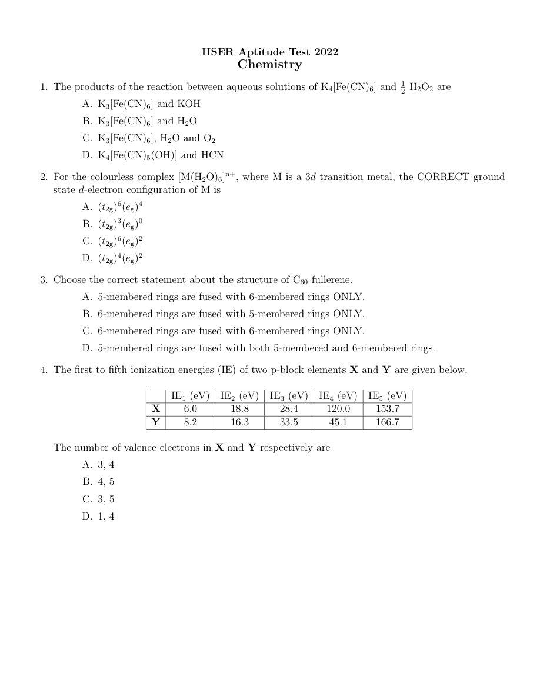

## PDF page 6

[Open original PDF at page 6](../pdf/IAT_2022_English_paper.pdf#page=6)

### Visual description

Chemistry Q5: a radial wavefunction psi(r) is plotted against radius r/a0; it begins positive, crosses zero, has a negative trough, then tends back toward zero. Q6 shows four nitrogen-containing rings M, N, O and P with different charges and bonding for an aromaticity comparison.

### Searchable text - PDF text layer

```text
5. Which of the following expressions represents the hydrogen atom wave function ψ(r) shown in the
   figure below?
   (r is the distance of the electron from the nucleus and a0 is a constant)


             1     1   3/2        A. √            2 −r   e−r/2a0
           4  2π   a0           a0
            1    1   3/2
        B. √π   a0      e−r/2a0
             1    1   3/2   r
        C. √                    e−r/2a0
            6π   a0       a0
             1    1   3/2            2r2        D. √            3 −2r +       e−r/3a0
            3π   a0           a0   9a20

6. Which of the following molecules are aromatic?


        A. M, N and O only

        B. M, N, O, and P

        C. M and O only

        D. N and P only


                                        Page 2
```

### Original page image

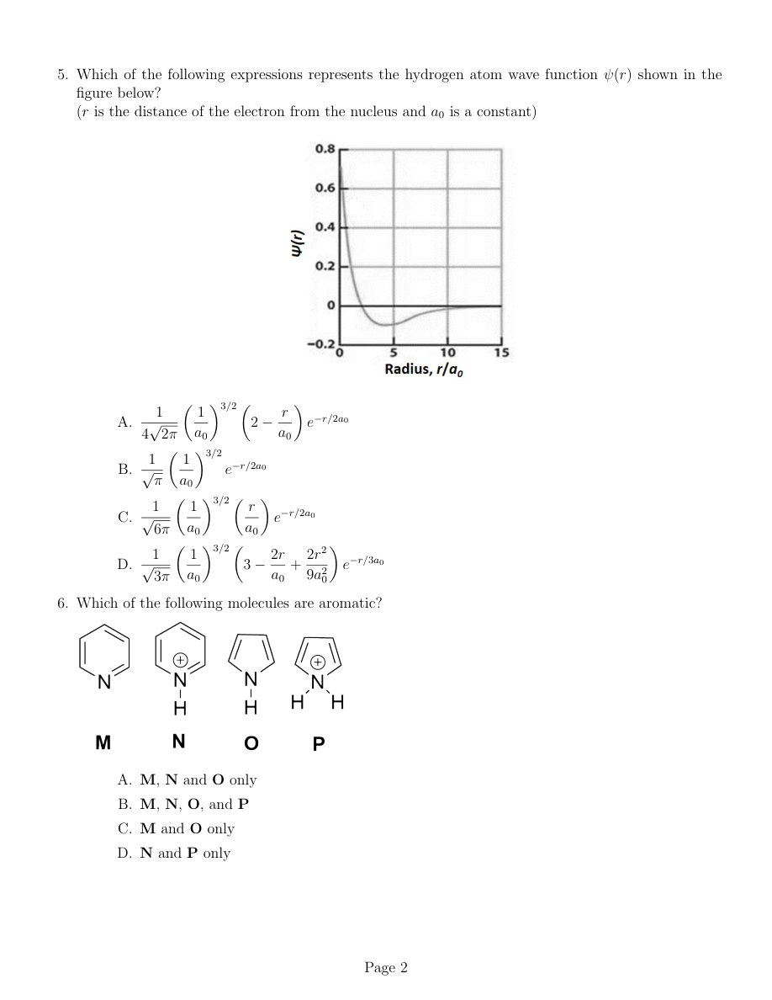

## PDF page 7

[Open original PDF at page 7](../pdf/IAT_2022_English_paper.pdf#page=7)

### Visual description

Chemistry Q7 displays four bromine-containing skeletal structures M-P, distinguishing aromatic from non-aromatic carbon-bromine bonds. Q8 has four benzene-based product alternatives: benzene, ethoxybenzene, aniline and ethylbenzene.

### Searchable text - PDF text layer

```text
7. Which of the following are aryl bromides?


        A. N and P only

        B. N, O and P only

        C. M, O and P only

        D. N and O only

8. Benzamide is treated with Br2 and NaOH(aq) to form the product X, which is then reacted with
  NaNO2 and HCl(aq) at 0 −5 ◦C to form Y. Y is immediately treated with ethanol to give Z. What
    is Z?


        A.


        B.


        C.


        D.


                                        Page 3
```

### Original page image

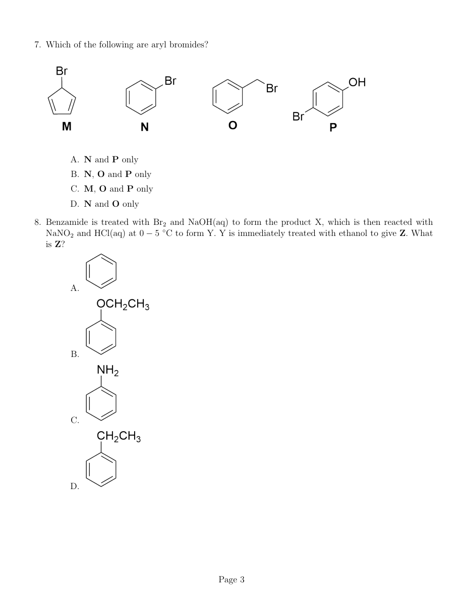

## PDF page 8

[Open original PDF at page 8](../pdf/IAT_2022_English_paper.pdf#page=8)

### Visual description

Chemistry Q9: phenol proceeds through reagent-labelled steps to M, N and O. Four answer rows contain different triplets of aromatic structures; substitution positions and the terminal sodium salt groups differ.

### Searchable text - PDF text layer

```text
9. In the following reaction sequence, the major products M, N, and O respectively are


        A.


        B.


        C.


        D.


                                        Page 4
```

### Original page image

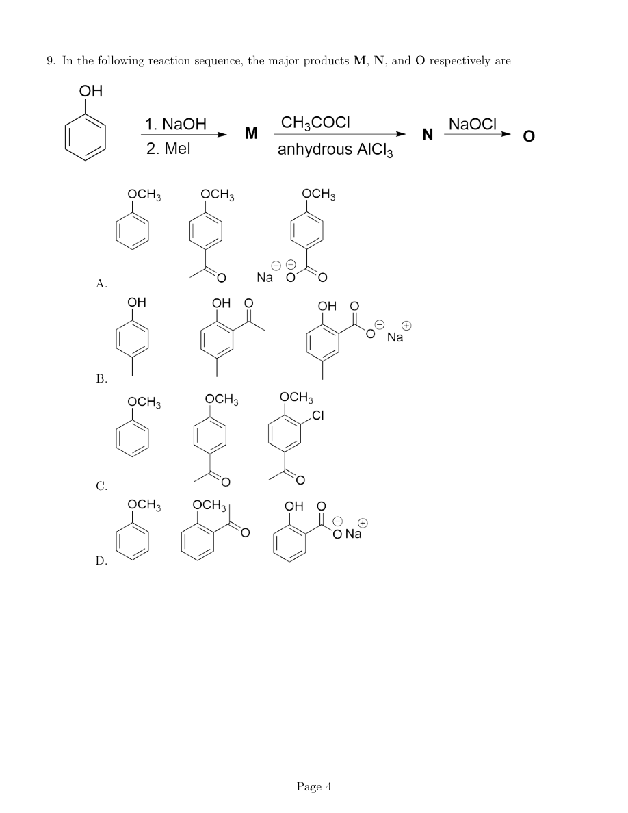

## PDF page 9

[Open original PDF at page 9](../pdf/IAT_2022_English_paper.pdf#page=9)

### Visual description

Chemistry Q10: HBr is added to a phenyl-substituted alkene. Four drawn products place bromine or change connectivity differently. The image preserves the alkene position, branching and the bromine position in each candidate.

### Searchable text - PDF text layer

```text
10. The major product P of the following reaction is


         A.


         B.


         C.


         D.

11. An aqueous solution contains 1.0 M of X2+ and 0.001 M of Y2+ ions at 25 ◦C. X2+ and Y2+ ions do
    not interact with each other. This solution is put in an electrolytic cell and the voltage is gradually
    increased till a current begins to flow through the cell. The voltage is maintained at this point and
    a deposit is observed on the cathode. What is the composition of the material deposited on the
    cathode?
    (Given: Atomic weight of X is 63 and Y is 200.
   X2+ + 2e−→X, E0 = 0.35 V,
   Y2+ + 2e−→Y, E0 = 0.40 V,
   E0 is the standard reduction potential.)

         A. Only X

         B. 24% X and 76% Y by weight

         C. 98% X and 2% Y by weight

         D. Only Y


                                         Page 5
```

### Original page image

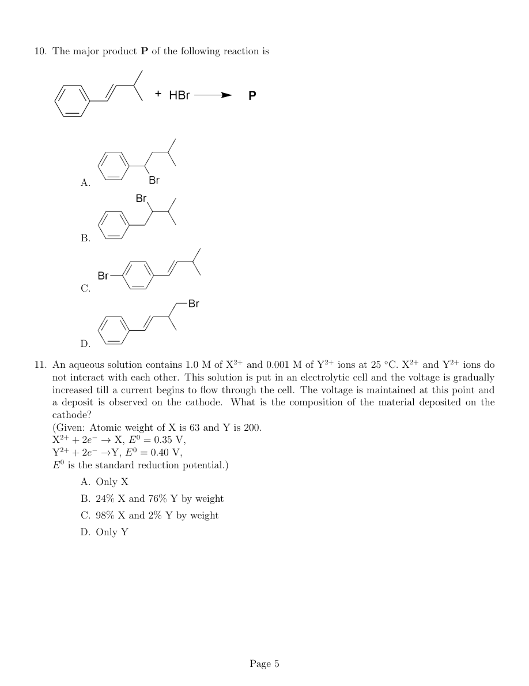

## PDF page 10

[Open original PDF at page 10](../pdf/IAT_2022_English_paper.pdf#page=10)

### Visual description

Chemistry Q12: four qualitative plots of Kp/Kc against absolute temperature T. They are, respectively, a convex rising curve, a horizontal line, a descending straight line and an ascending straight line.

### Searchable text - PDF text layer

```text
12. For the reaction involving ideal gases, A(g)+2B(g) ⇋2C(g)+3D(g), which of the following plots is
    qualitatively correct? (Kp and Kc are the equilibrium constants in terms of pressure and concentration
    respectively. T is the absolute temperature.)


         A.


         B.


         C.


         D.
                                                    a
13. The van der Waals equation for a real gas is given by P +     (V −b) = RT. What is the dimension
                                              V 2
       a
    of     ?
         b
         A. ML2T−2
         B. ML−1T−2
         C. MLT−2
         D. ML2T−1

14. 2 g of naphthoic acid (molecular weight = 172 g mol−1) dissolved in 20 mL of benzene shows a
    freezing point depression of 2 K. For benzene, the freezing point depression constant, Kf = 5 K kg
    mol−1 and the density is 0.88 g mL−1. What is the magnitude of the van’t Hoff factor?

         A. 0.605

         B. 605.0

         C. 0.688


                                         Page 6
```

### Original page image

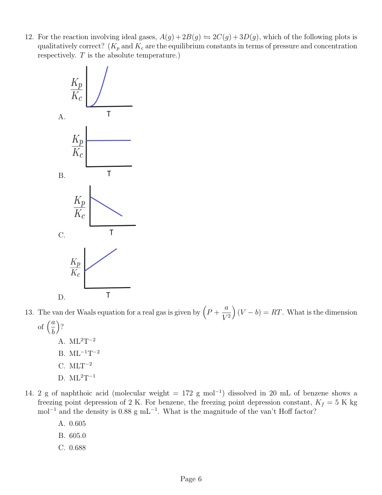

## PDF page 11

[Open original PDF at page 11](../pdf/IAT_2022_English_paper.pdf#page=11)

### Visual description

Chemistry Q15: four rows order fluorinated and chlorinated benzene derivatives by dipole moment. The relative positions of halogens on the rings, not simply the element names, determine the comparison.

### Searchable text - PDF text layer

```text
D. 688.0

15. Identify the correct order of the molecules with respect to the magnitude of their dipole moment:


         A.


         B.


         C.


         D.


                                         Page 7
```

### Original page image

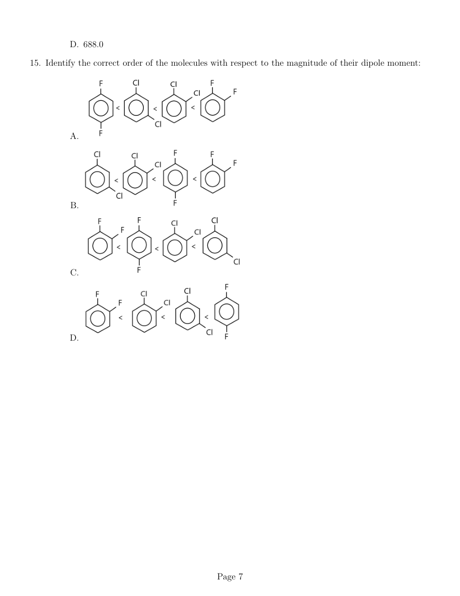

## PDF page 12

[Open original PDF at page 12](../pdf/IAT_2022_English_paper.pdf#page=12)

### Searchable text - PDF text layer

```text
1. A randomly chosen card from a deck of 52 cards is given to be a black card (i.e. Spade or Club).
  What is the probability that it is either a face card (i.e. King, Queen or Jack) or a Spade?

        A. 8/13

        B. 9/13

        C. 19/26

        D. 7/13

2. Let ω be a complex root of the quadratic polynomial x2 + x + 1. The value of

                                  1          1              1
                        ω +       ·  ω2 +        · · ·  ω100 +
                           ω         ω2              ω100

    is
        A. -233
        B. -231
        C. 233
        D. 231

3. Let f(x) = anxn + an−1xn−1 + · · · + a1x + a0 be a polynomial. Suppose that

                                         df        d2f           d3f    d5f
                           f(0) = 0,    = 1,    = 4 and   =       .
                                dx x=0    dx2  x=0      dx3   dx5

  Then f(5) =

        A. 55

        B. 25

        C. 35

        D. 105

4. Let S be the set of all unit vectors in the XY -plane. Then the set S has

        A. Infinitely many elements

        B. 2 elements

        C. 4 elements

        D. 8 elements

5. A lab reports that the global average temperature in the year 2020 was 14.9◦C and predicts that the
   global average temperature will increase at the rate of 1% per year. What will be the global average
   temperature in the year 2035?
        A. 17.298◦C
        B. 15.049◦C
        C. 17.135◦C
        D. 17.471◦C
```

### Original page image

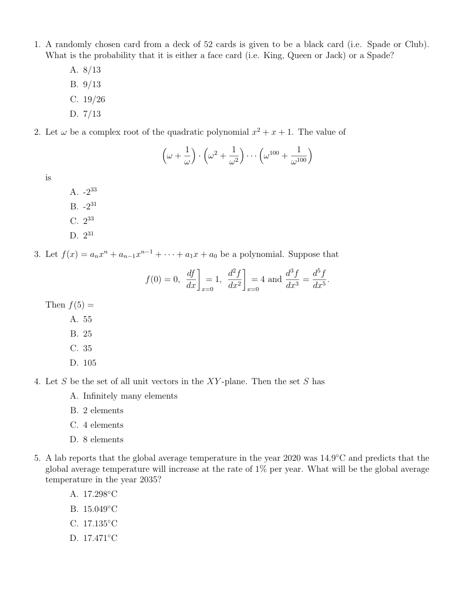

## PDF page 13

[Open original PDF at page 13](../pdf/IAT_2022_English_paper.pdf#page=13)

### Searchable text - PDF text layer

```text
6. Let X be the set of all 2 × 2 matrices with real entries and R ⊂X × X be the relation

                        R = {(A, B) : AB = BA}.

   Which of the following statements is true?

         A. R is reflexive and symmetric but not transitive

         B. R is reflexive and transitive but not symmetric

         C. R is symmetric and transitive but not reflexive

         D. R is an equivalance relation

 7. For a natural number n, let Cn be the curve in the XY -plane given by y = xn, where 0 ≤x ≤1. Let
   An denote the area of the region bounded between Cn and Cn+1. Then the largest value of An is
            1
         A.
            6
            1
         B.
            2
            1
         C.
            3
             1
         D.
            12
 8. Let f be a continuous function on [0, 1] and F be its antiderivative. If F(0) = 1 and R 1 f(x) dx = 1,                                                                                                             0
    then F(1) is

         A. 2

         B. 0

         C. 1
            1
         D.
            2
 9. Let a be a nonzero real number and f : R →R be a continuous function such that f ′(x) > 0 for all
   x ∈R. Consider g(x) = f(2a2x −ax2). Then g has

         A. Local maxima at x = a if a > 0

         B. Local maxima at x = a if a < 0

         C. Local minima at x = a if a > 0

         D. A point of inflection at x = a

10. Let A be the matrix
                            cos θ  0  −sin θ 
                                         1   1    1                                         .
                                                 sin θ  0   cos θ

    For any natural number k, the determinant of Ak is

         A. 1

         B. -1
         C. (−1)k


                                         Page 2
```

### Original page image

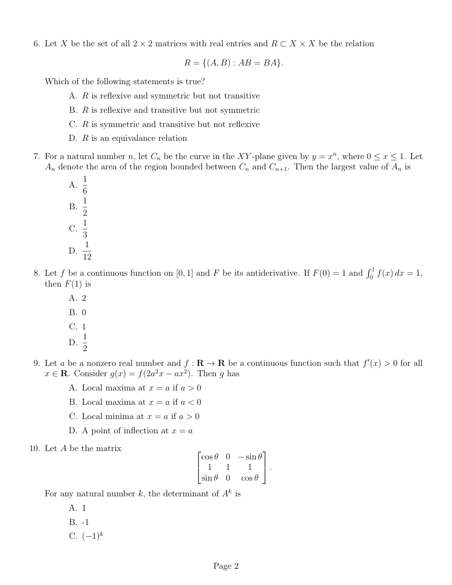

## PDF page 14

[Open original PDF at page 14](../pdf/IAT_2022_English_paper.pdf#page=14)

### Searchable text - PDF text layer

```text
D. 0

11. Consider the vectors

                                                                    ⃗a = ˆi + xˆj + 2ˆk,
                                                                          ⃗b = ˆi + 2ˆj + xˆk,
                                                                                 ⃗c = 2ˆi + ˆj + 3ˆk.

   The values of x for which there is at least one nonzero vector perpendicular to the vectors ⃗a,⃗b and ⃗c
    are

         A. 0, 2

         B. -2, 2

         C. 7/2, 0

         D. 4, -2

12. Consider the tangent lines to the circle x2 + y2 = 1 at points P = (1, 0) and Q = ( √12,  1                                                                   √ 2). If R is
    the point of intersection of these two tangent lines, then ∠PRQ is:
         A.  3π                  4
         B. π                 4
         C.  5π                  6
         D. π                 6

13. The function given by f(x) = 2x3 −15x2 + 36x −5 is

         A. Increasing on the interval (0, 2)

         B. Decreasing on the interval (−3, 0)

         C. Increasing on the interval (2, 3)

         D. Decreasing on the interval (3, ∞)

14. The value of the integral
                                     Z 100 [x]
                                                       dx,
                                                            1   x
   where [x] is the greatest integer less than or equal to x for any real number x, is
                   10099
         A. log
                     99!
                   10099
         B. log
                     98!
                   10098
         C. log
                     99!
                   10098
         D. log
                     98!

15. For arbitrary constants α, β , the differential equation representing the family of curves y = (αx+β)ex
     is


                                         Page 3
```

### Original page image

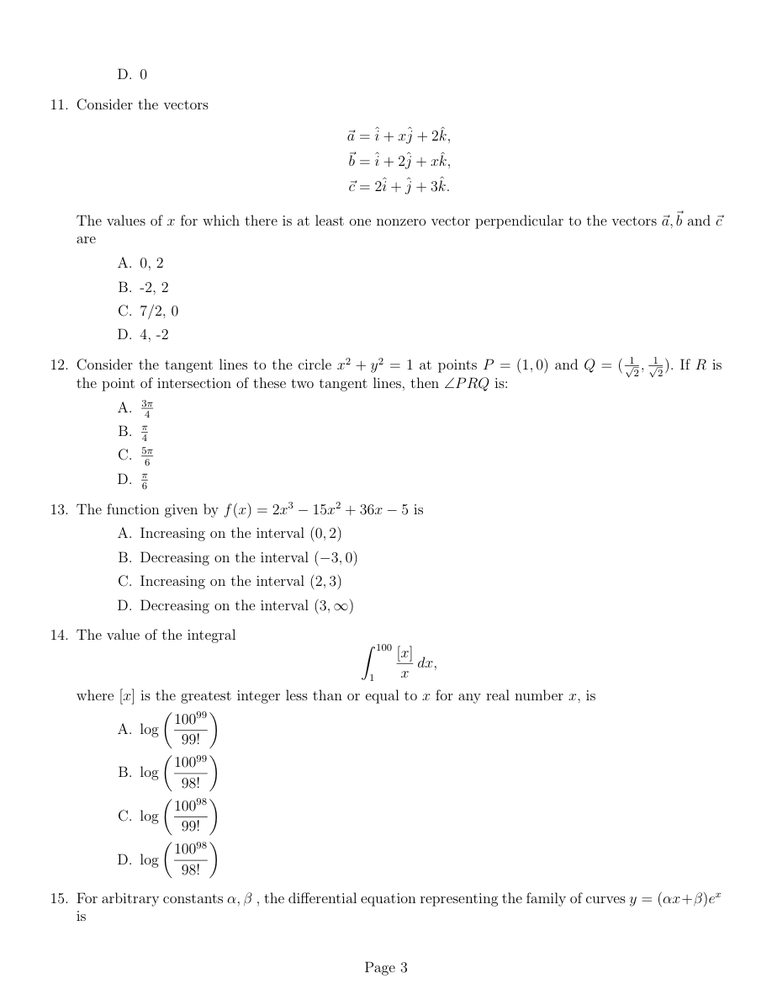

## PDF page 15

[Open original PDF at page 15](../pdf/IAT_2022_English_paper.pdf#page=15)

### Searchable text - PDF text layer

```text
A.  y′′ −2y′ + y = 0
B.  y′′ −y′ + y = 0
C.  y′′ −2y′ −y = 0
D.  y′′ −y′ −y = 0


                                Page 4
```

### Original page image

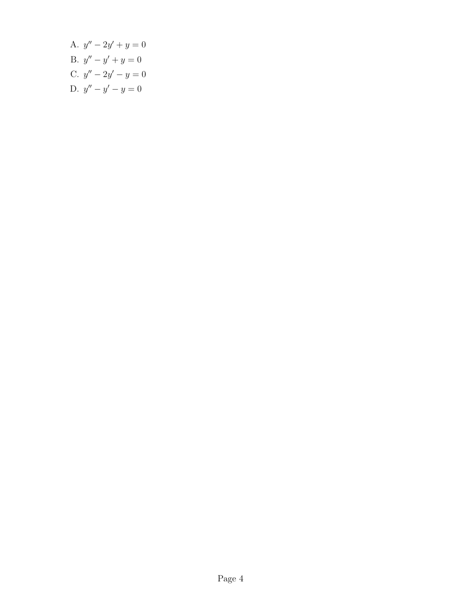

## PDF page 16

[Open original PDF at page 16](../pdf/IAT_2022_English_paper.pdf#page=16)

### Searchable text - PDF text layer

```text
Physics: Set A

1. A particle experiences an acceleration ⃗a = α⃗v, where ⃗v is the velocity of the particle
  and α is a constant.  If the distances traveled by the particle in the time intervals
    t2 −t1 and t3 −t1 are S12 and S13, respectively, which of the following relations is
   true?
             S13    exp[α(t3 −t1)] −1
        A.   =
             S12    exp[α(t2 −t1)] −1
             S13    exp[α(t3 −t1)]
        B.   =
             S12    exp[α(t2 −t1)]
             S13    log[α(t3 −t1)]
        C.   =
             S12    log[α(t2 −t1)]
             S13    log[α(t3 −t1)] −1
        D.   =
             S12    log[α(t2 −t1)] −1
```

### Original page image

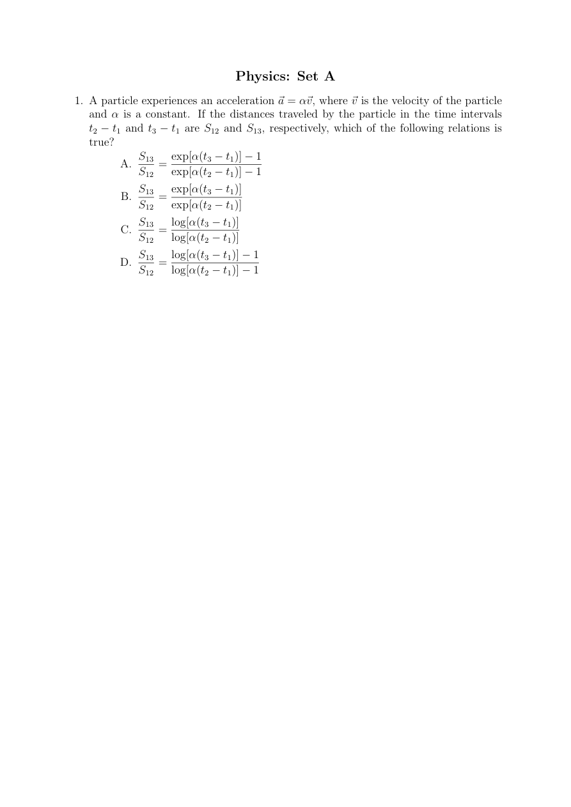

## PDF page 17

[Open original PDF at page 17](../pdf/IAT_2022_English_paper.pdf#page=17)

### Searchable text - PDF text layer

```text
2. A point mass m attached to a massless string is undergoing circular motion in a
   vertical plane. The length of the string is R and the acceleration due to gravity is g.
    If the minimum value of the tension in the string is 2mg, the maximum speed of this
   circular motion of the point mass is
        A. √7gR.
     r 7gR
        B.             .
               2
        C. √6gR.
        D. 4√gR.


                                 Page 2
```

### Original page image

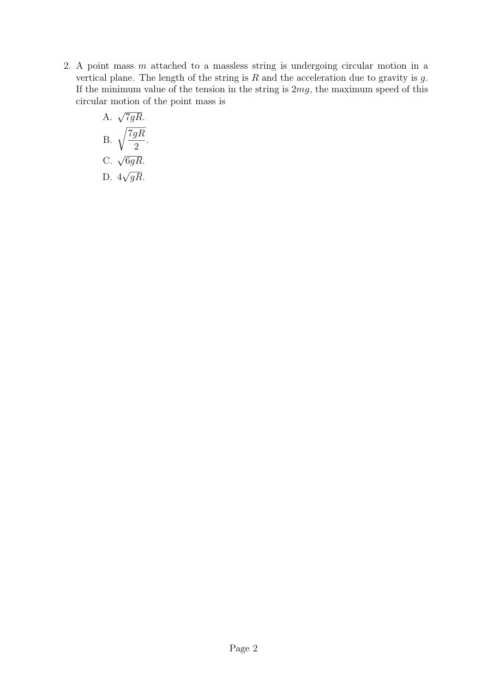

## PDF page 18

[Open original PDF at page 18](../pdf/IAT_2022_English_paper.pdf#page=18)

### Searchable text - PDF text layer

```text
3. An object is released from rest from the inner edge of a hemispherical bowl, and
    it falls under gravity. The coefficient of kinetic friction between the object and the
  bowl is µ. If the object covers an angular displacement θ with respect to the center
   of the hemisphere when it stops for the first time, which of the following expressions
    is correct?

        A. µ = cot(θ/2)

        B. µ = cot(θ)

        C. µ = tan(θ)

        D. µ = tan(θ/2)


                                 Page 3
```

### Original page image

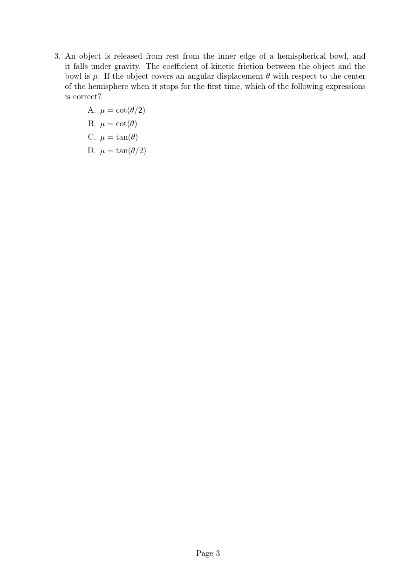

## PDF page 19

[Open original PDF at page 19](../pdf/IAT_2022_English_paper.pdf#page=19)

### Visual description

Physics Q4: a horizontal spring fixed at the left is attached to a block on a smooth floor. A wall to the right is separated from the equilibrium block position by distance d; different spring compressions may cause a wall collision.

### Searchable text - PDF text layer

```text
4. As shown in the figure a block is resting on a frictionless floor and is attached to the
   free end of a spring. The right edge of the block in equilibrium is at a distance d
   from the wall. When the spring is compressed by a distance d/2 and released, the
   time-period of the motion is T.  Similarly, when compressed by a distance 2d and
   released, the time-period is T0. Considering elastic collision between the block and
   the wall, what is the value of the quantity T0/T?


                                                d

        A. 2/3

        B. 1

        C. 3/4

        D. 1/4


                                 Page 4
```

### Original page image

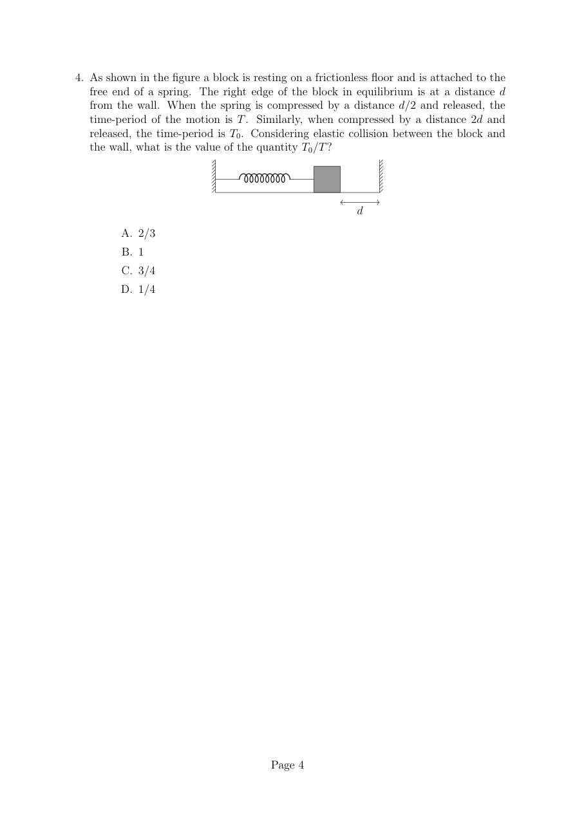

## PDF page 20

[Open original PDF at page 20](../pdf/IAT_2022_English_paper.pdf#page=20)

### Visual description

Physics Q5: an externally pushed cube is fully submerged in liquid inside a vessel resting on a weighing scale. The stick acts from above; the cube does not touch the bottom. The external support and the scale must be distinguished.

### Searchable text - PDF text layer

```text
5. A liquid of density ρ in a container weighs W. A cubic block of side L and density
   ρb < ρ is pushed by a stick to completely submerge the block in the liquid without
   touching the bottom. If g is the acceleration due to the gravity and liquid displaced
  by the stick is negligible, what is the new weight of the container as registered by the
   weighing machine below?


        A. W + ρgL3
        B. W + ρbgL3
        C. W + (ρ −ρb)gL3
        D. W + (ρb −ρ)gL3


                                 Page 5
```

### Original page image

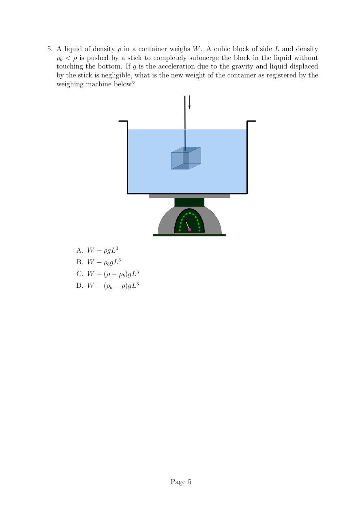

## PDF page 21

[Open original PDF at page 21](../pdf/IAT_2022_English_paper.pdf#page=21)

### Searchable text - PDF text layer

```text
6. A monoatomic ideal gas at pressure P and volume V is first adiabatically compressed
          V
   to volume   and then is allowed to expand isothermally back to its original volume.
            8
  What is the final pressure of the gas?

        A. 4P

        B. 2P

        C. P
         P
        D.
            2


                                 Page 6
```

### Original page image

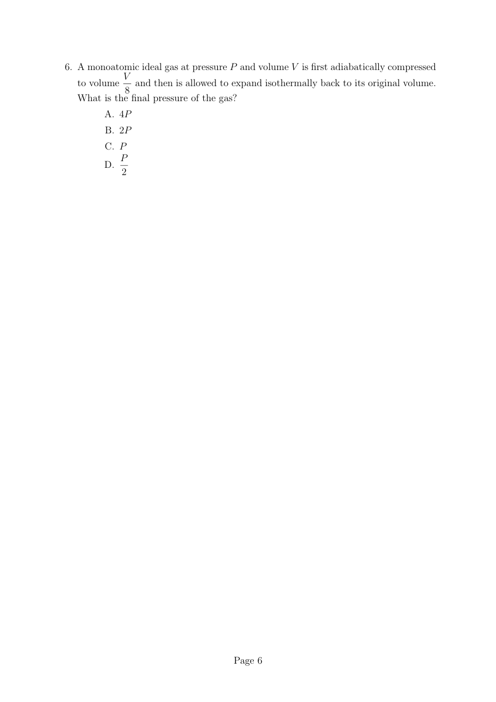

## PDF page 22

[Open original PDF at page 22](../pdf/IAT_2022_English_paper.pdf#page=22)

### Visual description

Physics Q7: a taut string spans two pulleys separated by L, with charges +q and -q on the hanging ends. A horizontal reference separation L/2 is indicated between the hanging charge positions.

### Searchable text - PDF text layer

```text
7. A uniform taut string with two point charges q and −q attached to its ends passes
   over two massless pullies kept L distance apart as shown in the figure.  If f  is the
   fundamental frequency of the part of the string over pullies, which of the following
   statements is correct?


        A. f ∝L−2
        B. f ∝L−1

        C. f ∝L
        D. f ∝L2


                                 Page 7
```

### Original page image

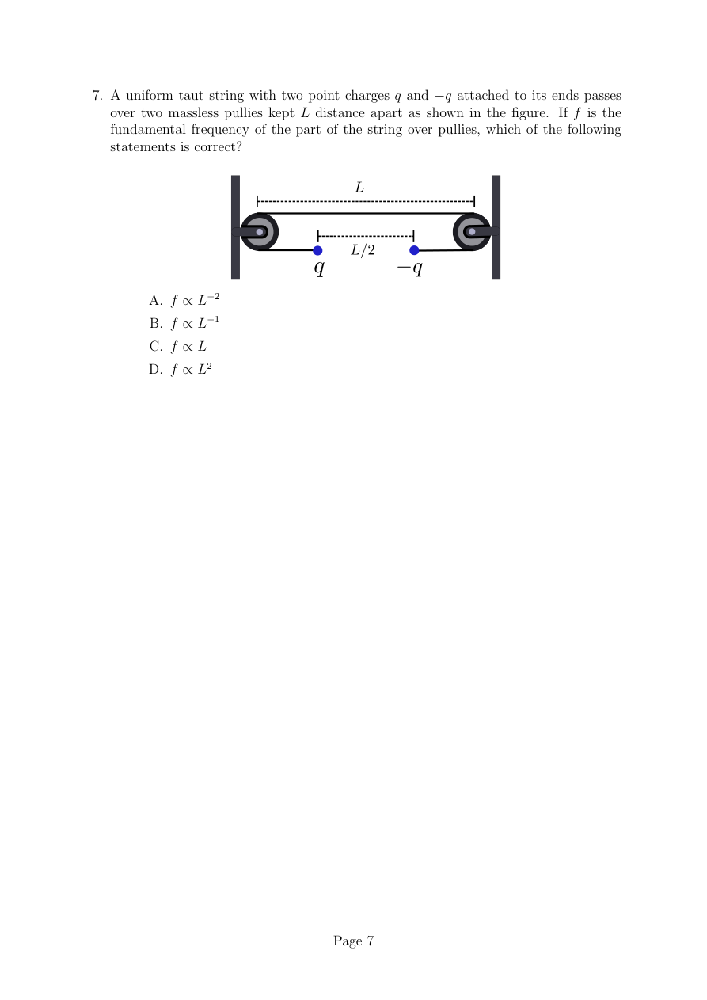

## PDF page 23

[Open original PDF at page 23](../pdf/IAT_2022_English_paper.pdf#page=23)

### Visual description

Physics Q8: two concentric shells have radii r1 and r2 and charges +Q and -Q. Four potential-versus-radius alternatives differ in their inner plateau, middle-region shape and value outside the outer shell.

### Searchable text - PDF text layer

```text
8. Two uniformly charged concentric thin spherical shells of radii r1 and r2 have charges
  +Q and −Q, respectively. How does the electrostatic potential vary with distance
   from the center of the shells?


        A.                                    C.


        B.                                  D.


                                 Page 8
```

### Original page image

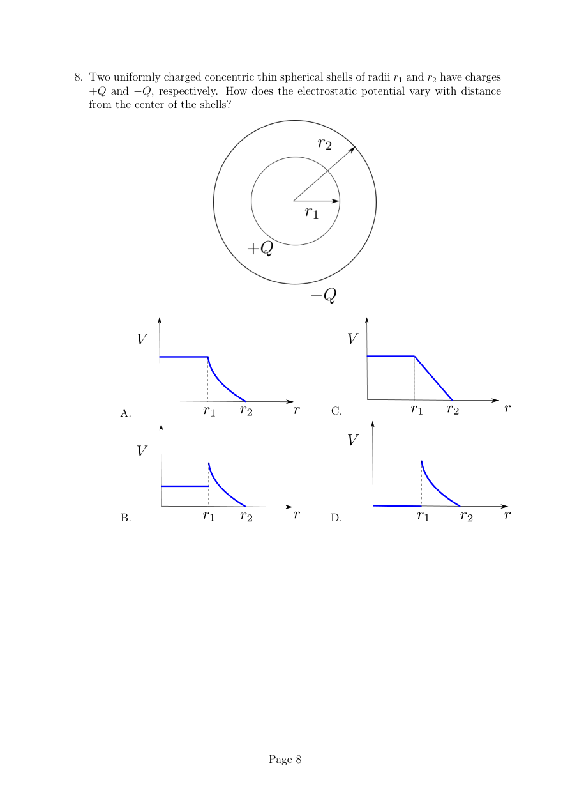

## PDF page 24

[Open original PDF at page 24](../pdf/IAT_2022_English_paper.pdf#page=24)

### Visual description

Physics Q9: a circular/spherical cavity of radius a has been removed from a positively charged cylindrical region. The shaded remaining material is labelled with charge density rho; x is measured radially outward from the cavity centre.

### Searchable text - PDF text layer

```text
9. Consider a very long cylinder of radius a having a uniform positive charge density
   ρ. A sphere of radius a has been carved out (see figure), leaving no charge in that
   region. The distance radially outward to the cylinder, as measured from the center
   of the sphere is x. At what value of x will the electric field be maximum?


           4
        A. 3a
           2
        B. 3a
           3
        C. 2a
        D. a


                                 Page 9
```

### Original page image

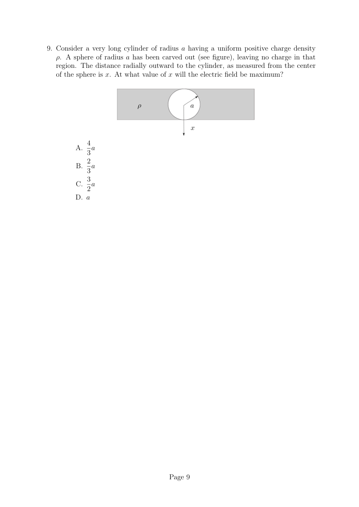

## PDF page 25

[Open original PDF at page 25](../pdf/IAT_2022_English_paper.pdf#page=25)

### Visual description

Physics Q10: a switched source, resistor R, ammeter and mystery box B form a series circuit. Three I-versus-t plots a1, a2 and a3 show a constant current, a decay to zero and a rise to a plateau, respectively.

### Searchable text - PDF text layer

```text
10. In the given circuit, the box B either contains a capacitor, or an inductor or a resistor.
   The current I versus time t plots for three cases (a1, a2, a3) are shown in figures.
   The switch S is closed at time t = 0. Which of the following is correct?

                            B

               A          R
                                S


     I                a1         I                a2         I                a3


     0                          t    0                          t    0                          t

         A. a1 corresponds to a resistor, a2 corresponds to a capacitor, a3 corresponds
              to an inductor.

         B. a1 corresponds to a resistor, a2 corresponds to an inductor, a3 corresponds
              to a capacitor.

         C. a1 corresponds to an inductor, a2 corresponds to a resistor, a3 corresponds
              to a capacitor.

         D. a1 corresponds to an inductor, a2 corresponds to a capacitor, a3 corresponds
              to a resistor.


                                 Page 10
```

### Original page image

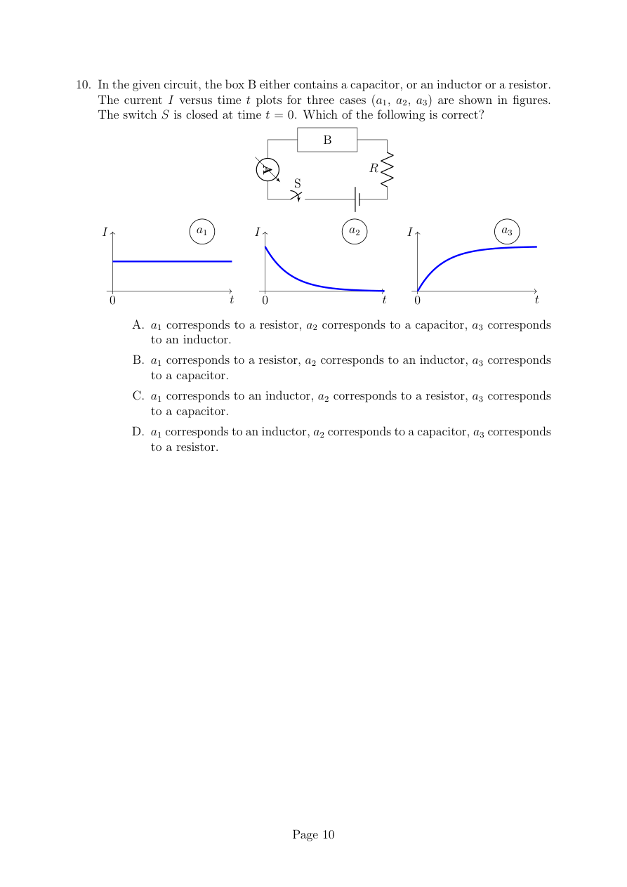

## PDF page 26

[Open original PDF at page 26](../pdf/IAT_2022_English_paper.pdf#page=26)

### Visual description

Physics Q11: a cube-shaped electrical network has vertices A-H, resistors on several edges, capacitors on other edges and a 5 V supply between the marked lower vertices. The capacitor between B and F is the requested one; trace edges in the page image to avoid confusing perspective crossings with junctions.

### Searchable text - PDF text layer

```text
11. In the given circuit each of the resistors is of 1 kΩresistance and each of the capacitors
    has 4 µF capacitance. What is the charge in the capacitor between the points B and
   F?

                              F           G


                   B            C

                             E           H


                  A           D

                             5V


         A. 10 µC

         B. 15 µC
            40
         C.   µC
             7
            60
         D.   µC
             7


                                 Page 11
```

### Original page image

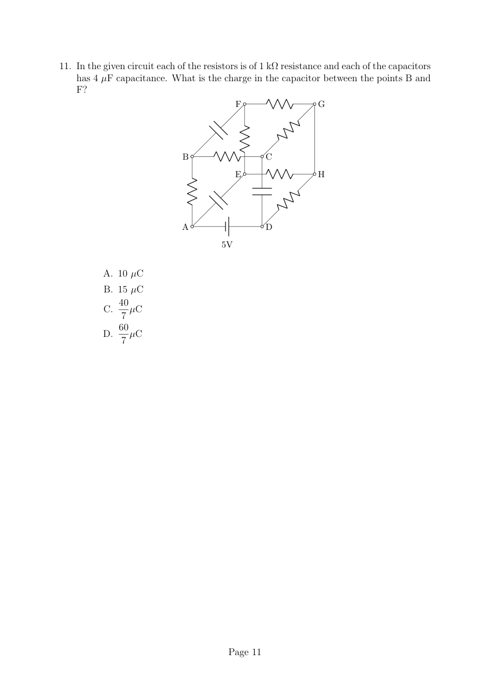

## PDF page 27

[Open original PDF at page 27](../pdf/IAT_2022_English_paper.pdf#page=27)

### Visual description

Physics Q12: a convex lens lies on a horizontal optical axis. Object O and image I are marked along with candidate positions A, B, C and D. Two rays are shown through the lens, and the surrounding medium has refractive index nm.

### Searchable text - PDF text layer

```text
12. A thin lens made of material of refractive index nl forms the image at the position
    I of a point object held at O on the central axis of the lens, as is shown in the ray
   diagram below. Consider that the refractive index of the medium is nm and nl > nm
    for the figure given. Where does the image form when nl < nm?


                         A   O   B        C       I  D


         A. At point B

         B. At point A

         C. At point C

         D. At point D


                                 Page 12
```

### Original page image

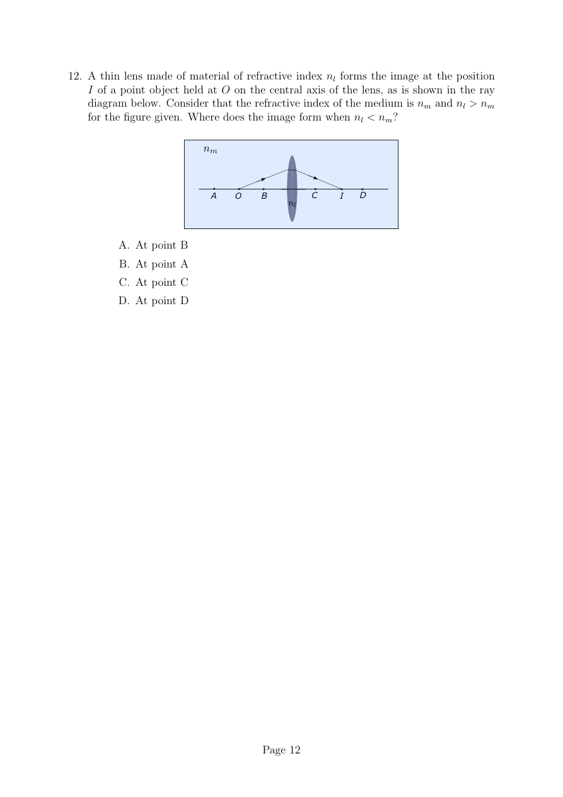

## PDF page 28

[Open original PDF at page 28](../pdf/IAT_2022_English_paper.pdf#page=28)

### Visual description

Physics Q13: a shaded charged sphere of radius a overlaps a larger spherical Gaussian surface of radius 2a. The larger sphere is centred at a point on the smaller sphere's surface, rather than sharing its centre.

### Searchable text - PDF text layer

```text
13. A conducting sphere of radius a initially contains a uniform volume charge density ρ.
   What is the electric flux Φ through a spherical surface of radius 2a centered at a
    point on the surface of the charged sphere (see figure) at a later time t?
     (ϵ0 is the permittivity of free space.)


                 4
         A. Φ =    πa3ρ
                    3ϵ0
                 32
         B. Φ =    πa3ρ
                    3ϵ0
                16
         C. Φ =   πa2ρ
                      ϵ0
                 4
         D. Φ =   πa2ρ
                      ϵ0


                                 Page 13
```

### Original page image

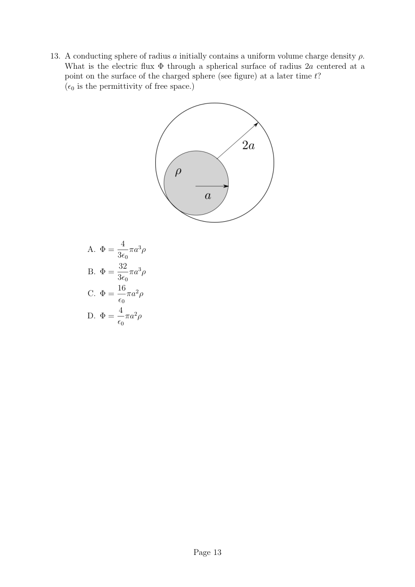

## PDF page 29

[Open original PDF at page 29](../pdf/IAT_2022_English_paper.pdf#page=29)

### Visual description

Physics Q14: alternatives A-D plot photocurrent J versus frequency f for intensities I1, I2 and I3. Some show saturation-like plateaus with different heights; others are straight rising branches with shifted intercepts. Preserve the curve labels and their intensity order.

### Searchable text - PDF text layer

```text
14. The figures in the options show the photocurrent J of a photoelectric material versus
    the frequency f of an incident light beam. The light beam can have three different
    intensities I1, I2, I3, with I3 > I2 > I1. Which of the options is correct?


         A.


         B.


         C.


         D.


                                 Page 14
```

### Original page image

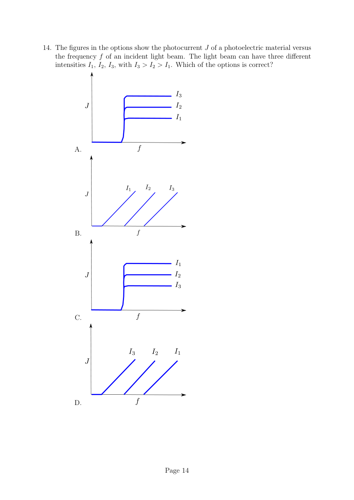

## PDF page 30

[Open original PDF at page 30](../pdf/IAT_2022_English_paper.pdf#page=30)

### Searchable text - PDF text layer

```text
15. Consider that in a fission of a single Plutonium (Pu239) atom 207 MeV energy is
    released. Assuming all atoms of Plutonium undergo fission, which of the following
    options is the closest estimate of the amount of Plutonium required for a 20,000 units
    of TNT explosion?
    (1 unit of TNT= 4.184 × 109 J, 1 eV= 1.6 × 10−19 J)

         A. 1 kg.

         B. 10 kg.

         C. 60.0 g.

         D. 0.5 kg.


                                 Page 15
```

### Original page image

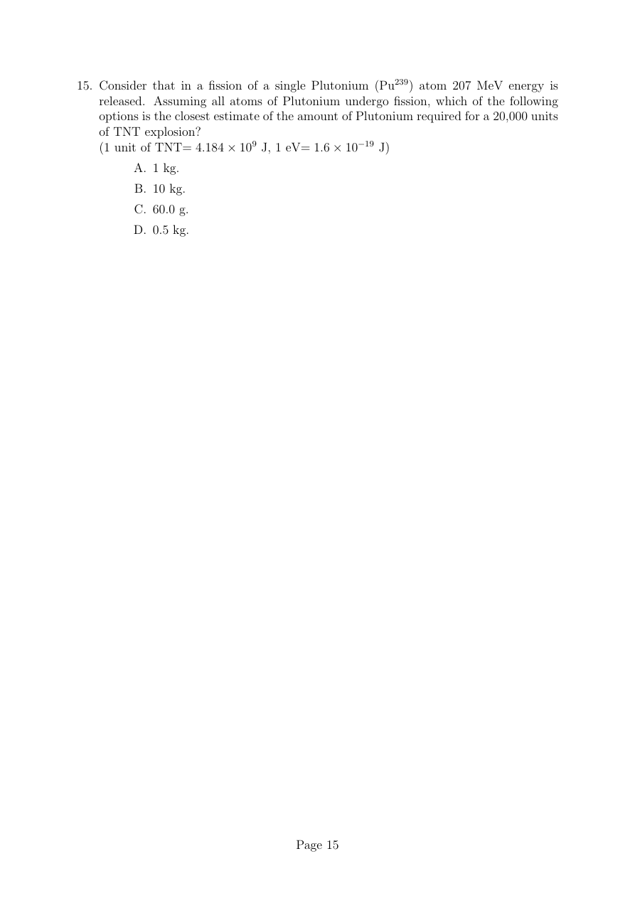
