# IAT 2022 - Hindi

Original PDF: [IAT_2022_Hindi_paper.pdf](../pdf/IAT_2022_Hindi_paper.pdf)

- Acquisition: SciAstra CloudFront mirror; not downloaded from the official server.
- Downloaded: 28 October 2026. PDF pages: 31.
- Exact download/source URL: https://d2aaa7ts7sm3bp.cloudfront.net/pdfs/01KMFRN409TSH8QHJ034HWT6AZ.pdf
- PDF SHA-256: `e59eb68308390b22fdecaa6704792431d2ab1067e0022987791188c81b57b5c2`
- This is a search/accessibility copy of an existing paper, not newly authored mock content.
- Text is mechanically extracted or OCR-derived and has not been proofread character by character. Equations, option letters, chemical bonds, tables and Hindi OCR can contain errors. The PDF and page images are authoritative.
- Figure descriptions are explanatory annotations, not official answers or complete structural/formula transcriptions. Use the linked image to resolve exact labels, values and stereochemistry.

**Source correction:** SciAstra table says 2021, but PDF content identifies IAT 2022; independently corroborated by PYQP 2022 Drive file names and matching reported byte sizes.

## Visual guide

The following descriptions refer to **PDF page numbers in the English companion**, because Hindi pagination can differ. The Hindi page images below retain every original diagram; identical embedded images are additionally cross-linked where matched by image digest.

- [English PDF page 1](IAT_2022_English_paper.md#pdf-page-1): Biology Q1: a two-column matching table compares plant-cell features with examples. Q2: four reaction arrows labelled i-iv represent individual steps involving pyruvate/acetyl-CoA, triose phosphates, oxaloacetate/citrate and fumarate/malate; the task is to order them in glucose oxidation.
- [English PDF page 3](IAT_2022_English_paper.md#pdf-page-3): Biology Q14 introduces four mitochondrial chemiosmosis diagrams printed on the next page. The abbreviations IMS, IMM and MM denote intermembrane space, inner mitochondrial membrane and mitochondrial matrix; ETC is the electron-transport chain.
- [English PDF page 4](IAT_2022_English_paper.md#pdf-page-4): Biology Q14: alternatives A-D show proton arrows across a horizontal IMM, an ETC block, ATP synthase, and ATP/ADP labels. The choices differ in proton direction and in the side where ATP synthesis is drawn. Q15 follows below the figures.
- [English PDF page 5](IAT_2022_English_paper.md#pdf-page-5): Chemistry Q4: a numerical table gives the first five successive ionisation energies, in eV, for elements X and Y. The abrupt changes between columns are the visual data; the table must be read by element row and ionisation-order column.
- [English PDF page 6](IAT_2022_English_paper.md#pdf-page-6): Chemistry Q5: a radial wavefunction psi(r) is plotted against radius r/a0; it begins positive, crosses zero, has a negative trough, then tends back toward zero. Q6 shows four nitrogen-containing rings M, N, O and P with different charges and bonding for an aromaticity comparison.
- [English PDF page 7](IAT_2022_English_paper.md#pdf-page-7): Chemistry Q7 displays four bromine-containing skeletal structures M-P, distinguishing aromatic from non-aromatic carbon-bromine bonds. Q8 has four benzene-based product alternatives: benzene, ethoxybenzene, aniline and ethylbenzene.
- [English PDF page 8](IAT_2022_English_paper.md#pdf-page-8): Chemistry Q9: phenol proceeds through reagent-labelled steps to M, N and O. Four answer rows contain different triplets of aromatic structures; substitution positions and the terminal sodium salt groups differ.
- [English PDF page 9](IAT_2022_English_paper.md#pdf-page-9): Chemistry Q10: HBr is added to a phenyl-substituted alkene. Four drawn products place bromine or change connectivity differently. The image preserves the alkene position, branching and the bromine position in each candidate.
- [English PDF page 10](IAT_2022_English_paper.md#pdf-page-10): Chemistry Q12: four qualitative plots of Kp/Kc against absolute temperature T. They are, respectively, a convex rising curve, a horizontal line, a descending straight line and an ascending straight line.
- [English PDF page 11](IAT_2022_English_paper.md#pdf-page-11): Chemistry Q15: four rows order fluorinated and chlorinated benzene derivatives by dipole moment. The relative positions of halogens on the rings, not simply the element names, determine the comparison.
- [English PDF page 19](IAT_2022_English_paper.md#pdf-page-19): Physics Q4: a horizontal spring fixed at the left is attached to a block on a smooth floor. A wall to the right is separated from the equilibrium block position by distance d; different spring compressions may cause a wall collision.
- [English PDF page 20](IAT_2022_English_paper.md#pdf-page-20): Physics Q5: an externally pushed cube is fully submerged in liquid inside a vessel resting on a weighing scale. The stick acts from above; the cube does not touch the bottom. The external support and the scale must be distinguished.
- [English PDF page 22](IAT_2022_English_paper.md#pdf-page-22): Physics Q7: a taut string spans two pulleys separated by L, with charges +q and -q on the hanging ends. A horizontal reference separation L/2 is indicated between the hanging charge positions.
- [English PDF page 23](IAT_2022_English_paper.md#pdf-page-23): Physics Q8: two concentric shells have radii r1 and r2 and charges +Q and -Q. Four potential-versus-radius alternatives differ in their inner plateau, middle-region shape and value outside the outer shell.
- [English PDF page 24](IAT_2022_English_paper.md#pdf-page-24): Physics Q9: a circular/spherical cavity of radius a has been removed from a positively charged cylindrical region. The shaded remaining material is labelled with charge density rho; x is measured radially outward from the cavity centre.
- [English PDF page 25](IAT_2022_English_paper.md#pdf-page-25): Physics Q10: a switched source, resistor R, ammeter and mystery box B form a series circuit. Three I-versus-t plots a1, a2 and a3 show a constant current, a decay to zero and a rise to a plateau, respectively.
- [English PDF page 26](IAT_2022_English_paper.md#pdf-page-26): Physics Q11: a cube-shaped electrical network has vertices A-H, resistors on several edges, capacitors on other edges and a 5 V supply between the marked lower vertices. The capacitor between B and F is the requested one; trace edges in the page image to avoid confusing perspective crossings with junctions.
- [English PDF page 27](IAT_2022_English_paper.md#pdf-page-27): Physics Q12: a convex lens lies on a horizontal optical axis. Object O and image I are marked along with candidate positions A, B, C and D. Two rays are shown through the lens, and the surrounding medium has refractive index nm.
- [English PDF page 28](IAT_2022_English_paper.md#pdf-page-28): Physics Q13: a shaded charged sphere of radius a overlaps a larger spherical Gaussian surface of radius 2a. The larger sphere is centred at a point on the smaller sphere's surface, rather than sharing its centre.
- [English PDF page 29](IAT_2022_English_paper.md#pdf-page-29): Physics Q14: alternatives A-D plot photocurrent J versus frequency f for intensities I1, I2 and I3. Some show saturation-like plateaus with different heights; others are straight rising branches with shifted intercepts. Preserve the curve labels and their intensity order.

## Page index

[p1](#pdf-page-1) | [p2](#pdf-page-2) | [p3](#pdf-page-3) | [p4](#pdf-page-4) | [p5](#pdf-page-5) | [p6](#pdf-page-6) | [p7](#pdf-page-7) | [p8](#pdf-page-8) | [p9](#pdf-page-9) | [p10](#pdf-page-10) | [p11](#pdf-page-11) | [p12](#pdf-page-12) | [p13](#pdf-page-13) | [p14](#pdf-page-14) | [p15](#pdf-page-15) | [p16](#pdf-page-16) | [p17](#pdf-page-17) | [p18](#pdf-page-18) | [p19](#pdf-page-19) | [p20](#pdf-page-20) | [p21](#pdf-page-21) | [p22](#pdf-page-22) | [p23](#pdf-page-23) | [p24](#pdf-page-24) | [p25](#pdf-page-25) | [p26](#pdf-page-26) | [p27](#pdf-page-27) | [p28](#pdf-page-28) | [p29](#pdf-page-29) | [p30](#pdf-page-30) | [p31](#pdf-page-31)

## PDF page 1

[Open original PDF at page 1](../pdf/IAT_2022_Hindi_paper.pdf#page=1)

### Searchable text - OCR draft (hin+eng)

```text
_.--...090 6 Aptitude Test 2022: 5800. रख आउ़उ़उ़उ़उ़उ़

Biology
L. स्तम्भ में दिए गए पादप कोशिका के लक्षणों को स्तम्भ IF feria उनके उदाहरणों से मिलाइए,
स्तम्भा oH II
i. केन्द्रक रहित कोशिका द्रव युक्त कोशिका p. पराग कण
ii, केन्द्रक और कोशिका द्रव रहित कोशिका 4. सिनर्जिड्स
iii, दो से अधिक केन्द्रक वाली कोशिका rats
iv. समसूत्री विभाजन से उत्पन्न अगुणित कोशिका 5. टैपीटम

t. परिपक्व सीव नली (sieve tube)

u. फ्लोएम साथी कोशिका (companion cell)

दिए गए विकल्पों में से सही संयोजन वाले विकल्प का चुनाव कीजिए |
A.i3ik t: ii और Yr; ili और s; iv और q
B.i और U; ii और T; iil और 8; iv और p
C. idk u; ii der; ii और 6; iv और p
D.i और Tv; ii और t; iil और 8; iv और q
2. ऑक्सीकीय श्वसन के दौरान, उपापचयी पथ की कुछ अभिक्रियाएं जो ग्लूकोज के संपूर्ण उपचयन में सहायक होती हैं उन्हें
नीचे दर्शाया गया है |

i, पाइरुवेट —> एसीटिल CoA

ii, डाइहाइड्रॉक्सी एसीटोन फॉस्फेट ---> ग्लिसरलडीहाइड-3-फॉस्फेट
iii, ऑक्जैलो एसीटेट —+ सिट्रेट

iv. WE ---> मैलेट

ग्लूकोज के संपूर्ण उपचयन के दौरान होने वाली अभिक्रियाओं के सही क्रम वाले विकल्प का चुनाव कीजिए |
A. ii; i; iii; iv
B. i; iii; iv; ii
C.. i; ii; iii; iv

D. ii; iii; i; iv
```

### Original page image

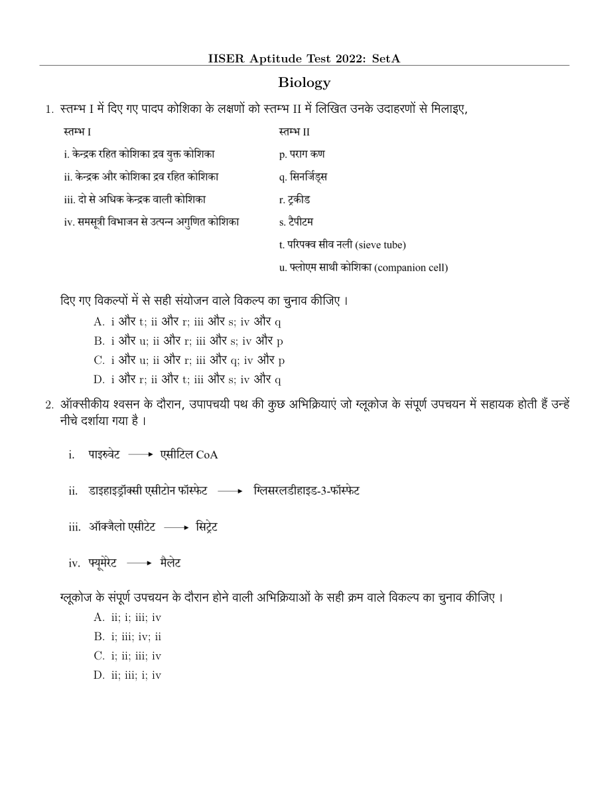

## PDF page 2

[Open original PDF at page 2](../pdf/IAT_2022_Hindi_paper.pdf#page=2)

### Searchable text - OCR draft (hin+eng)

```text
ol

पुष्पी पादप की किसी एक प्रजाति में, बीजों के रंग का निर्धारण विशेषतः उनके बीजावरण के रंग से होता है | इस प्रजाति में,
बीजावरण के रंग का नियमन किसी केन्द्रक जीन के दो अलीलों से होता है। WHITE (W) अलील brown (w) अलील
पर प्रभावी है । यदि एक भूरे रंग के बीज (ww) वाले पौधे को मादा जनक के रूप मे श्वेत बीज वाले ( WW) पौधे के पराग

कणों से संकरित कराते हैं तो इस संकरण से प्राप्त बीजों का रंग और उन बीजों के भ्रूण का जीन-प्रारूप निम्न में से कौन सा
होगा ?

A. RWS बीज वाले Ww भ्रूण
9. श्वेत रंग के बीज वाले Ww भ्रूण
९. भूरे रंग के बीज वाले ww भ्रूण
9. श्वेत रंग के बीज वाले ww भ्रूण

(०५०-79 महामारी के eR SARS-CoV? विषाणु कई बार उत्परिवर्तित हुआ और विभिन्न रूपांतरों (variants) को
जन्म दिया। SARS-CoV2 विषाणु का जीनी पदार्थ निम्न में से किस प्रकार का है ?

A. एकल कुण्डलित RNA
B. द्विकुण्डलित RNA
C. एकल कुण्डलित DNA
D. द्विकुण्डलित DNA

. लसिका एक महत्त्वपूर्ण शारीरिक द्रव है । लसिका के संदर्भ में दिए गए कथनों में से असत्य कथन का चुनाव कीजिए |

A. यह एक अंतरकोशिकीय द्रव बना रहता है जो कभी भी संचरण में पुनः मिलाया नहीं जाता है |

B. यह एक अंतरकोशिकीय द्रव है जिसका उत्पादन रक्त-केशिका की कोशिकाओं के मध्य तरल
के गमन से होता है |

C. यह एक रंजकहीन द्रव है जिसका खनिज-संगठन प्लाज्मा के समान है |
9. sitet में पाचित वसा का अवशोषण लसिका द्वारा होता है ।

. मेरु-रज्जु से माध्यित प्रतिवर्ती क्रियाओं के सम्पादन मे अंतरा-तंत्रकोशिका की महत्त्वपूर्ण भूमिका है | ये अंतरा-तंत्रकोशिका

कहाँ उपस्थित होती है ?
A. धूसर द्रव्य
B. श्वेत द्रव्य
९. पृष्ठ मूल गुच्छिका (Dorsal root ganglion)
9. ग्राही (Muscle spindle)
परासरण ग्राहियाँ (Osmoreceptors) शारीरिक तरल के आयतन और उनके आयनिक सांद्रण में होने वाले परिवर्तनों के प्रति
संवेदी होते हैं । निम्न में से कौन सा विकल्प इन परासरण ग्राहियों के कार्य की सबसे सटीक व्याख्या करता है ?
A. ये हाइपोथेलेमस ग्रन्थि को उद्दीपित कर एंटी-डाई-यूरेटिक हॉर्मोन के स्त्रावण में सहायक होते हैं जो जल के
पुनरावशोषण को बढ़ाता है |
B. ये पीयूष ग्रन्थि को उद्दीपित कर मिनेरैलोकार्टीक्वायड हॉर्मोन के स्त्रावण में सहायक होते हैं जो शारीरिक द्रव के
खनिज संगठन के परिवर्तनों का समायोजन करता है |

०. ये आलिंद भित्ति को उद्दीपित कर एट्रियल नैट्रीयूरेटिक कारक नामक हॉर्मोन के era में सहायक होते हैं जो रक्त
वाहिकाओं को फैलाकर रक्त-दाब को कम करते हैं |

Page 2
```

### Original page image

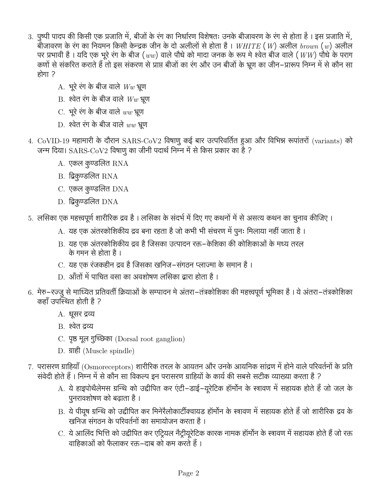

## PDF page 3

[Open original PDF at page 3](../pdf/IAT_2022_Hindi_paper.pdf#page=3)

### Searchable text - OCR draft (hin+eng)

```text
D. ये रेनिन के उत्पादन को उद्दीपित करते हैं जो रक्त वाहिकाओं का संकीर्णन कर रक्त दाब को बढ़ाते हैं |

8. किसी जीन x’ में एकल बिन्दु-उत्परिवर्तन के परिणामस्वरूप श्वास लेने में कठिनाई, उच्च रक्त दाब और आंशिक ऊसरता

(sterility) OR लक्षण दिखाई देते हैं । निम्न में से कौन सी घटना इन लक्षणों (दर्श रूपों) की सबसे सटीक व्याख्या करती
है?

A. बहुप्रभाविता

B. अपूर्ण प्रभाविता

C. सहलग्नता (Linkage)

D. आंशिक प्रभाविता (Partial dominance)

9. ऐसा मानते हुए कि स्वतंत्र अपव्यूहन हो रहा है, जीन प्रारूप PpQQRrSS और ppqqRrss वाले व्यष्टियों मे मध्य संकरण
कराने पर प्राप्त 400 व्यष्टियों वाली आबादी में ppQQRrSs जीन प्रारूप वाली संततियों की अपेक्षित संख्या कितनी होगी ?

A. 0

8. 00
C. 200
D. 25

0. निम्न में से किस संघ के जीव त्रिकोरकी, अप्रगुही और द्विपार्श्व सममिति दशति हैं ?
A. प्लेटीहैलमिन्थीज
8. मोलस्का
C. आर्थ्रोपोडा
9. हेमीकार्डेटा
L. निम्नलिखित जीवोमों पर विचार कीजिए: उष्ण कटिबंधीय-वर्षा वन (/); ट्ुंड़ा (6); मरुस्थल (72) और समुद्र तट (9) |

aoe की नेट प्राथमिक उत्पादकता के घटने के क्रम को सबसे संभावी तरीके से निरूपित करने वाले विकल्प का चयन
a

A.P>S>Q>R
83. P>Q>S>R
C.Q>P>S>R
D. R>Q>S>P

2. किसी आबादी के 9 प्रतिशत व्यष्टि, जीन LAT के अप्रभावी अलील के कारण कुछ भोज्य पदार्थों का स्वाद नहीं ले पाते हैं
| ऐसा मानते हुए कि यह आबादी हार्डी वीनबर्ग साम्य मे है, इस जीन के प्रभावी और अप्रभावी अलीलों की आवृत्ति क्रमशः
कितनी होगी ?

A. 0.7 और 0.3
B. 0.9 और 0.
0. 0.3 और 0.7
D. 0. और 0.9

3. कोशिका मे भीतर होने वाले DNA प्रतिकृति प्रक्रिया के विपरीत पॉलीमेरेज श्रृंखला अभिक्रिया (PCR) में DNA का संश्लेषण
असतत रूप से नहीं होता है | ऐसा क्यों?

Page 3
```

### Original page image

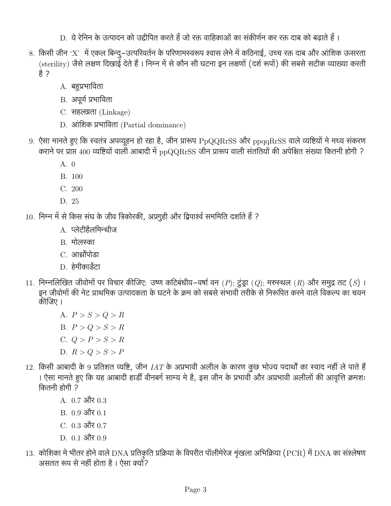

## PDF page 4

[Open original PDF at page 4](../pdf/IAT_2022_Hindi_paper.pdf#page=4)

**Matching embedded figure, English PDF page 4:** Biology Q14: alternatives A-D show proton arrows across a horizontal IMM, an ETC block, ATP synthase, and ATP/ADP labels. The choices differ in proton direction and in the side where ATP synthesis is drawn. Q15 follows below the figures.

### Searchable text - OCR draft (hin+eng)

```text
l4.

A. PCR के विकृतिकरण पद के फलस्वरूप प्रतिकृति द्विशाख (replication fork) की आवश्यकता नहीं रहती
और Taq पॉलीमेरेज DNA को केवल 5' से ' दिशा में हीं वर्धित कर सकता है |

3. प्रतिकृति द्विशाख तो बनता है परंतु Taq पॉलीमेरेज DNA को 3! से 5! और 5' से 3 दोनों हीं दिशाओं में वर्धित
कर सकता है |

C. PCR के विकृतिकरण पद के फलस्वरूप प्रतिकृति द्विशाख की आवश्यकता नहीं रहती और Taq पॉलीमेरेज
DNA को केवल 3’ से 5 दिशा में हीं वर्धित कर सकता है |

D. प्रतिकृति द्विशाख बनता है और असतत रूप से संश्लेषित DNA खंड Taq पॉलीमेरेज की DNA लाइगेज क्रिया
द्वारा आपस में जुड़ जाते हैं |

निम्न में से कौन सा चित्र किसी कोशिका की सूत्रकणिका के अंदर होने वाले ATP संश्लेषण की रसोपरासरण (chemiosmotic)
परिकल्पना को सबसे सटीक रूप से निरूपित करता है ? (FTF IMS: अंतर-झिल्ली अवकाश, IMM: आंतरिक सूत्रकणिका
झिल्ली, MM: सूत्रकणिका आधात्री, ETC: इलेक्ट्रान परिवहन तंत्र)

A.
H* H*
IMS
ATP
IMM [ETC synthase
MM | ADP ४ ATP
Ht Ht
B.
Ht
H* ADP | ATP
IMs
ATP
IMM [ETC synthase
MM | aa
Ht
०.
H* H*
IMS
ATP
IMM [LETC synthase
MM ADP | ATP

|

Page 4

H*
```

### Original page image

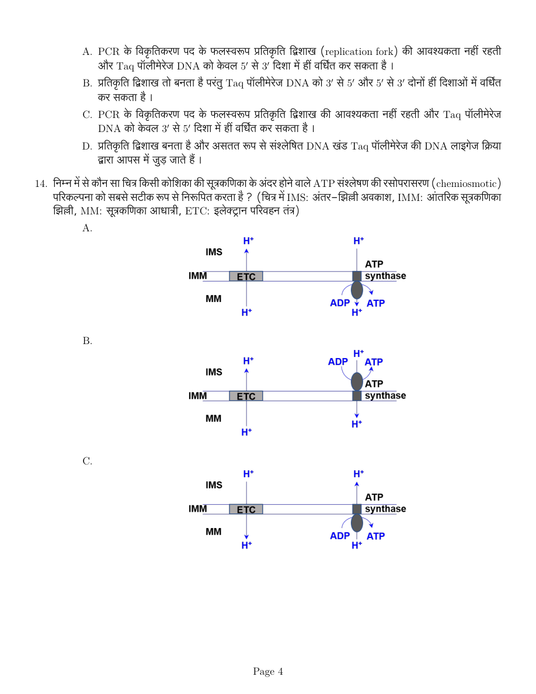

## PDF page 5

[Open original PDF at page 5](../pdf/IAT_2022_Hindi_paper.pdf#page=5)

**Matching embedded figure, English PDF page 4:** Biology Q14: alternatives A-D show proton arrows across a horizontal IMM, an ETC block, ATP synthase, and ATP/ADP labels. The choices differ in proton direction and in the side where ATP synthesis is drawn. Q15 follows below the figures.

### Searchable text - OCR draft (hin+eng)

```text
H*

H* ADP «4 ATP
IMS
ATP
IMM [ETC synthase
MM

H*
H*

I5. मान लें कि <x’ मानव कोशिका के किसी गुणसूत्र के गुणसूत्र बिन्दु से कोशिका के मध्यवर्ती तल के बीच की लम्बवत दूरी है ।
कोशिका चक्र की निम्न में से किस अवस्था में <x’ का औसत मान अधिकतम होगा ?

A. Sy पश्चावस्था
B. मध्यावस्था

C. आरंभिक पश्चावस्था
D. आरंभिक मध्यावस्था

Page 5
```

### Original page image

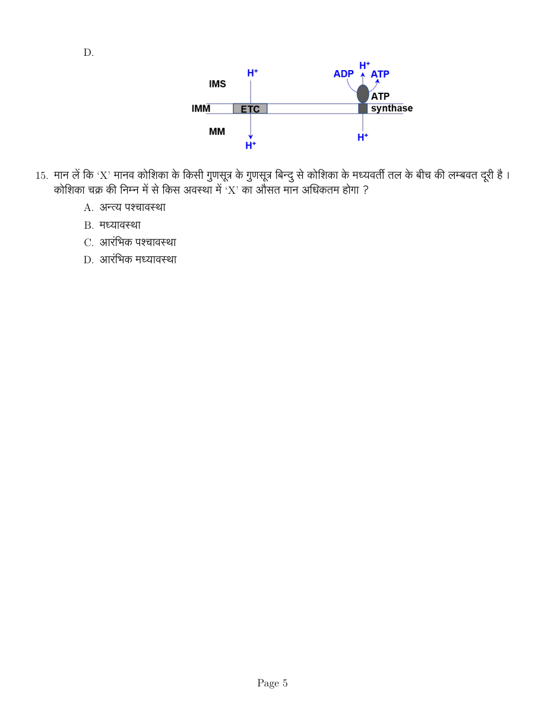

## PDF page 6

[Open original PDF at page 6](../pdf/IAT_2022_Hindi_paper.pdf#page=6)

### Searchable text - OCR draft (hin+eng)

```text
IISER Aptitude Test 2022
Chemistry: SetA
. K,[Fe(CN)] और ३ H,0, के जलीय विलयनों के बीच की अभिक्रिया के उत्पाद हैं
A. K3[Fe
B. K3[Fe(CN)
0. K3[Fe(CN)¢], 820 और 0५
9. K,{Fe(CN);(OH)] और HCN

A. (t2)°
8. (tag)
C. (tag)
D. (tog)

. Coo फुलरीन की संरचना के बारे मे सही कथन चुनिये।
A. पाँच-सदस्यीय वलय केवल छः-सदस्यीय वलयों के साथ संगलित अवस्था मे रहते है।
8. छः-सदस्यीय वलय केवल पाँच-सदस्यीय वलयों के साथ संगलित अवस्था मे रहते है।
0. छः-सदस्यीय वलय केवल छः-सदस्यीय वलयों के साथ संगलित अवस्था मे रहते है।
9. पाँच-सदस्यीय वलय पाँच-सदस्यीय और छः-सदस्यीय दोनों वलयों के साथ संगलित अवस्था मे रहते है।.

. #-ब्लॉक के दो तत्वों X और ५ की प्रथम से पाँचवची आयनन ऊर्जा (7) नीचे दी गई है।

TE; (eV) | IE) (eV) | IE; (eV) | IE; (eV) | IEs (eV)
| 6.0 | 88 28.4 720.0 | 53.7
8.2 6.3 33.5 45. ]66.7

x
Y

X और 9 में संयोजक इलेक्ट्रॉनों की संख्या क्रमशः है
A. 3, 4
4,5

va
हि
ol

l,4
```

### Original page image

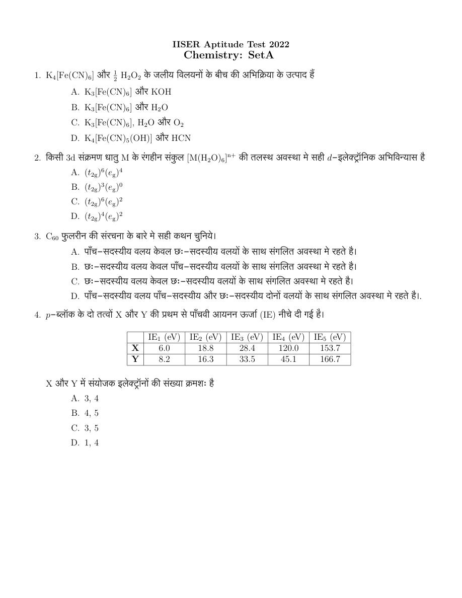

## PDF page 7

[Open original PDF at page 7](../pdf/IAT_2022_Hindi_paper.pdf#page=7)

**Matching embedded figure, English PDF page 6:** Chemistry Q5: a radial wavefunction psi(r) is plotted against radius r/a0; it begins positive, crosses zero, has a negative trough, then tends back toward zero. Q6 shows four nitrogen-containing rings M, N, O and P with different charges and bonding for an aromaticity comparison.

### Searchable text - OCR draft (hin+eng)

```text
5. निम्न मे से कौन सा समीकरण नीचे दर्शाये गए चित्र मे हाइड्रोजन परमाणु के तरंग फलन y(r) को प्रदर्शित करता है ?
(r इलेक्ट्रॉन की नाभिक से दूरी और ay एक स्थिरांक है। )

0.8

०0 5 70 5

Radius, r/a,
A l ( ] ) 3/2 (2 r ) = /2aq
. Van —_— ——]e
4/27 \ao ao
3/2
B. = e7 7/200
Vr ao
el)" Ge
. Von — —]e
67 ५०90 ao
pt ( ] ) 32 (s ar 2? ) _।3०७
Ba जप —-—+-— 5]e"
3m \ Go ०0. 966
6. निम्न मे से कौन से अणु ऐरोमटिक हैं ?

OC (S 6३
Seog
H H HH

M N 0 P

A. केवल M,N और 0
B. M,N, 0 और ए
C. केवल M और 0
9. केवल और ए

Page 2
```

### Original page image

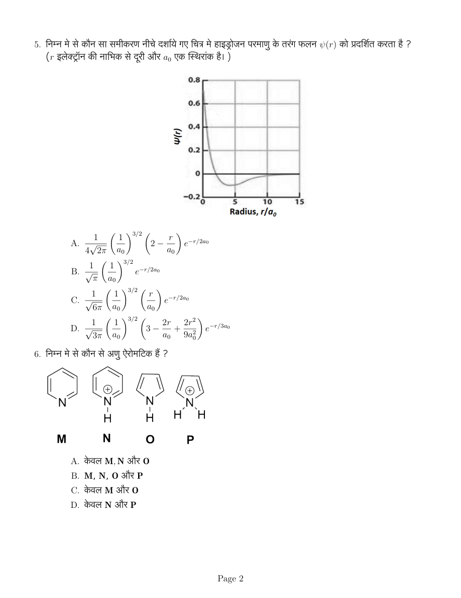

## PDF page 8

[Open original PDF at page 8](../pdf/IAT_2022_Hindi_paper.pdf#page=8)

**Matching embedded figure, English PDF page 7:** Chemistry Q7 displays four bromine-containing skeletal structures M-P, distinguishing aromatic from non-aromatic carbon-bromine bonds. Q8 has four benzene-based product alternatives: benzene, ethoxybenzene, aniline and ethylbenzene.

### Searchable text - OCR draft (hin+eng)

```text
7. निम्न मे से कौन से ऐरिल ब्रोमाइड्स हैं?

Br B
Cy r oe Br ion H
Br
M N ०0 7
A. केवल और ए

B. केवल ५, 0 और ए
C. केवल M, 0 0 और ए
9. eat N और 0

8. बेंजामाइड की Br. और NaOH (aq) के साथ अभिक्रिया से उत्पाद X बनता है जो NaNO, और HCl(aq) के साथ 0 — 5
°C पर अभिक्रिया करके उत्पाद ५ बनाता Sl ५ तुरंत एथेनॉल के साथ अभिक्रिया करके Z बनाता है। Z क्या है ?

OCH,CH;

दर

NH,

CH,CH;

a

Page 3
```

### Original page image

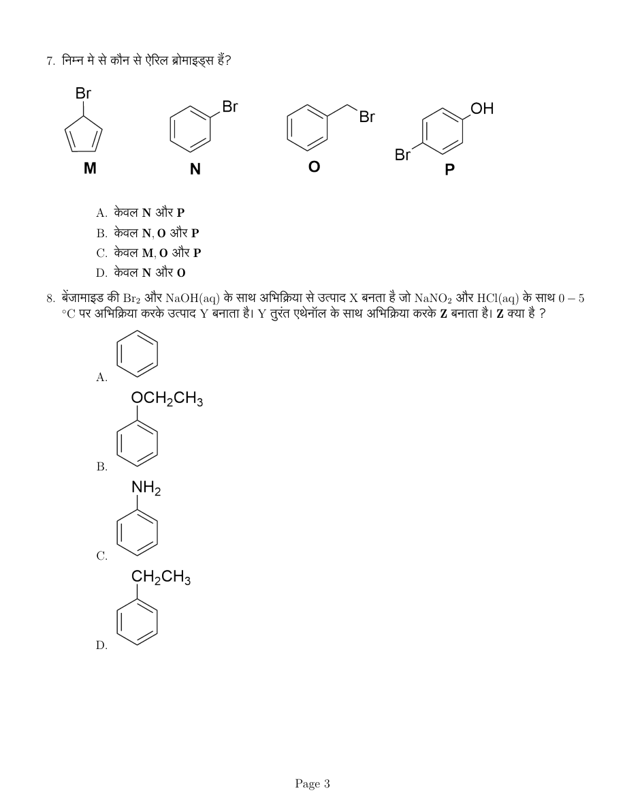

## PDF page 9

[Open original PDF at page 9](../pdf/IAT_2022_Hindi_paper.pdf#page=9)

**Matching embedded figure, English PDF page 8:** Chemistry Q9: phenol proceeds through reagent-labelled steps to M, N and O. Four answer rows contain different triplets of aromatic structures; substitution positions and the terminal sodium salt groups differ.

### Searchable text - OCR draft (hin+eng)

```text
9. नीचे दी गई अभिक्रिया क्रम के अनुसार मुख्य उत्पाद M,N, और 0 क्रमशः हैं
OH

4. NaOH mM CHsCOc! NaOCl
oe NX eo
2. Mel anhydrous AICl3
OCH; OCH; OCH,
G | (2
A ० Na 07 0
OH OH O OH O
Oo ©
B.
OCH; OCH; OCH;
. o
०. ०0 ०

Page 4
```

### Original page image

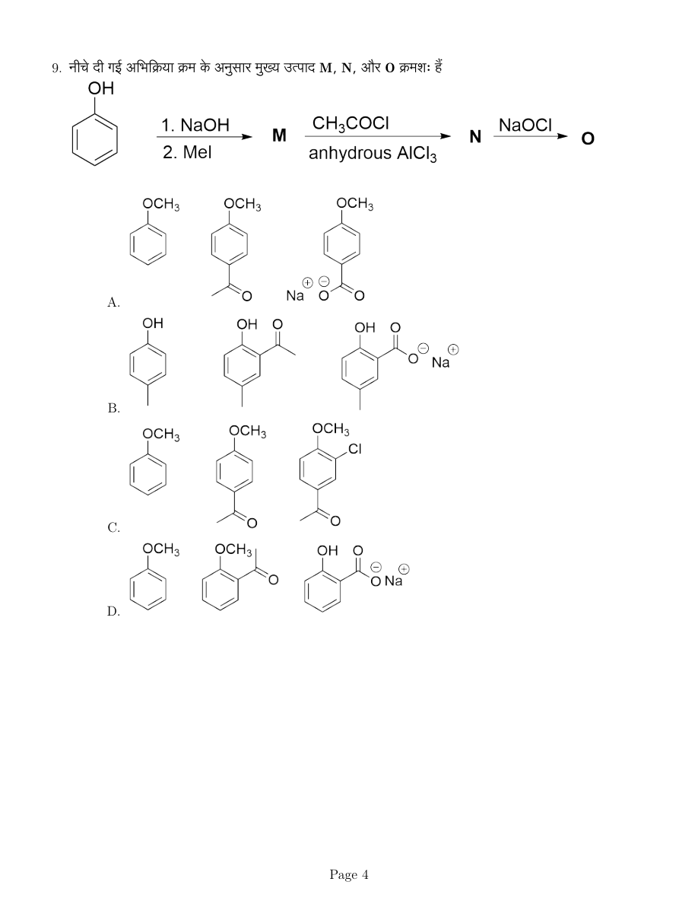

## PDF page 10

[Open original PDF at page 10](../pdf/IAT_2022_Hindi_paper.pdf#page=10)

**Matching embedded figure, English PDF page 9:** Chemistry Q10: HBr is added to a phenyl-substituted alkene. Four drawn products place bromine or change connectivity differently. The image preserves the alkene position, branching and the bromine position in each candidate.

### Searchable text - OCR draft (hin+eng)

```text
0. नीचे दी गई अभिक्रिया का मुख्य उत्पाद 7 है

or + HBr——»> P

Br
or
9. \=
LL. एक जलीय विलयन मे 25 °C पर X?+ के ,.0 M आयन और ५?+ के 0.00IM आय-न हैं। X2+ और 2+ आयन आपस
मे अन्योन्य क्रिया नहीं करते। इस विलयन को वैद्युतअपघटनी सेल मे रख कर विभव को धीरे धीरे तब तक बढ़ाया जाता है

जब तक सेल मे धारा का प्रवाह शुरू नहीं होता | विभव को इसी स्थिति मे रखते हुए कैथोड पर एक निक्षेप परिलक्षित होता
है। कैथोड पर निक्षेपित पदार्थ का संघटन कया है ?

(दिया गया है: X और ५ के परमाणविक भार क्रमशः 63 और 200 हैं।

X2+ + 267 + X, 8० - 0.35 V,

Y2+ 4 2८८ Y, 770 - 0.40 V,

#0"-- मानक अपचयन विभव)

A. केवल X

B. भार के अनुरूप 24% X और 76% ५
0. भार के अनुरूप 98% X और 2% ५
9. केवल ५

Page 5
```

### Original page image

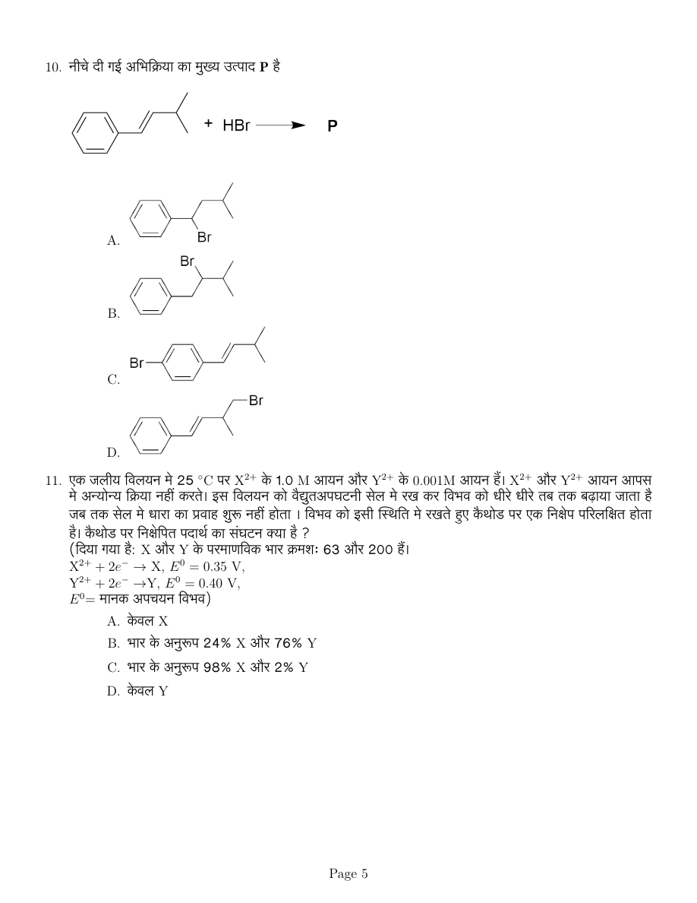

## PDF page 11

[Open original PDF at page 11](../pdf/IAT_2022_Hindi_paper.pdf#page=11)

**Matching embedded figure, English PDF page 10:** Chemistry Q12: four qualitative plots of Kp/Kc against absolute temperature T. They are, respectively, a convex rising curve, a horizontal line, a descending straight line and an ascending straight line.

### Searchable text - OCR draft (hin+eng)

```text
I2. आदर्श गैसों की अभिक्रिया, A(g) + 23(8) = 20(8) + 30 (8), के लिए निम्न मे से कौन सा आरेख गुणात्मक रूप से
सही है? (K, और K, क्रमशः दाब और सांद्रता के अनुरूप साम्यावस्था स्थिरांक हैं। T परमताप है। )

हि
|
N

Sp
K,

ia

3. एक गैस के लिए वॉन्डरवाल्स समीकरण (P + ia) (V —b) = RT दिया गया है। . (हु) की विमा क्या होगी?
A. ML?T-?
B. ML“!T-?
0. MLT~?
D. ML?T-!

I4. 2g नैपथोइक ऐसिड (naphthoic acid) (आणविक भार =72 gmol-!) को 20 mL बेन्ज़ीन मे घोलने पर हिमांक मे
2K का अवनमन होता है। ols के लिए हिमांक अवनमन स्थिरांक और घनत्व क्रमशः Ky = 5 K kg mol! और
0.88 g mL~! हैं। dire हॉफ गुणक का परिमाण क्या होगा?

A. 0.605
B. 605.0
C. 0.688
D. 688.0

5. faye आघूर्ण के परिमाण के अनुसार निम्न अणुओं का सही क्रम ज्ञात कीजिए:

Page 6
```

### Original page image

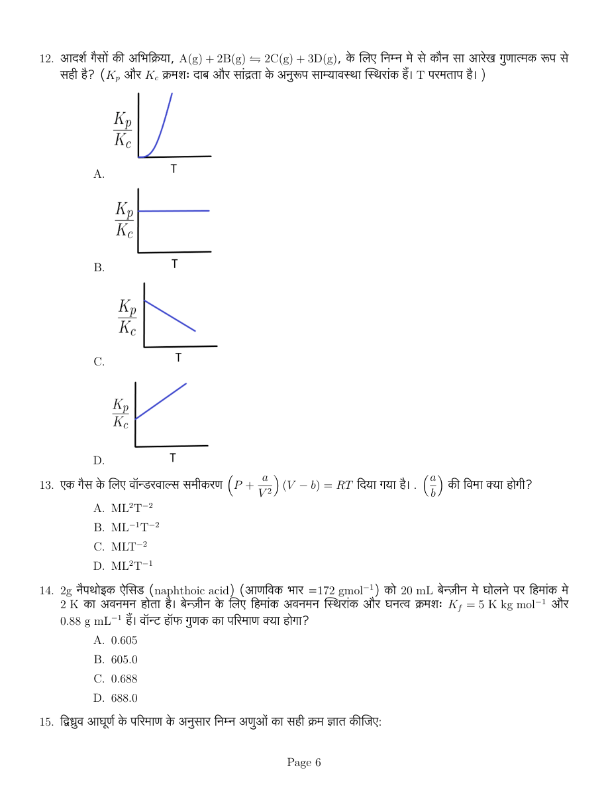

## PDF page 12

[Open original PDF at page 12](../pdf/IAT_2022_Hindi_paper.pdf#page=12)

**Matching embedded figure, English PDF page 11:** Chemistry Q15: four rows order fluorinated and chlorinated benzene derivatives by dipole moment. The relative positions of halogens on the rings, not simply the element names, determine the comparison.

### Searchable text - OCR draft (hin+eng)

```text
© © © &:
~) -~O- +O ©)

© -~© -O- O
© 6 छः 6)

A
```

### Original page image

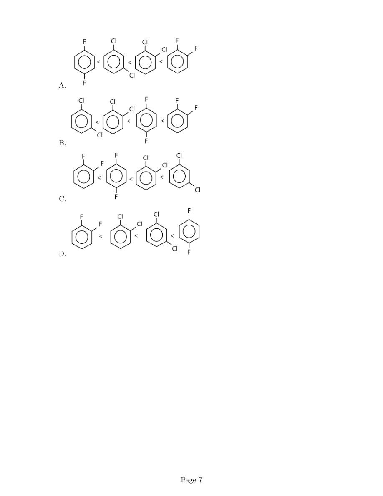

## PDF page 13

[Open original PDF at page 13](../pdf/IAT_2022_Hindi_paper.pdf#page=13)

### Searchable text - OCR draft (hin+eng)

```text
ol

IISER. Aptitude Test 2022
Math: SetA
. 52 ताशों की गड्डी से यादृच्छया निकाला गया एक पत्ता काले रंग का है (यानि कि स्पेड अथवा क्लब)। इस पत्ते कि फेस पत्ता
(यानि कि किंग, क्वीन या जैक) अथवा स्पेड होने कि प्रायिकता क्या है?
A. 8/3
8. 9/3
0. 9/26
D. 7/3

. द्विघात बहुपद ४? +o + का एक सम्मिश्रित हल ७ है।

॥ 2 ॥ 00 l
(+5) +a) (००९ + aa)

का मान क्या है?
A. -233
B. ~23
Cc. 933
D. 93
© f (2) = a2” + aye?! ++ Faye + ०० एक बहुपद Bl मान लीजिए कि

d & att &
Homo gel oh कप पद a
£(5) =
AL 55
B. 25
C. 35
D. 05

. #४-तल में मात्रक सदिशों का समुच्चय 5 है। तो # में
A. अनगिनत अवयव हैं
8. 2 अवयव हैं
0. 4 अवयव हैं
9. 8 अवयव हैं
. एक प्रयोगशाला की रिपोर्ट के अनुसार वर्ष 2020 मे विश्व औसत तापमान i4.9°C था। इस रिपोर्ट का यह अनुमान है कि
विश्व औसत तापमान हर वर्ष % की गति से बढ़ेगा। तो 2035 मे विश्व औसत तापमान क्या होगा?
A. 7.298°C
8. 5.049°C
0. 7.35°C
```

### Original page image

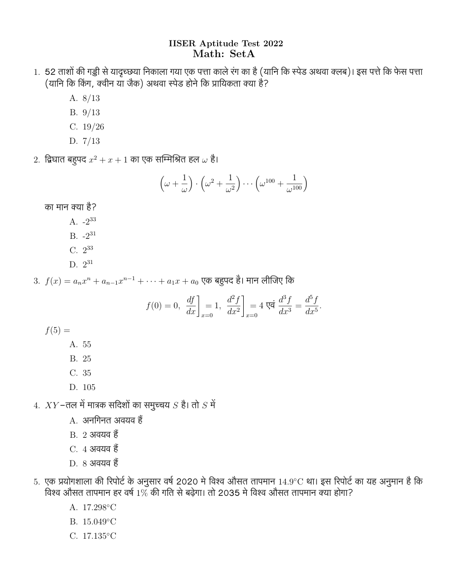

## PDF page 14

[Open original PDF at page 14](../pdf/IAT_2022_Hindi_paper.pdf#page=14)

### Searchable text - OCR draft (hin+eng)

```text
D. i7.47i°C
6. X उन 2 » 2 आव्यूहों का समुच्चय है, जिनके समस्त अवयव वास्तविक संख्याएं हैं। RC X x X निम्नलिखित संबंध है:
R={(A,B): 48 = BA}
निम्नलिखित aaat में कौन सा वाक्य सही है?

A. R स्वतुल्य एवं सममित है, परंतु संक्रामक नहीं
8. # स्वतुल्य एवं संक्रामक है, परंतु सममित नहीं
C. # सममित एवं संक्रामक है, परंतु स्वतुल्य नहीं
D. # एक Gera संबंध है

7. एक प्राकृत संख्या # के लिए, ;४-तल का वक्र C,, है, जिस का समीकरण है, y= 2”, 0 < # Sl GMO के
मध्यवर्ती क्षेत्र का क्षेत्रफल 4,, कहलाता है। A, का उच्चतम मान क्या है?

A.
B.
C.

Dz.

BR WIR NI ०१| ++
blr

8. अंतराल (0, L] पर परिभाषित / एक संतत फलन है। / का एक प्रतिअवकलज / है। यदि F(0) = एवं f[) f(a) de = I,
तो F() का मान क्या है?
2

णएएएमदए

NIRrF Oo

9. a एक अशून्य वास्तविक संख्या है एवं / : 8 -> छ एक संतत फलन है | समस्त » CRG fat f(z) > 0 है। मान लीजिए
( (2a?x — ax?)|

)

A. यदि 4 > 0, तो & -- ५७ के स्थानीय उच्चतम का बिन्दु है
8. यदि 6 < 0, तो & - ७५ के स्थानीय उच्चतम का बिन्दु है
C. यदि 6 > 0, तो & - ७५ के स्थानीय निम्नतम का बिन्दु है
D. ४-५ 9 का नति परिवर्तन बिन्दु है

0. मान लीजिए कि 4 निम्नलिखित आव्यूह है।

८0890 0 —sin@
4च्च् |. | ]
sind 0 cosé

यदि # एक प्राकृत संख्या है , तो A का सारणिक क्या है?

Page 2
```

### Original page image

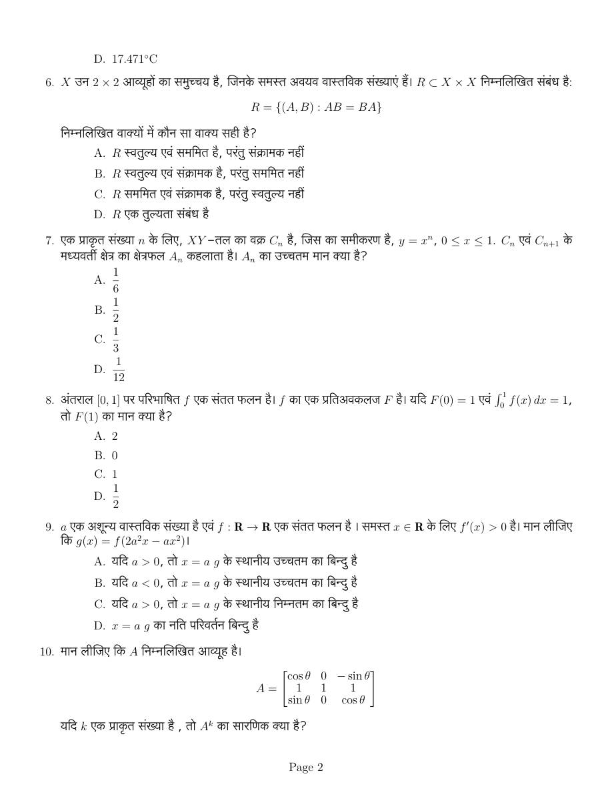

## PDF page 15

[Open original PDF at page 15](../pdf/IAT_2022_Hindi_paper.pdf#page=15)

### Searchable text - OCR draft (hin+eng)

```text
ll.

2.

I3.

l4.

Al

B. -l
0. (-I)*
D. 0
हमारे पास तीन सदिश
ब> + ०) +2#,
b=i4+2j+ck,
@= 2+ 543k

हैं। उन » के क्या मान हैं , जिन के लिए, कम से कम एक अशून्य सदिश है जो कि 4, 8 एवं oH लम्बवत है?

A. 0, 2

B. -2, 2

0. 7/2, 0

9. 4, -2
एक TT 2? + ४१ = । की उन दो स्पर्श रेखाओं पर ध्यान दीजिए, जो बिन्दु 7? = (,0) एवं ७ = (45, २5) से गुजरती हैं।
यदि २ इन दोनों रेखाओं का प्रतिच्छेद बिन्दु है, तो ZPRQ क्या है?

उग्‌
AL &

a

nT

“4

B
C. 5
D

6
6
फलन f(x) = 2a? — 52? + 36a — 5
A. अंतराल (0,2) 4 वर्धमान है
B. अंतराल (—3, 0) में हासमान हैं
C. अंतराल (2,3) में वर्धमान है
D. अंतराल (3, ००) में हासमान हैं

यदि [x] =max{n€ 2 :% < ४), तो समाकलन

का मान क्या है?

Page 3
```

### Original page image

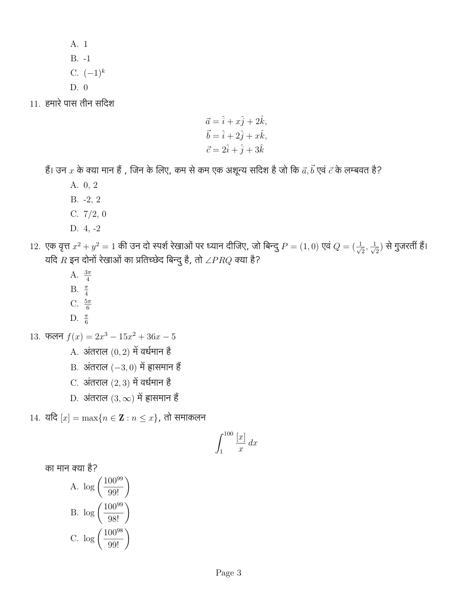

## PDF page 16

[Open original PDF at page 16](../pdf/IAT_2022_Hindi_paper.pdf#page=16)

### Searchable text - OCR draft (hin+eng)

```text
00#
D. log ( 38 )
L5. स्वेच्छ अचरों ०, 8 के लिए, वक्रों के Gey = (ax + 8)” को निरूपित करने वाला अवकल समीकरण ज्ञात कीजिए।

A. y” —2y'+y=0
97 - ४/ +y=0

ठ्फ़

y! — 2y yo y=0

o

श्र -y / y= 0

Page 4
```

### Original page image

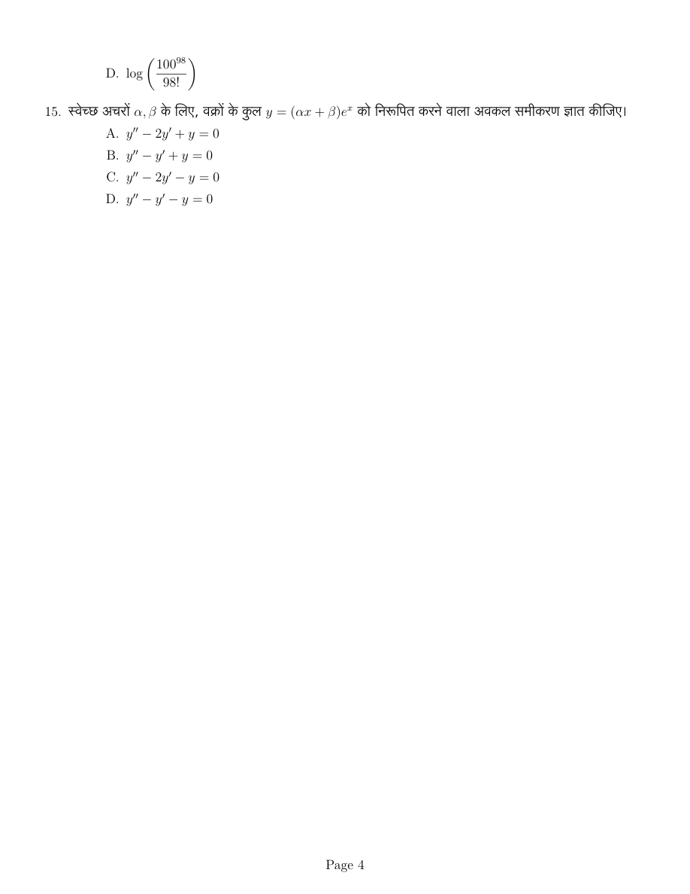

## PDF page 17

[Open original PDF at page 17](../pdf/IAT_2022_Hindi_paper.pdf#page=17)

### Searchable text - OCR draft (hin+eng)

```text
Physics: Set A

L. एक कण त्वरण 6 = ad का अनुभव करता है जहाँ TF कण का वेग है और a एक स्थिरांक है। यदि इस
कण द्वारा समयन्तराल ty - 8 तथा ts — t, में तय की गई दूरियाँ क्रमशः S,, और S,, हैं, तो निम्न में
से कौन सा संबंध सही है ?

A Sig _ exp[a(ts — t,)] 7
* 89. expla(t, —ti)] -।
B Sig _ exp[a(ts — t)]
| Siz expla(te — ti)]
C Sis _ logla(ts — t,)]
' Sig logla(ts - ti)]
D Sig _ logla(t; — t,)] — 7
" Sia logla(tz —t:)] +!
```

### Original page image

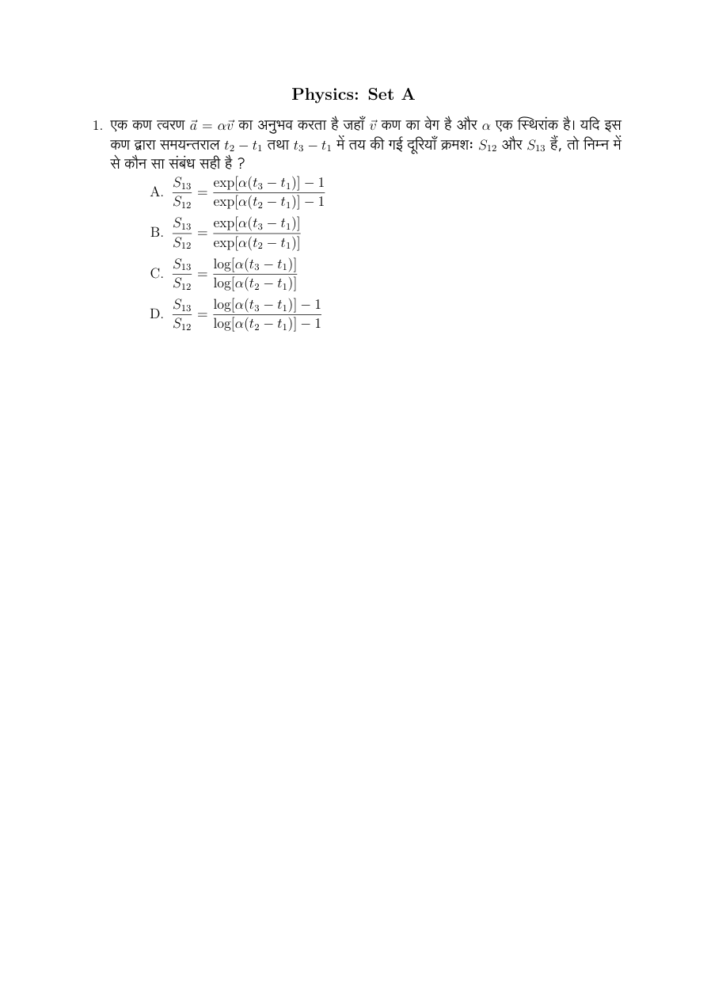

## PDF page 18

[Open original PDF at page 18](../pdf/IAT_2022_Hindi_paper.pdf#page=18)

### Searchable text - OCR draft (hin+eng)

```text
2. द्रव्यमान रहित धागे से बँधा एक बिन्दु द्रव्यमान m ऊर्ध्वाधर तल में एक वृत्तीय गति करता है। इस धागे
की लंबाई RTM गुरुत्वीय त्वरण ५ है। यदि इस धागे के तनाव का न्यूनतम मान 2g है, तो इस बिन्दु
द्रव्यमान का वृत्तीय गति में अधिकतम चाल कितना होगा?

A. २7476.

(a

a

C. V6gR.

D. 4V/9R.

B.

Page 2
```

### Original page image

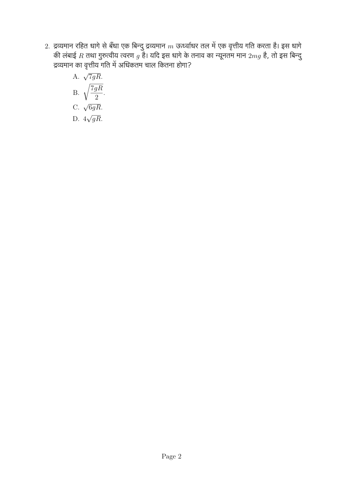

## PDF page 19

[Open original PDF at page 19](../pdf/IAT_2022_Hindi_paper.pdf#page=19)

### Searchable text - OCR draft (hin+eng)

```text
3. एक वस्तु को किसी अर्धगोलीय कटोरे के आंतरिक किनारे से विरामावस्था से छोड़ा जाता है, और वह
गुरुत्व के प्रभाव में गिरता है। वस्तु और कटोरे के बीच गतिज घ॒र्षण का गुणांक pp है। वस्तु जब पहली बार
रुकती है तब यदि वह अर्धगोल के केंद्र से # कोणीय विस्थापन प्राप्त करती है तो निम्न में से कौन सा
विकल्प सही है?

A. = ९0

B
C. w= tan
D

Page 3
```

### Original page image

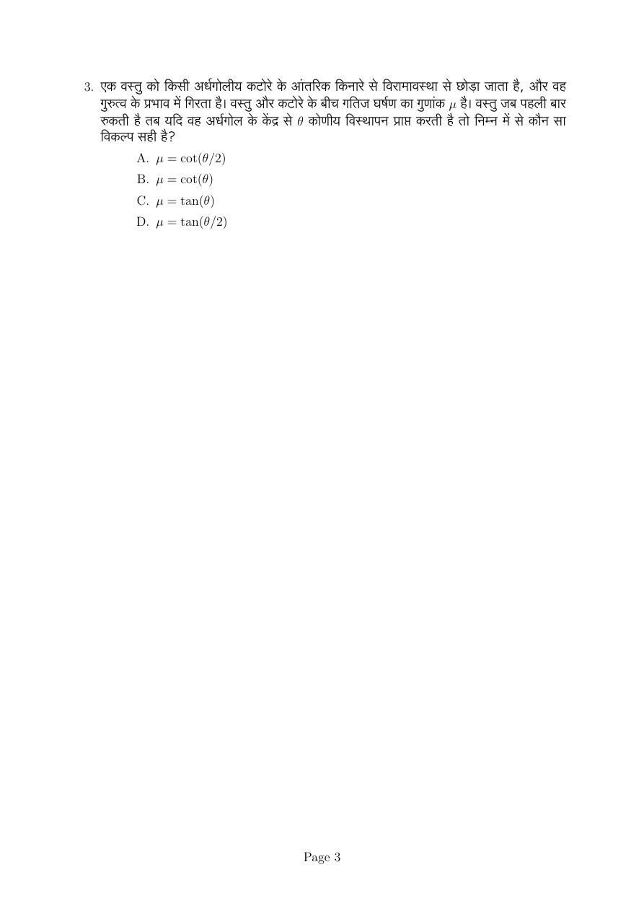

## PDF page 20

[Open original PDF at page 20](../pdf/IAT_2022_Hindi_paper.pdf#page=20)

### Searchable text - OCR draft (hin+eng)

```text
4. चित्रानुसार एक खंड किसी घर्षण रहित सतह पर रखा हुआ है और एक FST के मुक्त सिरे से जुड़ा हुआ
है। इस खंड का दाहिना क्षोर साम्यावस्था में दीवार से ८ दूरी पर है। जब स्प्रिंग को ८/2 दूरी तक संकुचित
करके छोड़ दिया जाता है तो होने वाली गति का आवर्त काल 7' है। उसी प्रकार, जब स्प्रिंग को 26 दूरी
तक संकुचित करके छोड़ दिया जाता है तो आवर्त काल Ty Bl यदि इस खंड और दीवार के मध्य प्रत्यास्थ
संघट्ट होता है, तो 70/7' का मान कितना है?

— हा

कफ

d

A. 2/3
Bl

C. 3/4
D. i/4

Page 4
```

### Original page image

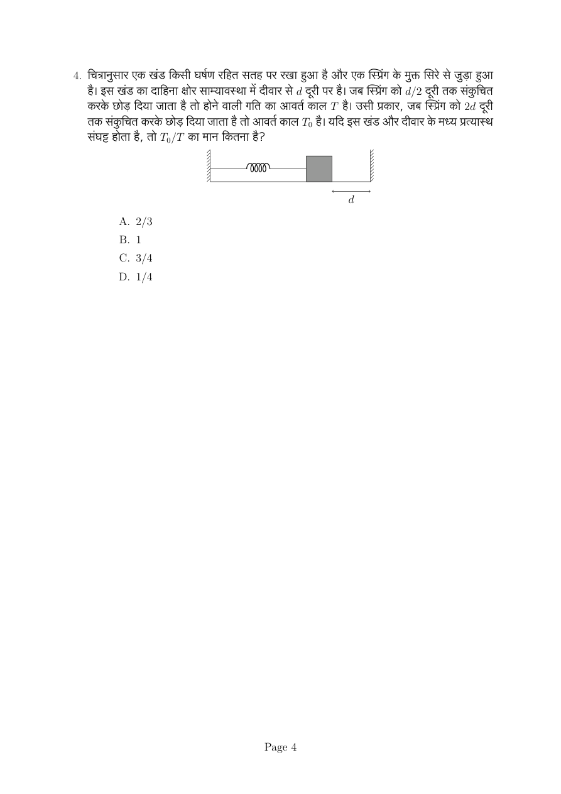

## PDF page 21

[Open original PDF at page 21](../pdf/IAT_2022_Hindi_paper.pdf#page=21)

### Searchable text - OCR draft (hin+eng)

```text
5. » घनत्व के द्रव सहित एक पात्र का भार W है। भुजा L तथा घनत्व py, < » वाला एक घनाकार खंड
किसी छड़ द्वारा पात्र की दीवारों को छूए बिना इस द्रव में पूरी तरह से Yar जाता है। यदि g गुरुत्वीय
त्वरण है और छड़ी द्वारा विस्थापित द्रव नगण्य है तो नीचे दिखाए गए भार मापी पर अंकित इस पात्र का
नया भार कितना होगा?

A. का + pgL?
B. W + poglL®
C. W + (७ - po)g L?
D. W + (७ — p)gL?

Page 5
```

### Original page image

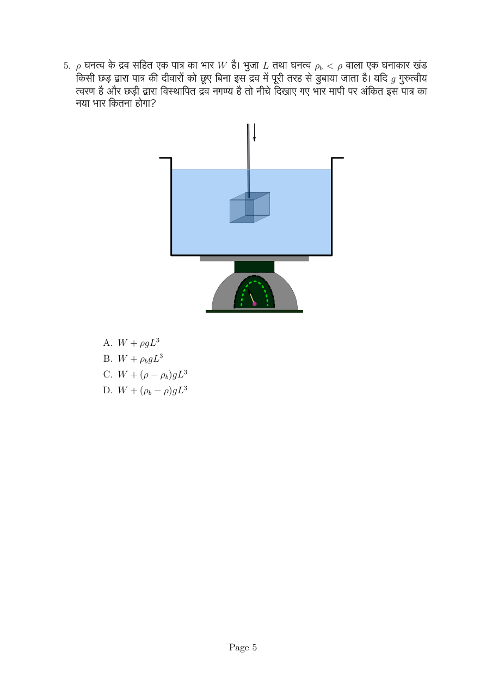

## PDF page 22

[Open original PDF at page 22](../pdf/IAT_2022_Hindi_paper.pdf#page=22)

### Searchable text - OCR draft (hin+eng)

```text
6. किसी एकल परमाण्विक आदर्श गैस को aa 7? और आयतन 79 पर पहले रुद्धोष्म रूप से आयतन =

तक संकुचित करते हैं और फिर गैस का प्रसार समतापीय रूप से इसके प्रारम्भिक आयतन तक होने दिया
जाता है। इस गैस का seca दाब कितना है?

A. 472

Page 6
```

### Original page image

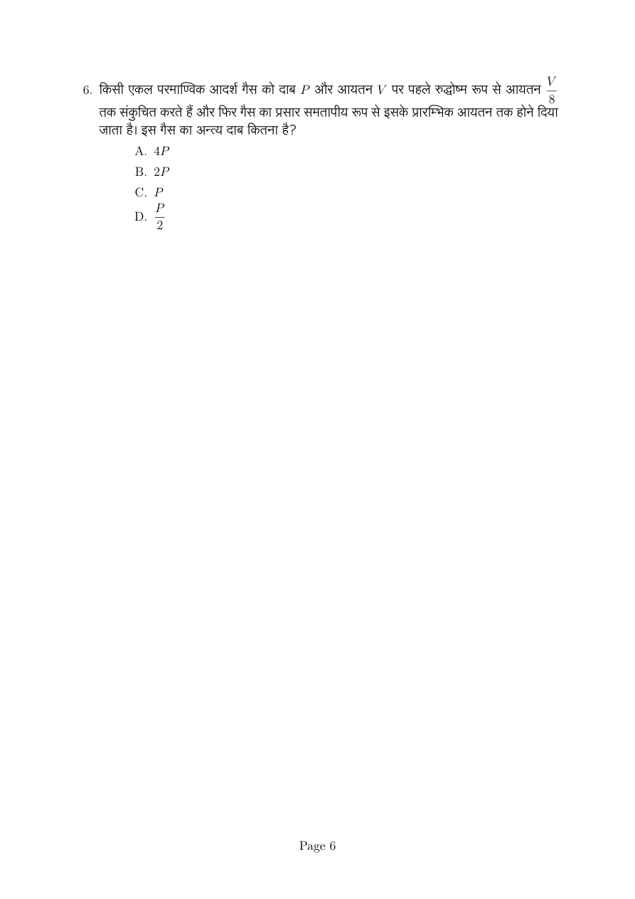

## PDF page 23

[Open original PDF at page 23](../pdf/IAT_2022_Hindi_paper.pdf#page=23)

### Searchable text - OCR draft (hin+eng)

```text
7. चित्रानुसार, एक oa धागे के दो सिरों से बँधे दो बिन्दु आवेश 4 और —¢, L दूरी पर रखे द्रव्यमान रहित
दो घिरनियों से गुजरते हैं। यदि घिरनियों के ऊपरी भाग के ar धागे की मूलभूत आवृत्ति / है तो निम्न
में से कौन सा विकल्प सही है?

A. fxL?
B. fxL
C.fax«l
D. fx L?

Page 7
```

### Original page image

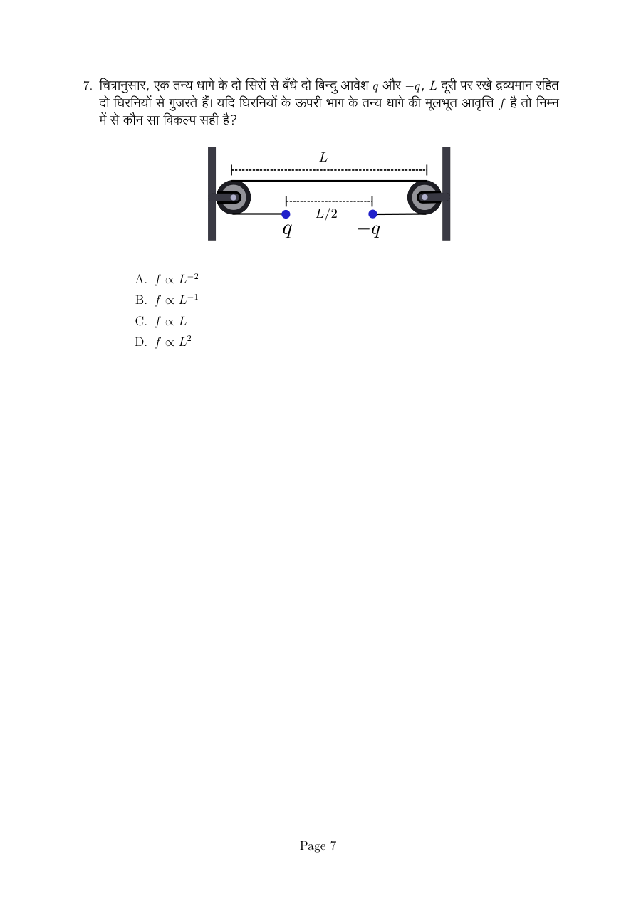

## PDF page 24

[Open original PDF at page 24](../pdf/IAT_2022_Hindi_paper.pdf#page=24)

**Matching embedded figure, English PDF page 23:** Physics Q8: two concentric shells have radii r1 and r2 and charges +Q and -Q. Four potential-versus-radius alternatives differ in their inner plateau, middle-region shape and value outside the outer shell.

### Searchable text - OCR draft (hin+eng)

```text
8. समान रूप से आवेशित rn, और rp त्रिज्याओं के दो संकेंद्रीय गोलाकार Gell के आवेश क्रमशः +6? और
—Q हैं। Nel के केंद्रों से दूरी के साथ स्थिरवैद्युत विभव कैसे परिवर्तित होगा?

Page 8
```

### Original page image

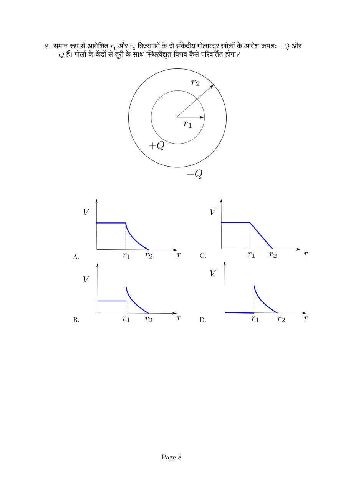

## PDF page 25

[Open original PDF at page 25](../pdf/IAT_2022_Hindi_paper.pdf#page=25)

**Matching embedded figure, English PDF page 24:** Physics Q9: a circular/spherical cavity of radius a has been removed from a positively charged cylindrical region. The shaded remaining material is labelled with charge density rho; x is measured radially outward from the cavity centre.

### Searchable text - OCR draft (hin+eng)

```text
9. एकसमान धनात्मक आवेश घनत्व p और त्रिज्या ७ वाले एक अत्यधिक लंबे बेलन की कल्पना कीजिए।
चित्रानुसार a त्रिज्या वाले एक गोले को इस बेलन से इस प्रकार काट कर निकाला गया है कि उस क्षेत्र
में कोई आवेश शेष नहीं रह जाता। इस गोले के केंद्र से बेलन के बाहर की ओर त्रिज्यीय रूप से मापी गई
कोई दूरी x है। x के किस मान पर विद्युत क्षेत्र अधिकतम होगा?

छा जा

Page 9
```

### Original page image

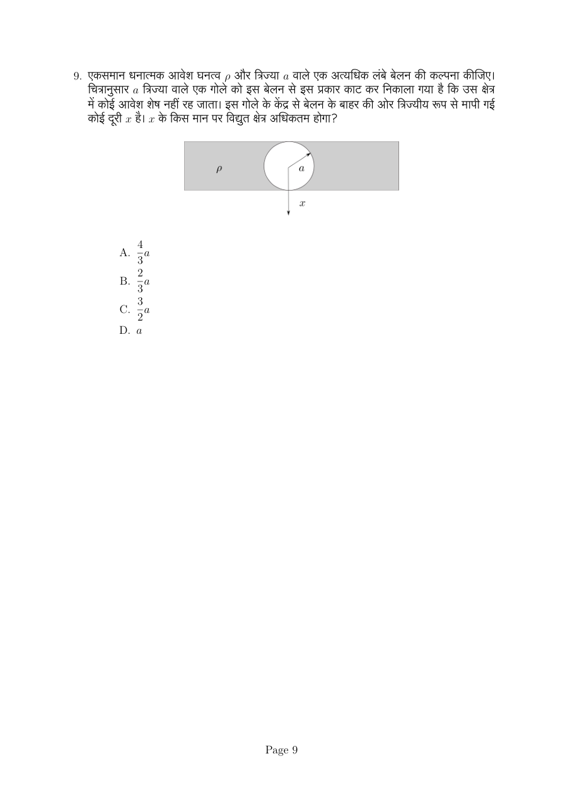

## PDF page 26

[Open original PDF at page 26](../pdf/IAT_2022_Hindi_paper.pdf#page=26)

### Searchable text - OCR draft (hin+eng)

```text
l0. नीचे दिए गए परिपथ में, बक्से / में एक संघारित्र, या एक प्रेरक या एक प्रतिरोधक है। तीन दशाओं (ai,
a, a3) में धारा ik समय # के मध्य आरेख को नीचे चित्र में दर्शाया गया है। समय # = 0 पर स्विच
$ को जोड़ते हैं तो निम्न में से कौन सा सही है?

a, एक प्रतिरोधक है, a. एक संधारित्र है, और ८३ एक प्रेरक है।
a, एक प्रतिरोधक है, ay एक प्रेरक है, और a; एक संधारित्र है.
a, एक प्रेरक है, ५४ एक प्रतिरोधक है, और a; एक संधारित्र है.
a, एक प्रेरक है, ay संधारित्र है, और 6३ एक प्रतिरोधक है.

GQn S

Page 0
```

### Original page image

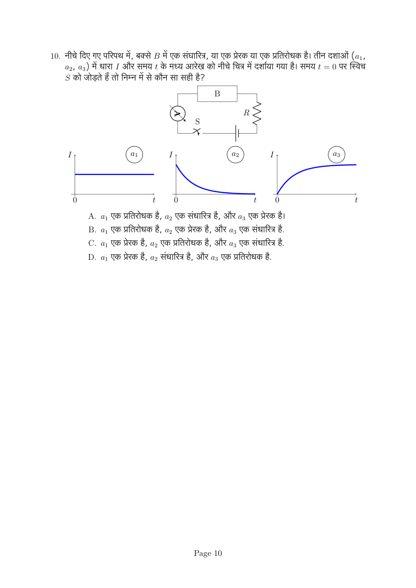

## PDF page 27

[Open original PDF at page 27](../pdf/IAT_2022_Hindi_paper.pdf#page=27)

### Searchable text - OCR draft (hin+eng)

```text
L.. नीचे दिए गए परिपथ में प्रत्येक प्रतिरोधक कि era Lk0 है और प्रत्येक संधारित्र की धारिता
4 uF है। बिंदुओं B और 7 के मध्य संधारित्र में कितना आवेश है?

w
_
on
a

Page Il
```

### Original page image

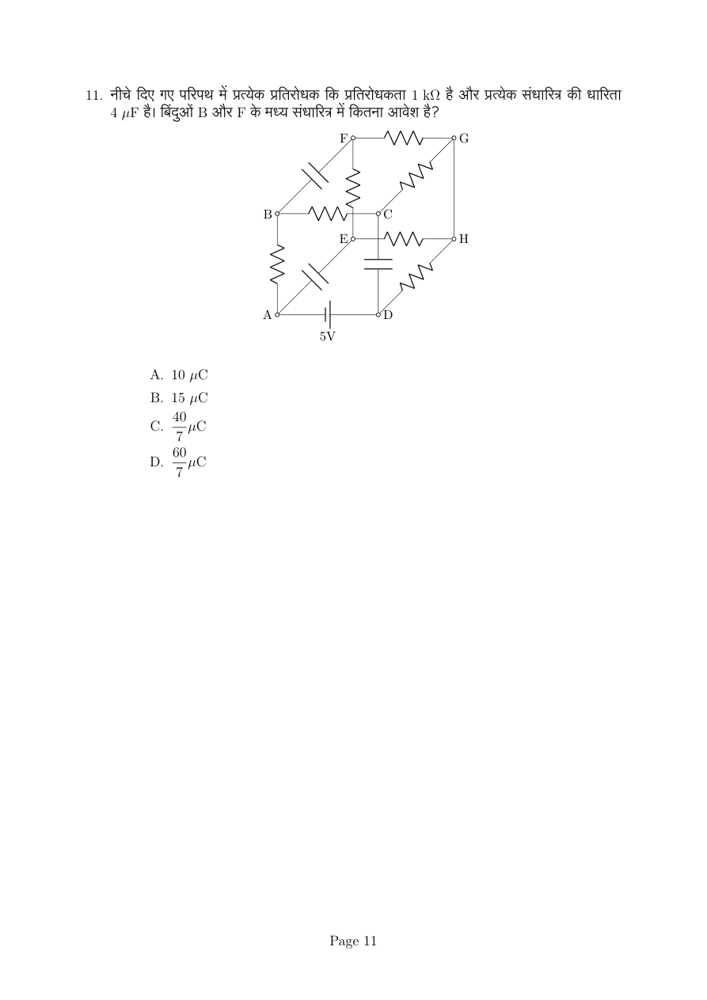

## PDF page 28

[Open original PDF at page 28](../pdf/IAT_2022_Hindi_paper.pdf#page=28)

### Searchable text - OCR draft (hin+eng)

```text
2. नीचे दिखाए गए रेखा-चित्र के अनुसार n, अपवर्तनांक वाले पदार्थ से बने एक पतले लेंस से लेंस के
केन्द्रीय अक्ष पर O स्थान पर रखे एक बिन्दुवत वस्तु का प्रतिबिम्ब स्थान । पर बनता है। मान लें कि चित्र
में उपयोग में लाए गए माध्यम का अपवर्तनांक %,, और rp > rn BI जब 79४ < ym होगा तो प्रतिबिम्ब
कहाँ पर बनेगा?

. बिन्दु 8 पर
. बिन्दु & पर
ECR
. gD पर

Qn eS

o

Page 2
```

### Original page image

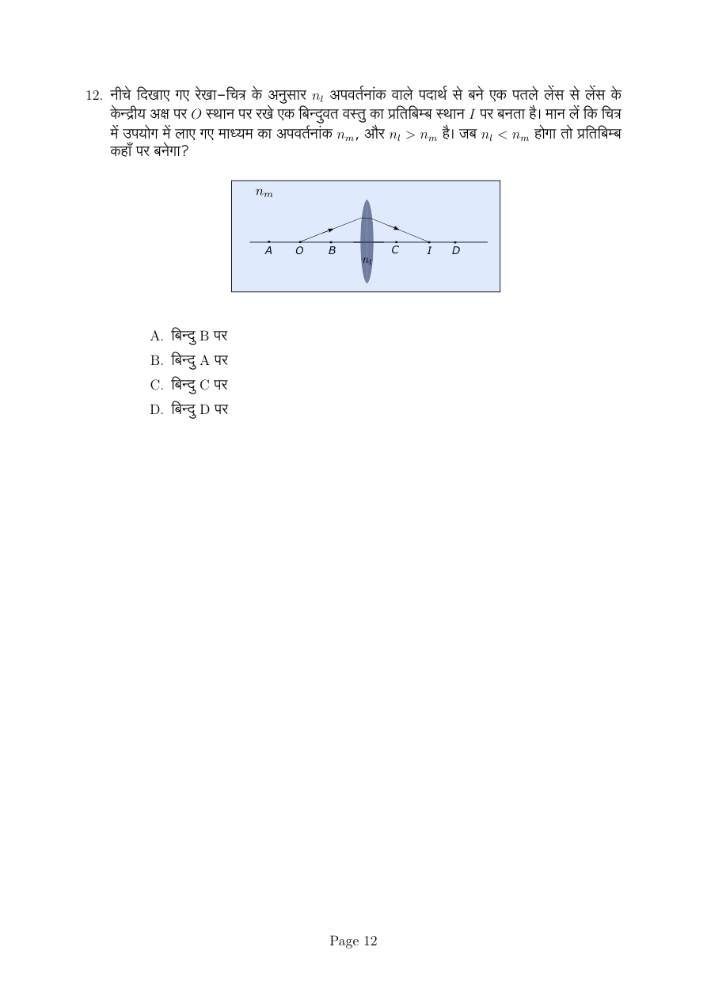

## PDF page 29

[Open original PDF at page 29](../pdf/IAT_2022_Hindi_paper.pdf#page=29)

**Matching embedded figure, English PDF page 28:** Physics Q13: a shaded charged sphere of radius a overlaps a larger spherical Gaussian surface of radius 2a. The larger sphere is centred at a point on the smaller sphere's surface, rather than sharing its centre.

### Searchable text - OCR draft (hin+eng)

```text
3. a त्रिज्या वाला एक चालकीय गोला आरंभ में एकसमान आयतनी आवेश घनत्व ७ रखता है। बाद में समय
# पर, आवेशित गोले के पृष्ठ पर केंद्रित 2a त्रिज्या वाले एक गोलीय पृष्ठ से गुजरने वाला वैद्युत फ्लक्स ©
कितना होगा? (०: निर्वात का परावैद्युतांक है)

4.

A. 6 = —ra?
3c," p

2

B. @= 32 ap
360

C. कु ८ (0 ६2५
€0
4

D. ® = —7ra’p

Page 3
```

### Original page image

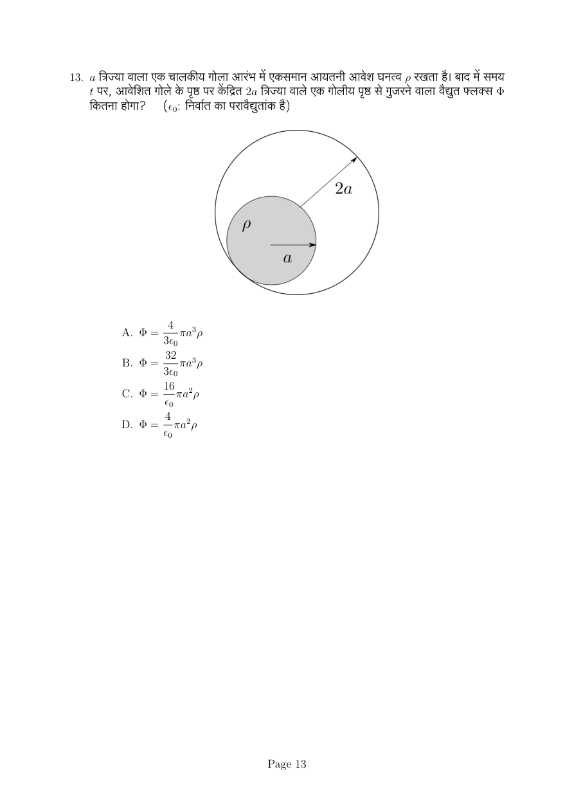

## PDF page 30

[Open original PDF at page 30](../pdf/IAT_2022_Hindi_paper.pdf#page=30)

### Searchable text - OCR draft (hin+eng)

```text
i4. विकल्पों में दिए गए चित्र एक प्रकाश-वैद्युत पदार्थ की प्रकाश-वैद्युत धारा J तथा आपतित किरण की
अवृत्ति / के बीच के संबंध को दर्शाता है। प्रकाश की इस किरण की तीन विभिन्न Haare, bb, Is हो
सकती हैं (जहाँ I, > I, > 7। है)। कौन सा विकल्प सही है?

—
Is
J In
qh
A f
Dy
qi In Ts
J
>
B. f
—
qh
J In
Iz
C f
DY
Ts Tp qT,
J
>
D f

Page 4
```

### Original page image

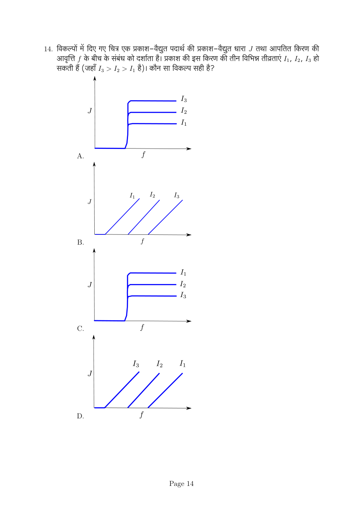

## PDF page 31

[Open original PDF at page 31](../pdf/IAT_2022_Hindi_paper.pdf#page=31)

### Searchable text - OCR draft (hin+eng)

```text
5. विचार करें कि एक प्लुटोनियम (Pu2%) परमाणु के नाभिकीय विघटन में 207 Mev ऊर्जा उत्सर्जित
होती है। यदि मान लिया जाए कि प्लुटोनियम के सभी परमाणुओं का नाभिकीय विघटन हो तो, निम्न में
से कौन सा विकल्प, 20,000 यूनिट TNT विस्फोट करने के लिए आवश्यक प्लुटोनियम की मात्रा का

निकटतम अनुमान है?
(. यूनिट TNT= 4.84 x 09 J, | V=.6 x 0-!9 J)

A. Lkg.
B. 0 kg.
C. 60.0 g.
D. 0.5 kg.

Page 5
```

### Original page image

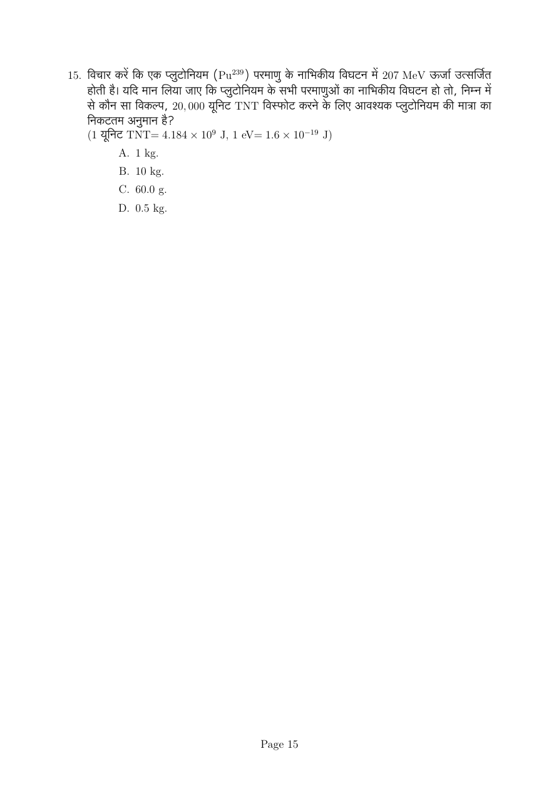
