# IAT 2023 - English

Original PDF: [IAT_2023_English_paper.pdf](../pdf/IAT_2023_English_paper.pdf)

- Acquisition: SciAstra CloudFront mirror; not downloaded from the official server.
- Downloaded: 28 October 2026. PDF pages: 62.
- Exact download/source URL: https://d2aaa7ts7sm3bp.cloudfront.net/pdfs/01KMFRDHRKBJJA2CNCPQBT0G6G.pdf
- PDF SHA-256: `fcd76b3dd1f0c3c6286aad2a50cb2fe599aad7c1528c2481b3c775aa6bfe50c9`
- This is a search/accessibility copy of an existing paper, not newly authored mock content.
- Text is mechanically extracted or OCR-derived and has not been proofread character by character. Equations, option letters, chemical bonds, tables and Hindi OCR can contain errors. The PDF and page images are authoritative.
- Figure descriptions are explanatory annotations, not official answers or complete structural/formula transcriptions. Use the linked image to resolve exact labels, values and stereochemistry.

## Visual guide

- [English PDF page 1](#pdf-page-1): Biology Q1: a matching table pairs epithelial tissue categories with location or function descriptions. Keep each labelled row intact when using the extracted text.
- [English PDF page 3](#pdf-page-3): Biology Q3: a matching table lists biomolecules and possible chemical natures, including polymers and secondary metabolites. Column labels identify the answer combinations.
- [English PDF page 10](#pdf-page-10): Biology Q10: a matching table links cell or organ structures, including Sertoli cells and hormone-producing tissues, to physiological roles.
- [English PDF page 12](#pdf-page-12): Biology Q12: an enzyme has a specifically shaped active site, a substrate drawn above it, and five potential inhibitors P-T with distinct polygonal shapes. Competitive-inhibitor comparisons depend on shape complementarity.
- [English PDF page 14](#pdf-page-14): Biology Q14: a 3500 bp circular plasmid map shows restriction sites and an inserted DNA segment. Below it is gel alternative (a), with two lanes for two different digests and band-size labels; alternatives continue on pages 15-16.
- [English PDF page 15](#pdf-page-15): Continuation of Biology Q14: gel alternatives (b) and (c), each with Lane 1 and Lane 2 and different band numbers and sizes. Interpret them with the restriction map on page 14.
- [English PDF page 16](#pdf-page-16): Continuation of Biology Q14: gel alternative (d), with a two-lane band pattern. Its lane and base-pair labels belong to the preceding restriction-digest question.
- [English PDF page 17](#pdf-page-17): Biology Q15: a three-generation pedigree labels individuals I-1/I-2, II-1/II-2/II-3 and III-1/III-2. Shading denotes affected members; II-3 has a question-mark phenotype in the diagram.
- [English PDF page 23](#pdf-page-23): Chemistry Q6: four organic bromides I-IV compare a bromine directly on an aromatic ring with bromine on different side-chain carbons. The task concerns Finkelstein substitution, so bond placement is crucial.
- [English PDF page 24](#pdf-page-24): Chemistry Q7: four proposed synthetic routes to n-propylbenzene start from benzene and show different alkylation/acylation reagents and, in one route, a reduction step.
- [English PDF page 25](#pdf-page-25): Chemistry Q8: four labelled molecular structures show stereochemical environments using wedges, dashes and substituent labels. The question asks which structures are chiral; do not flatten the wedge/dash distinctions.
- [English PDF page 26](#pdf-page-26): Chemistry Q9: four nitrogenous-base structures I-IV are drawn with their carbonyl, amino and methyl substituents. The task distinguishes a base absent from RNA.
- [English PDF page 27](#pdf-page-27): Chemistry Q10: four cyclic structures I-IV with different conjugation and charge patterns are compared for aromaticity. Read the exact ring sizes and double-bond locations from the figure.
- [English PDF page 58](#pdf-page-58): Physics Q11: a diamond-shaped resistor network joins terminals A and B, with an internal horizontal branch and unequal labelled edge resistances. Distinguish the internal junctions from simple wire crossings.
- [English PDF page 59](#pdf-page-59): Physics Q12: two equal spherical bodies of mass M and radius R have centres separated by 4R. A projectile leaves the surface of sphere A toward sphere B along the line joining their centres; the launch arrow and surface point are marked.

## Page index

[p1](#pdf-page-1) | [p2](#pdf-page-2) | [p3](#pdf-page-3) | [p4](#pdf-page-4) | [p5](#pdf-page-5) | [p6](#pdf-page-6) | [p7](#pdf-page-7) | [p8](#pdf-page-8) | [p9](#pdf-page-9) | [p10](#pdf-page-10) | [p11](#pdf-page-11) | [p12](#pdf-page-12) | [p13](#pdf-page-13) | [p14](#pdf-page-14) | [p15](#pdf-page-15) | [p16](#pdf-page-16) | [p17](#pdf-page-17) | [p18](#pdf-page-18) | [p19](#pdf-page-19) | [p20](#pdf-page-20) | [p21](#pdf-page-21) | [p22](#pdf-page-22) | [p23](#pdf-page-23) | [p24](#pdf-page-24) | [p25](#pdf-page-25) | [p26](#pdf-page-26) | [p27](#pdf-page-27) | [p28](#pdf-page-28) | [p29](#pdf-page-29) | [p30](#pdf-page-30) | [p31](#pdf-page-31) | [p32](#pdf-page-32) | [p33](#pdf-page-33) | [p34](#pdf-page-34) | [p35](#pdf-page-35) | [p36](#pdf-page-36) | [p37](#pdf-page-37) | [p38](#pdf-page-38) | [p39](#pdf-page-39) | [p40](#pdf-page-40) | [p41](#pdf-page-41) | [p42](#pdf-page-42) | [p43](#pdf-page-43) | [p44](#pdf-page-44) | [p45](#pdf-page-45) | [p46](#pdf-page-46) | [p47](#pdf-page-47) | [p48](#pdf-page-48) | [p49](#pdf-page-49) | [p50](#pdf-page-50) | [p51](#pdf-page-51) | [p52](#pdf-page-52) | [p53](#pdf-page-53) | [p54](#pdf-page-54) | [p55](#pdf-page-55) | [p56](#pdf-page-56) | [p57](#pdf-page-57) | [p58](#pdf-page-58) | [p59](#pdf-page-59) | [p60](#pdf-page-60) | [p61](#pdf-page-61) | [p62](#pdf-page-62)

## PDF page 1

[Open original PDF at page 1](../pdf/IAT_2023_English_paper.pdf#page=1)

### Visual description

Biology Q1: a matching table pairs epithelial tissue categories with location or function descriptions. Keep each labelled row intact when using the extracted text.

### Searchable text - PDF text layer

```text
Biology
1. Question 1
    Match the entries in Column I with their functions described in Column II.


   Which one of the following combinations is correct?

      P - (iv); Q - (iii); R - (ii); S - (i)
    (a)
      P - (iii); Q - (i); R - (iv); S - (ii)
    (b)
      P - (ii); Q - (iv); R - (i); S - (iii)
    (c)
      P - (i); Q - (ii); R - (iii); S - (iv)
    (d)


                                            1
```

### Original page image

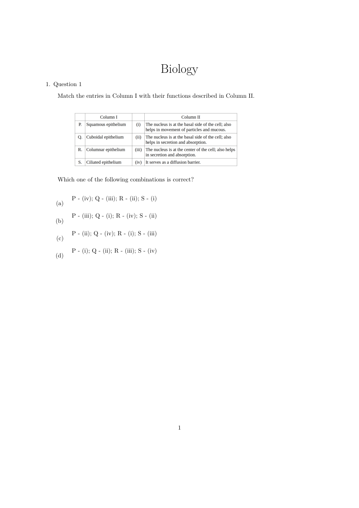

## PDF page 2

[Open original PDF at page 2](../pdf/IAT_2023_English_paper.pdf#page=2)

### Searchable text - PDF text layer

```text
2. Question 2
   Which one of the following best describes peptones?

          Partially digested proteins
    (a)
        Zymogen form of pepsin
    (b)
         Activated form of pepsin
    (c)
       An intestinal mixture of proteins, mucous and HCO−3    (d)


                                            2
```

### Original page image

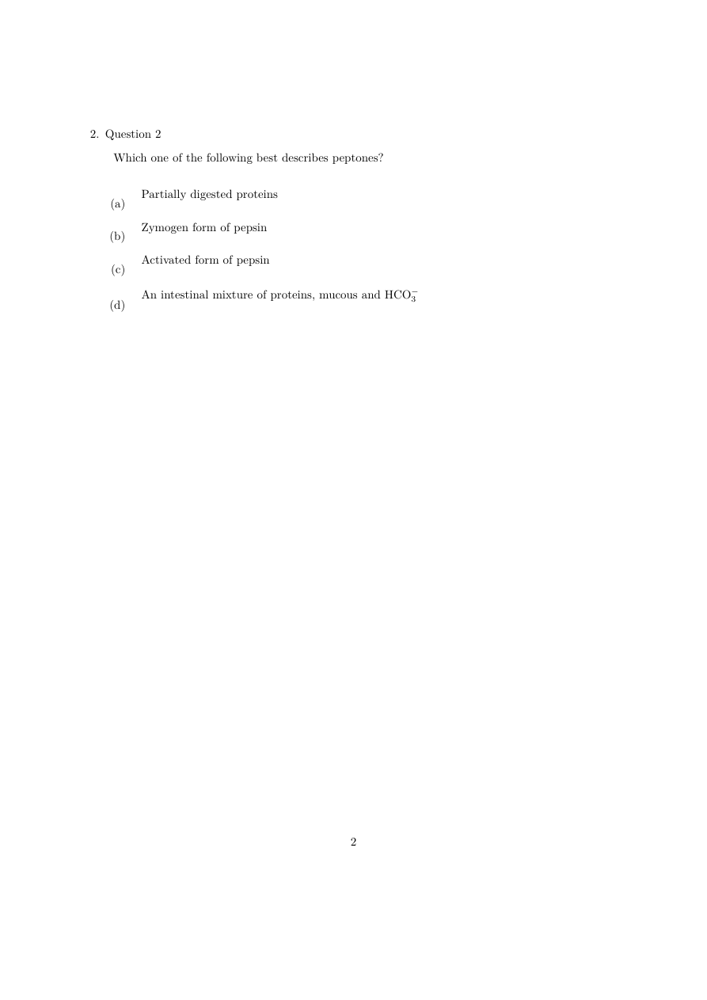

## PDF page 3

[Open original PDF at page 3](../pdf/IAT_2023_English_paper.pdf#page=3)

### Visual description

Biology Q3: a matching table lists biomolecules and possible chemical natures, including polymers and secondary metabolites. Column labels identify the answer combinations.

### Searchable text - PDF text layer

```text
3. Question 3
    Match the biomolecules given in Column I with their corresponding chemical
    nature given in Column II.


   Which one of the following combinations is correct?

      P - (iv); Q - (ii); R - (i); S - (iii)
    (a)
      P - (ii); Q - (iv); R - (iii); S - (i)
    (b)
      P - (iii); Q - (i); R - (iv); S - (ii)
    (c)
      P - (i); Q - (iii); R - (ii); S - (iv)
    (d)


                                            3
```

### Original page image

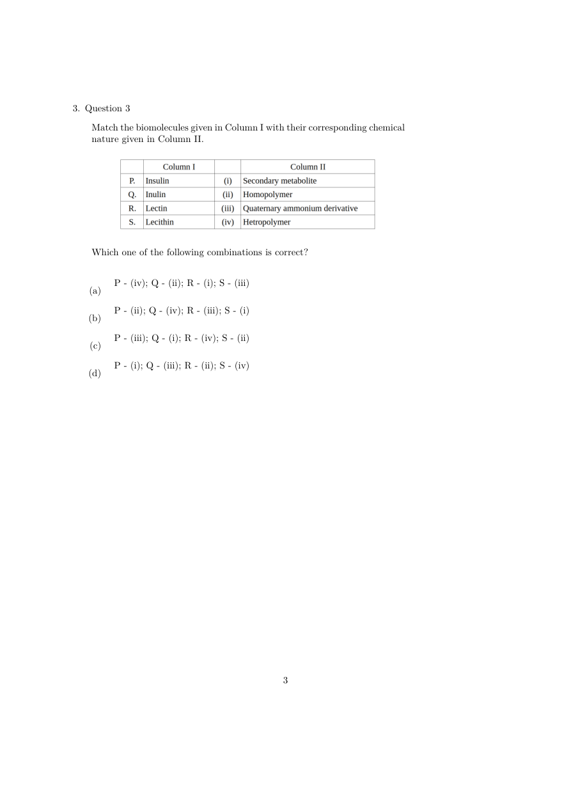

## PDF page 4

[Open original PDF at page 4](../pdf/IAT_2023_English_paper.pdf#page=4)

### Searchable text - PDF text layer

```text
4. Question 4
   A mitotic drug inhibits microtubule formation. Which one of the following
     stages of karyokinesis will be the first to get affected by the drug?

        Metaphase
    (a)
        Anaphase
    (b)
         Prophase
    (c)
         Telophase
    (d)


                                            4
```

### Original page image

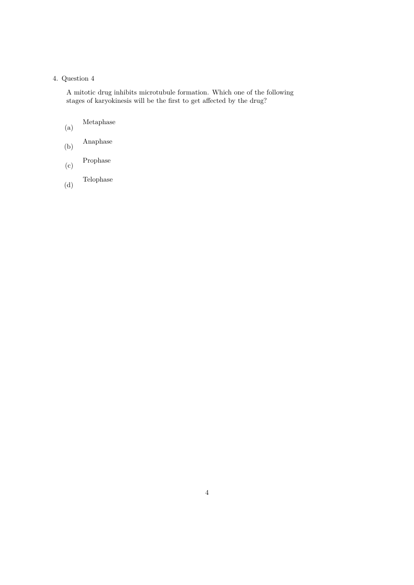

## PDF page 5

[Open original PDF at page 5](../pdf/IAT_2023_English_paper.pdf#page=5)

### Searchable text - PDF text layer

```text
5. Question 5
   Which  one  of  the  following  statements  regarding  seed  structure  is
   INCORRECT?

         In monocot seeds, the membraneous seed coat that is fused with the fruit
          wall is called the aleurone layer.
    (a)
        The endosperm is not present in some of the mature dicot seeds.
    (b)
         In dicots, the outer layer of the seed coat is called testa.
    (c)
          Coleoptile and coleorhiza are found in monocotyledonous seeds.
    (d)


                                            5
```

### Original page image

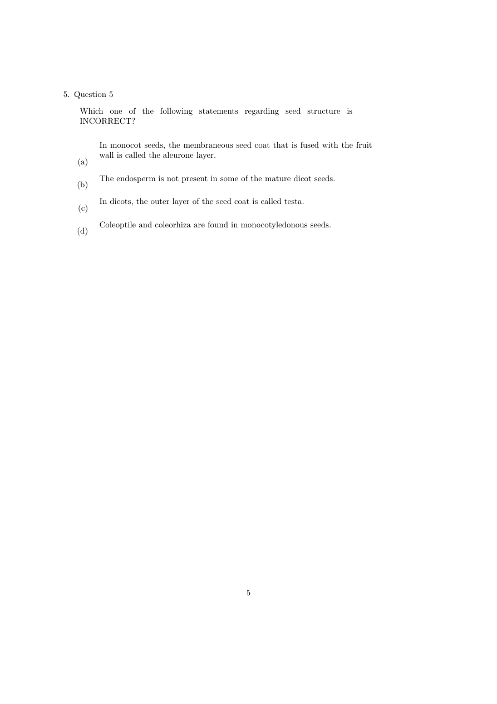

## PDF page 6

[Open original PDF at page 6](../pdf/IAT_2023_English_paper.pdf#page=6)

### Searchable text - PDF text layer

```text
6. Question 6
   Which one of the following anatomical features of wood can be used to
    estimate the age of a tree growing in a temperate climate?

         Spring wood and late wood.
    (a)
         Heart wood and sap wood.
    (b)
         Spring wood and heart wood.
    (c)
       Autumn wood and sap wood.
    (d)


                                            6
```

### Original page image

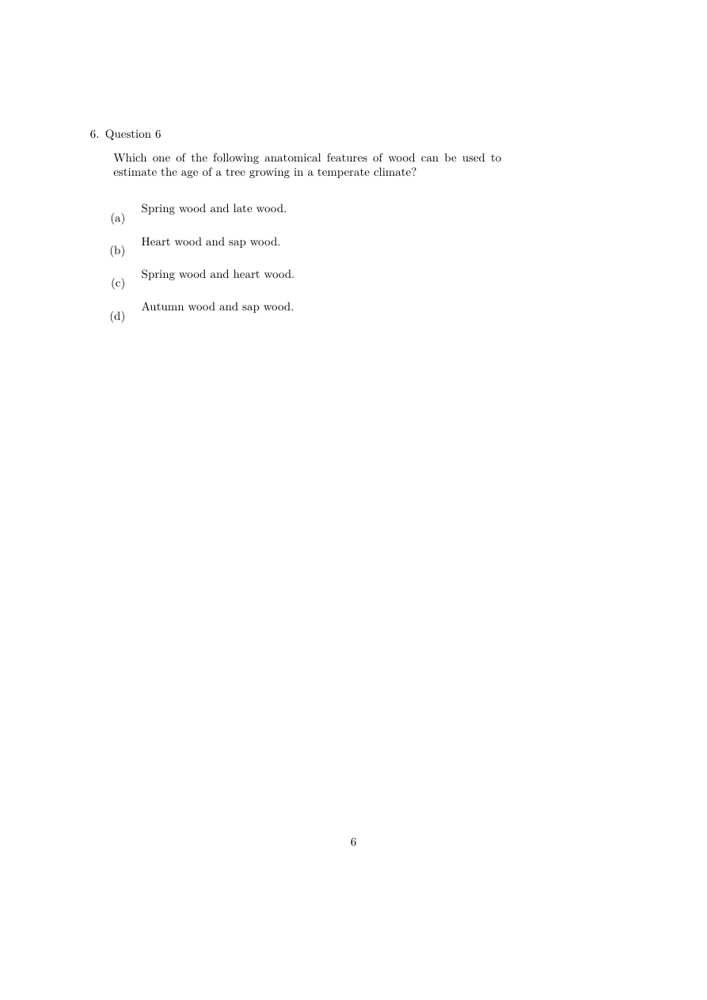

## PDF page 7

[Open original PDF at page 7](../pdf/IAT_2023_English_paper.pdf#page=7)

### Searchable text - PDF text layer

```text
7. Question 7
   Which one of the following statements  is CORRECT about biological
    nitrogen fixation in plants?

        The catalytic redox center of Nitrogenase contains Mo and Fe as cofactors.
    (a)
         Atmospheric nitrogen is fixed by Nitrogenase by converting N2 to NO−3 .    (b)
         Nitrogenase can function optimally only in the presence of molecular oxygen.
    (c)
        The transport of important amides, like asparagine and glutamine, produced
        by transamination, to different parts of the plant body  is mediated by
         phloem.
    (d)


                                            7
```

### Original page image

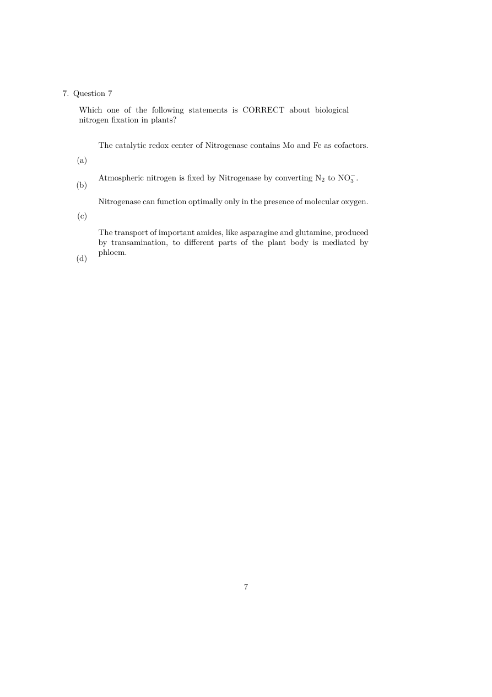

## PDF page 8

[Open original PDF at page 8](../pdf/IAT_2023_English_paper.pdf#page=8)

### Searchable text - PDF text layer

```text
8. Question 8
   Which one of the following is an example of genetic diversity?

          Variation  in the potency and concentration  of reserpine produced by
        Rauwolfia vomitoria.
    (a)
         Higher diversity of amphibians in the Western Ghats than in the Eastern
         Ghats.    (b)
         Greater variation of ecosystems found in India than in Scandinavia.
    (c)
        The greater diversity of plant species found in India compared to Central
          Asia.    (d)


                                            8
```

### Original page image

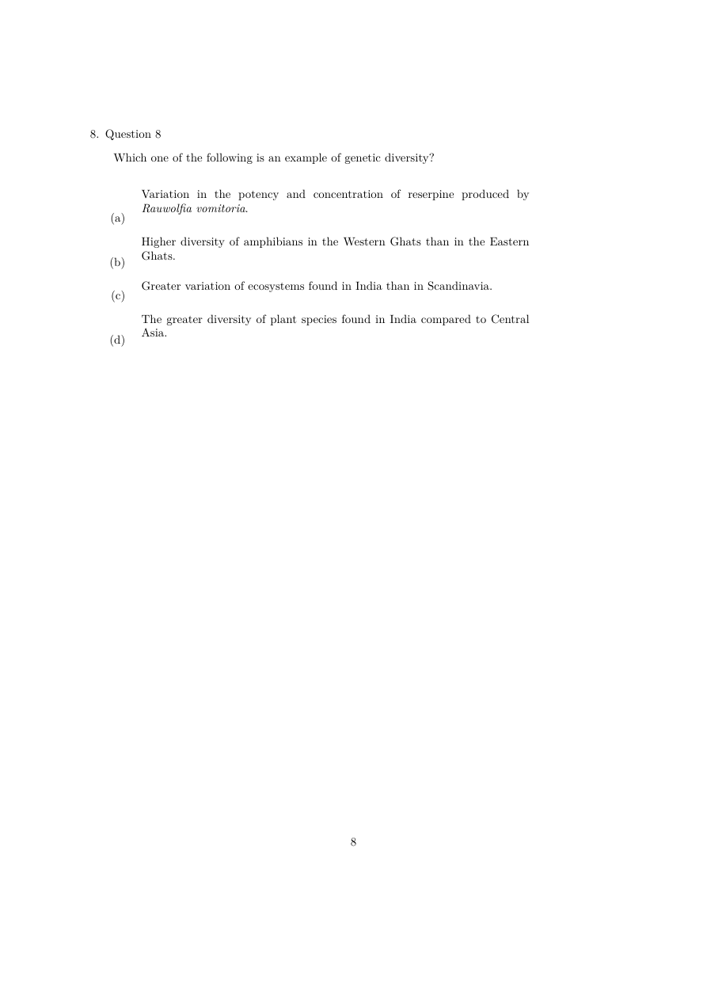

## PDF page 9

[Open original PDF at page 9](../pdf/IAT_2023_English_paper.pdf#page=9)

### Searchable text - PDF text layer

```text
9. Question 9
   When the ribosome encounters a  stop codon  in the mRNA, during
     translation, which one of the followng binds to the stop codon?

         Release factor.    (a)
       Rho factor.    (b)
         Termination factor.    (c)
        Sigma factor.
    (d)


                                            9
```

### Original page image

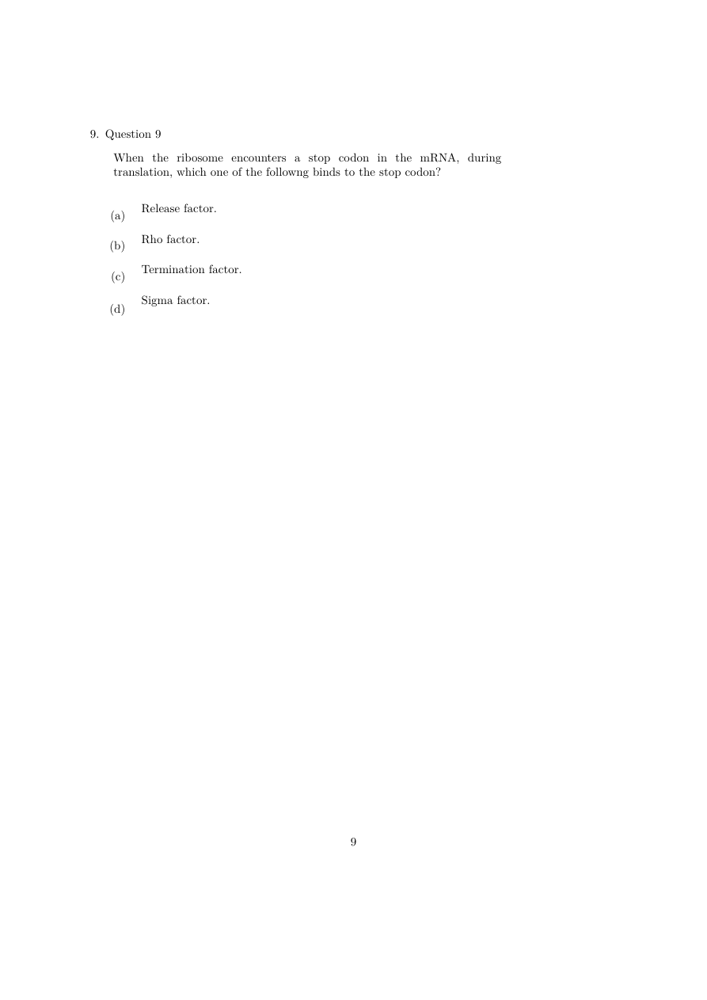

## PDF page 10

[Open original PDF at page 10](../pdf/IAT_2023_English_paper.pdf#page=10)

### Visual description

Biology Q10: a matching table links cell or organ structures, including Sertoli cells and hormone-producing tissues, to physiological roles.

### Searchable text - PDF text layer

```text
10. Question 10
    Match the terms in column I with their corresponding physiological roles
     given in Column II.


    Which one of the following combinations is correct?

       P - (iv); Q - (v); R - (i); S - (ii)
     (a)
       P - (v); Q - (i); R - (iv); S - (iii)
     (b)
       P - (iii); Q - (ii); R - (v); S - (iv)
      (c)
       P - (i); Q - (iv); R - (iii); S - (v)
     (d)


                                             10
```

### Original page image

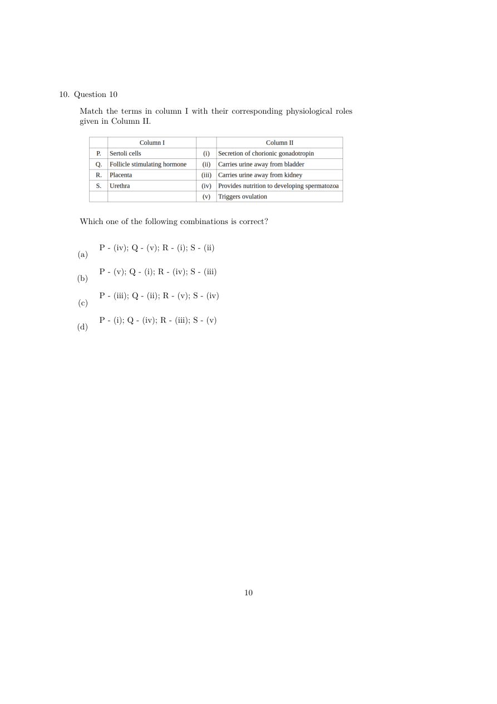

## PDF page 11

[Open original PDF at page 11](../pdf/IAT_2023_English_paper.pdf#page=11)

### Searchable text - PDF text layer

```text
11. Question 11
     For which one of the following diseases does the causative agent require the
      splicing of their hnRNA to generate mature mRNA?

          Malaria     (a)
           Pertussis     (b)
         Typhoid
      (c)
           Tuberculosis     (d)


                                             11
```

### Original page image

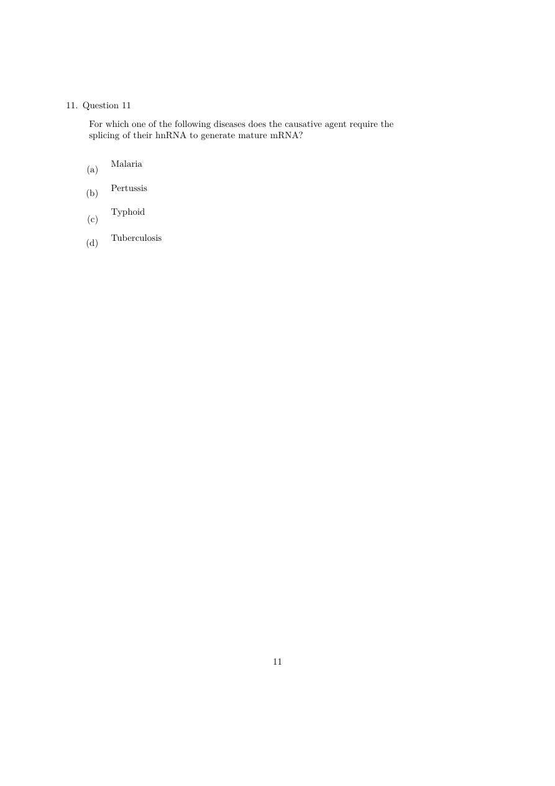

## PDF page 12

[Open original PDF at page 12](../pdf/IAT_2023_English_paper.pdf#page=12)

### Visual description

Biology Q12: an enzyme has a specifically shaped active site, a substrate drawn above it, and five potential inhibitors P-T with distinct polygonal shapes. Competitive-inhibitor comparisons depend on shape complementarity.

### Searchable text - PDF text layer

```text
12. Question 12
    The diagram represents an enzyme, its substrate and potential inhibitors
      (P, Q, R, S, T).


    Which one of the following combinations is the best pair of competitive
      inhibitors for the enzyme?

           P, S
     (a)
         Q, R
     (b)
            S, T
      (c)
          R, T
     (d)


                                             12
```

### Original page image

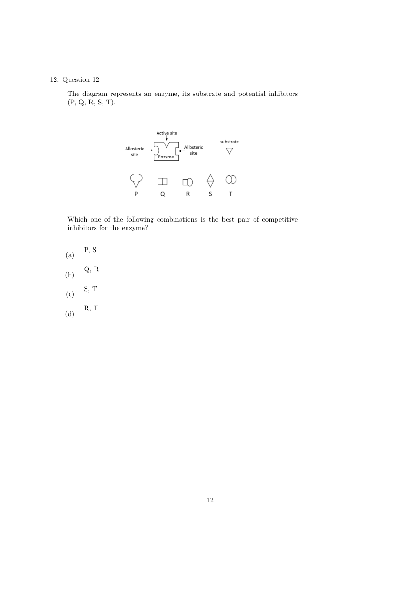

## PDF page 13

[Open original PDF at page 13](../pdf/IAT_2023_English_paper.pdf#page=13)

### Searchable text - PDF text layer

```text
13. Question 13
     In an island with 10,000  individuals,  four have  sickle  cell anemia, a
      recessive autosomal disease. Assuming that the locus is in Hardy-Weinberg
      equilibrium, how many individuals in that island are expected to be
     heterozygous for the disease allele?

          392     (a)
          4     (b)
          9996      (c)
          9608     (d)


                                             13
```

### Original page image

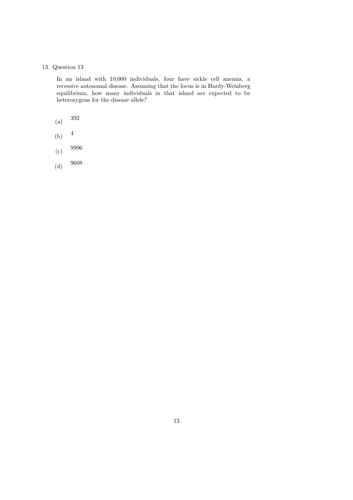

## PDF page 14

[Open original PDF at page 14](../pdf/IAT_2023_English_paper.pdf#page=14)

### Visual description

Biology Q14: a 3500 bp circular plasmid map shows restriction sites and an inserted DNA segment. Below it is gel alternative (a), with two lanes for two different digests and band-size labels; alternatives continue on pages 15-16.

### Searchable text - PDF text layer

```text
14. Question 14
   A 1000 base-pair DNA fragment was cloned between Hind III and EcoR
       I sites of the plasmid vector (pIAT) of size 3500 base-pair.  The cloned
     fragment had a Not I site as shown in the figure. In order to confirm the
     presence of the insert, the recombinant plasmid was digested completely
     with (a) Not I and EcoR I, and (b)Not I and Hind III.


     In lane 1 the products of the digestion by Not I and EcoR I was loaded. In
      lane 2 the products of the digestion by Not I and Hind III was loaded.
    Which  one  of  the  following  correctly  represents  the  agarose  gel
      electrophoresis profile of the digested recombinant plasmid for (a) and (b),
      respectively?


     (a)


                                             14
```

### Original page image

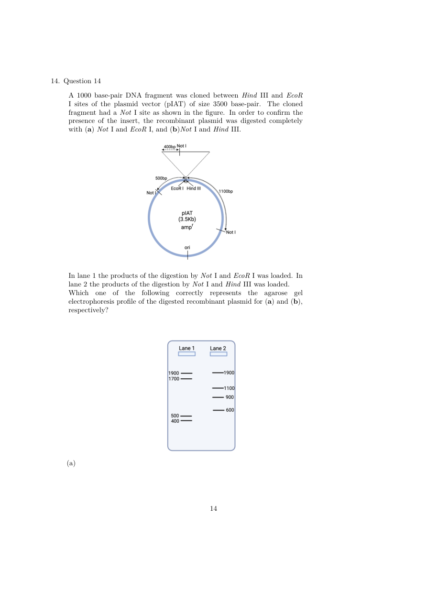

## PDF page 15

[Open original PDF at page 15](../pdf/IAT_2023_English_paper.pdf#page=15)

### Visual description

Continuation of Biology Q14: gel alternatives (b) and (c), each with Lane 1 and Lane 2 and different band numbers and sizes. Interpret them with the restriction map on page 14.

### Searchable text - PDF text layer

```text
(b)


(c)


                                        15
```

### Original page image

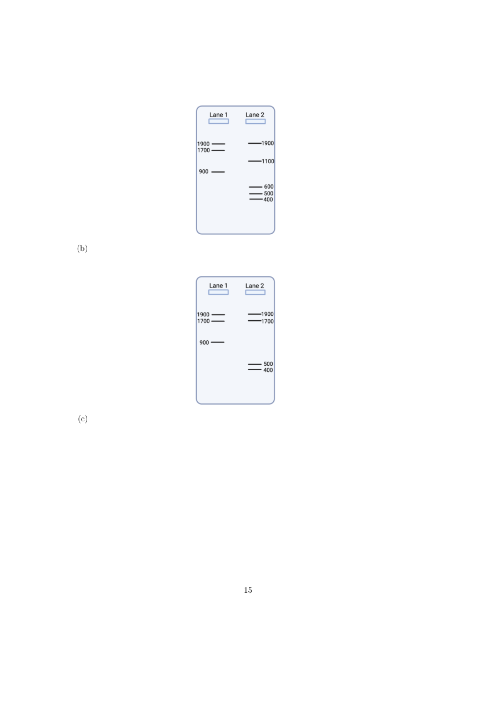

## PDF page 16

[Open original PDF at page 16](../pdf/IAT_2023_English_paper.pdf#page=16)

### Visual description

Continuation of Biology Q14: gel alternative (d), with a two-lane band pattern. Its lane and base-pair labels belong to the preceding restriction-digest question.

### Searchable text - PDF text layer

```text
(d)


                                        16
```

### Original page image


## PDF page 17

[Open original PDF at page 17](../pdf/IAT_2023_English_paper.pdf#page=17)

### Visual description

Biology Q15: a three-generation pedigree labels individuals I-1/I-2, II-1/II-2/II-3 and III-1/III-2. Shading denotes affected members; II-3 has a question-mark phenotype in the diagram.

### Searchable text - PDF text layer

```text
15. Question 15
    The following pedigree chart shows the inheritance of a genetic disorder.
      I-2 and III-2 are the only affected individuals.


    Which one of the following  is the correct pattern of inheritance of the
      disorder, and the genotype of the II-3 individual?

         Autosomal recessive, heterozygous
     (a)
         Autosomal dominant, homozygous for the normal allele
     (b)
          X-linked recessive, heterozygous
      (c)
         Autosomal recessive, homozygous for the normal allele
     (d)


                                             17
```

### Original page image

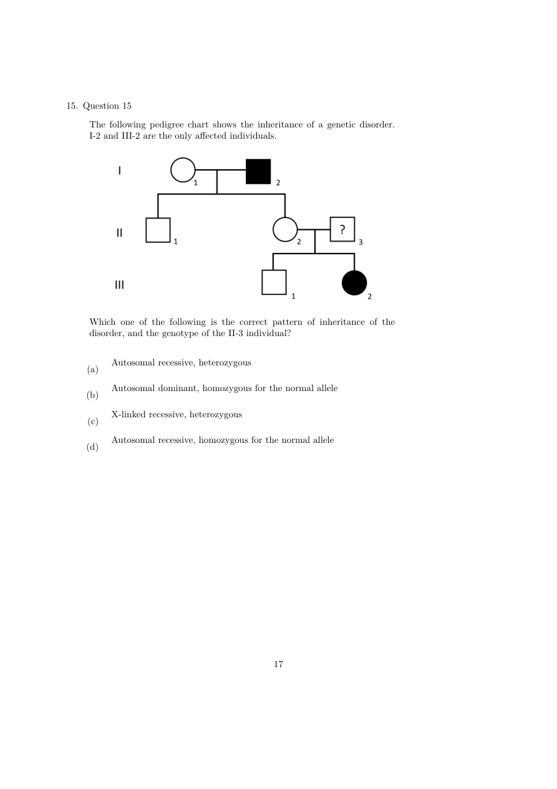

## PDF page 18

[Open original PDF at page 18](../pdf/IAT_2023_English_paper.pdf#page=18)

### Searchable text - PDF text layer

```text
Chemistry
1. Question 1
   How many radial nodes does Ca+ have in its 4s orbital?

         3    (a)
         0    (b)
         1    (c)
         2    (d)


                                            1
```

### Original page image

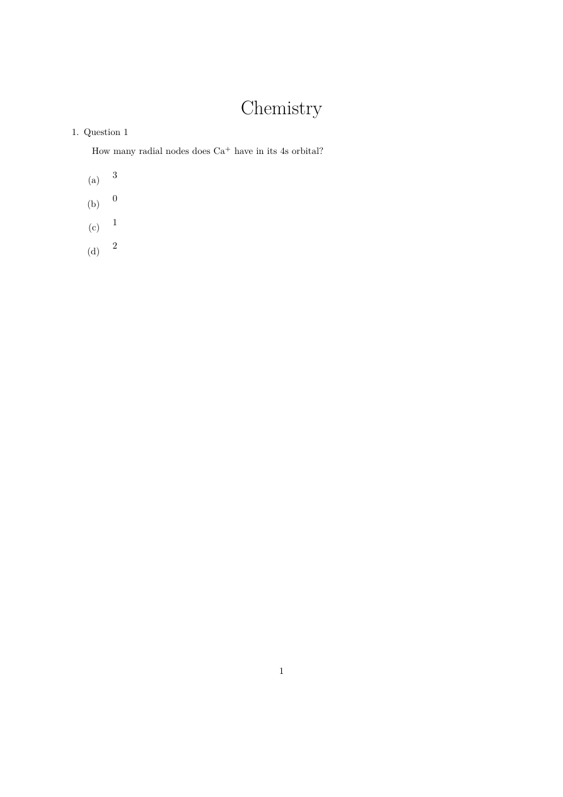

## PDF page 19

[Open original PDF at page 19](../pdf/IAT_2023_English_paper.pdf#page=19)

### Searchable text - PDF text layer

```text
2. Question 2
    Amongst O2, N2, F2, and B2, which molecules will be attracted to an
     external magnetic field?

       O2 and B2    (a)
         F2, N2, and B2    (b)
         O2, B2, and N2    (c)
       O2 and F2    (d)


                                            2
```

### Original page image

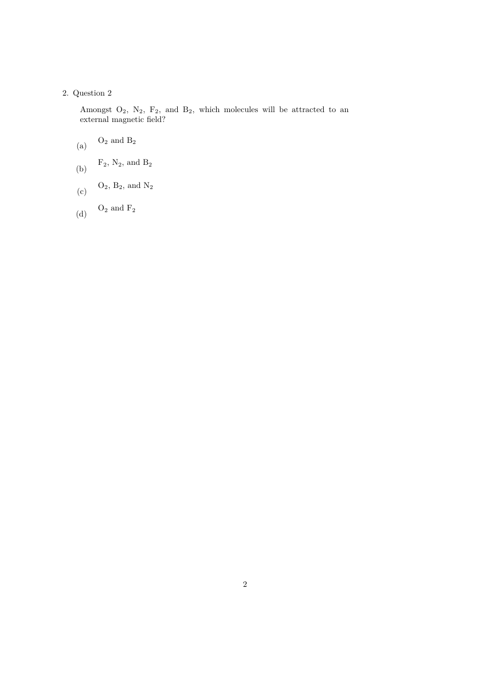

## PDF page 20

[Open original PDF at page 20](../pdf/IAT_2023_English_paper.pdf#page=20)

### Searchable text - PDF text layer

```text
3. Question 3
   What is the smallest P−P−P bond angle in the highly reactive allotrope of    phosphorus?

         60◦    (a)
         109◦    (b)
         45◦    (c)
         120◦    (d)


                                            3
```

### Original page image


## PDF page 21

[Open original PDF at page 21](../pdf/IAT_2023_English_paper.pdf#page=21)

### Searchable text - PDF text layer

```text
4. Question 4
    Which of the following is an ore of iron?

          Siderite    (a)
         Bauxite    (b)
         Malachite    (c)
         Quartz
    (d)


                                            4
```

### Original page image

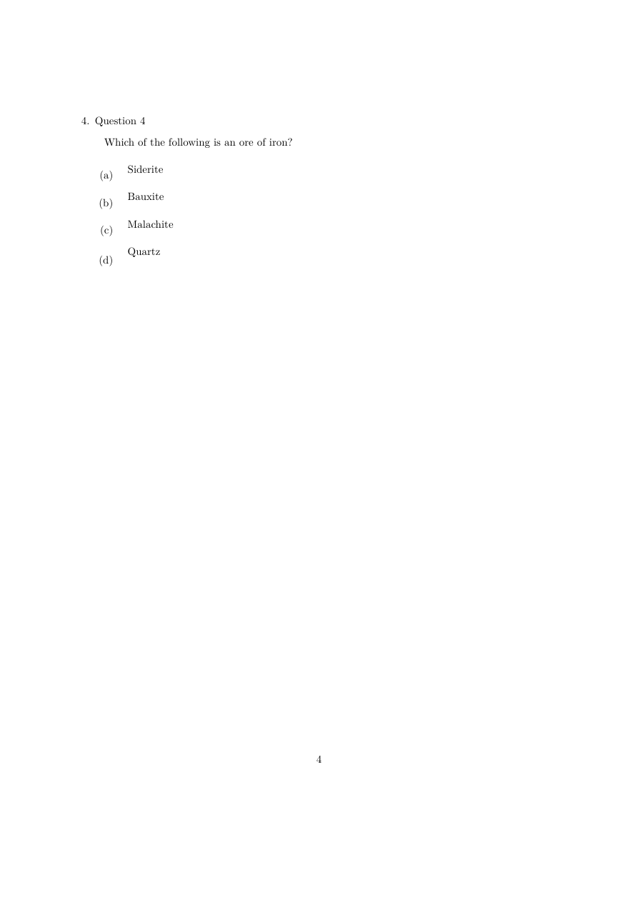

## PDF page 22

[Open original PDF at page 22](../pdf/IAT_2023_English_paper.pdf#page=22)

### Searchable text - PDF text layer

```text
5. Question 5
    Which parameters are plotted in the Ellingham diagram?

       ∆rG◦vs T    (a)
       ∆rH◦vs T    (b)
       ∆rS◦vs T    (c)
       ∆rS◦vs P    (d)


                                            5
```

### Original page image

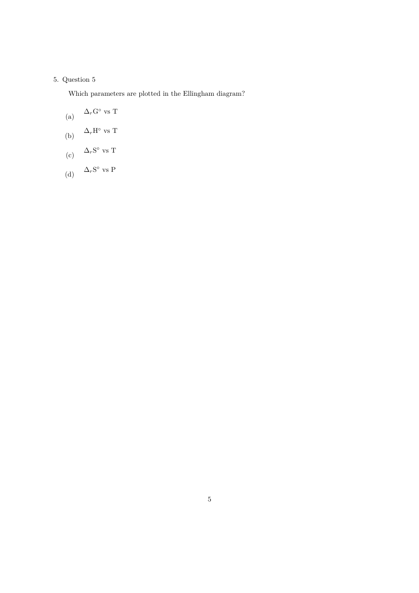

## PDF page 23

[Open original PDF at page 23](../pdf/IAT_2023_English_paper.pdf#page=23)

### Visual description

Chemistry Q6: four organic bromides I-IV compare a bromine directly on an aromatic ring with bromine on different side-chain carbons. The task concerns Finkelstein substitution, so bond placement is crucial.

### Searchable text - PDF text layer

```text
6. Question 6

    Which  of the following compounds  will NOT undergo the Finkelstein
     reaction with NaI via SN2 pathway?


            II and III    (a)
            I and III    (b)
            II and IV    (c)
            I and IV    (d)


                                            6
```

### Original page image

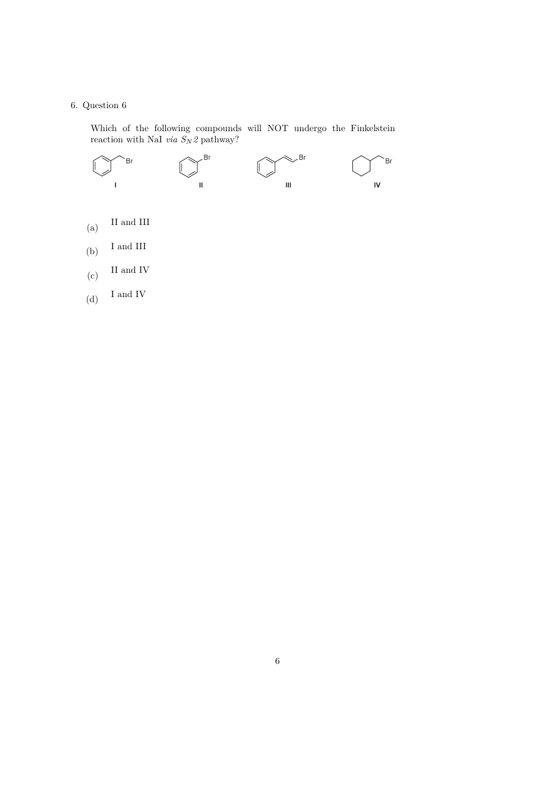

## PDF page 24

[Open original PDF at page 24](../pdf/IAT_2023_English_paper.pdf#page=24)

### Visual description

Chemistry Q7: four proposed synthetic routes to n-propylbenzene start from benzene and show different alkylation/acylation reagents and, in one route, a reduction step.

### Searchable text - PDF text layer

```text
7. Question 7
    Which one amongst the following is the most efficient way of synthesizing
     n-propyl benzene?


            I    (a)
            II    (b)
           III    (c)
        IV    (d)


                                            7
```

### Original page image

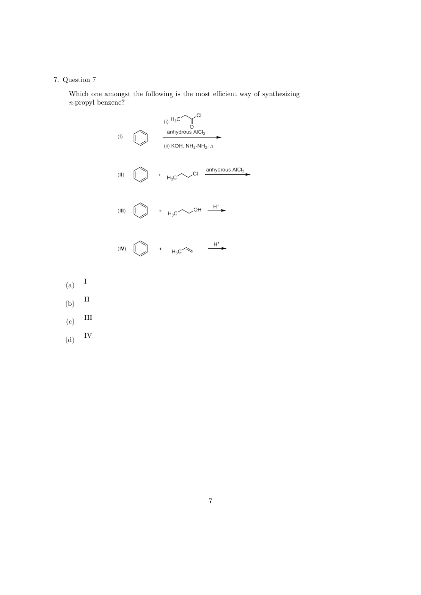

## PDF page 25

[Open original PDF at page 25](../pdf/IAT_2023_English_paper.pdf#page=25)

### Visual description

Chemistry Q8: four labelled molecular structures show stereochemical environments using wedges, dashes and substituent labels. The question asks which structures are chiral; do not flatten the wedge/dash distinctions.

### Searchable text - PDF text layer

```text
8. Question 8
    Which amongst the following are chiral compounds?


            II and IV    (a)
            I and IV    (b)
            II and III    (c)
            I and II    (d)


                                            8
```

### Original page image

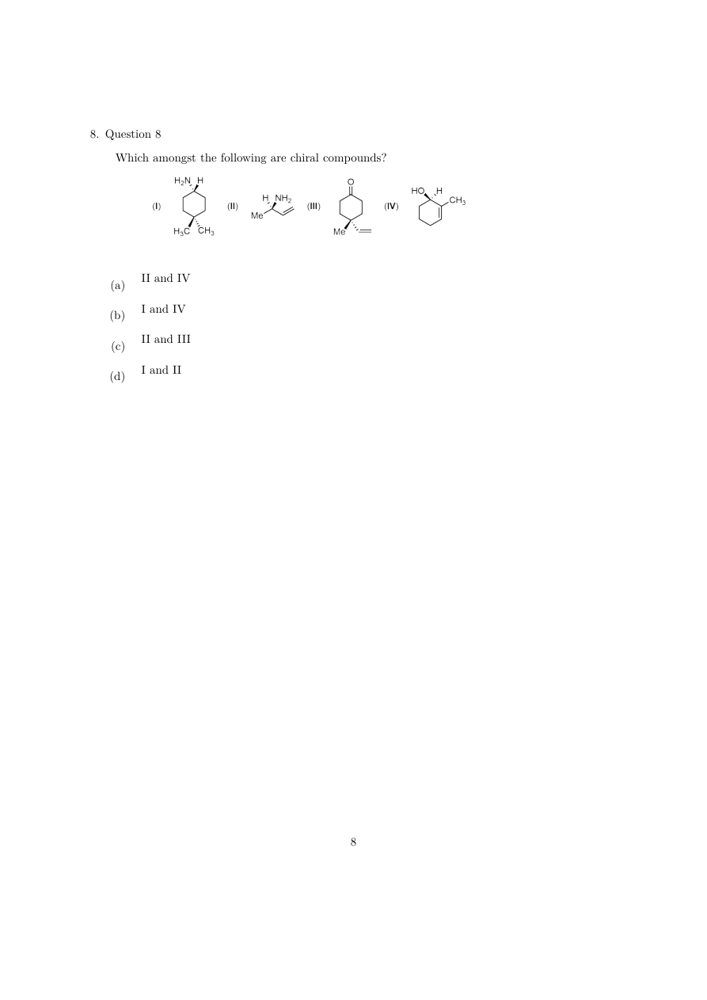

## PDF page 26

[Open original PDF at page 26](../pdf/IAT_2023_English_paper.pdf#page=26)

### Visual description

Chemistry Q9: four nitrogenous-base structures I-IV are drawn with their carbonyl, amino and methyl substituents. The task distinguishes a base absent from RNA.

### Searchable text - PDF text layer

```text
9. Question 9
    Which one amongst the following bases is NOT present in RNA?


           III    (a)
            I    (b)
            II    (c)
        IV    (d)


                                            9
```

### Original page image

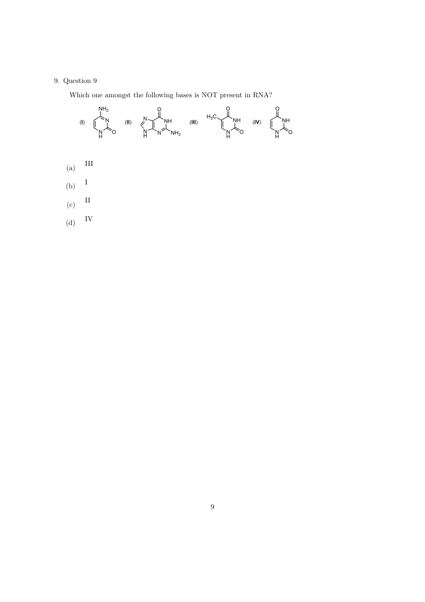

## PDF page 27

[Open original PDF at page 27](../pdf/IAT_2023_English_paper.pdf#page=27)

### Visual description

Chemistry Q10: four cyclic structures I-IV with different conjugation and charge patterns are compared for aromaticity. Read the exact ring sizes and double-bond locations from the figure.

### Searchable text - PDF text layer

```text
10. Question 10
     Which amongst the following are aromatic?


             I and II     (a)
             III and IV     (b)
             II and IV      (c)
             I and III     (d)


                                             10
```

### Original page image

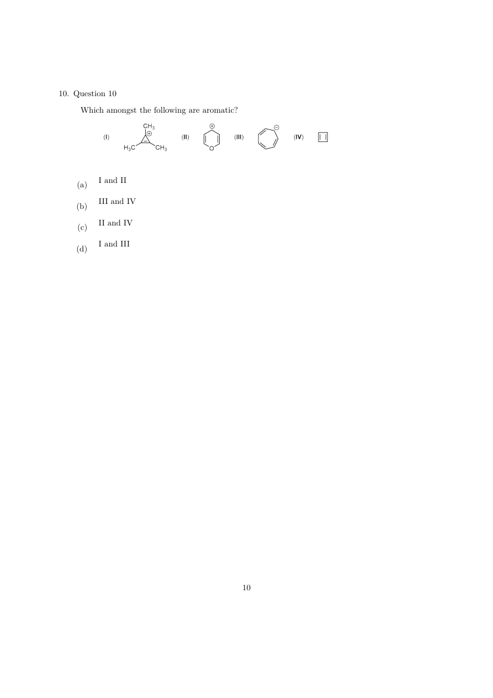

## PDF page 28

[Open original PDF at page 28](../pdf/IAT_2023_English_paper.pdf#page=28)

### Searchable text - PDF text layer

```text
11. Question 11
    Why is it harder to compress liquids and solids relative to gases?

          Molecules are closer to each other in solids and liquids.
     (a)
        Due to the presence of electron-nuclear attraction in solids and liquids.
     (b)
        Due to the absence of electron-nuclear attraction in solids and liquids.
      (c)
           Solids and liquids have definite volume.
     (d)


                                             11
```

### Original page image

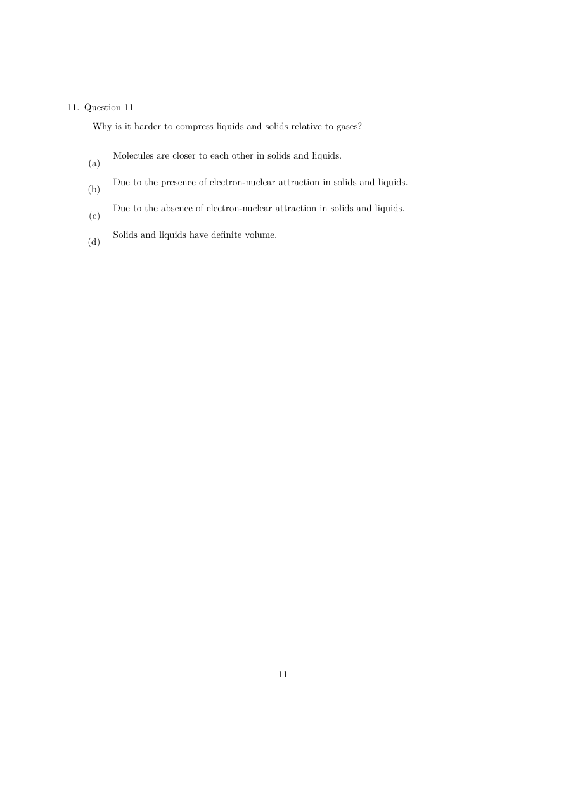

## PDF page 29

[Open original PDF at page 29](../pdf/IAT_2023_English_paper.pdf#page=29)

### Searchable text - PDF text layer

```text
12. Question 12
      Related to the Freundlich adsorption isotherm, which one of the following
      statements is NOT correct?

             It holds good over a wide range of pressures.
     (a)
                      1        The value of    is between 0 and 1.
     (b)            n
        The Freundlich adsorption isotherm equation is an empirical equation.
      (c)
             It is used for the adsorption of both gases and solutions.
     (d)


                                             12
```

### Original page image

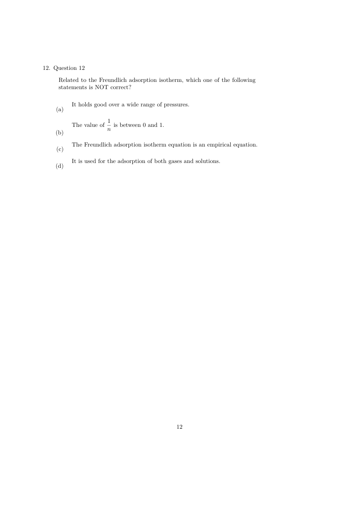

## PDF page 30

[Open original PDF at page 30](../pdf/IAT_2023_English_paper.pdf#page=30)

### Searchable text - PDF text layer

```text
13. Question 13

     Consider the following reaction:
     CH4(g) −→C(g) + 4H(g); ∆aH0 = 1665 kJ mol−1     Which of the statements is FALSE?

       ∆aH0 is the mean bond enthalpy of a C-H bond.
     (a)
           All four C-H bonds in CH4 are identical in bond length and energy.     (b)
        The energy required to break individual C-H bonds in successive steps is
           different.      (c)
        Mean C-H bond enthalpies differ slightly from compound to compound.
     (d)


                                             13
```

### Original page image

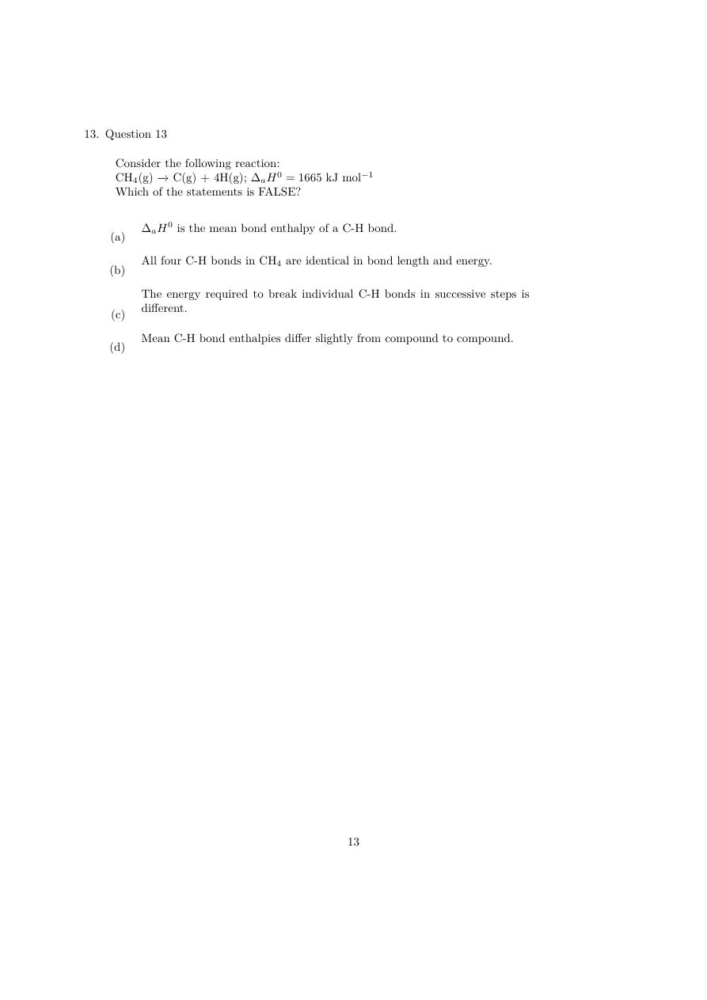

## PDF page 31

[Open original PDF at page 31](../pdf/IAT_2023_English_paper.pdf#page=31)

### Searchable text - PDF text layer

```text
14. Question 14
      In two solutions X (hexane and benzene) and Y (water and HCl), what
      types of deviations from Raoult’s law are observed?

        No deviation (ideal behaviour) and negative deviation, respectively.
     (a)
          Negative deviation and positive deviation, respectively.
     (b)
           Positive deviation and negative deviation, respectively.
      (c)
           Positive deviation and no deviation (ideal behaviour), respectively.
     (d)


                                             14
```

### Original page image

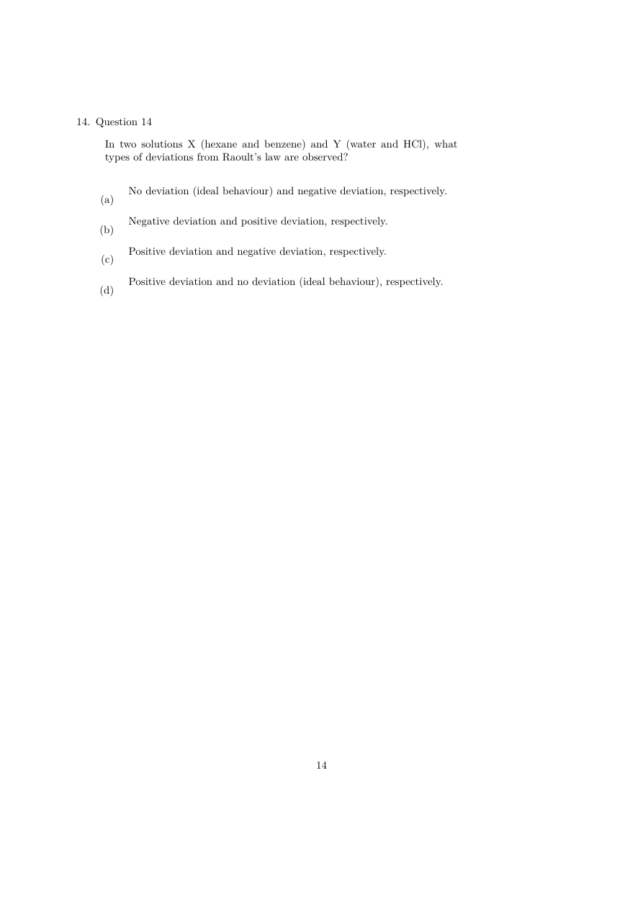

## PDF page 32

[Open original PDF at page 32](../pdf/IAT_2023_English_paper.pdf#page=32)

### Searchable text - PDF text layer

```text
15. Question 15
      In aqueous solution, the hydronium ion gets further hydrated to give which
       of the following species?

        H9O4+     (a)
        H7O4+     (b)
        H3O2+      (c)
        H5O3+     (d)


                                             15
```

### Original page image

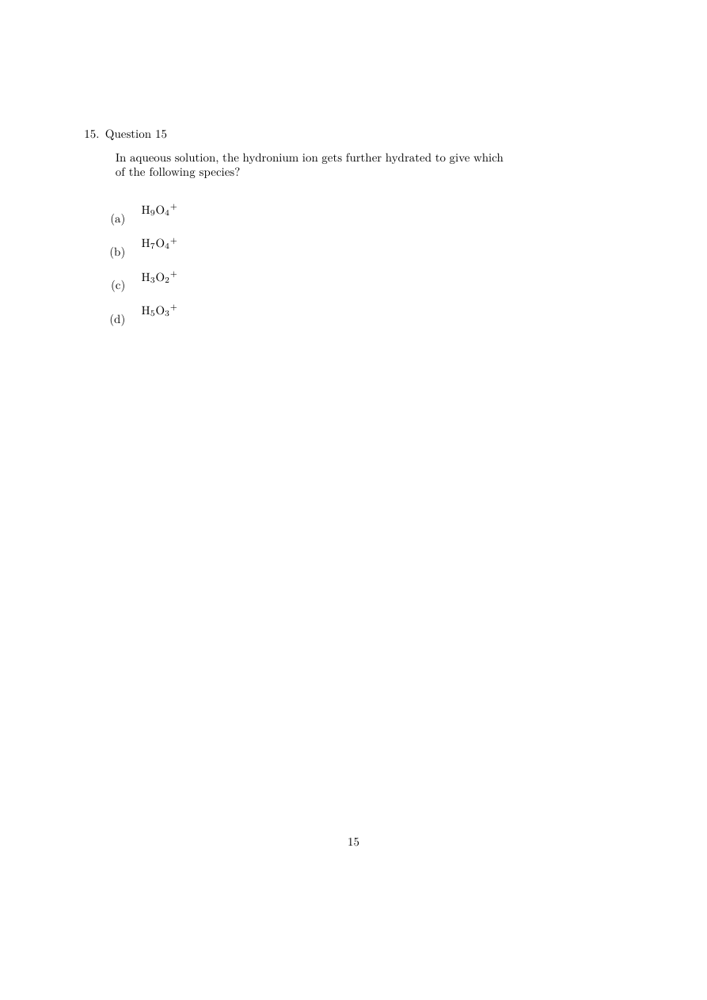

## PDF page 33

[Open original PDF at page 33](../pdf/IAT_2023_English_paper.pdf#page=33)

### Searchable text - PDF text layer

```text
Mathematics
1. Question 1
    Let f   : R →(0, ∞) be a continuous decreasing function.  Suppose1     f(0), f(1), . . . , f(10) are in a geometric progression                                                   with                                             common ratio 5.                                                     R                                                                10
    In which of the following intervals does the value of  0  f(x)dx lie?

           (0, 2f(0))
    (a)
          (4f(0), 6f(0))
    (b)
          (8f(0), 10f(0))
    (c)
          (12f(0), 14f(0))
    (d)


                                            1
```

### Original page image

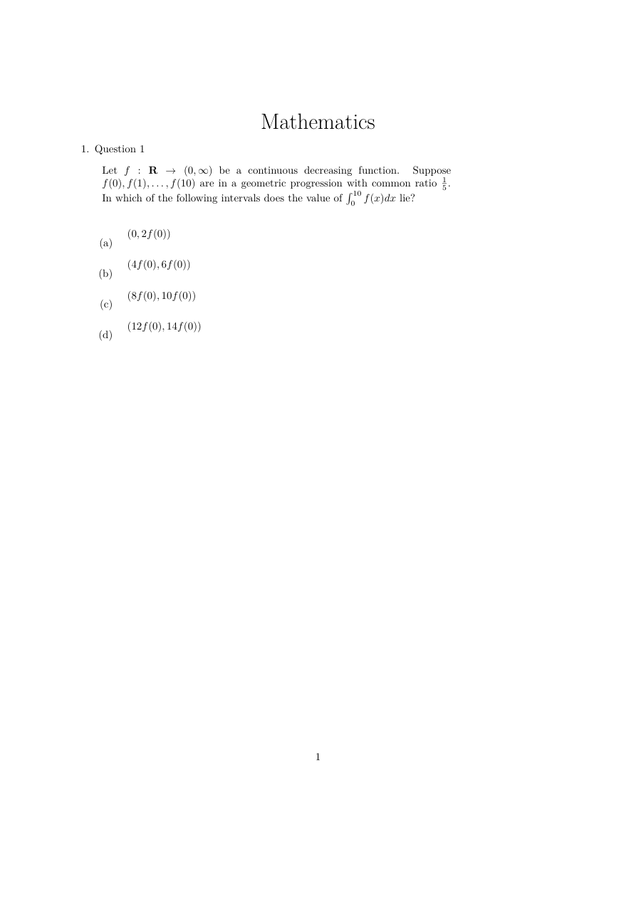

## PDF page 34

[Open original PDF at page 34](../pdf/IAT_2023_English_paper.pdf#page=34)

### Searchable text - PDF text layer

```text
2. Question 2
    Let M be a 3  3 matrix with real entries such that           ×                              
      x1       x1     0   x1             
        x2 : M x2 = 0      x2 : x1 + x2 = 0 = x2 + x3               =                    .            x3       x3     0         x3
   What is the value of the determinant of M?

         0    (a)
         1    (b)
         2    (c)
         3    (d)


                                            2
```

### Original page image

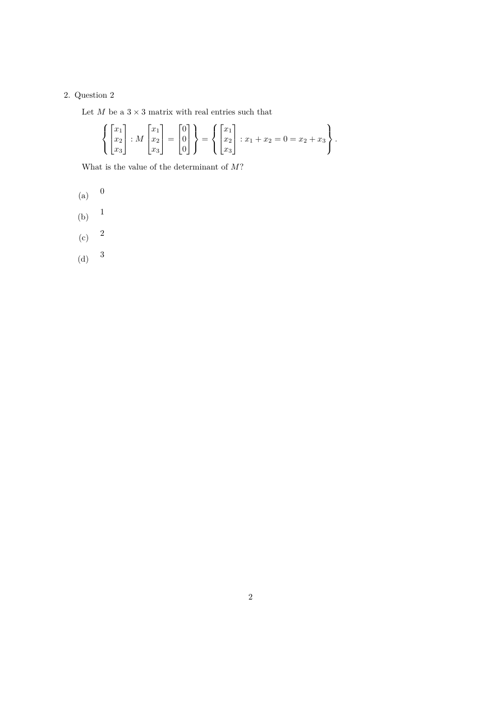

## PDF page 35

[Open original PDF at page 35](../pdf/IAT_2023_English_paper.pdf#page=35)

### Searchable text - PDF text layer

```text
3. Question 3
   What is the locus of the center of circles passing through the origin (0, 0)
    with fixed radius?

          Circle    (a)
         Hyperbola
    (b)
         Parabola    (c)
         Line    (d)


                                            3
```

### Original page image

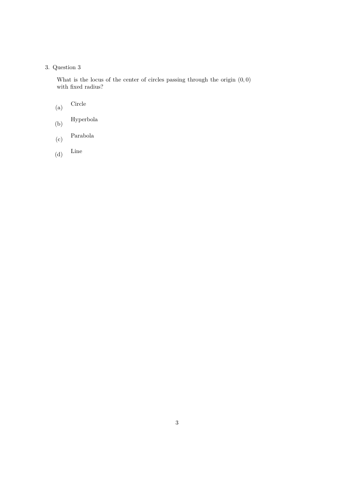

## PDF page 36

[Open original PDF at page 36](../pdf/IAT_2023_English_paper.pdf#page=36)

### Searchable text - PDF text layer

```text
4. Question 4
    Let α be a real number. What is the total number of distinct point(s) of
     intersection between the parabola y = x2 + 4x sin α + 6 and the pair of lines
    y2 = 1?

         Zero    (a)
       One    (b)
       Two    (c)
         Four    (d)


                                            4
```

### Original page image


## PDF page 37

[Open original PDF at page 37](../pdf/IAT_2023_English_paper.pdf#page=37)

### Searchable text - PDF text layer

```text
5. Question 5
    Let L be a straight line passing through the origin, and it makes angles α,
   β and γ with the positive X, Y and Z-axes, respectively. What is the value
     of cos 2α + cos 2β + cos 2γ ?

    (a)  −1
         3    (b)
         1    (c)
    (d)  −3


                                            5
```

### Original page image

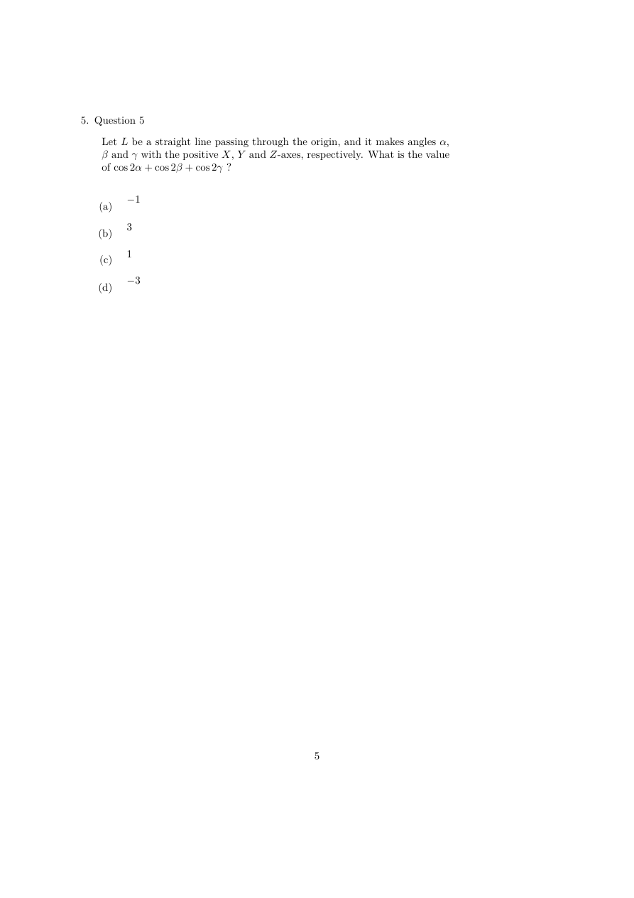

## PDF page 38

[Open original PDF at page 38](../pdf/IAT_2023_English_paper.pdf#page=38)

### Searchable text - PDF text layer

```text
6. Question 6
   What is the total number of distinct divisors of 29   319?                               ×

         200    (a)
         30    (b)
         435    (c)
         100    (d)


                                            6
```

### Original page image

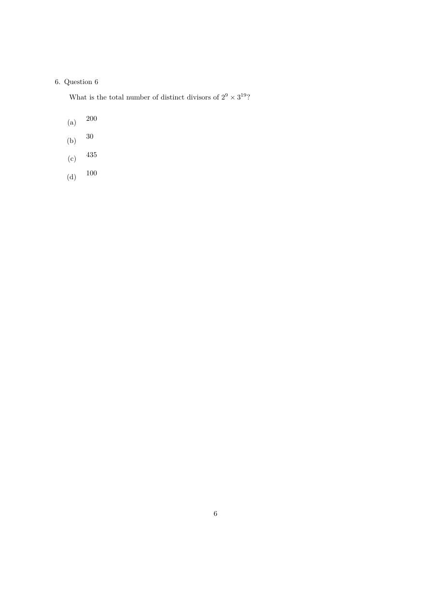

## PDF page 39

[Open original PDF at page 39](../pdf/IAT_2023_English_paper.pdf#page=39)

### Searchable text - PDF text layer

```text
7. Question 7
    Suppose the mean and the standard deviation of the data     x2,      ,                                                              {x1,      · · ·  x9}
    are µ and σ(̸= 0), respectively. After including one more data value x10,    the mean of the data     x2,      , x9,     remains µ. What is the standard                         {x1,      · · ·     x10}    deviation of the data     x2,      , x9,                          {x1,      · · ·     x10}?

          3
     √ 10 σ
    (a)
     √ 10
            σ
          3    (b)
         10
          σ
         9    (c)
         9
          σ
         10    (d)


                                            7
```

### Original page image

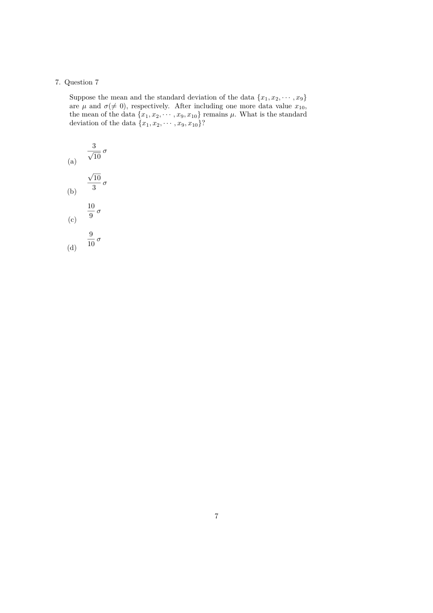

## PDF page 40

[Open original PDF at page 40](../pdf/IAT_2023_English_paper.pdf#page=40)

### Searchable text - PDF text layer

```text
8. Question 8
                                                             1    Consider three biased coins. Let the probability of getting head be  and the                                                             3
                             2     probability of getting tail be   in each of the coins. Consider the experiment                             3
     of tossing the three coins one by one, and the following events:

              E :  “at least two heads show up”
                F :      “first coin shows tail”.

   What is the conditional probability of E given that F has already occured?


         1
         9    (a)
         2
         9    (b)
         1
         4    (c)
         4
         9    (d)


                                            8
```

### Original page image

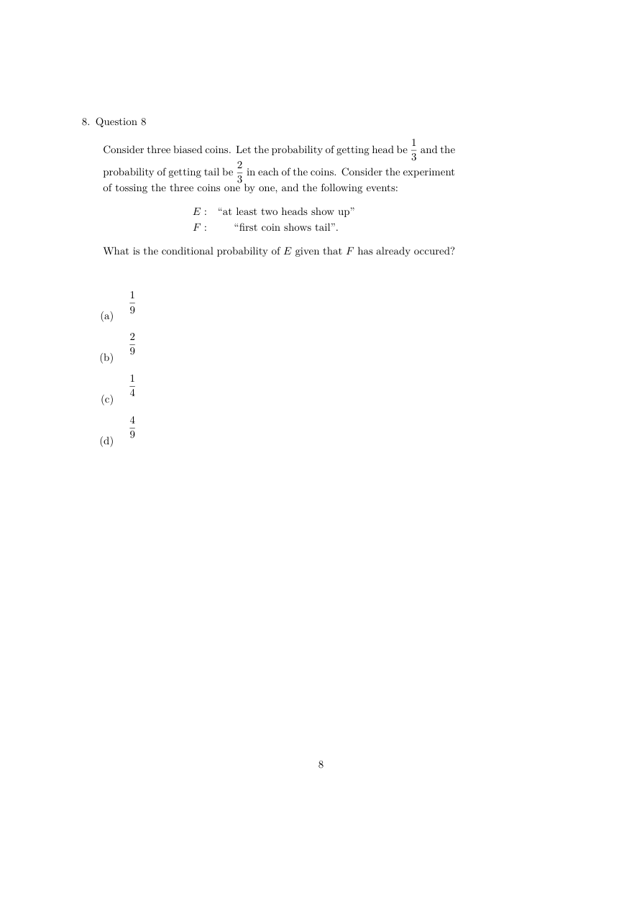

## PDF page 41

[Open original PDF at page 41](../pdf/IAT_2023_English_paper.pdf#page=41)

### Searchable text - PDF text layer

```text
9. Question 9
   Which of the following differential equations has y = ex as one of its
     particular solutions?

          d2y     dy         y       + y2 = e2x          dx2 −ex dx    (a)
          d2y     dy         y   + ex  + y2 = e2x          dx2     dx    (b)
          d2y     dy         y       + y2 = ex          dx2 −ex dx    (c)
          d2y     dy         y   + ex  + y2 = ex          dx2     dx    (d)


                                            9
```

### Original page image

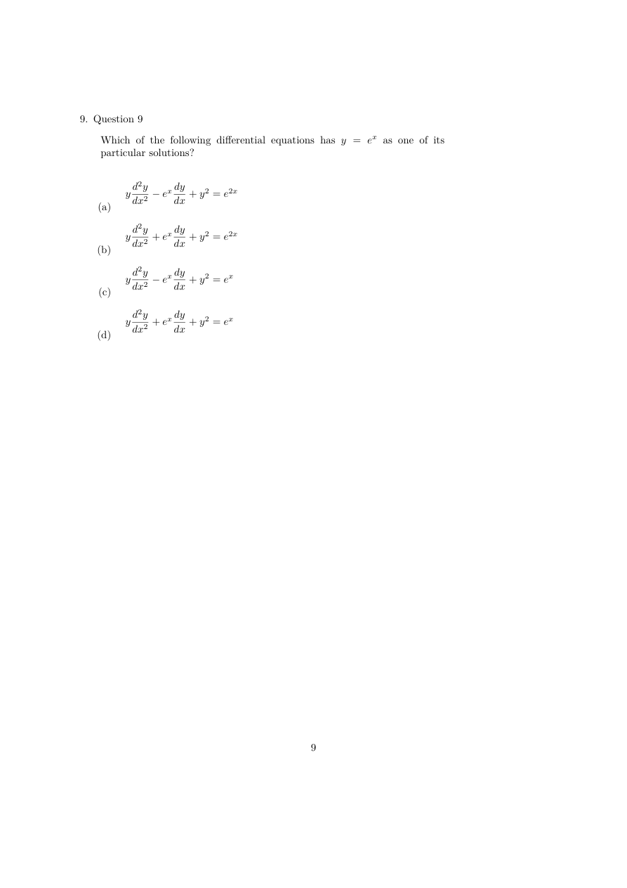

## PDF page 42

[Open original PDF at page 42](../pdf/IAT_2023_English_paper.pdf#page=42)

### Searchable text - PDF text layer

```text
10. Question 10
    What is the area of the region
                 n                    o
                             (x, y) : 0           0         ?                    ≤y ≤xex2, ≤x ≤1


          1
          2(e −1)     (a)
          1
         2e     (b)
      (c)   e −1
     (d)   e −2


                                             10
```

### Original page image

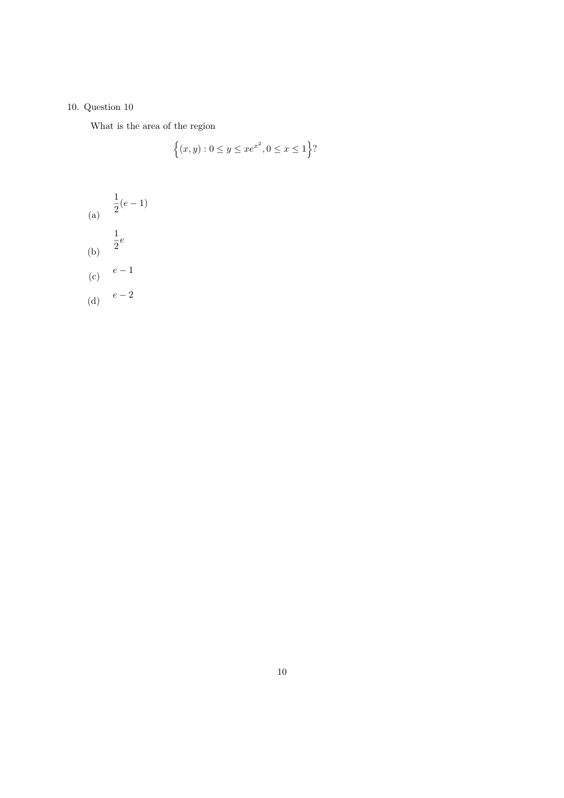

## PDF page 43

[Open original PDF at page 43](../pdf/IAT_2023_English_paper.pdf#page=43)

### Searchable text - PDF text layer

```text
11. Question 11
     Consider the objective function

                        Z = x                          −y
      subject to the constraints:
                            x + 2y ≤10
                            x + y ≥2
                            x     y                            ≥0,  ≥0.
    What is the minimum value of Z subject to the above constraints?

     (a)  −5
     (b)  −2
          2      (c)
     (d)  −10


                                             11
```

### Original page image

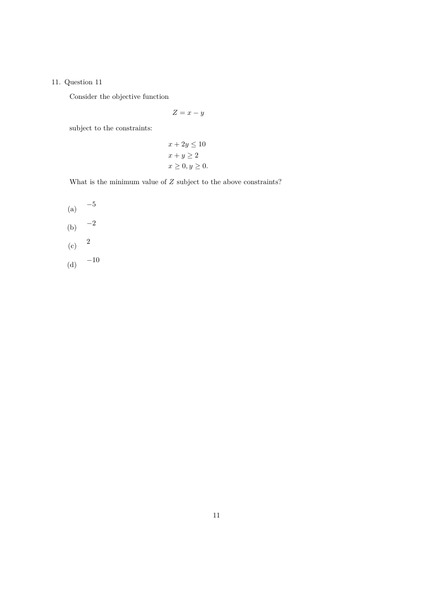

## PDF page 44

[Open original PDF at page 44](../pdf/IAT_2023_English_paper.pdf#page=44)

### Searchable text - PDF text layer

```text
12. Question 12
     Let p(x) = x2 + bx + c be a quadratic polynomial with real coefficients b
     and c. Suppose p(1) = 5 and p(−1) = 3. What is the product of the roots      of p(x) = 0?

          3     (a)
     (b)  −1
          2      (c)
          1     (d)


                                             12
```

### Original page image

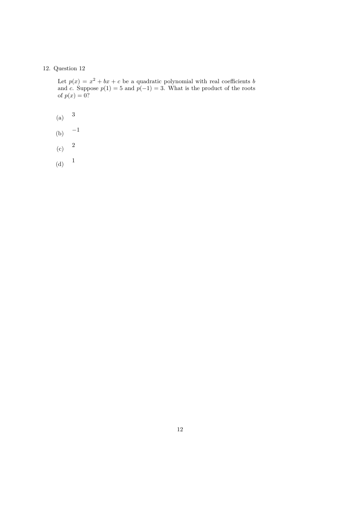

## PDF page 45

[Open original PDF at page 45](../pdf/IAT_2023_English_paper.pdf#page=45)

### Searchable text - PDF text layer

```text
13. Question 13
     Let f : (−1, 2) →R be a differentiable function such that
                                 2                        f ′(x) =        and  f(0) = 0.
                                x2 −5
    Then in which of the following intervals does f(1) lie?

     (a)  (−∞, 0)
            (0, 2)
     (b)
            (2, 4)
      (c)
            (4, ∞)     (d)


                                             13
```

### Original page image

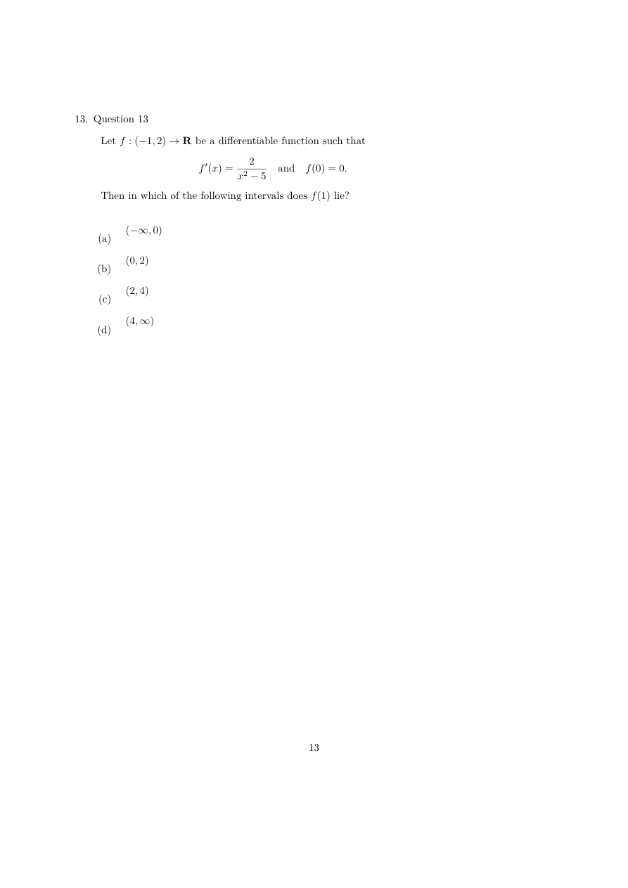

## PDF page 46

[Open original PDF at page 46](../pdf/IAT_2023_English_paper.pdf#page=46)

### Searchable text - PDF text layer

```text
14. Question 14
                            h    i
     Let f(x) = sin(3x), x    0, π   . Which of the following statements is true?                  ∈    2


                        π π
          f is decreasing on      ,      .                            4  2     (a)

                        π π
          f is increasing on      ,      .                           4  2     (b)

                        π π                  π π
          f is increasing on      ,    and decreasing on      ,      .                           4  3                    3  2      (c)

                        π π                 π π
          f is decreasing on      ,    and increasing on      ,      .                            4  3                    3  2     (d)


                                             14
```

### Original page image

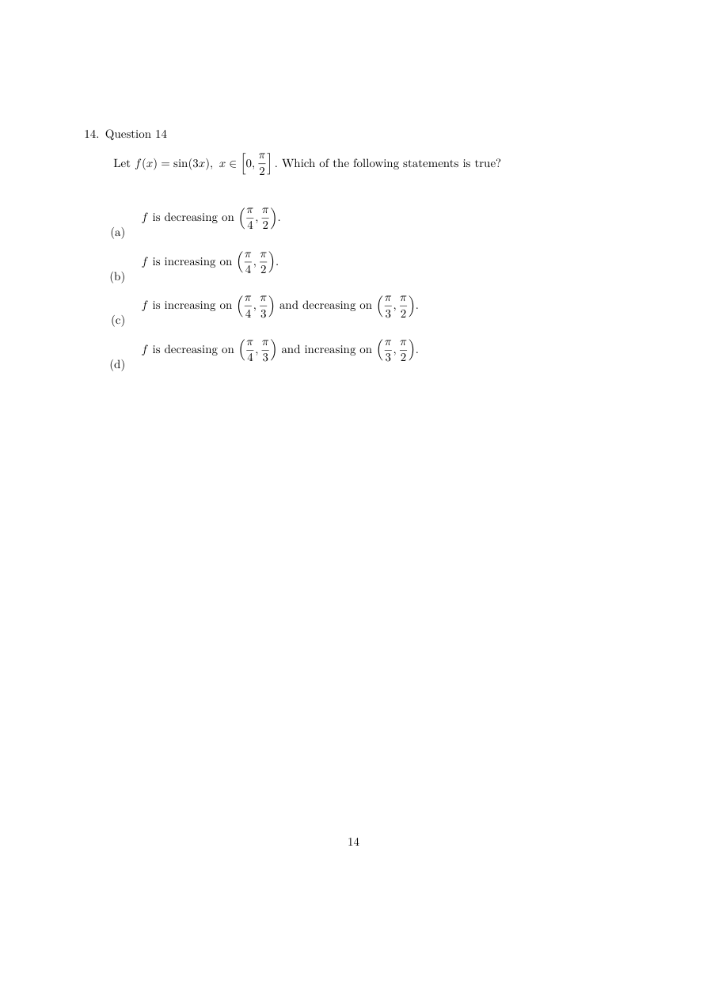

## PDF page 47

[Open original PDF at page 47](../pdf/IAT_2023_English_paper.pdf#page=47)

### Searchable text - PDF text layer

```text
15. Question 15
    Which one of the following functions is differentiable at x = 0?

           cos     (a)        |x|
            sin     (b)       |x|

                  1
      (c)    |x| 2

     (d)    |x|


                                             15
```

### Original page image

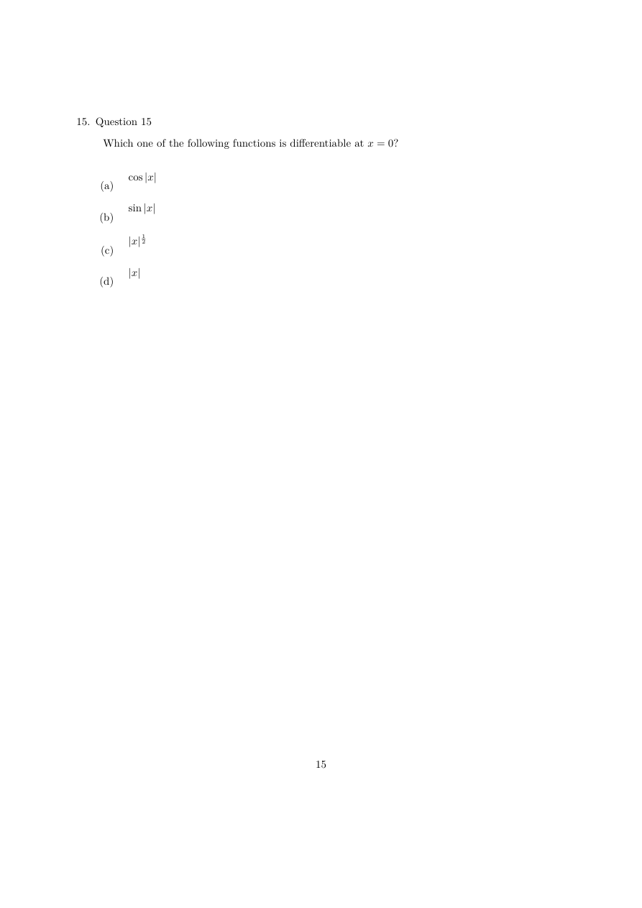

## PDF page 48

[Open original PDF at page 48](../pdf/IAT_2023_English_paper.pdf#page=48)

### Searchable text - PDF text layer

```text
Physics
1. Question 1
   A ball is thrown vertically upwards with an initial speed u from a height h
    above the ground. The ball eventually hits the ground with a speed v. The
     acceleration due to gravity is g and the air resistance is negligible. What is
    the average speed of the ball over its entire trajectory?

          u2 + v2
         2(u + v)
    (a)
         v + u
           2    (b)

          gh
         2(u + v)
    (c)
         u2 + gh
         2(u + v)
    (d)


                                            1
```

### Original page image

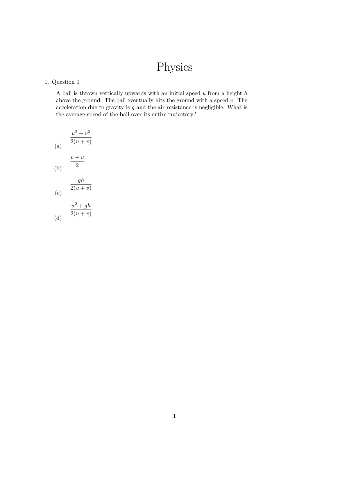

## PDF page 49

[Open original PDF at page 49](../pdf/IAT_2023_English_paper.pdf#page=49)

### Searchable text - PDF text layer

```text
2. Question 2
   Two cubes A and B of same dimensions are made of different materials with
     densities ρA and ρB, respectively. Cube A floats in water with a fraction
    η of its volume immersed. When cube B is placed on top of cube A, it is
    found that cube A is just entirely immersed, while cube B is entirely above
    the surface of the water. What is the ratio ρB/ρA?

          (1 −η)/η    (a)
         η/(1 −η)    (b)

         η
    (c)
         1/η
    (d)


                                            2
```

### Original page image

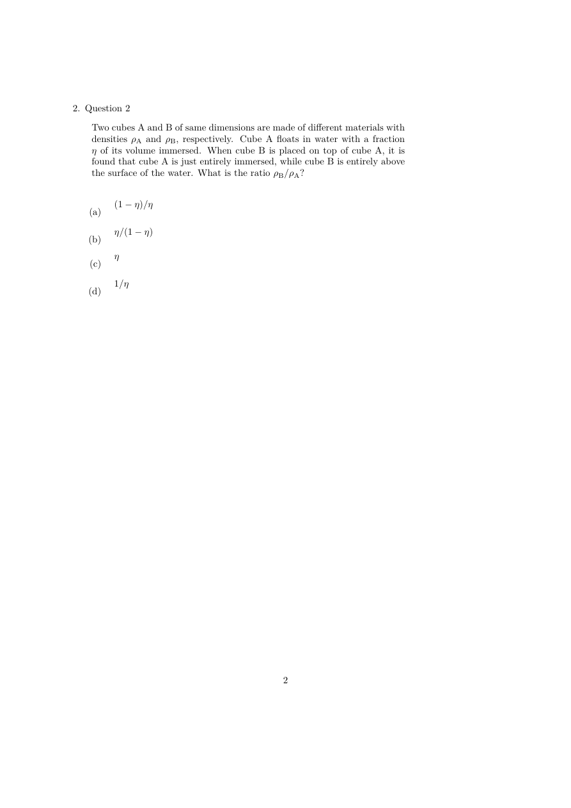

## PDF page 50

[Open original PDF at page 50](../pdf/IAT_2023_English_paper.pdf#page=50)

### Searchable text - PDF text layer

```text
3. Question 3
   An object is placed in front of a convex lens. A real inverted image of double
      its size is formed. When the object is moved closer to the lens by a distance
     d, the image shifts away from the lens by a distance 8d from its previous
     position. What is the magnitude of the magnification in the final setup?

         4    (a)
         1/2
    (b)
         8    (c)
         16    (d)


                                            3
```

### Original page image

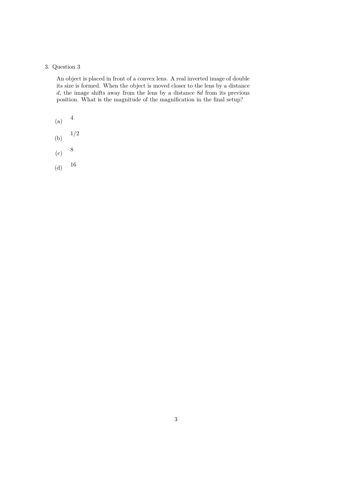

## PDF page 51

[Open original PDF at page 51](../pdf/IAT_2023_English_paper.pdf#page=51)

### Searchable text - PDF text layer

```text
4. Question 4
   The frequency of the whistle of a train moving with a constant speed is
    observed by a stationary detector on the platform to be ν1. The frequency
     of the same whistle is detected to be ν2 inside another train moving on a
     parallel track, at a speed v towards the first train. If the speed of sound in
     air is taken to be vsound, what is the ratio v/vsound?

          ν2 −ν1
            ν1    (a)
          ν2 −ν1
            ν2    (b)

          ν2
          ν1    (c)

          ν1
          ν2    (d)


                                            4
```

### Original page image

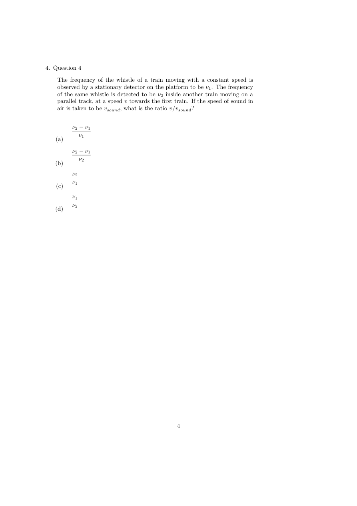

## PDF page 52

[Open original PDF at page 52](../pdf/IAT_2023_English_paper.pdf#page=52)

### Searchable text - PDF text layer

```text
5. Question 5
   A current I flows through a cylindrical cable of length L and uniform
     cross-sectional area A. The power dissipated due to the current is P1. The
    cable is cut into two equal halves. If the cross-sectional area and the current
    flowing through the two halves remain unchanged and the power dissipated
     in each half is P2, which of the following options is correct?

        P2 = P1/2
    (a)
        P2 = 2P1    (b)
        P2 = P1    (c)
        P2 = P1/4
    (d)


                                            5
```

### Original page image

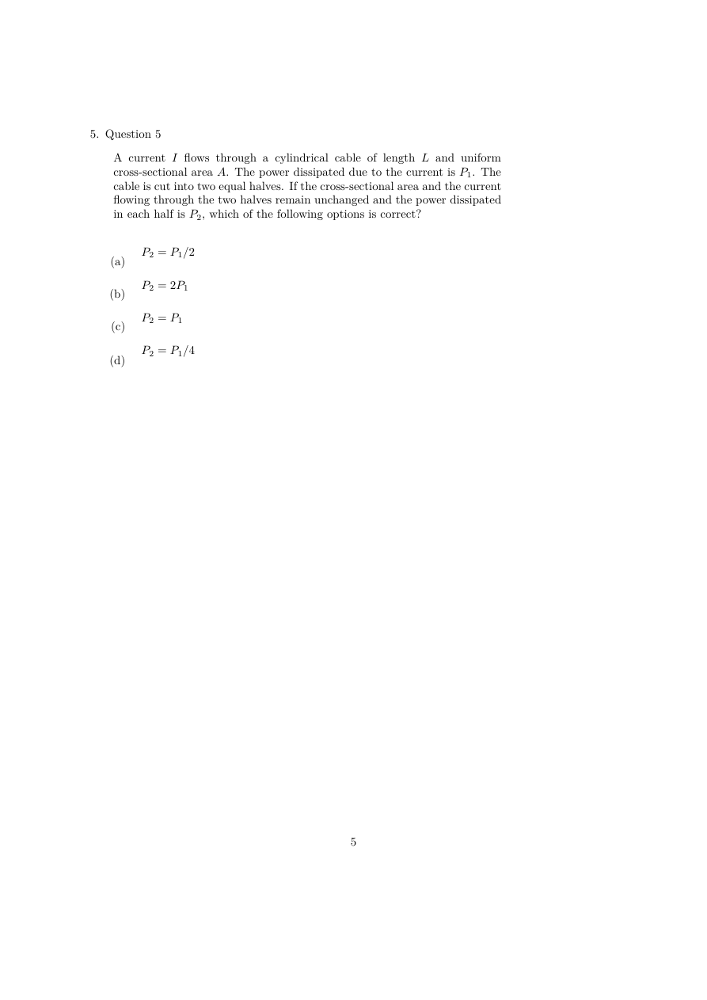

## PDF page 53

[Open original PDF at page 53](../pdf/IAT_2023_English_paper.pdf#page=53)

### Searchable text - PDF text layer

```text
6. Question 6
     Particle A with charge Q and particle B with charge 2Q are fixed at positions
     ⃗rA and ⃗rB, respectively. The force on A due to B is ⃗FBA, and that on B due
    to A is ⃗FAB. Which of the following options is correct?

          ⃗FAB = −⃗FBA    (a)

          ⃗FAB = ⃗FBA    (b)

          ⃗FAB = 2⃗FBA    (c)
          ⃗FAB = −2⃗FBA    (d)


                                            6
```

### Original page image

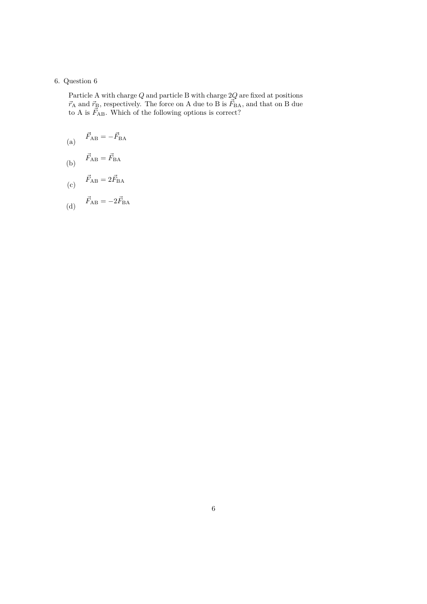

## PDF page 54

[Open original PDF at page 54](../pdf/IAT_2023_English_paper.pdf#page=54)

### Searchable text - PDF text layer

```text
7. Question 7
   The magnetic flux φB(t) through a coil at a time t is given by φB(t) =
    φ0 cos ωt, where 0         and φ0 is a non-zero constant. At what time is              ≤ωt ≤π    the magnitude of the induced emf a maximum?


        π
        2ω    (a)

        π
    (b)  ω

        π
        4ω    (c)
         0    (d)


                                            7
```

### Original page image


## PDF page 55

[Open original PDF at page 55](../pdf/IAT_2023_English_paper.pdf#page=55)

### Searchable text - PDF text layer

```text
8. Question 8
   The  intrinsic  electron and hole concentrations  of a Si-based  intrinsic
    semiconductor are n(0)e  and n(0)h  , respectively. Upon doping with trivalent
    impurities the respective carrier concentrations become ne and nh. Which
     of the following options is true?

        nh > n(0)h    (a)
         ne > n(0)e    (b)
         ne = nh    (c)
           n(0)e  and n(0)h  are independent of temperature.    (d)


                                            8
```

### Original page image


## PDF page 56

[Open original PDF at page 56](../pdf/IAT_2023_English_paper.pdf#page=56)

### Searchable text - PDF text layer

```text
9. Question 9
   The velocity v(t) of a particle moving in one dimension is given by:
              
               αt,        0                            ≤t ≤T/3
                      v(t) =   αT/3,     T/3                         ≤t ≤2T/3                                                                ,  2T/3                     α (T −t)                              ≤t ≤T,
    where α (̸= 0) is a constant. What is the total displacement of the particle    from time t = 0 to t = T?

        2αT 2
           9    (a)
        4αT 2
           9    (b)
        8αT 2
           9    (c)
        7αT 2
           9    (d)


                                            9
```

### Original page image


## PDF page 57

[Open original PDF at page 57](../pdf/IAT_2023_English_paper.pdf#page=57)

### Searchable text - PDF text layer

```text
10. Question 10
    Two fixed point particles, each of charge +q, are separated by a distance
     2L. Another point charge +q of mass m is oscillating about its equilibrium
      position as indicated in the figure below. The time period of oscillation is
     given by T = 2π3/2α√m/q. Given that ϵ0 is the permittivity of free space,
     which of the following options is the dimensionally correct expression for α
      in SI units?
                               2L
                        +q      +q, m     +q


            ϵ1/20  L3/2     (a)
            ϵ1/20 L     (b)
            ϵ3/20  L1/2      (c)
            ϵ3/20 L     (d)


                                             10
```

### Original page image


## PDF page 58

[Open original PDF at page 58](../pdf/IAT_2023_English_paper.pdf#page=58)

### Visual description

Physics Q11: a diamond-shaped resistor network joins terminals A and B, with an internal horizontal branch and unequal labelled edge resistances. Distinguish the internal junctions from simple wire crossings.

### Searchable text - PDF text layer

```text
11. Question 11
    What is the effective resistance between A and B in the circuit shown below?

              R    2R 3R
                       R      3R
                  A             B

                                 2R
              R     3R


        4R
           3     (a)

       R
          3     (b)
        2R
           3      (c)

       R
          6     (d)


                                             11
```

### Original page image


## PDF page 59

[Open original PDF at page 59](../pdf/IAT_2023_English_paper.pdf#page=59)

### Visual description

Physics Q12: two equal spherical bodies of mass M and radius R have centres separated by 4R. A projectile leaves the surface of sphere A toward sphere B along the line joining their centres; the launch arrow and surface point are marked.

### Searchable text - PDF text layer

```text
12. Question 12
    Two spherical bodies A and B each of mass M and radius R are located
     such that their centers are apart by a distance of 4R as shown in the figure.
    An object C of mass m is thrown from the surface of A directly towards
     the center of B with a speed v0 = 2vmin, where vmin is the minimum speed
     needed for C to reach the surface of B.  Given that G is the universal
      gravitational constant, how does the speed v(x) of C change as a function
      of its distance x from the center of A?

                            R     v0          R
              A                     B
                       C

                             4R

                   2√ 2GMR          v(x) =
                x1/2(4R −x)1/2     (a)
             2R √ 2GMR          v(x) =
               x(4R −x)     (b)
            √ GMR
          v(x) =
                x1/2(4R −x)1/2      (c)
              6R2√ 2GMR          v(x) =
                x3/2(4R −x)3/2     (d)


                                             12
```

### Original page image


## PDF page 60

[Open original PDF at page 60](../pdf/IAT_2023_English_paper.pdf#page=60)

### Searchable text - PDF text layer

```text
13. Question 13
     Consider the Bohr model of an atom where an electron of charge    revolves                                                 −e     around a nucleus of charge +e in an orbit of radius r. The electron has an
      orbital angular momentum 2ℏ. If the nucleus had charge +2e, what would
     have been the radius of the orbit of the electron with the same principal
    quantum number?

          r/2
     (a)
          2r     (b)
      (c)   r
      √ 2r
     (d)


                                             13
```

### Original page image


## PDF page 61

[Open original PDF at page 61](../pdf/IAT_2023_English_paper.pdf#page=61)

### Searchable text - PDF text layer

```text
14. Question 14
   A quantity has been measured to have a value of 0.00230 in some units.
    How many significant figures does the measured value have?

          3     (a)
          5     (b)
          4      (c)
          2     (d)


                                             14
```

### Original page image


## PDF page 62

[Open original PDF at page 62](../pdf/IAT_2023_English_paper.pdf#page=62)

### Searchable text - PDF text layer

```text
15. Question 15
     Consider a Carnot heat engine operating between a heat reservoir at
     temperature 600 K, and an external atmosphere at temperature 300 K.
     In one cycle, 1000 kJ of heat is extracted from the heat reservoir, and
     the associated work  is input to a reversible refrigerator that operates
     between 200 K and the same external atmosphere at 300 K. The refrigerator
     completes one cycle and releases heat into the atmosphere. How much heat
       is released into the atmosphere at the end of one cycle of the combined
     system?

          2000 kJ     (a)
          2500 kJ     (b)
          1000 kJ      (c)
          500 kJ     (d)


                                             15
```

### Original page image


