# IAT 2023 - Hindi

Original PDF: [IAT_2023_Hindi_paper.pdf](../pdf/IAT_2023_Hindi_paper.pdf)

- Acquisition: SciAstra CloudFront mirror; not downloaded from the official server.
- Downloaded: 28 October 2026. PDF pages: 62.
- Exact download/source URL: https://d2aaa7ts7sm3bp.cloudfront.net/pdfs/01KMFRD2SACMH05D81KGSSF667.pdf
- PDF SHA-256: `245a56d6a5770e0f805673202b673c59e89f222052981a5534c7bc5f786a132d`
- This is a search/accessibility copy of an existing paper, not newly authored mock content.
- Text is mechanically extracted or OCR-derived and has not been proofread character by character. Equations, option letters, chemical bonds, tables and Hindi OCR can contain errors. The PDF and page images are authoritative.
- Figure descriptions are explanatory annotations, not official answers or complete structural/formula transcriptions. Use the linked image to resolve exact labels, values and stereochemistry.

## Visual guide

The following descriptions refer to **PDF page numbers in the English companion**, because Hindi pagination can differ. The Hindi page images below retain every original diagram; identical embedded images are additionally cross-linked where matched by image digest.

- [English PDF page 1](IAT_2023_English_paper.md#pdf-page-1): Biology Q1: a matching table pairs epithelial tissue categories with location or function descriptions. Keep each labelled row intact when using the extracted text.
- [English PDF page 3](IAT_2023_English_paper.md#pdf-page-3): Biology Q3: a matching table lists biomolecules and possible chemical natures, including polymers and secondary metabolites. Column labels identify the answer combinations.
- [English PDF page 10](IAT_2023_English_paper.md#pdf-page-10): Biology Q10: a matching table links cell or organ structures, including Sertoli cells and hormone-producing tissues, to physiological roles.
- [English PDF page 12](IAT_2023_English_paper.md#pdf-page-12): Biology Q12: an enzyme has a specifically shaped active site, a substrate drawn above it, and five potential inhibitors P-T with distinct polygonal shapes. Competitive-inhibitor comparisons depend on shape complementarity.
- [English PDF page 14](IAT_2023_English_paper.md#pdf-page-14): Biology Q14: a 3500 bp circular plasmid map shows restriction sites and an inserted DNA segment. Below it is gel alternative (a), with two lanes for two different digests and band-size labels; alternatives continue on pages 15-16.
- [English PDF page 15](IAT_2023_English_paper.md#pdf-page-15): Continuation of Biology Q14: gel alternatives (b) and (c), each with Lane 1 and Lane 2 and different band numbers and sizes. Interpret them with the restriction map on page 14.
- [English PDF page 16](IAT_2023_English_paper.md#pdf-page-16): Continuation of Biology Q14: gel alternative (d), with a two-lane band pattern. Its lane and base-pair labels belong to the preceding restriction-digest question.
- [English PDF page 17](IAT_2023_English_paper.md#pdf-page-17): Biology Q15: a three-generation pedigree labels individuals I-1/I-2, II-1/II-2/II-3 and III-1/III-2. Shading denotes affected members; II-3 has a question-mark phenotype in the diagram.
- [English PDF page 23](IAT_2023_English_paper.md#pdf-page-23): Chemistry Q6: four organic bromides I-IV compare a bromine directly on an aromatic ring with bromine on different side-chain carbons. The task concerns Finkelstein substitution, so bond placement is crucial.
- [English PDF page 24](IAT_2023_English_paper.md#pdf-page-24): Chemistry Q7: four proposed synthetic routes to n-propylbenzene start from benzene and show different alkylation/acylation reagents and, in one route, a reduction step.
- [English PDF page 25](IAT_2023_English_paper.md#pdf-page-25): Chemistry Q8: four labelled molecular structures show stereochemical environments using wedges, dashes and substituent labels. The question asks which structures are chiral; do not flatten the wedge/dash distinctions.
- [English PDF page 26](IAT_2023_English_paper.md#pdf-page-26): Chemistry Q9: four nitrogenous-base structures I-IV are drawn with their carbonyl, amino and methyl substituents. The task distinguishes a base absent from RNA.
- [English PDF page 27](IAT_2023_English_paper.md#pdf-page-27): Chemistry Q10: four cyclic structures I-IV with different conjugation and charge patterns are compared for aromaticity. Read the exact ring sizes and double-bond locations from the figure.
- [English PDF page 58](IAT_2023_English_paper.md#pdf-page-58): Physics Q11: a diamond-shaped resistor network joins terminals A and B, with an internal horizontal branch and unequal labelled edge resistances. Distinguish the internal junctions from simple wire crossings.
- [English PDF page 59](IAT_2023_English_paper.md#pdf-page-59): Physics Q12: two equal spherical bodies of mass M and radius R have centres separated by 4R. A projectile leaves the surface of sphere A toward sphere B along the line joining their centres; the launch arrow and surface point are marked.

## Page index

[p1](#pdf-page-1) | [p2](#pdf-page-2) | [p3](#pdf-page-3) | [p4](#pdf-page-4) | [p5](#pdf-page-5) | [p6](#pdf-page-6) | [p7](#pdf-page-7) | [p8](#pdf-page-8) | [p9](#pdf-page-9) | [p10](#pdf-page-10) | [p11](#pdf-page-11) | [p12](#pdf-page-12) | [p13](#pdf-page-13) | [p14](#pdf-page-14) | [p15](#pdf-page-15) | [p16](#pdf-page-16) | [p17](#pdf-page-17) | [p18](#pdf-page-18) | [p19](#pdf-page-19) | [p20](#pdf-page-20) | [p21](#pdf-page-21) | [p22](#pdf-page-22) | [p23](#pdf-page-23) | [p24](#pdf-page-24) | [p25](#pdf-page-25) | [p26](#pdf-page-26) | [p27](#pdf-page-27) | [p28](#pdf-page-28) | [p29](#pdf-page-29) | [p30](#pdf-page-30) | [p31](#pdf-page-31) | [p32](#pdf-page-32) | [p33](#pdf-page-33) | [p34](#pdf-page-34) | [p35](#pdf-page-35) | [p36](#pdf-page-36) | [p37](#pdf-page-37) | [p38](#pdf-page-38) | [p39](#pdf-page-39) | [p40](#pdf-page-40) | [p41](#pdf-page-41) | [p42](#pdf-page-42) | [p43](#pdf-page-43) | [p44](#pdf-page-44) | [p45](#pdf-page-45) | [p46](#pdf-page-46) | [p47](#pdf-page-47) | [p48](#pdf-page-48) | [p49](#pdf-page-49) | [p50](#pdf-page-50) | [p51](#pdf-page-51) | [p52](#pdf-page-52) | [p53](#pdf-page-53) | [p54](#pdf-page-54) | [p55](#pdf-page-55) | [p56](#pdf-page-56) | [p57](#pdf-page-57) | [p58](#pdf-page-58) | [p59](#pdf-page-59) | [p60](#pdf-page-60) | [p61](#pdf-page-61) | [p62](#pdf-page-62)

## PDF page 1

[Open original PDF at page 1](../pdf/IAT_2023_Hindi_paper.pdf#page=1)

### Searchable text - OCR draft (hin+eng)

```text
l. Wal

जीव विज्ञान

स्तंभ | और स्तंभ ॥ की प्रविष्टियों को उनके कार्यकलाप के अनुसार मिलाएँ।

[ स्तंभ। स्तंभ II

" शल्कीय उपकला | (i) |केन्द्रक कोशिका के आधारीय सतह पर होता है
और यह कणों और म्युकस (8ST) के प्रवाह में
सहायता प्रदान करती है |

" il उपकला | (ii) |केन्द्रक कोशिका के आधारीय सतह पर होता है
और यह Gaur और अवशोषण प्रक्रिया में
सहायता प्रदान करती है ।

| स्तंभाकार उपकला | (iii) | केन्द्रक कोशिका के मध्य में होता है और यह
स्रवण और अवशोषण प्रक्रिया में सहायता प्रदान
करती है |

5. | पक्ष्माभ उपकला | (iv) | यह विसरण सीमा का कार्य करती है ।

इस आधार पर सही संयोजन वाला विकल्प निम्न में से कौन सा है ?

P-(iv); Q-(ili); R-(ii); $-()
P-(iii); Q-(i); R=(iv); S- Ci)
P-(ii); Q-(iv); R-(i); (ili)
P-(i); Q-(ii); R-(ii); S~(iv)
```

### Original page image

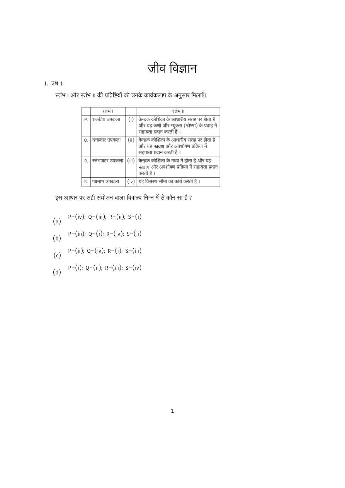

## PDF page 2

[Open original PDF at page 2](../pdf/IAT_2023_Hindi_paper.pdf#page=2)

### Searchable text - OCR draft (hin+eng)

```text
2. प्रश्न 2
निम्न में से कौन सा विकल्प पेप्टोन्स की सटीक व्याख्या करता है?
(७) हि आंशिक रूप से पाचित प्रोटीन्‍्स हैं।
(७) यह पेप्सिन का अपूर्ण रूप (ज़ाइमोजेन) है।
(०0 हि पेप्सिन का सक्रिय रूप है।

(०) यह आँत में पाये जाने वाले प्रोटीन्स, म्युकस और HCO; का मिश्रण है।
```

### Original page image

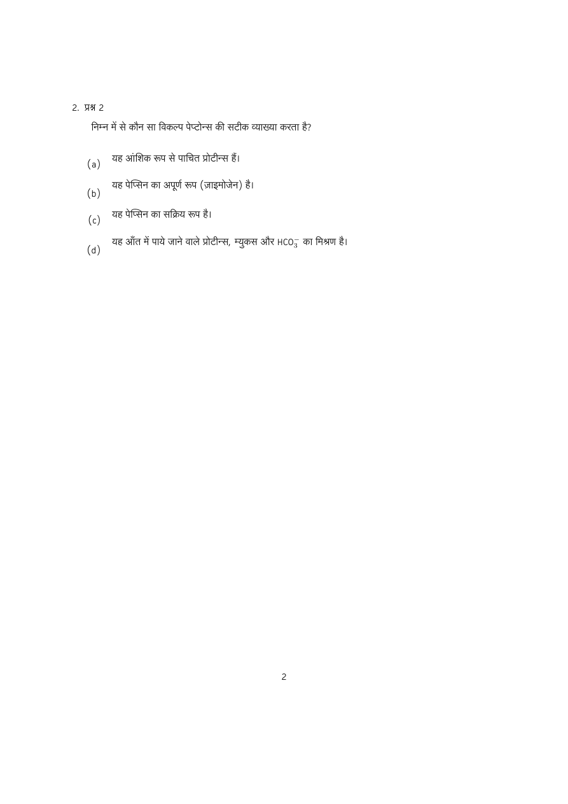

## PDF page 3

[Open original PDF at page 3](../pdf/IAT_2023_Hindi_paper.pdf#page=3)

### Searchable text - OCR draft (hin+eng)

```text
3. प्रश्न 3

स्तंभ | में उपस्थित जैवअणुओं का मिलान स्तंभ ॥ में लिखित उनके रासायनिक स्वरूप से
कीजिए।

स्तंभ। स्तंभ ॥
Safer | (i) [द्वितीयक उपापचय
Safer | (ii) |समांगी बहुलक

लेक्टिन | (ii) | चतुर्थक अमोनियम व्युत्पन्न
लेसिथिन | (५) | विषमांगी बहुलक

9 a] Oo] 2

इस आधार पर किस विकल्प में दिया गया संयोजन सही है?
(a) P-(iv); ९ -(ii); R- (i); $ - (iii)

(0) P-(ii); Q -(iv); R= (iii); $ - (i)

(c) P-(iii); Q -(i); १- (iv); $ - (ii)

(०) ?-() Q -(॥); १- (ii); $ - (iv)
```

### Original page image

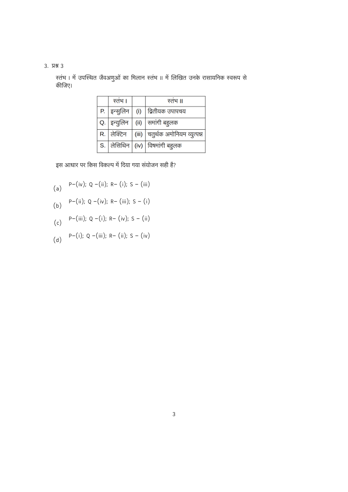

## PDF page 4

[Open original PDF at page 4](../pdf/IAT_2023_Hindi_paper.pdf#page=4)

### Searchable text - OCR draft (hin+eng)

```text
4. प्रश्न 4

समसूत्री विभाजन को अवमंदित करने वाला एक पदार्थ माइक्रोटुब्युल्स के निर्माण को बाधित करता

हा bots के उपयोग से केन्द्रक विभाजन की सबसे पहले प्रभावित होने वाली प्रावस्था कौन
rf ?

मध्यावस्था
(9)

पश्चावस्था
(०)

पूर्वावस्था

(०) अत्यावस्था
```

### Original page image

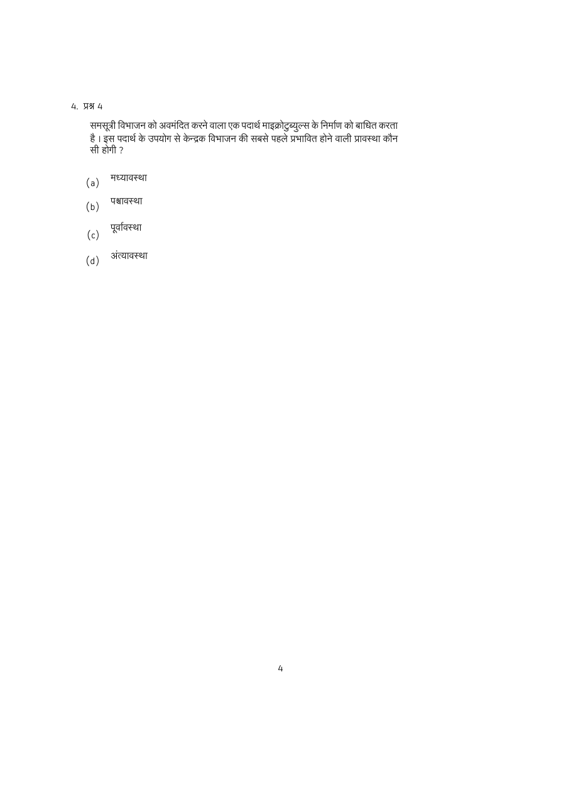

## PDF page 5

[Open original PDF at page 5](../pdf/IAT_2023_Hindi_paper.pdf#page=5)

### Searchable text - OCR draft (hin+eng)

```text
5. प्रश्न 5
निम्न में से कौन सा कथन बीज की संरचना के विषय में गलत है ?

एकबीजपत्री पौधों के बीज में फल-भित्ति से जुड़ी हुई झिल्लीदार बीजावरण को एल्युरोन स्तर
कहते हैं।

कुछ परिपक्व द्विबीजपत्री बीजों से भ्रूणपोष अनुपस्थित रहता है।
द्विबीजपत्री बीज-चोल के बाह्य-सतह को टेस्टा कहते हैं।

एकबीजपत्री बीजों में कोलियोप्टाइल और कोलियोरहाइजा पाए जाते हैं।
```

### Original page image

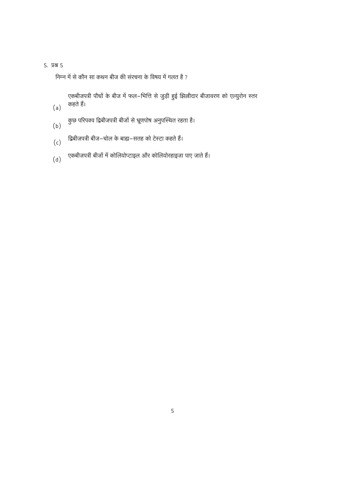

## PDF page 6

[Open original PDF at page 6](../pdf/IAT_2023_Hindi_paper.pdf#page=6)

### Searchable text - OCR draft (hin+eng)

```text
6. प्रश्न 6

निम्न में से कौन सा संरचनात्मक लक्षण समशीतोष्ण जलवायु में पाए जाने वाले वृक्ष की आयु-
निर्धारण के लिए उपयोग में लाया जा सकता है ?

वसंत काष्ठ और दीर्घ (लेट) काष्ठ
& (हार्ट) काष्ठ और सैप काष्ठ
वसंत काष्ठ और ee काष्ठ

शरद्‌ (ऑटम्न) ars और सैप ars
```

### Original page image

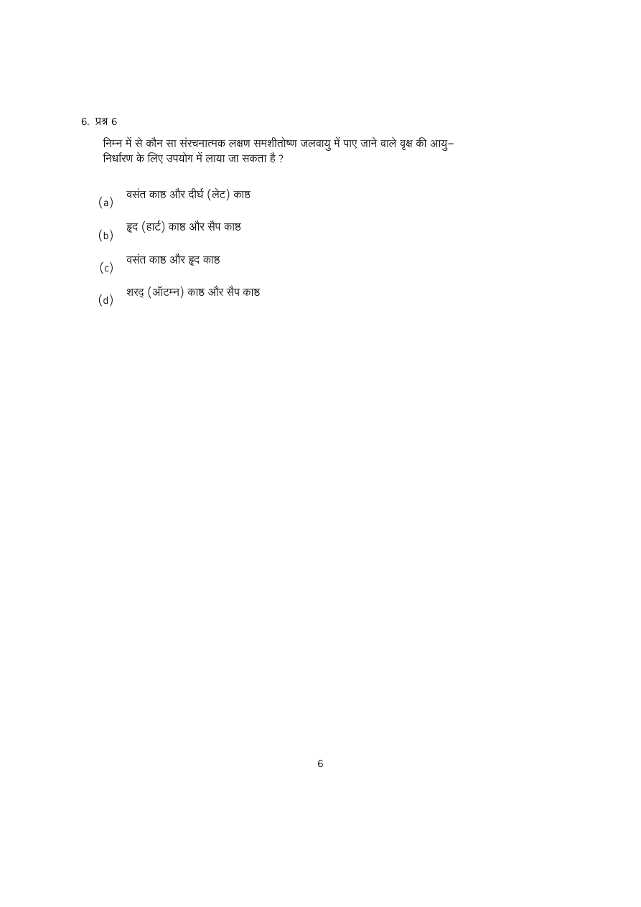

## PDF page 7

[Open original PDF at page 7](../pdf/IAT_2023_Hindi_paper.pdf#page=7)

### Searchable text - OCR draft (hin+eng)

```text
7. प्रश्न 7
पौधों में होने वाले जैविक नाइट्रोजन स्थिरीकरण के विषय में कौन सा कथन सही है ?

नाइट्रोजिनेज के उत्प्रेर अपचय-उपचय केन्द्र पर Mo और Fe सह-कारक के रूप में उपस्थित
(a) रहते हैं।

नाइट्रोजिनेज वायुमंडलीय नाइट्रोजन का स्थिरीकरण No को NO; A परिवर्तित करके करता है।
(७)
नाइट्रोजिनेज सबसे दक्ष रूप से कार्य केवल आण्विक ऑक्सिजन की उपस्थिति में कर सकता
है।

पार एमीनन या विपक्ष एमीनन प्रक्रिया से उत्पादित दो मुख्य अमाइड, एस्पेरजिन एवंम ग्लूटेमिन,
पौधों के अन्य भागों में फ़ोएम द्वारा स्थानांतरित होते हैं।
```

### Original page image

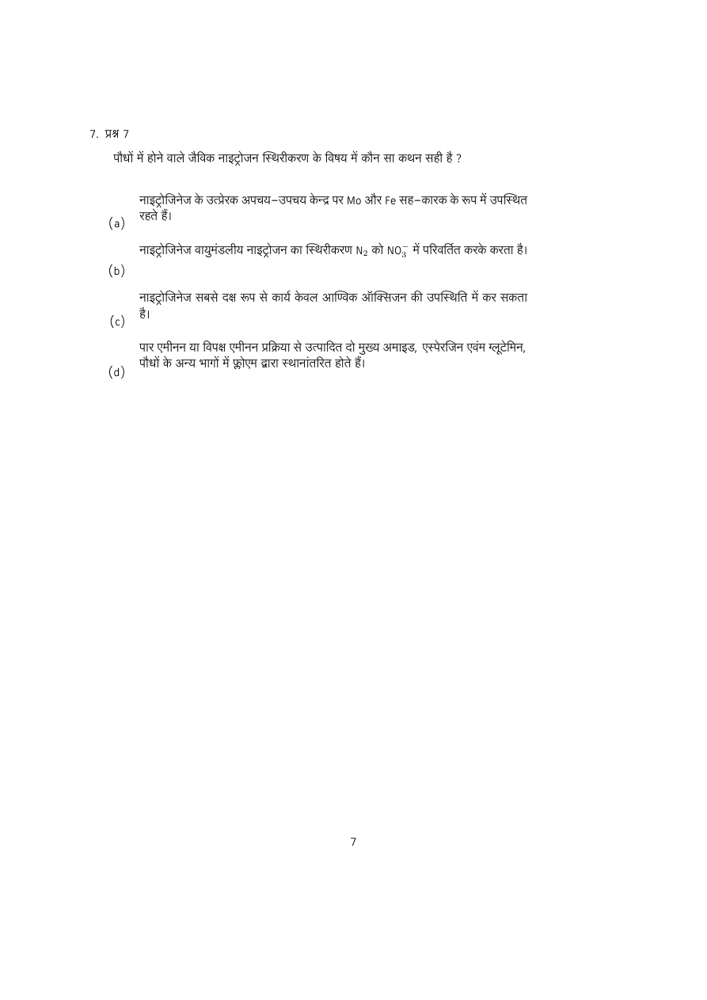

## PDF page 8

[Open original PDF at page 8](../pdf/IAT_2023_Hindi_paper.pdf#page=8)

### Searchable text - OCR draft (hin+eng)

```text
8. प्रश्न 8

निम्न में से कौन सा विकल्प आनुवांशिक विविधता का उदाहरण है?

राऊवोल्फीया वोमिटोरिया द्वारा उत्पादित सक्रिय रसायन रेसरपिन की क्षमता तथा साद्रता में
(a) विविधता होना।

(७) उभयचर जातियों की विविधता भारत के पूर्वी घाट की तुलना में पश्चिम घाट में अधिक होना।

(c) भारत की पारितंत्र विविधता का स्कैंडिनेविया से अधिक होना।

भारत की पादप जातीय विविधता का मध्य एशिया से अधिक होना।

(५)
```

### Original page image

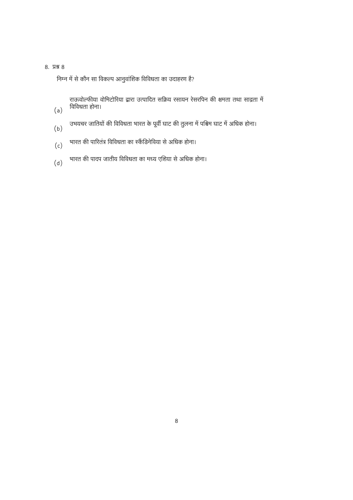

## PDF page 9

[Open original PDF at page 9](../pdf/IAT_2023_Hindi_paper.pdf#page=9)

### Searchable text - OCR draft (hin+eng)

```text
9. प्रश्न 9

जब MRNA का अनुवादन कर रहे राइबोसोम का सामना एक अवरोधक प्रकूट से हो जाता है, तो
निम्न में से कौन सा अवरोधक प्रकूट से बँधता है ?

(a) विमोचक कारक
(७) Rho फैक्टर
(०) मापन कारक

(a) सिगमा फैक्टर
```

### Original page image

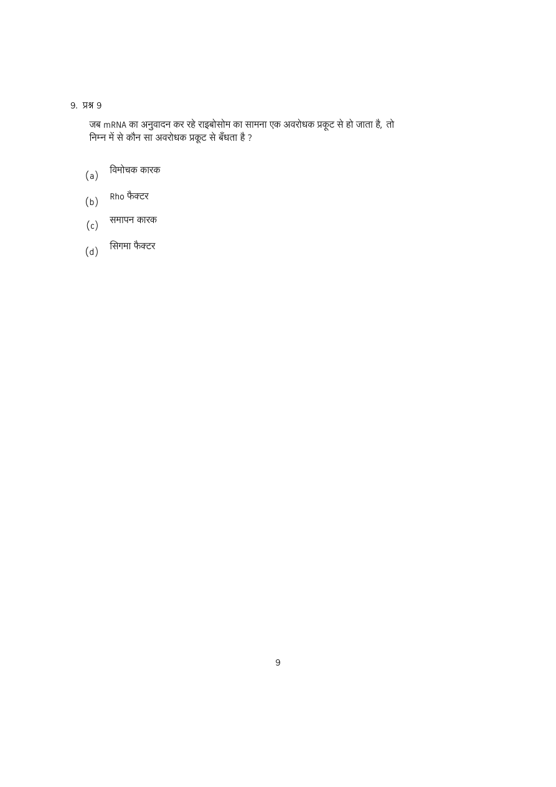

## PDF page 10

[Open original PDF at page 10](../pdf/IAT_2023_Hindi_paper.pdf#page=10)

### Searchable text - OCR draft (hin+eng)

```text
0. W420

स्तंभ | और स्तंभ ॥ की प्रविष्टियों को उनके क्रियात्मक भूमिका के अनुसार मिलाएँ।

| स्तंभ। | ! [oe ॥
[P| सर्टोली कोशिका () |कोरियोनिक गोनैडोट्रॉपिन का aac
९] फॉलिकल स्टिमुलेटिंग हॉर्मोन | (i) | मूत्र को मूत्राशय से दूर ले जाने वाली वाहिनी
[R. | [er कि (ii) | मूत्र को वृक्ष से दूर ले जाने वाली वाहिनी
5. | मूत्रमार्ग (iv) | वृद्धि कर रहे शुक्राणुजन का पोषण
(५) |अंडोत्सर्ग का सक्रियण

इस आधार पर सही संयोजन वाला विकल्प निम्न में से कौन सा है?

(a)
(७)
(०)
(५)

?- (iv); ९ - (४); R - (i); $ - (ii)

?- (४) ९ - (i); १ - (iv); $ - (iii)

?- (iii); ९ - (ii); १- (५); $ - (iv)

?- (i); ९ - (iv); R - (iii); $ - (५)

i0
```

### Original page image

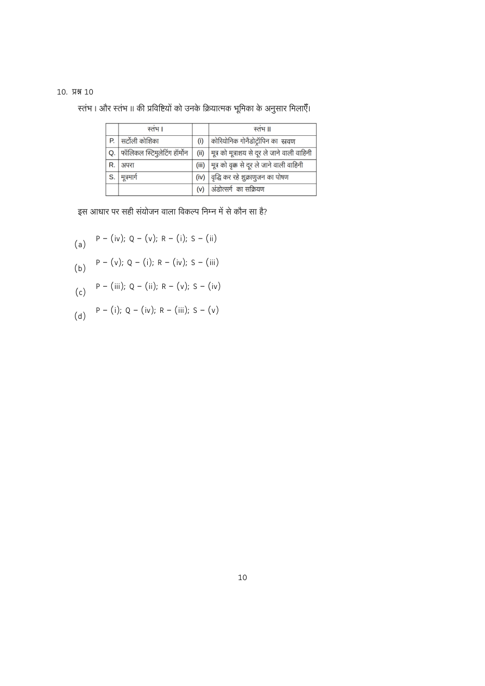

## PDF page 11

[Open original PDF at page 11](../pdf/IAT_2023_Hindi_paper.pdf#page=11)

### Searchable text - OCR draft (hin+eng)

```text
2. 44 2

निम्न में से किस रोग के कारक जीव के hnRNA को स्प्लाइसिंग की आवश्यकता परिपक्व mRNA
बनाने के लिए होगी ?

मलेरिया
काली खाँसी (पर्टुसिस)
टाइफायड

(a) क्षय रोग

वव
```

### Original page image

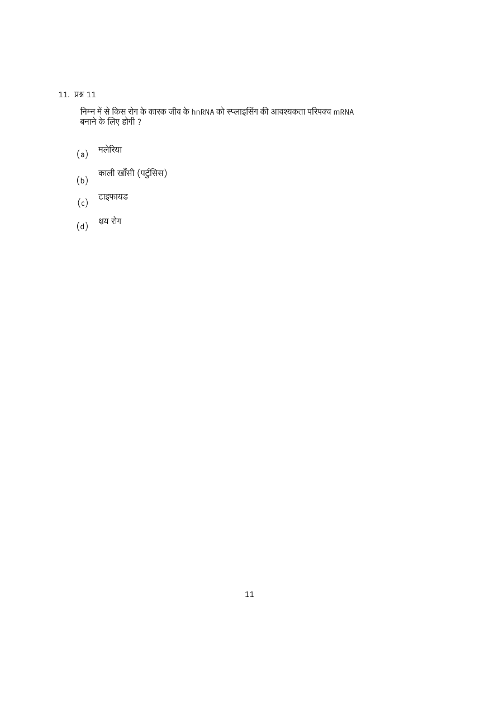

## PDF page 12

[Open original PDF at page 12](../pdf/IAT_2023_Hindi_paper.pdf#page=12)

### Searchable text - OCR draft (hin+eng)

```text
2. WA2

दिया गया चित्र, एक विकर, उसके अभिकर्मक और संभावी संदमकों (2, 0, R, S SIRT) को
दर्शाता है।

सक्रियण केंद्र

निम्न में से कौन सा संयोजन इस विकर के लिए प्रतिस्पर्धात्मक संदमकों के सटीक युग्म का कार्य
करेंगे?

२, 5

Ss, T

R, T

i2
```

### Original page image

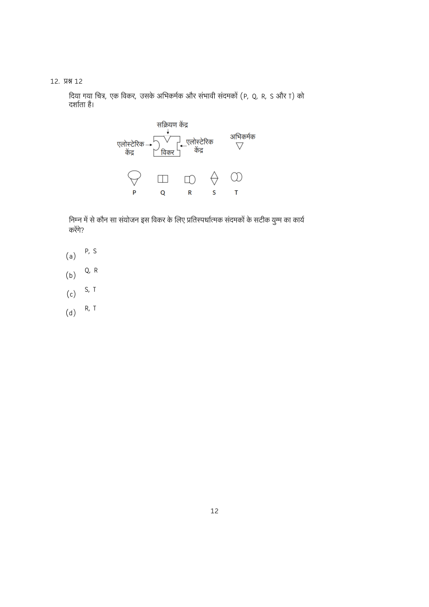

## PDF page 13

[Open original PDF at page 13](../pdf/IAT_2023_Hindi_paper.pdf#page=13)

### Searchable text - OCR draft (hin+eng)

```text
3. WA 33

0,000 eafthat वाले एक द्वीप के 4 व्यक्ति हँसियाकार रुधिराणु अरक्तता (एक अप्रभावी
समगुणसूत्री रोग) से ग्रसित हैं। यदि यह जीन-बिन्दु हार्डी-विनबर्ग साम्य में है तो इस द्वीप पर
कितने व्यक्तियों के रोगजनक अलील के प्रति विषमयुग्मजी होने की संभावना है ?

(a) 392

(b) *
( c ) 9996

(4) 9608

i3
```

### Original page image

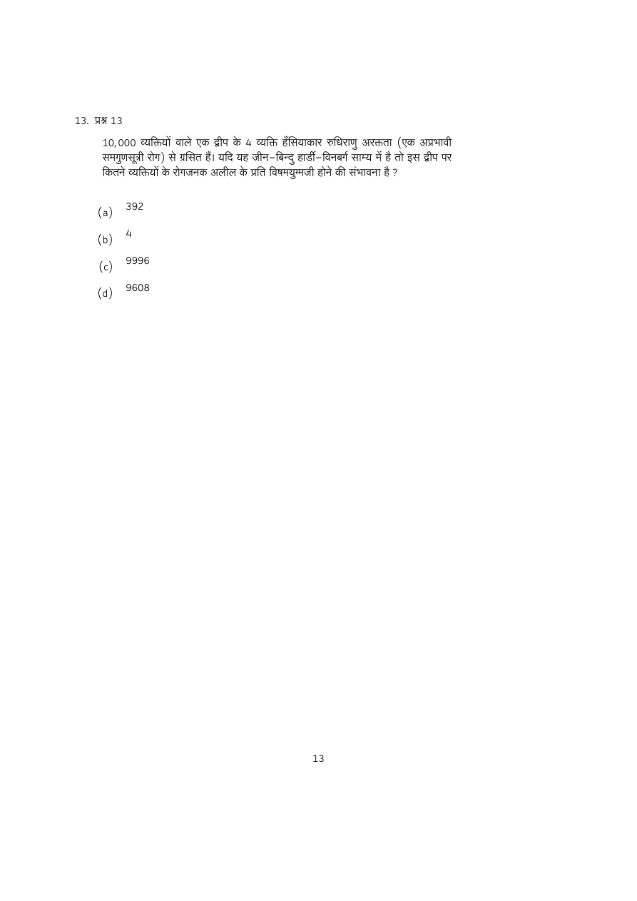

## PDF page 14

[Open original PDF at page 14](../pdf/IAT_2023_Hindi_paper.pdf#page=14)

**Matching embedded figure, English PDF page 14:** Biology Q14: a 3500 bp circular plasmid map shows restriction sites and an inserted DNA segment. Below it is gel alternative (a), with two lanes for two different digests and band-size labels; alternatives continue on pages 15-16.

### Searchable text - OCR draft (hin+eng)

```text
4. WI 4

000 क्षार युम्मों वाले एक डी एन ए टुकड़े को चित्र में दिखाए गए प्लाज्मिड (9॥0; 3500 क्षार
युग्म) के Hind ॥ और EcoR | प्रतिबंधन स्थलों के मध्य स्थापित किया गया। क्वोन किए गए
डी एन ए टुकड़े में एक Not | प्रतिबंधन स्थल है। प्राप्त पुनर्सयोजित प्लाज्मिड में 000 ae
युग्मों वाले इस डी एन ए टुकड़े की उपस्थिति का सत्यापन करने के लिए उसे (a) Not | और
EcoR | तथा (5) Not | और Hind i प्रतिबंधन विकरों द्वारा संपूर्ण रूप से पाचित किया गया
है।

&००र। Hind Ill

लेन (lane ) में Not | और 7८०7१ | द्वारा पाचित किए गए उत्पादों का वितरण दिखाया
गया है। लेन 2 (lane 2) में Not | और Hind ॥ द्वारा पाचित किए गए उत्पादों का वितरण
दिखाया गया है। निम्न में से कौन सा विकल्प एगैरोज जेल प्रारूप क्रमशः (a) और (9) दशाओं
में पाचित पुनर्सयोजित प्लाज्मिड रूप को सबसे सटीक ढंग से निरूपित करता है ?

|
Lane Lane 2
a co
900 —— —900)
700 ——
—00
— 900
— 600
500 ——
400 ——
ee

(a)

44
```

### Original page image

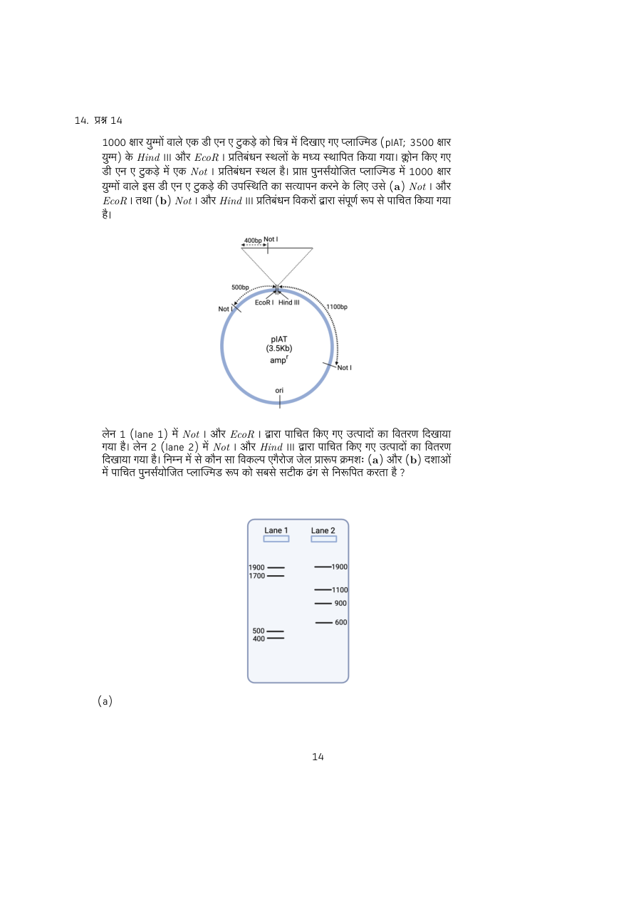

## PDF page 15

[Open original PDF at page 15](../pdf/IAT_2023_Hindi_paper.pdf#page=15)

**Matching embedded figure, English PDF page 15:** Continuation of Biology Q14: gel alternatives (b) and (c), each with Lane 1 and Lane 2 and different band numbers and sizes. Interpret them with the restriction map on page 14.

### Searchable text - OCR draft (hin+eng)

```text
(७)

_

Lane Lane 2
a co
900 —— —900
7700 ——
—00
900 ——
— 600
— 500
—400
—_
Lane4 Lane 2
co co
900 —— —900)
700 —— 700)
900 ——
— 500
— 400
—

45
```

### Original page image

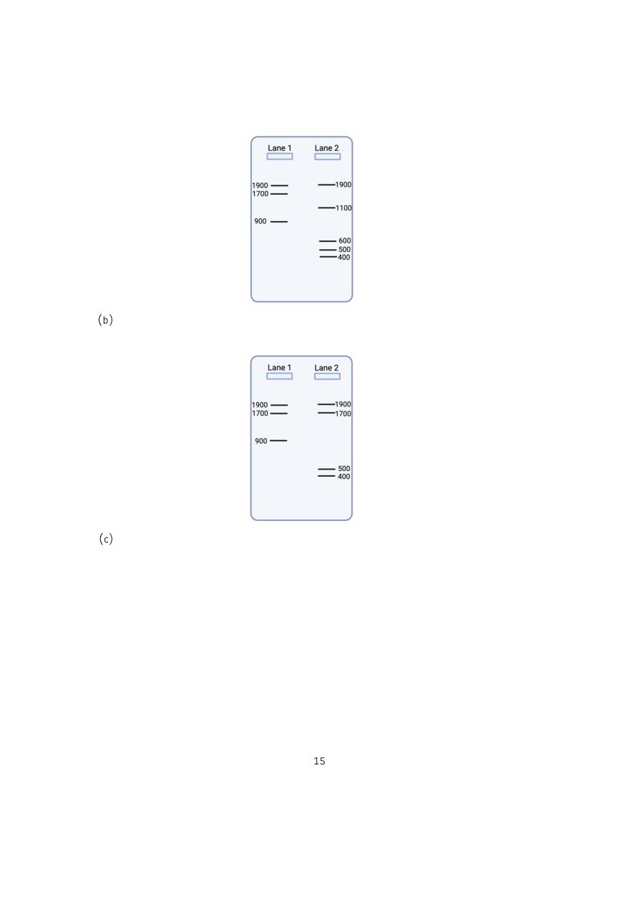

## PDF page 16

[Open original PDF at page 16](../pdf/IAT_2023_Hindi_paper.pdf#page=16)

**Matching embedded figure, English PDF page 16:** Continuation of Biology Q14: gel alternative (d), with a two-lane band pattern. Its lane and base-pair labels belong to the preceding restriction-digest question.

### Searchable text - OCR draft (hin+eng)

```text
(५)

[6 ] Lane2
| a
2600 ——
900 —— —900|
—00
— 600:
— 500
— 400
TY

I6
```

### Original page image

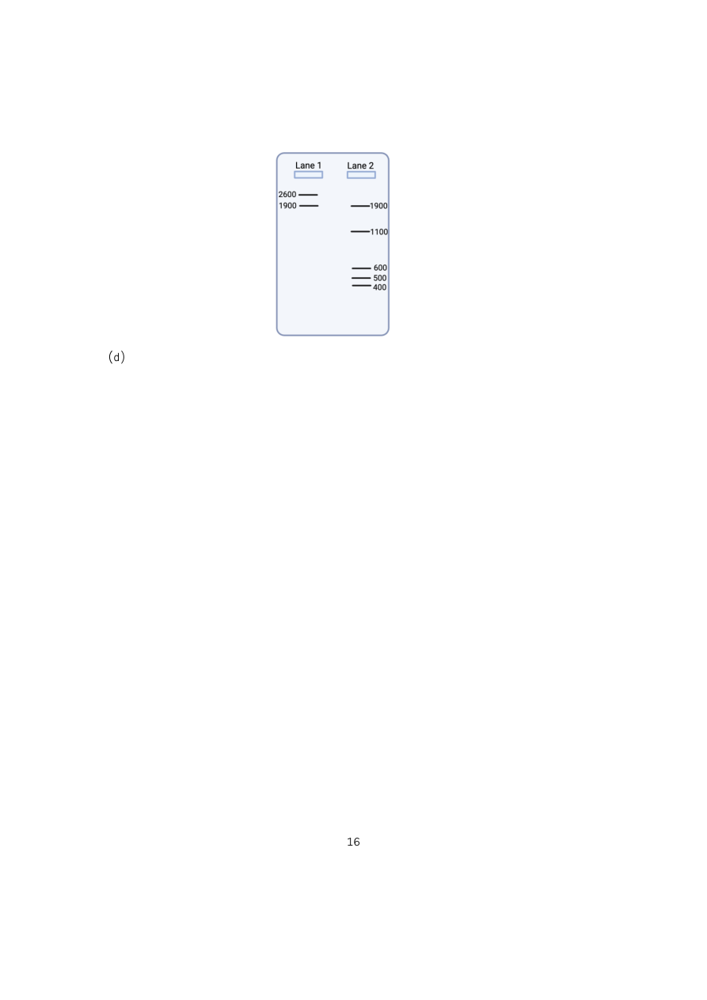

## PDF page 17

[Open original PDF at page 17](../pdf/IAT_2023_Hindi_paper.pdf#page=17)

**Matching embedded figure, English PDF page 17:** Biology Q15: a three-generation pedigree labels individuals I-1/I-2, II-1/II-2/II-3 and III-1/III-2. Shading denotes affected members; II-3 has a question-mark phenotype in the diagram.

### Searchable text - OCR draft (hin+eng)

```text
5. WH5

दिए गए वंशावली वृक्ष में किसी जीनी विकार के वंशानुगतता को दर्शाया गया है | केवल व्यक्ति
I-2, और ॥-2 इससे प्रभावित व्यक्ति हैं।

2

निम्न में से कौन सा विकल्प इस जीनी-विकार की वंशानुगतता और व्यक्ति ॥-3 के जीन-प्रारूप
के सही तरीके को प्रकट करता है?

क्रमशः समगुणसूत्री अप्रभावी, विषमयुग्मजी
क्रमशः समगुणसूत्री प्रभावी, सामान्य अलील के लिए समयुग्मजी
क्रमशः ५-सहलगून अप्रभावी, विषमयुग्मजी

क्रमशः समगुणसूत्र अप्रभावी, सामान्य अलील के लिए समयुग्मजी

हक
```

### Original page image

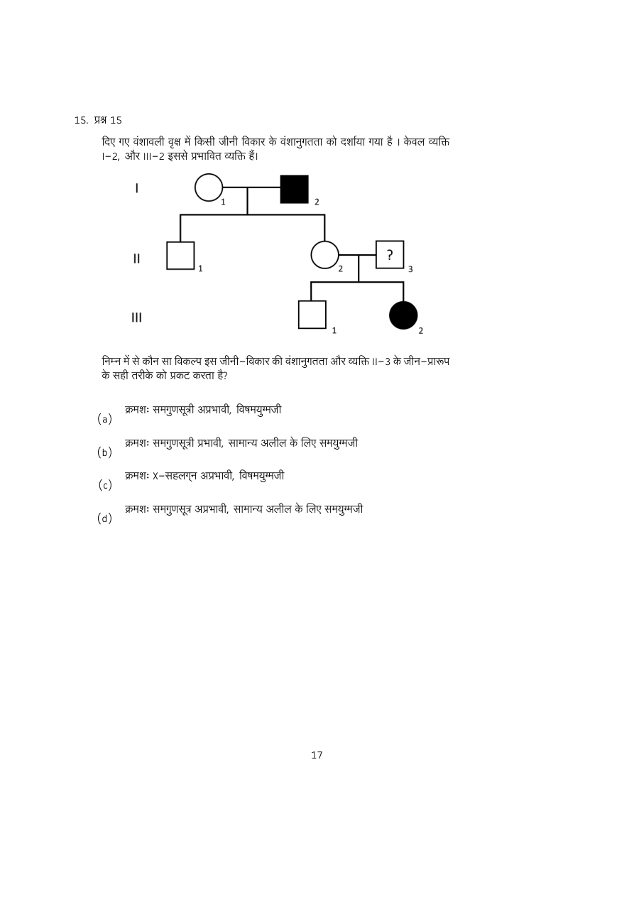

## PDF page 18

[Open original PDF at page 18](../pdf/IAT_2023_Hindi_paper.pdf#page=18)

### Searchable text - OCR draft (hin+eng)

```text
रसायन विज्ञान

4. प्रश्न 4
Cat के 4s कक्षक में कितने त्रिज्य नोड्स हैं ?
```

### Original page image

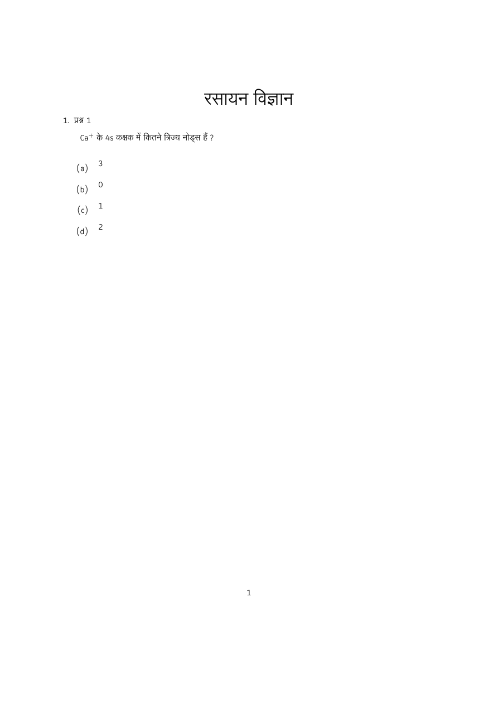

## PDF page 19

[Open original PDF at page 19](../pdf/IAT_2023_Hindi_paper.pdf#page=19)

### Searchable text - OCR draft (hin+eng)

```text
2. प्रश्न 2
अणुओं Oo, No, Fo, और 8: में से कौन से अणु बाह्य चुम्बकीय क्षेत्र के प्रति आकर्षित होंगे ?

02 और By

(a)
(७)

Fo, No, और Bo

02, Bo, और No

(c)
02 और Fo

(५)
```

### Original page image

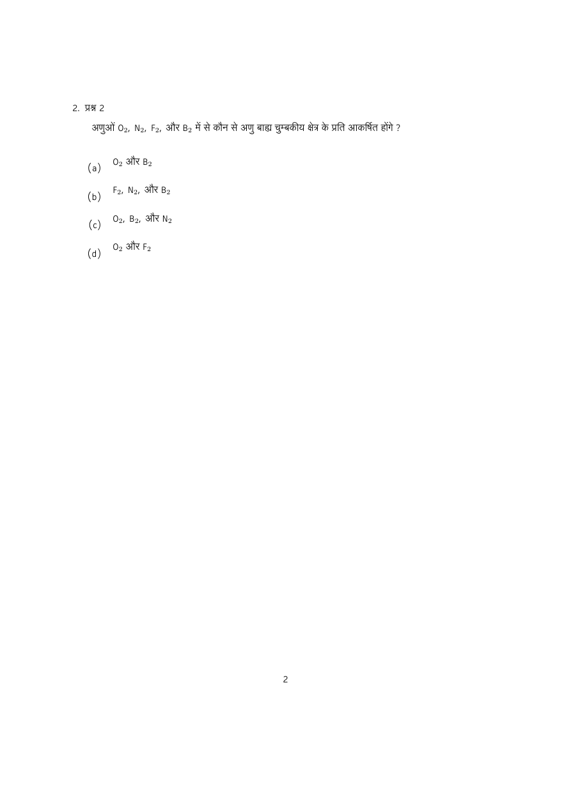

## PDF page 20

[Open original PDF at page 20](../pdf/IAT_2023_Hindi_paper.pdf#page=20)

### Searchable text - OCR draft (hin+eng)

```text
3. प्रश्न 3

फास्फोरस के अधिक क्रियाशील अपररूप में p—p—p का न्यूनतम आबंध-कोण कितना है ?

(a) 0९
209°
(०)

() 4

20°
(०)
```

### Original page image

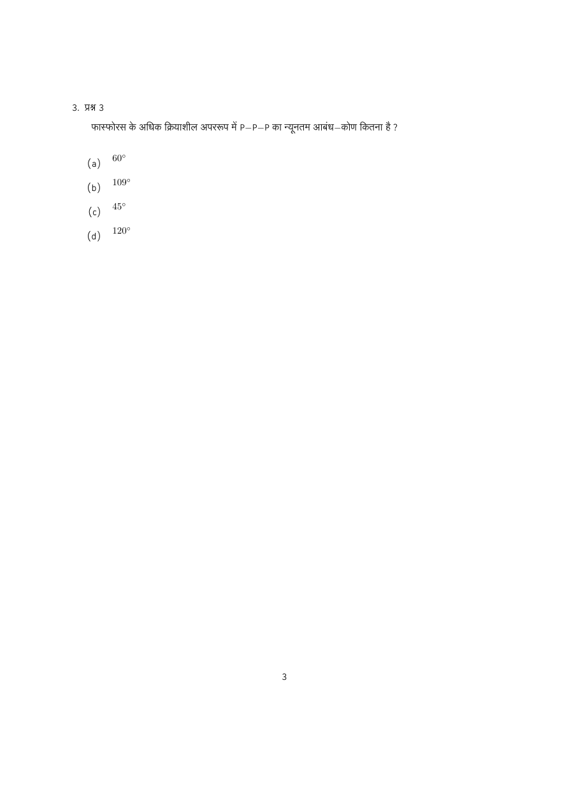

## PDF page 21

[Open original PDF at page 21](../pdf/IAT_2023_Hindi_paper.pdf#page=21)

### Searchable text - OCR draft (hin+eng)

```text
4. प्रश्न 4

निम्न में से कौन सा विकल्प लोहे का एक अयस्क है ?
सिडेराइट
बाक्साइट
मेलाकाइट

(a) क्वार्टज
```

### Original page image

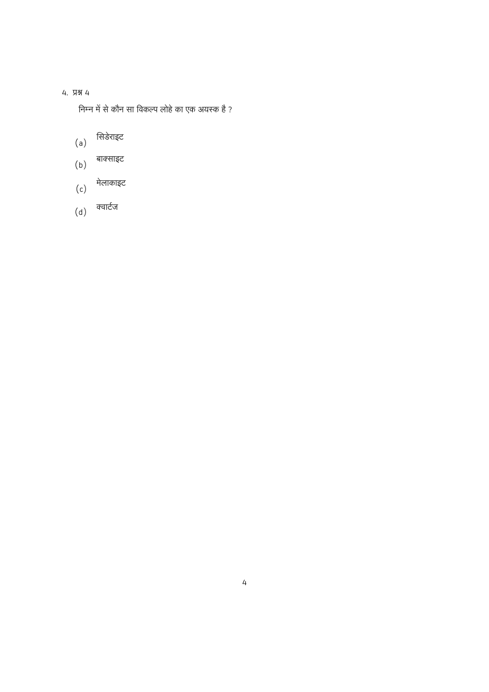

## PDF page 22

[Open original PDF at page 22](../pdf/IAT_2023_Hindi_paper.pdf#page=22)

### Searchable text - OCR draft (hin+eng)

```text
5. प्रश्न 5
एलिंघम चित्र कौन से प्राचलों के मध्य संबंध को दर्शाता है ?

A,;G° vs T
A,H° vs T
A,S° vs T

A,S° vs P
```

### Original page image

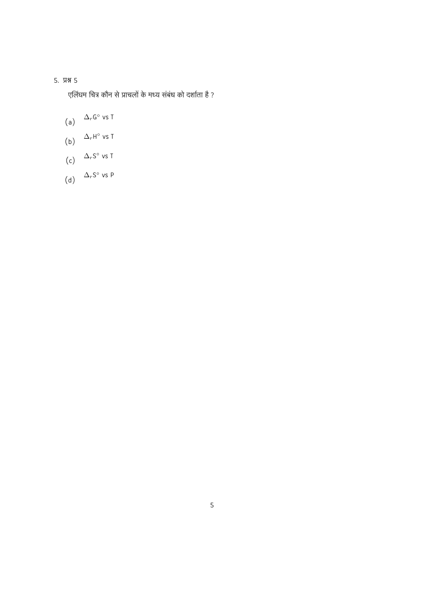

## PDF page 23

[Open original PDF at page 23](../pdf/IAT_2023_Hindi_paper.pdf#page=23)

### Searchable text - OCR draft (hin+eng)

```text
6. प्रश्न 6

निम्न में से कौन से यौगिक Nal के साथ Sy2 पथ से फिंकेल्स्टाइन अभिक्रिया नहीं दशयिंगे ?

on Br

॥ और ॥
। और ॥
॥ और Iv
। और iv

om Br
Ml

om
IV
```

### Original page image

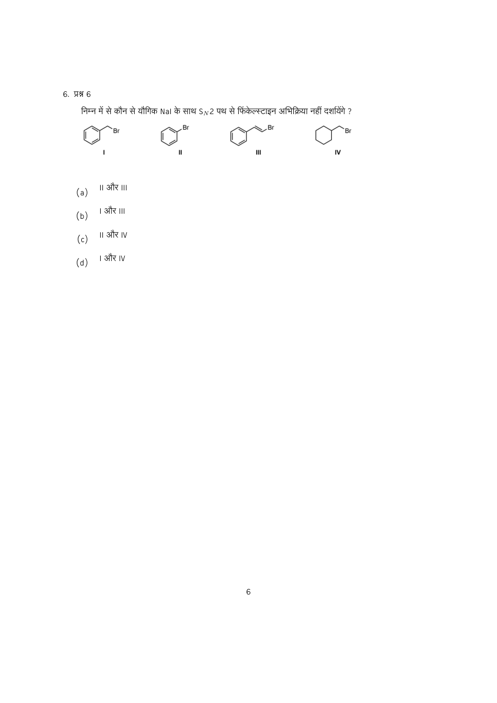

## PDF page 24

[Open original PDF at page 24](../pdf/IAT_2023_Hindi_paper.pdf#page=24)

### Searchable text - OCR draft (hin+eng)

```text
य. प्रश्न 7
निम्न में से कौन सा 7-प्रोपाइल बेंजीन के संश्लेषण का सबसे दक्ष तरीका है?

cl
( we

0) C anhydrous AICI;
6 (ii) KOH, NHp-NHp, A
oO ci anhydrous AICl3
SS
(ll) we + +30“+:
Oo Ht
OH
(Il) Uo + Hom —
C Ht
(lv) Uo +. hoa —
```

### Original page image

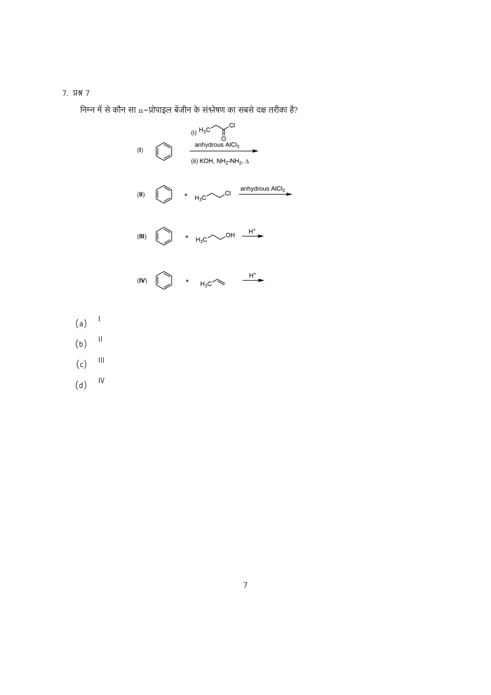

## PDF page 25

[Open original PDF at page 25](../pdf/IAT_2023_Hindi_paper.pdf#page=25)

### Searchable text - OCR draft (hin+eng)

```text
8. प्रश्न 8

निम्न में से कौन सा विकल्प काइरल यौगिकों के युग्म का उदाहरण है?

HoN H °
(2) a HO, or on
WW Ag il IV 8
o CJ 0 eA am () Ww) Cy
H;C CHs Me =

(a) ! और Iv

७) ! और iv

(c) ! और ॥

(a)! और ॥
```

### Original page image

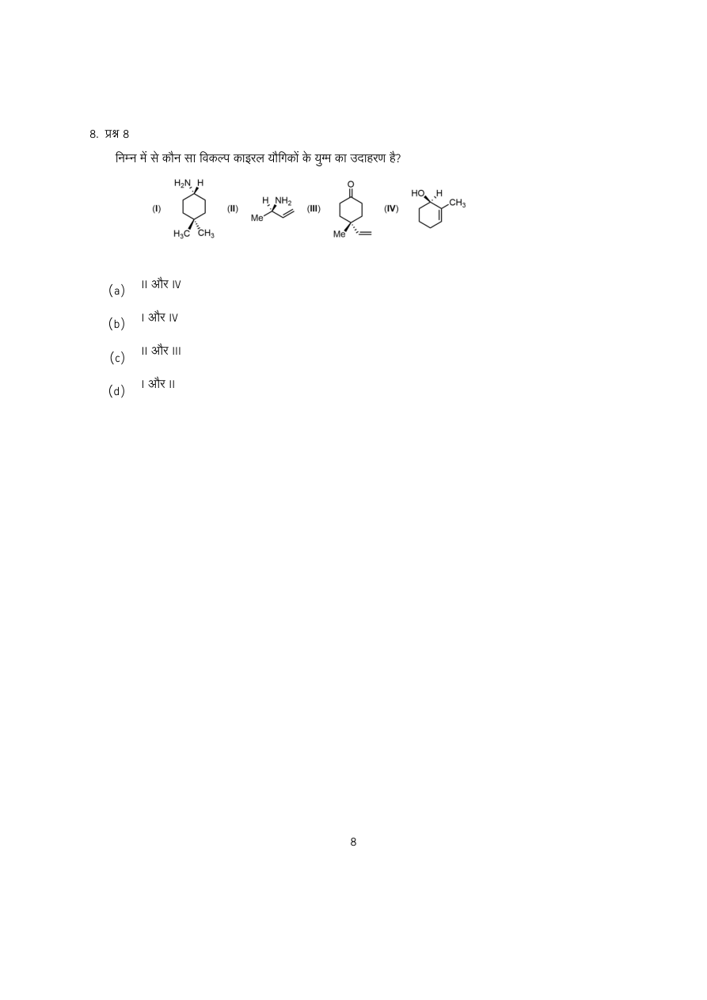

## PDF page 26

[Open original PDF at page 26](../pdf/IAT_2023_Hindi_paper.pdf#page=26)

**Matching embedded figure, English PDF page 26:** Chemistry Q9: four nitrogenous-base structures I-IV are drawn with their carbonyl, amino and methyl substituents. The task distinguishes a base absent from RNA.

### Searchable text - OCR draft (hin+eng)

```text
9. प्रश्न 9

निम्न में से कौन सा क्षार RNA में नहीं पाया जाता है?

NH, °

0) C “Na é NH (a)
wo “Lo,
(a) MM

७) |

(0 |

(0) ४

HC.

0

C

( x
```

### Original page image

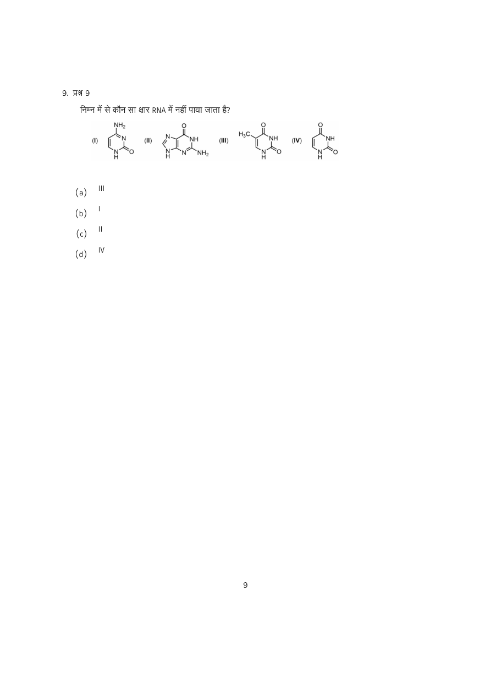

## PDF page 27

[Open original PDF at page 27](../pdf/IAT_2023_Hindi_paper.pdf#page=27)

### Searchable text - OCR draft (hin+eng)

```text
0. 44 40
निम्न में से कौन सी संरचनायें एरोमैटिक हैं?

CH;

o

H3C ‘CH;

(2) SR"
(७). और ४
(tak
(a) 'और॥

®

0

(i) O (॥)

i0

४ N
40)
```

### Original page image

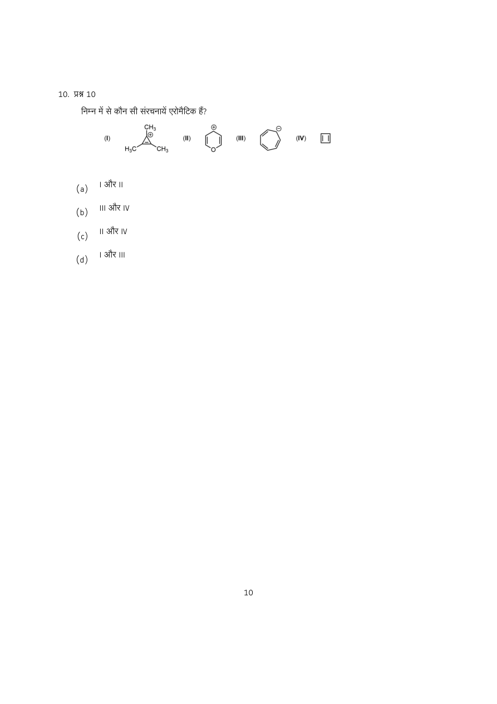

## PDF page 28

[Open original PDF at page 28](../pdf/IAT_2023_Hindi_paper.pdf#page=28)

### Searchable text - OCR draft (hin+eng)

```text
i. W442
गैसों की तुलना में द्रवों एवं ठोसों को संपीडित करना क्यों अधिक कठिन है?

द्रवों एवं ठोसों में अपु एक-दूसरे के अधिक सन्निकट होते हैं।
gal एवं ठोसों में इलेक्ट्रॉन और नाभिक के मध्य आकर्षण उपस्थित होता है।
द्रवों एवं ठोसों में इलेक्ट्रॉन और नाभिक के मध्य आकर्षण अनुपस्थित होता है।

द्रवों एवं ठोसों का आयतन निश्चित होता है।

वव
```

### Original page image

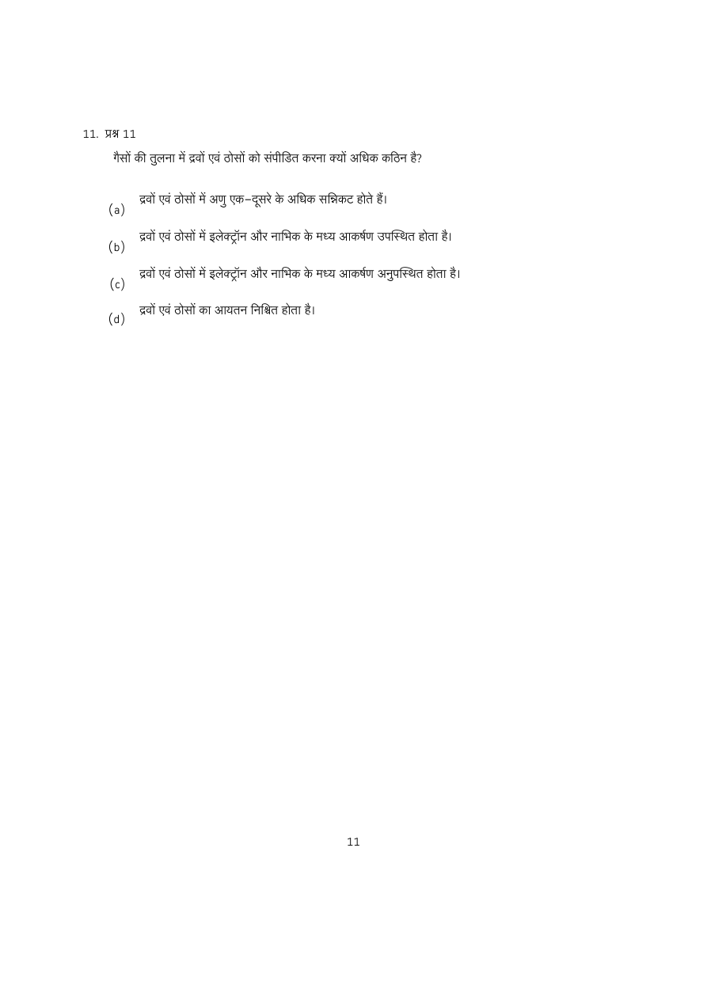

## PDF page 29

[Open original PDF at page 29](../pdf/IAT_2023_Hindi_paper.pdf#page=29)

### Searchable text - OCR draft (hin+eng)

```text
2. WA2

निम्नलिखित में से कौन सा कथन फ्रायन्डलिक के अधिशोषण समतापीवक्र के विषय में गलत
2

यह वक्र दाब के निस्सीमित विस्तार तक लागू होता है।

(a)

* का मान शून्य और एक के मध्य होता है।

(७) ”

फ्रायन्डलिक अधिशोषण समतापीवक्र का समीकरण एक प्रयोगाश्रित समीकरण है।

(०)

(a) इसका उपयोग गैसों एवं विलयनों के अधिशोषण के लिए किया जाता है।

i2
```

### Original page image

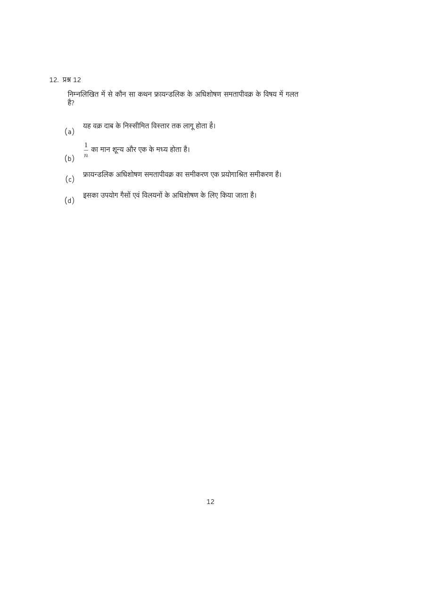

## PDF page 30

[Open original PDF at page 30](../pdf/IAT_2023_Hindi_paper.pdf#page=30)

### Searchable text - OCR draft (hin+eng)

```text
[No text recovered; use the original page image below.]
```

### Original page image

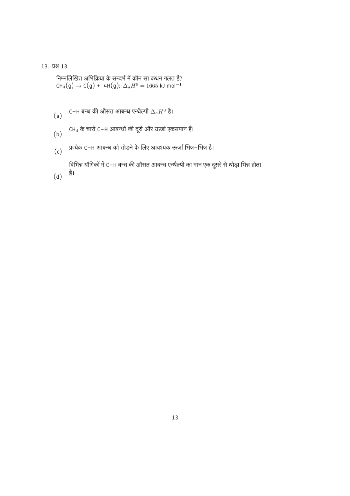

## PDF page 31

[Open original PDF at page 31](../pdf/IAT_2023_Hindi_paper.pdf#page=31)

### Searchable text - OCR draft (hin+eng)

```text
4. WI 4

दिए गए दो विलयनों x (हेक्जेन और बेंजीन ) तथा ४ (जल और हाइड्रोक्नोरिक अम्ल ) में राउल्ट
के नियम से किस प्रकार का विचलन देखा जायेगा?

क्रमशः कोई विचलन नहीं (आदर्श विलयन) और ऋणात्मक विचलन।
क्रमशः ऋणात्मक और धनात्मक विचलन।
क्रमशः धनात्मक और ऋणात्मक विचलन।

क्रमशः धनात्मक विचलन और कोई विचलन नहीं (आदर्श विलयन)।

4
```

### Original page image

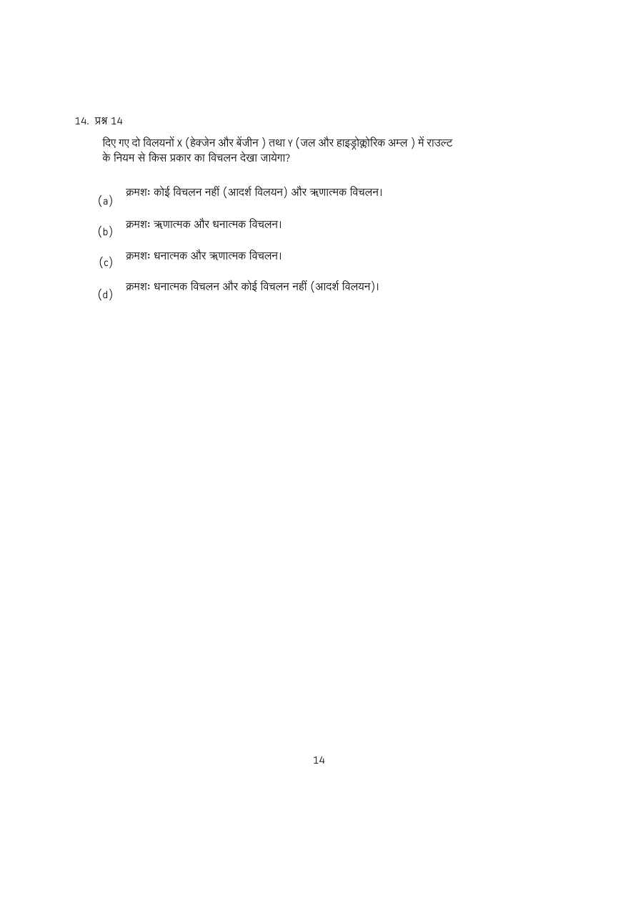

## PDF page 32

[Open original PDF at page 32](../pdf/IAT_2023_Hindi_paper.pdf#page=32)

### Searchable text - OCR draft (hin+eng)

```text
5. WH5

हाइड्रोनियम आयन जलीय विलयन मे पुनः जल-योजित होकर निम्न में से कौन सी प्रजाति
(स्पीशीस) बनाती है?

(a) HoO4t
(७) H7O4t
(c) H30.+
(a) Hs03+

a5
```

### Original page image


## PDF page 33

[Open original PDF at page 33](../pdf/IAT_2023_Hindi_paper.pdf#page=33)

### Searchable text - OCR draft (hin+eng)

```text
गणित

l. Wal

मान लीजिये f : R -> (0, ००) एक सतत SRAM फलन है। यदि f(0), f(L),.-., F(20)
एक ऐसी गुणोत्तर श्रेणी में है जिसका सार्वानुपात 2 है, तो |,” /(:)०% का मान निम्नलिखित
में से किस अन्तराल में होगा?

(0, 2/(0))

(4/(0), 6/(0))

(8/(0), L0f(0))

(2/(0), 4 f(0))
```

### Original page image

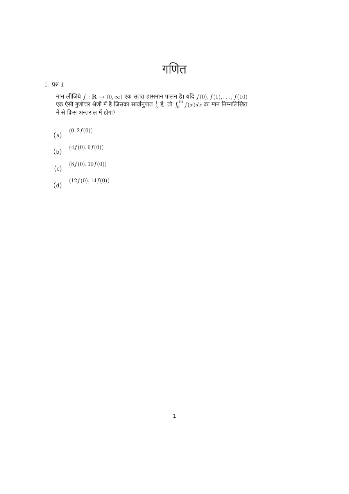

## PDF page 34

[Open original PDF at page 34](../pdf/IAT_2023_Hindi_paper.pdf#page=34)

### Searchable text - OCR draft (hin+eng)

```text
2. प्रश्न 2

यदि 3 x 3 आकार का एक आव्यूह M इस प्रकार है कि

व xy 0 xy
22 | :M 82 | = |0 = 22 | : छा +%2=0=424+43},
3 23, 0 3

aM के सारणिक का मान क्या है?
```

### Original page image

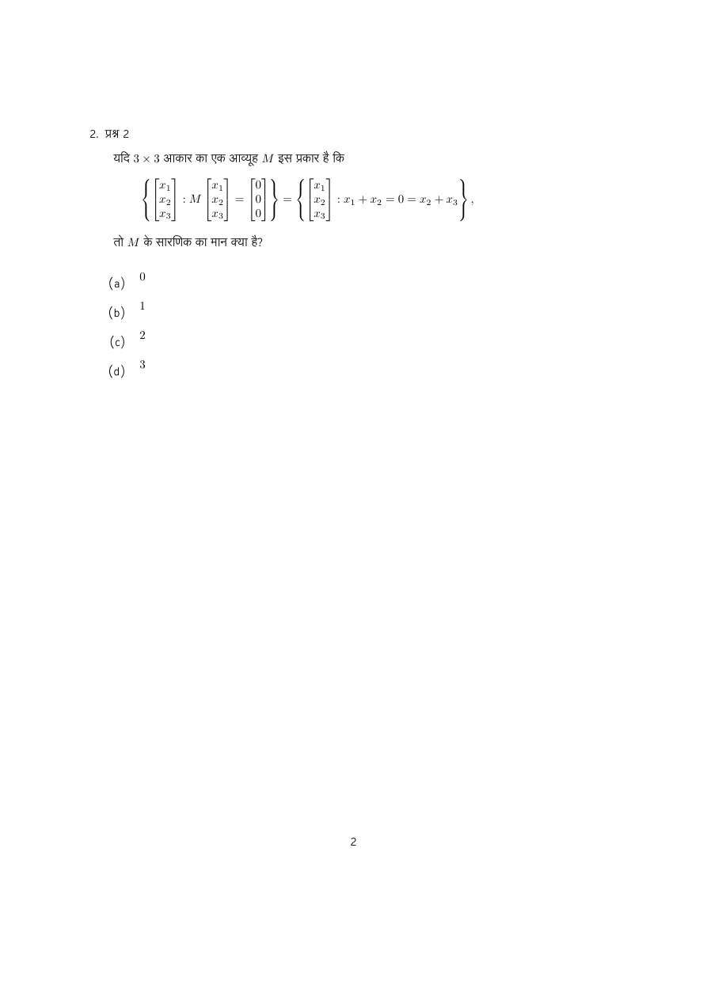

## PDF page 35

[Open original PDF at page 35](../pdf/IAT_2023_Hindi_paper.pdf#page=35)

### Searchable text - OCR draft (hin+eng)

```text
3. प्रश्न 3

मूल बिन्दु (0, 0) से गुज़रने वाले एक समान त्रिज्या के वृत्तों के केन्द्र का पथ क्या होगा?
वृत्त

(b) अतिपरवलय

(०) WA

(a) रेखा
```

### Original page image

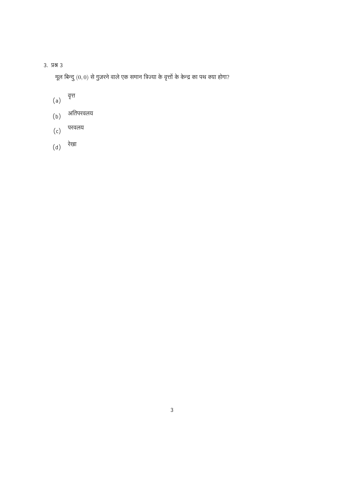

## PDF page 36

[Open original PDF at page 36](../pdf/IAT_2023_Hindi_paper.pdf#page=36)

### Searchable text - OCR draft (hin+eng)

```text
4. प्रश्न 4

मान लीजिये a एक वास्तविक संख्या है। परवलय y = 2? + desing + 6 और सरल रेखाओं
का युग्म y? = कुल कितने बिन्दु/बिन्दुओं पर प्रतिच्छेद करते हैं?

शून्य

(a)
```

### Original page image

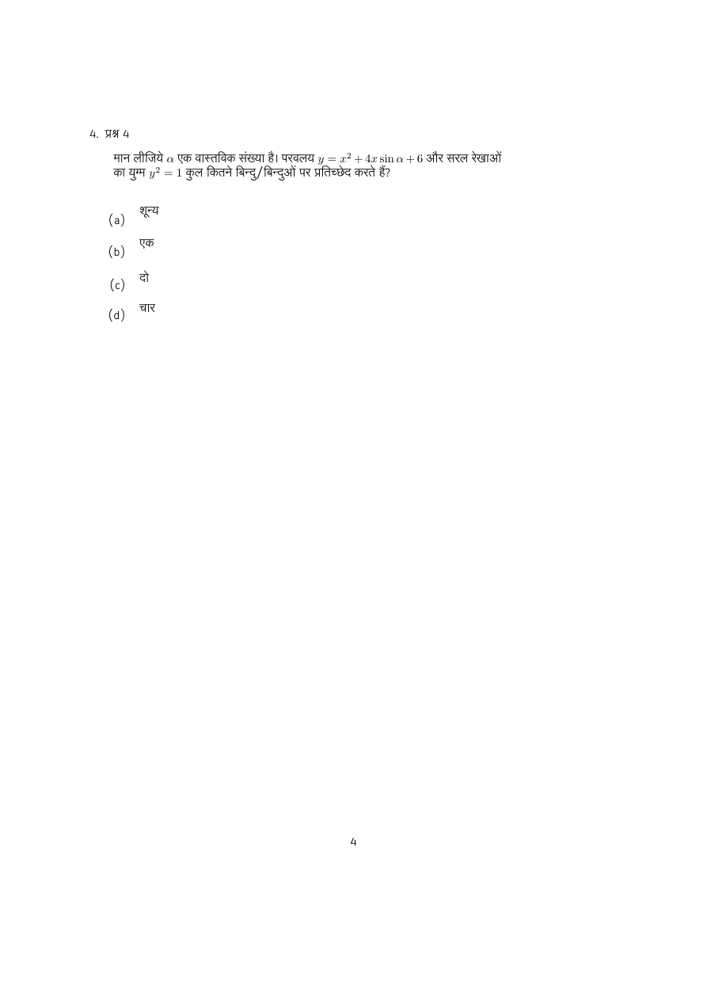

## PDF page 37

[Open original PDF at page 37](../pdf/IAT_2023_Hindi_paper.pdf#page=37)

### Searchable text - OCR draft (hin+eng)

```text
5. प्रश्न 5

मान लीजिये एक सरल रेखा L मूल बिन्दु से होकर जाती है, तथा धनात्मक निर्देशाक्षों xX, ४
एवं 2-अक्षों के साथ क्रमशः a, (2 तथा HiT बनाती है। तब, cos 2a + cos 28 + cos 27
का मान क्या है?

न

(a)
(७) *
() |
(a) 5
```

### Original page image

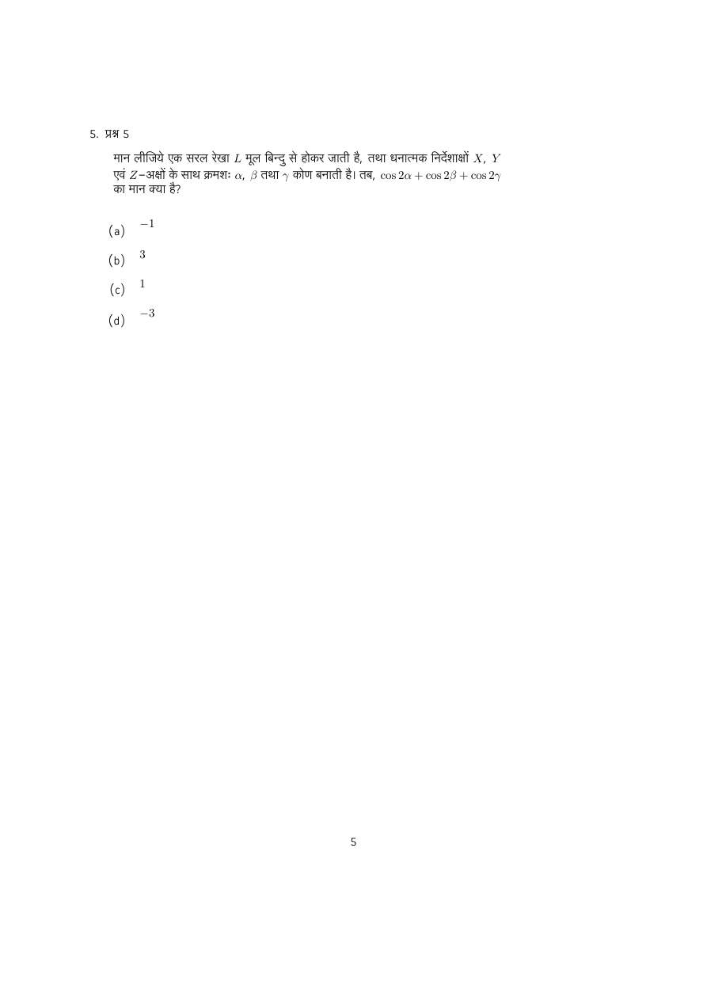

## PDF page 38

[Open original PDF at page 38](../pdf/IAT_2023_Hindi_paper.pdf#page=38)

### Searchable text - OCR draft (hin+eng)

```text
6. प्रश्न 6
संख्या 2° x 37१ के कुल कितने भिन्न-भिन्न विभाजक हैं?

(a) 200

(b) 30

(c) 435

(०) 00
```

### Original page image

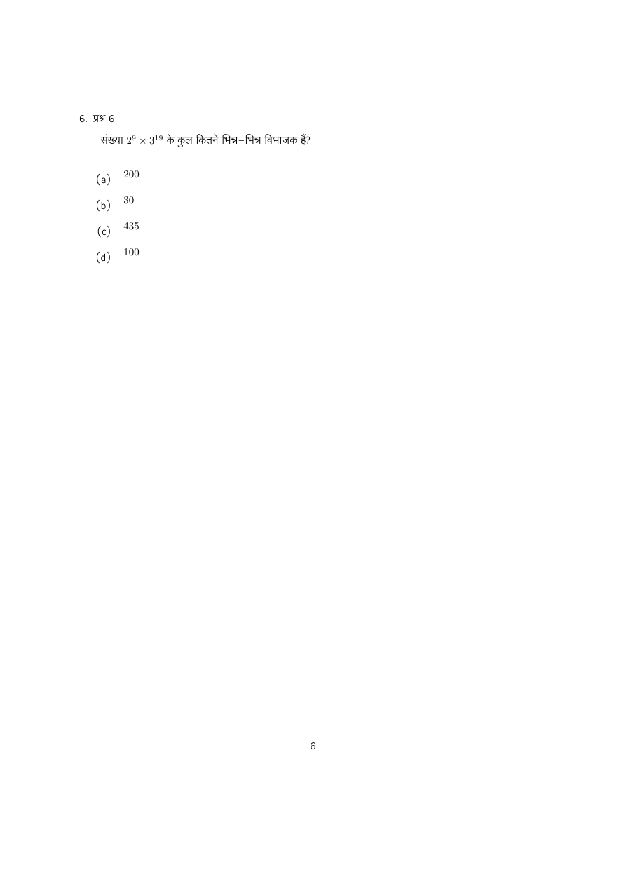

## PDF page 39

[Open original PDF at page 39](../pdf/IAT_2023_Hindi_paper.pdf#page=39)

### Searchable text - OCR draft (hin+eng)

```text
उ. प्रश्न 7

मान लीजिये आँकड़ों {arr 22, - * * ,29) का माध्य तथा मानक विचलन क्रमशः pp तथा ०(# 0)
है। मान लीजिये कि एक और आँकड़ा 249 शामिल करने के बाद आँकड़ों (&], 22, - * * , 29, 20)
का माध्य | ही रहता है। तो आँकड़ों (&], 22, - - - , x9, 29} का मानक विचलन FA होगा?

3 o
(a) ४
V0 ०
छ) 3.
20 o
() 9
a o
(a) 20
```

### Original page image

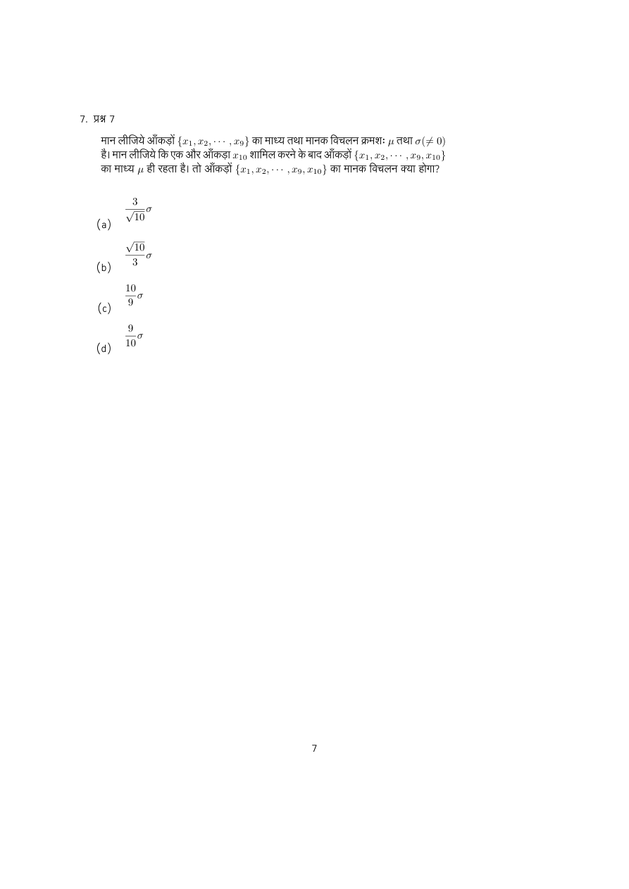

## PDF page 40

[Open original PDF at page 40](../pdf/IAT_2023_Hindi_paper.pdf#page=40)

### Searchable text - OCR draft (hin+eng)

```text
8. प्रश्न 8

तीन भिनत (biased) सिक्के लीजिये। मान लीजिये कि हर एक सिक्के के लिये ue आने की
प्रायिकता — तथा चित्त आने की प्रायिकता = है। तीनों सिक्कों को एक के बाद एक उछालने के

परीक्षण में निम्नलिखित घटनाओं की परिकल्पना कीजिये।

+7: “कम से कम दो पट्‌ आते हैं।”
F: “पहला सिक्का चित्त आता है।”

घटना 7 की सप्रतिबंध प्रायिकता क्या है, जबकि ज्ञात है कि घटना F घटित हो चुकी है?

श्र
o
० ++

colNm

=
Ble

Ole
```

### Original page image

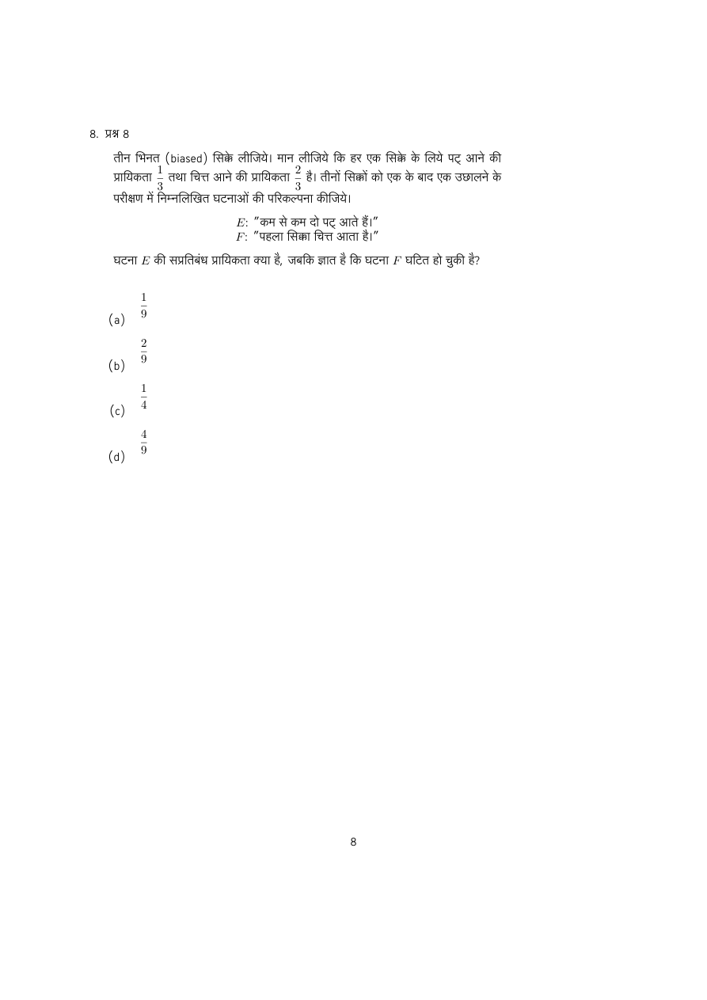

## PDF page 41

[Open original PDF at page 41](../pdf/IAT_2023_Hindi_paper.pdf#page=41)

### Searchable text - OCR draft (hin+eng)

```text
9. प्रश्न 9
निम्नलिखित अवकल समीकरणों FS y = ०" किस समीकरण का विशिष्ट हल है?

dy
-e

dy 2 _ 22०
vse 2 OY P
(a) A dx

+y =e

a d
vss + on +y? =e
७) *
ay dy
ys +p ae

2
(c) dx dx

a d
Z oy e a +y=e
(०)
```

### Original page image

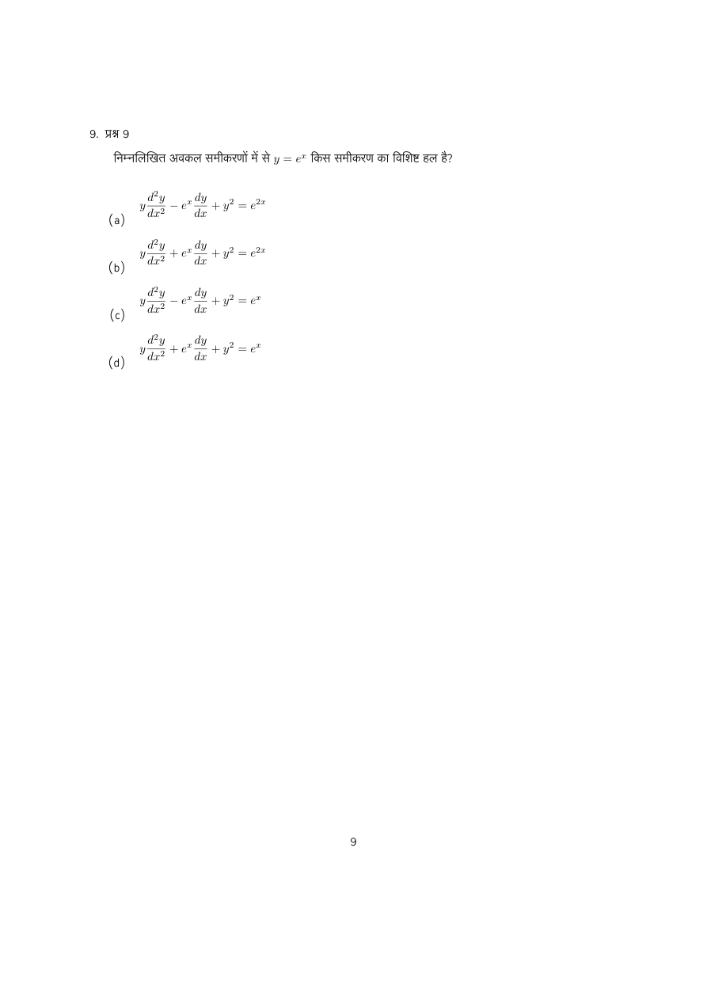

## PDF page 42

[Open original PDF at page 42](../pdf/IAT_2023_Hindi_paper.pdf#page=42)

### Searchable text - OCR draft (hin+eng)

```text
0. 4H l0
क्षेत्र

का क्षेत्रफल क्या है?

ह॥

७) 2”
(७)
(०)
(a)

i0
```

### Original page image

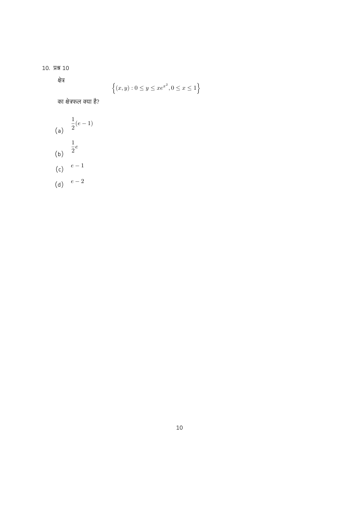

## PDF page 43

[Open original PDF at page 43](../pdf/IAT_2023_Hindi_paper.pdf#page=43)

### Searchable text - OCR draft (hin+eng)

```text
2. 44 2

उद्देश्य फलन 2 = ax - y का न्यूनतम मान व्यवरोधों

के अंतर्गत क्या होगा?

a+2y <0

aty>2
z>0,y>0

वव
```

### Original page image

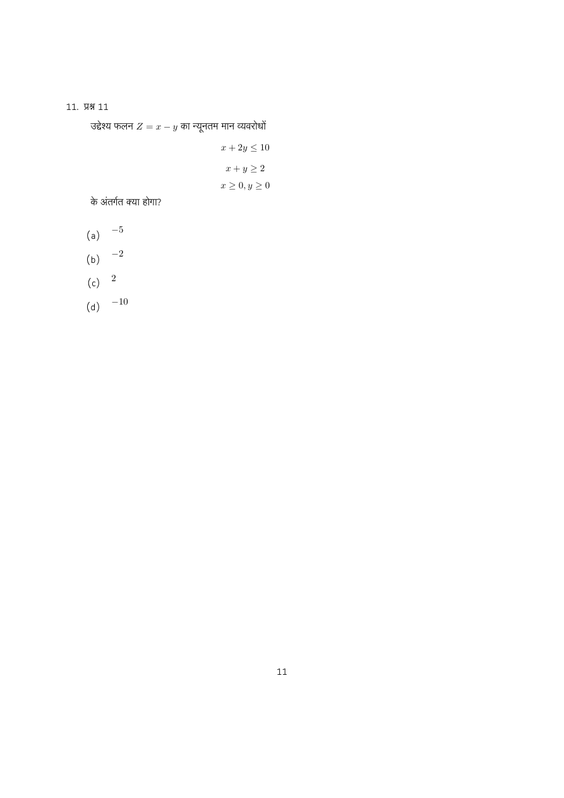

## PDF page 44

[Open original PDF at page 44](../pdf/IAT_2023_Hindi_paper.pdf#page=44)

### Searchable text - OCR draft (hin+eng)

```text
2. WA2

मान लीजिये p(w) = a? + br + ८ एक द्विघातीय बहुपद है, जहाँ b तथा ८ वास्तविक गुणांक
हैं । यदि p() = 5 तथा p(—) = 3 हैं, तो #(४) = 0 के मूलों का गुणनफल क्या है?

i2
```

### Original page image

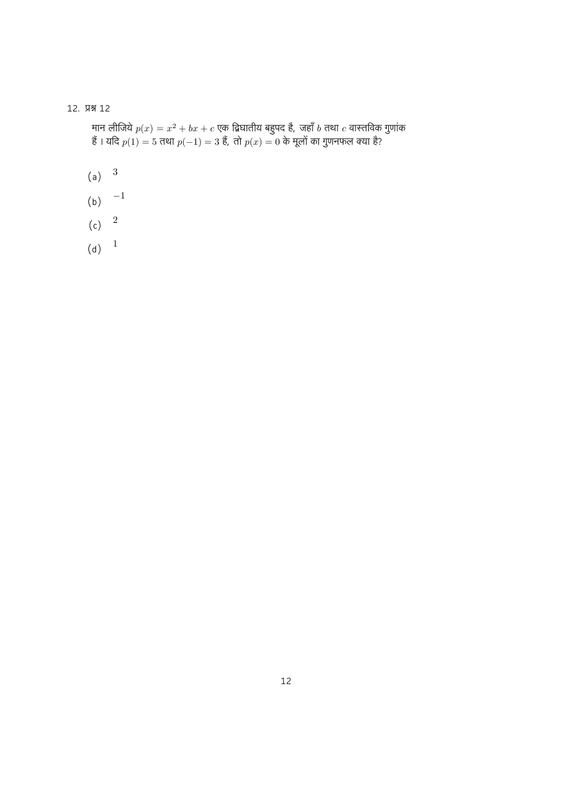

## PDF page 45

[Open original PDF at page 45](../pdf/IAT_2023_Hindi_paper.pdf#page=45)

### Searchable text - OCR draft (hin+eng)

```text
43. प्रश्न 3
मान लीजिये एक अवकलनीय फलन | : (-, 2) -> R इस प्रकार है कि

/०+ छू = तथा /(0)-0,

तब f() का मान नीचे दिये गये किस अंतराल में है?

(-००, 0)
(0,2)
(2,4)

(4, 00)

i3
```

### Original page image

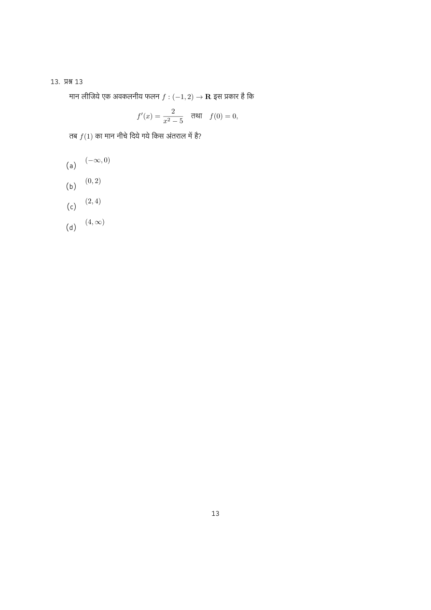

## PDF page 46

[Open original PDF at page 46](../pdf/IAT_2023_Hindi_paper.pdf#page=46)

### Searchable text - OCR draft (hin+eng)

```text
4. WI 4

एक फलन f(x) = sin(3x), x € (0. | लीजिये। निम्नलिखित में से कौन सा कथन सत्य
है?

फलन f अन्तराल में हासमान है।

फलन f अन्तराल में वर्धमान है।
q अन्तराल TT में हासमान
फलन / अन्तराल में वर्धभान है तथा अन ( 32 ) में हासमान है।

फलन / अन्तराल में हासमान है तथा अन्तराल ( 32 ) में वर्धमान है।

4
```

### Original page image

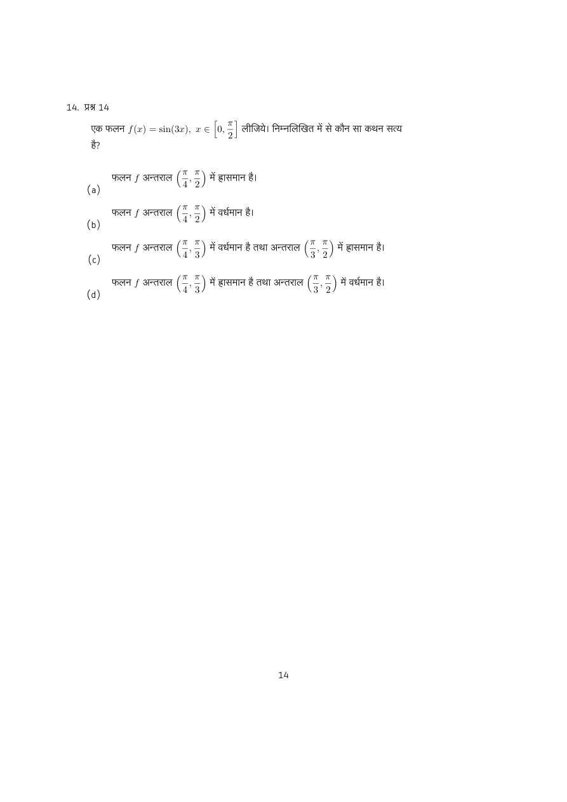

## PDF page 47

[Open original PDF at page 47](../pdf/IAT_2023_Hindi_paper.pdf#page=47)

### Searchable text - OCR draft (hin+eng)

```text
5. WH5

निम्नलिखित में से कौन सा फलन x = 0 पर अवकलनीय है?
cos |2°|

sin ||

|x|?

i

a5
```

### Original page image

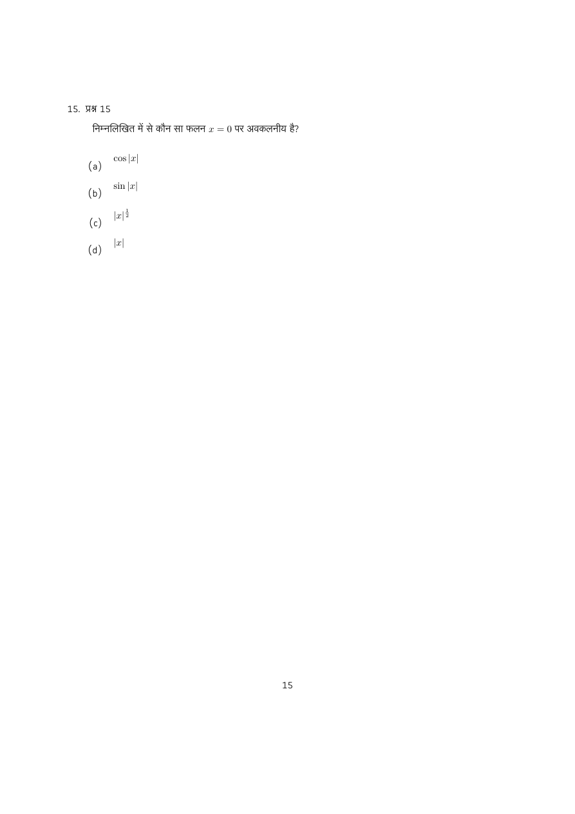

## PDF page 48

[Open original PDF at page 48](../pdf/IAT_2023_Hindi_paper.pdf#page=48)

### Searchable text - OCR draft (hin+eng)

```text
भौतिक विज्ञान

पृथ्वी की सतह से # ऊँचाई से एक गेंद को ऊपर की दिशा में आरंभिक चाल wu से फेंका जाता
है। गेंद अंतत: पृथ्वी की सतह से ७ चाल से टकराती है। गुरुत्वीय त्वरण का मान 9 है तथा वायु
का घर्षण नगप्य है। संपूर्ण प्रक्षेप पथ में गेंद की औसत चाल क्या होगी?

हा +07
(a) 2(७+ ४)
0 ने
(o)
gh
(c) 2(७+ ४)
u? + gh
(०) 2(७+ ४)
```

### Original page image

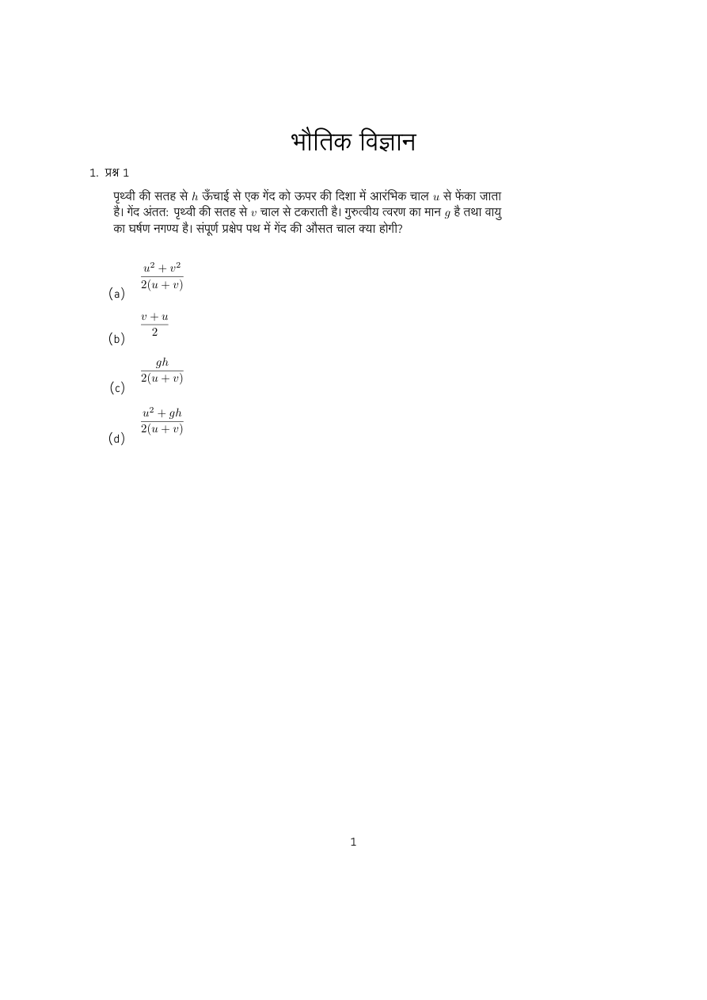

## PDF page 49

[Open original PDF at page 49](../pdf/IAT_2023_Hindi_paper.pdf#page=49)

### Searchable text - OCR draft (hin+eng)

```text
2. प्रश्न 2

एकसमान आकार के दो घन, A तथा 8, दो अलग-अलग पदार्थों से बने हैं, जिनके घनत्व क्रमश:
pa तथा pp Sl पानी में छोड़ने पर घन ॥ के आयतन का अंश # पानी में डूबा रहता है। यदि घन
8 को घन A के ऊपर रखा जाये तो घन # पानी में लगभग पूरा डूबा रहता है तथा घन 8 संपूर्णत:
पानी की सतह के ऊपर रहता है। घनत्वों का अनुपात 98//» FA होगा?

(a) (l—n)/n
(b) n/(l-n)
(०) ”

(०) L/n
```

### Original page image

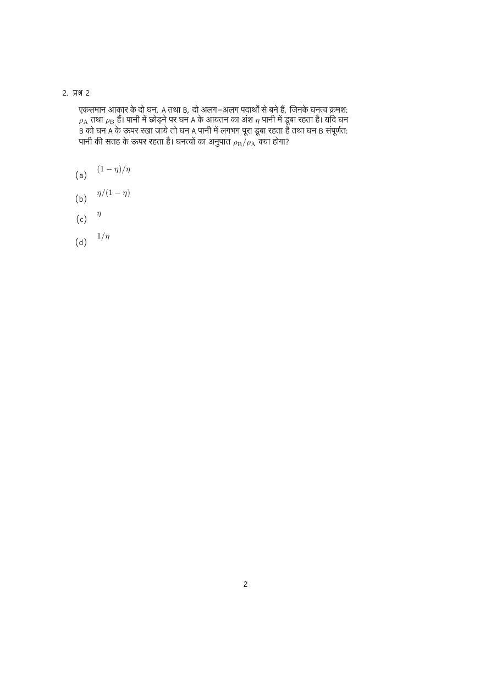

## PDF page 50

[Open original PDF at page 50](../pdf/IAT_2023_Hindi_paper.pdf#page=50)

### Searchable text - OCR draft (hin+eng)

```text
3. प्रश्न 3

किसी वस्तु को एक उत्तल लेंस के सामने रखे जाने पर उसके वास्तविक vee प्रतिबिंब का
आकार दोगुना होता है। जब वस्तु को लेंस की दिशा में ८ दूरी से विस्थापित किया जाता है तो
प्रतिबिंब अपने पूर्वस्थान से sd की दूरी से, लेंस से दूर की तरफ़, विस्थापित हो जाता है। अंतिम
स्थिति में प्रतिबिम्ब के आवर्धन का मान क्या होगा?

(a) 4
4/2

(a) 7
```

### Original page image

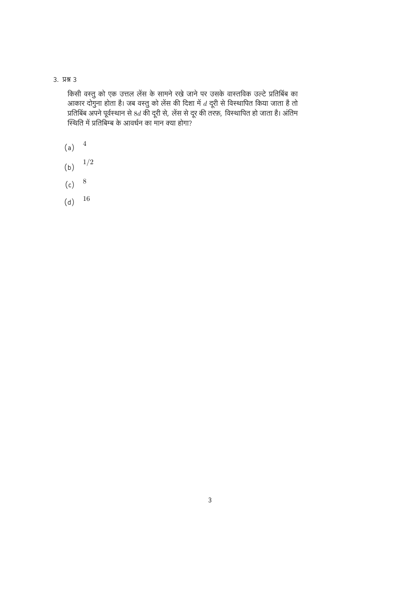

## PDF page 51

[Open original PDF at page 51](../pdf/IAT_2023_Hindi_paper.pdf#page=51)

### Searchable text - OCR draft (hin+eng)

```text
[No text recovered; use the original page image below.]
```

### Original page image

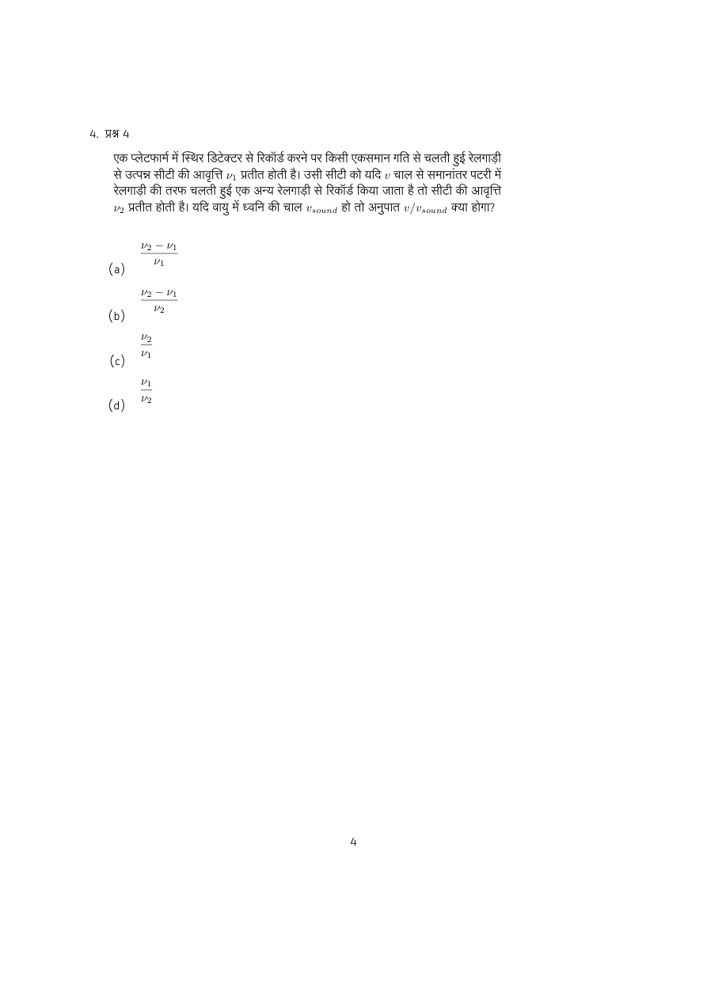

## PDF page 52

[Open original PDF at page 52](../pdf/IAT_2023_Hindi_paper.pdf#page=52)

### Searchable text - OCR draft (hin+eng)

```text
[No text recovered; use the original page image below.]
```

### Original page image


## PDF page 53

[Open original PDF at page 53](../pdf/IAT_2023_Hindi_paper.pdf#page=53)

### Searchable text - OCR draft (hin+eng)

```text
[No text recovered; use the original page image below.]
```

### Original page image


## PDF page 54

[Open original PDF at page 54](../pdf/IAT_2023_Hindi_paper.pdf#page=54)

### Searchable text - OCR draft (hin+eng)

```text
उ. प्रश्न 7

किसी समय # पर एक कुंडली से गुजरने वाला चुंबकीय GAT op (t) = Go coswt है, जहाँ
0 < wt <7 और ७७ SES अचर है। किस समय पर कुंडली में प्रेरित विद्युत वाहक बल का
मान अधिकतम होगा?

(a) Qu
७) “
(0 ४
(a) °
```

### Original page image


## PDF page 55

[Open original PDF at page 55](../pdf/IAT_2023_Hindi_paper.pdf#page=55)

### Searchable text - OCR draft (hin+eng)

```text
8. प्रश्न 8

Si- आधारित एक नैज अर्धचालक में इलेक्ट्रॉनों एवं होलों की नैज वाहक सांद्रताएँ क्रमश: nM
etn) से निरूपित की जाती हैं। इस अर्धचालक को त्रिसंयोगी अशुद्धियों से ऐसे अपमिश्रित

किया जाता है कि वाहक सांद्रताएँ क्रमश: #८ तथा +% हो जाती हैं। निम्नलिखित में से कौन सा
कथन सही है?

0
Nh > nit )

Ne > Nn 0 )

Ne = Nh

nO) तथा n© तापमान पर निर्भर नहीं करती हैं।
```

### Original page image


## PDF page 56

[Open original PDF at page 56](../pdf/IAT_2023_Hindi_paper.pdf#page=56)

### Searchable text - OCR draft (hin+eng)

```text
9. प्रश्न 9
एकविमीय गति करते हुए किसी कण का वेग v(t) निम्नलिखित रूप से परिभाषित है:

at, 0<t<T/3
v(t)=¢ ८०7५3, T/3<t<2T/3
a(T—t), 2T/3<t<T,

जहाँ ० (F 0) एक अचर राशि है। समय & = 0 से # = T तक कण का कुल विस्थापन क्या
होगा?

2aT?
(a) 9
4daT?
(७) 9
8aT?
(c) 9
TaT?
(4) 9
```

### Original page image


## PDF page 57

[Open original PDF at page 57](../pdf/IAT_2023_Hindi_paper.pdf#page=57)

### Searchable text - OCR draft (hin+eng)

```text
0. W420

आवेश +g वाले दो स्थिर कण aL की दूरी पर स्थित हैं। आवेश +g एवं द्रव्यमान m वाला एक
और कण इन दोनों के बीच अपनी साम्य अवस्था के इर्द-गिर्द दोलन कर रहा है (जैसा कि चित्र
में दर्शाया गया है)। दोलन की अवधि T = 2#7/20,/7%/9 द्वारा दी गयी है। यदि eo Prat
का परावैद्युतांक है तो निम्न में से कौन सा विकल्प मापन की 5। प्रणाली में Ht सही विमा को
दर्शाता है?

2L
e oe e
+q +q,m +q

€ ‘ /2 73/2
€ * 7,
€ 8 /2 7 /2

€ 4 /2 7,

i0
```

### Original page image


## PDF page 58

[Open original PDF at page 58](../pdf/IAT_2023_Hindi_paper.pdf#page=58)

### Searchable text - OCR draft (hin+eng)

```text
2. 44 2

चित्र में प्रदर्शित परिपथ के बिन्दुओं a तथा 8 के बीच एक समतुल्य प्रतिरोध की मात्रा का मान
क्या होगा?

वव
```

### Original page image


## PDF page 59

[Open original PDF at page 59](../pdf/IAT_2023_Hindi_paper.pdf#page=59)

### Searchable text - OCR draft (hin+eng)

```text
2. WA2

द्रव्यमान M एवं त्रिज्या 7? के दो गोले A तथा 8 ऐसे रखे गये हैं कि उनके केंद्रों के बीच की दूरी

47 है। द्रव्यमान m का एक पिंड C गोले A की सतह से 9 के केंद्र की दिशा में वेग vg = 20,,,७
से प्रक्षेपित किया जाता है। ७,, वह न्यूनतम वेग है जिससे प्रक्षेपित किये जाने पर पिंड C गोले

B की सतह तक पहुँच सकता है। यदि 6 गुरुत्वाकर्षण का नियतांक है, तो पिंड (! की चाल v(x)
गोले » के केंद्र से उसकी दूरी x के साथ कैसे बदलती है?

vo
A > B
i

4R

(a)
(5)
v(x) = ain
(०)
(०)

i2
```

### Original page image


## PDF page 60

[Open original PDF at page 60](../pdf/IAT_2023_Hindi_paper.pdf#page=60)

### Searchable text - OCR draft (hin+eng)

```text
3. WA 33

किसी परमाणु के बोर मॉडल में आवेश -८ वाला एक इलेक्ट्रॉन आवेश +e वाले नाभिक से +
दूरी वाली कक्षा में स्थापित है। इलेक्ट्रॉन का कोणीय संवेग 2# है। यदि नाभिक का आवेश +2€
होता तो उसी मुख्य क्वांटम संख्या वाले इलेक्ट्रॉन के कक्षा की त्रिज्या क्या होती?

r/2

(b) 2r
(c) 7

V2r

i3
```

### Original page image


## PDF page 61

[Open original PDF at page 61](../pdf/IAT_2023_Hindi_paper.pdf#page=61)

### Searchable text - OCR draft (hin+eng)

```text
4. WI 4

किसी राशि की मात्रा मापन की fret इकाइयों F 0.00230 आँकी गई है। इस मात्रा के माप में
कितने सार्थक अंक हैं?

(a) 3
(b) °
(c) “
(a) ?

4
```

### Original page image


## PDF page 62

[Open original PDF at page 62](../pdf/IAT_2023_Hindi_paper.pdf#page=62)

### Searchable text - OCR draft (hin+eng)

```text
5. WH5

एक कार्नो इंजन 600 K के तापमान वाले एक ऊष्मा-भंडार एवं 300 K के तापमान वाले बाह्य
परिवेश के मध्य कार्य कर रहा है। इसके किसी एक चक्र में 000 ks की ऊष्मा ऊष्मा-भंडार से
ली जाती है और तदनुरूप निर्गत कार्य को एक उत्क्रमणीय प्रशीतक, जो कि 200 kK के तापमान
एवं उसी बाह्य परिवेश (जिसका तापमान 300 K @) के मध्य कार्य कर रहा है, में निविष्ट किया
जाता है। प्रशीतक भी एक चक्र पूर्ण होने पर वातावरण में कुछ ऊष्मा Fria करता है। संपूर्ण
संयुक्त निकाय के एक चक्र के पूर्ण होने पर परिवेश में कितनी ऊष्मा निर्गत होगी?

2000 kJ
(a)

2500 kJ
(०)

4000 kJ
(०)

500 kJ
(०)

a5
```

### Original page image


