# IAT 2024 - English

Original PDF: [IAT_2024_English_paper.pdf](../pdf/IAT_2024_English_paper.pdf)

- Acquisition: SciAstra CloudFront mirror; not downloaded from the official server.
- Downloaded: 28 October 2026. PDF pages: 63.
- Exact download/source URL: https://d2aaa7ts7sm3bp.cloudfront.net/pdfs/01KMFRC7Q0CKVE3P4D57FHJ85P.pdf
- PDF SHA-256: `4241376374919368c3b357831f2c65e72d07634bf3ac2e7bd40a45b969fa0757`
- This is a search/accessibility copy of an existing paper, not newly authored mock content.
- Text is mechanically extracted or OCR-derived and has not been proofread character by character. Equations, option letters, chemical bonds, tables and Hindi OCR can contain errors. The PDF and page images are authoritative.
- Figure descriptions are explanatory annotations, not official answers or complete structural/formula transcriptions. Use the linked image to resolve exact labels, values and stereochemistry.

## Visual guide

- [English PDF page 2](#pdf-page-2): Biology Q2: a pedigree of a rare disorder uses shaded circles/squares for affected females/males and open symbols for unaffected members. Affected individuals appear in several branches over multiple generations.
- [English PDF page 3](#pdf-page-3): Biology Q3: a matching table pairs disorders with physiological effects, including immune response and hormone-related conditions.
- [English PDF page 7](#pdf-page-7): Biology Q7: three candidate photosynthesis-rate versus light-intensity graphs are shown: a rise followed by a plateau, a sigmoidal rise and an arch that falls. The fourth candidate continues on page 8.
- [English PDF page 8](#pdf-page-8): Continuation of Biology Q7, option (d): a straight line through the origin increases without a plateau on the same X-Y axes.
- [English PDF page 9](#pdf-page-9): Biology Q8: a matching table compares enzymes with possible cellular compartments. The row and compartment labels, not their position after text extraction, define the choices.
- [English PDF page 10](#pdf-page-10): Biology Q9: reciprocal crosses are drawn between plant species P (2n=20) and Q (2n=30). Female/male symbols reverse between the two crosses; resulting F1 seed groups are labelled R and S.
- [English PDF page 12](#pdf-page-12): Biology Q11: plasmid-vector alternatives (a) and (b) show Ori, AmpR and restriction sites BamHI and EcoRI in different positions. The other two alternatives continue on page 13.
- [English PDF page 13](#pdf-page-13): Continuation of Biology Q11: vector alternatives (c) and (d). Compare whether the cloning sites disrupt the marked origin or antibiotic-resistance region; do not assume all circular maps are equivalent.
- [English PDF page 17](#pdf-page-17): Biology Q15: three sigmoidal oxygen-dissociation curves A, B and C are horizontally displaced on axes of oxygen partial pressure and haemoglobin saturation. The question relates the shifts to proton concentration.
- [English PDF page 23](#pdf-page-23): Chemistry Q6: two sawhorse-like drawings show substituents H, F, OH and CH3 around a carbon-carbon bond; their relative orientation is needed to classify the relationship between the structures.
- [English PDF page 24](#pdf-page-24): Chemistry Q7: four phenolic structures M, N, P and Q differ in methyl and nitro substitution, including a multiply nitrated ring. These structures supply the acidity comparison.
- [English PDF page 25](#pdf-page-25): Chemistry Q8: two aromatic reaction sequences lead to products N and Q. Reagents appear above the arrows and four answer rows present different structure pairs; preserve cyano/carboxyl and aldehyde/alcohol distinctions.
- [English PDF page 26](#pdf-page-26): Chemistry Q9: a multistep reaction has missing starting material X and product Z, followed by a phenyl-substituted carbonyl product. The options specify alternative alkynes and aldehydes.
- [English PDF page 27](#pdf-page-27): Chemistry Q10: cyclic carbohydrate structures M and N have hydroxyl groups above/below the ring and ring oxygen atoms. The alternatives distinguish sugar identity, ring size and alpha/beta configuration.
- [English PDF page 30](#pdf-page-30): Chemistry Q13, options (a) and (b): concentration [R] versus time is shown either as a straight decrease or as a curved decay. The remaining rate-law graph alternatives continue on page 31.
- [English PDF page 31](#pdf-page-31): Continuation of Chemistry Q13: option (c) is a descending straight line for ln[R] versus t; option (d) rises linearly for log([R]0/[R]) versus t.
- [English PDF page 32](#pdf-page-32): Chemistry Q14: four osmotic-pressure Pi versus solution-volume V plots include reciprocal-like decays and straight increasing/decreasing alternatives, with differing intercept behaviour.
- [English PDF page 33](#pdf-page-33): Chemistry Q15: a two-row data table gives KCl concentration and molar conductivity, with units in the headings. The requested limiting conductivity must be inferred from both data pairs.
- [English PDF page 48](#pdf-page-48): Mathematics Q15: a geometric construction marks points Q, A, P, B and C, a horizontal base, vertical segments and intersecting oblique lines. Right-angle conditions and labelled lengths determine PQ.
- [English PDF page 51](#pdf-page-51): Physics Q3: a cord passes over a massive disc pulley with moment of inertia. Masses M/2 and M hang at the two ends; the pulley radius R and mass M are indicated.
- [English PDF page 52](#pdf-page-52): Physics Q4: an oil-filled tank contains a point mass suspended by a string from a fixed point. A dotted circular path has bottom point A, side point B and top point C, with the initial velocity arrow at A; buoyancy and circular motion are relevant.
- [English PDF page 57](#pdf-page-57): Physics Q9: charges +q and +2q lie on the horizontal axis at x=-l/2 and x=+l/2. A charge -q lies above the origin at y=l/2. Axes and marked coordinates locate the requested force.
- [English PDF page 58](#pdf-page-58): Physics Q10: an AC source drives a network with resistor R on the top edge, capacitor C on the right, inductor L on the bottom, and another resistor R along a diagonal. Junctions at the diagonal endpoints set the topology.
- [English PDF page 59](#pdf-page-59): Physics Q11: a current-carrying wire bends through perpendicular segments in three dimensions. Segment lengths a and b and Cartesian unit-vector directions are indicated; the arrows show the current orientation.
- [English PDF page 60](#pdf-page-60): Physics Q12: two capacitors C1 and C2, a cell, and a switch with positions X, Y and Z are drawn in one charging/connection circuit. Switch positions must not be read as permanently connected junctions.
- [English PDF page 62](#pdf-page-62): Physics Q14: two stacked transparent slabs lie between an external medium above and below. Their refractive indices and the upper slab thickness of 1 cm are labelled; a ray enters obliquely at 45 degrees and emerges through the lower face.

## Page index

[p1](#pdf-page-1) | [p2](#pdf-page-2) | [p3](#pdf-page-3) | [p4](#pdf-page-4) | [p5](#pdf-page-5) | [p6](#pdf-page-6) | [p7](#pdf-page-7) | [p8](#pdf-page-8) | [p9](#pdf-page-9) | [p10](#pdf-page-10) | [p11](#pdf-page-11) | [p12](#pdf-page-12) | [p13](#pdf-page-13) | [p14](#pdf-page-14) | [p15](#pdf-page-15) | [p16](#pdf-page-16) | [p17](#pdf-page-17) | [p18](#pdf-page-18) | [p19](#pdf-page-19) | [p20](#pdf-page-20) | [p21](#pdf-page-21) | [p22](#pdf-page-22) | [p23](#pdf-page-23) | [p24](#pdf-page-24) | [p25](#pdf-page-25) | [p26](#pdf-page-26) | [p27](#pdf-page-27) | [p28](#pdf-page-28) | [p29](#pdf-page-29) | [p30](#pdf-page-30) | [p31](#pdf-page-31) | [p32](#pdf-page-32) | [p33](#pdf-page-33) | [p34](#pdf-page-34) | [p35](#pdf-page-35) | [p36](#pdf-page-36) | [p37](#pdf-page-37) | [p38](#pdf-page-38) | [p39](#pdf-page-39) | [p40](#pdf-page-40) | [p41](#pdf-page-41) | [p42](#pdf-page-42) | [p43](#pdf-page-43) | [p44](#pdf-page-44) | [p45](#pdf-page-45) | [p46](#pdf-page-46) | [p47](#pdf-page-47) | [p48](#pdf-page-48) | [p49](#pdf-page-49) | [p50](#pdf-page-50) | [p51](#pdf-page-51) | [p52](#pdf-page-52) | [p53](#pdf-page-53) | [p54](#pdf-page-54) | [p55](#pdf-page-55) | [p56](#pdf-page-56) | [p57](#pdf-page-57) | [p58](#pdf-page-58) | [p59](#pdf-page-59) | [p60](#pdf-page-60) | [p61](#pdf-page-61) | [p62](#pdf-page-62) | [p63](#pdf-page-63)

## PDF page 1

[Open original PDF at page 1](../pdf/IAT_2024_English_paper.pdf#page=1)

### Searchable text - PDF text layer

```text
Biology
1. Question 1
   What will be the sequence of RNA synthesized using the following DNA
    template strand?
   5Õ-GTCTAGGCTTCTC-3Õ

       5Õ-GAGAAGCCUAGAC-3Õ    (a)
       5Õ-GUCUAGGCUUCUC-3Õ    (b)
       5Õ-CAGAUCCGAAGAG-3Õ    (c)
       5Õ-CUCUUCGGAUCUG-3Õ    (d)


                                            1
```

### Original page image

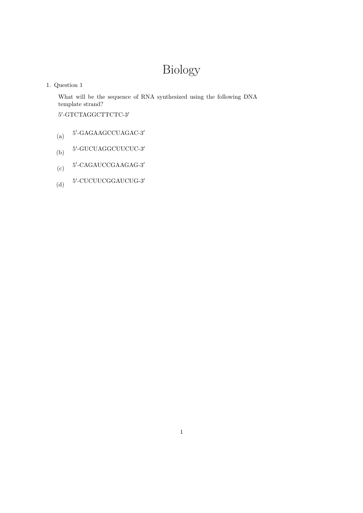

## PDF page 2

[Open original PDF at page 2](../pdf/IAT_2024_English_paper.pdf#page=2)

### Visual description

Biology Q2: a pedigree of a rare disorder uses shaded circles/squares for affected females/males and open symbols for unaffected members. Affected individuals appear in several branches over multiple generations.

### Searchable text - PDF text layer

```text
2. Question 2
   The following pedigree diagram shows the inheritance of a rare genetic
    disorder (filled shapes depict affected individuals).


   Which of the following  is the most likely pattern of inheritance of the
    disorder?

         X-linked dominant    (a)
         X-linked recessive    (b)
        Autosomal recessive    (c)
        Autosomal dominant    (d)


                                            2
```

### Original page image

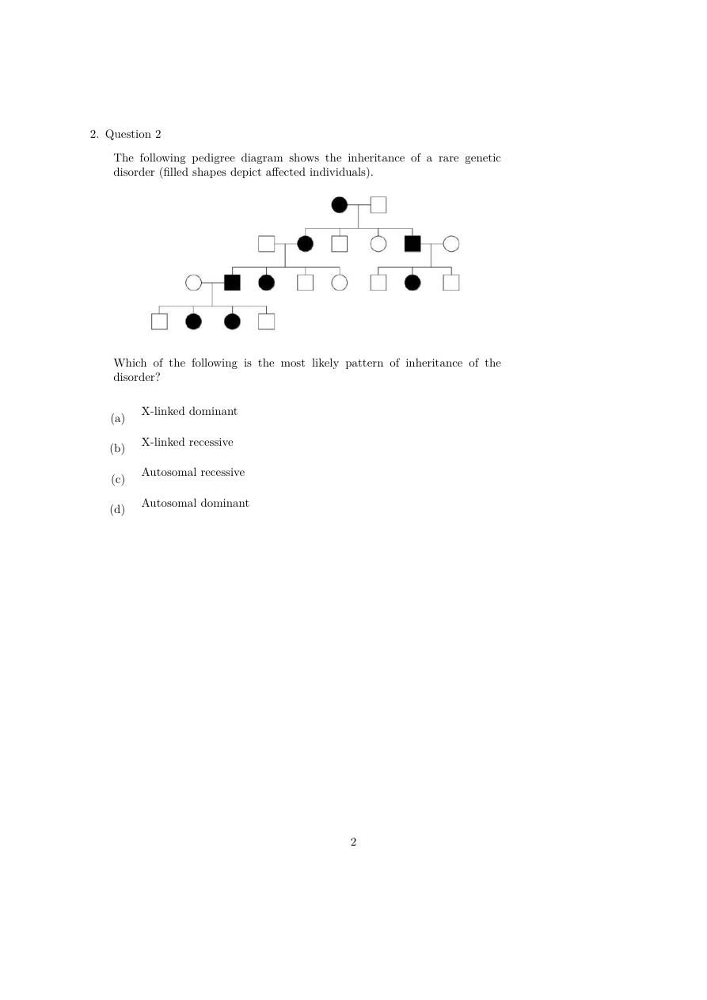

## PDF page 3

[Open original PDF at page 3](../pdf/IAT_2024_English_paper.pdf#page=3)

### Visual description

Biology Q3: a matching table pairs disorders with physiological effects, including immune response and hormone-related conditions.

### Searchable text - PDF text layer

```text
3. Question 3
    Match the list of conditions (Column I) with the list of affected physiological
    processes (Column II).


   Which of the following combinations is correct?

      P - (ii); Q - (iv); R - (iii); S - (i)
    (a)
      P - (iii); Q - (iv); R - (i); S - (ii)
    (b)
      P - (iv); Q - (iii); R - (i); S - (ii)
    (c)
      P - (ii); Q - (i); R - (iv); S - (iii)
    (d)


                                            3
```

### Original page image

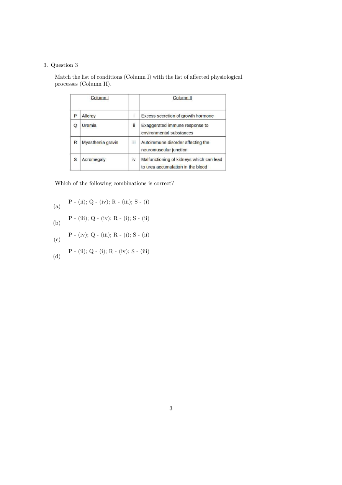

## PDF page 4

[Open original PDF at page 4](../pdf/IAT_2024_English_paper.pdf#page=4)

### Searchable text - PDF text layer

```text
4. Question 4
   Which of the following proteins plays a direct role in muscle contraction?

         Troponin
    (a)
          Insulin    (b)
         Myoglobin
    (c)
         Trypsin
    (d)


                                            4
```

### Original page image

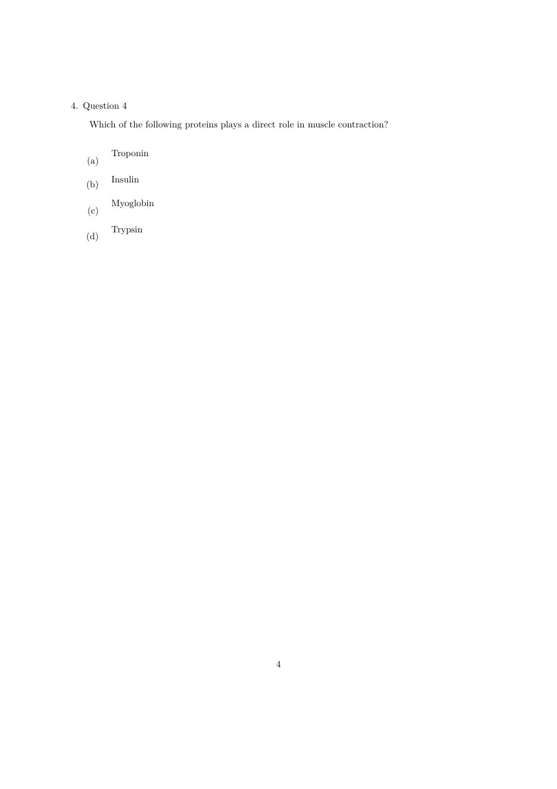

## PDF page 5

[Open original PDF at page 5](../pdf/IAT_2024_English_paper.pdf#page=5)

### Searchable text - PDF text layer

```text
5. Question 5
   Which of the following is NOT derived from the epidermal cell layer in
    plants?

         Casparian strip from rice root
    (a)
         Trichomes from maize leaf    (b)
         Subsidiary cells from rice leaf
    (c)
         Bulliform cells from grass
    (d)


                                            5
```

### Original page image

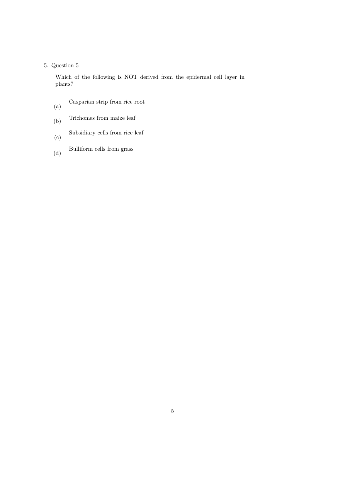

## PDF page 6

[Open original PDF at page 6](../pdf/IAT_2024_English_paper.pdf#page=6)

### Searchable text - PDF text layer

```text
6. Question 6
   Which of the following statements about meiosis in sexually reproducing
    plants is INCORRECT?

        The end products of meiosis II are haploid gametes.
    (a)
        The four products of meiosis are genetically different.
    (b)
         Meiotic recombination takes place in both males and females.
    (c)
         In most flowering plants, only one of the four products of meiosis survives
          in females.    (d)


                                            6
```

### Original page image

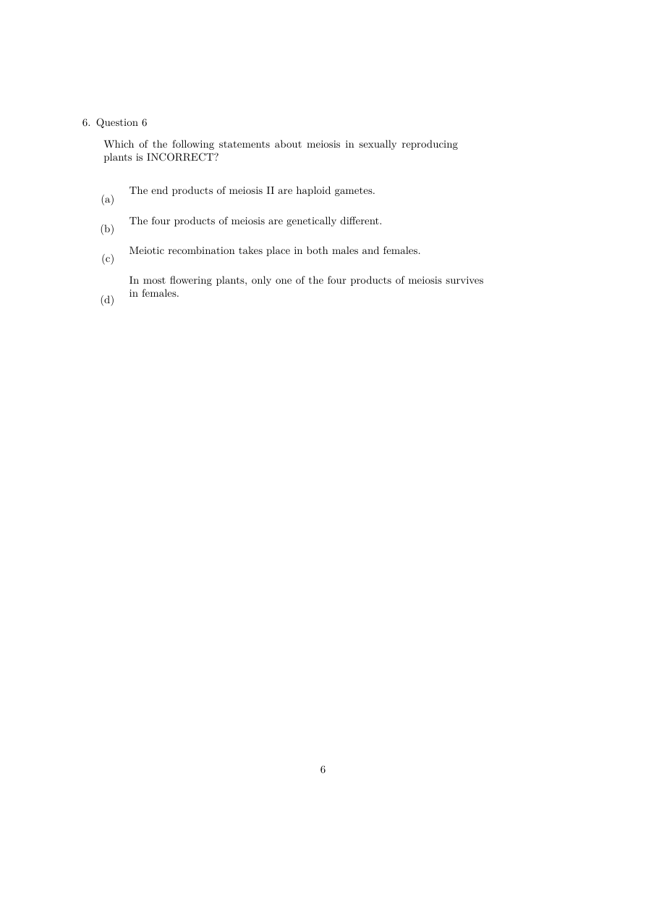

## PDF page 7

[Open original PDF at page 7](../pdf/IAT_2024_English_paper.pdf#page=7)

### Visual description

Biology Q7: three candidate photosynthesis-rate versus light-intensity graphs are shown: a rise followed by a plateau, a sigmoidal rise and an arch that falls. The fourth candidate continues on page 8.

### Searchable text - PDF text layer

```text
7. Question 7
   Which of the following graphs represents the correct relationship between
     light intensity (X-axis) and the rate of photosynthesis (Y-axis)?


    (a)


    (b)


    (c)

                                            7
```

### Original page image

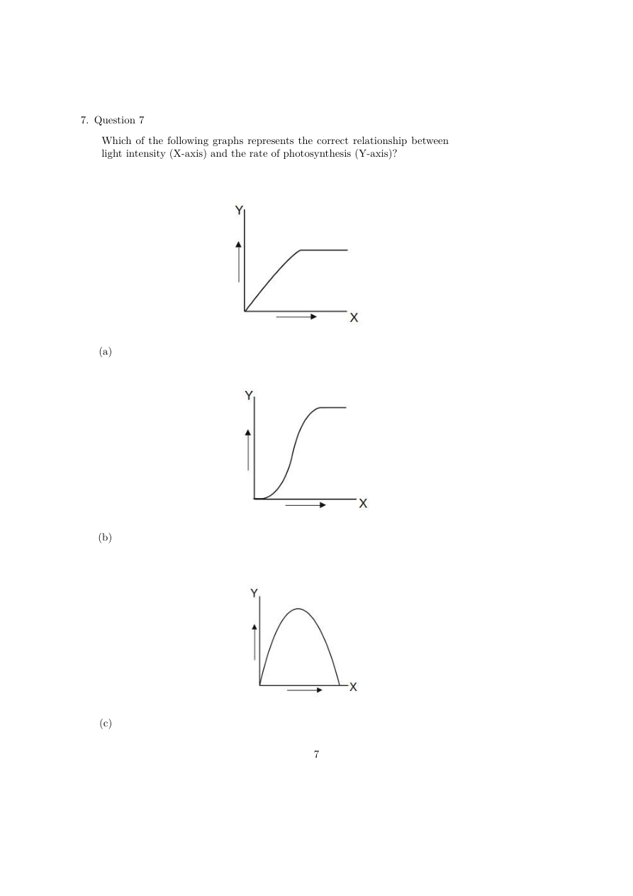

## PDF page 8

[Open original PDF at page 8](../pdf/IAT_2024_English_paper.pdf#page=8)

### Visual description

Continuation of Biology Q7, option (d): a straight line through the origin increases without a plateau on the same X-Y axes.

### Searchable text - PDF text layer

```text
(d)


                                         8
```

### Original page image

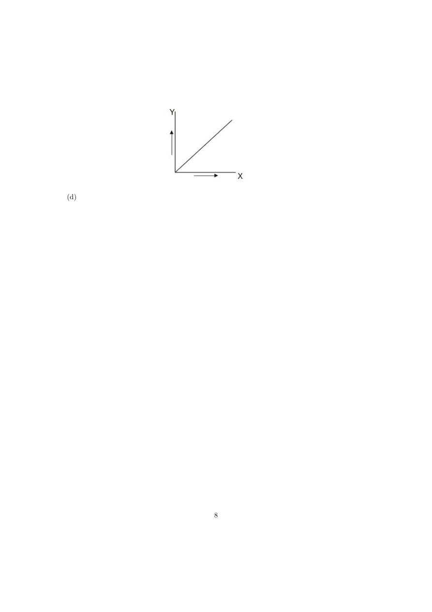

## PDF page 9

[Open original PDF at page 9](../pdf/IAT_2024_English_paper.pdf#page=9)

### Visual description

Biology Q8: a matching table compares enzymes with possible cellular compartments. The row and compartment labels, not their position after text extraction, define the choices.

### Searchable text - PDF text layer

```text
8. Question 8
    Match the enzymes in Column I with the cellular compartments in Column
      II.


   Which of the following combinations is correct?

      P - (ii); Q - (iii); R - (i); S - (iv)
    (a)
      P - (iv); Q - (i); R - (iii); S - (ii)
    (b)
      P - (iii); Q - (ii); R - (i); S - (v)
    (c)
      P - (iii); Q - (i); R - (iv); S - (ii)
    (d)


                                            9
```

### Original page image

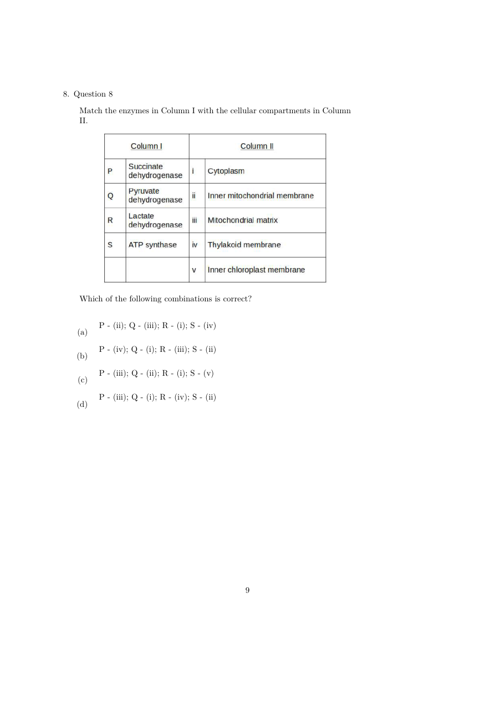

## PDF page 10

[Open original PDF at page 10](../pdf/IAT_2024_English_paper.pdf#page=10)

### Visual description

Biology Q9: reciprocal crosses are drawn between plant species P (2n=20) and Q (2n=30). Female/male symbols reverse between the two crosses; resulting F1 seed groups are labelled R and S.

### Searchable text - PDF text layer

```text
9. Question 9
   Two species of a flowering plant, P (2n = 20 chromosomes) and Q (2n = 30
    chromosomes) are reciprocally crossed with each other as male or female as
    shown below to produce F1 seeds.


   Which of the following seed tissues from both the F1 seeds (R and S) will
    have the same chromosome numbers?

        Embryo
    (a)
        Endosperm
    (b)
        Embryo and seed coat
    (c)
        Embryo and endosperm
    (d)


                                            10
```

### Original page image

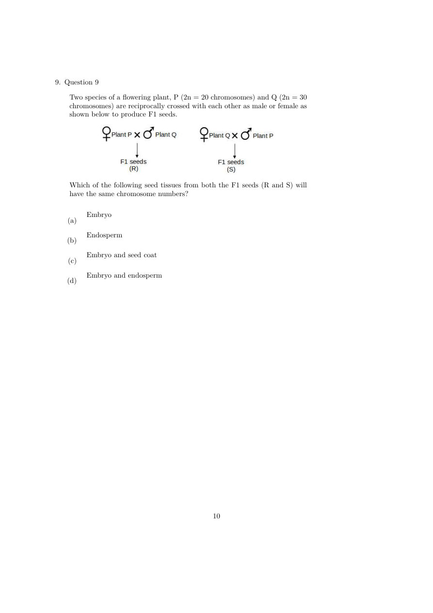

## PDF page 11

[Open original PDF at page 11](../pdf/IAT_2024_English_paper.pdf#page=11)

### Searchable text - PDF text layer

```text
10. Question 10
    Which of the following is routinely performed to detect typhoid?

         Widal test     (a)
        ELISA     (b)
          Gel electrophoresis
      (c)
        RT-PCR     (d)


                                             11
```

### Original page image

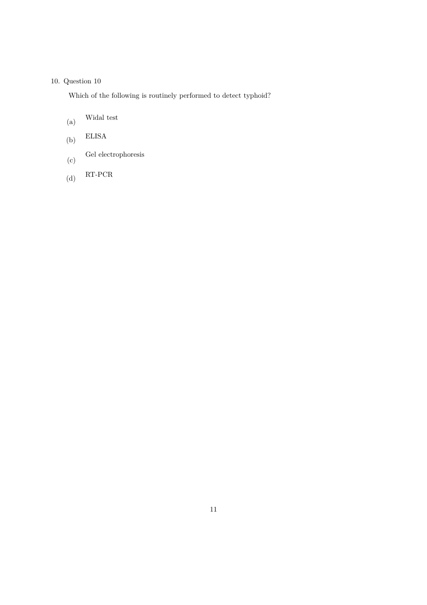

## PDF page 12

[Open original PDF at page 12](../pdf/IAT_2024_English_paper.pdf#page=12)

### Visual description

Biology Q11: plasmid-vector alternatives (a) and (b) show Ori, AmpR and restriction sites BamHI and EcoRI in different positions. The other two alternatives continue on page 13.

### Searchable text - PDF text layer

```text
11. Question 11
    Which of the following plasmid vectors can be used for cloning of a gene, with
      restriction enzymes BamHI and EcoRI, and ampicillin-containing nutrient
     agar for selection?
      [Ori and AmpR represent origin of replication and gene for ampicillin
      resistance, respectively.]


     (a)


     (b)


                                             12
```

### Original page image

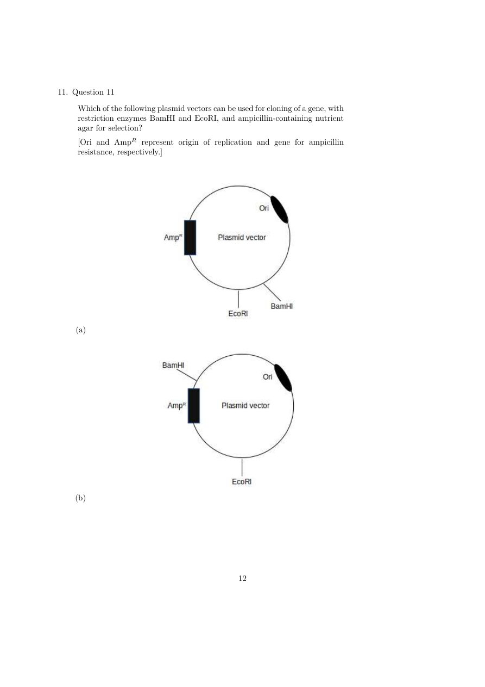

## PDF page 13

[Open original PDF at page 13](../pdf/IAT_2024_English_paper.pdf#page=13)

### Visual description

Continuation of Biology Q11: vector alternatives (c) and (d). Compare whether the cloning sites disrupt the marked origin or antibiotic-resistance region; do not assume all circular maps are equivalent.

### Searchable text - PDF text layer

```text
(c)


(d)


                                        13
```

### Original page image

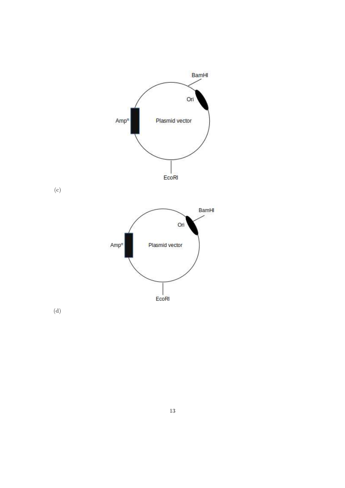

## PDF page 14

[Open original PDF at page 14](../pdf/IAT_2024_English_paper.pdf#page=14)

### Searchable text - PDF text layer

```text
12. Question 12
     Polymerase chain reaction (PCR)  is used to amplify a gene of interest
     (GOI). If, after 30 cycles of PCR, 1 billion copies of GOI are produced,
     approximately how many copies of GOI were present at the end of the 20th
      cycle?

          1 million     (a)
           0.66 billion     (b)
          10 million      (c)
           0.1 billion     (d)


                                             14
```

### Original page image

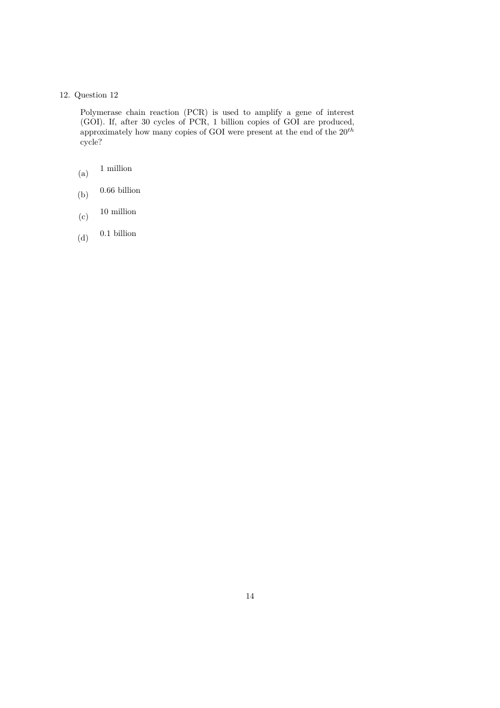

## PDF page 15

[Open original PDF at page 15](../pdf/IAT_2024_English_paper.pdf#page=15)

### Searchable text - PDF text layer

```text
13. Question 13
   A population with N = 400 individuals increases in numbers till it reaches an
     asymptote at K = 500 individuals, K being the carrying capacity. Assuming
     the intrinsic rate of natural increase (r) to be 0.01, what would be the
     population growth rate (dN/dt)?

           0.8     (a)
           0.05     (b)
          1      (c)
           0.4     (d)


                                             15
```

### Original page image

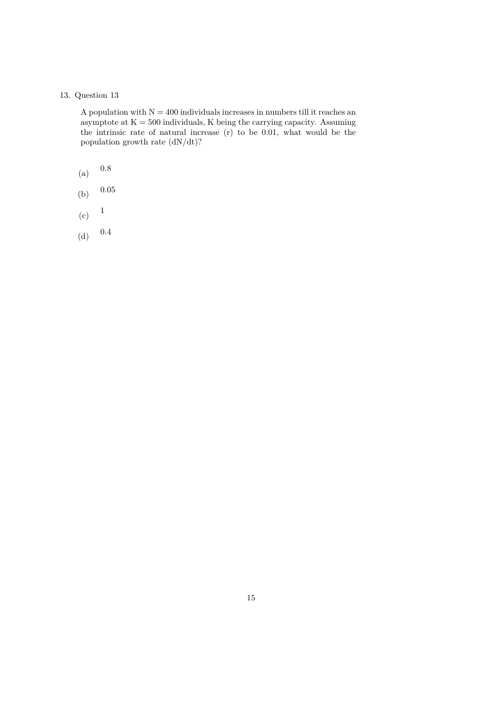

## PDF page 16

[Open original PDF at page 16](../pdf/IAT_2024_English_paper.pdf#page=16)

### Searchable text - PDF text layer

```text
14. Question 14
    Which one of the following statements is correct?

          Hemichordata is not considered as a chordate sub-phylum, and possesses a
          proto-notochord called stomochord.
     (a)
          Hemichordata   is  a  sub-phylum  under  Chordata  and  possesses  a
          proto-notochord called stomochord.
     (b)
          Hemichordata  is a sub-phylum under Chordata and possesses a proper
          notochord and gill slits like chordates.
      (c)
          Hemichordata  is not considered as a chordate sub-phylum because  it
           possesses a water vascular system.
     (d)


                                             16
```

### Original page image

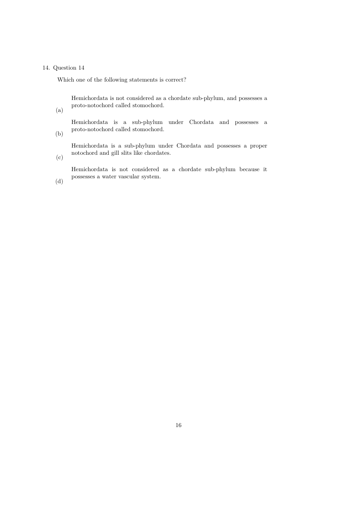

## PDF page 17

[Open original PDF at page 17](../pdf/IAT_2024_English_paper.pdf#page=17)

### Visual description

Biology Q15: three sigmoidal oxygen-dissociation curves A, B and C are horizontally displaced on axes of oxygen partial pressure and haemoglobin saturation. The question relates the shifts to proton concentration.

### Searchable text - PDF text layer

```text
15. Question 15
    Which  of the  following statements  is  correct about the oxygen (O2)
      dissociation curves (A and C) relative to curve B?


         Curve A represents favourable O2 association with haemoglobin at low [H+].
     (a)
         Curve C represents favourable O2 association with haemoglobin at low
         pCO2.     (b)
         Curve A represents favourable O2 association with haemoglobin at low pH.
      (c)
         Curve C represents favourable O2 association with haemoglobin at high
         pO2.     (d)


                                             17
```

### Original page image

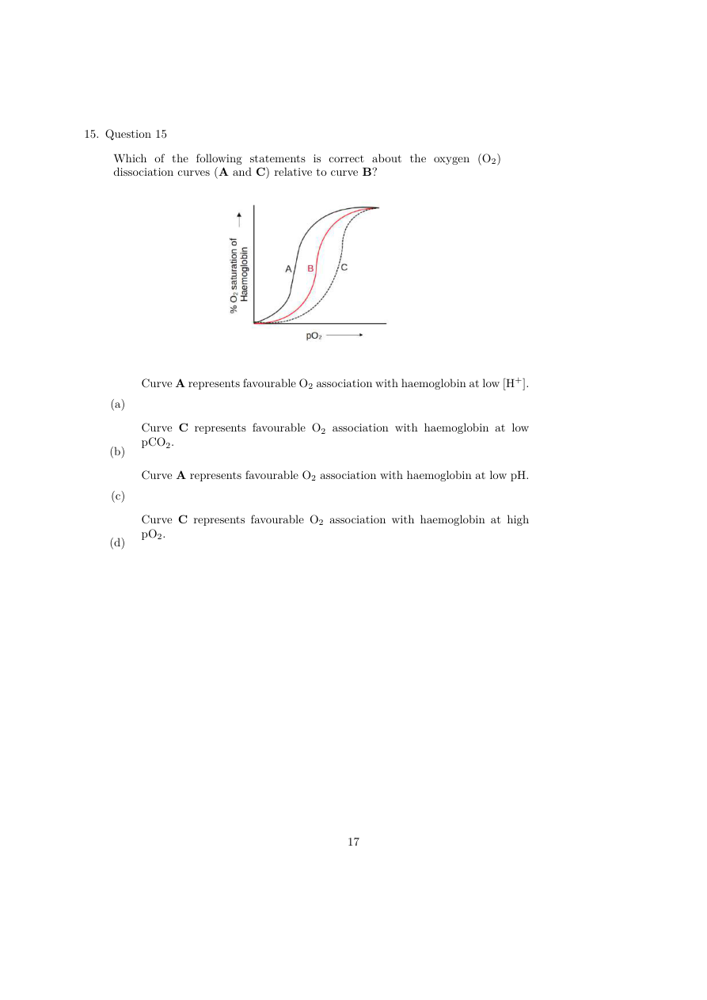

## PDF page 18

[Open original PDF at page 18](../pdf/IAT_2024_English_paper.pdf#page=18)

### Searchable text - PDF text layer

```text
Chemistry
1. Question 1
      If an element with Z = 120 is discovered, then which group of elements will
      it belong to?

          Alkaline earth metals    (a)
          Alkali metals    (b)
         Halogens
    (c)
         Noble gases
    (d)


                                            1
```

### Original page image

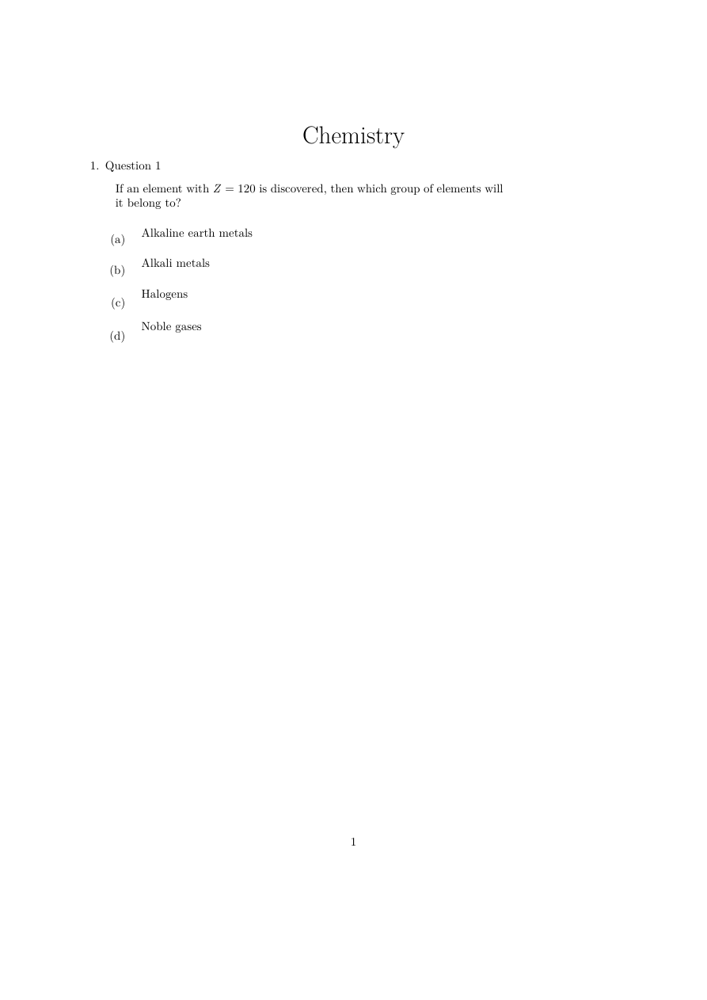

## PDF page 19

[Open original PDF at page 19](../pdf/IAT_2024_English_paper.pdf#page=19)

### Searchable text - PDF text layer

```text
2. Question 2
    Which one of the following statements is correct about N2, CO, and NO+?

        These are isoelectronic and have identical bond order.    (a)
        These are isoelectronic and have different bond orders.    (b)
        These are not isoelectronic but have identical bond order.    (c)
        These are neither isoelectronic nor have identical bond order.    (d)


                                            2
```

### Original page image

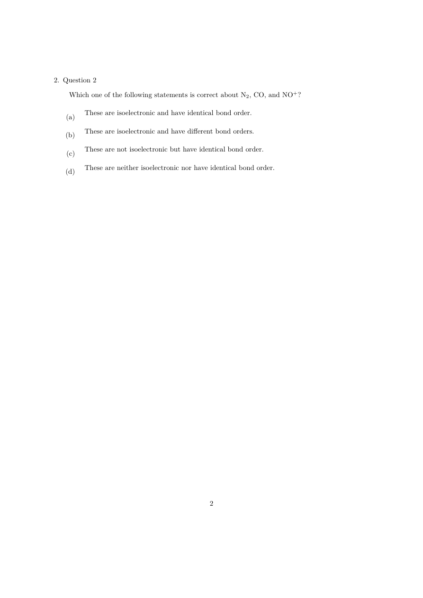

## PDF page 20

[Open original PDF at page 20](../pdf/IAT_2024_English_paper.pdf#page=20)

### Searchable text - PDF text layer

```text
3. Question 3
    Which of the following complexes exhibit(s) magnetic moment close to 2
    Bohr Magneton?
    [Fe(H2O)6](NO3)2, K2[MnCl4], K4[Mn(CN)6], and [Ni(CO)4]

        Only K4[Mn(CN)6]
    (a)
        K2[MnCl4] and K4[Mn(CN)6]
    (b)
         [Fe(H2O)6](NO3)2 and K2[MnCl4]
    (c)
        K4[Mn(CN)6] and [Ni(CO)4]
    (d)


                                            3
```

### Original page image

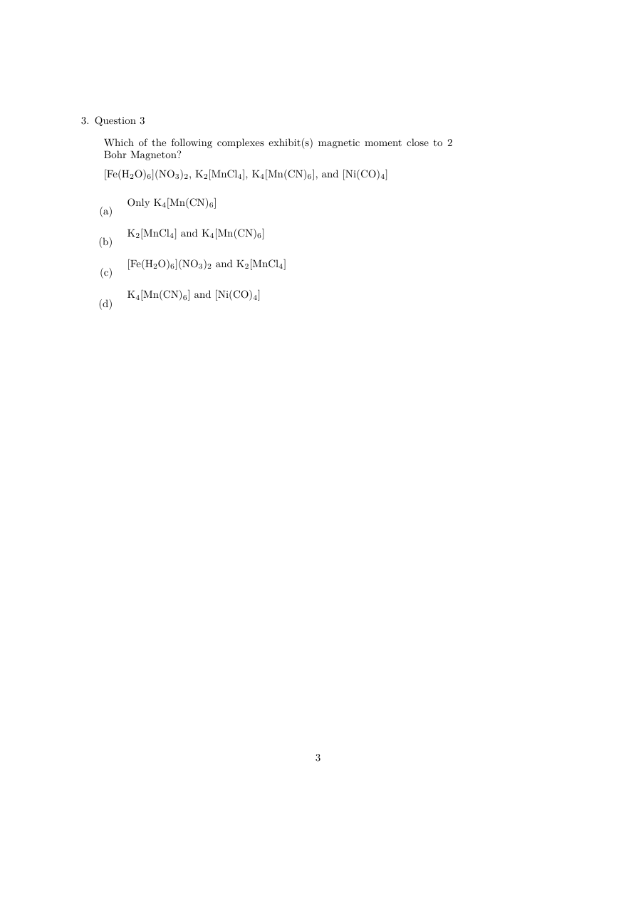

## PDF page 21

[Open original PDF at page 21](../pdf/IAT_2024_English_paper.pdf#page=21)

### Searchable text - PDF text layer

```text
4. Question 4
    According to the VSEPR theory, what are the most stable shapes of XeF4
    and SF4, respectively?

         Square planar and see-saw
    (a)
        Both see-saw    (b)
         See-saw and square planar
    (c)
        Both square planar
    (d)


                                            4
```

### Original page image

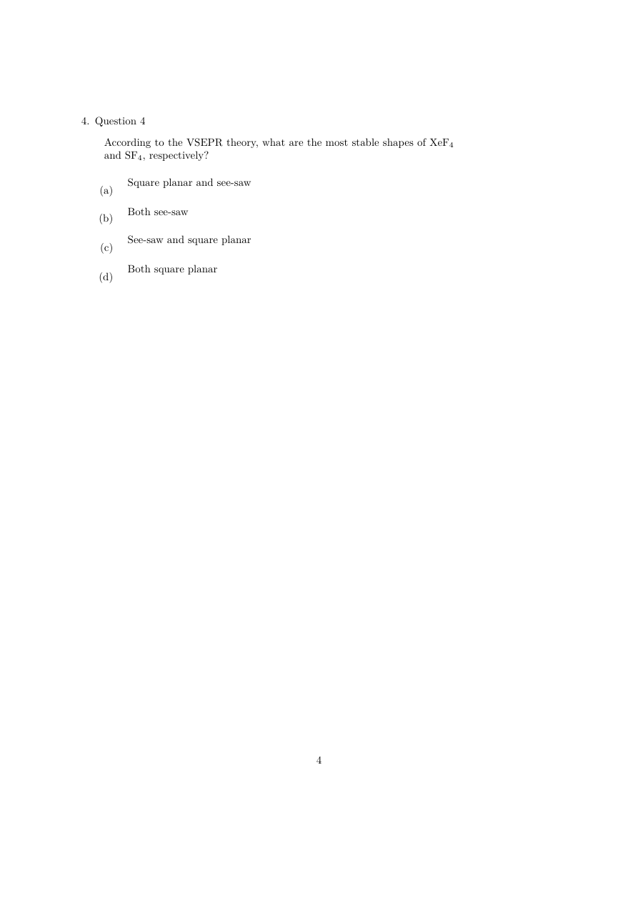

## PDF page 22

[Open original PDF at page 22](../pdf/IAT_2024_English_paper.pdf#page=22)

### Searchable text - PDF text layer

```text
5. Question 5
    The following complex ions absorb in the ultraviolet-visible region of light.
    Which one of these shows violet colour?
    [CoCl(NH3)5]2+, [Co(H2O)(NH3)5]3+, [Co(NH3)6]3+, and [Co(CN)6]3≠

         [CoCl(NH3)5]2+
    (a)
        [Co(H2O)(NH3)5]3+
    (b)
         [Co(NH3)6]3+
    (c)
         [Co(CN)6]3≠
    (d)


                                            5
```

### Original page image

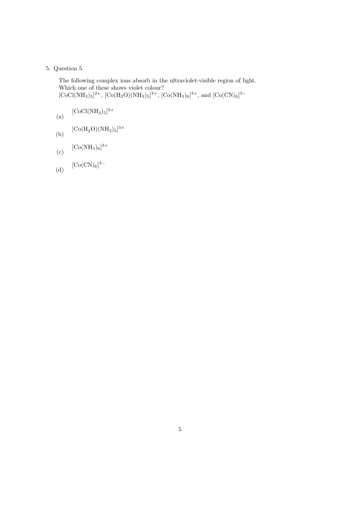

## PDF page 23

[Open original PDF at page 23](../pdf/IAT_2024_English_paper.pdf#page=23)

### Visual description

Chemistry Q6: two sawhorse-like drawings show substituents H, F, OH and CH3 around a carbon-carbon bond; their relative orientation is needed to classify the relationship between the structures.

### Searchable text - PDF text layer

```text
6. Question 6

   What is the relationship between the structures depicted below?


         Conformational isomers    (a)
          Structural isomers    (b)
         Enantiomers    (c)
          Positional isomers    (d)


                                            6
```

### Original page image

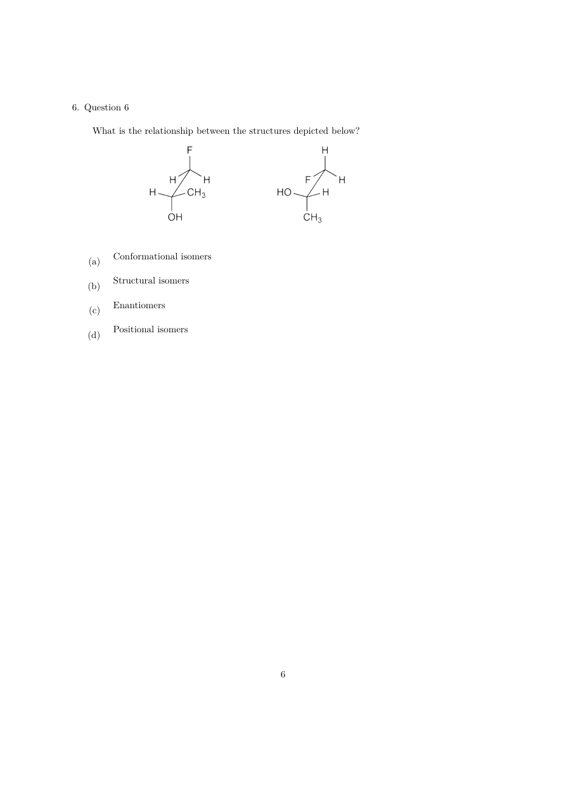

## PDF page 24

[Open original PDF at page 24](../pdf/IAT_2024_English_paper.pdf#page=24)

### Visual description

Chemistry Q7: four phenolic structures M, N, P and Q differ in methyl and nitro substitution, including a multiply nitrated ring. These structures supply the acidity comparison.

### Searchable text - PDF text layer

```text
7. Question 7
   What is the correct order of acidity for the following compounds?


      P > N > Q > M
    (a)
      P > Q > N > M
    (b)
     N > P > M > Q
    (c)
     N > P > Q > M
    (d)


                                            7
```

### Original page image

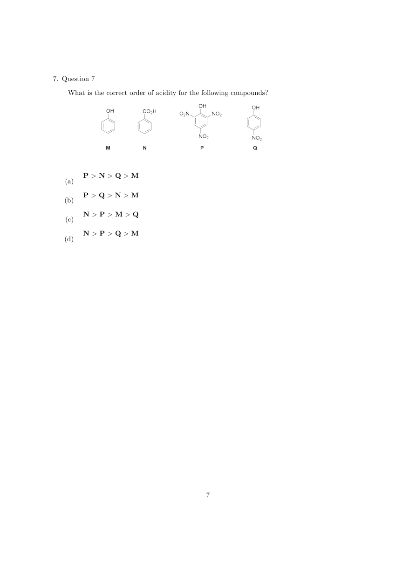

## PDF page 25

[Open original PDF at page 25](../pdf/IAT_2024_English_paper.pdf#page=25)

### Visual description

Chemistry Q8: two aromatic reaction sequences lead to products N and Q. Reagents appear above the arrows and four answer rows present different structure pairs; preserve cyano/carboxyl and aldehyde/alcohol distinctions.

### Searchable text - PDF text layer

```text
8. Question 8
   What are the products N and Q in the following reaction sequences?


    (a)


    (b)


    (c)


    (d)


                                            8
```

### Original page image

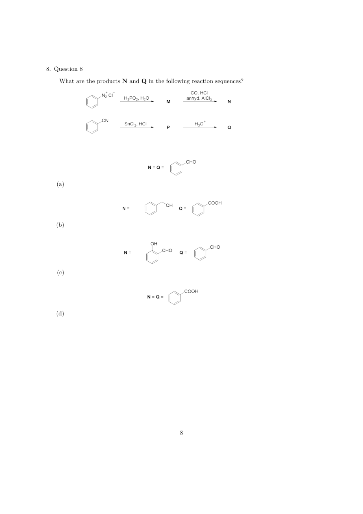

## PDF page 26

[Open original PDF at page 26](../pdf/IAT_2024_English_paper.pdf#page=26)

### Visual description

Chemistry Q9: a multistep reaction has missing starting material X and product Z, followed by a phenyl-substituted carbonyl product. The options specify alternative alkynes and aldehydes.

### Searchable text - PDF text layer

```text
9. Question 9
   What are X and Z in the following sequence of reactions?


    (a)


    (b)


    (c)


    (d)


                                            9
```

### Original page image

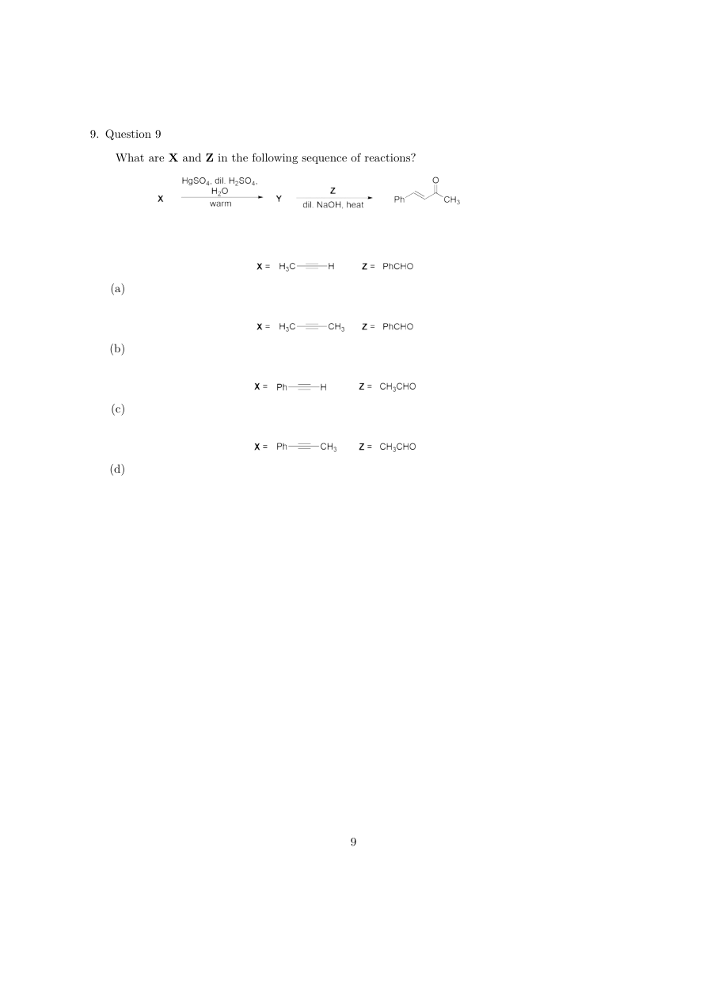

## PDF page 27

[Open original PDF at page 27](../pdf/IAT_2024_English_paper.pdf#page=27)

### Visual description

Chemistry Q10: cyclic carbohydrate structures M and N have hydroxyl groups above/below the ring and ring oxygen atoms. The alternatives distinguish sugar identity, ring size and alpha/beta configuration.

### Searchable text - PDF text layer

```text
10. Question 10
    What are the correct structural descriptions for M and N?


    M is –-D-(+)-glucopyranose and N is —-D-(≠)-fructofuranose     (a)
    M is —-D-(+)-glucopyranose and N is —-D-(≠)-fructofuranose     (b)
    M is –-D-(+)-glucopyranose and N is –-D-(≠)-fructofuranose      (c)
    M is –-D-(+)-glucofuranose and N is —-D-(≠)-fructopyranose     (d)


                                             10
```

### Original page image

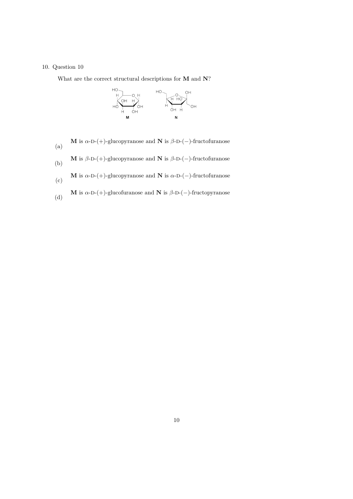

## PDF page 28

[Open original PDF at page 28](../pdf/IAT_2024_English_paper.pdf#page=28)

### Searchable text - PDF text layer

```text
11. Question 11
     Consider an exothermic reaction:
     2A(s)     B(s) + C(g) + D(g)       ≠æ
     The correct statement about the reaction is

          spontaneous at all temperatures.
     (a)
          spontaneous only at very high temperatures.
     (b)
          spontaneous only at very low temperatures.
      (c)
          non-spontaneous at all temperatures.
     (d)


                                             11
```

### Original page image

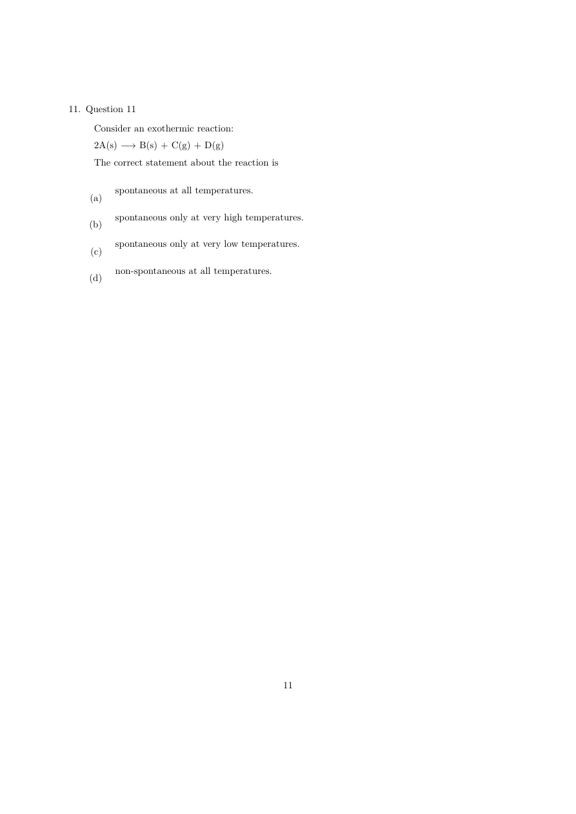

## PDF page 29

[Open original PDF at page 29](../pdf/IAT_2024_English_paper.pdf#page=29)

### Searchable text - PDF text layer

```text
12. Question 12
     The minimum  energy  needed  to remove an  electron from  a  metal
      corresponds to a wavelength of 500 nm. What is the total kinetic energy
       of all the photoelectrons ejected per second when the entire radiation from
     a 100 Watt bulb with a wavelength of 300 nm falls on the surface of the
     metal?
      Planck’s constant = 6.6 ◊10≠34 J s; speed of light = 3 ◊108 m s≠1

          40 J     (a)

           2.6        J     (b)     ◊10≠19
           1.6        J      (c)     ◊10≠19
          80 J     (d)


                                             12
```

### Original page image

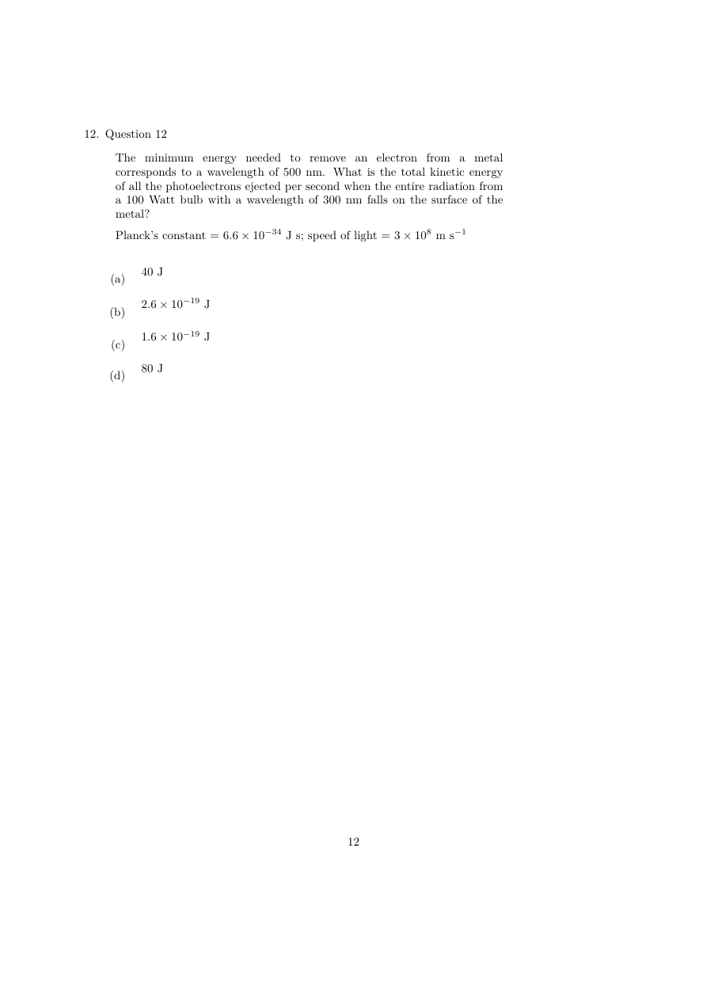

## PDF page 30

[Open original PDF at page 30](../pdf/IAT_2024_English_paper.pdf#page=30)

### Visual description

Chemistry Q13, options (a) and (b): concentration [R] versus time is shown either as a straight decrease or as a curved decay. The remaining rate-law graph alternatives continue on page 31.

### Searchable text - PDF text layer

```text
13. Question 13
     For a reaction R   P with a rate constant of        mol L≠1 s≠1, which            ≠æ                   3◊10≠3     one of the following plots is correct?
     (Given [R]0 is the initial concentration of R and [R] is the concentration of
    R at time t)


     (a)


     (b)


                                             13
```

### Original page image

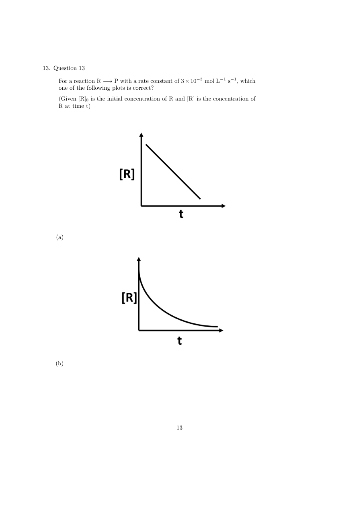

## PDF page 31

[Open original PDF at page 31](../pdf/IAT_2024_English_paper.pdf#page=31)

### Visual description

Continuation of Chemistry Q13: option (c) is a descending straight line for ln[R] versus t; option (d) rises linearly for log([R]0/[R]) versus t.

### Searchable text - PDF text layer

```text
(c)


(d)


                                        14
```

### Original page image

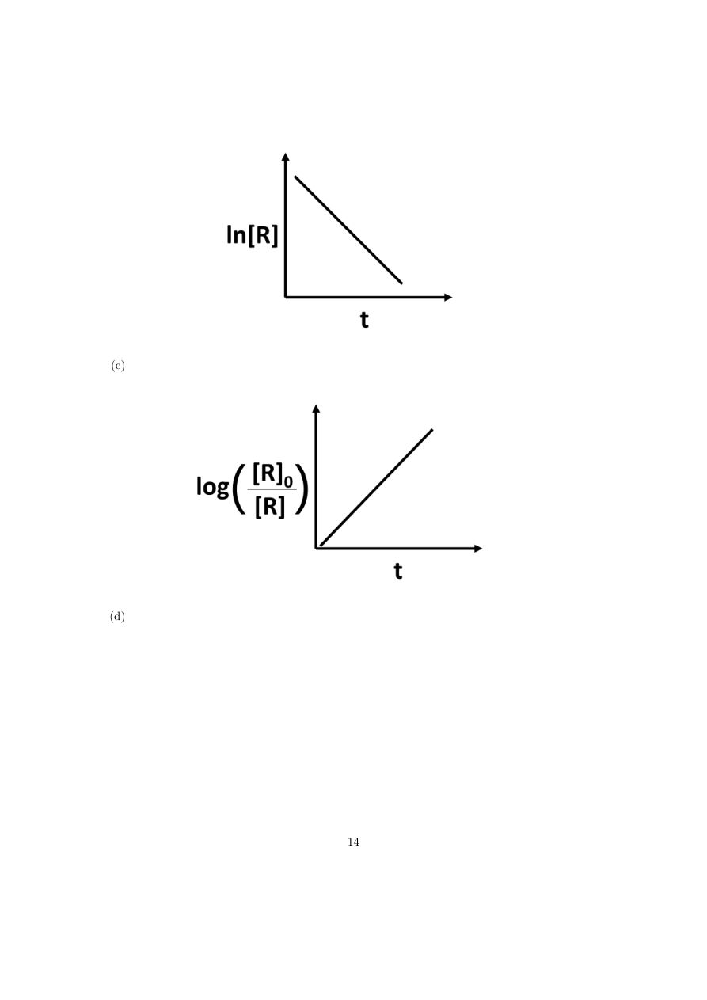

## PDF page 32

[Open original PDF at page 32](../pdf/IAT_2024_English_paper.pdf#page=32)

### Visual description

Chemistry Q14: four osmotic-pressure Pi versus solution-volume V plots include reciprocal-like decays and straight increasing/decreasing alternatives, with differing intercept behaviour.

### Searchable text - PDF text layer

```text
14. Question 14
     Which one of the following plots correctly describes the variation of osmotic
      pressure (Π) of a fixed amount of a solute against the volume (V) of the
      solution at a fixed temperature?


     (a)


     (b)


      (c)


     (d)


                                             15
```

### Original page image

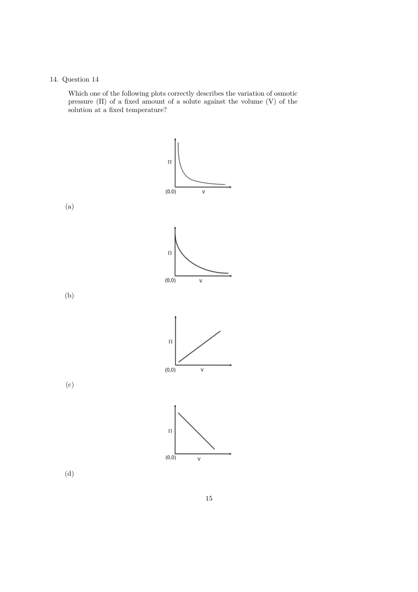

## PDF page 33

[Open original PDF at page 33](../pdf/IAT_2024_English_paper.pdf#page=33)

### Visual description

Chemistry Q15: a two-row data table gives KCl concentration and molar conductivity, with units in the headings. The requested limiting conductivity must be inferred from both data pairs.

### Searchable text - PDF text layer

```text
15. Question 15
     Consider the following data for KCl solution at a particular temperature:


    What is the value of the limiting molar conductivity?

           150.1 S cm2 mol≠1     (a)
           149.2 S cm2 mol≠1     (b)
           151.1 S cm2 mol≠1      (c)
           152.1 S cm2 mol≠1     (d)


                                             16
```

### Original page image

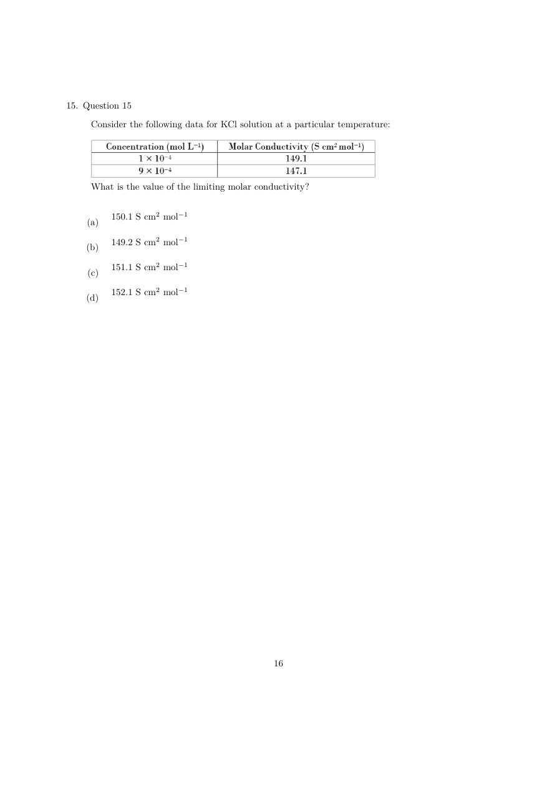

## PDF page 34

[Open original PDF at page 34](../pdf/IAT_2024_English_paper.pdf#page=34)

### Searchable text - PDF text layer

```text
Mathematics
1. Question 1
    Consider the following lines in the XY -plane:
     L1 : 5x ≠2y = 1,
     L2 : the line passing through (0, 1) and (100, 101),
     L3 : the line passing through (1, 11) and parallel to the vector ≠‚i + 2‚j.
    Let A = (L1 flL2) fi(L2 flL3) fi(L3 flL1). What is the total number of    elements of A ?

         3    (a)
         0    (b)
         1    (c)
         2    (d)


                                            1
```

### Original page image

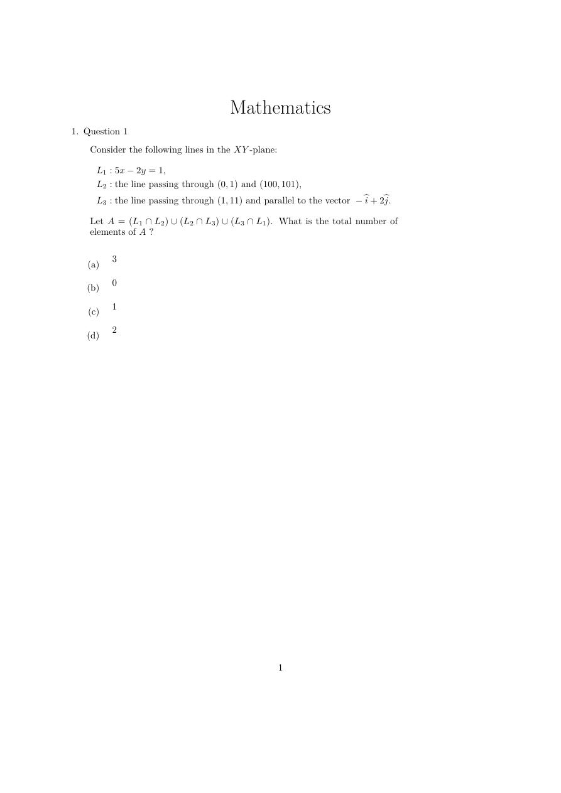

## PDF page 35

[Open original PDF at page 35](../pdf/IAT_2024_English_paper.pdf#page=35)

### Searchable text - PDF text layer

```text
2. Question 2
    Let A be the set of points in the XY -plane which are equidistant from
                  B be the set of points in the XY -plane which are    P(≠1, 0) and Q(1, 0). Let     equidistant from A and Q. If (5, y) is a point in B, then what is the value
     of y2 ?

         9    (a)
         1    (b)
         4    (c)
         16    (d)


                                            2
```

### Original page image


## PDF page 36

[Open original PDF at page 36](../pdf/IAT_2024_English_paper.pdf#page=36)

### Searchable text - PDF text layer

```text
3. Question 3
    Consider the lines L1 and L2 given below:
                 L1 : x = 2 + ⁄,  y = 3 + 2⁄,   z = 4 + 3⁄;
                 L2 : x = 4 + ⁄,  y = 4,   z = 4 + ⁄.
      If (2, 3, 4) is the point of L1 that is closest to L2, then which point of L2 is
     closest to L1?

           (3, 4, 3)
    (a)
           (3, 4, 4)
    (b)
           (5, 4, 5)
    (c)
           (4, 4, 4)
    (d)


                                            3
```

### Original page image

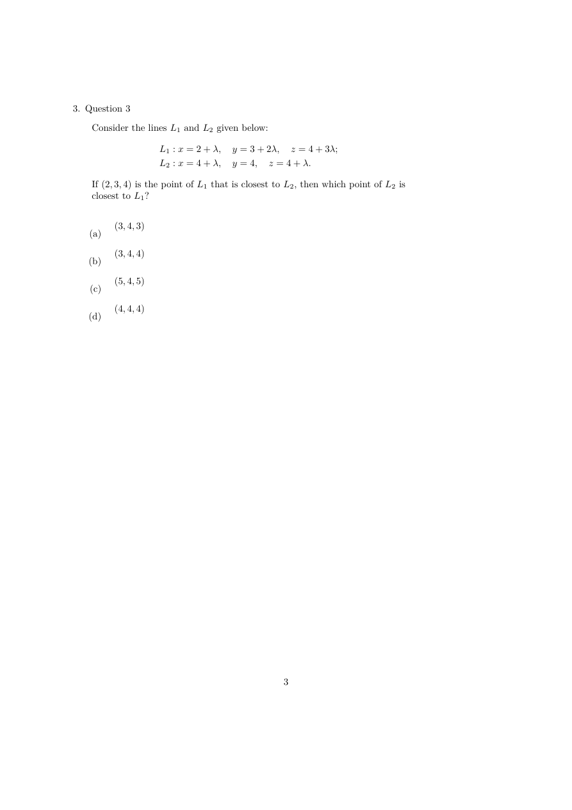

## PDF page 37

[Open original PDF at page 37](../pdf/IAT_2024_English_paper.pdf#page=37)

### Searchable text - PDF text layer

```text
4. Question 4
    Let a1, a2, a3, . . . be a sequence of real numbers. Let sn = a1 +a2 +· · ·+an.      If 2sn = n(c + an) for some real number c and for all n = 1, 2, 3, . . ., then
    which one of the following statements is Correct?

          a1, a2, a3, . . . is an Arithmetic Progression.    (a)
          a1, 2a2, 3a3, . . . is an Arithmetic Progression.    (b)
          a1, a2, a3, . . . is a Geometric Progression.    (c)
          a1, 2a2, 3a3, . . . is a Geometric Progression.    (d)


                                            4
```

### Original page image

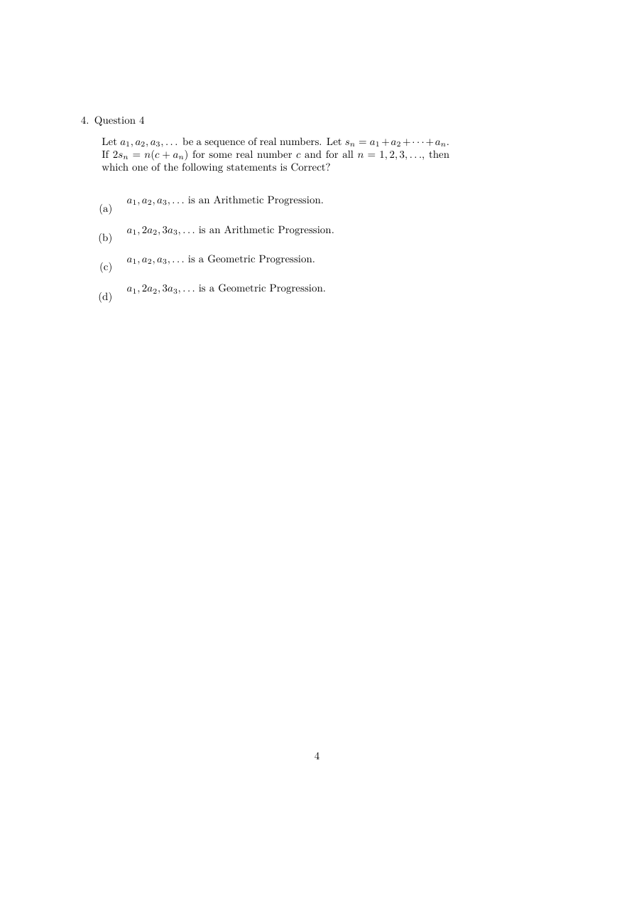

## PDF page 38

[Open original PDF at page 38](../pdf/IAT_2024_English_paper.pdf#page=38)

### Searchable text - PDF text layer

```text
5. Question 5
    Let f : R  R be a strictly decreasing function with    < fi/2 for all      æ                                                 |f(t)|     t  R. Let g: [0, fi]  R be a function defined by g(t) = sin(f(t)). Which    œ       æ    one of the following statements is Correct ?

         g is decreasing on [0, fi].
    (a)
         g is increasing on [0, fi].
    (b)
         g is increasing on (0, fi/2) and decreasing on (fi/2, fi).
    (c)
         g is decreasing on (0, fi/2) and increasing on (fi/2, fi).
    (d)


                                            5
```

### Original page image

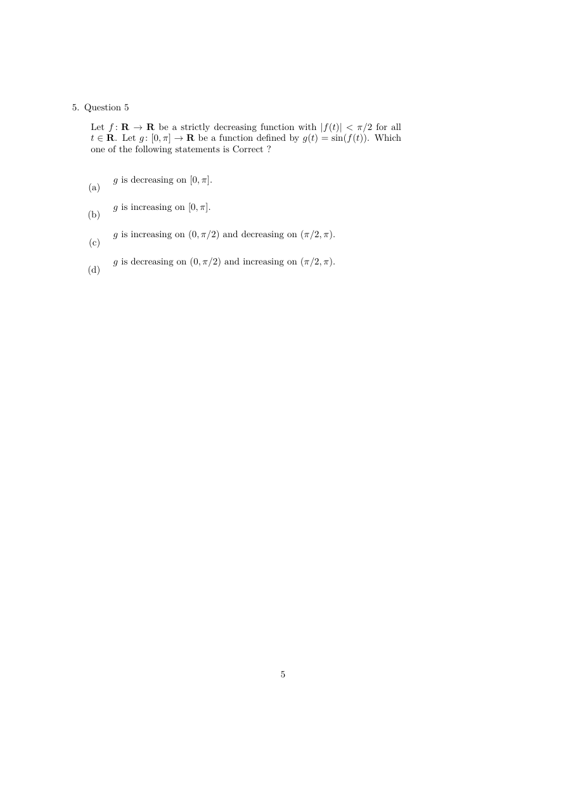

## PDF page 39

[Open original PDF at page 39](../pdf/IAT_2024_English_paper.pdf#page=39)

### Searchable text - PDF text layer

```text
6. Question 6
    Let f, g: R  R be functions.  If g is continuous, then which one of the        æ     following cases implies that f is continuous ?

         g(x) = (f(x))3
    (a)
         g(x) = |f(x)|    (b)
         g(x) = (f(x))2
    (c)
         g(x) = sin(f(x))
    (d)


                                            6
```

### Original page image

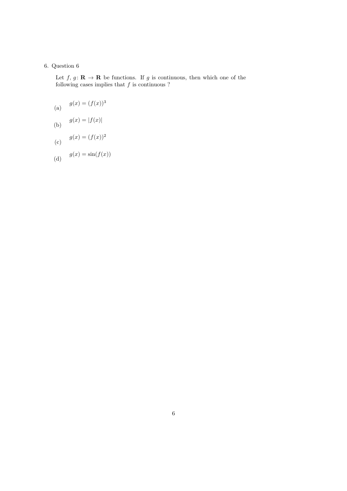

## PDF page 40

[Open original PDF at page 40](../pdf/IAT_2024_English_paper.pdf#page=40)

### Searchable text - PDF text layer

```text
7. Question 7
   What is the largest area of a rectangle, whose sides are parallel to the
    coordinate axes, that can be inscribed under the graph of the curve
                                 y = 1 ≠x2
    and above the X-axis ?

          4
         3Ô 3
    (a)
          2
         3Ô 3
    (b)
         4
         3    (c)
         1
         3    (d)


                                            7
```

### Original page image

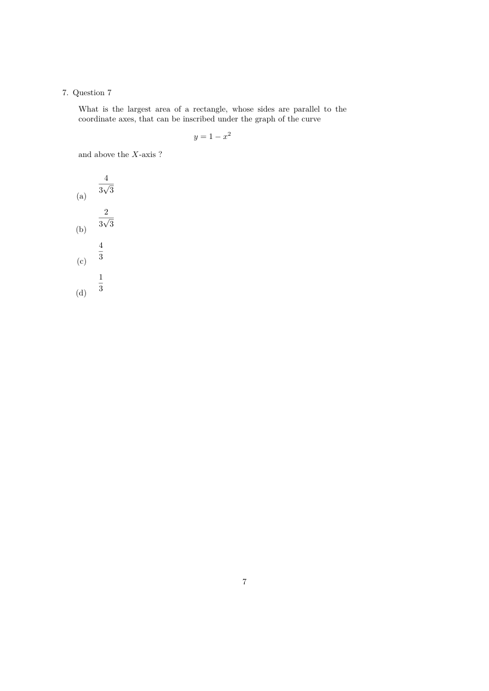

## PDF page 41

[Open original PDF at page 41](../pdf/IAT_2024_English_paper.pdf#page=41)

### Searchable text - PDF text layer

```text
8. Question 8
    Let M be the set of all 3◊3 matrices with real entries. Consider the relation
   R on M given by R = {(A, B) œ                 M ◊M                                                                       : det(A≠B) is an integer}. Which    one of the following statements is Correct ?

      R is reflexive and symmetric, but not transitive.
    (a)
      R is reflexive, but neither symmetric nor transitive.
    (b)
      R is an equivalence relation.
    (c)
      R is symmetric and transitive, but not reflexive.
    (d)


                                            8
```

### Original page image

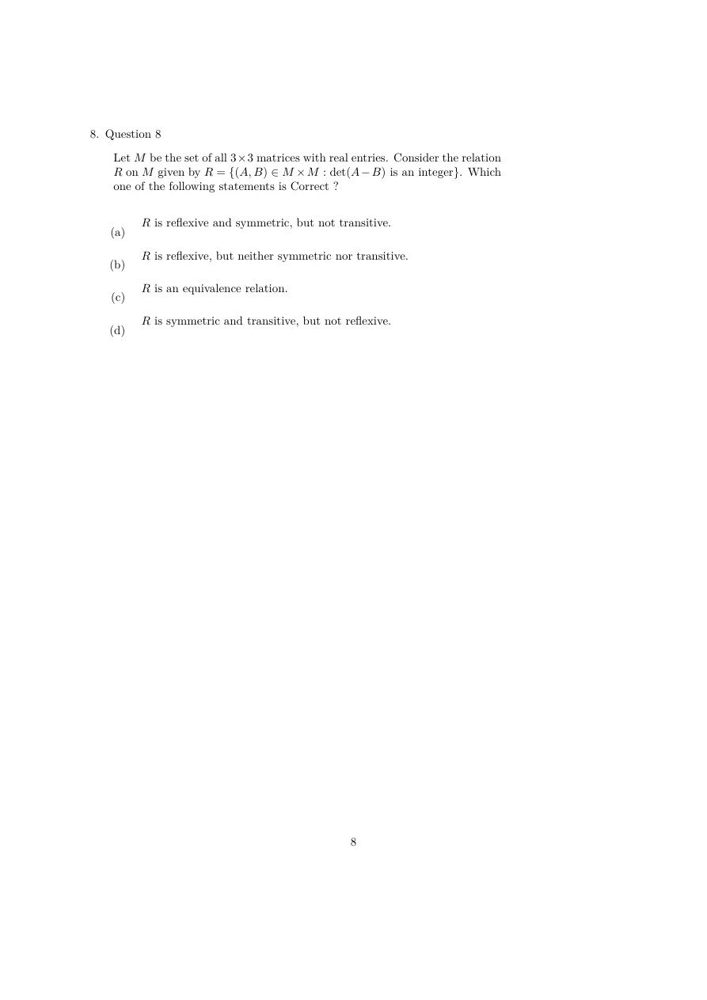

## PDF page 42

[Open original PDF at page 42](../pdf/IAT_2024_English_paper.pdf#page=42)

### Searchable text - PDF text layer

```text
9. Question 9
   What is the value of 23C0 + 23C2 + 23C4 +  + 23C22 ?                                                                           · · ·

          222    (a)
          222    (b)    ≠1
          223 + 1    (c)
          223    (d)


                                            9
```

### Original page image

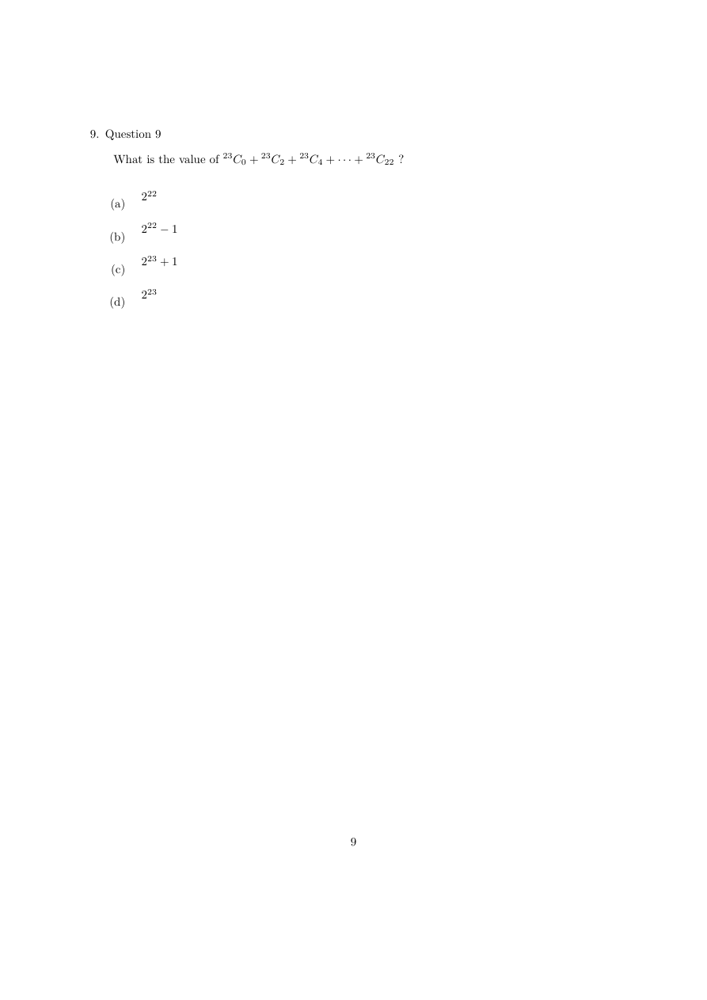

## PDF page 43

[Open original PDF at page 43](../pdf/IAT_2024_English_paper.pdf#page=43)

### Searchable text - PDF text layer

```text
10. Question 10
     Let f  : Q  Q be a function such that f(x + y) = f(x) + f(y) for all       æ      x, y  Q, and f(1) = 10. Which one of the following statements is Correct ?      œ

          f is bijective.
     (a)
          f is injective but not surjective.
     (b)
          f is surjective but not injective.
      (c)
          f is neither injective nor surjective.
     (d)


                                             10
```

### Original page image

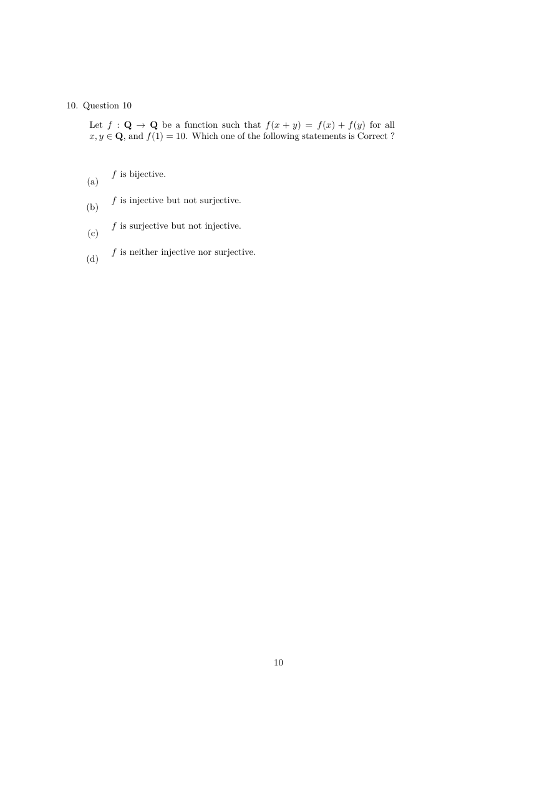

## PDF page 44

[Open original PDF at page 44](../pdf/IAT_2024_English_paper.pdf#page=44)

### Searchable text - PDF text layer

```text
11. Question 11
     Let
                    ⁄ efi/2                               !                         "
                      I =         sin2(log(x)) + sin(log(x2))  dx.
                             e≠fi/2
    What is the value of I ?

           efi/2     (a)      ≠e≠fi/2
          0     (b)

          fiefi/2
            2      (c)
     (d)  efi≠1


                                             11
```

### Original page image

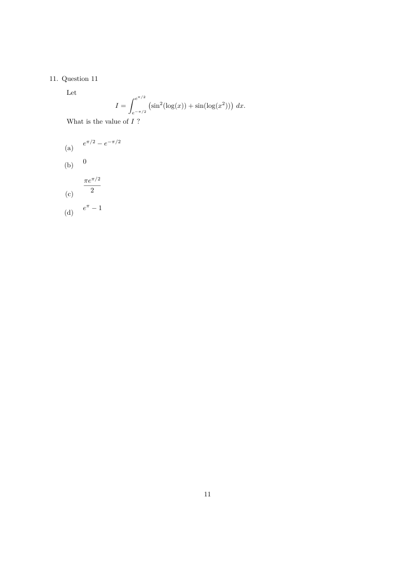

## PDF page 45

[Open original PDF at page 45](../pdf/IAT_2024_English_paper.pdf#page=45)

### Searchable text - PDF text layer

```text
12. Question 12
     Consider the following subset of the XY -plane:
                  )                             *
                                       z is a complex number  .              S =  (|z ≠iz|, |z|2) :
    Which one of the following statements is Correct ?

        S is a parabola.
     (a)
        S is a circle.     (b)
        S is an ellipse but not a circle.
      (c)
        S is a hyperbola.
     (d)


                                             12
```

### Original page image

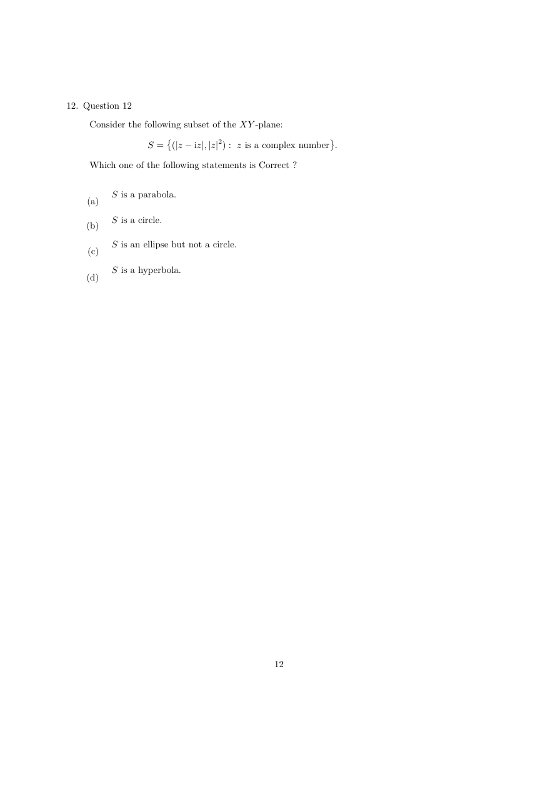

## PDF page 46

[Open original PDF at page 46](../pdf/IAT_2024_English_paper.pdf#page=46)

### Searchable text - PDF text layer

```text
13. Question 13
   A ship sets offon a voyage with three engines, labelled A, B, and C, which
     work independently. The ship can complete the voyage only if at least two
      of these engines keep working. The probability that engine A breaks down
       is 1/4, that engine B breaks down is 1/4, and that engine C breaks down is
      1/2. What is the probability that the ship can complete the voyage ?

          3
          4     (a)
          1
          2     (b)
          1
          32      (c)
          1
          4     (d)


                                             13
```

### Original page image

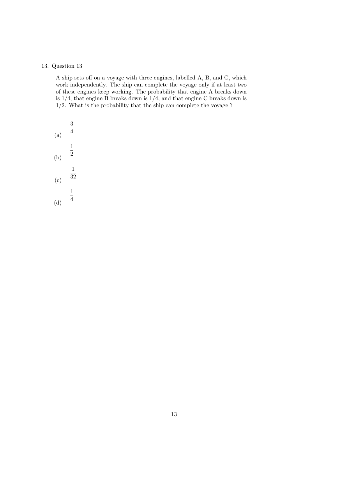

## PDF page 47

[Open original PDF at page 47](../pdf/IAT_2024_English_paper.pdf#page=47)

### Searchable text - PDF text layer

```text
14. Question 14
     Consider the differential equation
                                 1                       cos(y)dy +   sin(y) = x,  (x > 0);
                         dx   x
     given that y = fi at x = Ô 3. Which one of the following is the value of y
      Ú      2
             3      at x =     ?             2


         fi
          6     (a)

         fi
          3     (b)

         fi
          2      (c)

         fi
          4     (d)


                                             14
```

### Original page image

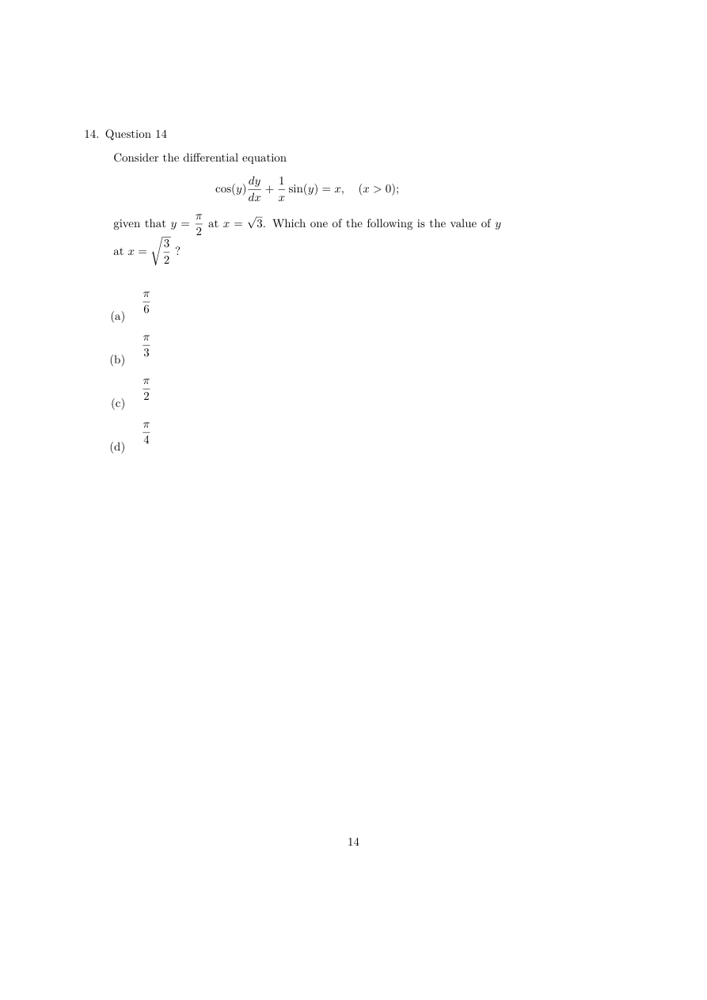

## PDF page 48

[Open original PDF at page 48](../pdf/IAT_2024_English_paper.pdf#page=48)

### Visual description

Mathematics Q15: a geometric construction marks points Q, A, P, B and C, a horizontal base, vertical segments and intersecting oblique lines. Right-angle conditions and labelled lengths determine PQ.

### Searchable text - PDF text layer

```text
15. Question 15

     In  the  given  figure,  the  angles \BAQ =
                    fi
   \CPQ = \CBQ =    ; and the lengths QA = 3                       2
      unit, AB = 4 unit, and BC = 1 unit. What is
     the length of PQ ?


           2.2 unit     (a)
          2 unit     (b)
      Ô 2 unit
      (c)
          3 Ô 2 unit     (d)   ≠


                                             15
```

### Original page image

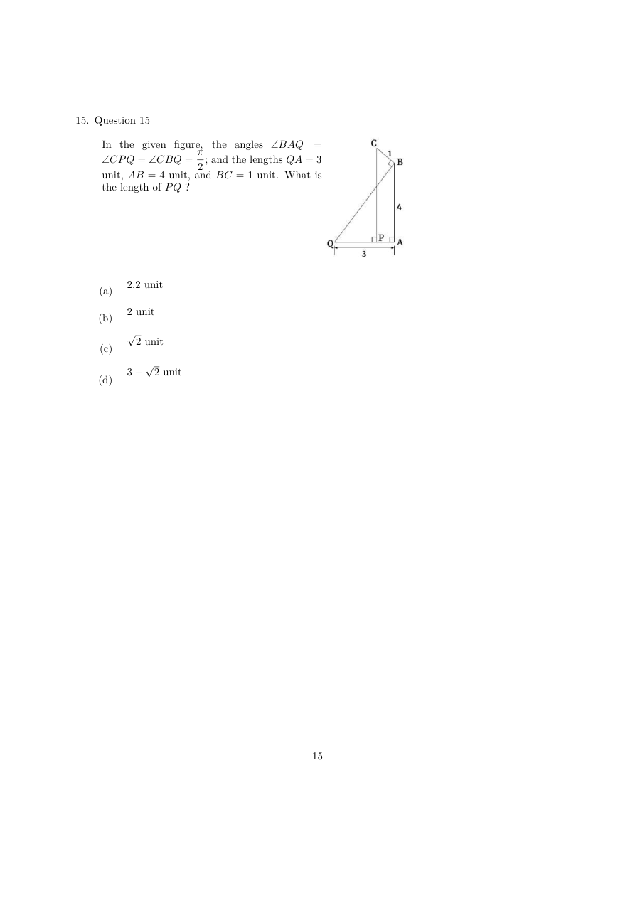

## PDF page 49

[Open original PDF at page 49](../pdf/IAT_2024_English_paper.pdf#page=49)

### Searchable text - PDF text layer

```text
Physics
1. Question 1
   On a circular track, two cyclists, Abhijit and Vani, start moving in opposite
     directions from a point. Abhijit moves with a constant speed. Vani starts
    with a constant acceleration from rest. They meet again on the track with
    the same speed. Which of the following is correct?

          Abhijit travelled double the distance travelled by Vani.
    (a)
          Abhijit travelled half the distance travelled by Vani.
    (b)
          Abhijit travelled the same distance travelled by Vani.
    (c)
          Abhijit travelled 4/3 of the distance travelled by Vani.
    (d)


                                            1
```

### Original page image

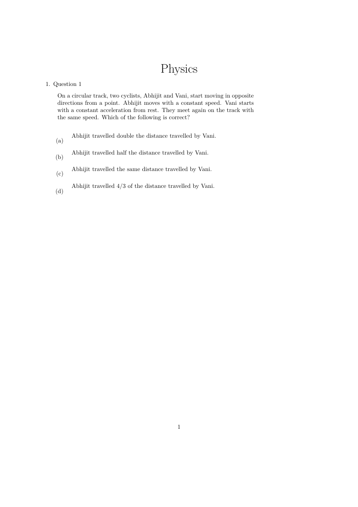

## PDF page 50

[Open original PDF at page 50](../pdf/IAT_2024_English_paper.pdf#page=50)

### Searchable text - PDF text layer

```text
2. Question 2
    Consider a simple pendulum undergoing simple harmonic motion with a
    time period T, and a fixed amplitude ◊0 of angular oscillation. Its angular
   momentum about the point of suspension exhibits an oscillatory behavior
    with an amplitude A. Which of the following relations between A and T is
     correct?


                  3
    (a)  A Ã T

                  2
    (b)  A Ã T
    (c)  A Ã T

                  4
    (d)  A Ã T


                                            2
```

### Original page image

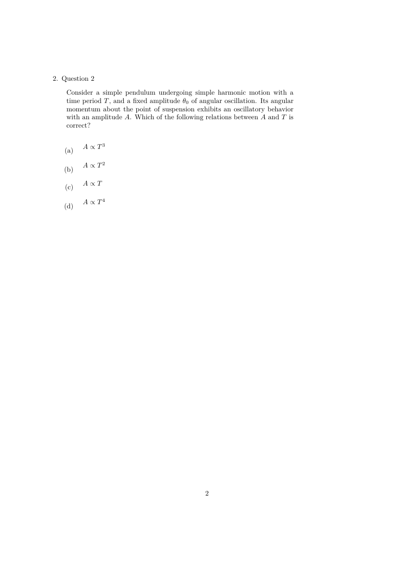

## PDF page 51

[Open original PDF at page 51](../pdf/IAT_2024_English_paper.pdf#page=51)

### Visual description

Physics Q3: a cord passes over a massive disc pulley with moment of inertia. Masses M/2 and M hang at the two ends; the pulley radius R and mass M are indicated.

### Searchable text - PDF text layer

```text
3. Question 3
   An inextensible cord of negligible mass passes over the rim of a solid disc
     of mass M and radius R. The disc is free to rotate about an axis passing
    through the centre perpendicular to the plane of the screen, as shown in
    the figure. Two blocks of masses M and M/2 are attached to the two free
    ends of the cord. Assume that there is no slipping of the cord on the disc.
   The acceleration due to gravity is g. What is the value of the angular
     acceleration of the disc?


          g
       4R    (a)

          g
       2R    (b)

          g
    (c)  R

          g
       3R    (d)


                                            3
```

### Original page image

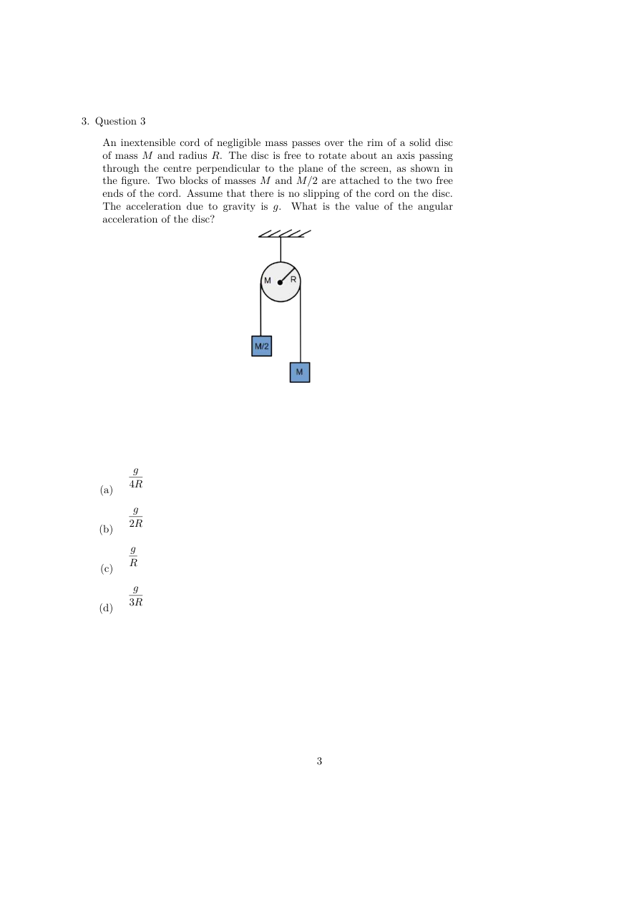

## PDF page 52

[Open original PDF at page 52](../pdf/IAT_2024_English_paper.pdf#page=52)

### Visual description

Physics Q4: an oil-filled tank contains a point mass suspended by a string from a fixed point. A dotted circular path has bottom point A, side point B and top point C, with the initial velocity arrow at A; buoyancy and circular motion are relevant.

### Searchable text - PDF text layer

```text
4. Question 4
   A solid bob of a material having density twice that of water is suspended
    with a massless and inextensible string of length L. The whole set-up is
    placed inside a water-filled tank. The bob is imparted a horizontal velocity
    V0 at the lowest point A, while the other end of the string is fixed, such that
    the bob completes a semi-circular trajectory in the vertical plane. The string
    becomes slack only when the bob reaches the topmost point C. Assume that
    the effects of viscosity and water currents are negligible. The acceleration
    due to gravity is g. What is the expression for V0?

                     C


                              B

                     L

                                          V0
                     A


    Ú
           5
         2gL
    (a)
       Ô5gL
    (b)
       Ô2gL
    (c)
    Ú
           3
         2gL
    (d)


                                            4
```

### Original page image


## PDF page 53

[Open original PDF at page 53](../pdf/IAT_2024_English_paper.pdf#page=53)

### Searchable text - PDF text layer

```text
5. Question 5
    Consider a solid sphere of radius R floating in a pond with half of the sphere
    submerged. The sphere is pushed vertically downwards at the topmost point
    and released, such that it executes a simple harmonic motion. Acceleration
    due to gravity is g. What is the time period of oscillation?

       Ú2R        2fi              3g
    (a)
      ÚR
        2fi
              g
    (b)
       Ú3R        2fi              2g
    (c)
       Ú2R        2fi
               g
    (d)


                                            5
```

### Original page image


## PDF page 54

[Open original PDF at page 54](../pdf/IAT_2024_English_paper.pdf#page=54)

### Searchable text - PDF text layer

```text
6. Question 6
   One mole of an ideal gas of volume V and temperature T  is allowed to
    expand adiabatically to volume 2V  while doing no external work.  The
     universal gas constant is R. What is the pressure of the gas after expansion?


       RT
        2V    (a)

       RT
        4V    (b)

       RT
    (c)   V
       2RT
    (d)    V


                                            6
```

### Original page image


## PDF page 55

[Open original PDF at page 55](../pdf/IAT_2024_English_paper.pdf#page=55)

### Searchable text - PDF text layer

```text
7. Question 7
    Consider the motion of a particle along the x-axis. The position of the
     particle varies with time t as x(t) = sin2(Êt) cos3(Êt), where Ê is a constant.
   What is the time period of the motion?

        2fi
    (a)   Ê
        2fi
        3Ê    (b)
        2fi
        5Ê    (c)
         2fi
        15Ê    (d)


                                            7
```

### Original page image


## PDF page 56

[Open original PDF at page 56](../pdf/IAT_2024_English_paper.pdf#page=56)

### Searchable text - PDF text layer

```text
8. Question 8
   Two identical boxes contain the same ideal gas. Let (n1, ⁄1, T1) and (n2,
     ⁄2, T2) be the number density, mean free path and temperature of the gas
     in the first and the second box, respectively. One of the boxes is emptied
     into the other one. What will be the mean free path ⁄ and temperature T
     of the gas now?

              ⁄1⁄2       n1T1 + n2T2       ⁄ =              , T =
             ⁄1 + ⁄2        n1 + n2    (a)
             n1⁄1 + n2⁄2      n1T1 + n2T2       ⁄ =                      , T =
               n1 + n2           n1 + n2    (b)
             n1⁄1 + n2⁄2       ⁄ =                      , T = ÔT1T2               n1 + n2    (c)

              ⁄1⁄2       ⁄ =              , T = ÔT1T2             ⁄1 + ⁄2    (d)


                                            8
```

### Original page image


## PDF page 57

[Open original PDF at page 57](../pdf/IAT_2024_English_paper.pdf#page=57)

### Visual description

Physics Q9: charges +q and +2q lie on the horizontal axis at x=-l/2 and x=+l/2. A charge -q lies above the origin at y=l/2. Axes and marked coordinates locate the requested force.

### Searchable text - PDF text layer

```text
9. Question 9
    Consider two point charges +q and +2q fixed on the      plane at       0)                                    x≠y         (≠¸/2,    and (+¸/2, 0) respectively.  Another point charge     having mass m is                    Ô3                  ≠q     released from rest at (0,  2 ¸) on the x     plane, as shown in the figure.                         ≠y   The permittivity of free space is ‘0. What is the acceleration of the charge
        at the time of release?   ≠q
                                y
                         (0, Ô 3¸/2)                          ≠q


                                         x
               +q                  +2q
                (≠¸/2, 0)                   (¸/2, 0)

             q2   1       2                                    ˆi  Ô 3 ˆj         8fi‘0m¸2  ≠3    (a)
             q2   1      2                                    ˆi Ô 3 ˆj         8fi‘0m¸2  ≠    (b)
             q2   1       2                  3 ˆi Ô 3 ˆj         8fi‘0m¸2   ≠    (c)
             q2   1       2
                  3Ô 3 ˆi ≠ˆj         8fi‘0m¸2    (d)


                                            9
```

### Original page image


## PDF page 58

[Open original PDF at page 58](../pdf/IAT_2024_English_paper.pdf#page=58)

### Visual description

Physics Q10: an AC source drives a network with resistor R on the top edge, capacitor C on the right, inductor L on the bottom, and another resistor R along a diagonal. Junctions at the diagonal endpoints set the topology.

### Searchable text - PDF text layer

```text
10. Question 10
     Consider the circuit diagram as shown in the figure.  The source has a
      voltage V = V0 sin Êt. Both the resistors A and B have the same resistance.
    The capacitor and the inductor have capacitance C and inductance L,
      respectively.  For some frequency Ê, and certain  initial charge in the
      capacitor, the current through the resistor A is in phase with the source.
    What is the value of Ê?
                           A


               B
                   sin Êt                            C             V¶


                                L

            1
      Ô 2LC     (a)
            1
      Ô LC
     (b)
            1
          2Ô LC      (c)
            1
      Ô 3LC     (d)


                                             10
```

### Original page image


## PDF page 59

[Open original PDF at page 59](../pdf/IAT_2024_English_paper.pdf#page=59)

### Visual description

Physics Q11: a current-carrying wire bends through perpendicular segments in three dimensions. Segment lengths a and b and Cartesian unit-vector directions are indicated; the arrows show the current orientation.

### Searchable text - PDF text layer

```text
11. Question 11
   A conducting wire carrying a steady current I is shaped as shown in the
     figure below. All connected straight segments meet at right angles. What
       is the magnetic moment of the current loop?


                                   b


                                        a
                                                                                               ˆj
                                                                                                         ˆi
                  I
                                  a          ˆk


                    b

          Iab (ˆj + ˆk)
     (a)
          Iab (ˆj ≠ˆk)     (b)
      Ô 2Iab (ˆj + ˆk)
      (c)
          Iab (ˆk ≠ˆj)     (d)


                                             11
```

### Original page image


## PDF page 60

[Open original PDF at page 60](../pdf/IAT_2024_English_paper.pdf#page=60)

### Visual description

Physics Q12: two capacitors C1 and C2, a cell, and a switch with positions X, Y and Z are drawn in one charging/connection circuit. Switch positions must not be read as permanently connected junctions.

### Searchable text - PDF text layer

```text
12. Question 12
     Consider the circuit shown in the figure. The capacitors C1 and C2 have
     capacitances 2 µF and 8 µF, respectively. The switch can connect point
   X to either Y or Z. Initially XY is connected until the capacitor is fully
     charged by the battery. Then the switch connects X and Z, and the final
     charges on C1 and C2 are Q1 and Q2, respectively. What is the value of
     the ratio   Q2   ?
           Q1 + Q2


                                X
                            Y      Z
                C1
                                            C2


          4
          5     (a)
          1
          5     (b)
          1
          4      (c)
          1
          2     (d)


                                             12
```

### Original page image


## PDF page 61

[Open original PDF at page 61](../pdf/IAT_2024_English_paper.pdf#page=61)

### Searchable text - PDF text layer

```text
13. Question 13
     Atomic masses of two oxygen isotopes 168O and 188O are 15.99491 u and
     17.99916 u, respectively, where u is the atomic mass unit. Masses of proton
     and neutron are given by 1.00727 u and 1.00866 u, respectively. The speed
      of light is c. What is the difference between the binding energies of 188O and
       168O nuclei in units of u c2?

          0.01307     (a)
          2.00425     (b)
          0.99559      (c)
          3.01291     (d)


                                             13
```

### Original page image


## PDF page 62

[Open original PDF at page 62](../pdf/IAT_2024_English_paper.pdf#page=62)

### Visual description

Physics Q14: two stacked transparent slabs lie between an external medium above and below. Their refractive indices and the upper slab thickness of 1 cm are labelled; a ray enters obliquely at 45 degrees and emerges through the lower face.

### Searchable text - PDF text layer

```text
14. Question 14
    The refractive indices (n) of two transparent slabs are 2 and 2/Ô 3. They are
     attached together and placed in a third transparent medium of refractive
     index Ô 2, as shown in the figure. The thickness of the upper slab is 1 cm. A
     monochromatic light ray is incident on the upper slab at 45o. What would
     be the thickness in cm of the lower slab such that the lateral shift of the ray
      after passing through both the slabs is zero?


                                         45o                             incident ray                            n = Ô 2


                                 1 cm                           n = 2

                                                         n = 2/Ô 3

                                                          n = Ô 2
                                                      outgoing ray


          1/Ô 3
     (a)
          1/Ô 2
     (b)
          1/2
      (c)
      Ô 3/2
     (d)


                                             14
```

### Original page image


## PDF page 63

[Open original PDF at page 63](../pdf/IAT_2024_English_paper.pdf#page=63)

### Searchable text - PDF text layer

```text
15. Question 15
    Two monochromatic sources emit light at wavelengths ⁄ and ⁄/2.  The
     stopping potentials for a photosensitive material using these two sources
      are found to be 1 V and 3 V , respectively. What is the work function of the
     material ?

          1 eV     (a)
          2 eV     (b)
           1.5 eV      (c)
           1.25 eV     (d)


                                             15
```

### Original page image


