# IAT 2024 - Hindi

Original PDF: [IAT_2024_Hindi_paper.pdf](../pdf/IAT_2024_Hindi_paper.pdf)

- Acquisition: SciAstra CloudFront mirror; not downloaded from the official server.
- Downloaded: 28 October 2026. PDF pages: 63.
- Exact download/source URL: https://d2aaa7ts7sm3bp.cloudfront.net/pdfs/01KMFRB3S2XX63HBC0F3BS59MJ.pdf
- PDF SHA-256: `19b3167bf476660acdc9798d75a190e80a65195ccc8f08be04626a0ae11f95a6`
- This is a search/accessibility copy of an existing paper, not newly authored mock content.
- Text is mechanically extracted or OCR-derived and has not been proofread character by character. Equations, option letters, chemical bonds, tables and Hindi OCR can contain errors. The PDF and page images are authoritative.
- Figure descriptions are explanatory annotations, not official answers or complete structural/formula transcriptions. Use the linked image to resolve exact labels, values and stereochemistry.

## Visual guide

The following descriptions refer to **PDF page numbers in the English companion**, because Hindi pagination can differ. The Hindi page images below retain every original diagram; identical embedded images are additionally cross-linked where matched by image digest.

- [English PDF page 2](IAT_2024_English_paper.md#pdf-page-2): Biology Q2: a pedigree of a rare disorder uses shaded circles/squares for affected females/males and open symbols for unaffected members. Affected individuals appear in several branches over multiple generations.
- [English PDF page 3](IAT_2024_English_paper.md#pdf-page-3): Biology Q3: a matching table pairs disorders with physiological effects, including immune response and hormone-related conditions.
- [English PDF page 7](IAT_2024_English_paper.md#pdf-page-7): Biology Q7: three candidate photosynthesis-rate versus light-intensity graphs are shown: a rise followed by a plateau, a sigmoidal rise and an arch that falls. The fourth candidate continues on page 8.
- [English PDF page 8](IAT_2024_English_paper.md#pdf-page-8): Continuation of Biology Q7, option (d): a straight line through the origin increases without a plateau on the same X-Y axes.
- [English PDF page 9](IAT_2024_English_paper.md#pdf-page-9): Biology Q8: a matching table compares enzymes with possible cellular compartments. The row and compartment labels, not their position after text extraction, define the choices.
- [English PDF page 10](IAT_2024_English_paper.md#pdf-page-10): Biology Q9: reciprocal crosses are drawn between plant species P (2n=20) and Q (2n=30). Female/male symbols reverse between the two crosses; resulting F1 seed groups are labelled R and S.
- [English PDF page 12](IAT_2024_English_paper.md#pdf-page-12): Biology Q11: plasmid-vector alternatives (a) and (b) show Ori, AmpR and restriction sites BamHI and EcoRI in different positions. The other two alternatives continue on page 13.
- [English PDF page 13](IAT_2024_English_paper.md#pdf-page-13): Continuation of Biology Q11: vector alternatives (c) and (d). Compare whether the cloning sites disrupt the marked origin or antibiotic-resistance region; do not assume all circular maps are equivalent.
- [English PDF page 17](IAT_2024_English_paper.md#pdf-page-17): Biology Q15: three sigmoidal oxygen-dissociation curves A, B and C are horizontally displaced on axes of oxygen partial pressure and haemoglobin saturation. The question relates the shifts to proton concentration.
- [English PDF page 23](IAT_2024_English_paper.md#pdf-page-23): Chemistry Q6: two sawhorse-like drawings show substituents H, F, OH and CH3 around a carbon-carbon bond; their relative orientation is needed to classify the relationship between the structures.
- [English PDF page 24](IAT_2024_English_paper.md#pdf-page-24): Chemistry Q7: four phenolic structures M, N, P and Q differ in methyl and nitro substitution, including a multiply nitrated ring. These structures supply the acidity comparison.
- [English PDF page 25](IAT_2024_English_paper.md#pdf-page-25): Chemistry Q8: two aromatic reaction sequences lead to products N and Q. Reagents appear above the arrows and four answer rows present different structure pairs; preserve cyano/carboxyl and aldehyde/alcohol distinctions.
- [English PDF page 26](IAT_2024_English_paper.md#pdf-page-26): Chemistry Q9: a multistep reaction has missing starting material X and product Z, followed by a phenyl-substituted carbonyl product. The options specify alternative alkynes and aldehydes.
- [English PDF page 27](IAT_2024_English_paper.md#pdf-page-27): Chemistry Q10: cyclic carbohydrate structures M and N have hydroxyl groups above/below the ring and ring oxygen atoms. The alternatives distinguish sugar identity, ring size and alpha/beta configuration.
- [English PDF page 30](IAT_2024_English_paper.md#pdf-page-30): Chemistry Q13, options (a) and (b): concentration [R] versus time is shown either as a straight decrease or as a curved decay. The remaining rate-law graph alternatives continue on page 31.
- [English PDF page 31](IAT_2024_English_paper.md#pdf-page-31): Continuation of Chemistry Q13: option (c) is a descending straight line for ln[R] versus t; option (d) rises linearly for log([R]0/[R]) versus t.
- [English PDF page 32](IAT_2024_English_paper.md#pdf-page-32): Chemistry Q14: four osmotic-pressure Pi versus solution-volume V plots include reciprocal-like decays and straight increasing/decreasing alternatives, with differing intercept behaviour.
- [English PDF page 33](IAT_2024_English_paper.md#pdf-page-33): Chemistry Q15: a two-row data table gives KCl concentration and molar conductivity, with units in the headings. The requested limiting conductivity must be inferred from both data pairs.
- [English PDF page 48](IAT_2024_English_paper.md#pdf-page-48): Mathematics Q15: a geometric construction marks points Q, A, P, B and C, a horizontal base, vertical segments and intersecting oblique lines. Right-angle conditions and labelled lengths determine PQ.
- [English PDF page 51](IAT_2024_English_paper.md#pdf-page-51): Physics Q3: a cord passes over a massive disc pulley with moment of inertia. Masses M/2 and M hang at the two ends; the pulley radius R and mass M are indicated.
- [English PDF page 52](IAT_2024_English_paper.md#pdf-page-52): Physics Q4: an oil-filled tank contains a point mass suspended by a string from a fixed point. A dotted circular path has bottom point A, side point B and top point C, with the initial velocity arrow at A; buoyancy and circular motion are relevant.
- [English PDF page 57](IAT_2024_English_paper.md#pdf-page-57): Physics Q9: charges +q and +2q lie on the horizontal axis at x=-l/2 and x=+l/2. A charge -q lies above the origin at y=l/2. Axes and marked coordinates locate the requested force.
- [English PDF page 58](IAT_2024_English_paper.md#pdf-page-58): Physics Q10: an AC source drives a network with resistor R on the top edge, capacitor C on the right, inductor L on the bottom, and another resistor R along a diagonal. Junctions at the diagonal endpoints set the topology.
- [English PDF page 59](IAT_2024_English_paper.md#pdf-page-59): Physics Q11: a current-carrying wire bends through perpendicular segments in three dimensions. Segment lengths a and b and Cartesian unit-vector directions are indicated; the arrows show the current orientation.
- [English PDF page 60](IAT_2024_English_paper.md#pdf-page-60): Physics Q12: two capacitors C1 and C2, a cell, and a switch with positions X, Y and Z are drawn in one charging/connection circuit. Switch positions must not be read as permanently connected junctions.
- [English PDF page 62](IAT_2024_English_paper.md#pdf-page-62): Physics Q14: two stacked transparent slabs lie between an external medium above and below. Their refractive indices and the upper slab thickness of 1 cm are labelled; a ray enters obliquely at 45 degrees and emerges through the lower face.

## Page index

[p1](#pdf-page-1) | [p2](#pdf-page-2) | [p3](#pdf-page-3) | [p4](#pdf-page-4) | [p5](#pdf-page-5) | [p6](#pdf-page-6) | [p7](#pdf-page-7) | [p8](#pdf-page-8) | [p9](#pdf-page-9) | [p10](#pdf-page-10) | [p11](#pdf-page-11) | [p12](#pdf-page-12) | [p13](#pdf-page-13) | [p14](#pdf-page-14) | [p15](#pdf-page-15) | [p16](#pdf-page-16) | [p17](#pdf-page-17) | [p18](#pdf-page-18) | [p19](#pdf-page-19) | [p20](#pdf-page-20) | [p21](#pdf-page-21) | [p22](#pdf-page-22) | [p23](#pdf-page-23) | [p24](#pdf-page-24) | [p25](#pdf-page-25) | [p26](#pdf-page-26) | [p27](#pdf-page-27) | [p28](#pdf-page-28) | [p29](#pdf-page-29) | [p30](#pdf-page-30) | [p31](#pdf-page-31) | [p32](#pdf-page-32) | [p33](#pdf-page-33) | [p34](#pdf-page-34) | [p35](#pdf-page-35) | [p36](#pdf-page-36) | [p37](#pdf-page-37) | [p38](#pdf-page-38) | [p39](#pdf-page-39) | [p40](#pdf-page-40) | [p41](#pdf-page-41) | [p42](#pdf-page-42) | [p43](#pdf-page-43) | [p44](#pdf-page-44) | [p45](#pdf-page-45) | [p46](#pdf-page-46) | [p47](#pdf-page-47) | [p48](#pdf-page-48) | [p49](#pdf-page-49) | [p50](#pdf-page-50) | [p51](#pdf-page-51) | [p52](#pdf-page-52) | [p53](#pdf-page-53) | [p54](#pdf-page-54) | [p55](#pdf-page-55) | [p56](#pdf-page-56) | [p57](#pdf-page-57) | [p58](#pdf-page-58) | [p59](#pdf-page-59) | [p60](#pdf-page-60) | [p61](#pdf-page-61) | [p62](#pdf-page-62) | [p63](#pdf-page-63)

## PDF page 1

[Open original PDF at page 1](../pdf/IAT_2024_Hindi_paper.pdf#page=1)

### Searchable text - OCR draft (hin+eng)

```text
जीव विज्ञान

l. Wal

निम्न DNA टेम्प्लेट WE ST उपयोग करने पर संश्लेषित RNA का क्रम कौन सा होगा?
5!-GTCTAGGCTTCTC-3

(a) 5'—GAGAAGCCUAGAC-3’
(७) 5'—GUCUAGGCUUCUC-3’
(c) 5’—CAGAUCCGAAGAG —3’

(०) 5/-0७९७७९668७९७७-३/
```

### Original page image

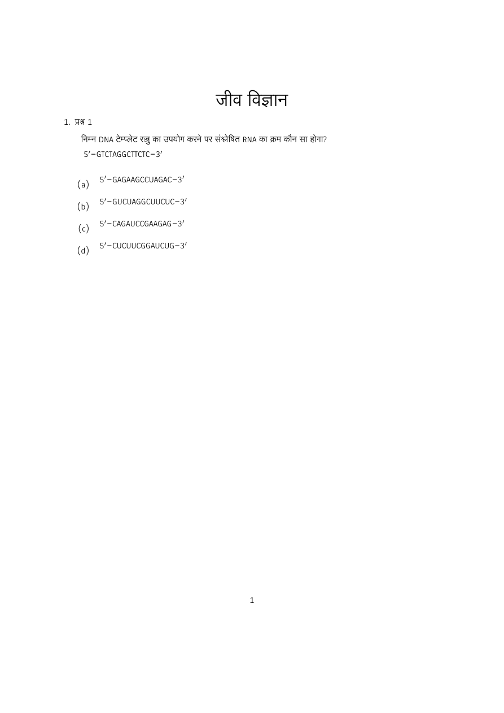

## PDF page 2

[Open original PDF at page 2](../pdf/IAT_2024_Hindi_paper.pdf#page=2)

### Searchable text - OCR draft (hin+eng)

```text
2. प्रश्न 2

निम्न वंशावली-वृक्ष चित्र किसी दुर्लभ जीनी-विकार की वंशानुगतता को दर्शाता है | (भरी हुई
संरचनाएं प्रभावित व्यष्टियों को दर्शाती हैं ।)

eu
Ceo ० Ho
Oya evuotves
७ ७ ||

निम्न में से कौन सा विकल्प इस विकार की वंशानुगतता के सबसे सटीक प्रकार को दर्शाता है ?
(a) X- सहलग्न प्रभावी

(b) X- सहलग्न अप्रभावी

सम-गुणसूत्र अप्रभावी

सम-गुणसूत्र प्रभावी
```

### Original page image

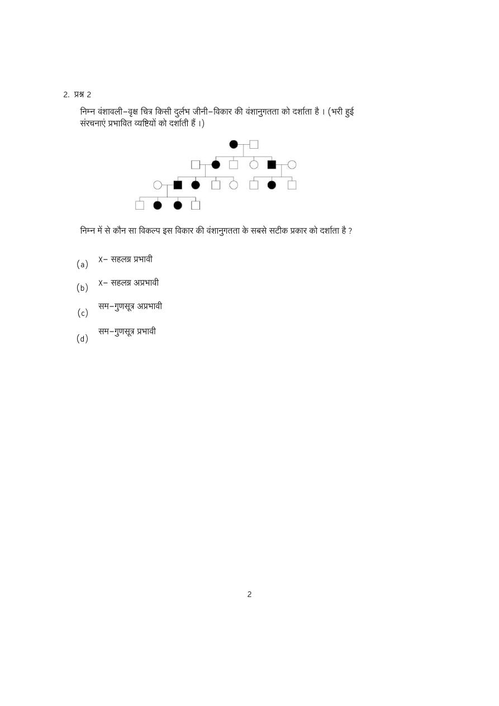

## PDF page 3

[Open original PDF at page 3](../pdf/IAT_2024_Hindi_paper.pdf#page=3)

### Searchable text - OCR draft (hin+eng)

```text
3. प्रश्न 3

oe । में दी गई अवस्थाओं का मिलान स्तंभ ॥ में सूचीबद्ध प्रभावित शारीरिक प्रक्रियाओं से
a

| wa! a. ॥
| P  प्रत्युर्जन | % | वृद्धि हार्मोन का अति-स्रावण
[९ युरीमिया ॥ |वातावरणीय तत्वों के विरुद्ध वर्धित प्रतिरक्षा प्रतिक्रिया
R | मायस्थेनिया ग्रेविस a | तंत्री-पेशीय संधि स्थल के प्रति स्व-प्रतिरक्षा प्रणाली का प्रभाव
| अतिकायता iv | वृक्कों की कार्यत्मकता पर विपरीत प्रभाव से रक्त में युरिया का
एकत्रण

निम्न में से कौन सा विकल्प मिलानों के सही संयोजनों को दर्शाता है?

P-(ii); Q -(iv); R= (iii); $ - (i)

(a)

(७) P-(iii); 0 -(iv); R= (i); $ - (ii)
(c) P-(iv); Q -(iii); R= (i); S - (ii)
(a) P-(ii); Q -(i); R= (iv); S - (iii)
```

### Original page image

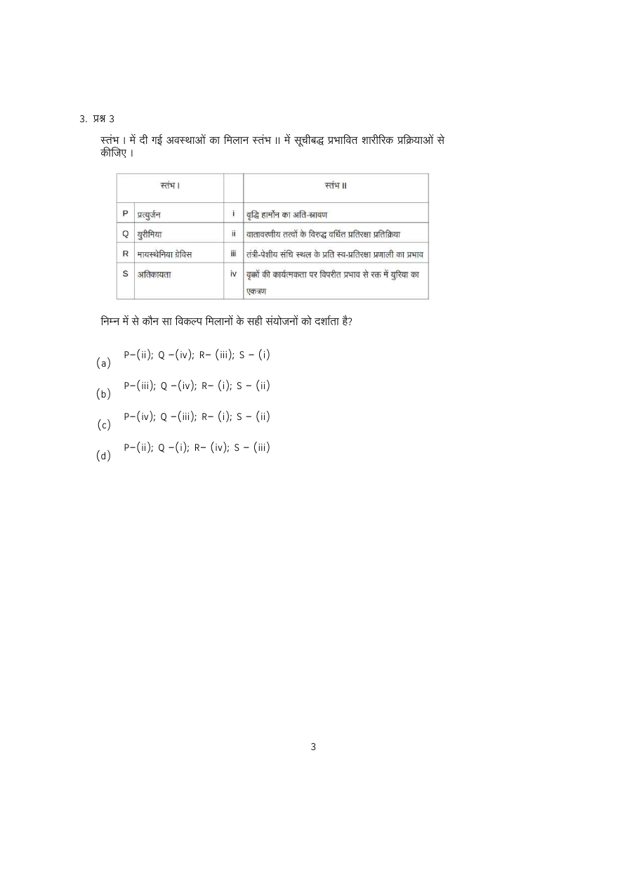

## PDF page 4

[Open original PDF at page 4](../pdf/IAT_2024_Hindi_paper.pdf#page=4)

### Searchable text - OCR draft (hin+eng)

```text
4. प्रश्न 4
निम्न में से कौन सा प्रोटीन पेशीय संकुचन में प्रत्यक्ष भूमिका निभाता है ?

ट्रोपोनिन
इंसुलिन
मायोग्लोबिन

ट्रिप्सिन
```

### Original page image

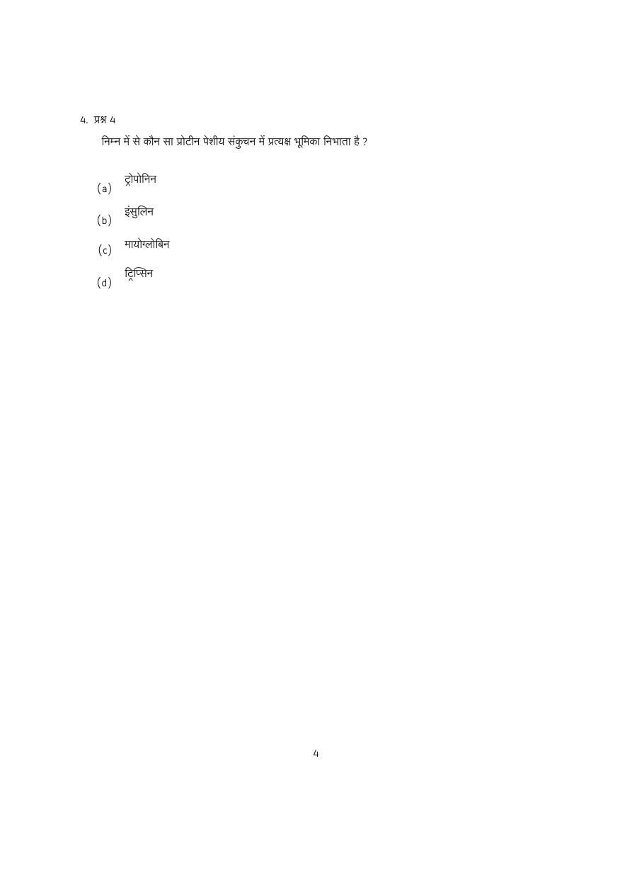

## PDF page 5

[Open original PDF at page 5](../pdf/IAT_2024_Hindi_paper.pdf#page=5)

### Searchable text - OCR draft (hin+eng)

```text
5. प्रश्न 5
निम्न में से कौन सी रचना पौधों की उपकलीय कोशिका स्तर से व्युत्पन्न नहीं है ?
चावल की जड़ों की कैस्पेरियन पट्टी
मक्के की पत्ती के रोम-चर्म (ट्राइकोम्स)
चावल की पत्ती की सहायक (सब्सिडियरी) कोशिकाएं

घास की बुलीफार्म कोशिकाएं
```

### Original page image

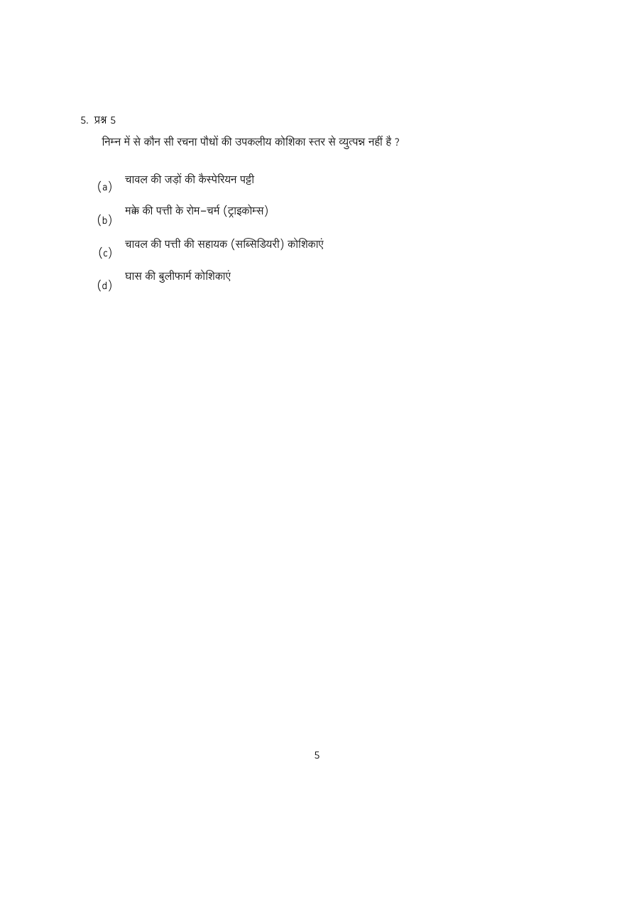

## PDF page 6

[Open original PDF at page 6](../pdf/IAT_2024_Hindi_paper.pdf#page=6)

### Searchable text - OCR draft (hin+eng)

```text
6. प्रश्न 6

निम्न में से कौन सा कथन लैंगिक प्रजनन दशनि वाले पौधों के अर्धसूत्री विभाजन के विषय में
गलत है ?

(a) अर्धसूत्री विभाजन ॥ का अन्त्य-उत्पाद अगुणित युग्मक |
a
अर्धसूत्री विभाजन से चार उत्पाद जीनी-रूप से भिन्न-भिन्न होते हैं |

नर और मादा दोनों हीं में अर्धसूत्री विभाजन के दौरान पुनर्सयोजन होता है |

अधिकतर पुष्पी पादपों की मादाओं में अर्धसूत्री विभाजन के चार उत्पादों में से केवल एक ही
(a) उत्तरजीवित रहता है |
```

### Original page image

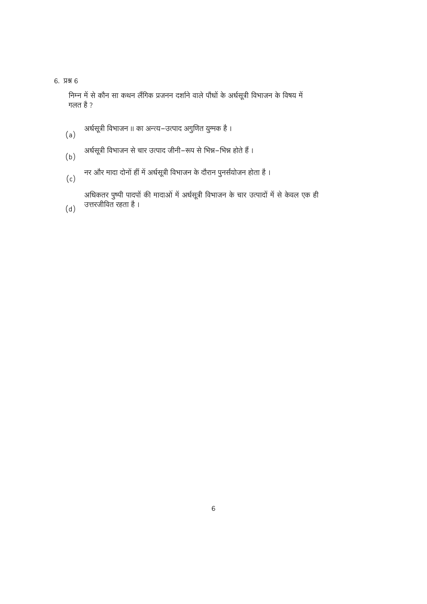

## PDF page 7

[Open original PDF at page 7](../pdf/IAT_2024_Hindi_paper.pdf#page=7)

**Matching embedded figure, English PDF page 7:** Biology Q7: three candidate photosynthesis-rate versus light-intensity graphs are shown: a rise followed by a plateau, a sigmoidal rise and an arch that falls. The fourth candidate continues on page 8.

### Searchable text - OCR draft (hin+eng)

```text
उ. प्रश्न 7

निम्न में से कौन सा रेखाचित्र प्रकाश की तीव्रता (१- stat पर) और प्रकाश संश्लेषण की दर (५-
अक्ष पर) के मध्य सही संबंध को दर्शाता है ?

दर्ज x
(a)
y,
—> Xx
(5)
%,
——S x
(०)
```

### Original page image

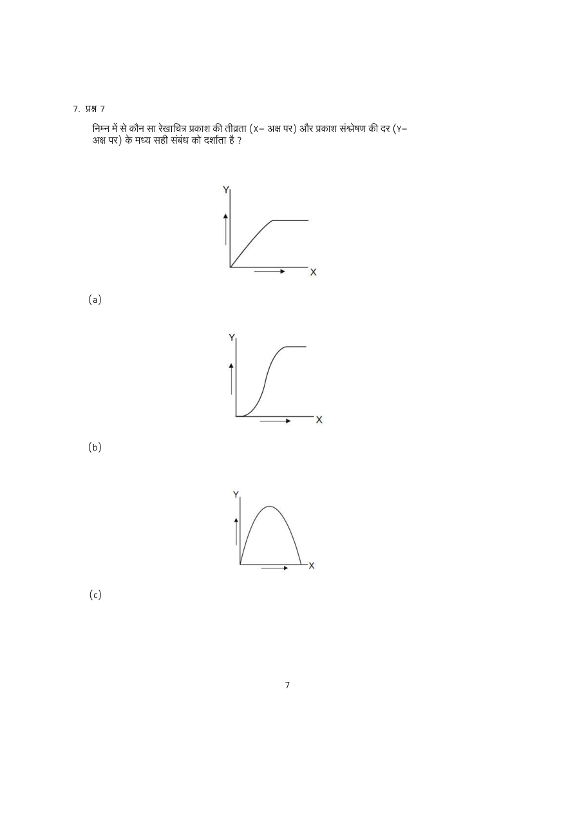

## PDF page 8

[Open original PDF at page 8](../pdf/IAT_2024_Hindi_paper.pdf#page=8)

**Matching embedded figure, English PDF page 8:** Continuation of Biology Q7, option (d): a straight line through the origin increases without a plateau on the same X-Y axes.

### Searchable text - OCR draft (hin+eng)

```text
[No text recovered; use the original page image below.]
```

### Original page image

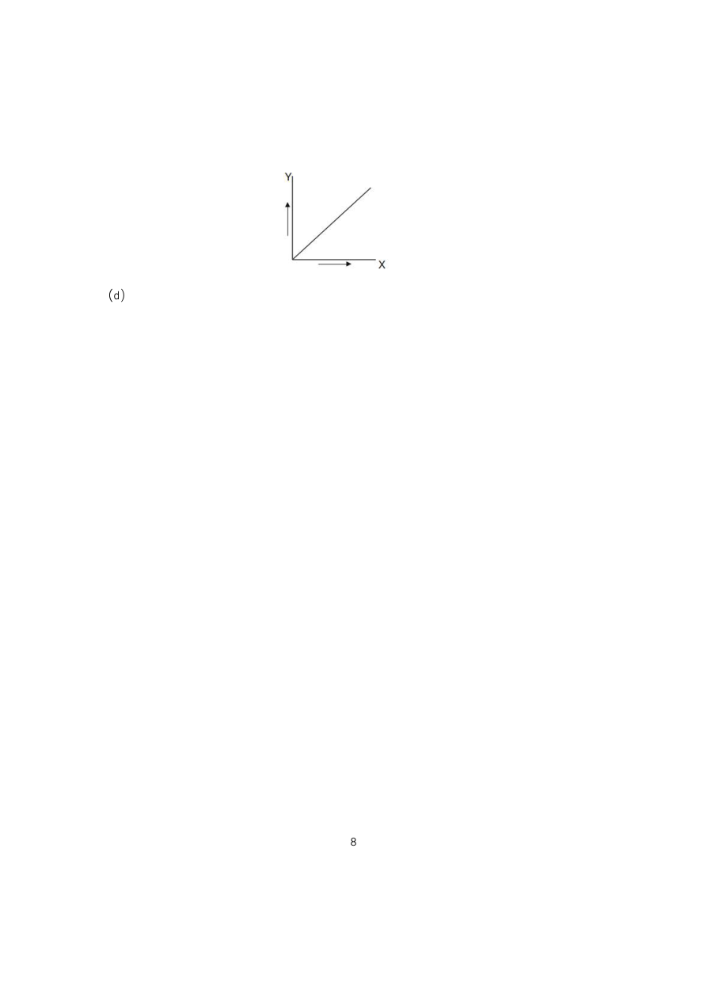

## PDF page 9

[Open original PDF at page 9](../pdf/IAT_2024_Hindi_paper.pdf#page=9)

### Searchable text - OCR draft (hin+eng)

```text
8. प्रश्न 8

स्तंभ | में दिए गए एंजाइम्स का मिलान स्तंभ ॥ में दिए गए कोशिकीय घटकों से कराएं |

स्तंभ। स्तंभ॥
7? |सक्सिनेट डिहाइड्रोजिनेज | | कोशिका द्रव
Q | needs डिहाइड्रोजिनेज | सूत्रकणिकीय अन्तःझिल्ली
R_ | लैक्टेट डिहाइड्रोजिनेज ॥# | सूत्रकणिकीय आधात्री
5. |aTp सिंथेज iv | थाइलाकोयड झिल्ली
५. | हरित caw अन्तःझिल्ली

निम्न में से कौन सा विकल्प इन मिलानों के सही संयोजनों को दर्शाता है ?

?- (ii); 0९ - (iii); १- (i); $ - (iv)

(9)

७) Po (iv); ० - (i); R= (iii); 5 - (ii)
(c) Po (iii); Q- (ii); R - (i); 5 - (v)
(a) Po (iii); Q - (i); R - (iv); $ - (ii)
```

### Original page image

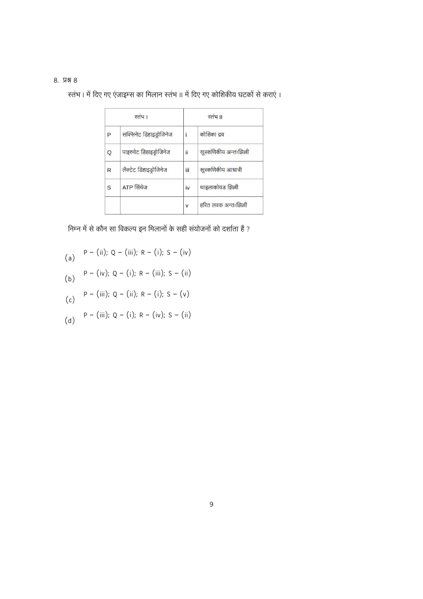

## PDF page 10

[Open original PDF at page 10](../pdf/IAT_2024_Hindi_paper.pdf#page=10)

### Searchable text - OCR draft (hin+eng)

```text
9. प्रश्न 9

पुष्पी पादपों की दो भिन्न प्रजातियों ? (2n= 20 गुणसूत्र) और 0 ( 2n= 30 गुणसूत्र) का व्युत्क्रम
संकरण एक-दूसरे से नर या मादा के रूप में (जैसा नीचे दर्शाया गया है) करा कर Fl Het के
बीज प्राप्त किए गए |

(पादप PX fel पादप Q (पादप Qx C. पादप ?

Fi बीज Fi बीज
(R) (3)

दोनों हीं 7 बीजों (? और 5) के किस/किन बीज-उत्तक/उत्तकों में गुणसूत्रों की संख्या
एकसमान होगी ?

(a)

(७) भ्रूणपोष

भ्रूण और बीज-चोल
(c)

भ्रूण और भ्रूणपोष
(a) x x

i0
```

### Original page image

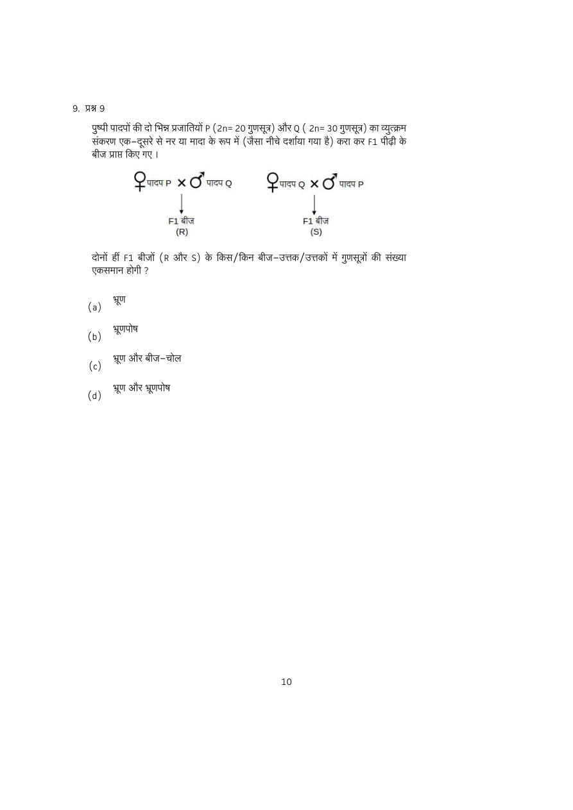

## PDF page 11

[Open original PDF at page 11](../pdf/IAT_2024_Hindi_paper.pdf#page=11)

### Searchable text - OCR draft (hin+eng)

```text
0. W420

निम्न में से कौन टाइफॉयड की जांच के लिए सामान्यतः उपयोग में लाया जाता है ?

(a) विडाल टेस्ट

(७) ELISA
(c) जेल वैद्युत-संचलन
(a) RT-PCR

वव
```

### Original page image

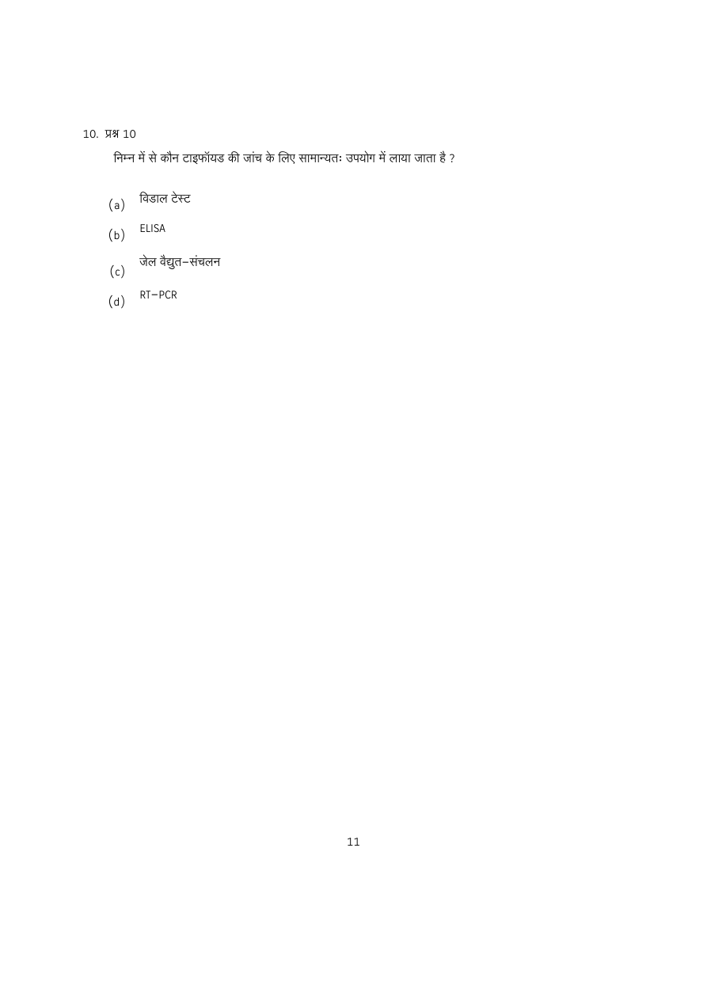

## PDF page 12

[Open original PDF at page 12](../pdf/IAT_2024_Hindi_paper.pdf#page=12)

### Searchable text - OCR draft (hin+eng)

```text
2. 44 2

निम्न में से किस confers संवाहक में किसी जीन की क़ोनिंग BamHl और ६८०१ प्रतिबंधन
एंजाइम्स के मध्य करके उसका चयन एंपीसिलीन युक्त पोषण-अगार माध्यम पर किया जा सकता
है?

[ori, और Amp” क्रमशः प्रतिकृतियन का प्रारंभ और एंपीसिलीन प्रतिरोधकता जीन हैं । ]

Ori

Amp* प्लाज्मिड संवाहक

BamHI

EcoRI
(a)
प्लाज्मिड संवाहक
EcoRI
(०)

i2
```

### Original page image

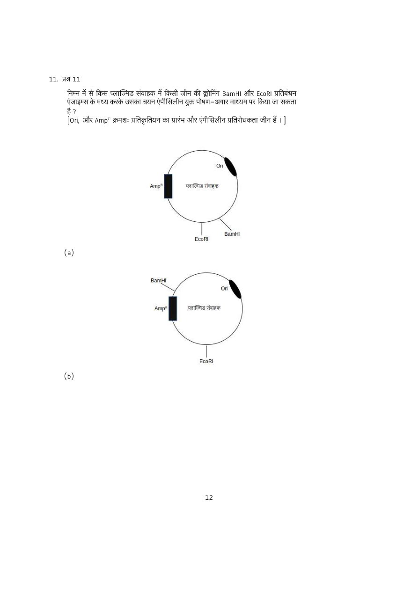

## PDF page 13

[Open original PDF at page 13](../pdf/IAT_2024_Hindi_paper.pdf#page=13)

### Searchable text - OCR draft (hin+eng)

```text
(०)

(५)

Amp®

Amp

प्लाज्मिड संवाहक

EcoRI

प्लाज्मिड संवाहक

EcoRI

i3

Ori

BamHI
```

### Original page image

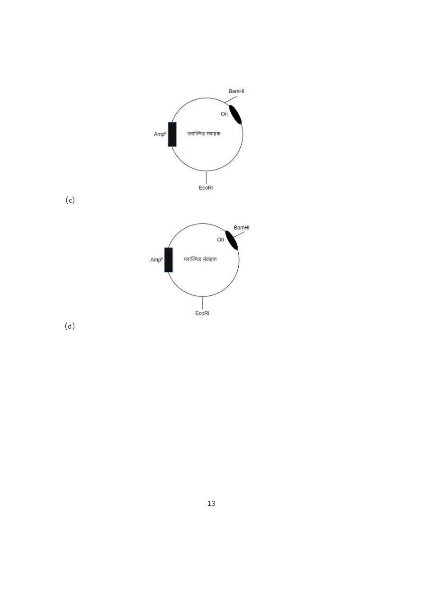

## PDF page 14

[Open original PDF at page 14](../pdf/IAT_2024_Hindi_paper.pdf#page=14)

### Searchable text - OCR draft (hin+eng)

```text
2. WA2

पॉलीमेरेज श्रृंखला अभिक्रिया (PCR) का उपयोग करके अभिरुचि जीन का प्रवर्धन किया जाता
है । यदि PCR के 30 चक्रों के उपरान्त अभिरुचि जीन की 2 बिलियन प्रतियाँ उत्पन्न हुई तो 20वें
चक्र के अन्त में इस अभिरुचि जीन की कितनी प्रतियाँ प्रवर्धित हुई रही होंगी ?

4 मिलियन
(७) 0.66 बिलियन
i0 मिलियन

0.7 बिलियन

4
```

### Original page image

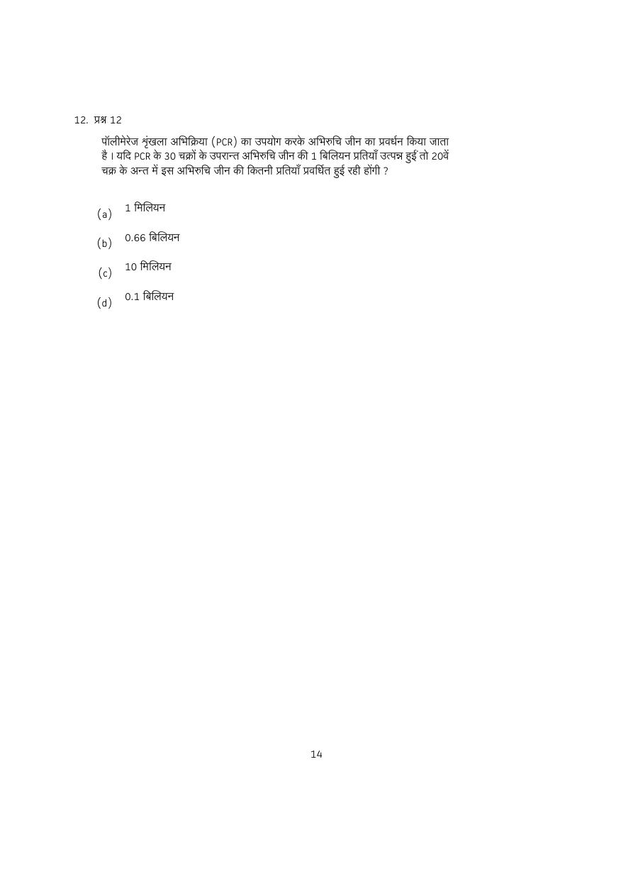

## PDF page 15

[Open original PDF at page 15](../pdf/IAT_2024_Hindi_paper.pdf#page=15)

### Searchable text - OCR draft (hin+eng)

```text
3. WA 33

यदि किसी आबादी का आकार N = 400 व्यष्टियों का है जो = 500 तक बढ़कर अनन्तस्पर्शी
(एसिम्प्टोट) हो जाती है, यहाँ K पोषण क्षमता है । यदि इस आबादी की प्राकृतिक वृद्धि की
इंट्रीज्िक दर (7) 0.02 है तो आबादी वृद्धि दर (AN /dt) का मान कितना होगा ?

(a) °°

(b) 0.05

(a) °4

a5
```

### Original page image

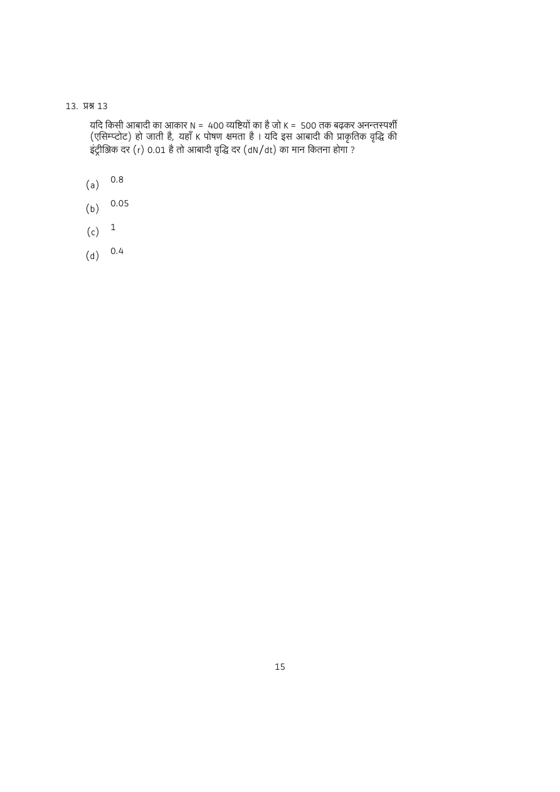

## PDF page 16

[Open original PDF at page 16](../pdf/IAT_2024_Hindi_paper.pdf#page=16)

### Searchable text - OCR draft (hin+eng)

```text
44. प्रश्न 4
निम्नलिखित में से कौन सा कथन सही है ?

हेमी-कार्डेटा को कार्डेट्स का एक उप-संघ नहीं माना जाता है और इसमें प्रोटो-नोटोकार्ड होता
है जिसे स्टोमोकार्ड कहते हैं ।

यह कार्डेटा का एक उप-संघ है और इसमें प्रोटो-नोटोकार्ड होता है जिसे स्टोमोकार्ड कहते हैं |

यह कार्डेटा का एक उप-संघ है और इनमें कार्डेट्स की तरह वास्तविक नोटोकार्ड एवं गिल-छिद्र
होते है।

हेमी-कार्डेटा को कार्डेटा का एक उप-संघ नहीं माना जाता है क्‍योंकि इनमें जल संवहन तंत्र
(४) 'याजाता है।

i6
```

### Original page image

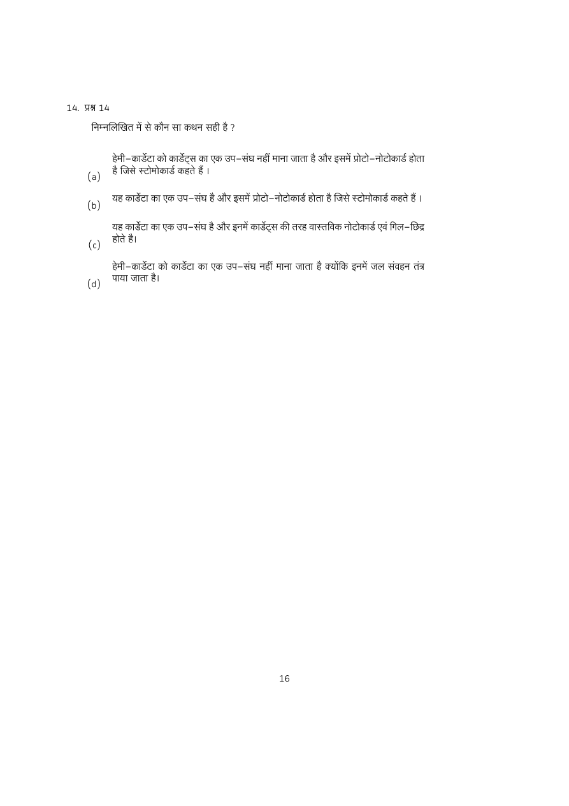

## PDF page 17

[Open original PDF at page 17](../pdf/IAT_2024_Hindi_paper.pdf#page=17)

### Searchable text - OCR draft (hin+eng)

```text
45. प्रश्न 5
निम्न

में से कौन सा कथन वक्र ‘a’ की तुलना में ऑक्सीजन (0५) वियोजन at ‘a’ sil

८” के विषय में सही है ?

हीमोग्लोबिन की 0: संतृप्तता का % ->

वक्र ‘A’ =e [H+] सांद्रता की दशाओं में हीमोग्लोबिन से हितकारी 02-संयोजन को निरूपित
करता है ।

am “८! न्यून 700: की दशाओं में हीमोग्लोबिन से हितकारी 0/-संयोजन को निरूपित करता
है।

वक्र ‘A’ न्‍्यून pH की दशाओं में हीमोग्लोबिन से हितकारी 02-संयोजन को निरूपित करता है
|

am “८” उच्च 702 की दशाओं में हीमोग्लोबिन से हितकारी 02-संयोजन को निरूपित करता है
|

हक
```

### Original page image

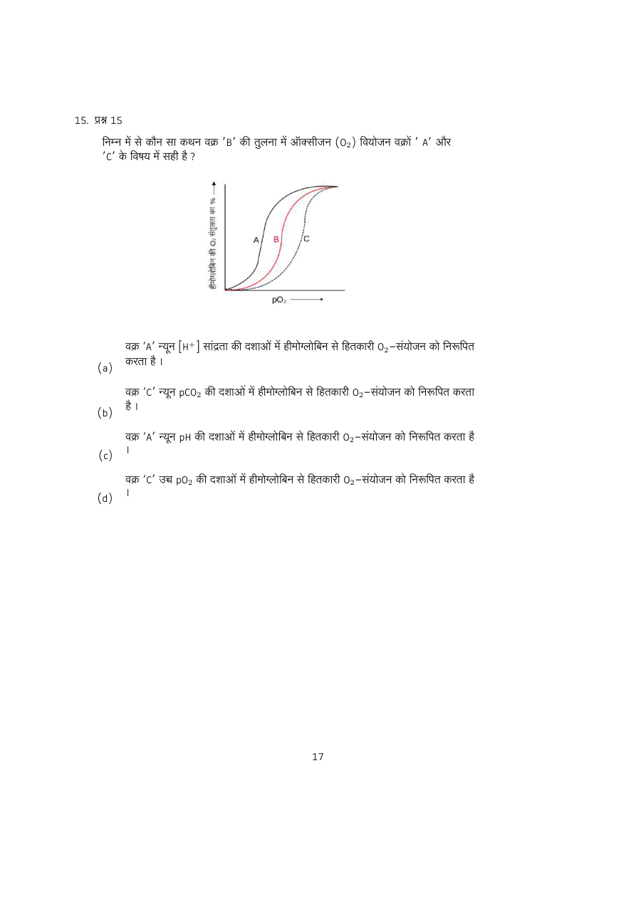

## PDF page 18

[Open original PDF at page 18](../pdf/IAT_2024_Hindi_paper.pdf#page=18)

### Searchable text - OCR draft (hin+eng)

```text
रसायन विज्ञान

l. Wal

यदि Z = 420 वाला तत्व खोजा गया तो यह तत्वों के किस समूह का सदस्य होगा?

क्षारीय मृदा धातु
क्षारीय धातु
हैलोजेन समूह

उत्कृष्ट गैसें
```

### Original page image

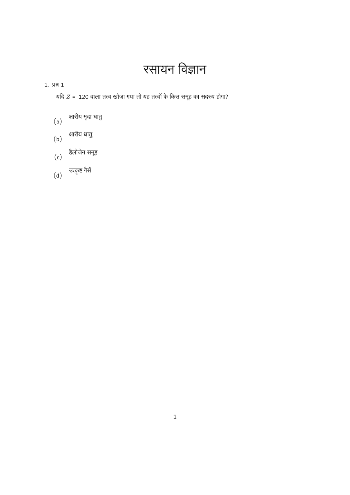

## PDF page 19

[Open original PDF at page 19](../pdf/IAT_2024_Hindi_paper.pdf#page=19)

### Searchable text - OCR draft (hin+eng)

```text
2. प्रश्न 2
No, CO, तथा NOt के सन्दर्भ में कौन सा कथन सही है ?
(a) ये सम-इलेक्ट्रानिक हैं तथा एकसमान बन्ध-क्रम रखते हैं |
a

(७) ये सम-इलेक्ट्रानिक हैं तथा विभिन्न बन्ध-क्रम रखते हैं |

ये सम-इलेक्ट्रानिक नहीं हैं परन्तु एकसमान बन्ध-क्रम रखते हैं ।

(०)

ये न तो सम-इलेक्ट्रानिक हैं और ना हीं एकसमान बन्ध-क्रम रखते हैं |

(५)
```

### Original page image

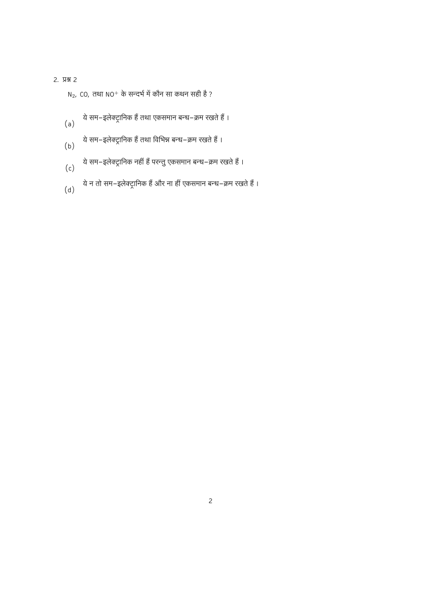

## PDF page 20

[Open original PDF at page 20](../pdf/IAT_2024_Hindi_paper.pdf#page=20)

### Searchable text - OCR draft (hin+eng)

```text
3. प्रश्न 3

निम्नलिखित संकुलों में किसका/किनका चुंबकीय आधघूर्ण का मान 2 बोर मग्रेटोंन के निकट
होगा?

[#९(॥४20)6] (४03)2, /2[७॥०॥ |, Ka[Mn(CN)g], तथा [Ni(CO)4]

केवल ८, [॥॥(0४)6]

(9)

(७) Ko[MnCla] तथा Ka[Mn(CN )o]
[Fe(H20)¢](NO3)2 तथा Ko[MnCly]

(०)

(a) Ka[Mn(CN)¢] तथा [Ni(CO)4]
```

### Original page image

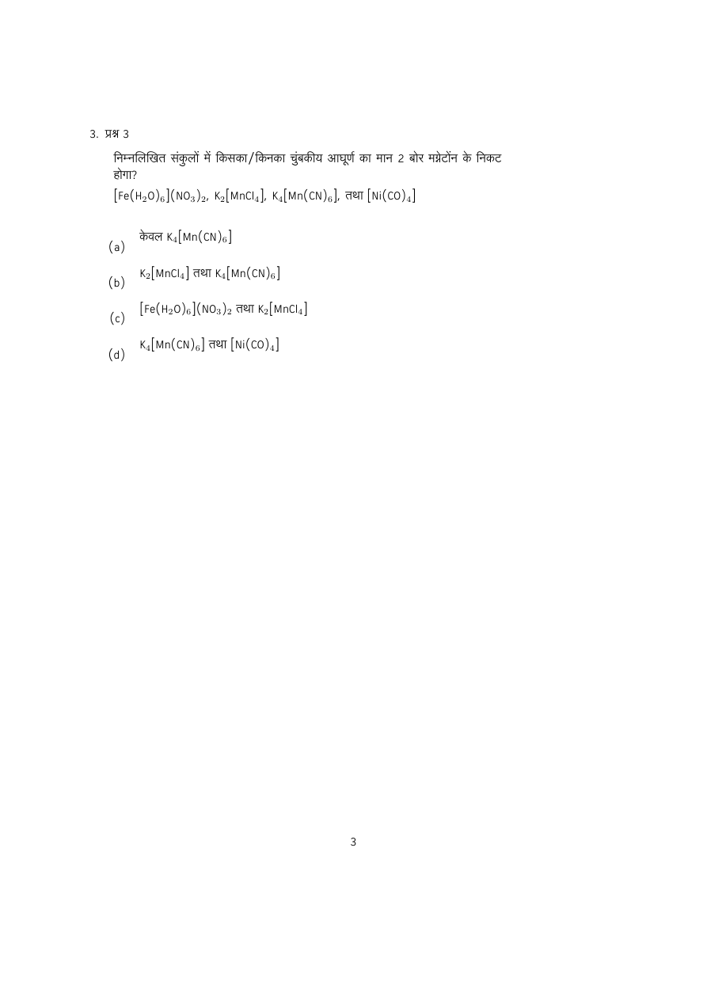

## PDF page 21

[Open original PDF at page 21](../pdf/IAT_2024_Hindi_paper.pdf#page=21)

### Searchable text - OCR draft (hin+eng)

```text
4. प्रश्न 4

VSEPR सिद्धांत के अनुसार, ४४५ तथा 574 की सबसे स्थायी आकृति क्रमशः कौन सी होगी?

वर्ग समतली तथा ढेंकुली
(9)
दोनों ढेंकुली

ढेंकुली तथा वर्ग समतली

दोनों वर्ग समतली
```

### Original page image

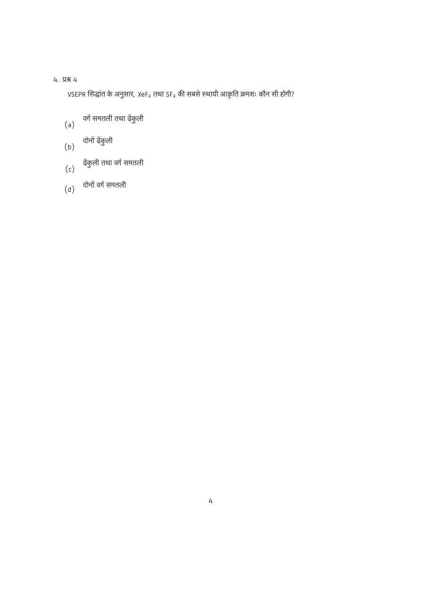

## PDF page 22

[Open original PDF at page 22](../pdf/IAT_2024_Hindi_paper.pdf#page=22)

### Searchable text - OCR draft (hin+eng)

```text
5. प्रश्न 5

निम्नलिखित संकुल आयन प्रकाश के पराबैंगनी-दृश्य क्षेत्र में अवशोषण करता है | इनमें से कौन
सा आयन बैंगनी रंग दशयिगा?
[cocl(NH3)s]2+, [Co(H20)(NHs)5]**, [Co(NHs)6]**, तथा [Co(CN) 6]

[Cocl(NH3)5 ]?*

(a)

() [Co(H20)(NHs)s J+
(c) [Co(NHs Js ]3+
() [co(cn)s]*~
```

### Original page image

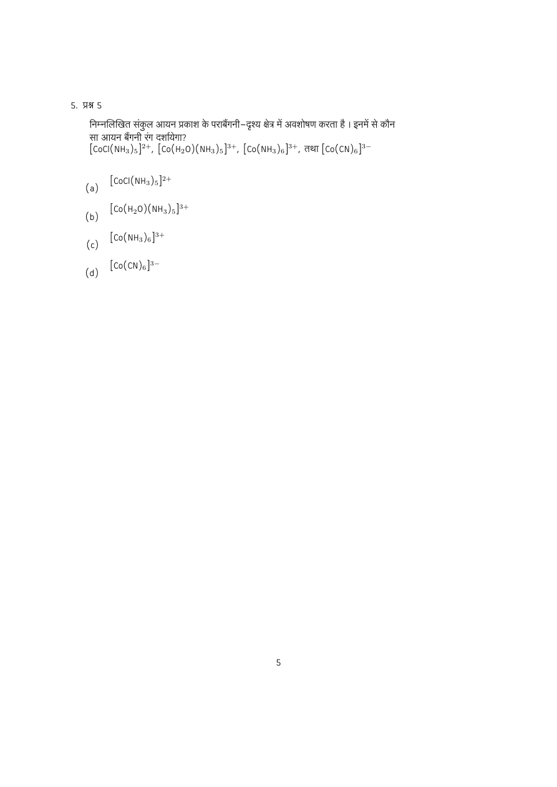

## PDF page 23

[Open original PDF at page 23](../pdf/IAT_2024_Hindi_paper.pdf#page=23)

**Matching embedded figure, English PDF page 23:** Chemistry Q6: two sawhorse-like drawings show substituents H, F, OH and CH3 around a carbon-carbon bond; their relative orientation is needed to classify the relationship between the structures.

### Searchable text - OCR draft (hin+eng)

```text
6. प्रश्न 6
नीचे दर्शाई गई संरचनाओं के मध्य परस्पर क्या सम्बन्ध है?
F

Le H
H CH3 HO

OH

संरुपण समावयव
(9)
(७) रचनात्मक समावयव
प्रतिबिंब रुप

स्थिति समावयव

CH;

H

Le

H
```

### Original page image

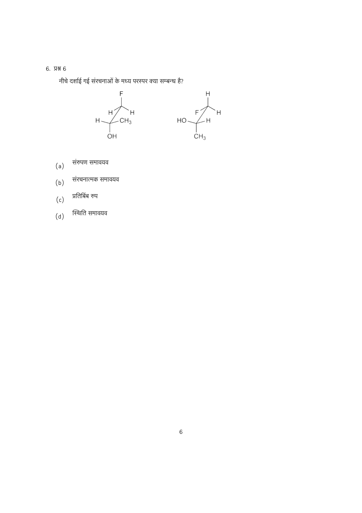

## PDF page 24

[Open original PDF at page 24](../pdf/IAT_2024_Hindi_paper.pdf#page=24)

**Matching embedded figure, English PDF page 24:** Chemistry Q7: four phenolic structures M, N, P and Q differ in methyl and nitro substitution, including a multiply nitrated ring. These structures supply the acidity comparison.

### Searchable text - OCR draft (hin+eng)

```text
य. प्रश्न 7
निम्नलिखित यौगिकों की अम्लीयता का सही क्रम क्‍या है?

OH

OH CO3H NO.
पा S eo oO
oO Cc
\A NZ
M N P Q

P>N>Q>M

(a)

(७) P7Q7NeM
(0 N7P> MQ
(a) N7P?Q>M
```

### Original page image

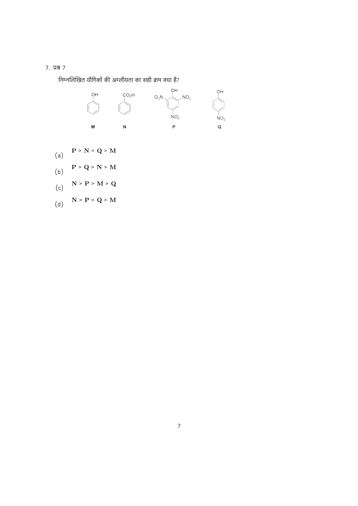

## PDF page 25

[Open original PDF at page 25](../pdf/IAT_2024_Hindi_paper.pdf#page=25)

**Matching embedded figure, English PDF page 25:** Chemistry Q8: two aromatic reaction sequences lead to products N and Q. Reagents appear above the arrows and four answer rows present different structure pairs; preserve cyano/carboxyl and aldehyde/alcohol distinctions.

### Searchable text - OCR draft (hin+eng)

```text
8. प्रश्न 8
निम्नलिखित अभिक्रिया क्रमों F Score N तथा 0 क्या हैं?

Nici CO, HC
C 2 H3PO2, HO M anhyd. AICI; _
CN
Cr S SnCl, HCI p H30
2

A

(a)
_COOH
N= ‘oe Ss OH a= C SS
(5)
OH CHO
N= om a- Cr
(c)
COOH
mee
(०)
```

### Original page image

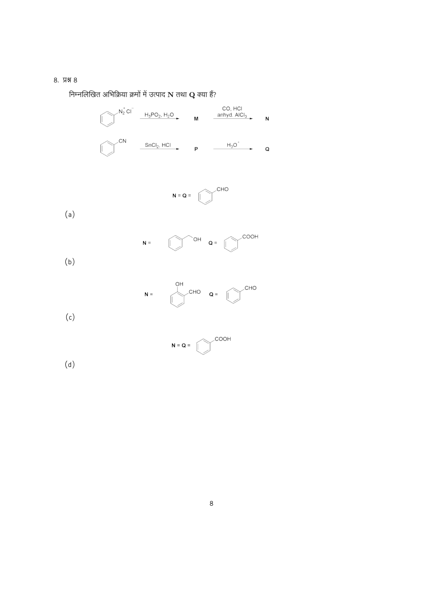

## PDF page 26

[Open original PDF at page 26](../pdf/IAT_2024_Hindi_paper.pdf#page=26)

**Matching embedded figure, English PDF page 26:** Chemistry Q9: a multistep reaction has missing starting material X and product Z, followed by a phenyl-substituted carbonyl product. The options specify alternative alkynes and aldehydes.

### Searchable text - OCR draft (hin+eng)

```text
9. प्रश्न 9

निम्नलिखित अभिक्रिया क्रम में X तथा Z क्‍या है?

HgSO,, dil. H2SO,,

(a)

(७)

(०)

(५)

+20
warm

Zz

~ ता NaOH, heat pros
X= HC H  Z= PhCHO
X= Hj;C—==—CH, 25 PhCHO
X= Ph—==-H Z= CH;CHO
X= Ph—==-CH; —_Z=_CH;CHO

0

in

“ CH
```

### Original page image

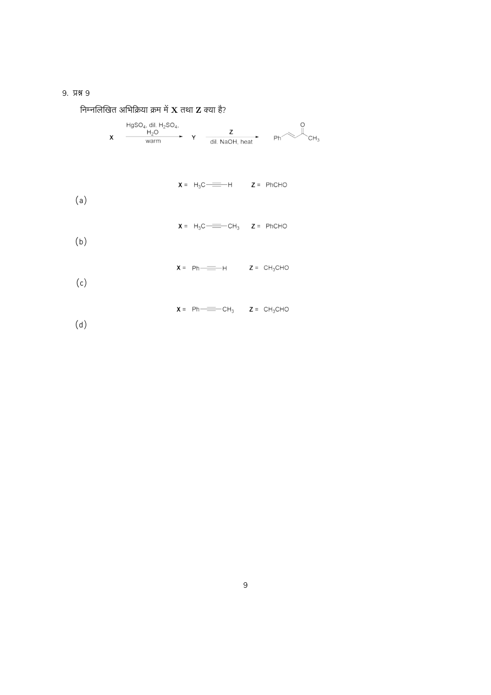

## PDF page 27

[Open original PDF at page 27](../pdf/IAT_2024_Hindi_paper.pdf#page=27)

**Matching embedded figure, English PDF page 27:** Chemistry Q10: cyclic carbohydrate structures M and N have hydroxyl groups above/below the ring and ring oxygen atoms. The alternatives distinguish sugar identity, ring size and alpha/beta configuration.

### Searchable text - OCR draft (hin+eng)

```text
0. W420

M तथा N OT उनके संरचनात्मकता के सन्दर्भ में सही विवरण क्या है?

HO

HOW H
(69 ——O.H te
OH H 2)
HO OH H OH

4 OH OH H
M N

M एक ४-०-(+) -ग्लुकोपाइरैनोस है तथा N एक 8-०-(-)-फ्रक्टोफ्युरेनोस है
M एक 8-०-(+)-ग्लुकोपाइरैनोस है तथा [४ एक .8-०-(-)-फ्रक्टोफ्युरेनोस है
M एक ४-०-(+) “ग्लुकोपाइरैनोस है तथा N एक ०-०-(-)-फ्रक्टोफ्युरेनोस है

M एक ४-०-(+) “ग्लुकोफ्युरेनोस है तथा N एक 8-०-(-)-फ्रक्टोपाइरैनोस है

i0
```

### Original page image

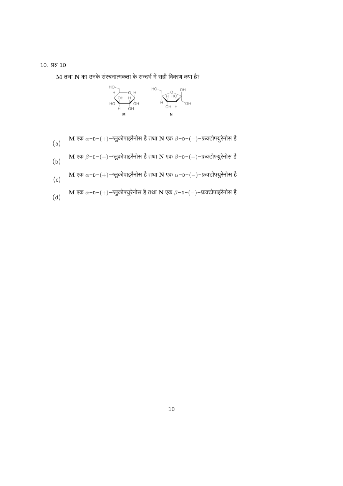

## PDF page 28

[Open original PDF at page 28](../pdf/IAT_2024_Hindi_paper.pdf#page=28)

### Searchable text - OCR draft (hin+eng)

```text
2. 44 2

एक ऊष्माक्षेपी अभिक्रिया

20(5) —> B(s) + C(g) + D(g)
पर गौर किजिए |

यह अभिक्रिया

(a) सभी तापमान पर स्वत: प्रवर्तित होगी
(७) केवल काफ़ी उच्च तापमान पर स्वत: प्रवर्तित होगी
(c) केवल काफ़ी निम्न तापमान पर स्वत: प्रवर्तित होगी

(a) सभी तापमान पर अस्वत: प्रवर्तित होगी

वव
```

### Original page image

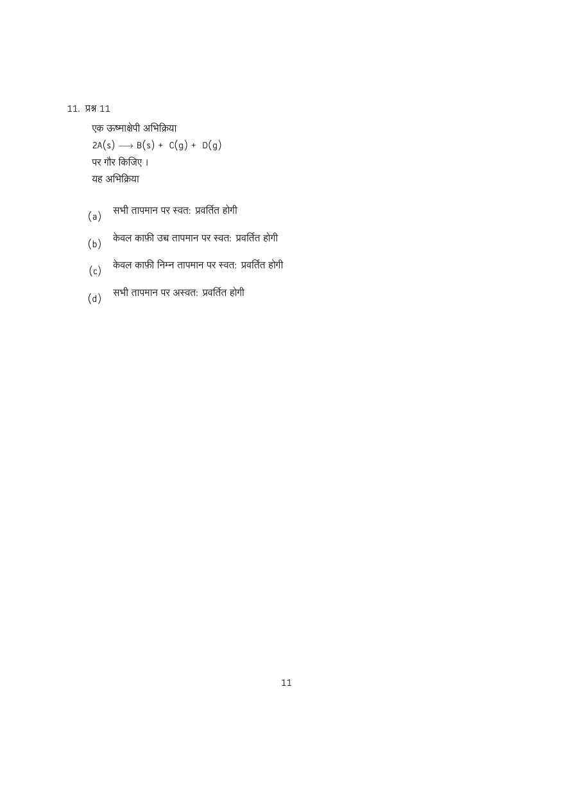

## PDF page 29

[Open original PDF at page 29](../pdf/IAT_2024_Hindi_paper.pdf#page=29)

### Searchable text - OCR draft (hin+eng)

```text
2. WA2

किसी धातु से एक इलेक्ट्रान के निष्कासन के लिये जो कम से कम ऊर्जा की आवश्यता होती है
वह 500 nm & तरंगदैर्घ्य के अनुरुप है। 00 वाट तथा 300 nm तरंगदैर्घ्य के एक बल्ब की
सारी विकिरण यदि इस धातु की सतह से टकराती है तो प्रति सेकेंड निष्कासित होने वाले सभी
प्रकाशिक इलेक्ट्रानों की समस्त गतिज ऊर्जा क्या होगी?

प्लांक स्थिरांक का AM = 6.6 x 0-4 Js, प्रकाश की गति = 3 x 08ms-t

40 J
(a)
2.6 x l0-!9 J

(७)

--9
(c) I.6 x l07™ J

(4) 80 J

i2
```

### Original page image

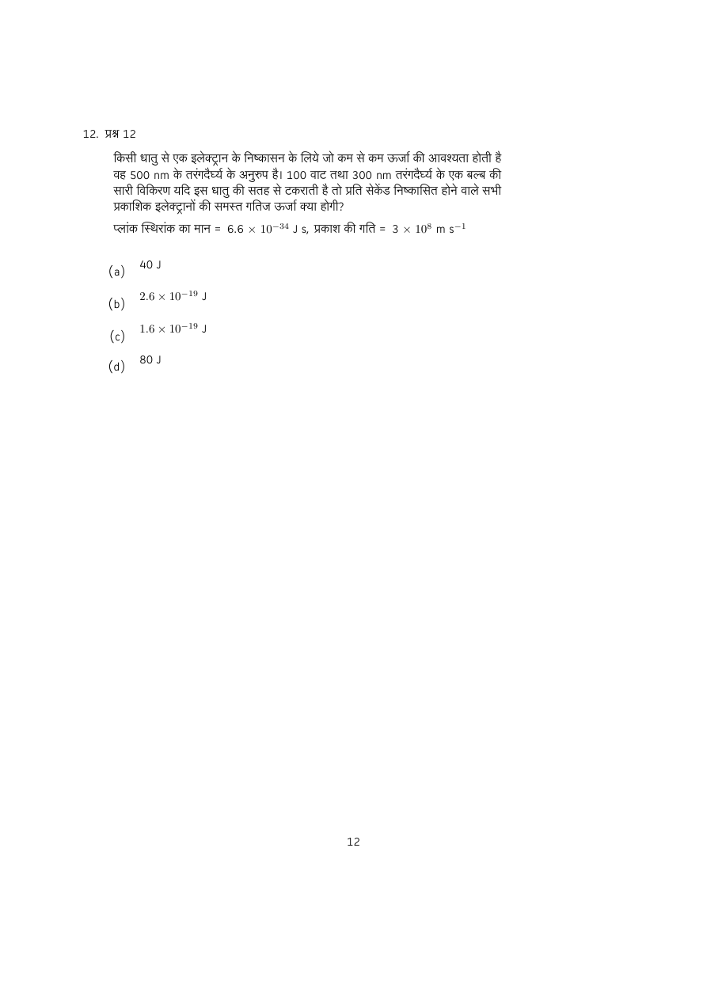

## PDF page 30

[Open original PDF at page 30](../pdf/IAT_2024_Hindi_paper.pdf#page=30)

### Searchable text - OCR draft (hin+eng)

```text
3. WH 33

एक अभिक्रिया  --> P जिसका वेग स्थिरांक 3 x I0-3 mol |7! 57” है तो नीचे दिये गये
रेखा-चित्रों में कौन सा सही है? (दिया गया है कि ४ की प्रारंभिक सांद्रता [२.७ है तथा समय ६
पर ४ की सांद्रता [२] है।)

[R]

[R]

i3
```

### Original page image

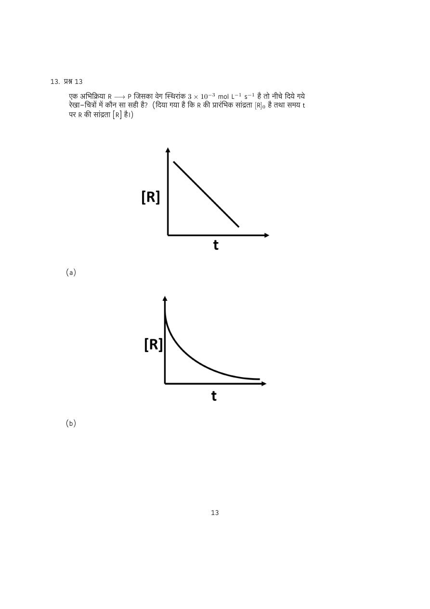

## PDF page 31

[Open original PDF at page 31](../pdf/IAT_2024_Hindi_paper.pdf#page=31)

### Searchable text - OCR draft (hin+eng)

```text
In[R] we

eC ia)

4
```

### Original page image

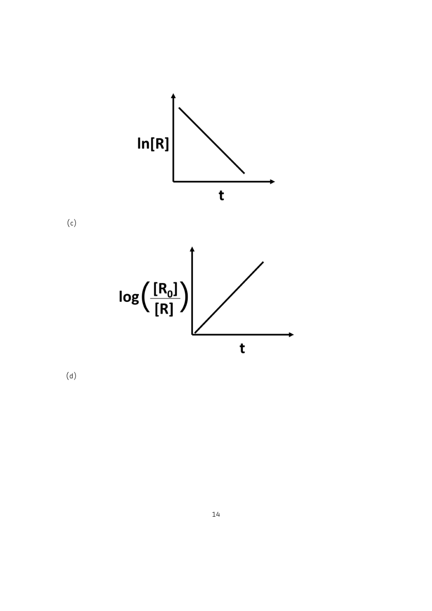

## PDF page 32

[Open original PDF at page 32](../pdf/IAT_2024_Hindi_paper.pdf#page=32)

**Matching embedded figure, English PDF page 32:** Chemistry Q14: four osmotic-pressure Pi versus solution-volume V plots include reciprocal-like decays and straight increasing/decreasing alternatives, with differing intercept behaviour.

### Searchable text - OCR draft (hin+eng)

```text
4. WI 4

निम्न में से कौन सा रेखाचित्र एक नियत तापमान पर आयतन (५) के अनुरूप किसी विलेय
पदार्थ की नियत मात्रा के परासरण दाब (IT) FSM वाले परिवर्तन का सही चित्रण करता है?

a

(0,0) Vv

(a)
rn K

(0,0) Vv
(b)

(0,0) Vv
(c)

NR
(d)

45
```

### Original page image

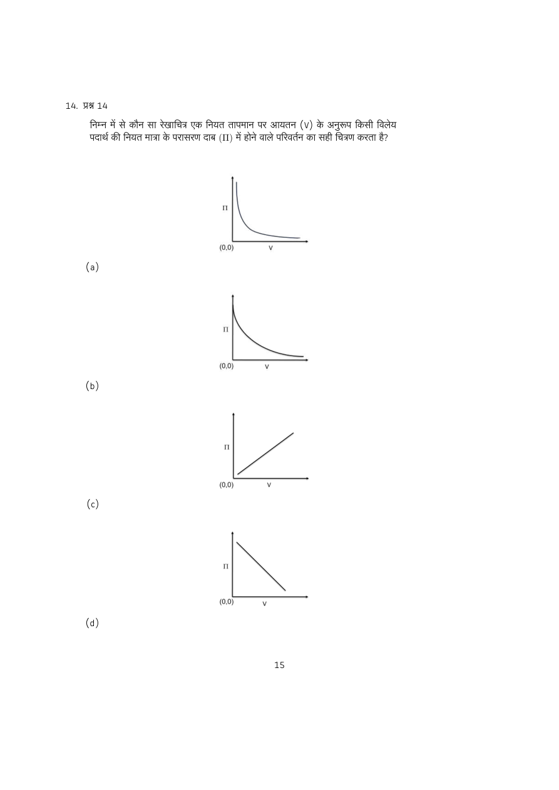

## PDF page 33

[Open original PDF at page 33](../pdf/IAT_2024_Hindi_paper.pdf#page=33)

### Searchable text - OCR draft (hin+eng)

```text
5. WH5

एक विशेष तापमान पर KCI विलयन के बारे में निम्न आँकड़े प्रस्तुत हैं:

raat (mol b> मोलर चालकता (S ता mol
व &705 वुब9.व
9» 405 व्बकत

सीमान्त मोलर चालकता का मान क्या होगा?

(a)
(5)
(c)
(०)

450.4 S cm? mol-!

49.2 S cm? mol-!

454. 5 cm? mol“!

252. S cm? mol-!

i6
```

### Original page image

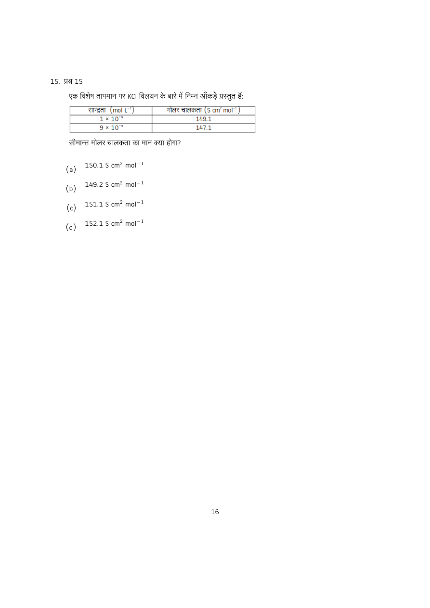

## PDF page 34

[Open original PDF at page 34](../pdf/IAT_2024_Hindi_paper.pdf#page=34)

### Searchable text - OCR draft (hin+eng)

```text
[No text recovered; use the original page image below.]
```

### Original page image

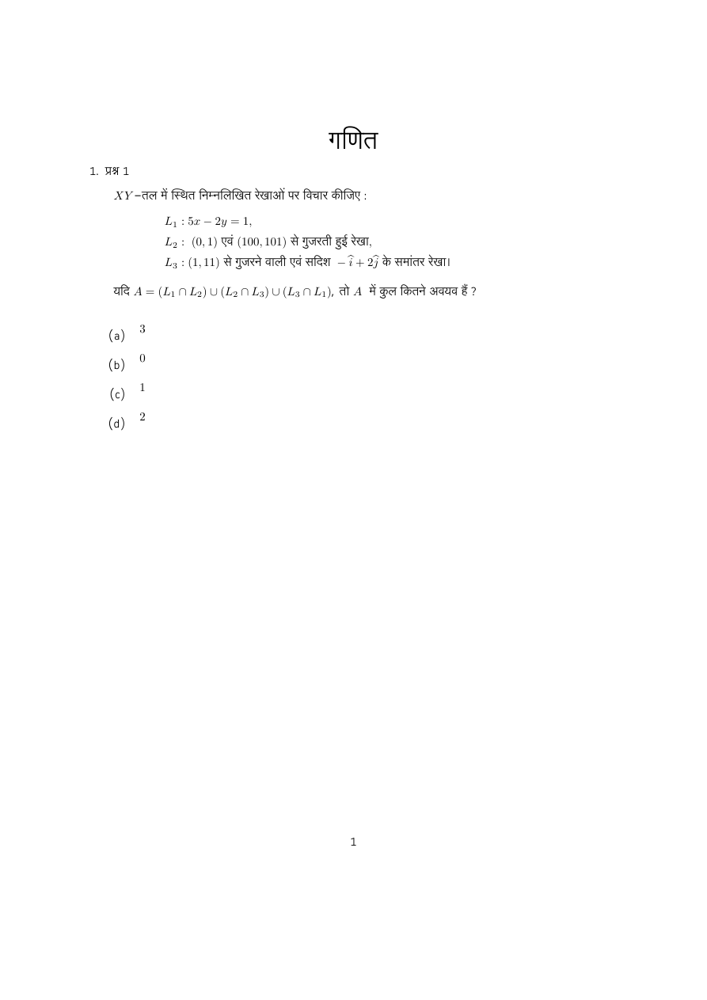

## PDF page 35

[Open original PDF at page 35](../pdf/IAT_2024_Hindi_paper.pdf#page=35)

### Searchable text - OCR draft (hin+eng)

```text
2. प्रश्न 2

मान लीजिए कि £४#-तल में बिंदुओं का एक wae 4 है जो P(—-I,0) और Q(,0) से
एकसमान दूरी पर है | मान लीजिये कि A एवं ६ से एकसमान दूरी पर &#-तल में स्थित
बिंदुओं का wae Bs | यदि BA उपस्थित एक अवयव (5, 9) है , तो ४? का मान क्या
है?

(०) 46
```

### Original page image

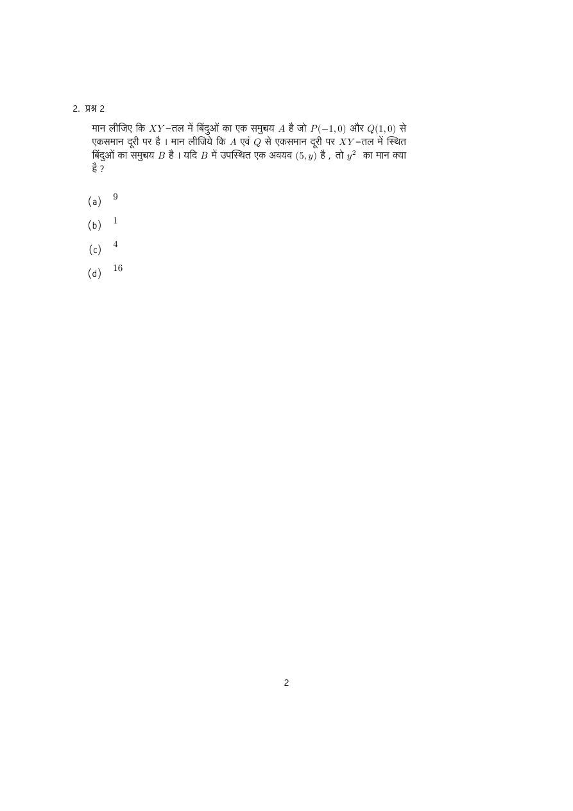

## PDF page 36

[Open original PDF at page 36](../pdf/IAT_2024_Hindi_paper.pdf#page=36)

### Searchable text - OCR draft (hin+eng)

```text
3. प्रश्न 3
नीचे दी गई रेखाओं Ly एवं Ly पर विचार कीजिए

Iy:%=2+2, ४८३+2ओ2, 2=44+3);
Ig:x%=4+2X, y=4, 2=44+2.

यदि (2,3,4), Ly का वह बिंदु है जो Ly के निकटतम है, तो Ly का कौनसा बिंदु L, के
निकटतम है ?

(a) 43)
(७) 44)
(०0 O43)
(०0) 844)
```

### Original page image

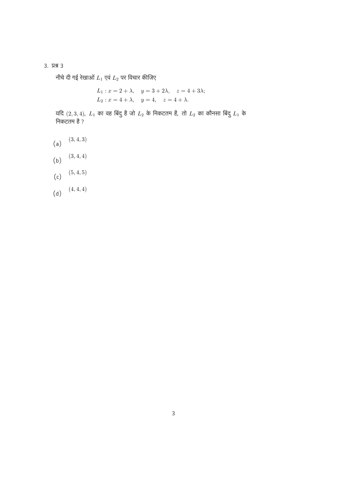

## PDF page 37

[Open original PDF at page 37](../pdf/IAT_2024_Hindi_paper.pdf#page=37)

### Searchable text - OCR draft (hin+eng)

```text
4. प्रश्न 4

मान लीजिए कि ७, ००, ५३, . - - वास्तविक संख्याओं का एक अनुक्रम है । मान लीजिये कि
Sp = 4, + ०2 +++: + ०५ | यदि किसी वास्तविक संख्या ० और सभी # = ,2,3,...8
लिए 2s, =n(c+a,) है, तो निम्नलिखित में से कौन सा कथन सही है ?

०१, ५2, 43, - - - एक समांतर श्रेढ़ी है ।
०१, 262, 303, -  - एक समांतर श्रेढ़ी है ।
Gy, 42, ०3, - - - एक गुणोत्तर श्रेढ़ी है ।

a}, 2ap, 303, - - - एक गुणोत्तर श्रेढ़ी है ।
```

### Original page image

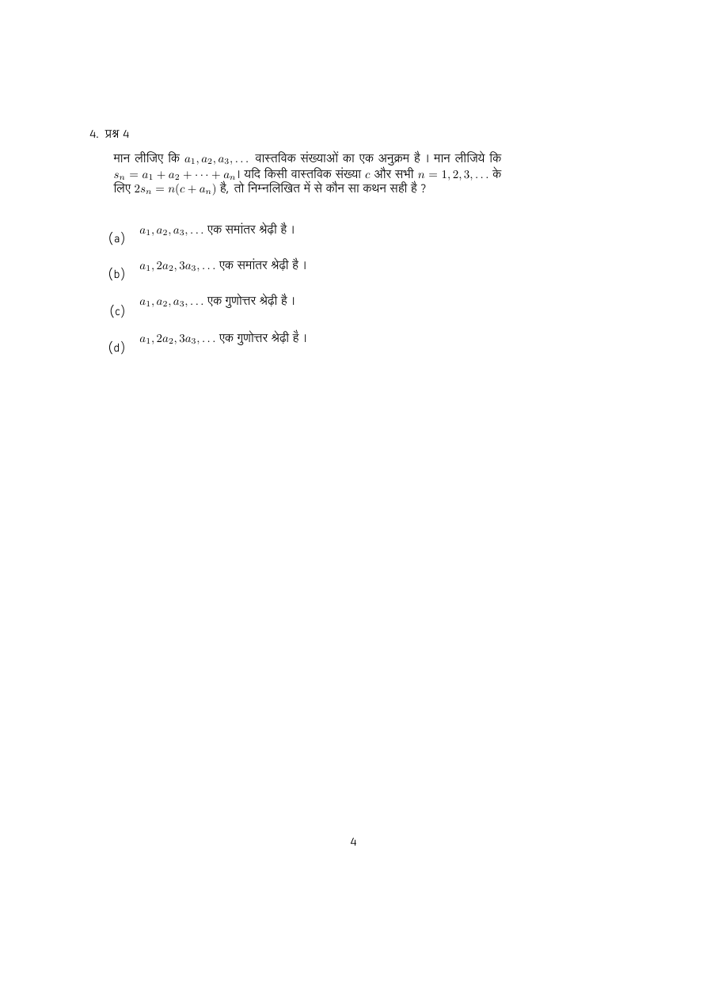

## PDF page 38

[Open original PDF at page 38](../pdf/IAT_2024_Hindi_paper.pdf#page=38)

### Searchable text - OCR draft (hin+eng)

```text
5. प्रश्न 5

यदि /: R > R एक ऐसा निरंतर हासमान फलन है कि सभी t € छ के लिये | f(t)| < #/2
है । मान लीजिये कि wer ५: [0,7] -> R, g(t) = sin(f(t)) से परिभाषित है, तो
निम्नलिखित में से कौन सा कथन सही है ?

(a) फलन g अंतराल [0,7] पर हासमान है |
a

फलन g अंतराल (0, 7] पर वर्धमान है |

(७)

फलन g अंतराल (0, 7/2) पर वर्धमान है और (#/2, 7) पर हासमान है |

(०)

फलन g अंतराल (0, 7/2) पर हासमान है और (#/2, 7) पर वर्धमान है।

(५)
```

### Original page image

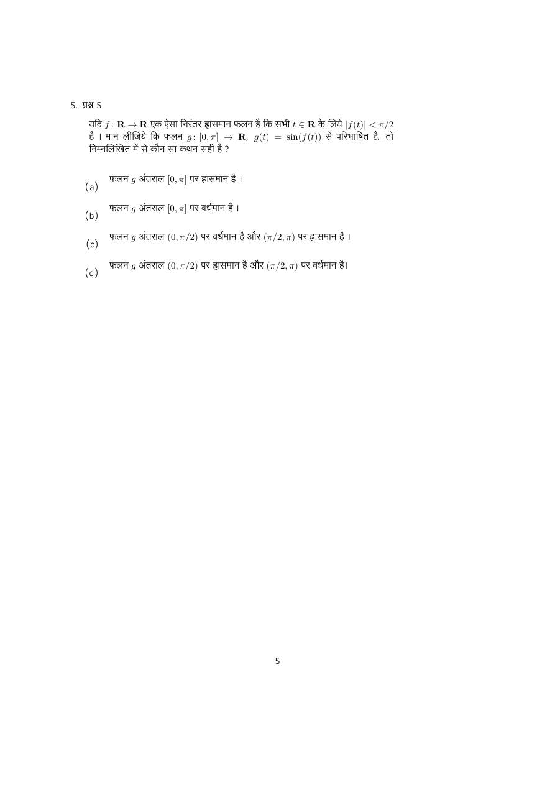

## PDF page 39

[Open original PDF at page 39](../pdf/IAT_2024_Hindi_paper.pdf#page=39)

### Searchable text - OCR draft (hin+eng)

```text
6. प्रश्न 6

मान लीजिए कि /, 4: R -> R फलन हैं । यदि g संतत है तो निम्नलिखित में से किस
परिस्थिति में / संतत है ?

(a) $= Fe
```

### Original page image

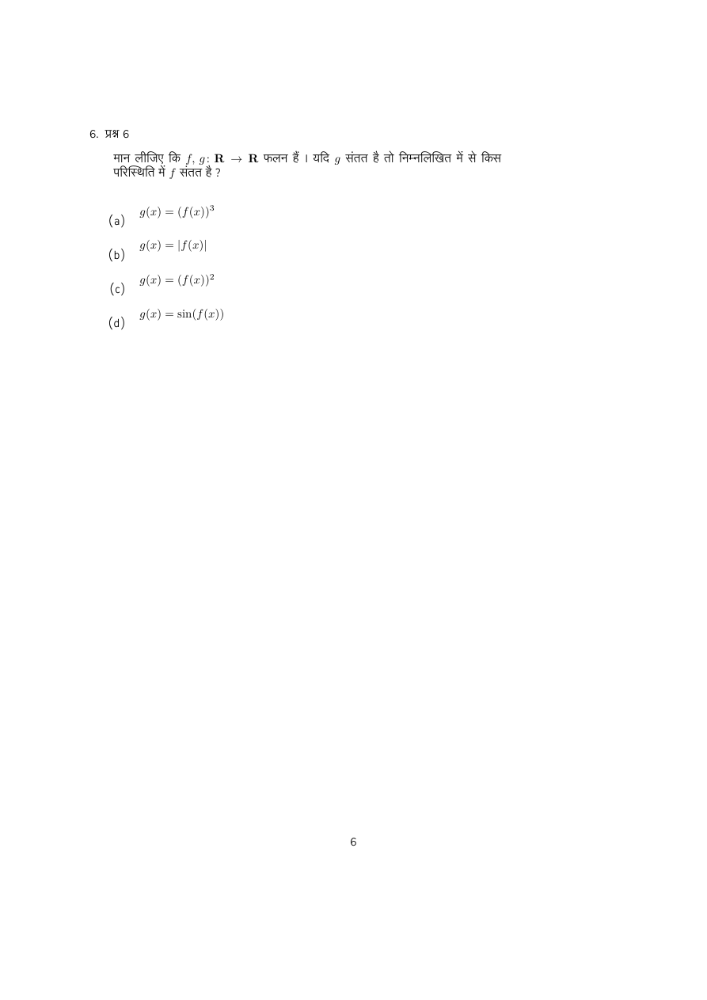

## PDF page 40

[Open original PDF at page 40](../pdf/IAT_2024_Hindi_paper.pdf#page=40)

### Searchable text - OCR draft (hin+eng)

```text
उ. प्रश्न 7

वक्र y = ] - »2 के नीचे तथा &-अक्ष के ऊपर स्थित क्षेत्र में निहित ऐसे आयत, जिसकी
भुजायें निर्देशाक्षों के समांतर है, का महत्तम क्षेत्रफल क्या है ?

4
(a) ४४
=
(७) ४४
4
(0) 3
I
(a) 3
```

### Original page image

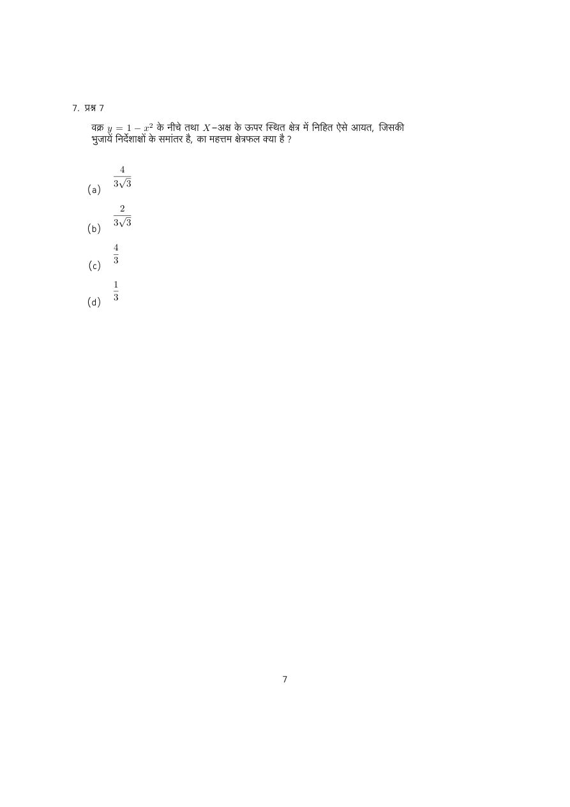

## PDF page 41

[Open original PDF at page 41](../pdf/IAT_2024_Hindi_paper.pdf#page=41)

### Searchable text - OCR draft (hin+eng)

```text
8. प्रश्न 8

मान लीजिए कि /७ वास्तविक प्रविष्टियों वाले 3००3 आकार के आव्यूहों का GAR है | समुच्चय
24 पर # ८ [(4, 2) € Mx M : det(A - B) एक पूर्णाक है ) द्वारा एक संबंध 7?
परिभाषित किया गया है । निम्नलिखित में से कौन सा कथन सही है ?

Rages और सममित है, लेकिन संक्रामक नहीं है |
#₹ स्वतुल्य है, परन्तु सममित या संक्रामक नहीं है |
# एक तुल्यता संबंध है |

# सममित और संक्रामक है, लेकिन स्वतुल्य नहीं है |
```

### Original page image

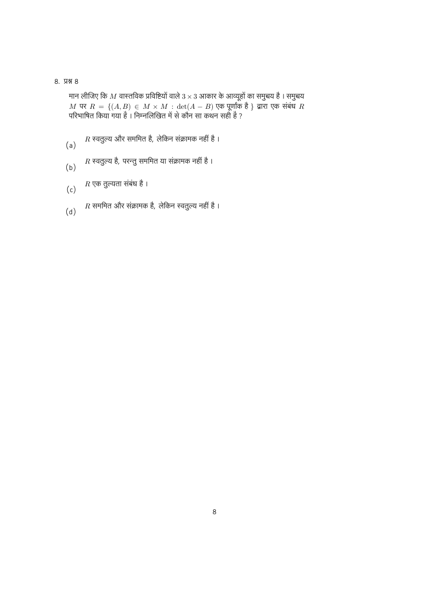

## PDF page 42

[Open original PDF at page 42](../pdf/IAT_2024_Hindi_paper.pdf#page=42)

### Searchable text - OCR draft (hin+eng)

```text
222
श्ख्ट्ज्वु
P54
223

wae 23 C. का
+ 3C 9 का मान क्या है?
```

### Original page image

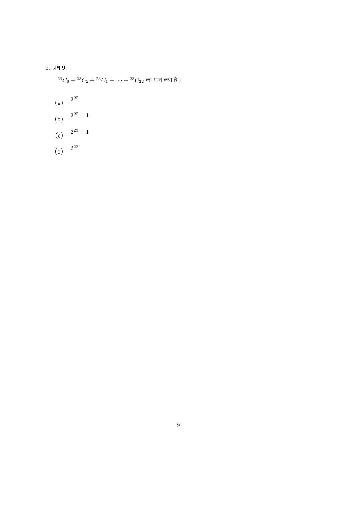

## PDF page 43

[Open original PDF at page 43](../pdf/IAT_2024_Hindi_paper.pdf#page=43)

### Searchable text - OCR draft (hin+eng)

```text
0. W420

मान लीजिए कि / : Q > Q ऐसा फलन है कि सभी », ५ € Q के लिए f(x +y) =
f(x) + f(y) एवं f() = 0 है | निम्नलिखित में से कौन सा कथन सही है ?

f एकैकी आच्छादी है |
/ एकैक है परन्तु आच्छादी नही है ।
f आच्छादी है परन्तु एकैक नही है |

f ना तो एकैक है और ना ही आच्छादी है |

i0
```

### Original page image

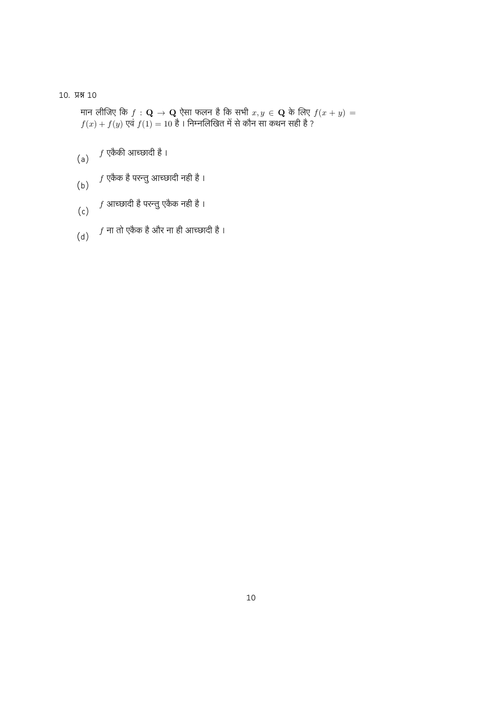

## PDF page 44

[Open original PDF at page 44](../pdf/IAT_2024_Hindi_paper.pdf#page=44)

### Searchable text - OCR draft (hin+eng)

```text
2. 94 2
यदि

er /2

l= I... (sin? (log(x)) + sin(log(x?))) dx

है तो 7 का मान क्या है ?

टए/2 _ en t/2

(a)
७) °

() ?

(a) 77

/2

हक
```

### Original page image

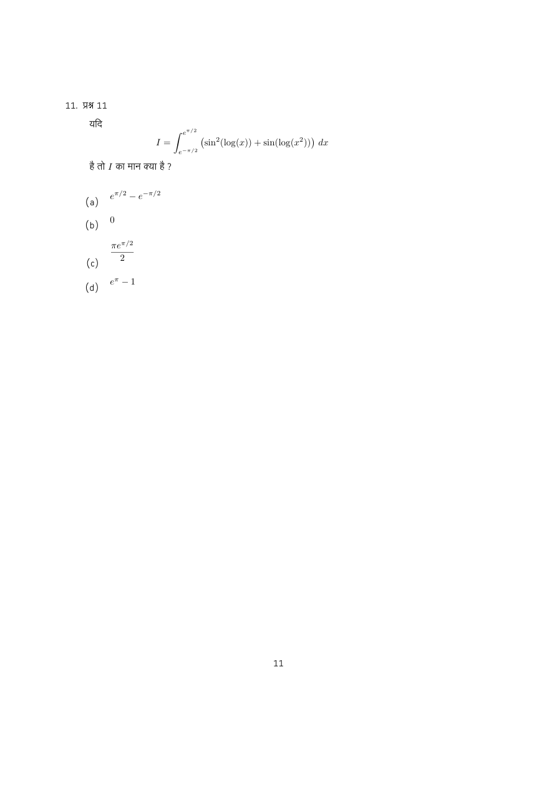

## PDF page 45

[Open original PDF at page 45](../pdf/IAT_2024_Hindi_paper.pdf#page=45)

### Searchable text - OCR draft (hin+eng)

```text
2. WH 2
>#-तल के निम्न उपसमुच्चय पर विचार कीजिए :
S = {(\z —iz|, |) : 2 एक सम्मिश्र संख्या है ।।

निम्नलिखित में से कौन सा कथन सही है ?
9 एक परवलय है |

5 एक वृत्त है ।

5 एक दीघ॑वृत्त है, पर वृत्त नहीं है।

S एक अतिपरवलय है |

i2
```

### Original page image

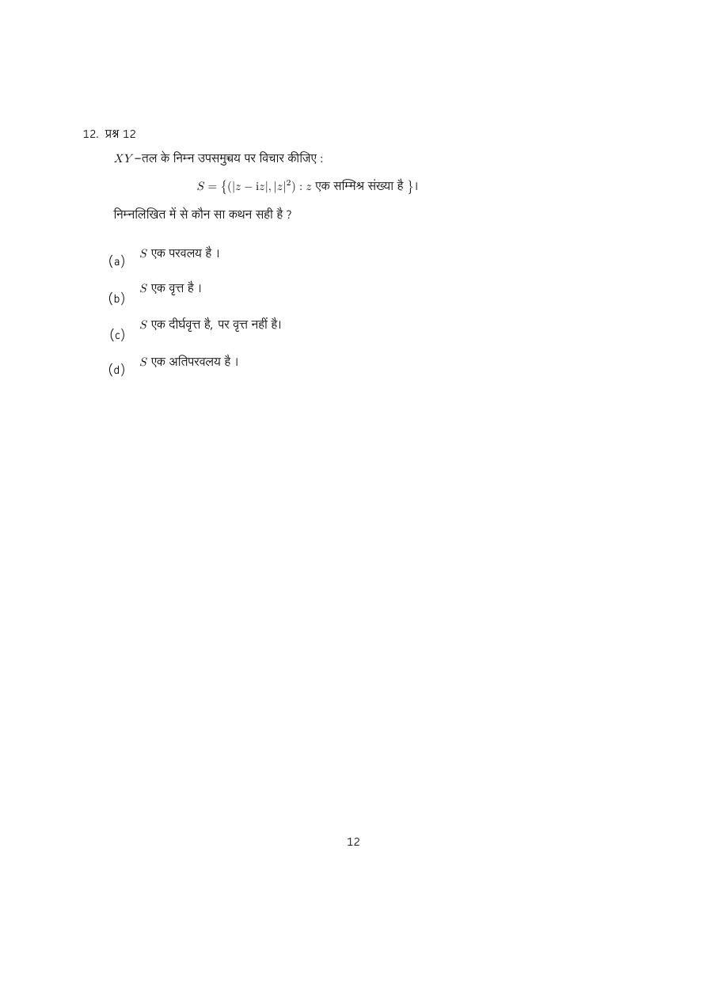

## PDF page 46

[Open original PDF at page 46](../pdf/IAT_2024_Hindi_paper.pdf#page=46)

### Searchable text - OCR draft (hin+eng)

```text
3. WA 33

एक जहाज, A, 8, और ८ से चिन्हित तीन इंजनों के साथ यात्रा प्रारंभ करता है । मान लीजिये
कि तीनों इंजन एक दूसरे से स्वतंत्र रूप से कार्य करते हैं। यदि कम से कम दो इंजन कार्य करते
रहें तभी जहाज यात्रा पूर्ण कर सकता है | इंजनों A, 8, एवं ८ के खराब हो जाने की प्रायिकता
क्रमशः /4, /4, तथा /2 है। इस जहाज के यात्रा पूर्ण कर लेने की प्रायिकता क्या है ?

3
(a) 4
7
७) ?
हि
(0 ४
7
(a) 4

i3
```

### Original page image

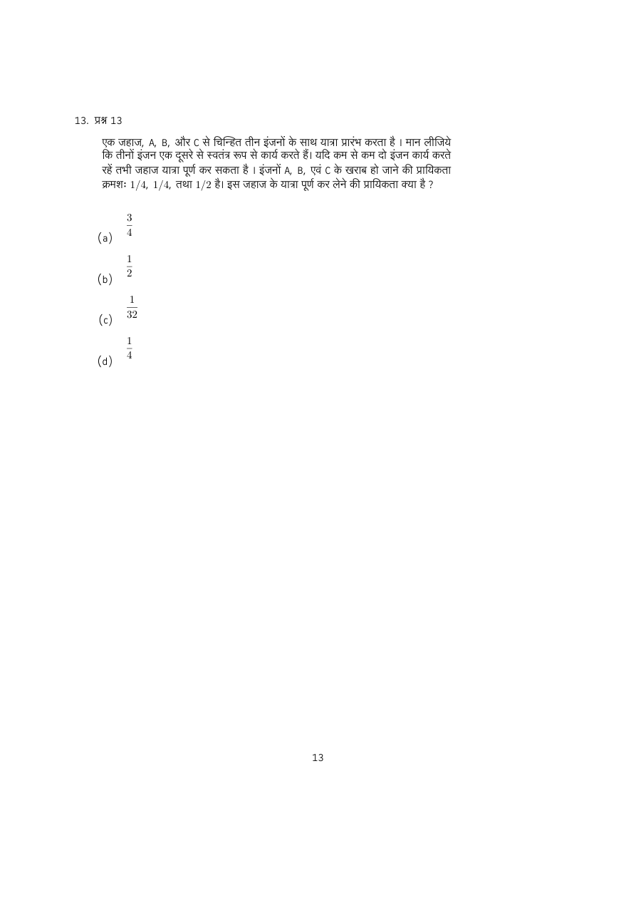

## PDF page 47

[Open original PDF at page 47](../pdf/IAT_2024_Hindi_paper.pdf#page=47)

### Searchable text - OCR draft (hin+eng)

```text
4. WI 4

निम्नलिखित अवकल समीकरण पर विचार कीजिये :

cos(y) w + i sin(y) =a, («> 0);

जहाँ दिया हुआ है कि y = 5 यदि x = V3 है | निम्नलिखित में से 2 = ii Ry का मान

क्या है?
(a) 7
७) 3
() ?
(a) 4

4
```

### Original page image

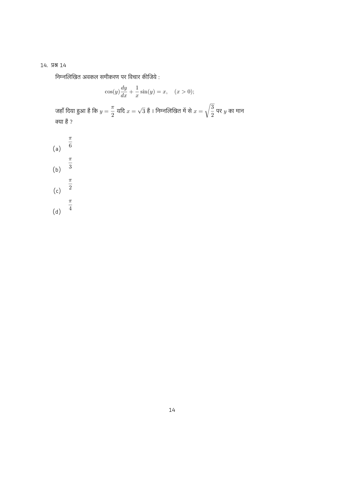

## PDF page 48

[Open original PDF at page 48](../pdf/IAT_2024_Hindi_paper.pdf#page=48)

**Matching embedded figure, English PDF page 48:** Mathematics Q15: a geometric construction marks points Q, A, P, B and C, a horizontal base, vertical segments and intersecting oblique lines. Right-angle conditions and labelled lengths determine PQ.

### Searchable text - OCR draft (hin+eng)

```text
5. WH5

दिये गए चित्र में कोण ZBAQ = ZCPQ = ZCBQ =
डरा और लंबाईयाँ QA = 3 इकाई , AB = 4 इकाई, और

BC - इकाई है | तब PQ की लंबाई कितनी है ?

2.2 इकाई
(७) 2 इकाई
V2 इकाई

3- /2 इकाई

45
```

### Original page image

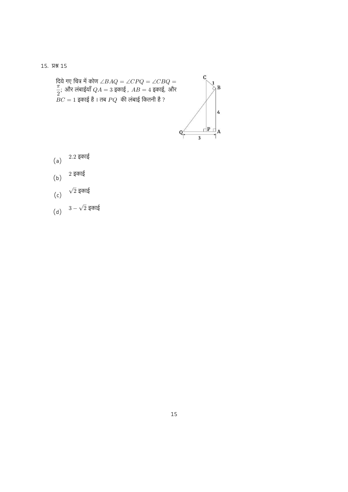

## PDF page 49

[Open original PDF at page 49](../pdf/IAT_2024_Hindi_paper.pdf#page=49)

### Searchable text - OCR draft (hin+eng)

```text
भौतिक विज्ञान

l. Wal

दो साइकिल चालक अभिजीत और वाणी एक वृत्ताकार पथ पर एक बिन्दु से विपरीत दिशा में
चलना प्रारम्भ करते हैं। अभिजीत एक नियत चाल से चलता है। वाणी स्थिरावस्था से शुरु करके
एक नियत त्वरण से चलती है। ये दोनो एक ही चाल से दुबारा इस पथ पर मिलते हैं। निम्न में से
कौन सा कथन सत्य है?

अभिजीत, वाणी की तुलना में, दोगुनी दूरी तय करता है।
अभिजीत, वाणी की तुलना में, आधी दूरी तय करता है।
अभिजीत और वाणी समान दूरी तय करते हैं।

अभिजीत, वाणी की तुलना में, 4/3 गुना दूरी तय करता है।
```

### Original page image

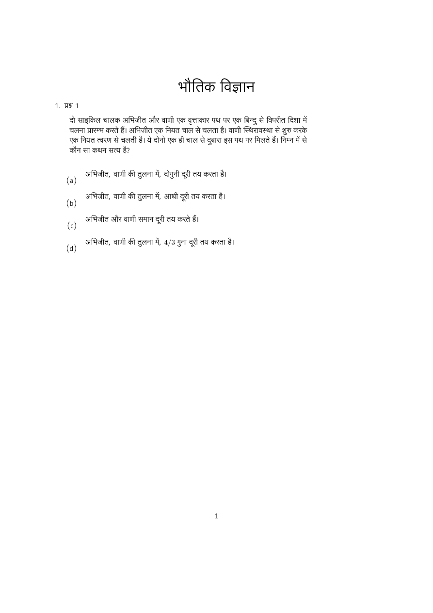

## PDF page 50

[Open original PDF at page 50](../pdf/IAT_2024_Hindi_paper.pdf#page=50)

### Searchable text - OCR draft (hin+eng)

```text
2. प्रश्न 2

विचार कीजिये कि एक सरल लोलक दोलनकाल 7' तथा कोंणीय दोलन के नियत आयाम 60 से
सरल आवर्त गति कर रहा है। इस लोलक का निलंबन बिंदु के सापेक्ष कोंणीय संवेग आयाम 4
से आवर्त गति करता है तो A तथा 7' के लिये निम्न में से कौन सा संबंध सही है?

(a) Ax T?
(७) AxT?
(c) AxT

(4) 4०१४
```

### Original page image

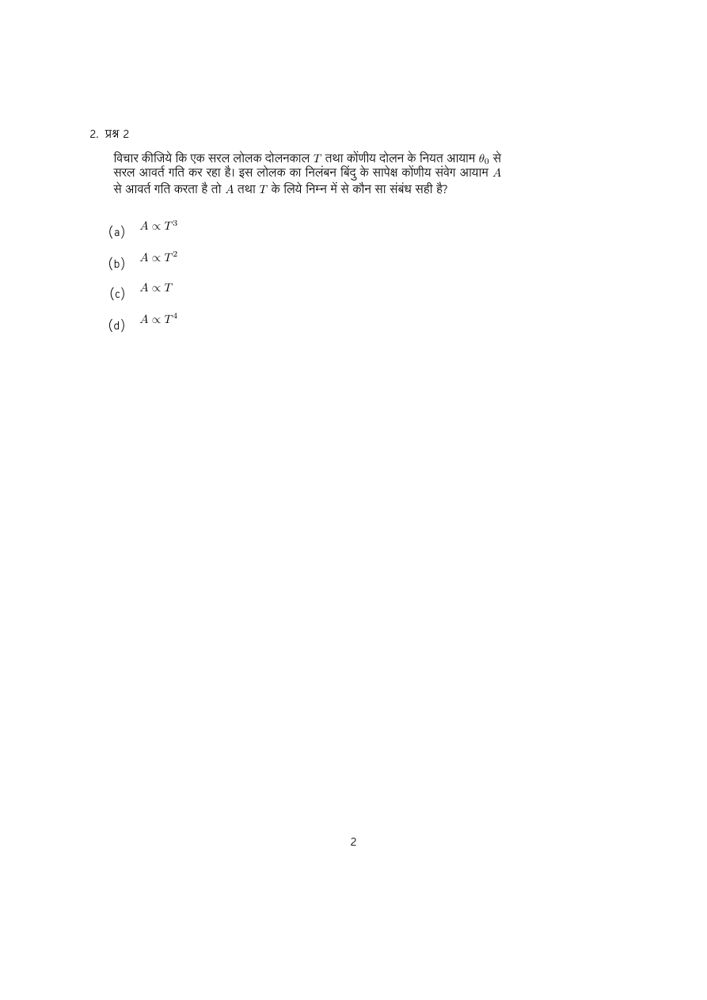

## PDF page 51

[Open original PDF at page 51](../pdf/IAT_2024_Hindi_paper.pdf#page=51)

### Searchable text - OCR draft (hin+eng)

```text
3. प्रश्न 3

चित्रानुसार, नगण्य द्रव्यमान वाली एक अवितान्य रस्सी ७ द्रव्यमान, # त्रिज्या तथा अपने अक्ष
(सतह के लम्बवत) पर घुमने के लिए स्वतन्त्र पहिये के रिम से गुजरती है। ॥/ तथा M/2
द्रव्यमान के दो पिंड रस्सी के दो मुक्त सिरों से जुड़े हैं। यदि मान लिया जाये कि रस्सी पहिये पर
नहीं सरकती है तथा गुरुत्वीय त्वरण ५ है तो पहिये का कोंणीय त्वरण का मान कितना होगा?

=
(a) 4R
I
(७) 2R
I
(०) *
ss
(०) 3R
```

### Original page image


## PDF page 52

[Open original PDF at page 52](../pdf/IAT_2024_Hindi_paper.pdf#page=52)

### Searchable text - OCR draft (hin+eng)

```text
4. प्रश्न 4

पानी के घनत्व के दोगुने घनत्व वाले एक छोटे ठोस पिंड को L लम्बाई के द्रव्यमान रहित
अवितान्य धागे से लटकाया गया है। पूरे संगठन को पानी से भरे टंकी में रखा गया al fig A पर
पिंड को क्षैतिज गति Vo प्रदान करने पर (दूसरे छोर को स्थिर रखते हुये) यह पिंड ऊर्ध्वाधर
तल मे अर्धवृत्ताकार पथ से होकर बिंदु ८ पर पहुंचता है सिर्फ़ जहाँ रस्सी ढीली पड़ जाती है।
यदि पानी की श्यानता तथा धारा प्रवाह को नगण्य माना जाए तथा गुरुत्वीय त्वरण g है, तो Vo

के लिये कौन सा विकल्प सही है?
```

### Original page image


## PDF page 53

[Open original PDF at page 53](../pdf/IAT_2024_Hindi_paper.pdf#page=53)

### Searchable text - OCR draft (hin+eng)

```text
- प्रश्न 5
RAST GI Ue ठोस गोला एक तालाब में आधा डूबा हुआ है। गोले को उसके ऊपरी बिंदु से
लम्बवत नींचे की तरफ़ धकेल कर छोड़ने पर यह गोला सरल आवर्त गति करते हुए पाया जाता
है। यदि गुरुत्वीय त्वरण g है तो गोले के दोलन का दोलनकाल क्या है?

Qn (z=
39

(9)
mn /2
g

(०)
Qn कि
g

(०)
Qn \=
g

(०)
```

### Original page image


## PDF page 54

[Open original PDF at page 54](../pdf/IAT_2024_Hindi_paper.pdf#page=54)

### Searchable text - OCR draft (hin+eng)

```text
6. प्रश्न 6

आयतन 7 तथा तापमान 7' के एक मोल आदर्श गैस को रुकद्धोष्म प्रक्रम में बिना बाह्य कार्य किये
QV आयतन तक विस्तारित किया जाता है। R गैस नियतांक है। गैस के विस्तार के बाद दाब
क्या होगा?

(a) 2V
(७) AV
RT
(छः
2RkT
(ad)
```

### Original page image


## PDF page 55

[Open original PDF at page 55](../pdf/IAT_2024_Hindi_paper.pdf#page=55)

### Searchable text - OCR draft (hin+eng)

```text
[No text recovered; use the original page image below.]
```

### Original page image


## PDF page 56

[Open original PDF at page 56](../pdf/IAT_2024_Hindi_paper.pdf#page=56)

### Searchable text - OCR draft (hin+eng)

```text
8. प्रश्न 8

दो एकसमान पात्रों में एकसमान आदर्श गैस भरी है। पहले एवं दूसरे पात्र में भरी गैस का संख्या
घनत्व, माध्य मुक्त पथ और तापमान क्रमश: (mi, Ar, Tr) तथा (nz, Az, 72) है। एक पात्र
के गैस को दूसरे पात्र में विस्थापित किया जाता है। परिणामी गैस का माध्य मुक्त पथ A और
तापमान 7' क्या होगा?

AiA2 क्र nT, + 7272

~ Ar+Ag’ om + INQ
(a)
— mA, + nrg Te mTy + nT
(b) ny +n ny + Ne
ya mMALtMA क _ कक
ny + ng
(c)
MA2 JET
A= yyy P= vie
ir +॑ 2७
(५)
```

### Original page image


## PDF page 57

[Open original PDF at page 57](../pdf/IAT_2024_Hindi_paper.pdf#page=57)

### Searchable text - OCR draft (hin+eng)

```text
9. प्रश्न 9

दो बिंदु आवेश +9 तथा +24 ; ४-४ सतह में क्रमश: (—C/2, 0) तथा (+0/2, 0) पर स्थिर
हैं। यदि (0, 80) पर स्थित m द्रव्यमान के एक बिंदु आवेश -५ को स्थिर अवस्था से मुक्त
किया जाता है तो मुक्त होते ही उसका त्वरण कया होगा? (निर्वात का परावैद्युतांक ८० है।)

x
(—¢/2,0) wisi

?  (i_3y33

(a) Sree (-8v35)
हर > V3 हि

(७) ह््फ़ाल (i —v3 i)
(c) जूक (3 i- v3 i)
(a) ae (avs i- i)
```

### Original page image


## PDF page 58

[Open original PDF at page 58](../pdf/IAT_2024_Hindi_paper.pdf#page=58)

### Searchable text - OCR draft (hin+eng)

```text
0. W420

निम्न परिपथ पर विचार कीजिए। स्रोत का विभव V = Vo 97 ८० है। दोनो प्रतिरोधकों A तथा
8 की प्रतिरोधकता समान है। संधारित्र की धारिता तथा प्रेरक की प्रेरकता क्रमश: C तथा L
है। किसी एक आवृत्ति w, और संधारित्र पर कुछ प्रारम्भिक आवेश के लिए यदि प्रतिरोधक # से
गुजरने वाली विद्युत धारा तथा स्रोत समान कला में हैं तो w का मान FA है?

A

oat

8
Vo sin wt (2 Cc

V3LC

i0
```

### Original page image


## PDF page 59

[Open original PDF at page 59](../pdf/IAT_2024_Hindi_paper.pdf#page=59)

### Searchable text - OCR draft (hin+eng)

```text
2. 44 2

चित्रानुसार एक चालकीय तार को आकार दिया गया है जिसमे एक स्थायी विद्युत धारा J प्रवाहित
हो रही है। सभी जोड़ों पर तार खंड एक दूसरे से समकोण बनाते हैं। इस कुंडली में प्रवाहित
विद्युत धारा के कारण चुम्बकीय आधूर्ण क्या है?

b

>)

——E

b

Tab (j +k)
Tab (j — k)

V2Iab (j +k)

Tab (k —j)

वव
```

### Original page image


## PDF page 60

[Open original PDF at page 60](../pdf/IAT_2024_Hindi_paper.pdf#page=60)

### Searchable text - OCR draft (hin+eng)

```text
2. WA2

निम्न परिपथ पर विचार कीजिए। संधारित्रों ( तथा (2 की धारिताएं क्रमश: 2 pF तथा 8 pF
हैं। एक स्विच द्वारा बिंदु x को बिंदु ४ से या बिंदु 2 से जोड़ा जा सकता है। प्रारम्भ में X तथा ४ को

संधारित्र के पूर्णत: आवेशित हो जाने तक जोड़े रखा जाता है। तत्पश्चात, X को Z से जोड़ दिया

गया तो SAA: CL तथा ८2 पर आवेश क्रमश: Q, तथा (३: हैं। ठ्‌ृ as का मान क्या है?
॥ 4 2

प्‌ i ¥ ' f ©
LTT

4
(a) °
पु
(b) °
न
() 4
पु
(4) ?

i2
```

### Original page image


## PDF page 61

[Open original PDF at page 61](../pdf/IAT_2024_Hindi_paper.pdf#page=61)

### Searchable text - OCR draft (hin+eng)

```text
3. WA 33

आक्सीजेन के दो आइसोटोपिक नभिकों १९0 तथा (SO का परमाणु भार क्रमश: 5.9949] ७
तथा 7.9996 u Bl ७ परमाणु भार इकाई है। प्रोटान तथा न्यूट्रान का द्रव्यमान क्रमश: .00727
u तथा .00866 u है। u c? कि इकाई में 0 तथा (0 नाभिकों के बन्धन ऊर्जा का अन्तर
कितना है? (८ निर्वात में प्रकाश कि चाल है।)

0.0307
(a)
(p) 2.00425
(c) 0.99559

3.029
(०)

i3
```

### Original page image


## PDF page 62

[Open original PDF at page 62](../pdf/IAT_2024_Hindi_paper.pdf#page=62)

### Searchable text - OCR draft (hin+eng)

```text
4. WI 4

दो पारदर्शी सिल्लियों का अपवर्तनांक (») क्रमश: 2 तथा 2//3 है। चित्रानुसार इन दोनो सिल्लियों
को एकदूसरे से जोड़ कर एक तीसरे माध्यम में रखा जाता है जिसका अपवर्तनांक /2 है। ऊपरी
सिल्ली की मोटाई  थ॥ है। एकरंगी (मोनोक्रोमैटिक) प्रकाश किरण ऊपरी सिल्ली पर 45० कोण
बनाते हुए आपतित है। निचली सिल्ली की मोटाई कितनी हो जिससे कि आपतित किरण और बाह्य
किरण के बीच पार्श्व परिवर्तन का मान शून्य है?

45° की
आपतित ma n=y2

f
'
t
Y

lcm an n=2

n=2/V3

n=y2
बाह्य किरण

i/Vv3
i/Vv2
4/2

V3/2

4
```

### Original page image


## PDF page 63

[Open original PDF at page 63](../pdf/IAT_2024_Hindi_paper.pdf#page=63)

### Searchable text - OCR draft (hin+eng)

```text
5. WH5

दो प्रकाश स्रोत A तथा A /2 तरंगदैर्घ्यों के प्रकाश उत्सर्जित करते Bl एक प्रकाश-संवेदी पदार्थ पर

इन प्रकाश स्रोतों के कारण निरोधी विभव क्रमश: 77 तथा 3 7 है। इस पदार्थ का कार्य-फ़लन
क्या है?

(a) leV
(७) 2eV
(c) .5 eV

(4) .25 eV

a5
```

### Original page image


