# IAT 2025 - English

Original PDF: [IAT_2025_English_paper.pdf](../pdf/IAT_2025_English_paper.pdf)

- Acquisition: SciAstra CloudFront mirror; not downloaded from the official server.
- Downloaded: 28 October 2026. PDF pages: 61.
- Exact download/source URL: https://d2aaa7ts7sm3bp.cloudfront.net/pdfs/01KMFRQMXX1MQEAR3MFAM9NH02.pdf
- PDF SHA-256: `e3da6607539ed815222373895a1b2fbc7268cbd61707bb0e500a37f7e8fb9b3d`
- This is a search/accessibility copy of an existing paper, not newly authored mock content.
- Text is mechanically extracted or OCR-derived and has not been proofread character by character. Equations, option letters, chemical bonds, tables and Hindi OCR can contain errors. The PDF and page images are authoritative.
- Figure descriptions are explanatory annotations, not official answers or complete structural/formula transcriptions. Use the linked image to resolve exact labels, values and stereochemistry.

**Archive count:** the English companion contains 59 `Question` headings (Biology 15, Chemistry 15, Mathematics 15, Physics 14). The archived content and numbering are preserved; no replacement question is invented.

## Visual guide

- [English PDF page 1](#pdf-page-1): Biology Q1: a matching table pairs animal body-plan features with taxonomic groups, using labelled entries P-S and i-iv.
- [English PDF page 11](#pdf-page-11): Biology Q11: two parental-cross schemes produce F1 double heterozygotes PpQq, then give different test-cross proportions. Parent labels R1-R4 and the percentage distributions distinguish the two schemes.
- [English PDF page 13](#pdf-page-13): Biology Q13: an agarose gel has lanes X, X+Y and Y with bands beside 5 kb, 3 kb and 2 kb reference labels. Circular plasmid-map alternatives (a) and (b) mark restriction sites X/Y and positions in bp; options continue on page 14.
- [English PDF page 14](#pdf-page-14): Continuation of Biology Q13: plasmid-map alternatives (c) and (d) place X and Y restriction sites at different marked positions. They must be compared with the gel on page 13.
- [English PDF page 21](#pdf-page-21): Chemistry Q5: a coordination-compound reaction scheme converts P to Q using excess concentrated ammonia. Separate excess-AgNO3 tests beneath P and Q show different moles of AgCl precipitate.
- [English PDF page 23](#pdf-page-23): Chemistry Q7: four reagent-labelled organic reaction drawings ask which route does not give an aldehyde. The structures and catalysts/reagents above each arrow are essential to identifying the transformation.
- [English PDF page 24](#pdf-page-24): Chemistry Q8: an organic starting structure undergoes ozonolysis with zinc/water workup, then excess phenylmagnesium bromide and acidic workup. Four answer rows depict different pairs of products with phenyl, methyl, carbonyl and hydroxyl groups.
- [English PDF page 25](#pdf-page-25): Chemistry Q9: a phenyl-substituted nitrile is treated sequentially with DIBAL-H, water and zinc/mercury-HCl. Four drawn candidates differ in their terminal functional group and side-chain connectivity.
- [English PDF page 26](#pdf-page-26): Chemistry Q10: four candidate starting structures I are drawn for a hydroboration-oxidation sequence followed by oxidation. Distinguish the alkene position and side-chain shape rather than reading only the molecular formula.
- [English PDF page 28](#pdf-page-28): Chemistry Q12: first three options plot half-life against initial concentration. Their shapes are a straight increase, a horizontal line and a curved increase. The fourth alternative is on page 29.
- [English PDF page 29](#pdf-page-29): Continuation of Chemistry Q12, option (d): half-life decreases as a straight line with initial concentration.
- [English PDF page 48](#pdf-page-48): Physics Q1: each option contains a pair of velocity plots for particles A and B, before and after an elastic collision. The first plot uses crossing/increasing lines while the second gives horizontal velocity levels; slope labels and level order differ between alternatives.
- [English PDF page 49](#pdf-page-49): Physics Q2: a block M is attached to a horizontal spring of constant k. A projectile of mass m approaches leftwards at speed v and sticks in the block; the diagram marks all four quantities.
- [English PDF page 50](#pdf-page-50): Physics Q3: a cart starts from a high point A on a descending track and enters a vertical circular loop. Positions B and C and radius R are marked; one is the bottom and the other the top of the loop.
- [English PDF page 55](#pdf-page-55): Physics Q8: parallel plates are separated by d and have potentials V and 0 V. A positive particle enters horizontally halfway between them; its entry point and the potential gradient fix the field direction and deflection geometry.
- [English PDF page 56](#pdf-page-56): Physics Q9: a 12 V source is connected across a diamond-shaped capacitor bridge. P and Q mark the upper/lower internal nodes, and the four edge capacitances are labelled in microfarads.
- [English PDF page 59](#pdf-page-59): Physics Q12: an equilateral prism of refractive index 1.5 and a parallelepiped of index 2.0 stand with adjacent faces parallel. A ray enters one face at normal incidence, traverses the bodies and exits at an angle theta.
- [English PDF page 60](#pdf-page-60): Physics Q13: light initially polarised along the x direction passes through two polarizers P0 and P1. Their transmission axes are drawn at different angles relative to x and the initial electric-field direction.

## Page index

[p1](#pdf-page-1) | [p2](#pdf-page-2) | [p3](#pdf-page-3) | [p4](#pdf-page-4) | [p5](#pdf-page-5) | [p6](#pdf-page-6) | [p7](#pdf-page-7) | [p8](#pdf-page-8) | [p9](#pdf-page-9) | [p10](#pdf-page-10) | [p11](#pdf-page-11) | [p12](#pdf-page-12) | [p13](#pdf-page-13) | [p14](#pdf-page-14) | [p15](#pdf-page-15) | [p16](#pdf-page-16) | [p17](#pdf-page-17) | [p18](#pdf-page-18) | [p19](#pdf-page-19) | [p20](#pdf-page-20) | [p21](#pdf-page-21) | [p22](#pdf-page-22) | [p23](#pdf-page-23) | [p24](#pdf-page-24) | [p25](#pdf-page-25) | [p26](#pdf-page-26) | [p27](#pdf-page-27) | [p28](#pdf-page-28) | [p29](#pdf-page-29) | [p30](#pdf-page-30) | [p31](#pdf-page-31) | [p32](#pdf-page-32) | [p33](#pdf-page-33) | [p34](#pdf-page-34) | [p35](#pdf-page-35) | [p36](#pdf-page-36) | [p37](#pdf-page-37) | [p38](#pdf-page-38) | [p39](#pdf-page-39) | [p40](#pdf-page-40) | [p41](#pdf-page-41) | [p42](#pdf-page-42) | [p43](#pdf-page-43) | [p44](#pdf-page-44) | [p45](#pdf-page-45) | [p46](#pdf-page-46) | [p47](#pdf-page-47) | [p48](#pdf-page-48) | [p49](#pdf-page-49) | [p50](#pdf-page-50) | [p51](#pdf-page-51) | [p52](#pdf-page-52) | [p53](#pdf-page-53) | [p54](#pdf-page-54) | [p55](#pdf-page-55) | [p56](#pdf-page-56) | [p57](#pdf-page-57) | [p58](#pdf-page-58) | [p59](#pdf-page-59) | [p60](#pdf-page-60) | [p61](#pdf-page-61)

## PDF page 1

[Open original PDF at page 1](../pdf/IAT_2025_English_paper.pdf#page=1)

### Visual description

Biology Q1: a matching table pairs animal body-plan features with taxonomic groups, using labelled entries P-S and i-iv.

### Searchable text - PDF text layer

```text
Biology
1. Question 1
    Match the entries in column I and column II.


   Which one of the following combinations is correct?

      P - iv; Q - i; R - ii;  S - iii
    (a)
      P - iv; Q - ii; R - i;  S - iii
    (b)
      P - i; Q - iii; R - ii;  S - iv
    (c)
      P - iii; Q - i; R - ii;  S - iv
    (d)


                                            1
```

### Original page image

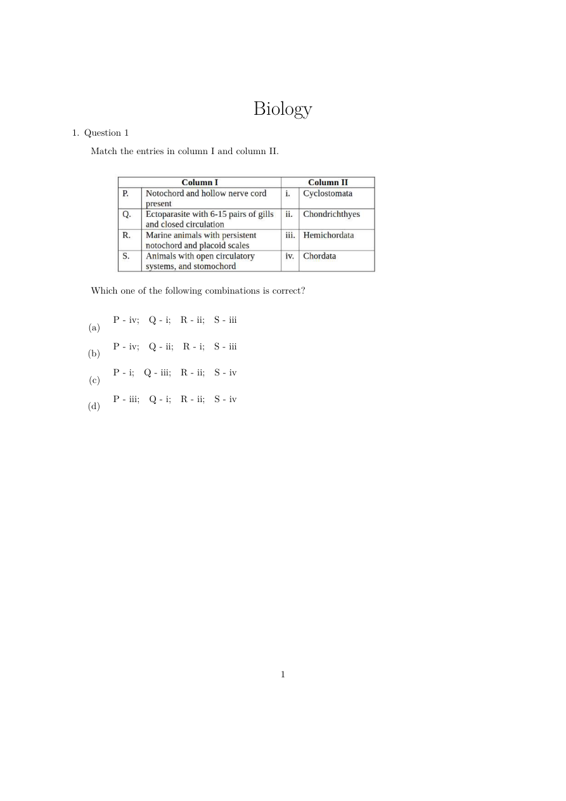

## PDF page 2

[Open original PDF at page 2](../pdf/IAT_2025_English_paper.pdf#page=2)

### Searchable text - PDF text layer

```text
2. Question 2
    Chromosomes are classified as metacentric, sub-metacentric, acrocentric and
     telocentric. This classification is based on the position of which one of the
     following structures?

         Centromere    (a)
        Centrosome    (b)
          Centriole    (c)
         Telomere    (d)


                                            2
```

### Original page image

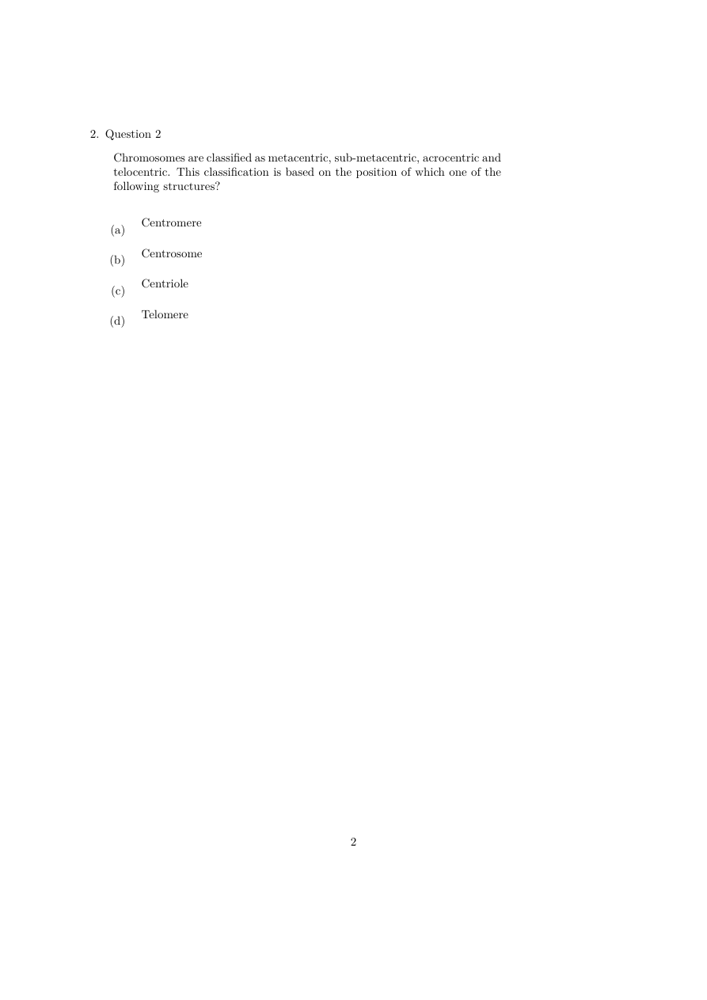

## PDF page 3

[Open original PDF at page 3](../pdf/IAT_2025_English_paper.pdf#page=3)

### Searchable text - PDF text layer

```text
3. Question 3
   Which one of the following options describes a triglyceride?

        Three fatty acid chains linked to a molecule of glycerol
    (a)
        Three glycerol molecules linked to a fatty acid chain
    (b)
        Three saturated fatty acid chains linked to a molecule of cholesterol
    (c)
        Three glyceride molecules linked to a molecule of phospholipid
    (d)


                                            3
```

### Original page image

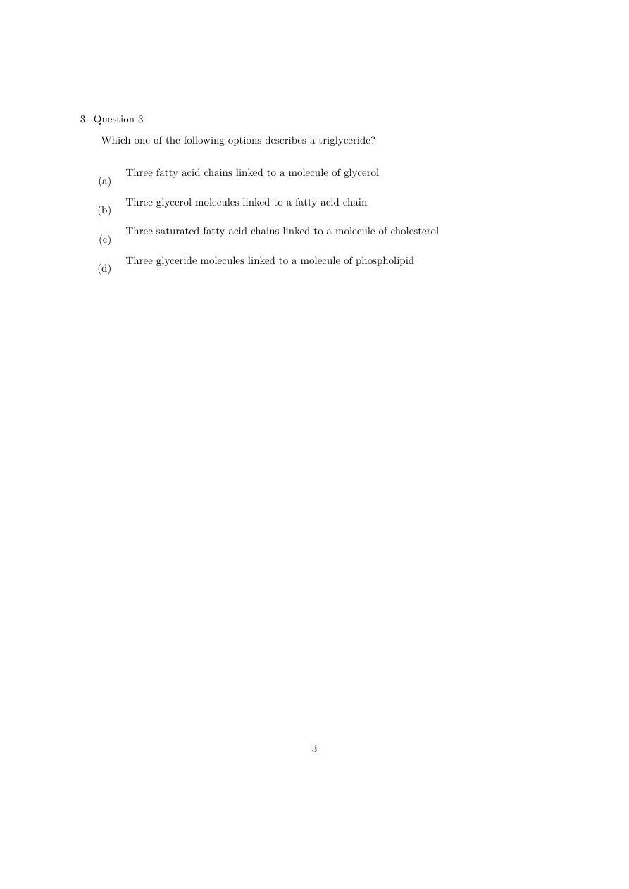

## PDF page 4

[Open original PDF at page 4](../pdf/IAT_2025_English_paper.pdf#page=4)

### Searchable text - PDF text layer

```text
4. Question 4
   Which one of the following statements about a plant carotenoid is FALSE?


            It is an accessory pigment which absorbs light at 600 - 700 nm.
    (a)
            It protects chlorophyll a from photo-oxidation.
    (b)
            It provides precursor for the synthesis of stress hormone in plants.
    (c)
            It accumulates in chromoplasts during fruit ripening.
    (d)


                                            4
```

### Original page image

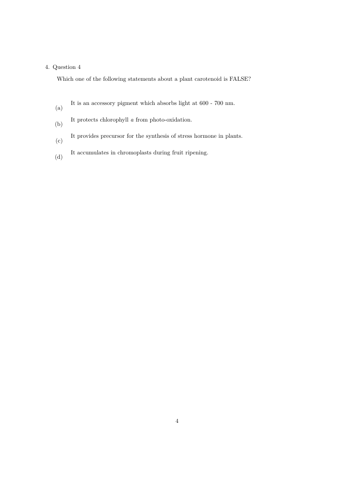

## PDF page 5

[Open original PDF at page 5](../pdf/IAT_2025_English_paper.pdf#page=5)

### Searchable text - PDF text layer

```text
5. Question 5
   A cell suspension of actively respiring mitochondria is treated with either
    chemical X (experiment 1) or chemical Y (experiment 2), or left untreated
    (experiment 3).

    Chemical X  selectively  inhibits electron transport from Complex  I to
    ubiquinone, while chemical Y selectively inhibits electron transport from
    Complex III to cytochrome C.

   Which one  of  the  following  options  represents  the  correct  order  of
     relative number of ATP synthesised in mitochondria?

         Experiment 2 < Experiment 1 < Experiment 3
    (a)
         Experiment 1 < Experiment 2 < Experiment 3
    (b)
         Experiment 1 = Experiment 2 = Experiment 3
    (c)
         Experiment 2 < Experiment 1 = Experiment 3
    (d)


                                            5
```

### Original page image

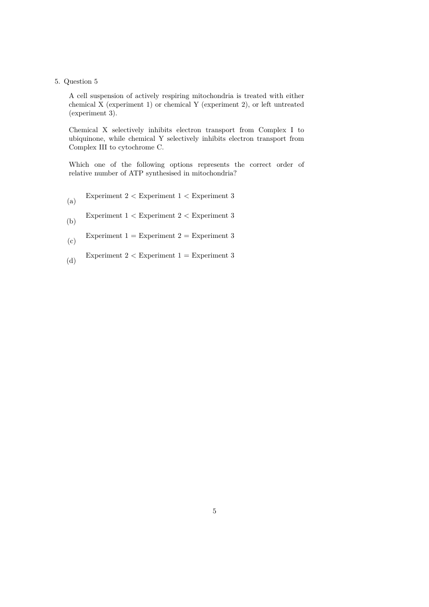

## PDF page 6

[Open original PDF at page 6](../pdf/IAT_2025_English_paper.pdf#page=6)

### Searchable text - PDF text layer

```text
6. Question 6
   Which one of the following autoregulatory mechanisms is employed by the
    kidney when glomerular filtration rate is reduced?

          Levels of renin, angiotensin I and II and aldosterone are increased.
    (a)
          Levels of renin and aldosterone are reduced.    (b)
          Levels of renin are increased, while those of angiotensin  I and II and
          aldosterone are reduced.    (c)
          Levels of angiotensin I and II are increased, while that of aldosterone are
         reduced.    (d)


                                            6
```

### Original page image

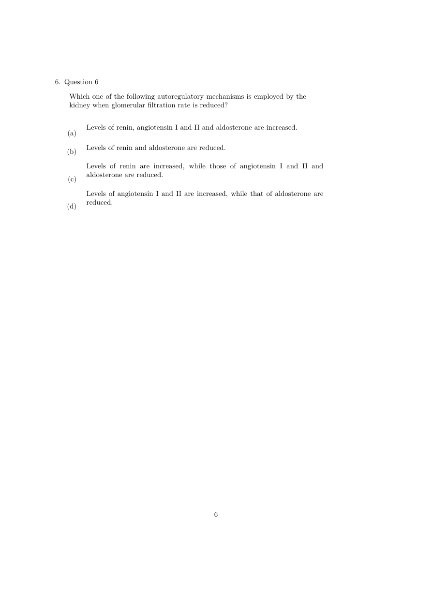

## PDF page 7

[Open original PDF at page 7](../pdf/IAT_2025_English_paper.pdf#page=7)

### Searchable text - PDF text layer

```text
7. Question 7
   Which one of the following conditions will favour maximum dissociation of
    oxygen from the oxyhaemoglobin in the tissues?

          higher [H+]; higher temperature
    (a)
          higher [H+]; lower temperature
    (b)
          lower [H+]; higher temperature
    (c)
          lower [H+]; lower temperature
    (d)


                                            7
```

### Original page image

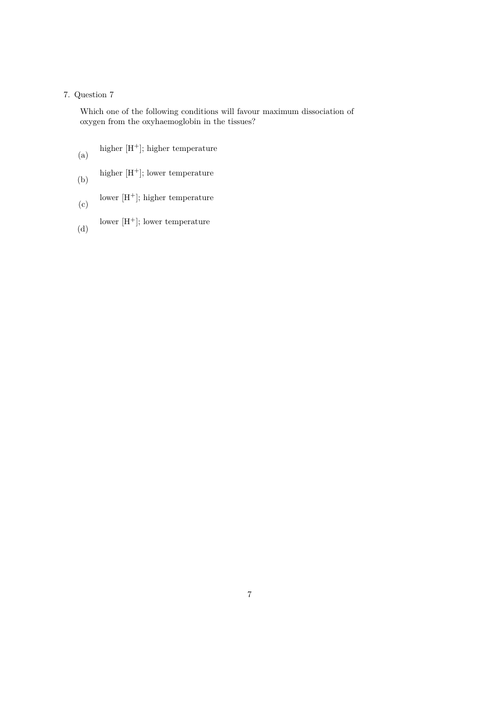

## PDF page 8

[Open original PDF at page 8](../pdf/IAT_2025_English_paper.pdf#page=8)

### Searchable text - PDF text layer

```text
8. Question 8
   Which one of the following statements is correct?

       Red muscle fibres produce ATP aerobically under normal oxygen conditions.
    (a)
         Mitochondria are more in white than in red muscle fibres.    (b)
          Lactic acid accumulates more in red than in white muscle fibres under similar
          conditions.    (c)
          All muscle fibres primarily produce ATP anaerobically.
    (d)


                                            8
```

### Original page image

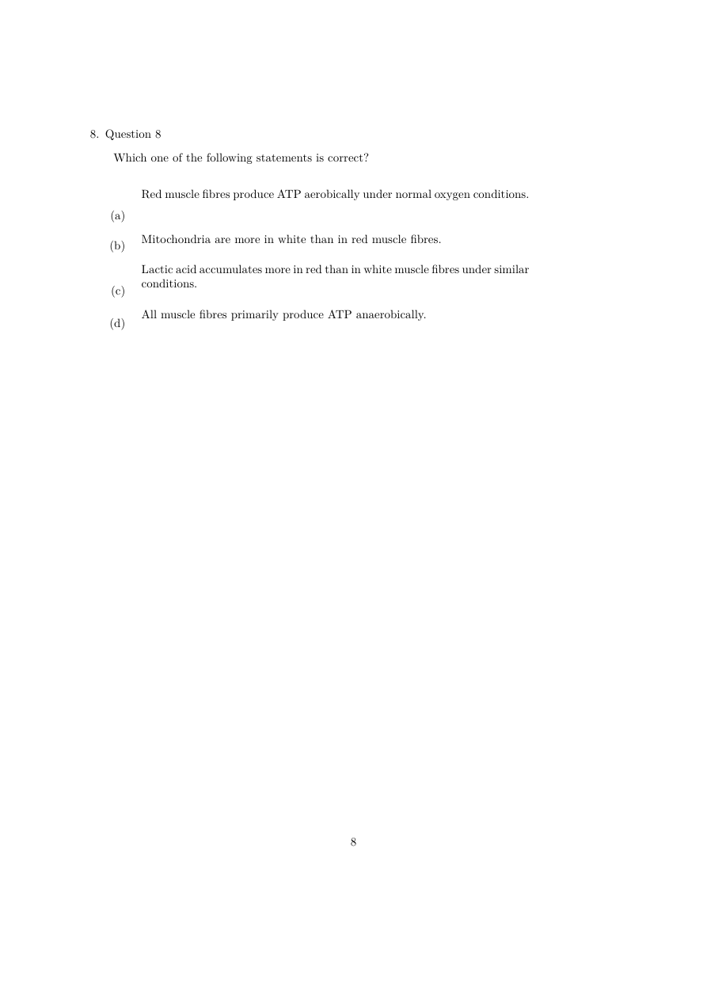

## PDF page 9

[Open original PDF at page 9](../pdf/IAT_2025_English_paper.pdf#page=9)

### Searchable text - PDF text layer

```text
9. Question 9
   Which one of the following organisms produces the female gamete by mitosis
     of haploid cells?

        Garden pea
    (a)
        Honey bee
    (b)
          Fruit fly
    (c)
         Chicken    (d)


                                            9
```

### Original page image

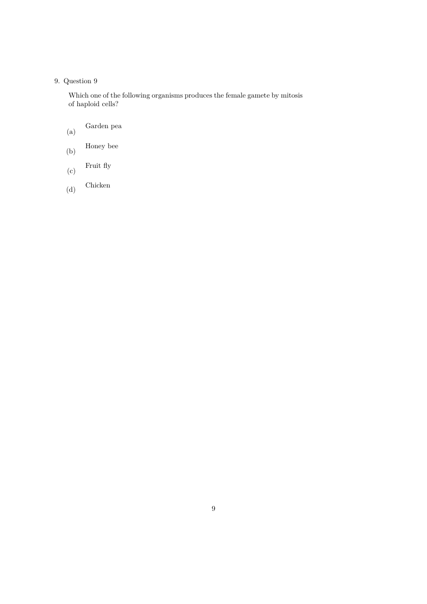

## PDF page 10

[Open original PDF at page 10](../pdf/IAT_2025_English_paper.pdf#page=10)

### Searchable text - PDF text layer

```text
10. Question 10
    Which amino acid will be charged on the tRNA with anticodon 5Õ-GUU-3Õ?


          Asparagine (codon AAC)
     (a)
           Valine (codon GUU)
     (b)
          Leucine (codon UUG)
      (c)
         Glutamine (codon CAA)
     (d)


                                             10
```

### Original page image


## PDF page 11

[Open original PDF at page 11](../pdf/IAT_2025_English_paper.pdf#page=11)

### Visual description

Biology Q11: two parental-cross schemes produce F1 double heterozygotes PpQq, then give different test-cross proportions. Parent labels R1-R4 and the percentage distributions distinguish the two schemes.

### Searchable text - PDF text layer

```text
11. Question 11
    Two double heterozygous plants (PpQq), derived from two different pairs
      of true-breeding parents of unknown genotype, produce gametes in the
     proportions as given below.


    Which one of the following options correctly represents the genotype of the
     parents?

        R1 = ppQQ ; R2 = PPqq ; R3 = PPQQ ; R4 = ppqq
     (a)
        R1 = PPQQ ; R2 = ppqq ; R3 = ppQQ ; R4 = PPqq
     (b)
        R1 = ppQQ ; R2 = PPqq ; R3 = PPqq ; R4 = ppQQ
      (c)
        R1 = PPQQ ; R2 = ppqq ; R3 = ppqq ; R4 = PPQQ
     (d)


                                             11
```

### Original page image

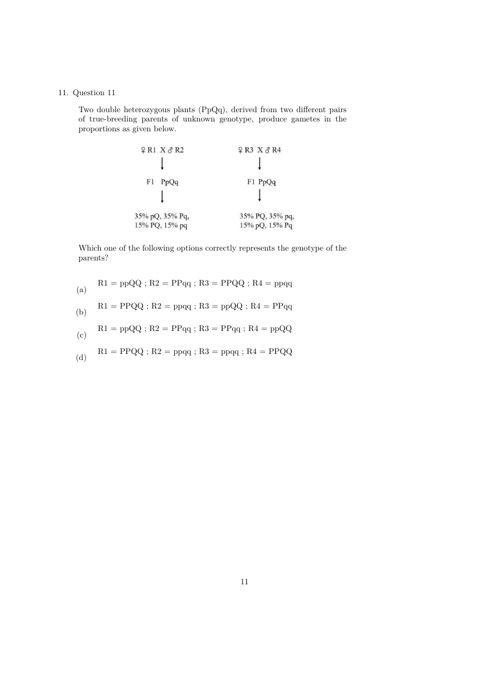

## PDF page 12

[Open original PDF at page 12](../pdf/IAT_2025_English_paper.pdf#page=12)

### Searchable text - PDF text layer

```text
12. Question 12
    What are retroviruses?

      A group of viruses with RNA genome and reverse transcriptase activity
     (a)
      A group of viruses with DNA genome and no reverse transcriptase activity
     (b)
      A group of viruses with DNA genome and reverse transcriptase activity
      (c)
      A group of viruses with RNA genome and no reverse transcriptase activity
     (d)


                                             12
```

### Original page image

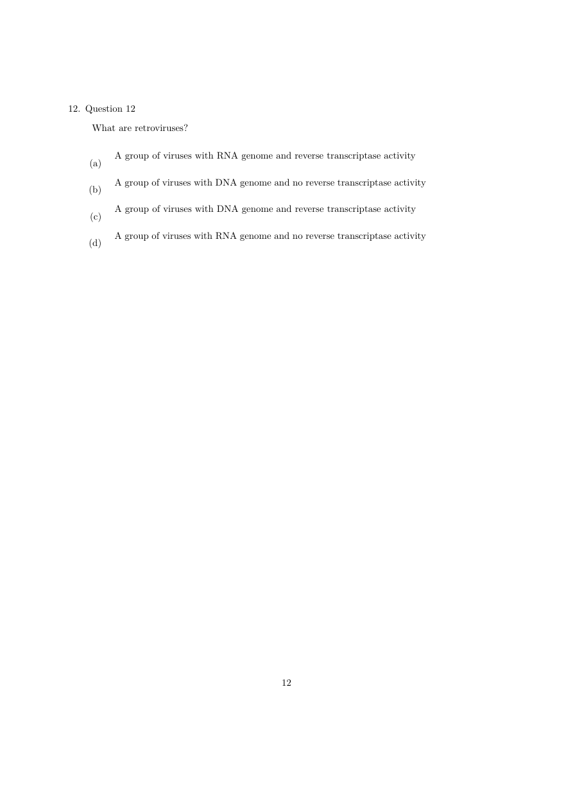

## PDF page 13

[Open original PDF at page 13](../pdf/IAT_2025_English_paper.pdf#page=13)

### Visual description

Biology Q13: an agarose gel has lanes X, X+Y and Y with bands beside 5 kb, 3 kb and 2 kb reference labels. Circular plasmid-map alternatives (a) and (b) mark restriction sites X/Y and positions in bp; options continue on page 14.

### Searchable text - PDF text layer

```text
13. Question 13
    The given picture was obtained from an agarose gel electrophoresis of a
     plasmid after digestion with restriction enzymes either X, Y or both X and
     Y.


    Which one of the following diagrams correctly represents the position of the
      restriction enzyme sites (X, Y) on the 10,000 bp plasmid?


     (a)


     (b)


                                             13
```

### Original page image

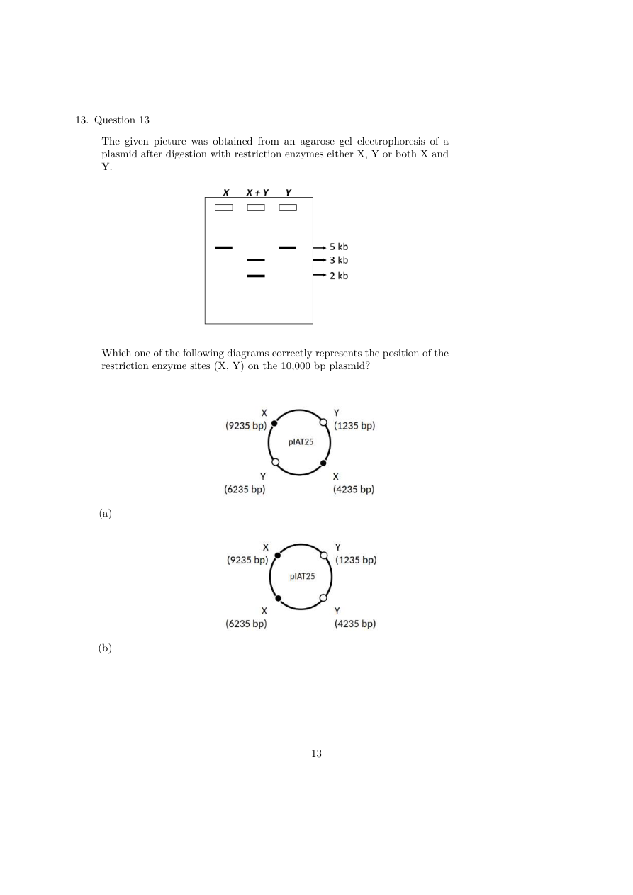

## PDF page 14

[Open original PDF at page 14](../pdf/IAT_2025_English_paper.pdf#page=14)

### Visual description

Continuation of Biology Q13: plasmid-map alternatives (c) and (d) place X and Y restriction sites at different marked positions. They must be compared with the gel on page 13.

### Searchable text - PDF text layer

```text
(c)


(d)


                                        14
```

### Original page image

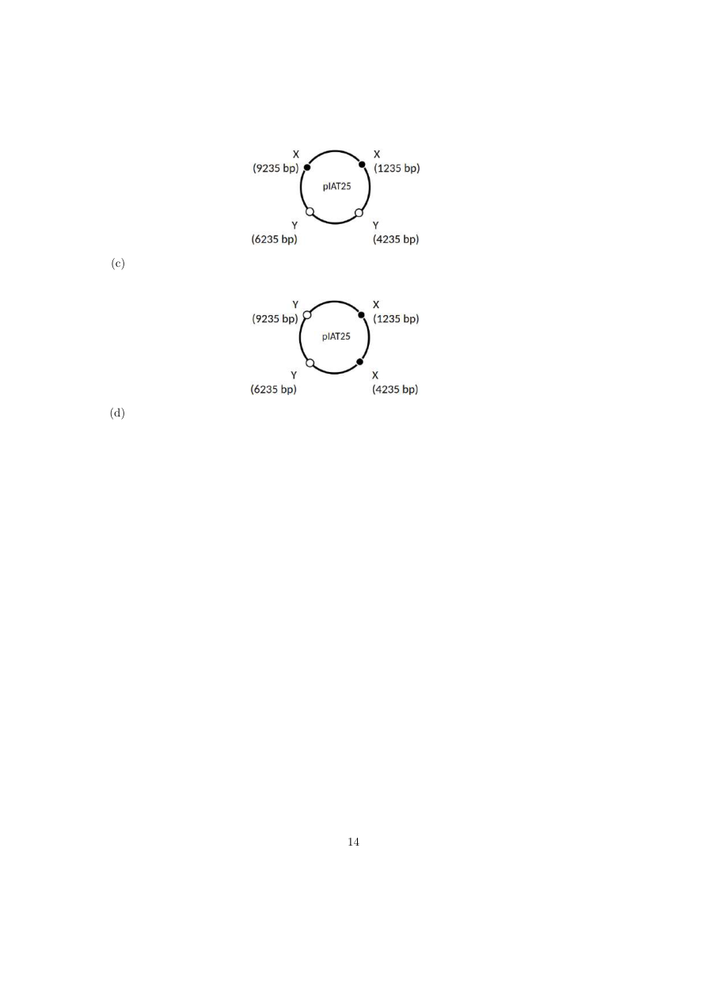

## PDF page 15

[Open original PDF at page 15](../pdf/IAT_2025_English_paper.pdf#page=15)

### Searchable text - PDF text layer

```text
14. Question 14
    Honey bee males are haploid and females are diploid. Which one of the
      following statements is INCORRECT about honey bees?

         Honey bee males cannot have daughters but can have sons.
     (a)
         Honey bee males are produced from unfertilized eggs and females are
          produced from fertilized eggs.
     (b)
      A honey bee male does not have a father but has a grandfather.
      (c)
         Honey bee males form gametes by mitosis and females form gametes by
           meiosis.     (d)


                                             15
```

### Original page image

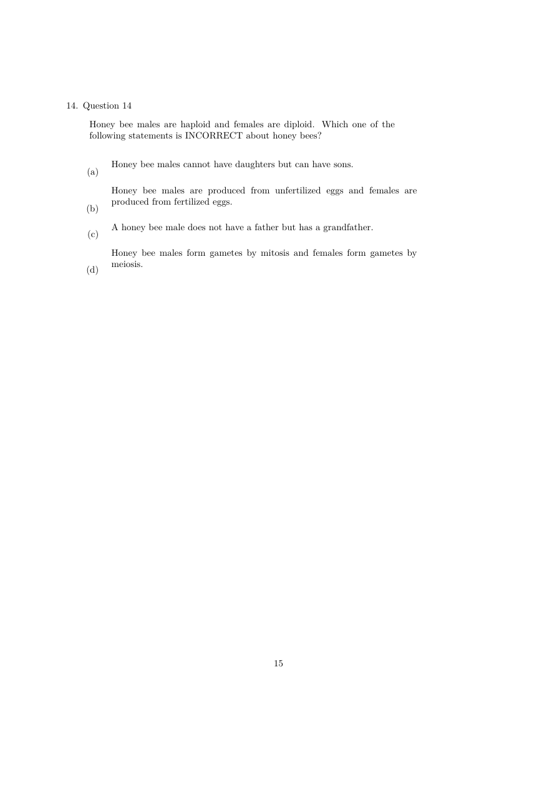

## PDF page 16

[Open original PDF at page 16](../pdf/IAT_2025_English_paper.pdf#page=16)

### Searchable text - PDF text layer

```text
15. Question 15
    Which one of the following statements is FALSE?

         More than 80% of the solar energy incident on earth is captured by plants
         and photosynthetic bacteria.
     (a)
         Only 10% of energy is transferred to each of the higher trophic levels in
           grazing food chain.
     (b)
           All organisms of a trophic level should be included for estimation of energy
           content of that trophic level.
      (c)
        The movement of energy  is unidirectional in the ecological pyramid of
           energy.
     (d)


                                             16
```

### Original page image

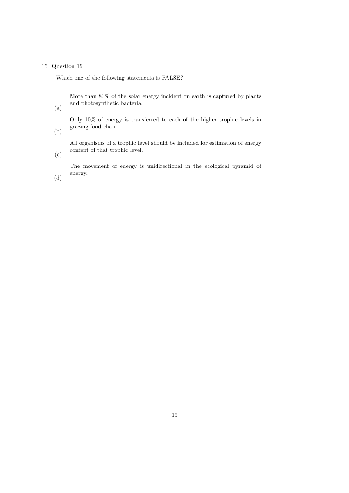

## PDF page 17

[Open original PDF at page 17](../pdf/IAT_2025_English_paper.pdf#page=17)

### Searchable text - PDF text layer

```text
Chemistry
1. Question 1
    Which   one   of   the   following   statements   best   describes   the
     acidic/basic/amphoteric nature of ZnO and CaO?

       ZnO is amphoteric, while CaO is basic.
    (a)
       ZnO is basic, while CaO is amphoteric.
    (b)
        Both ZnO and CaO are amphoteric.
    (c)
       ZnO is acidic, while CaO is basic.
    (d)


                                            1
```

### Original page image

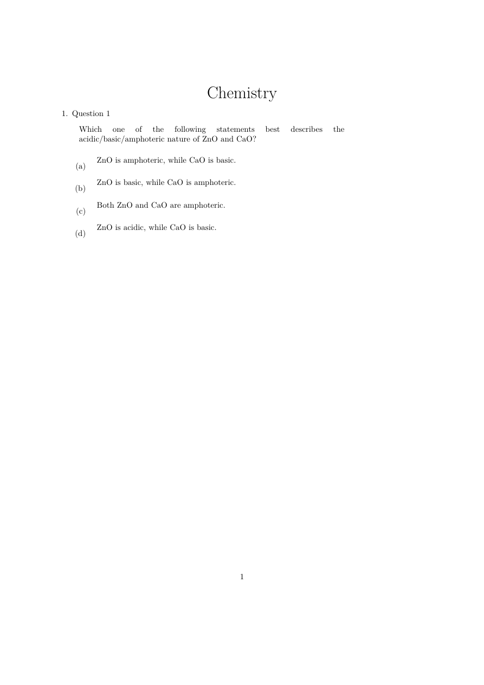

## PDF page 18

[Open original PDF at page 18](../pdf/IAT_2025_English_paper.pdf#page=18)

### Searchable text - PDF text layer

```text
2. Question 2
    Which among the following processes is/are associated with increasing bond
     order but no change in diamagnetic/paramagnetic behaviour?
                                        (i) N2   N2+ + e≠                 æ                                          (ii) O2   O2+ + e≠                 æ
                                           (iii) O2 + e≠æ O2≠

             (ii) only
    (a)
            (i) and (ii)
    (b)
             (ii) and (iii)
    (c)
             (iii) only
    (d)


                                            2
```

### Original page image

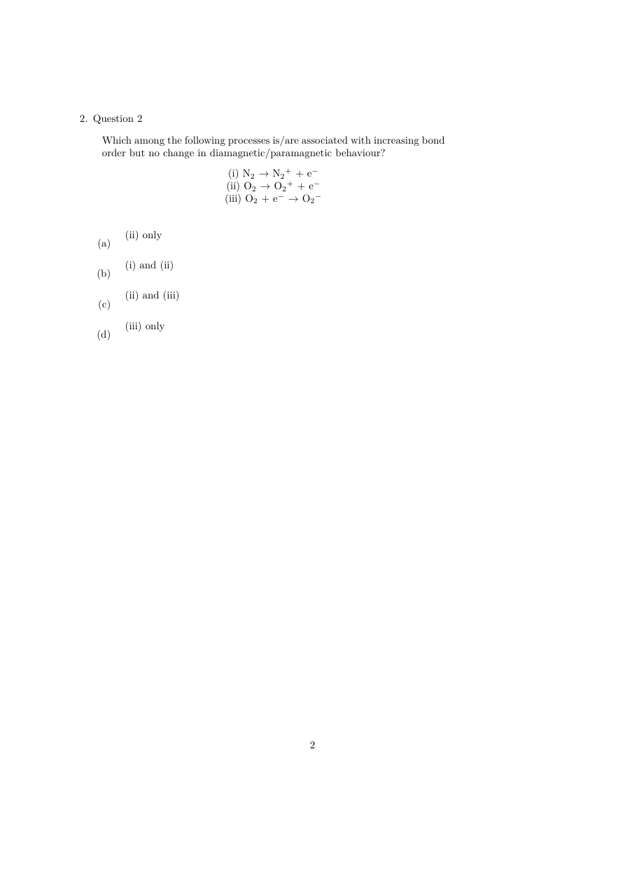

## PDF page 19

[Open original PDF at page 19](../pdf/IAT_2025_English_paper.pdf#page=19)

### Searchable text - PDF text layer

```text
3. Question 3
   What is the value of E¶(Fe3+/Fe0)?

    [The standard reduction potential values are
    E¶(Fe3+/Fe2+) = 0.77 V, and E¶(Fe2+/Fe0) = ≠0.44 V]
          V    (a)   ≠0.04
          0.33 V    (b)
          0.11 V    (c)
          V    (d)   ≠0.11


                                            3
```

### Original page image

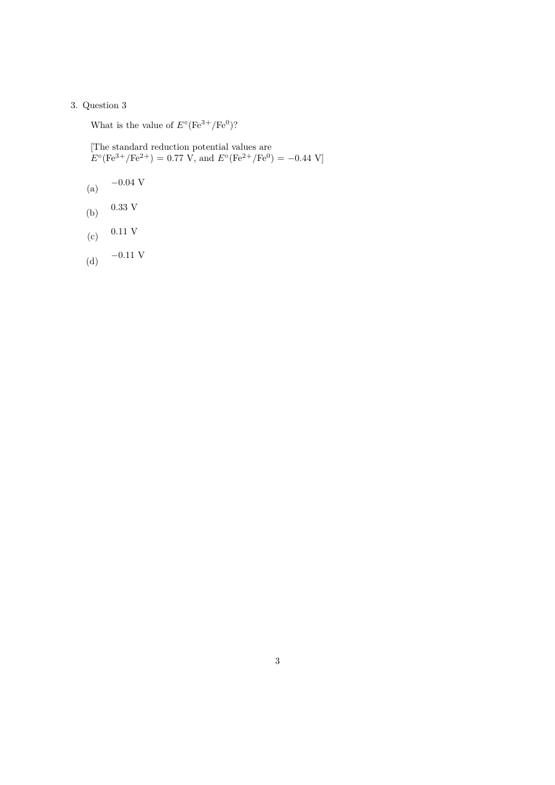

## PDF page 20

[Open original PDF at page 20](../pdf/IAT_2025_English_paper.pdf#page=20)

### Searchable text - PDF text layer

```text
4. Question 4
   What are the correct orders of stability for the following compounds?

       VF5 > VCl5 ; CuCl2 > CuI2    (a)
        VCl5 > VF5 ; CuCl2 > CuI2    (b)
        VCl5 > VF5 ; CuI2 > CuCl2    (c)
       VF5 > VCl5 ; CuI2 > CuCl2    (d)


                                            4
```

### Original page image

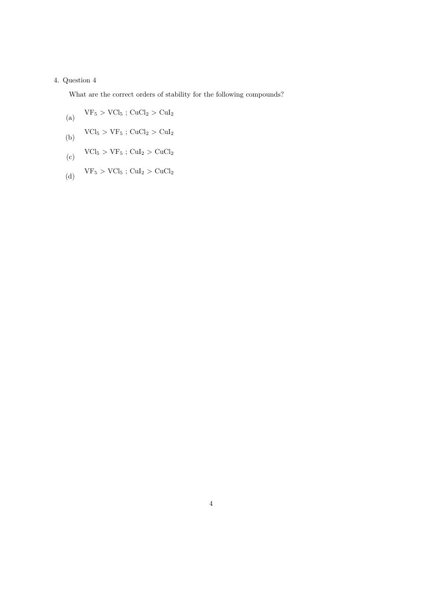

## PDF page 21

[Open original PDF at page 21](../pdf/IAT_2025_English_paper.pdf#page=21)

### Visual description

Chemistry Q5: a coordination-compound reaction scheme converts P to Q using excess concentrated ammonia. Separate excess-AgNO3 tests beneath P and Q show different moles of AgCl precipitate.

### Searchable text - PDF text layer

```text
5. Question 5

    Consider the following reaction scheme:


    Which among the following statements is correct?

      P shows geometrical isomerism and absorbs light of higher wavelength than
         that of Q.
    (a)
        Both P and Q show geometrical isomerism and P absorbs light of higher
         wavelength than that of Q.
    (b)
     Q shows geometrical isomerism and absorbs light of higher wavelength than
         that of P.    (c)
      P shows geometrical isomerism and absorbs light of lower wavelength than
         that of Q.
    (d)


                                            5
```

### Original page image

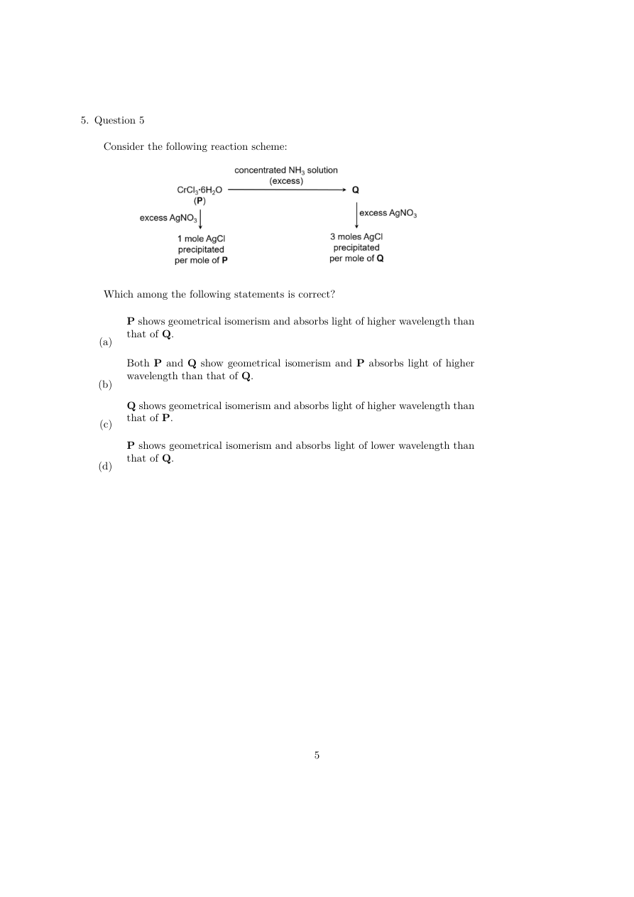

## PDF page 22

[Open original PDF at page 22](../pdf/IAT_2025_English_paper.pdf#page=22)

### Searchable text - PDF text layer

```text
6. Question 6
   How many —-hydrogen is/are present in 2-methyl-3-phenyl-pentan-1-al?

         4    (a)
         1    (b)
         3    (c)
         2    (d)


                                            6
```

### Original page image

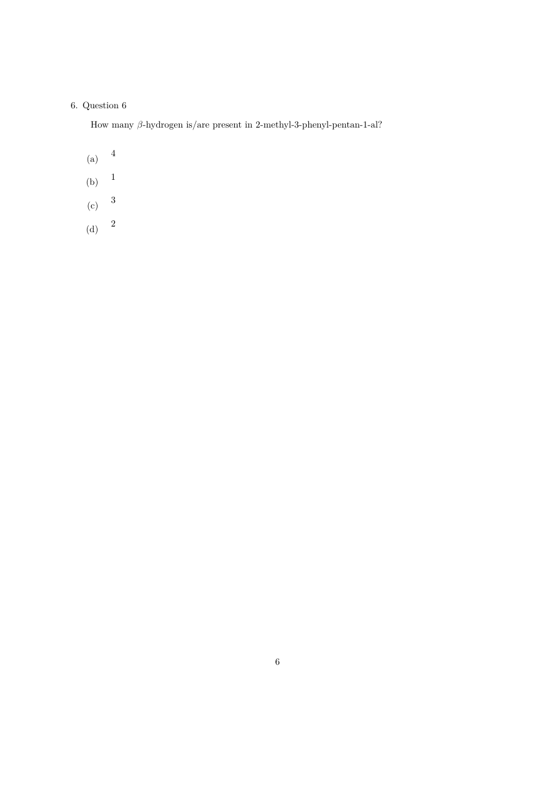

## PDF page 23

[Open original PDF at page 23](../pdf/IAT_2025_English_paper.pdf#page=23)

### Visual description

Chemistry Q7: four reagent-labelled organic reaction drawings ask which route does not give an aldehyde. The structures and catalysts/reagents above each arrow are essential to identifying the transformation.

### Searchable text - PDF text layer

```text
7. Question 7
    Which of the following reactions do NOT provide an aldehyde as a product?


    (a)


    (b)


    (c)


    (d)


                                            7
```

### Original page image

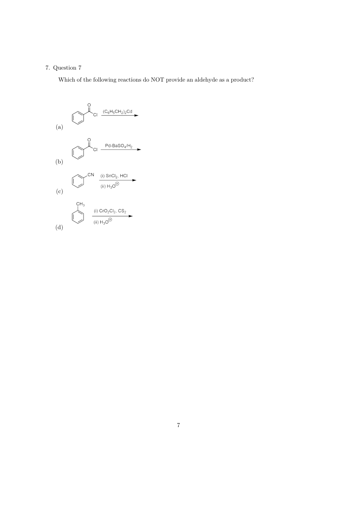

## PDF page 24

[Open original PDF at page 24](../pdf/IAT_2025_English_paper.pdf#page=24)

### Visual description

Chemistry Q8: an organic starting structure undergoes ozonolysis with zinc/water workup, then excess phenylmagnesium bromide and acidic workup. Four answer rows depict different pairs of products with phenyl, methyl, carbonyl and hydroxyl groups.

### Searchable text - PDF text layer

```text
8. Question 8
   What are the major products formed in the following reaction sequence?


    (a)


    (b)


    (c)


    (d)


                                            8
```

### Original page image

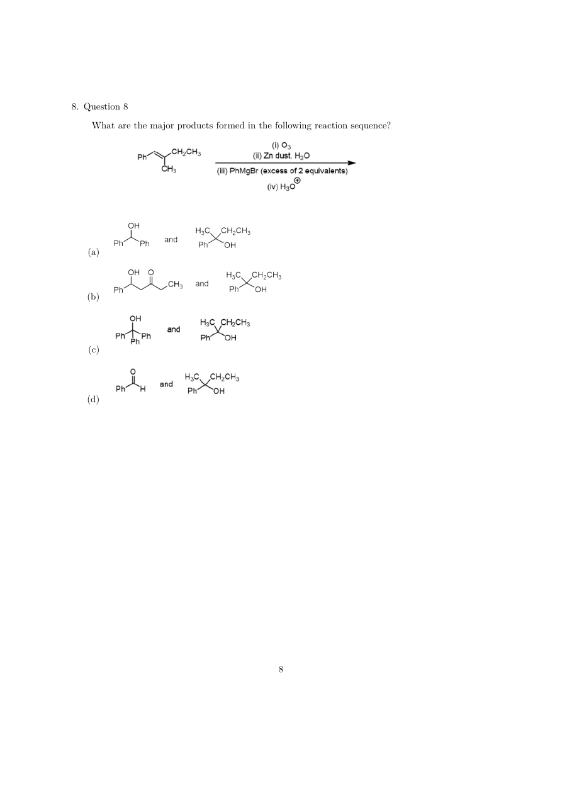

## PDF page 25

[Open original PDF at page 25](../pdf/IAT_2025_English_paper.pdf#page=25)

### Visual description

Chemistry Q9: a phenyl-substituted nitrile is treated sequentially with DIBAL-H, water and zinc/mercury-HCl. Four drawn candidates differ in their terminal functional group and side-chain connectivity.

### Searchable text - PDF text layer

```text
9. Question 9

   What is the major product in the reaction sequence given below?


    (a)


    (b)


    (c)

    (d)


                                            9
```

### Original page image

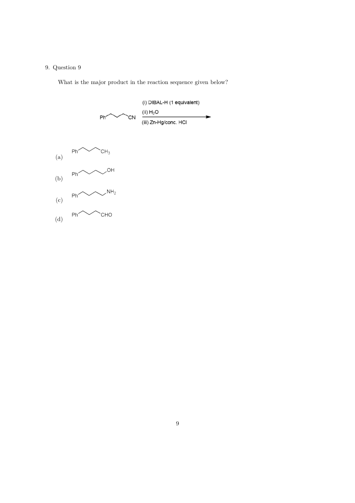

## PDF page 26

[Open original PDF at page 26](../pdf/IAT_2025_English_paper.pdf#page=26)

### Visual description

Chemistry Q10: four candidate starting structures I are drawn for a hydroboration-oxidation sequence followed by oxidation. Distinguish the alkene position and side-chain shape rather than reading only the molecular formula.

### Searchable text - PDF text layer

```text
10. Question 10
    Compound  I undergoes hydroboration-oxidation  reaction with (BH3)2
      followed  by  treatment  with H2O2  and  aqueous NaOH  to  produce
      another  compound   II,  which  upon  oxidation  with  CrO3   gives
      2,3-dimethyl-cyclohexanone as the product. What is the structure of I?


     (a)


     (b)


      (c)


     (d)


                                             10
```

### Original page image

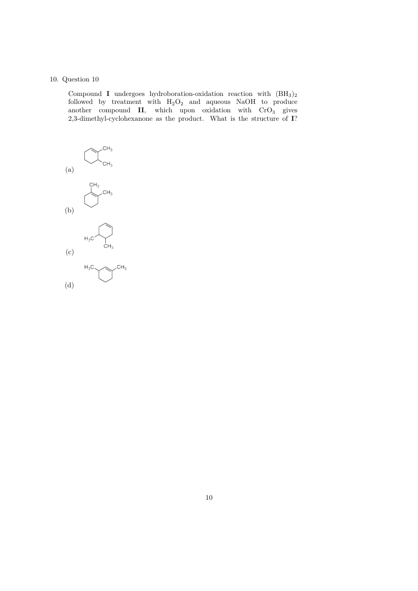

## PDF page 27

[Open original PDF at page 27](../pdf/IAT_2025_English_paper.pdf#page=27)

### Searchable text - PDF text layer

```text
11. Question 11
     The work done when one mole  of an  ideal gas expands at constant
     temperature T from volume V to 2V  (in two equal steps of volume in a
      linear fashion) is 12RT.7    How much more work would be done by the gas if
        it expands in three equal steps?
     [R is the universal gas constant]

         30RT1     (a)
            38RT     (b)

            3            4 RT      (c)
                 !  "
         -RT ln  151     (d)


                                             11
```

### Original page image

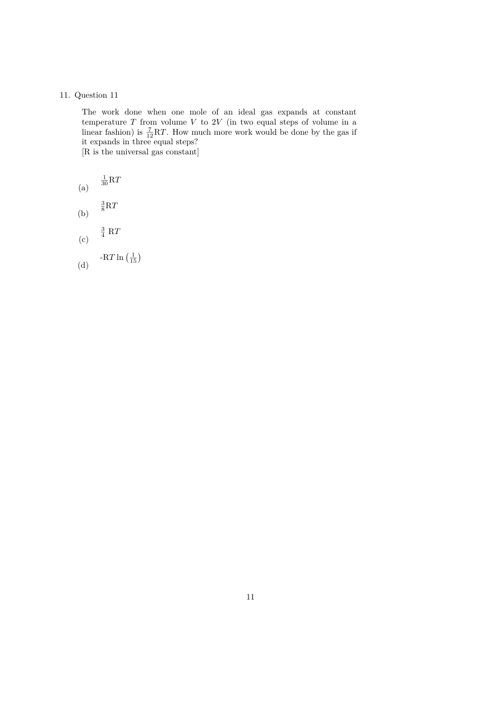

## PDF page 28

[Open original PDF at page 28](../pdf/IAT_2025_English_paper.pdf#page=28)

### Visual description

Chemistry Q12: first three options plot half-life against initial concentration. Their shapes are a straight increase, a horizontal line and a curved increase. The fourth alternative is on page 29.

### Searchable text - PDF text layer

```text
12. Question 12
     At a particular temperature, the magnitude of the rate constant of a
      reaction  is 5 ◊10≠5 and the unit of the pre-exponential factor of the      Arrhenius equation for this reaction  is mol L≠1 min≠1.  Which of the
      following plots is correct for this reaction?

      [Note: [R]0 is the initial concentration and t1/2 is the half-life of the reaction]


     (a)


     (b)


      (c)


                                             12
```

### Original page image

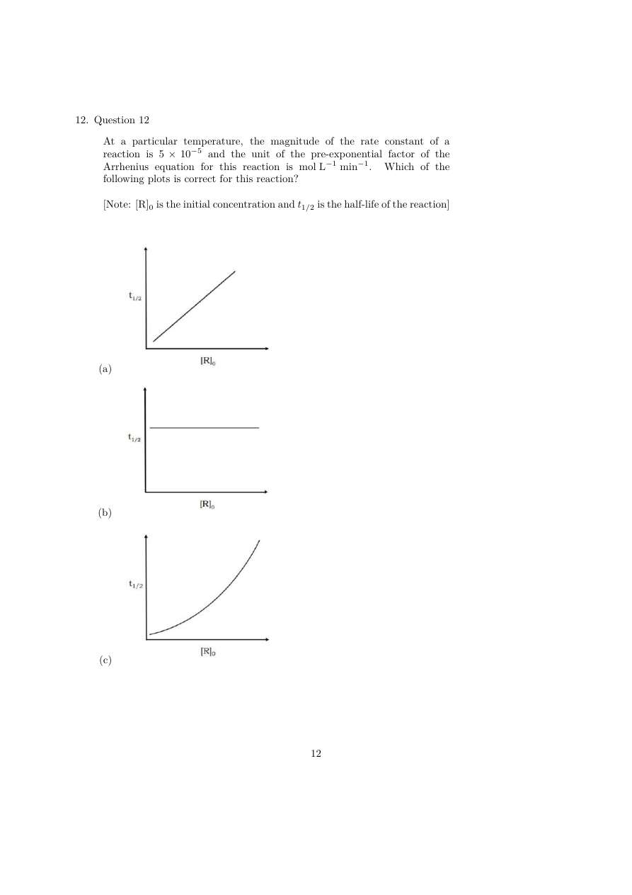

## PDF page 29

[Open original PDF at page 29](../pdf/IAT_2025_English_paper.pdf#page=29)

### Visual description

Continuation of Chemistry Q12, option (d): half-life decreases as a straight line with initial concentration.

### Searchable text - PDF text layer

```text
(d)


                                        13
```

### Original page image

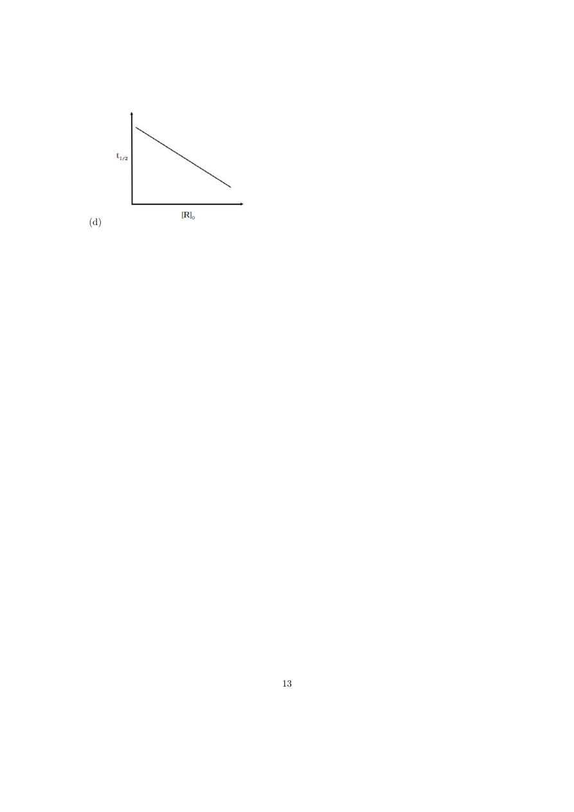

## PDF page 30

[Open original PDF at page 30](../pdf/IAT_2025_English_paper.pdf#page=30)

### Searchable text - PDF text layer

```text
13. Question 13

    What is the time period of revolution of an electron in the fourth Bohr
      orbit of He+?
     [Bohr radius = 52.9 picometers, mass of an electron = 9.11 ◊10≠31 kg,
      Planck’s constant = 6.626 ◊10≠34 Js]

           2.4 femtoseconds     (a)
           4.8 femtoseconds     (b)
          24 femtoseconds      (c)
           0.24 femtoseconds     (d)


                                             14
```

### Original page image

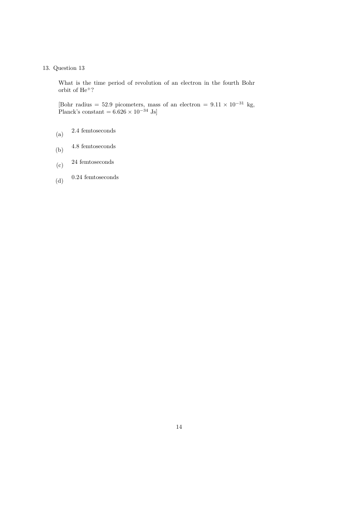

## PDF page 31

[Open original PDF at page 31](../pdf/IAT_2025_English_paper.pdf#page=31)

### Searchable text - PDF text layer

```text
14. Question 14
     The dipole moments of three AB3-type molecules I, II, and III are measured
      to be 0.0 D, 0.2 D, and 1.5 D, respectively. Which one of the following
      options is correct regarding the identity of I, II, and III?

              I: BF3, II: NF3, III: NH3     (a)
              I: BF3, II: NH3, III: NF3     (b)
              I: ClF3, II: NF3, III: NH3      (c)
              I: BCl3, II: NH3, III: NF3     (d)


                                             15
```

### Original page image

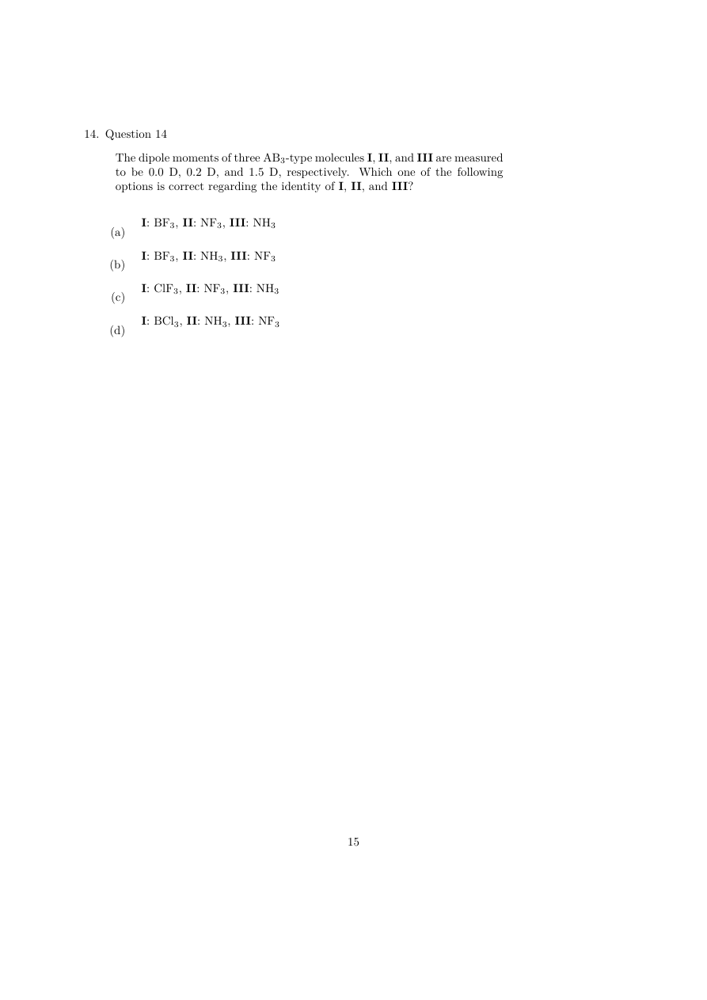

## PDF page 32

[Open original PDF at page 32](../pdf/IAT_2025_English_paper.pdf#page=32)

### Searchable text - PDF text layer

```text
15. Question 15
     During the charging and discharging of a lead-acid battery (a Pb anode, a
      grid of Pb packed with PbO2 as cathode, and an aqueous solution of H2SO4
      as an electrolyte), which of the following redox reactions does NOT occur?

         Pb4+ +      Pb     (a)       4e≠æ
         Pb2+   Pb4+ + 2e≠     (b)    æ
        Pb   Pb2+ + 2e≠      (c)   æ
         2Pb2+   Pb4+ + Pb     (d)    æ


                                             16
```

### Original page image

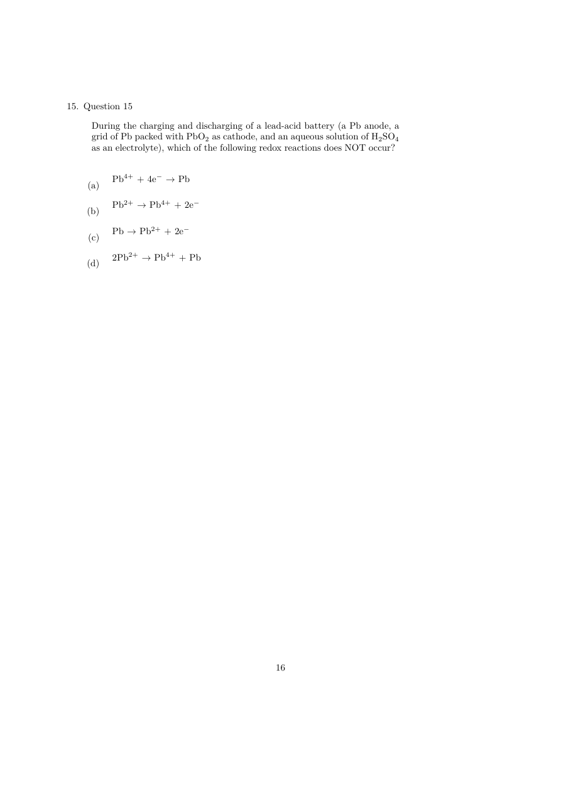

## PDF page 33

[Open original PDF at page 33](../pdf/IAT_2025_English_paper.pdf#page=33)

### Searchable text - PDF text layer

```text
Mathematics
1. Question 1
   How many three digit numbers divisible by 5 are there in which no digits
    are repeated?

    (a)   136

    (b)   128

    (c)   144

    (d)   162


                                            1
```

### Original page image

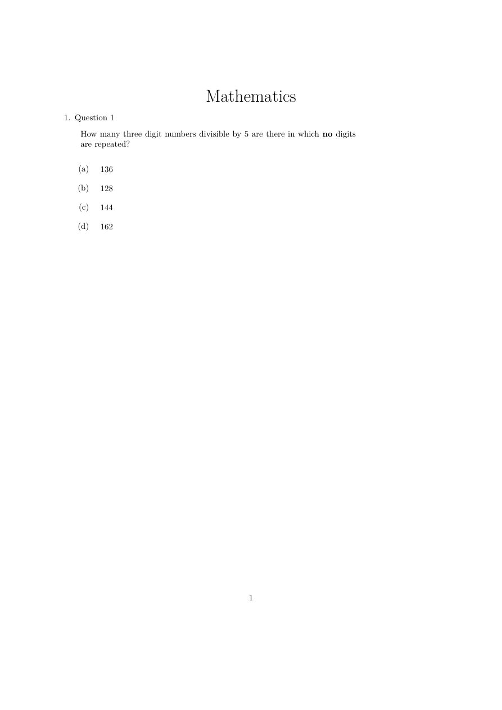

## PDF page 34

[Open original PDF at page 34](../pdf/IAT_2025_English_paper.pdf#page=34)

### Searchable text - PDF text layer

```text
2. Question 2
    Let A be a 3 ◊3 matrix with real entries such that
                      S            T
                                        x                                                cos                                 4   ≠1                                    5x                                            25                 A = U                         ≠1         V .                                x2 + 1  25    7
    For how many values of x, the matrix A is symmetric?

    (a)   1

    (b)   2

    (c)   4

    (d)   infinitely many


                                            2
```

### Original page image

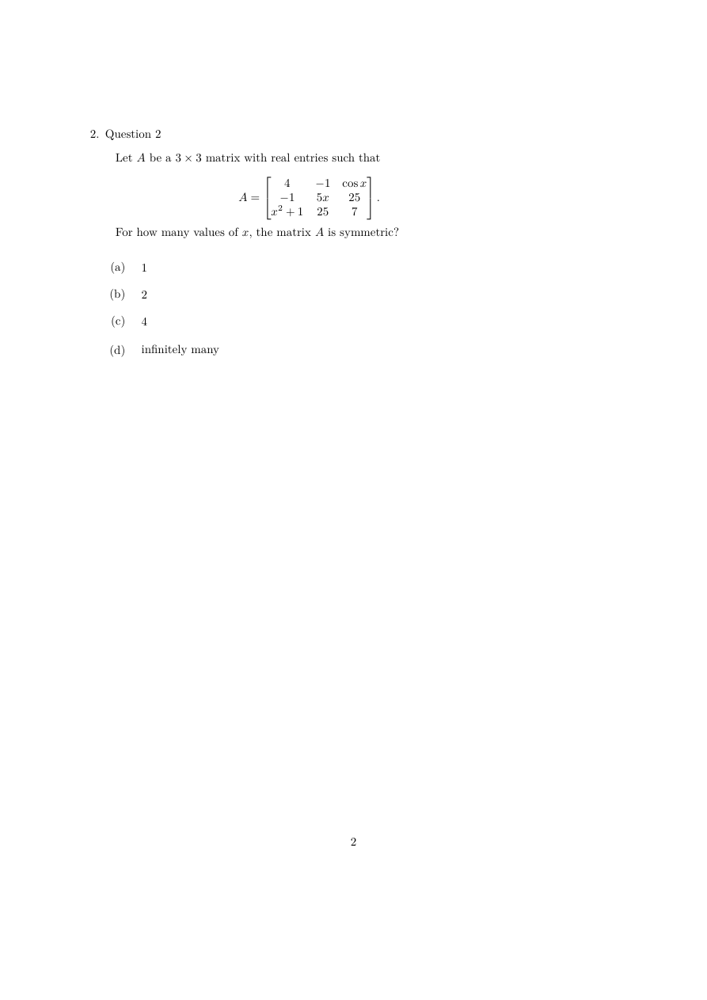

## PDF page 35

[Open original PDF at page 35](../pdf/IAT_2025_English_paper.pdf#page=35)

### Searchable text - PDF text layer

```text
3. Question 3
    ÿ10        32 42r
    Let n =    (≠1)r 10Cr   3     320. Which one of the following statements            r=0
      is TRUE?

    (a)  n is divisible by 5

    (b)  n is divisible by 6

    (c)  n is divisible by 8

    (d)  n is divisible by 9


                                            3
```

### Original page image

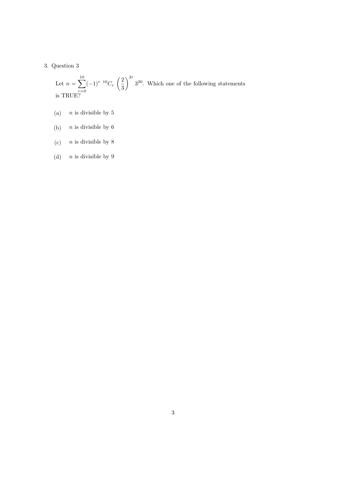

## PDF page 36

[Open original PDF at page 36](../pdf/IAT_2025_English_paper.pdf#page=36)

### Searchable text - PDF text layer

```text
4. Question 4
    Let f  : R  R be the function given by f(x) = cos (tan≠1 x). Which one       æ     of the following statements is TRUE?

    (a)   f is decreasing for x > 0

    (b)   f is decreasing for x < 0

    (c)   f is decreasing on R

    (d)   f is decreasing on the interval (≠1, 1)


                                            4
```

### Original page image

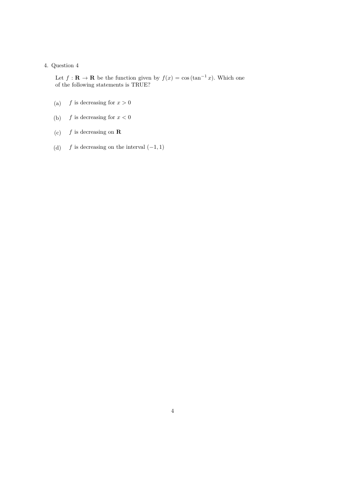

## PDF page 37

[Open original PDF at page 37](../pdf/IAT_2025_English_paper.pdf#page=37)

### Searchable text - PDF text layer

```text
5. Question 5
    Let        ;                            6   <                                    53x                                                                                 --    < det          A =  x R                            ≠1    2    29   .                 œ    ≠31                5 Æ                                ≠2
   Which one of the following statements is TRUE?

    (a)  A = (≠2, 2]
    (b)  A = (≠2, 2)
    (c)  A = [≠2, 2)
    (d)  A = [≠2, 2]


                                            5
```

### Original page image

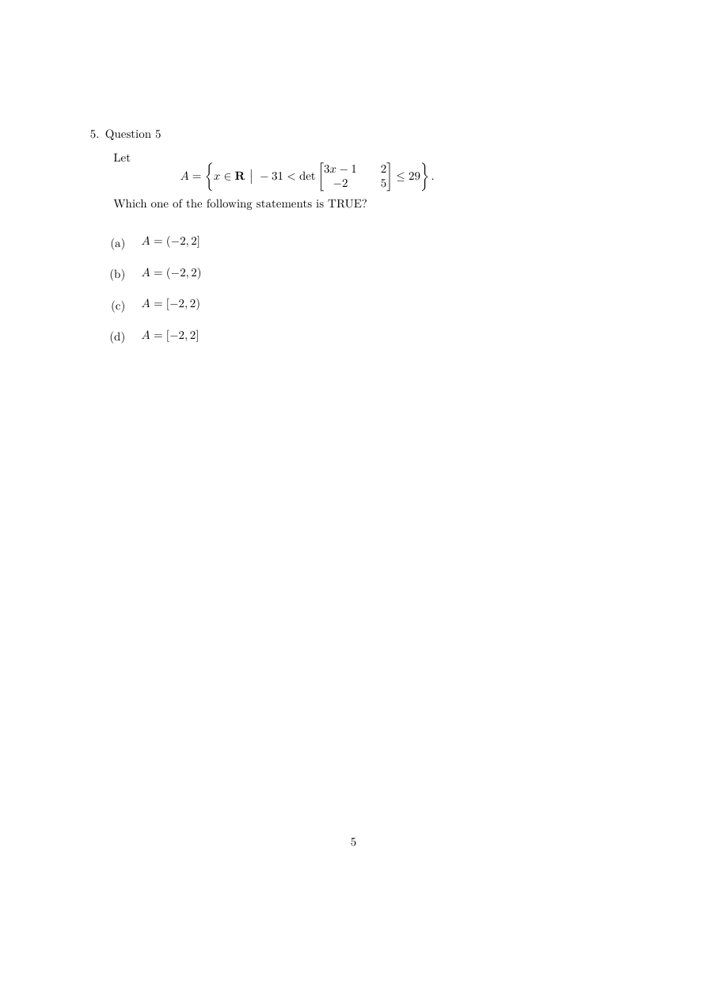

## PDF page 38

[Open original PDF at page 38](../pdf/IAT_2025_English_paper.pdf#page=38)

### Searchable text - PDF text layer

```text
6. Question 6
    Let z1, z2, and z3 be complex numbers satisfying the following conditions
                                          1     1       1            2 =   =     =  +  =   ----  +    +                                     ---- .                    |2z1|    |z2 ≠1|    |z3   1|    z1    z2       z3 + 1                                ≠1
   What is the value of |4z1 +                                 z2 + z3|?

    (a)   8

    (b)   4

         1
    (c)   4

         1
    (d)   8


                                            6
```

### Original page image

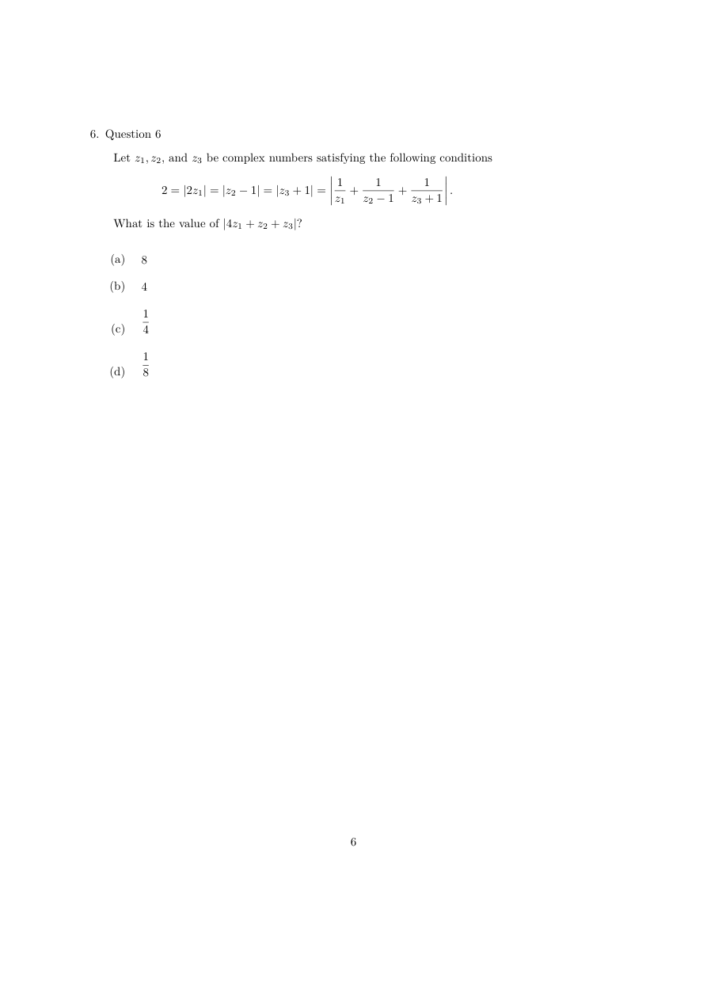

## PDF page 39

[Open original PDF at page 39](../pdf/IAT_2025_English_paper.pdf#page=39)

### Searchable text - PDF text layer

```text
7. Question 7
    Let f : R   R be defined as f(x) =             where [x] denotes       æ                              |x3 ≠3x|[x],    the greatest integer less than or equal to x. Which one of the following
    statements is TRUE?

    (a)   Every non-zero integer is a point of discontinuity of f

    (b)   f is continuous at every real number

    (c)   Every integer is a point of discontinuity of f
    (d)   f is continuous at every real number except for 0, Ô 3                                  ±


                                            7
```

### Original page image

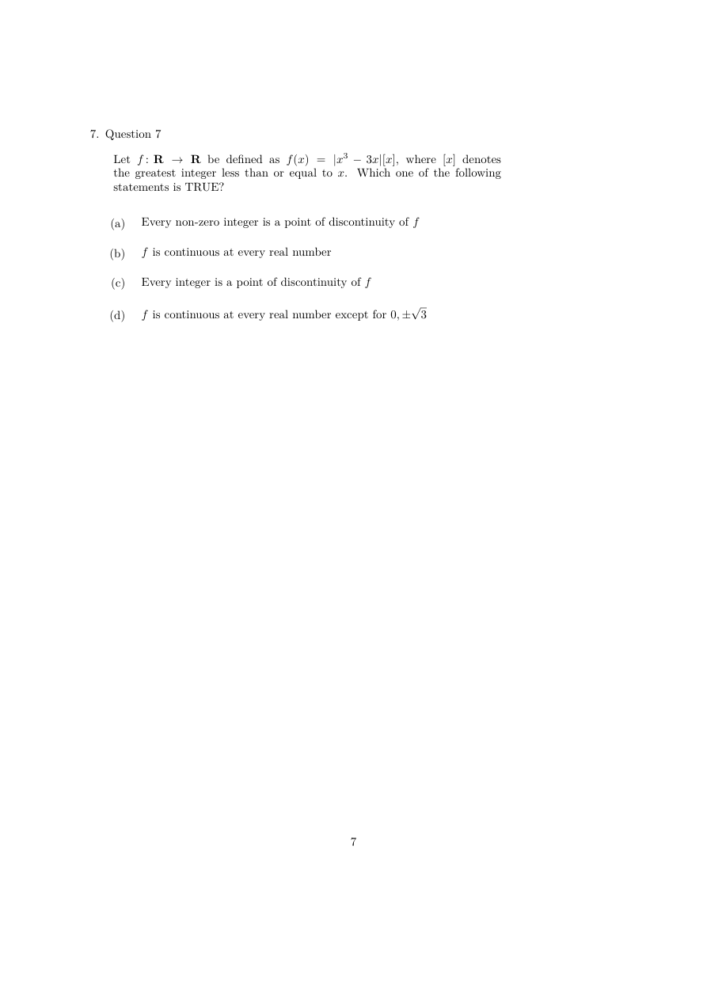

## PDF page 40

[Open original PDF at page 40](../pdf/IAT_2025_English_paper.pdf#page=40)

### Searchable text - PDF text layer

```text
8. Question 8
                                    3 Ô 3 4    Let ¸ be the tangent line to the ellipse x2 + 16y2 = 4 at   1,          . What is                                                         4
    the equation of the line perpendicular to ¸ passing through (2, 0)?

        Ô 3(x    (a)   y = 4               ≠2)
        Ô 3(x    (b)   y = 2               ≠2)
       Ô 3(x    (c)   y =              ≠2)
      Ô 3y = (x    (d)   4               ≠2)


                                            8
```

### Original page image

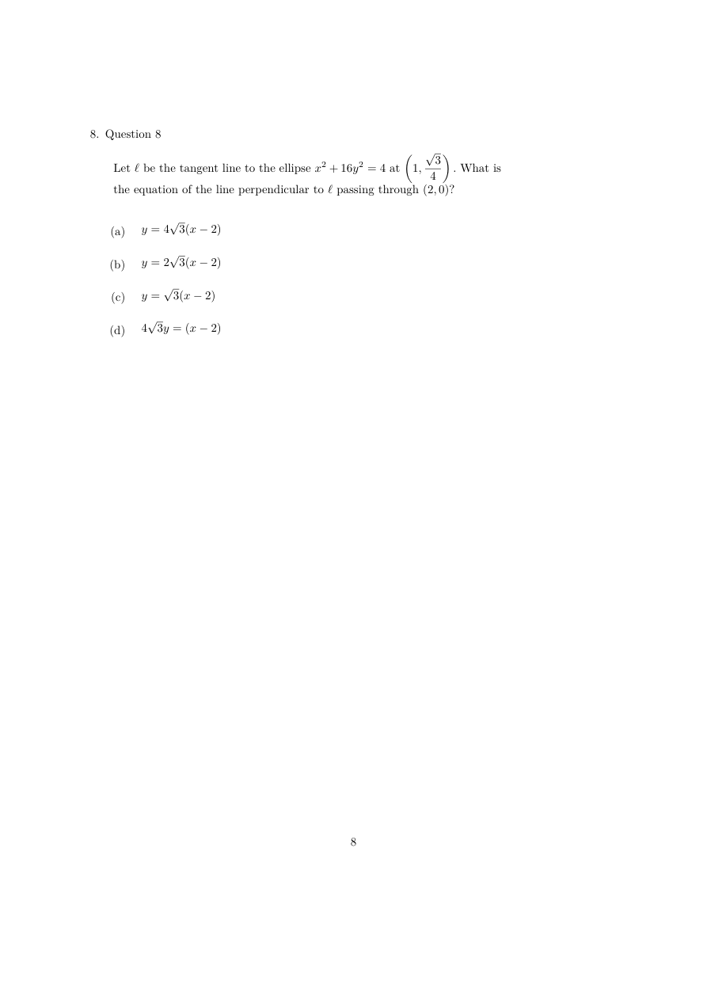

## PDF page 41

[Open original PDF at page 41](../pdf/IAT_2025_English_paper.pdf#page=41)

### Searchable text - PDF text layer

```text
9. Question 9

    Let ˛a and ˛b be two vectors such that    = 15 and                                                                    |˛a +˛b|

                                 ˛a                       ◊(3ˆi ≠4ˆj + 5ˆk) = (3ˆi ≠4ˆj + 5ˆk) ◊˛b.
   What is the value of |(˛a +˛b) · (2ˆi + 3ˆj + ˆk)|?

          3
    (a)  Ô 2
    (b)
         0
    (c)  Ô 2

    (d)   3


                                            9
```

### Original page image

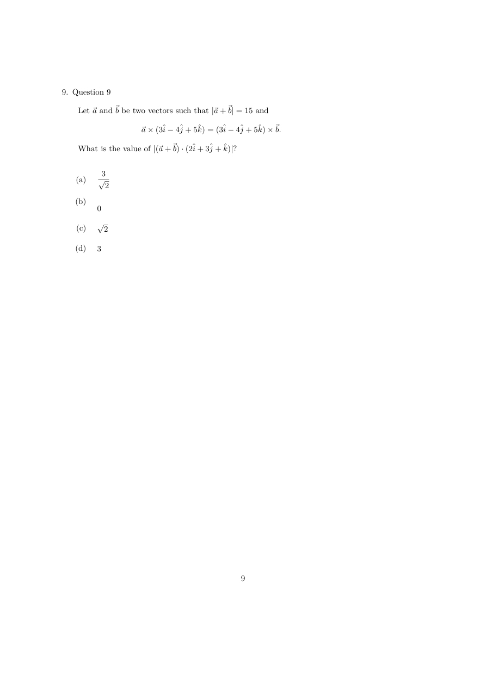

## PDF page 42

[Open original PDF at page 42](../pdf/IAT_2025_English_paper.pdf#page=42)

### Searchable text - PDF text layer

```text
10. Question 10
    What is the derivative of log(sin2 x) with respect to sin x?

     (a)   2 cosec x

     (b)   sin 2x

      (c)   4 cosec x

     (d)   cot x cosec 2x


                                             10
```

### Original page image

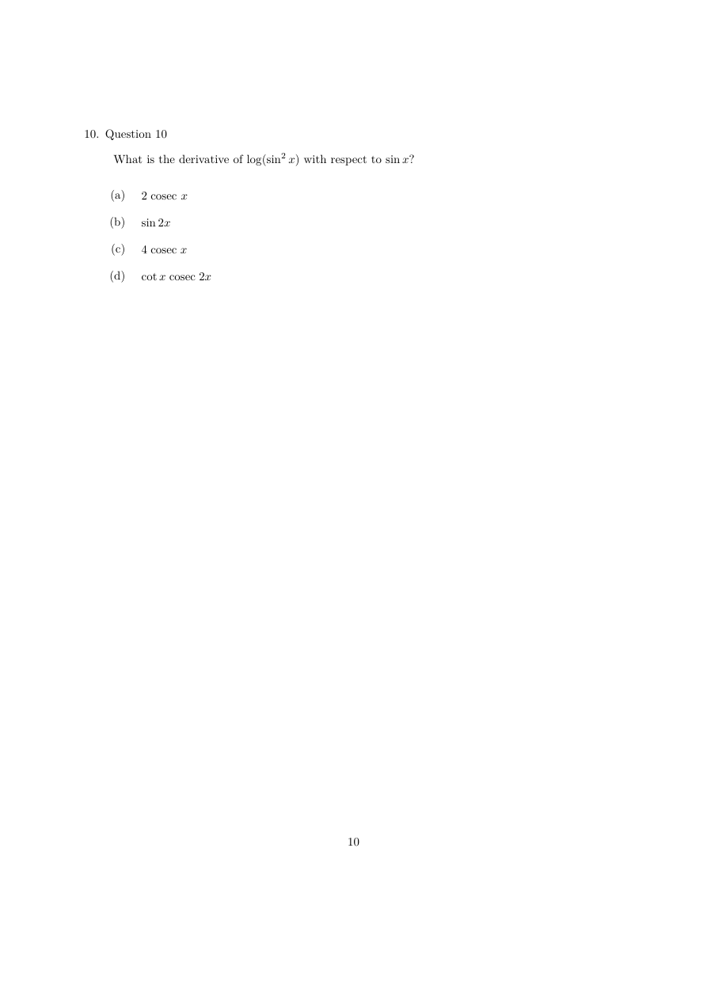

## PDF page 43

[Open original PDF at page 43](../pdf/IAT_2025_English_paper.pdf#page=43)

### Searchable text - PDF text layer

```text
11. Question 11
     Let Sn denote the sum of the first n terms of a sequence a1, a2, a3, . . ..  If
     Sn+3   = 13n + 7 for all n, what is the value of a13       ≠Sn                                   ≠a10?

     (a)   13

     (b)   137

      (c)   46

     (d)   12


                                             11
```

### Original page image

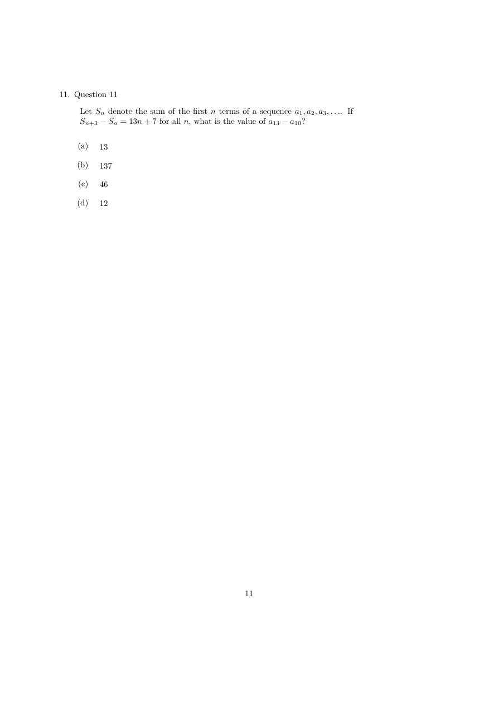

## PDF page 44

[Open original PDF at page 44](../pdf/IAT_2025_English_paper.pdf#page=44)

### Searchable text - PDF text layer

```text
12. Question 12
     Five fair coins are tossed independently. What is the probability that at
      least two heads appear?

          13
     (a)          16

          7
     (b)          16

          5
      (c)          16

          11
     (d)          16


                                             12
```

### Original page image

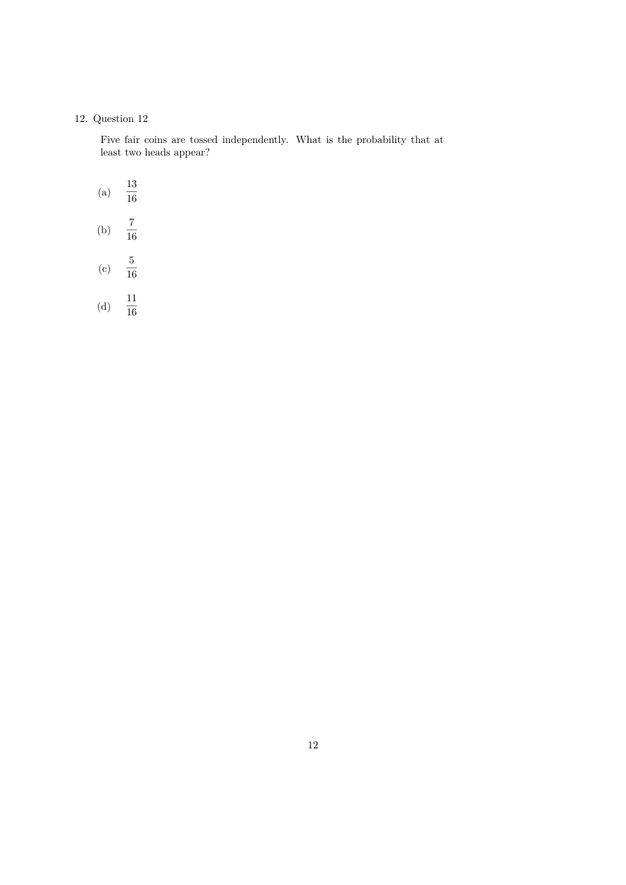

## PDF page 45

[Open original PDF at page 45](../pdf/IAT_2025_English_paper.pdf#page=45)

### Searchable text - PDF text layer

```text
13. Question 13
     Let f : R  R be the function defined by       æ
                   I
                                                                1,                                 x2 ≠4x ≠5   if                                        x Ø                        f(x) =
                              2x                 if x < 1.

    Which one of the following statements is TRUE?

     (a)   f is onto but not one-one

     (b)   f is one-one but not onto

      (c)   f is neither one-one nor onto

     (d)   f is one-one and onto


                                             13
```

### Original page image

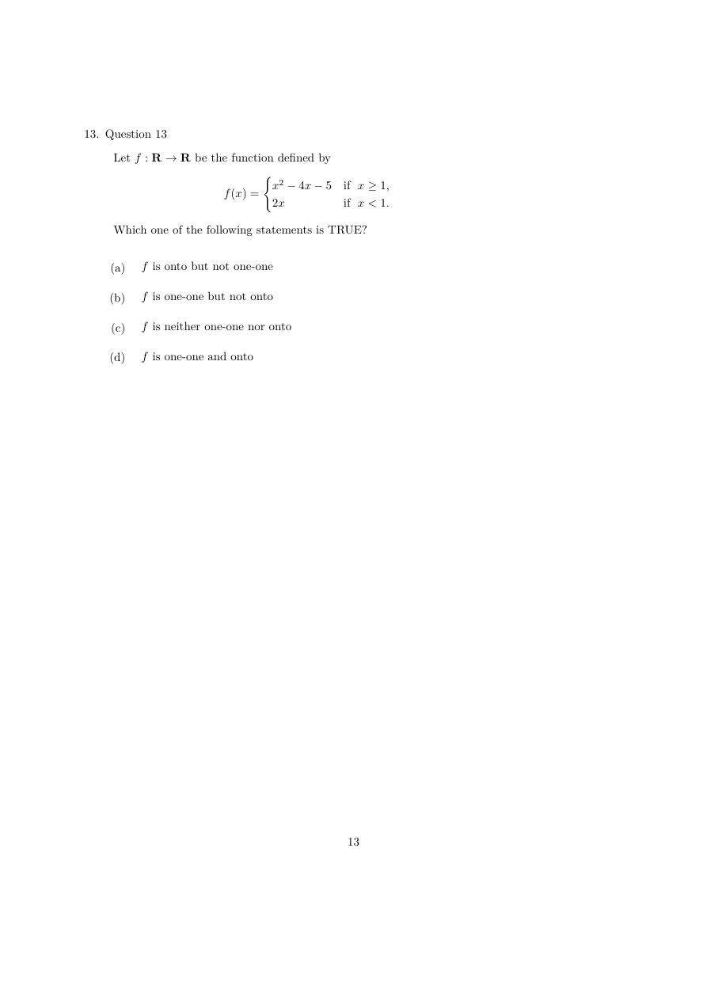

## PDF page 46

[Open original PDF at page 46](../pdf/IAT_2025_English_paper.pdf#page=46)

### Searchable text - PDF text layer

```text
14. Question 14
    Which one of the following is the solution of the differential equation

                          x2 dy + 9xy = x4 (for x > 0),
                         dx
     given that y = 0 when x = 1?

     (a)   12y = x3          ≠1x9

     (b)   12y = x9          ≠1x3

      (c)   9y = x21         ≠1x3

                    1
     (d)   9y = x3           ≠ x21


                                             14
```

### Original page image

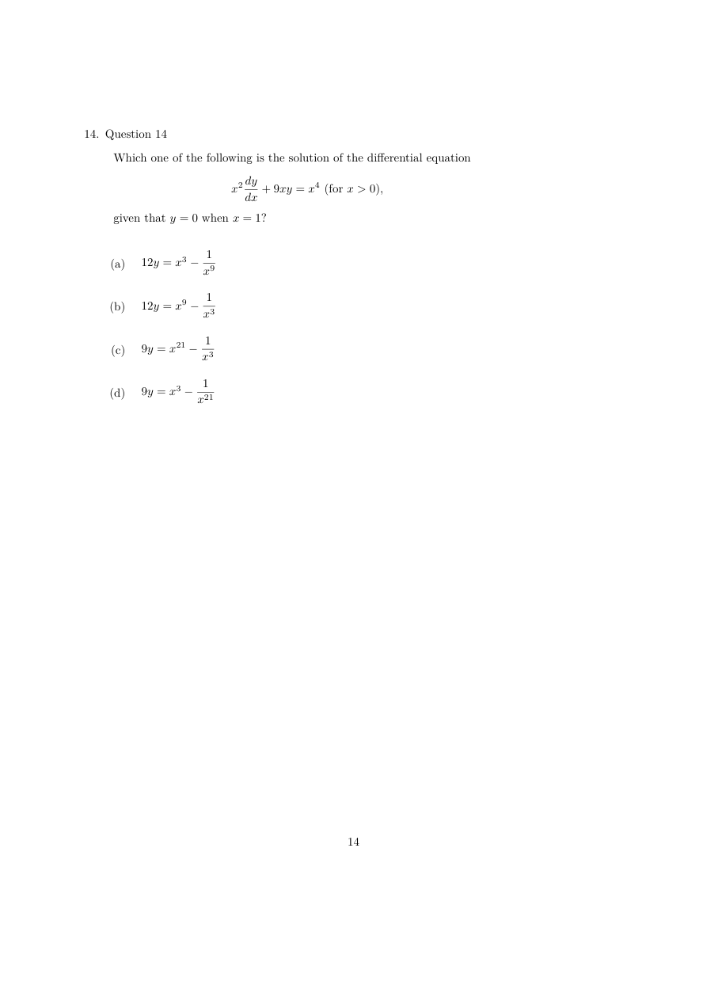

## PDF page 47

[Open original PDF at page 47](../pdf/IAT_2025_English_paper.pdf#page=47)

### Searchable text - PDF text layer

```text
15. Question 15

                     ⁄fi
    What is the value of      cos   sin x dx?                              x|    x|
                              0


         fi
     (a)          2

         fi
     (b)          4
      (c)  fi

         fi
     (d)          6


                                             15
```

### Original page image

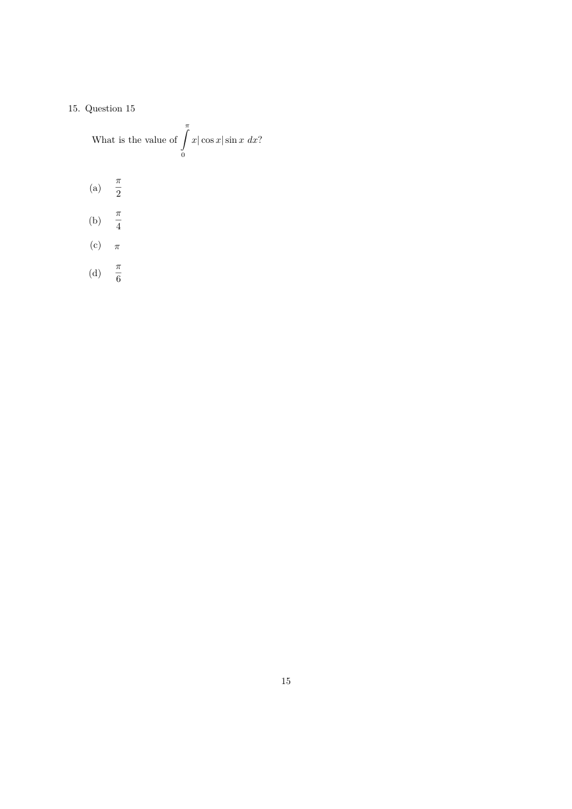

## PDF page 48

[Open original PDF at page 48](../pdf/IAT_2025_English_paper.pdf#page=48)

### Visual description

Physics Q1: each option contains a pair of velocity plots for particles A and B, before and after an elastic collision. The first plot uses crossing/increasing lines while the second gives horizontal velocity levels; slope labels and level order differ between alternatives.

### Searchable text - PDF text layer

```text
Physics
1. Question 1
    Consider an elastic collision between two particles A and B of same mass,
    moving in the same direction. Particle A is moving at speed vA and particle
   B is moving at speed vB.  In the figures shown, the solid lines represent
    the motion before the collision and the dotted lines represent the motion
     after the collision. Which of the following describes the motion of these two
     particles most accurately?


    (a)


    (b)


    (c)


    (d)


                                            1
```

### Original page image

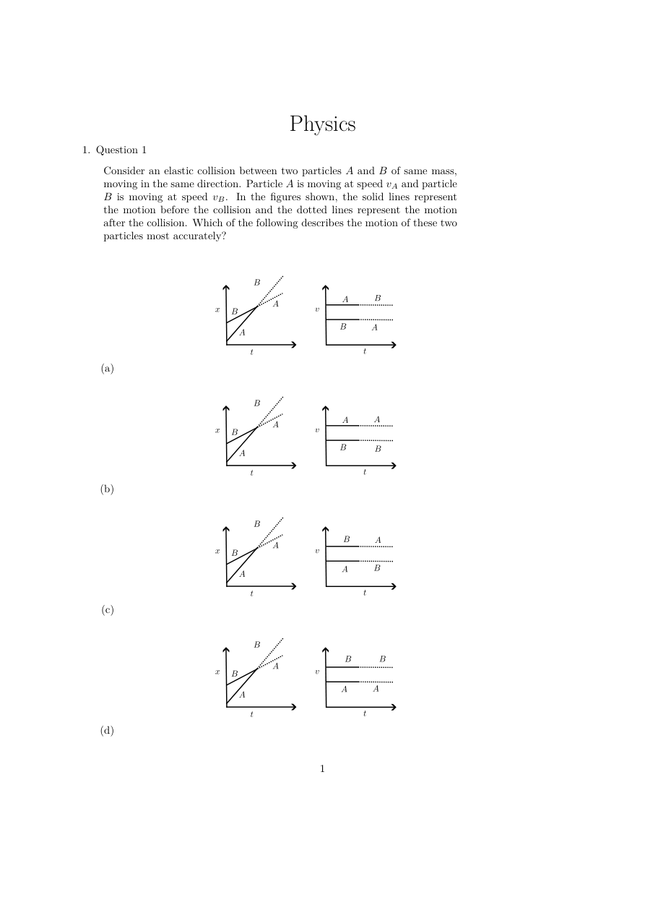

## PDF page 49

[Open original PDF at page 49](../pdf/IAT_2025_English_paper.pdf#page=49)

### Visual description

Physics Q2: a block M is attached to a horizontal spring of constant k. A projectile of mass m approaches leftwards at speed v and sticks in the block; the diagram marks all four quantities.

### Searchable text - PDF text layer

```text
2. Question 2
   A block of mass M  lies at rest connected to a massless spring of spring
    constant k on a frictionless surface. A bullet of mass m hits the block
     horizontally with speed v as shown in the figure and is completely stuck
    to the block. What is the maximum compression in the spring resulting
    from this impact (assuming that at this point the spring is still not fully
    compressed)?


    Û
            m2v2
         k(M + m)
    (a)
    Ú
         mv2
    (b)      k
    Ú
        Mv2
    (c)      k
    Û
         mMv2
         k(M + m)
    (d)


                                            2
```

### Original page image

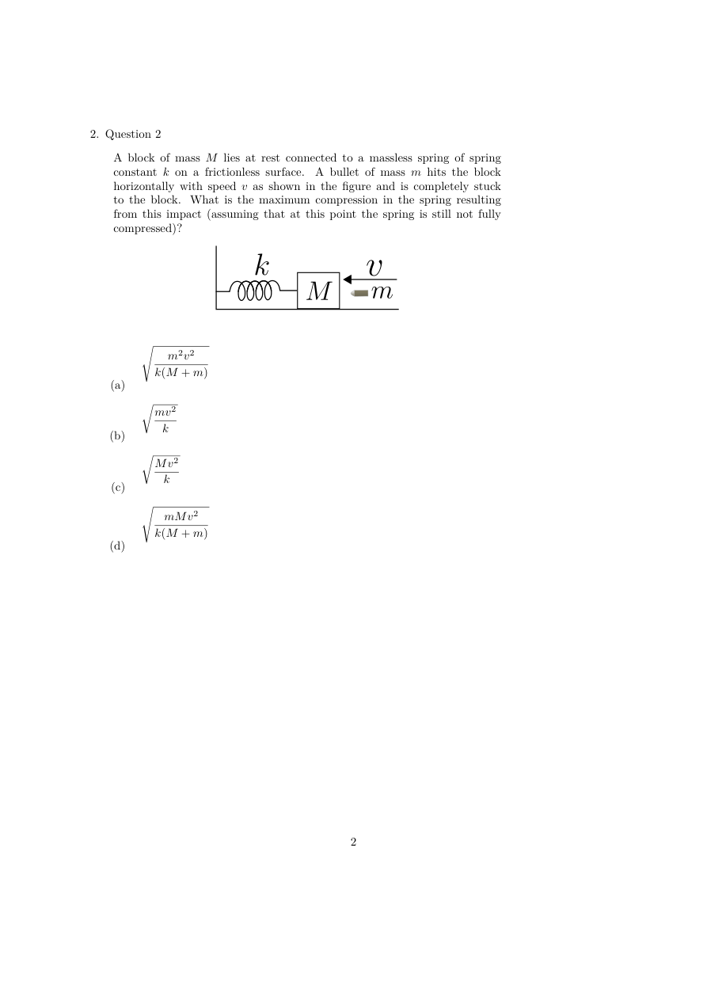

## PDF page 50

[Open original PDF at page 50](../pdf/IAT_2025_English_paper.pdf#page=50)

### Visual description

Physics Q3: a cart starts from a high point A on a descending track and enters a vertical circular loop. Positions B and C and radius R are marked; one is the bottom and the other the top of the loop.

### Searchable text - PDF text layer

```text
3. Question 3
   A cart of mass M  is released from A, the highest point of a frictionless
     track, as shown in the figure. The cart travels along the track and enters
     the semicircular arc DBC of radius R. The heights of the points A and
   B are h1 and h2 from the ground, respectively. Which of the following
     quantities does not play any role in ensuring that the cart does not leave
     the track?


    (a) M

         h1    (b)

         h2    (c)

    (d)  R


                                            3
```

### Original page image

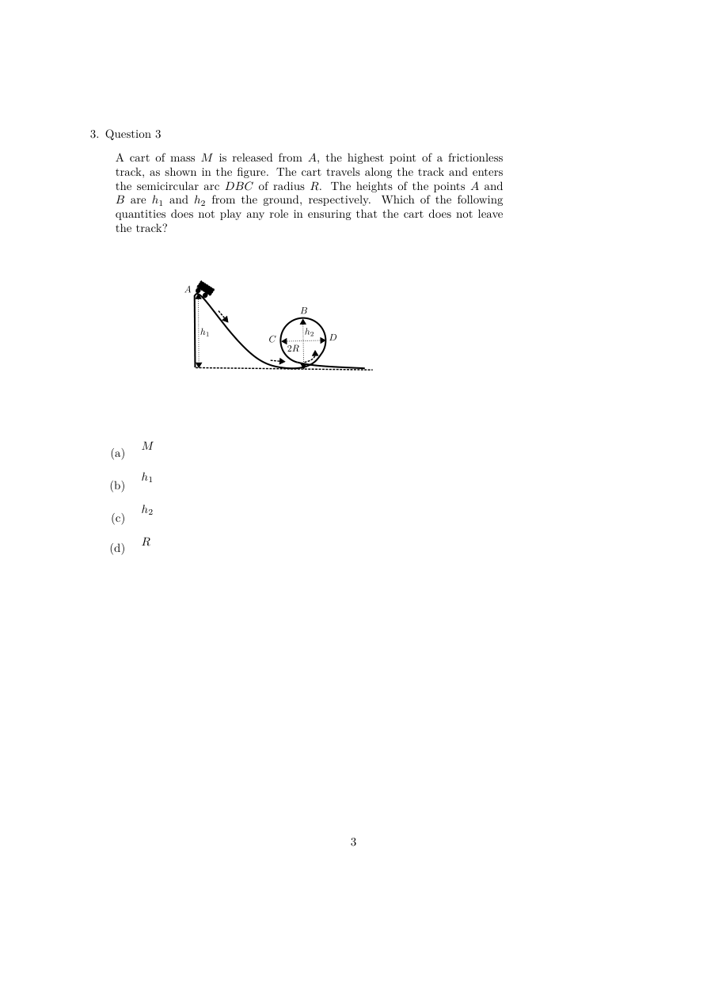

## PDF page 51

[Open original PDF at page 51](../pdf/IAT_2025_English_paper.pdf#page=51)

### Searchable text - PDF text layer

```text
4. Question 4
   A circular disk of mass M and radius R is rotating clockwise with a uniform
    angular velocity Ê about an axis passing through the centre, normal to the
     disk. At time t = 0, a torque T  is applied along the same axis to oppose
    the rotation of the disk. What is the angular displacement ◊(measured
    from t = 0 in the clockwise direction) that the disk attains before it starts
     rotating counterclockwise?

         Ê2MR2
      ◊=              4T    (a)
         Ê2MR2
      ◊=              8T    (b)

      ◊=         ≠Ê2MR24T    (c)

      ◊=         ≠Ê2MR28T    (d)


                                            4
```

### Original page image


## PDF page 52

[Open original PDF at page 52](../pdf/IAT_2025_English_paper.pdf#page=52)

### Searchable text - PDF text layer

```text
5. Question 5
   A metallic cube initially kept at a temperature T  is emitting black body
    radiation with a power P (energy emitted per unit time). If T is increased by
    1 %, the power being radiated increases by 4.5 %. What is the approximate
    percentage increase in the volume of the cube in this process?

          0.75 %    (a)
          0.50 %    (b)

          1.56    %    (c)      ◊10≠6
          6.25    %    (d)      ◊10≠6


                                            5
```

### Original page image

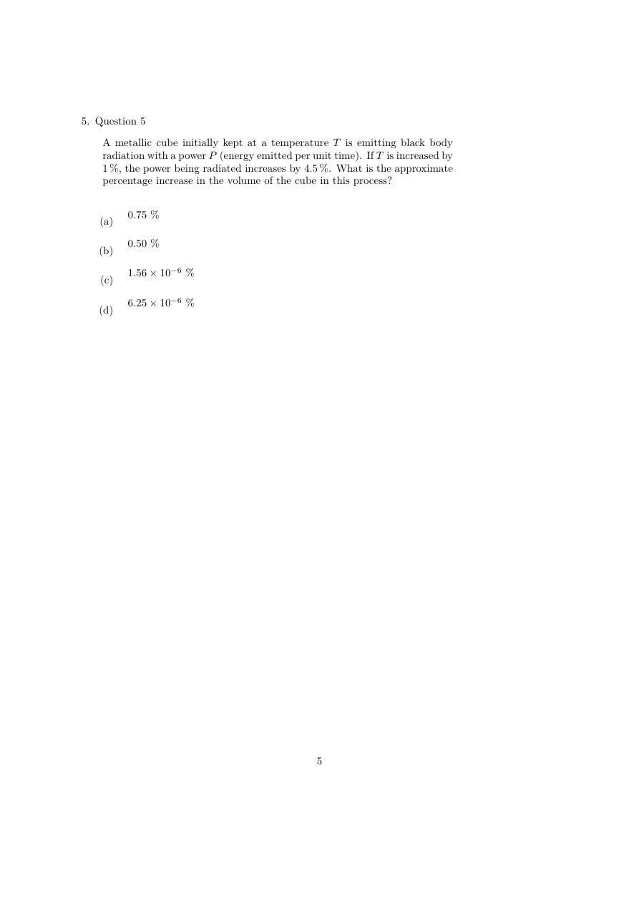

## PDF page 53

[Open original PDF at page 53](../pdf/IAT_2025_English_paper.pdf#page=53)

### Searchable text - PDF text layer

```text
6. Question 6
    Consider two pipes A and B of identical length. A has one end closed and
    one end open. B has both ends open. Each tube is immersed in a closed
    chamber of ideal gas having volume V . The chamber containing tube A is
    at temperature TA and the chamber containing tube B is at temperature
    TB. The sound frequencies corresponding to the nA-th harmonic in tube
   A and the nB-th harmonic in tube B are the same. What is the relation
    between the temperatures TA and TB?

            34n2B 4       TA =       TB
                n2A    (a)
            34n2A 4       TA =       TB
                n2B    (b)
         3   4
                n2A       TA =       TB
                4n2B    (c)
         3   4
                n2B       TA =       TB
                4n2A    (d)


                                            6
```

### Original page image


## PDF page 54

[Open original PDF at page 54](../pdf/IAT_2025_English_paper.pdf#page=54)

### Searchable text - PDF text layer

```text
7. Question 7
    Consider two waves, which are given by y1(x, t) = A sin(kx ≠Êt) and     y2(x, t) = Ô 3A cos(kx       where k  is the wave number and Ê  is the                      ≠Êt),    angular frequency. The amplitude of the resultant waveform obtained by
    the superposition of the two waves is As and its phase difference with y1 is
     „s. What are As and „s?

        As = 2A and „s = fi                          3    (a)
        As = 2A and „s = fi                          6    (b)

        As = A and „s = fi              2          3    (c)

        As = A and „s = fi              2          6    (d)


                                            7
```

### Original page image


## PDF page 55

[Open original PDF at page 55](../pdf/IAT_2025_English_paper.pdf#page=55)

### Visual description

Physics Q8: parallel plates are separated by d and have potentials V and 0 V. A positive particle enters horizontally halfway between them; its entry point and the potential gradient fix the field direction and deflection geometry.

### Searchable text - PDF text layer

```text
8. Question 8
   A particle of charge q = 1e and mass m with kinetic energy K enters an
     electric field set up by two parallel plates of length l as illustrated in the
    figure. The potential difference between the two plates is 1 V and their
    separation is d. What is the minimum value of K (in eV) for which the
     particle will not hit either of the plates?
     [e is the charge of the electron.]


             l2
         2d2    (a)
          d2
           2l2    (b)
             l2
          d2    (c)
          d2
             l2    (d)


                                            8
```

### Original page image


## PDF page 56

[Open original PDF at page 56](../pdf/IAT_2025_English_paper.pdf#page=56)

### Visual description

Physics Q9: a 12 V source is connected across a diamond-shaped capacitor bridge. P and Q mark the upper/lower internal nodes, and the four edge capacitances are labelled in microfarads.

### Searchable text - PDF text layer

```text
9. Question 9
   What is the potential difference between the points P and Q in the circuit
    shown below, once the capacitors are fully charged?

                          P
                    µF   2           4       µF


           2        µF                 µF   4
                       Q


                              12V


         4 V    (a)
         0 V    (b)
         8 V    (c)
         12 V    (d)


                                            9
```

### Original page image


## PDF page 57

[Open original PDF at page 57](../pdf/IAT_2025_English_paper.pdf#page=57)

### Searchable text - PDF text layer

```text
10. Question 10
   A particle of mass m and charge q moving with a velocity ˛v = v0(ˆi + ˆj ≠ˆk)       is placed in a uniform magnetic field ˛B = B0(ˆi+ˆj + ˆk). It executes a helical
      trajectory of radius r and pitch p. Which of the following options is correct?

              2Ô 2mv0        2fimv0           r =        and p =
              3qB0          3qB0     (a)
            mv0        2fimv0           r =      and p =
             3qB0         3qB0     (b)
              2Ô 2mv0         4Ô 2fimv0           r =        and p =
              3qB0            3qB0      (c)
            2fimv0         2Ô 2mv0           r =       and p =
             3qB0          3qB0     (d)


                                             10
```

### Original page image


## PDF page 58

[Open original PDF at page 58](../pdf/IAT_2025_English_paper.pdf#page=58)

### Searchable text - PDF text layer

```text
11. Question 11
   A charged particle is moving in a circular orbit with radius r and orbital
     angular frequency Ê in the presence of a magnetic field.  The orbit  is
     enclosed within a larger circular metallic frame. The frame is concentric
     and coplanar with the orbit.  The radius of the frame is now gradually
      decreased. Assuming that the particle remains within the frame at all times,
     what changes to the trajectory of the particle will occur as the frame is being
     shrunk?

        The radius of the orbit will gradually decrease and the frequency will
           gradually increase.
     (a)
        The radius of the orbit will gradually increase and the frequency will
           gradually decrease.
     (b)
        The radius of the orbit will remain the same but the frequency will gradually
            increase.      (c)
         Both the radius of the orbit and the frequency will remain unchanged.
     (d)


                                             11
```

### Original page image


## PDF page 59

[Open original PDF at page 59](../pdf/IAT_2025_English_paper.pdf#page=59)

### Visual description

Physics Q12: an equilateral prism of refractive index 1.5 and a parallelepiped of index 2.0 stand with adjacent faces parallel. A ray enters one face at normal incidence, traverses the bodies and exits at an angle theta.

### Searchable text - PDF text layer

```text
12. Question 12
     Consider an equilateral prism of refractive index 1.5 and a parallelepiped
     block of refractive index 2.0 arranged as shown in the figure such that their
     adjacent faces are parallel. A light ray enters the prism from air at an angle
      of incidence such that the ray travels through the prism parallel to its base.
    What is the angle of emergence ◊?


           sin≠1(3/4)
     (a)
           sin≠1(1/3)
     (b)
           sin≠1 (1/2)
      (c)
           sin≠1 (Ô 3/2)
     (d)


                                             12
```

### Original page image


## PDF page 60

[Open original PDF at page 60](../pdf/IAT_2025_English_paper.pdf#page=60)

### Visual description

Physics Q13: light initially polarised along the x direction passes through two polarizers P0 and P1. Their transmission axes are drawn at different angles relative to x and the initial electric-field direction.

### Searchable text - PDF text layer

```text
13. Question 13
   A source produces a  light beam  of  intensity  I0  polarized along the
      x-direction. The beam is sent along the z-direction. It enters a polaroid P1
     with its polaroid axis aligned along the y-direction so that no light exits the
      polaroid. When another polaroid P2 is placed in between the source and
     P1, the intensity measured after P1 is 3I0/16. Which among the following
       is a possible value of ◊, the angle of the polaroid axis measured from the
      x-axis?


                      Polarisation of
                      incident light


          60¶     (a)
          15¶     (b)
          45¶      (c)
          75¶     (d)


                                             13
```

### Original page image


## PDF page 61

[Open original PDF at page 61](../pdf/IAT_2025_English_paper.pdf#page=61)

### Searchable text - PDF text layer

```text
14. Question 14
    An electron in the ground state (with energy E1) of a hydrogen atom,
     absorbs a photon of energy Ea, and gets excited to a higher energy level of
      principal quantum number n. What is the value of n?

     Ú
             E1
          E1 + Ea
     (a)
     Ú
             E1
          E1 ≠Ea     (b)
     Ú
            Ea
          E1 ≠Ea      (c)
     Ú
            Ea
          E1 + Ea
     (d)


                                             14
```

### Original page image


