# IAT 2025 - Hindi

Original PDF: [IAT_2025_Hindi_paper.pdf](../pdf/IAT_2025_Hindi_paper.pdf)

- Acquisition: SciAstra CloudFront mirror; not downloaded from the official server.
- Downloaded: 28 October 2026. PDF pages: 60.
- Exact download/source URL: https://d2aaa7ts7sm3bp.cloudfront.net/pdfs/01KMFR5X4PTA9CANEKGAYX5SY1.pdf
- PDF SHA-256: `29625352a3f48ec4a8095fd5bbe38932e032fb8bd2787b3b30ad9b35aef00e4d`
- This is a search/accessibility copy of an existing paper, not newly authored mock content.
- Text is mechanically extracted or OCR-derived and has not been proofread character by character. Equations, option letters, chemical bonds, tables and Hindi OCR can contain errors. The PDF and page images are authoritative.
- Figure descriptions are explanatory annotations, not official answers or complete structural/formula transcriptions. Use the linked image to resolve exact labels, values and stereochemistry.

**Archive count:** the English companion contains 59 `Question` headings (Biology 15, Chemistry 15, Mathematics 15, Physics 14). The archived content and numbering are preserved; no replacement question is invented.

## Visual guide

The following descriptions refer to **PDF page numbers in the English companion**, because Hindi pagination can differ. The Hindi page images below retain every original diagram; identical embedded images are additionally cross-linked where matched by image digest.

- [English PDF page 1](IAT_2025_English_paper.md#pdf-page-1): Biology Q1: a matching table pairs animal body-plan features with taxonomic groups, using labelled entries P-S and i-iv.
- [English PDF page 11](IAT_2025_English_paper.md#pdf-page-11): Biology Q11: two parental-cross schemes produce F1 double heterozygotes PpQq, then give different test-cross proportions. Parent labels R1-R4 and the percentage distributions distinguish the two schemes.
- [English PDF page 13](IAT_2025_English_paper.md#pdf-page-13): Biology Q13: an agarose gel has lanes X, X+Y and Y with bands beside 5 kb, 3 kb and 2 kb reference labels. Circular plasmid-map alternatives (a) and (b) mark restriction sites X/Y and positions in bp; options continue on page 14.
- [English PDF page 14](IAT_2025_English_paper.md#pdf-page-14): Continuation of Biology Q13: plasmid-map alternatives (c) and (d) place X and Y restriction sites at different marked positions. They must be compared with the gel on page 13.
- [English PDF page 21](IAT_2025_English_paper.md#pdf-page-21): Chemistry Q5: a coordination-compound reaction scheme converts P to Q using excess concentrated ammonia. Separate excess-AgNO3 tests beneath P and Q show different moles of AgCl precipitate.
- [English PDF page 23](IAT_2025_English_paper.md#pdf-page-23): Chemistry Q7: four reagent-labelled organic reaction drawings ask which route does not give an aldehyde. The structures and catalysts/reagents above each arrow are essential to identifying the transformation.
- [English PDF page 24](IAT_2025_English_paper.md#pdf-page-24): Chemistry Q8: an organic starting structure undergoes ozonolysis with zinc/water workup, then excess phenylmagnesium bromide and acidic workup. Four answer rows depict different pairs of products with phenyl, methyl, carbonyl and hydroxyl groups.
- [English PDF page 25](IAT_2025_English_paper.md#pdf-page-25): Chemistry Q9: a phenyl-substituted nitrile is treated sequentially with DIBAL-H, water and zinc/mercury-HCl. Four drawn candidates differ in their terminal functional group and side-chain connectivity.
- [English PDF page 26](IAT_2025_English_paper.md#pdf-page-26): Chemistry Q10: four candidate starting structures I are drawn for a hydroboration-oxidation sequence followed by oxidation. Distinguish the alkene position and side-chain shape rather than reading only the molecular formula.
- [English PDF page 28](IAT_2025_English_paper.md#pdf-page-28): Chemistry Q12: first three options plot half-life against initial concentration. Their shapes are a straight increase, a horizontal line and a curved increase. The fourth alternative is on page 29.
- [English PDF page 29](IAT_2025_English_paper.md#pdf-page-29): Continuation of Chemistry Q12, option (d): half-life decreases as a straight line with initial concentration.
- [English PDF page 48](IAT_2025_English_paper.md#pdf-page-48): Physics Q1: each option contains a pair of velocity plots for particles A and B, before and after an elastic collision. The first plot uses crossing/increasing lines while the second gives horizontal velocity levels; slope labels and level order differ between alternatives.
- [English PDF page 49](IAT_2025_English_paper.md#pdf-page-49): Physics Q2: a block M is attached to a horizontal spring of constant k. A projectile of mass m approaches leftwards at speed v and sticks in the block; the diagram marks all four quantities.
- [English PDF page 50](IAT_2025_English_paper.md#pdf-page-50): Physics Q3: a cart starts from a high point A on a descending track and enters a vertical circular loop. Positions B and C and radius R are marked; one is the bottom and the other the top of the loop.
- [English PDF page 55](IAT_2025_English_paper.md#pdf-page-55): Physics Q8: parallel plates are separated by d and have potentials V and 0 V. A positive particle enters horizontally halfway between them; its entry point and the potential gradient fix the field direction and deflection geometry.
- [English PDF page 56](IAT_2025_English_paper.md#pdf-page-56): Physics Q9: a 12 V source is connected across a diamond-shaped capacitor bridge. P and Q mark the upper/lower internal nodes, and the four edge capacitances are labelled in microfarads.
- [English PDF page 59](IAT_2025_English_paper.md#pdf-page-59): Physics Q12: an equilateral prism of refractive index 1.5 and a parallelepiped of index 2.0 stand with adjacent faces parallel. A ray enters one face at normal incidence, traverses the bodies and exits at an angle theta.
- [English PDF page 60](IAT_2025_English_paper.md#pdf-page-60): Physics Q13: light initially polarised along the x direction passes through two polarizers P0 and P1. Their transmission axes are drawn at different angles relative to x and the initial electric-field direction.

## Page index

[p1](#pdf-page-1) | [p2](#pdf-page-2) | [p3](#pdf-page-3) | [p4](#pdf-page-4) | [p5](#pdf-page-5) | [p6](#pdf-page-6) | [p7](#pdf-page-7) | [p8](#pdf-page-8) | [p9](#pdf-page-9) | [p10](#pdf-page-10) | [p11](#pdf-page-11) | [p12](#pdf-page-12) | [p13](#pdf-page-13) | [p14](#pdf-page-14) | [p15](#pdf-page-15) | [p16](#pdf-page-16) | [p17](#pdf-page-17) | [p18](#pdf-page-18) | [p19](#pdf-page-19) | [p20](#pdf-page-20) | [p21](#pdf-page-21) | [p22](#pdf-page-22) | [p23](#pdf-page-23) | [p24](#pdf-page-24) | [p25](#pdf-page-25) | [p26](#pdf-page-26) | [p27](#pdf-page-27) | [p28](#pdf-page-28) | [p29](#pdf-page-29) | [p30](#pdf-page-30) | [p31](#pdf-page-31) | [p32](#pdf-page-32) | [p33](#pdf-page-33) | [p34](#pdf-page-34) | [p35](#pdf-page-35) | [p36](#pdf-page-36) | [p37](#pdf-page-37) | [p38](#pdf-page-38) | [p39](#pdf-page-39) | [p40](#pdf-page-40) | [p41](#pdf-page-41) | [p42](#pdf-page-42) | [p43](#pdf-page-43) | [p44](#pdf-page-44) | [p45](#pdf-page-45) | [p46](#pdf-page-46) | [p47](#pdf-page-47) | [p48](#pdf-page-48) | [p49](#pdf-page-49) | [p50](#pdf-page-50) | [p51](#pdf-page-51) | [p52](#pdf-page-52) | [p53](#pdf-page-53) | [p54](#pdf-page-54) | [p55](#pdf-page-55) | [p56](#pdf-page-56) | [p57](#pdf-page-57) | [p58](#pdf-page-58) | [p59](#pdf-page-59) | [p60](#pdf-page-60)

## PDF page 1

[Open original PDF at page 1](../pdf/IAT_2025_Hindi_paper.pdf#page=1)

### Searchable text - OCR draft (hin+eng)

```text
l. Wal

जीव विज्ञान

स्तंभ | की प्रविष्टियों का मिलान स्तंभ ॥ की प्रविष्टियों से कीजिए।

स्तंभ I | स्तंभ | I
P. q खोखले तंत्रिकीय रज्जु की |“ माइक्लोस्टोमेट | साइक्लोस्टोमे
उपस्थिति
0. 6-5 जोड़े गिल और बंद परिवहन वाला iene कोण्ड़िक्थी
वाह्मय-परजीवी
R. नोटोकार्ड युक्त प्लेकॉयड कोशिकाउ iii. हेमीकार्डे
वाला एक प्राणी

iv. कार्डटा

Sac rf तंत्र वाला सममि
प्राणी

निम्न में से कौन सा विकल्प सही संयोजनों को निरूपित करता है ?

(a)
(७)
(०)
(५)

P-iv, Q-i, R-ii, S-iii

P-iv, Q-ii, R-i, S-iii

P-i, Q-iii, R-ii, S-iv

P-iii, Q-i, R-ii, S-iv
```

### Original page image

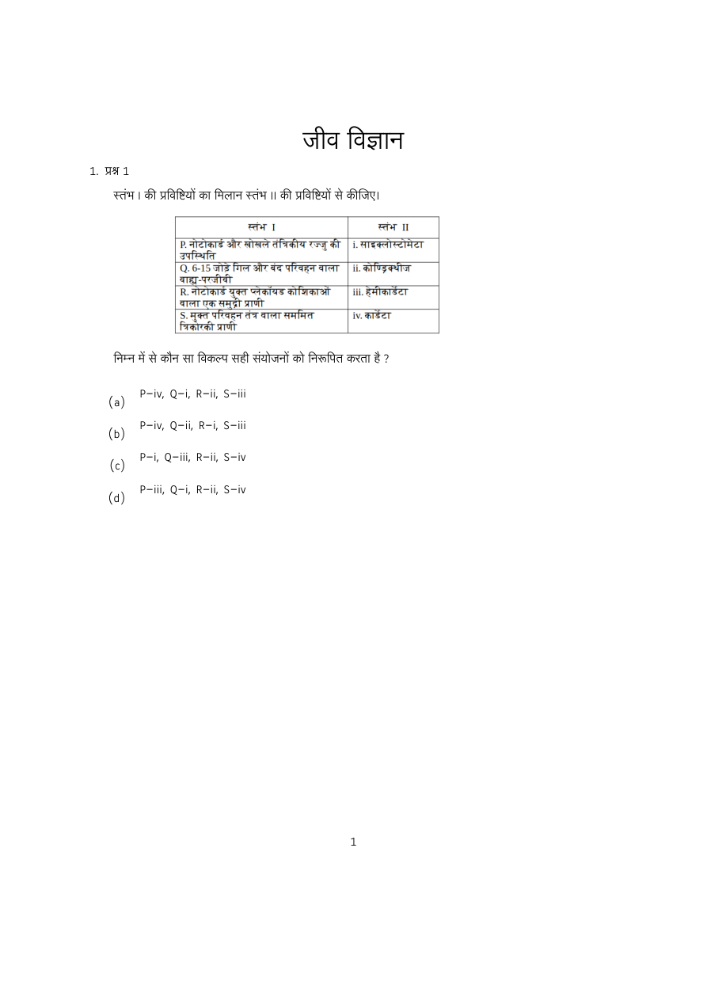

## PDF page 2

[Open original PDF at page 2](../pdf/IAT_2025_Hindi_paper.pdf#page=2)

### Searchable text - OCR draft (hin+eng)

```text
2. प्रश्न 2

गुणसूत्रों का वर्गीकरण निम्न में से किस संरचना के स्थान के अनुरूप मध्यकेंद्री, उपमध्यकेंद्री,
अग्रबिंदु तथा अंतर्केद्री रूपों में किया गया है ?

(9) PERS
(७) Tear
(c) तारककेंद्र

टीलोमीयर
```

### Original page image

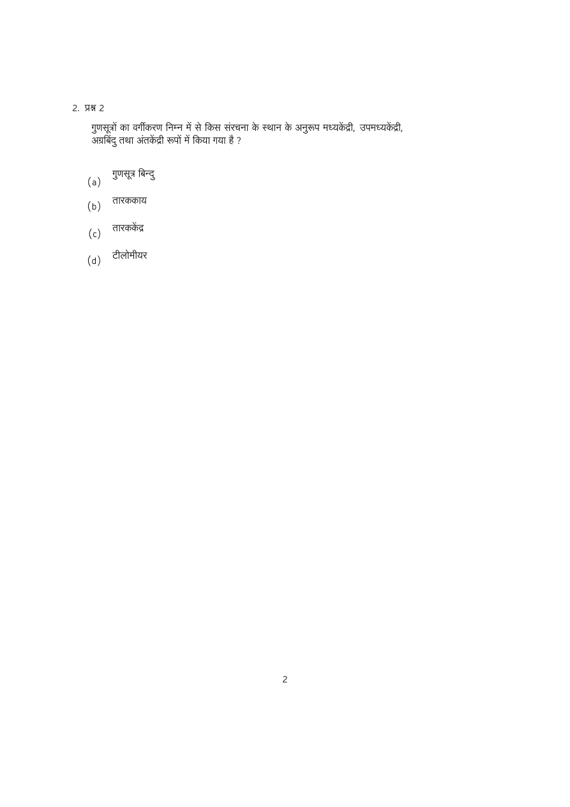

## PDF page 3

[Open original PDF at page 3](../pdf/IAT_2025_Hindi_paper.pdf#page=3)

### Searchable text - OCR draft (hin+eng)

```text
3. प्रश्न 3
निम्न में से कौन सा कथन ट्राइग्लिसराइड की व्याख्या करता है ?
(a) ग्लिसरॉल के एक अणु से वसीय अम्लों की तीन श्रृंखलाएं जुड़ी होती हैं |
a

(७) वसीय अम्ल की एक श्रृंखला से ग्लिसरॉल के तीन ary GS होते हैं ।

कोलेस्ट्राल के एक अणु से संतृप्त वसीय अम्लों की तीन श्रृंखलाएं जुड़ी होती हैं |

(०)

(०) ग्लिसराइड के तीन अणु फॉस्फोलिपिड के एक अणु से जुड़े होते है |
```

### Original page image

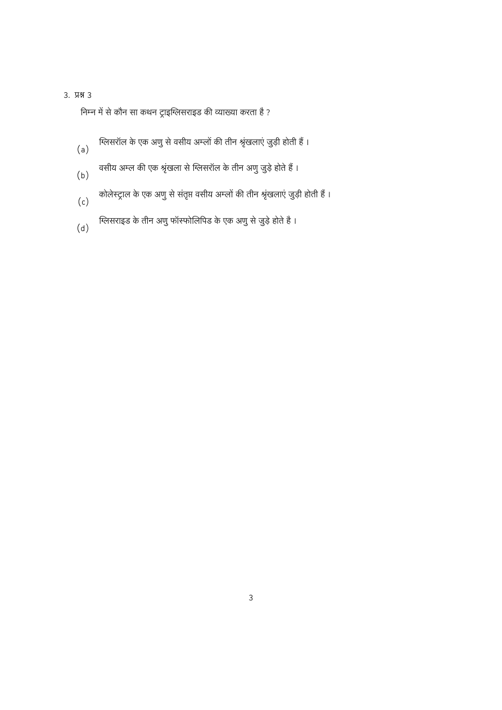

## PDF page 4

[Open original PDF at page 4](../pdf/IAT_2025_Hindi_paper.pdf#page=4)

### Searchable text - OCR draft (hin+eng)

```text
4. प्रश्न 4
निम्न में से कौन सा कथन पादप कैरोटिनॉयड के संदर्भ मे असत्य है ?

(a) यह एक सहायक वर्णक है जो 600 -700 nm तरंग-दैर्घ्य वाले प्रकाश का अवशोषण करता है।
यह क्लोरोफिल-9 की सुरक्षा प्रकाश-ऑक्सीकरण से करता है |
यह पौधों में तनाव हॉर्मोन के संश्लेषण के लिए पूर्ववर्ती का कार्य करता है ।

फलों के परिपक्वन के दौरान यह वर्णी-लवकों में एकत्रित हो जाता है |
```

### Original page image

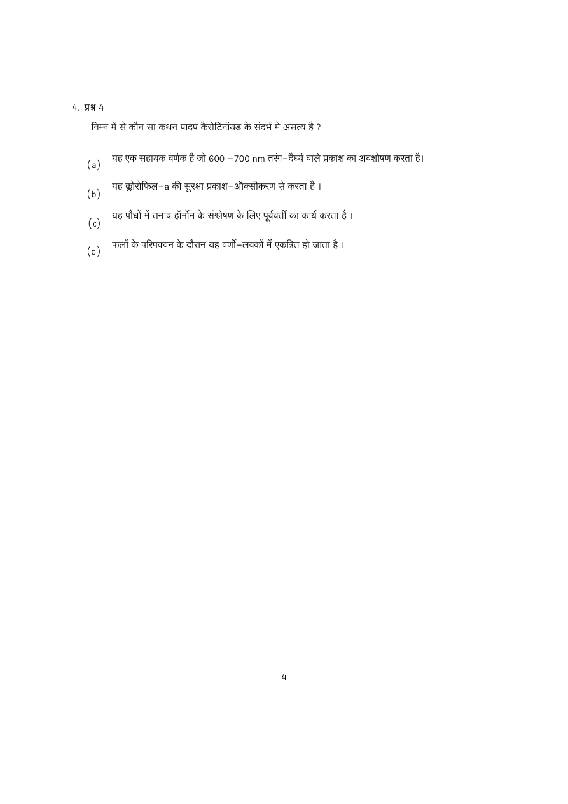

## PDF page 5

[Open original PDF at page 5](../pdf/IAT_2025_Hindi_paper.pdf#page=5)

### Searchable text - OCR draft (hin+eng)

```text
5. प्रश्न 5

सक्रिय-रूप से ध्वसन कर रहे सूत्रकणिकाओं वाली कोशिकाओं के एक निलम्ब को रसायन » से
उपचारित (प्रयोग 2), a7 रसायन ५ से उपचारित (प्रयोग 2), या अनुपचारित रखकर (प्रयोग 3)
प्रयोग किए गए ।

रसायन x विशिष्ट-रूप से संकुल | (कोम्प्लेक्स |) से ग्रबिक्विनोन तक इलेक्ट्रान परिवहन को
संदमित करता है जबकि रसायन ५ संकुल ॥ (कोम्प्लेक्स ॥) से साइटोक्रोम ८ तक इलेक्ट्रान
परिवहन को संदमित करता है |

निम्न में से कौन सा विकल्प इन प्रयोगों में संश्लेषित arp अणुओं की तुलनात्मक संख्याओं के
सही क्रम को निरुपित करता है ?

(a) प्रयोग 2 < Wart < प्रयोग 3
(७) प्रयोग  < प्रयोग 2 < प्रयोग 3
(c) प्रयोग 4 = प्रयोग 2 = प्रयोग 3

(a) प्रयोग 2 < प्रयोग . = प्रयोग 3
```

### Original page image

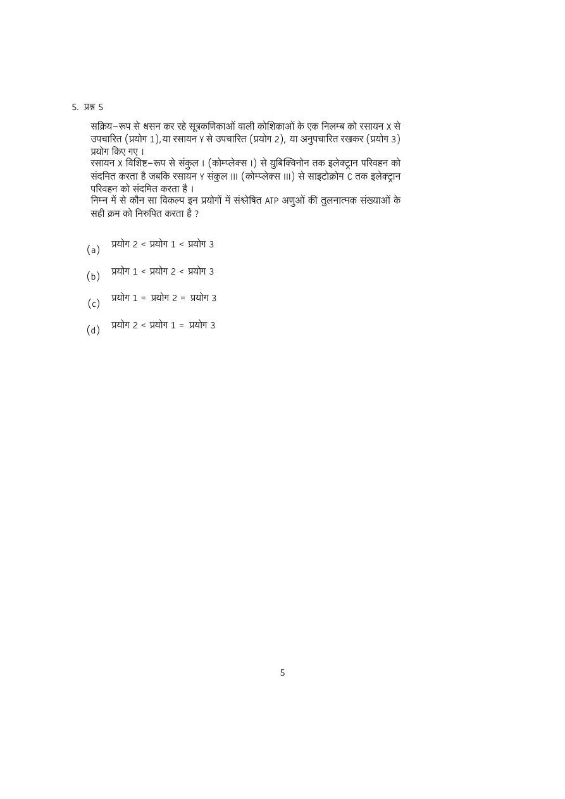

## PDF page 6

[Open original PDF at page 6](../pdf/IAT_2025_Hindi_paper.pdf#page=6)

### Searchable text - OCR draft (hin+eng)

```text
6. प्रश्न 6

यदि केशिका-गुच्छीय Preece दर घट जाती है तो gent में कौन सी स्वतः-नियमित क्रियाविधि
सुचारु हो जाती है ?

रेनिन, एंजियोटेंसिन | और ॥ एवं एल्डोस्टीरॉन के स्तरों में वृद्धि |
रेनिन और एल्डोस्टीरॉन के स्तरों में कमी ।
रेनिन के स्तर में वृद्धि, जबकि एंजियोटेंसिन | और ॥ एवं एल्डोस्टीरॉन के स्तरों में कमी |

एंजियोटेंसिन | और ॥ के स्तरों में वृद्धि एवं एल्डोस्टीरॉन के स्तर मे कमी |
```

### Original page image

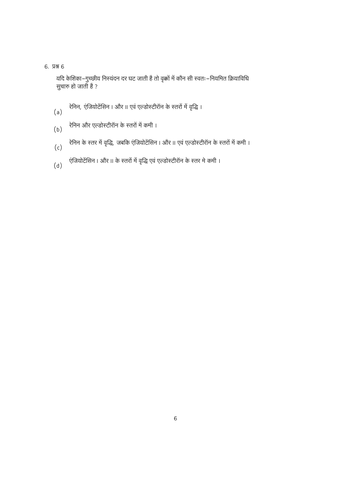

## PDF page 7

[Open original PDF at page 7](../pdf/IAT_2025_Hindi_paper.pdf#page=7)

### Searchable text - OCR draft (hin+eng)

```text
उ. प्रश्न 7

निम्न में से कौन सी दशा उत्तकों में ऑक्सीहीमोग्लोबिन से ऑक्सीजन के अधिकतम वियोजन
की पक्षधर होगी ?

उच्च [Ht], उच्च तापमान
(9)

उच्च [Ht], a तापमान

(७)

न्यून [H+], उच्च तापमान

(०)

ae [H+], न्‍्यून तापमान

(५)
```

### Original page image

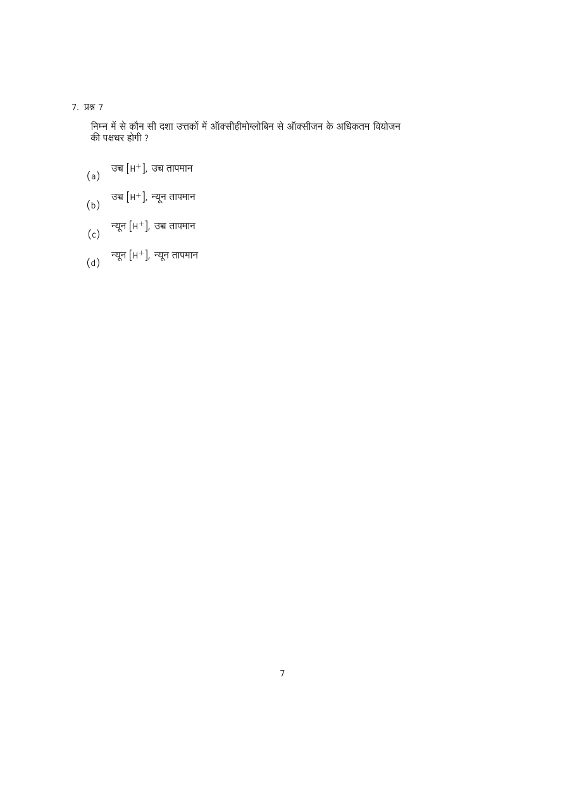

## PDF page 8

[Open original PDF at page 8](../pdf/IAT_2025_Hindi_paper.pdf#page=8)

### Searchable text - OCR draft (hin+eng)

```text
8. प्रश्न 8
निम्नलिखित में से कौन सा कथन सही है ?

(a) सामनय ओक्सिजन परिस्थिति में लाल पेशी रेशे ATP का उत्पादन वायुजीवी-रूप से करते हैं |
a

लाल पेशी रेशों की तुलना में श्वेत पेशी रेशों में सूत्ररणिकाओं की अधिकता होती है ।

समान परिस्थितियों में Act पेशी रेशों की तुलना में लाल पेशी रेशों में लैक्टिक अम्ल का एकत्रण
(c) अधिक होता है |

सभी प्रकार के पेशी रेशे ATP का उत्पादन प्रमुखतः वायुजीवी-रूप से करते हैं |
```

### Original page image

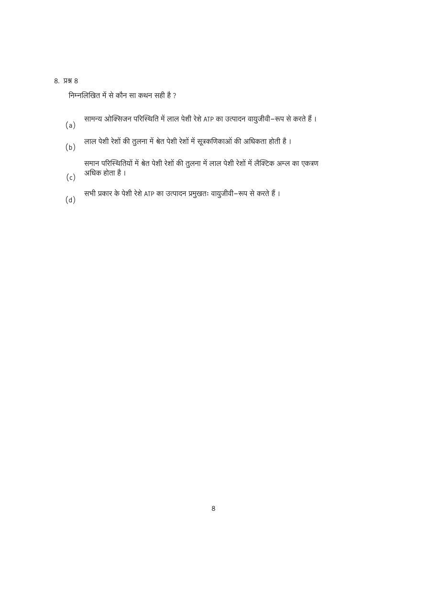

## PDF page 9

[Open original PDF at page 9](../pdf/IAT_2025_Hindi_paper.pdf#page=9)

### Searchable text - OCR draft (hin+eng)

```text
9. प्रश्न 9

निम्न में से कौन सा जीव अयुग्मित/अगुणित कोशिकाओं के समसूत्री विभाजन से मादा युग्मक
उत्पन्न करता है ?

मीठी/उद्यान-मटर
(9)

() मधुमक्खी

फल Herel (He BIS)
(c) हि

मुर्गी
(a) 3
```

### Original page image

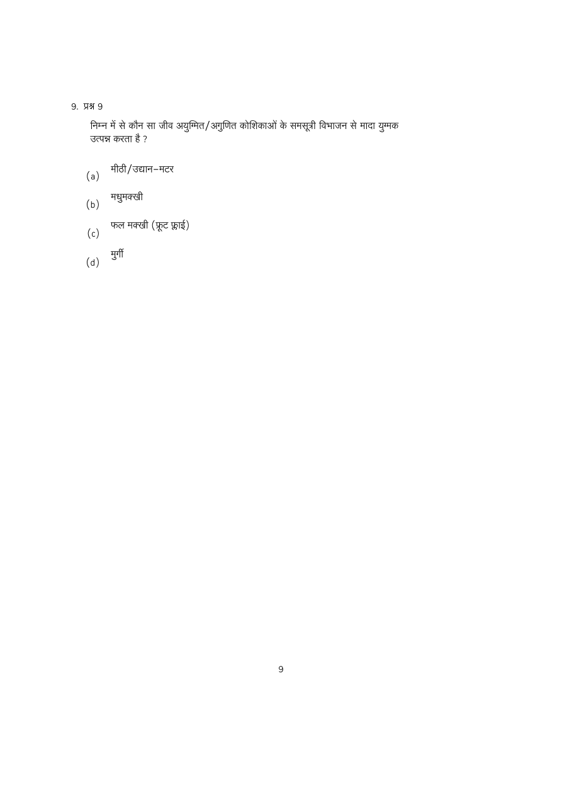

## PDF page 10

[Open original PDF at page 10](../pdf/IAT_2025_Hindi_paper.pdf#page=10)

### Searchable text - OCR draft (hin+eng)

```text
0. W420

5/-GUU-3' प्रति-प्रकूट वाले tRNA पर कौन सा अमीनो अम्ल आवेशित होगा ?

एस्पैराजीन ( प्रकूट AAC)

(a)

(७) वैलीन ( प्रकूट 600)

wis (प्रकूट UG)
(०)

ग्लुटामीन ( WRC CAA
(a) © ( प्रकूट CAA)

i0
```

### Original page image

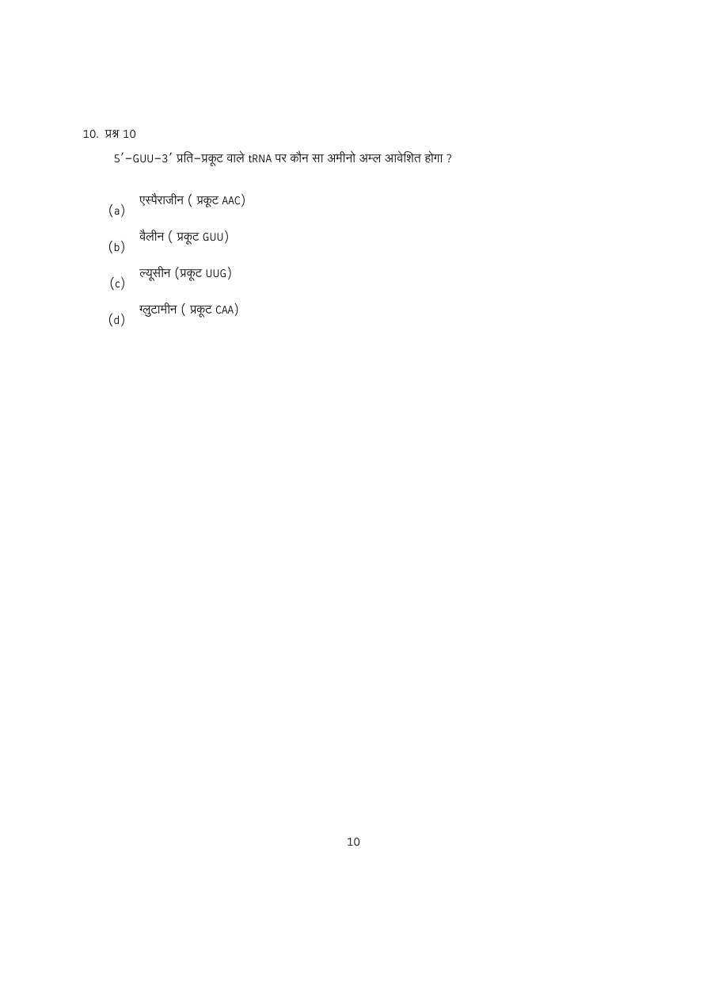

## PDF page 11

[Open original PDF at page 11](../pdf/IAT_2025_Hindi_paper.pdf#page=11)

### Searchable text - OCR draft (hin+eng)

```text
]7. प्रश्न 4]

अज्ञात जीन-प्रारूप वाले दो विशुद्ध-प्रजनित जनकों से व्युत्पन्न दो द्वि-विषमयुग्मजी पौधों
(PpQq) ने नीचे दर्शाए गए अनुपात मे युग्मकों को उत्पन्न किया।

@RI XGR2 @R3 XS R4
Fl PpQq Fl PpQq
35% pQ, 35% Pa, 35% PQ, 35% pq,
5% PQ, 5% pq 5% pQ, 5% Pq

निम्न में से कौन सा विकल्प जनकों के सही जीन-प्रारूप को दर्शाता है ?

रि] = ppQQ; R2 = PPqq; R3 = PPQQ; १4 5 004१

(a)
(b) रि]र = PPQQ; R2= ppqq; R3 = ppQQ; R4 = PPaqq
(c) रितर = ppQQ; R2 = PPqq; R3 = PPqq; R4= ppQQ

Pl = PPQQ; P2 = ppqq; P3 = ppqq; P4 = PPQQ

वव
```

### Original page image

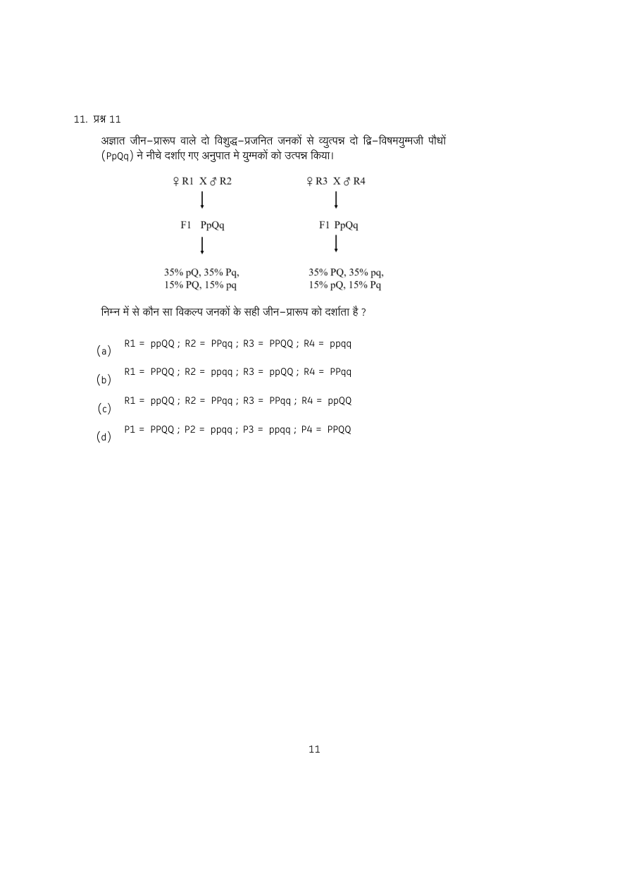

## PDF page 12

[Open original PDF at page 12](../pdf/IAT_2025_Hindi_paper.pdf#page=12)

### Searchable text - OCR draft (hin+eng)

```text
2. WH 2
निम्नलिखित में से कौन सा कथन पश्चविषाणुओं (रेट्रो-विषाणुओं) के संदर्भ में सही है 2
(a) विषाणुओं का एक समूह जिनमें RNA जीनोम है और रिवर्स-ट्रांसक्रिप्टेज क्रियाशील है |
a

(७) विषाणुओं का एक समूह जिनमें ONA जीनोम है परंतु रिवर्स-ट्रांसक्रिप्टेज क्रियाशील नहीं है |

विषाणुओं का एक समूह जिनमें ONA जीनोम है और रिवर्स-ट्रांसक्रिप्टेज क्रियाशील है |

(०)

(०) विषाणुओं का एक समूह जिनमें RNA जीनोम है परंतु रिवर्स-ट्रांसक्रिप्टेज क्रियाशील नहीं है |

i2
```

### Original page image

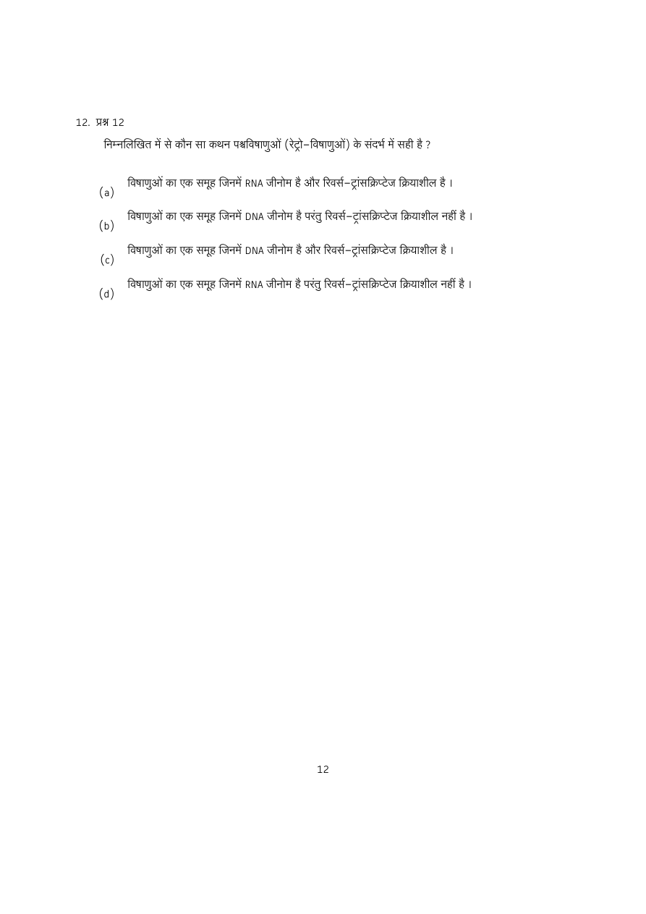

## PDF page 13

[Open original PDF at page 13](../pdf/IAT_2025_Hindi_paper.pdf#page=13)

### Searchable text - OCR draft (hin+eng)

```text
3. WH 33

नीचे दिया गया चित्र किसी प्लाज्मिड को प्रतिबंधन एंजाइमों x, या ५, atx और ५ दोनों से पाचित
कर, उन नमूनों के एगैरोज जेल वैद्युतसंचलन के उपरांत प्राप्त हुआ ।

x X+Y Y

Pe meee Sb
— > 3kb

+ 2kb

नीचे दिये गये चित्रों में से कौन सा चित्र इस 0,000 bp प्लाज्मिड पर इन प्रतिबंधन एंजाइमों
के स्थानों (x, ५) को सही रूप से निरूपित करता है?

xX | Y
(9235 bp) # (4235 bp)
७
Y xX
(6235 bp) (4235 bp)
(a)
X =) Y

(9235 bp) /* (4235 bp)
( plAT25

@
X Y
(6235 bp) (4235 bp)

i3
```

### Original page image

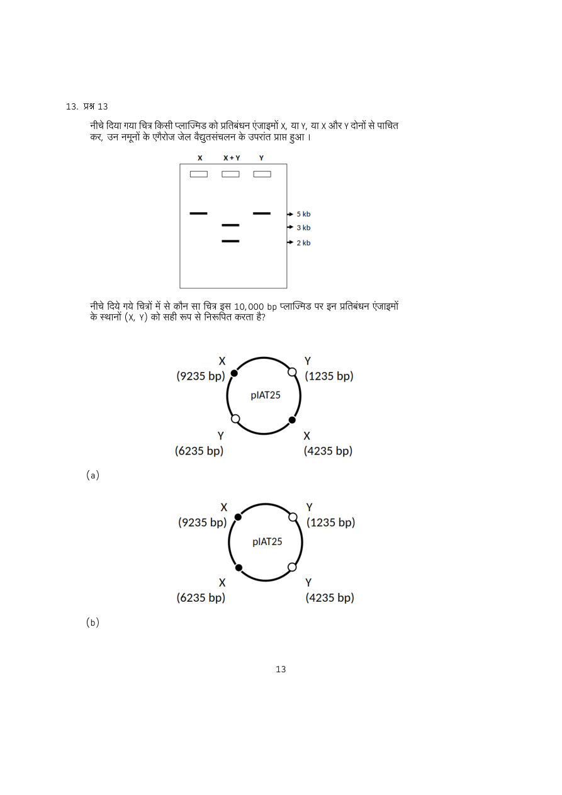

## PDF page 14

[Open original PDF at page 14](../pdf/IAT_2025_Hindi_paper.pdf#page=14)

### Searchable text - OCR draft (hin+eng)

```text
(9235 bp) # (4235 bp)
Le)
Y Y
(6235 bp) (4235 bp)

4
```

### Original page image

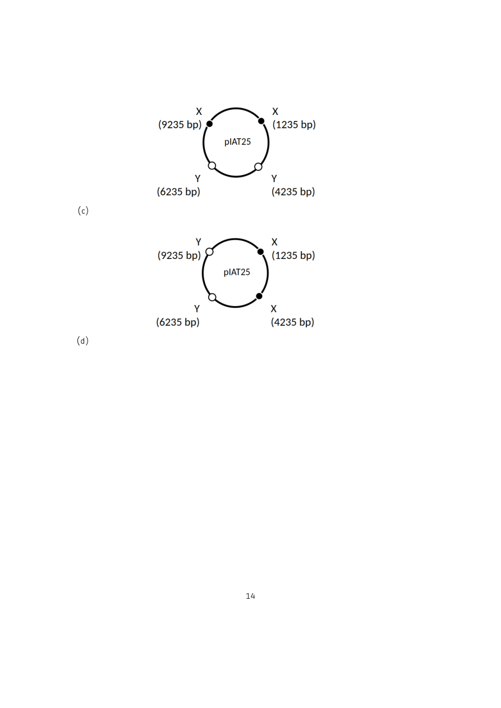

## PDF page 15

[Open original PDF at page 15](../pdf/IAT_2025_Hindi_paper.pdf#page=15)

### Searchable text - OCR draft (hin+eng)

```text
4, 5H I4
मधुमक्खियों में नर अगुणित और मादा द्वि-गुणित होते हैं | मधुमक्खियों के संदर्भ में निम्नलिखित
में से कौन सा कथन असत्य है ?
(a) मधुमक्खियों के नर पुत्र उत्पन्न कर सकते हैं पर पुत्री नहीं ।
मधुमक्खियों के नर अनिषेचित अंडों से और मादाएं निषेचित sist से उत्पन्न होते हैं |
मधुमक्खियों के नर के पितामह तो होते हैं पर पिता नहीं |

मधुमक्खियों के नर समसूत्री विभाजन से और मादाएं अर्धसूत्री विभाजन से युग्मक उत्पन्न करते
है।

a5
```

### Original page image

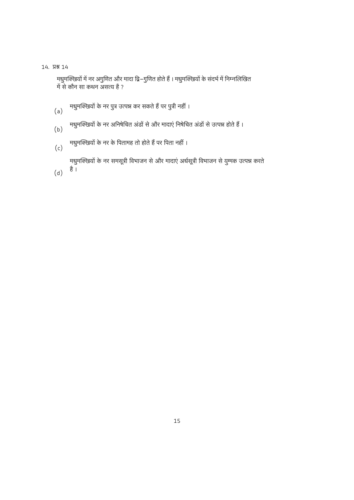

## PDF page 16

[Open original PDF at page 16](../pdf/IAT_2025_Hindi_paper.pdf#page=16)

### Searchable text - OCR draft (hin+eng)

```text
45. प्रश्न 5
निम्नलिखित में से कौन सा कथन असत्य है ?

पृथ्वि पर आपतित सौर-ऊर्जा का 80 % से अधिक भाग पौधों और प्रकाश-संश्लेषी जीवाणुओं
(७) आरा ग्रहण कर लिया जाता है |

किसी चरवाही खाद्य श्रृंखला के प्रत्येक पोषण स्तर की ऊर्जा का मात्र 0 % अगले पोषण स्तर
को स्थानांतरित होता है |

किसी पोषण स्तर की ऊर्जा की मात्रा के मापन के लिये उस पोषण स्तर के सभी जीवों को
सम्मिलित करना चहिए |

सभी पारितंत्री RRS में ऊर्जा का प्रवाह एक-दिशायी होता है |

i6
```

### Original page image

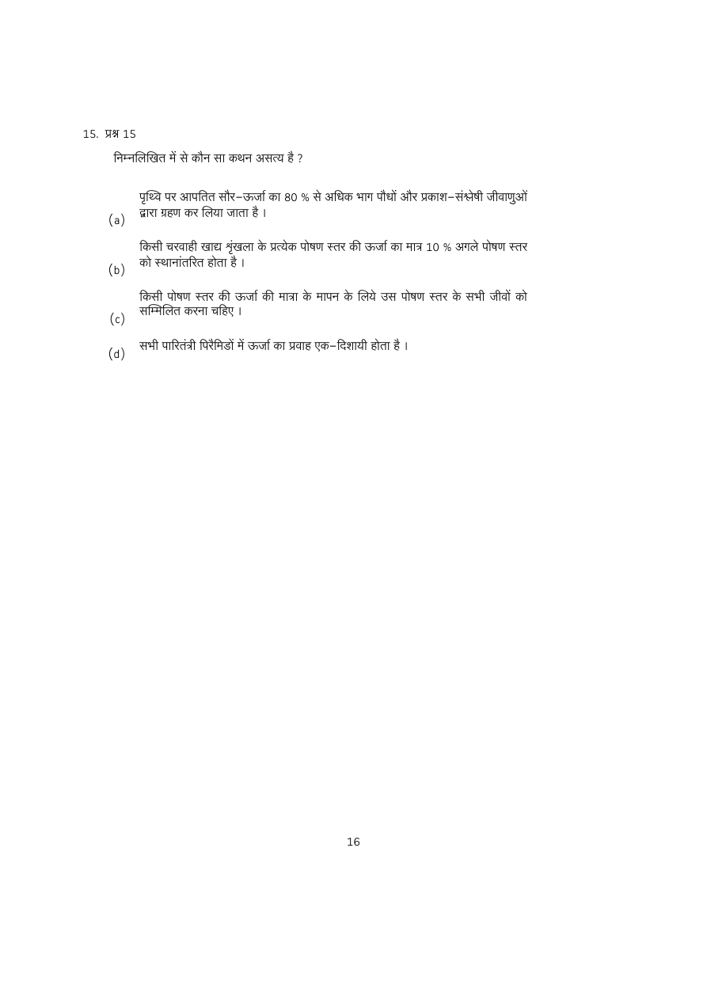

## PDF page 17

[Open original PDF at page 17](../pdf/IAT_2025_Hindi_paper.pdf#page=17)

### Searchable text - OCR draft (hin+eng)

```text
रसायन विज्ञान

l. Wal

निम्नलिखित में से कौन सा कथन 270 और cao की अम्लीयता/क्षारीयता/उभयधर्मिता की
सटीक व्याख्या करता है?

(a) 2 0 उभयधर्मी है और ८४0 क्षारीय है।
(७) 2 0 क्षारीय है और cao उभयधर्मी है।

० 0 और cao दोनों उभयधर्मी हैं।

(a) ZnO अम्लीय है और ८०० क्षारीय है।
```

### Original page image

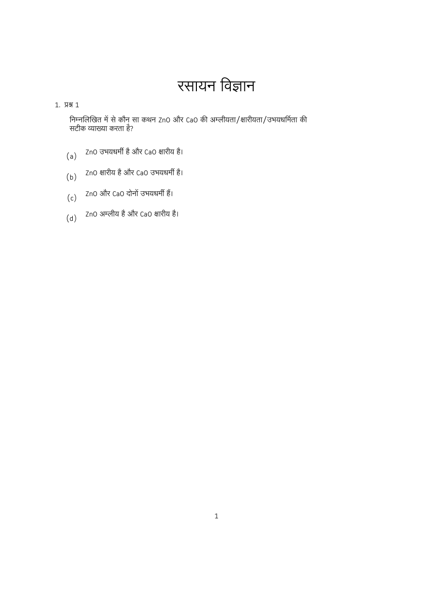

## PDF page 18

[Open original PDF at page 18](../pdf/IAT_2025_Hindi_paper.pdf#page=18)

### Searchable text - OCR draft (hin+eng)

```text
2. प्रश्न 2

निम्नलिखित प्रक्रियाओं में से कौन सी आबंध-कोटि में वृद्धि से सम्बन्ध रखती है/हैं, परन्तु
उनके प्रतिचुम्बकीय या अनुचुम्बकीय व्यव्हार में कोई परिवर्तन नहीं होता है ?

(i) No + Not + ९7

(ii) 03 + Oot + em
(iii) Og + e7 4 027
(a) केवल (ii)
(७) (i) तथा (ii)
(c) (ii) तथा (iii)
(a) केवल (iii)
```

### Original page image

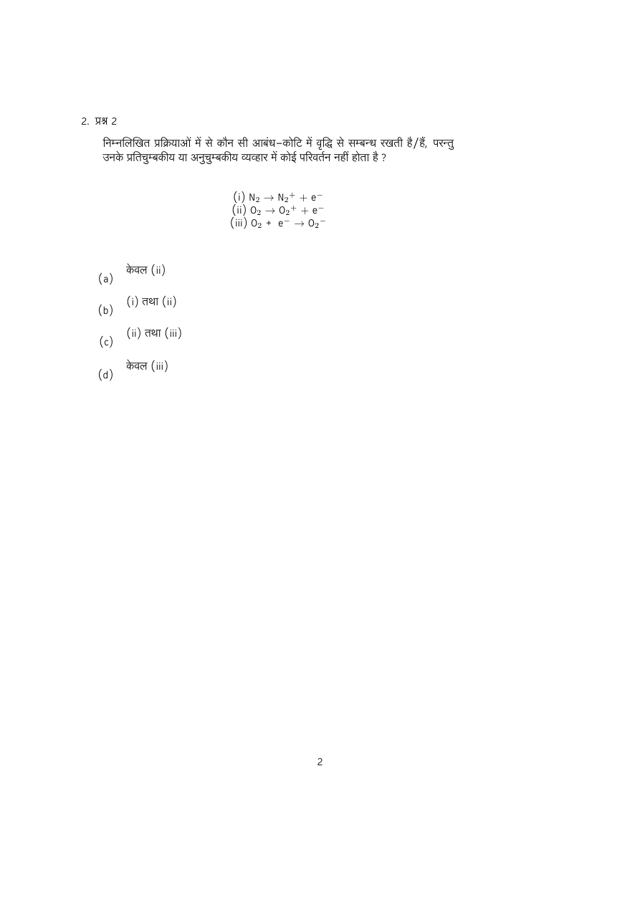

## PDF page 19

[Open original PDF at page 19](../pdf/IAT_2025_Hindi_paper.pdf#page=19)

### Searchable text - OCR draft (hin+eng)

```text
3. प्रश्न 3

770 (7९३+ /Fe®) का मान क्या होगा?
[मानक अपचयन विभव 80(+#९४+ /Fe2+) = 0.77 ४ और B(Fe?+/Fe°) = -0.44 ४
प्रदत्त है]

(a) -0.04V
(b) 0.33 ४
(c) 0. ४

(०0) 7 0.lV
```

### Original page image

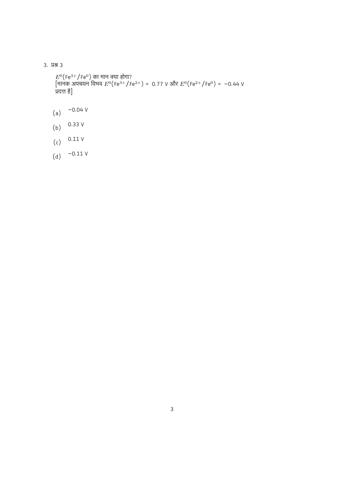

## PDF page 20

[Open original PDF at page 20](../pdf/IAT_2025_Hindi_paper.pdf#page=20)

### Searchable text - OCR draft (hin+eng)

```text
4. प्रश्न 4
निम्नलिखित यौगिकों के स्थायित्व का सही क्रम कया होगा?

६ > ४०७६; ८७०७० > Culg

(9)

५४७८६ > ४६; ९७९७७ > ९७॥३
(७) 5 > VF5 7 ५५४४ > ५७०2

४८६ > ४६5; Culg > CuClo
(०)

VF5 > ४८७६ ; Cul > CuClo
(०) 5 > ४४६; ५४२ > ५७५०
```

### Original page image

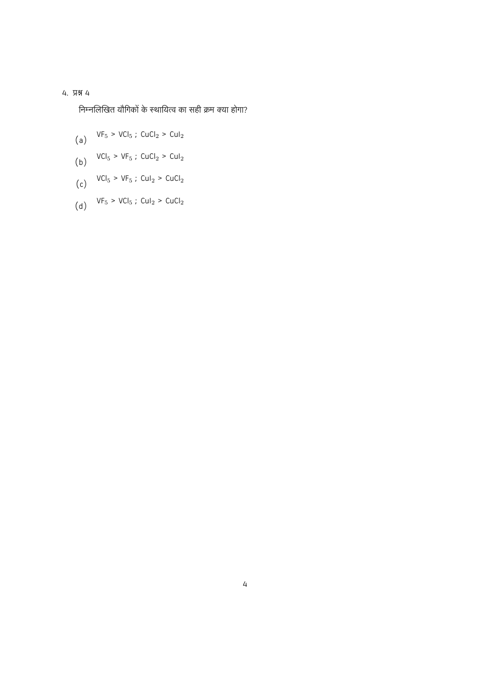

## PDF page 21

[Open original PDF at page 21](../pdf/IAT_2025_Hindi_paper.pdf#page=21)

### Searchable text - OCR draft (hin+eng)

```text
5. प्रश्न 5
नीचे दर्शायी अभिक्रिया योजना पर विचार करें।

concentrated NH; solution

(excess)
CrCl,-6H,O Q
(P)
excess AgNO, | [exces AgNO;
4 mole AgCl 3 moles AgCl
precipitated precipitated
per mole of P per mole of Q
निम्नलिखित में से कौन सा कथन सही है?

ए ज्यामितीय समावयवता दर्शाता है तथा Q की अपेक्षा में उच्च्तर तरंगदैर्घ्य का प्रकाश अवशोषित
(७) ऊरता है।

P और Q दोनों ज्यामितीय समावयवता दश्शाते हैं तथा Q की अपेक्षा में 7 उच्च्तर तरंगदैर्घ्य
(७) की प्रकाश अवशोषित करता है |

Q ज्यामितीय समावयवता दर्शाता है तथा 7 से उच्च्तर तरंगदैर्घ्य का प्रकाश अवशोषित करता
है।

P ज्यामितीय समावयवता दर्शाता हैं तथा ७ की अपेक्षा में निम्नतर तरंगदैर्घ्य का प्रकाश
(a) अवशोषित करता है |
```

### Original page image

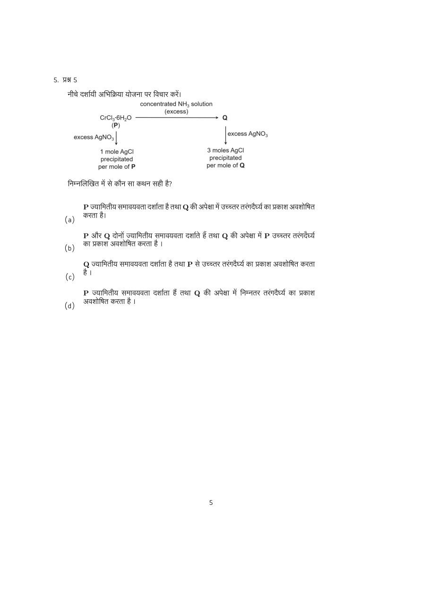

## PDF page 22

[Open original PDF at page 22](../pdf/IAT_2025_Hindi_paper.pdf#page=22)

### Searchable text - OCR draft (hin+eng)

```text
6. प्रश्न 6

2-मेथिल-3-फेनिल-पेन्ट--एल (2—-methyl-3-phenyl—pentan--al) में कितने
#-हाइड्रोजेन हैं?

(a) “
(b) 7
() 3
(a)?
```

### Original page image

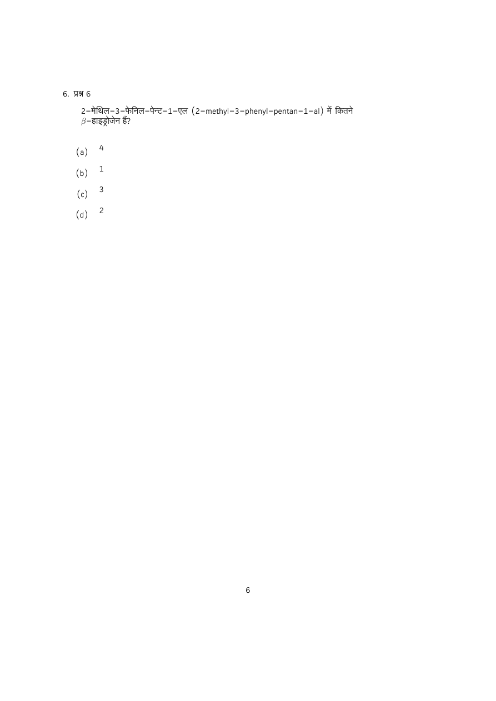

## PDF page 23

[Open original PDF at page 23](../pdf/IAT_2025_Hindi_paper.pdf#page=23)

### Searchable text - OCR draft (hin+eng)

```text
7. प्रश्न 7
निम्न में से किस अभिक्रिया का उत्पाद ऐल्डिहाइड नहीं होता है?

0

o Ko, (CetiscHe).ca
Z
(a)
°
oO oy —_PdeBaSOulHa
ea

(७)

(or CN (i) SnClz, HCl

A
(c)
CH
O 3... (0) 00:0७, 082
>
NZ (ii) Hy 02

(५)
```

### Original page image

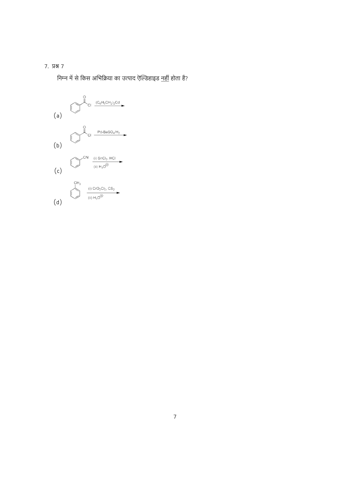

## PDF page 24

[Open original PDF at page 24](../pdf/IAT_2025_Hindi_paper.pdf#page=24)

### Searchable text - OCR draft (hin+eng)

```text
8. प्रश्न 8

निम्न अभिक्रिया क्रम से कौन से प्रमुख उत्पाद बनते हैं ?

(i) 03
Pry Hs _ (5४४४०
CHg (iii) PhMgBr (excess of 2 equivalents)

(iv) 30°

OH

H3C._CH,CH3
(2) शाप and pn Son
a
OH O H,C. (CH2CH
जाट ts and a,
(b)
OH
HyC. CH,CH,
and
20८0 pron
(c)
ae HyC._CH>CHs
(w) pron Mp Son
```

### Original page image

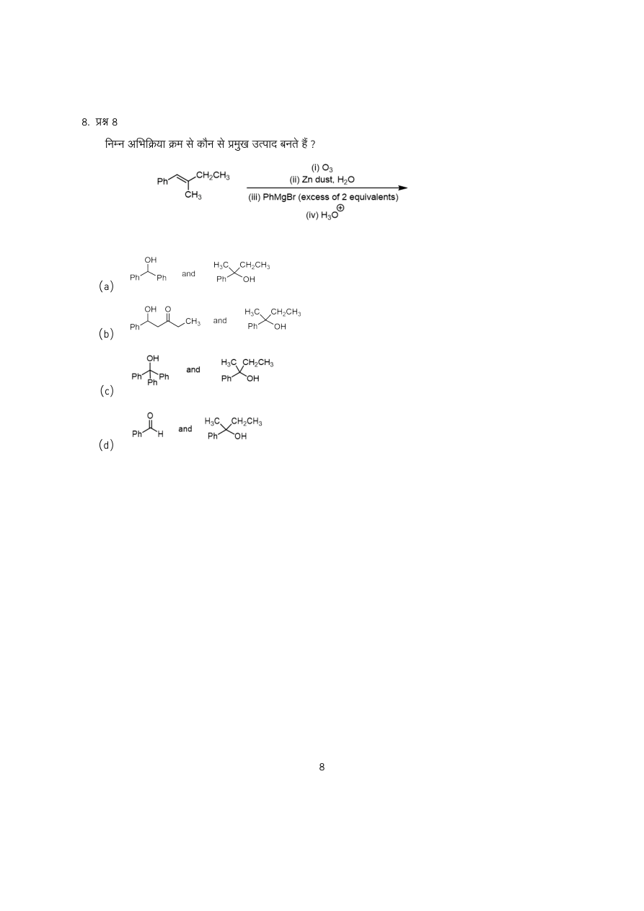

## PDF page 25

[Open original PDF at page 25](../pdf/IAT_2025_Hindi_paper.pdf#page=25)

### Searchable text - OCR draft (hin+eng)

```text
9. प्रश्न 9

निम्न अभिक्रिया क्रम से प्राप्त प्रमुख उत्पाद क्या होगा?

(i) DIBAL-H (4 equivalent)

(ili) Zn-Hg/conc. HCI

(a) शा ~~cH;
Pho

(b)

() ph NH

Cc

(०) शीट 20
```

### Original page image

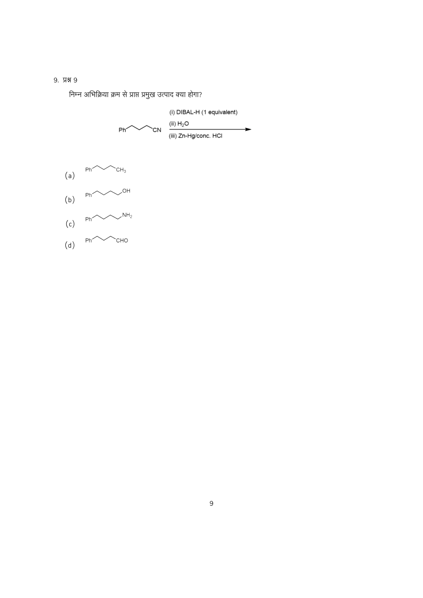

## PDF page 26

[Open original PDF at page 26](../pdf/IAT_2025_Hindi_paper.pdf#page=26)

### Searchable text - OCR draft (hin+eng)

```text
0. प्रश्न 30

यौगिक I की हाइड्रोबोरेशन-ऑक्सीकरण अभिक्रिया (8/3)2 तदोपरांत HO. और जलिय
NaOH से कराने पर एक अन्य यौगिक IL बनता है जिसका Cro, से ऑक्सीकरण करने पर
2, 3-डाईमिथिल साइक़ोहेक्सानोन बनता है। यौगिक I की संरचना क्या है?

CL CH;
CH;
(a)
CH;
Cy CH;
(b)
नरक
H3C
CH;
(c)
H3C. on CH;
(d)

i0
```

### Original page image

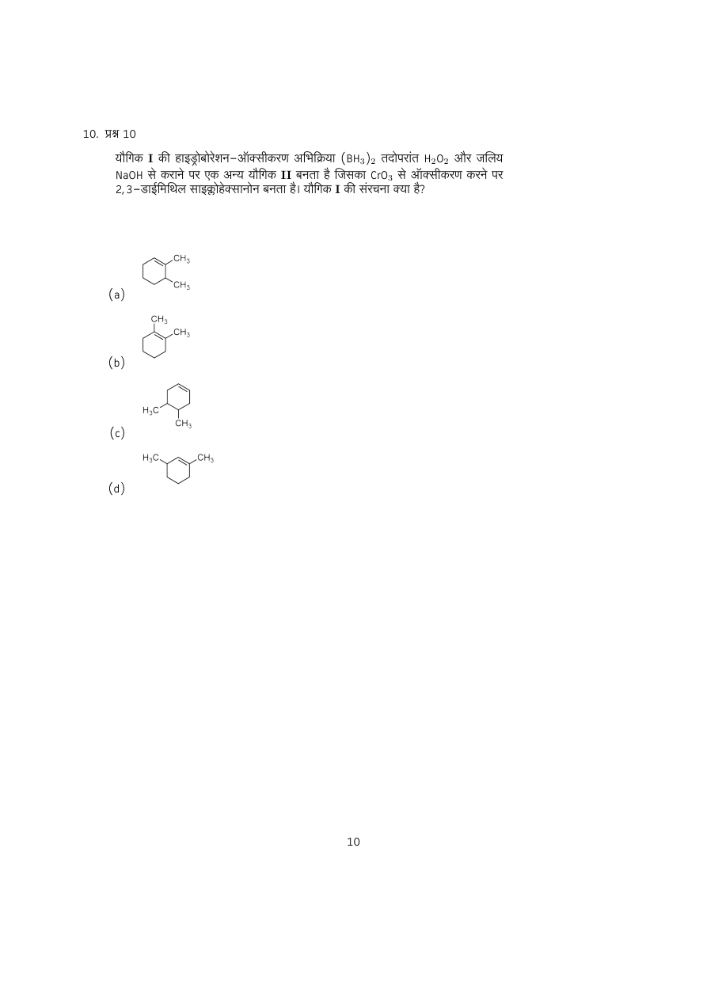

## PDF page 27

[Open original PDF at page 27](../pdf/IAT_2025_Hindi_paper.pdf#page=27)

### Searchable text - OCR draft (hin+eng)

```text
2. 44 2

एक मोल आदर्श गैस को नियत तापमान 7' पर अपने प्रारंभिक आयतन ४ से अंतिम आयतन 2V
तक (आयतन के दो समान चरणों में रैखिय तरीके से) फैलाने में किया गया कार्य evs |
यह गैस यदि तीन समान समान चरणों में फैलती है तो कितना कार्य किया जायेगा?

[R सार्वत्रिक गैस-नियतांक है]

(a) 7
७)
छा
(a) —RT In (रू)

वव
```

### Original page image

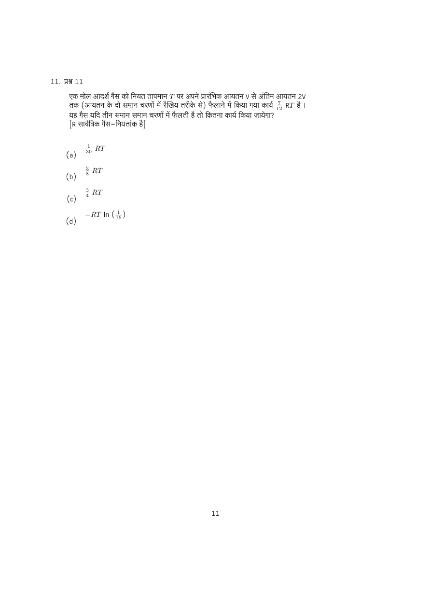

## PDF page 28

[Open original PDF at page 28](../pdf/IAT_2025_Hindi_paper.pdf#page=28)

### Searchable text - OCR draft (hin+eng)

```text
2. W42

किसी विशेष-तापमान पर एक अभिक्रिया का वेग स्थिरांक k = 5 x 0-5 है तथा आर्रेनियस
समीकरण के पूर्व-चरघातांकी गुणक की इकाई mol | 7! min-! Bi निम्न में से कौन सा आलेख
इस अभिक्रिया के लिये सही है?

[नोट: [४] प्रारंभिक सांद्रता तथा typ. इस अभिक्रिया की अर्ध-आयु है]

(2) a
(0) ह "
6 "
(०) कि

i2
```

### Original page image

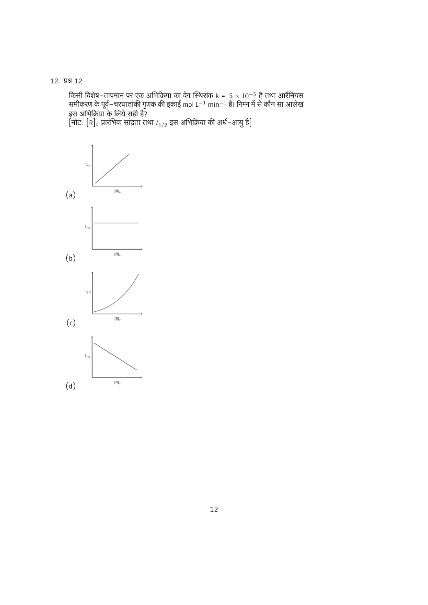

## PDF page 29

[Open original PDF at page 29](../pdf/IAT_2025_Hindi_paper.pdf#page=29)

### Searchable text - OCR draft (hin+eng)

```text
3. WA 33

Het के चौथी बोर कक्षा में उपस्थित एक इलेक्ट्रॉन का चक्रण-काल (time period of rev—
olution) क्या होगा?

[बोर ver = 52.9 पिकोमीटर, इलेक्ट्रॉन का द्रव्यमान = 9. x 0-*! kg, प्लांक स्थिरांक
= 6.626 x 0~*4 Js]

(a) 2.4 फेम्टोसेकंड

(b)
(c) 24 फेम्टोसेकंड

4.8 फेम्टोसेकंड

(a) 024 फेम्टोसेकंड

i3
```

### Original page image

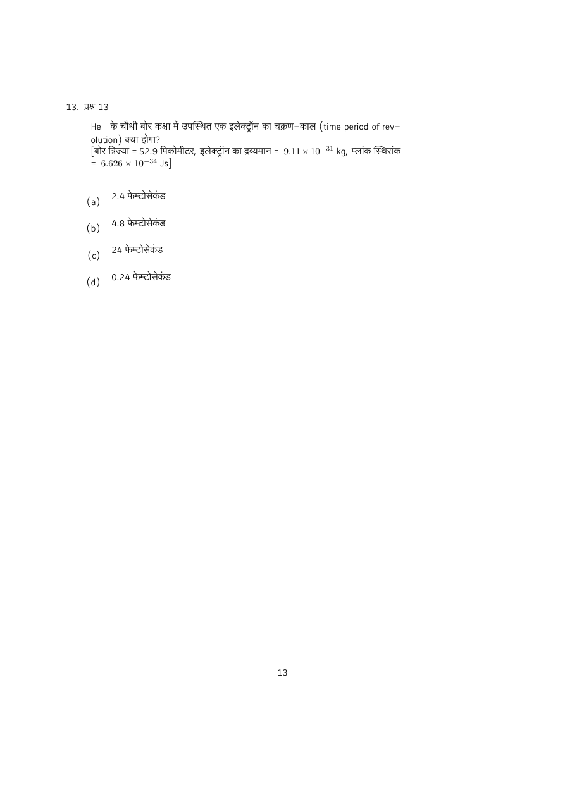

## PDF page 30

[Open original PDF at page 30](../pdf/IAT_2025_Hindi_paper.pdf#page=30)

### Searchable text - OCR draft (hin+eng)

```text
4. WI 4

#883-प्रकार के अणुओं L, LI तथा वा के द्विध्रुव आधघूर्ण का मान क्रमशः 0.0 0, 0.2 0 तथा
L.5D@ | अणुओं L, पर तथा गा की पहचान के विषय में कौन सा विकल्प सही है ?

I: BF3, II: NF3, TIT: NH3
I: BF3, II: NH3, ITI: NF3
I: CIFs, TI: ४४३, TIT: NH3

I: 80, II: NH3, III: NF3

4
```

### Original page image

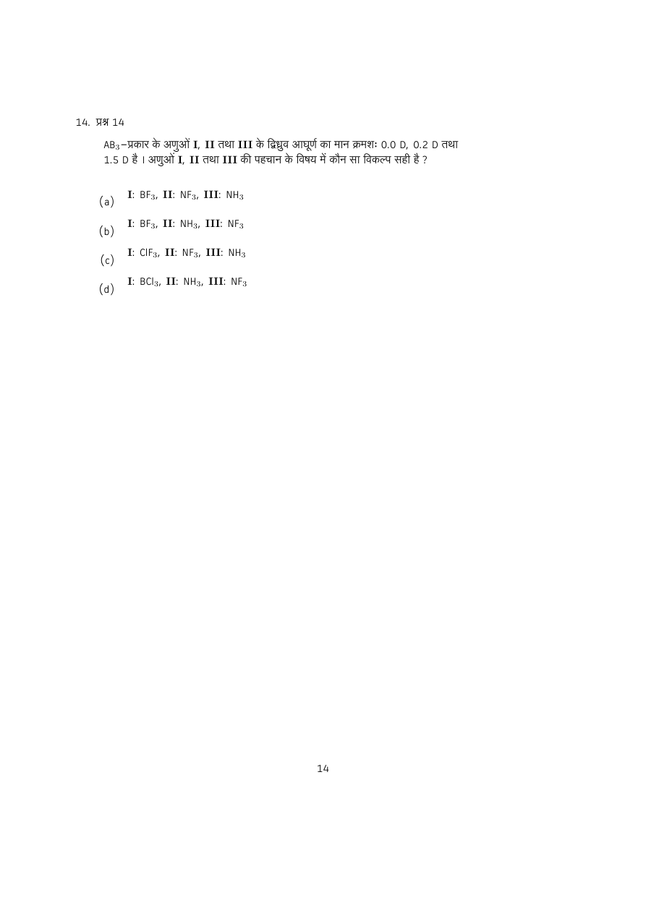

## PDF page 31

[Open original PDF at page 31](../pdf/IAT_2025_Hindi_paper.pdf#page=31)

### Searchable text - OCR draft (hin+eng)

```text
[No text recovered; use the original page image below.]
```

### Original page image

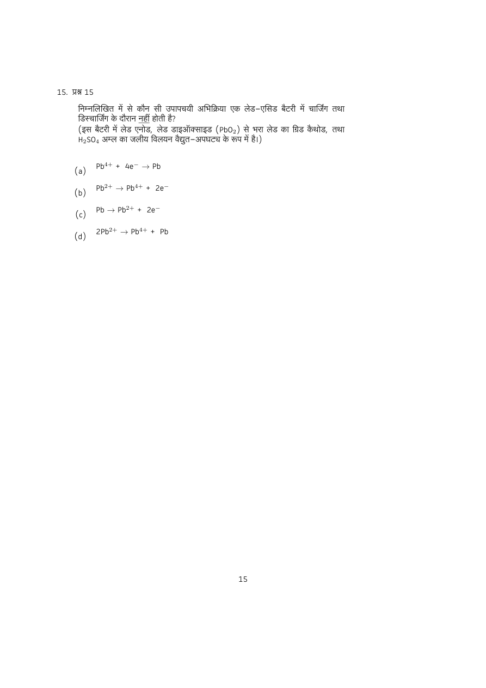

## PDF page 32

[Open original PDF at page 32](../pdf/IAT_2025_Hindi_paper.pdf#page=32)

### Searchable text - OCR draft (hin+eng)

```text
[No text recovered; use the original page image below.]
```

### Original page image

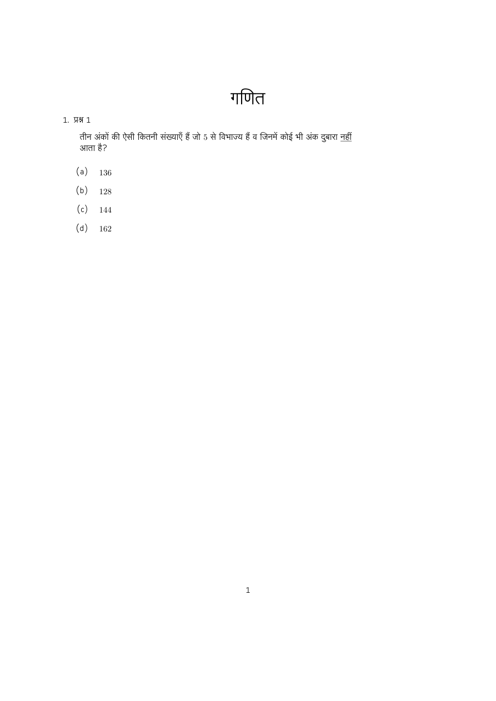

## PDF page 33

[Open original PDF at page 33](../pdf/IAT_2025_Hindi_paper.pdf#page=33)

### Searchable text - OCR draft (hin+eng)

```text
2. प्रश्न 2
यदि A वास्तविक संख्याओं का निम्नलिखित 3 x 3-आव्यूह है

4 ना cosa
न 5a 25 [-
a+. 25 7

तो » के ऐसे कितने मान हैं जिनके लिए आव्यूह A सममित है?

A=

(a) 4
(b) 2
(c) 4
(d) अनंत
```

### Original page image

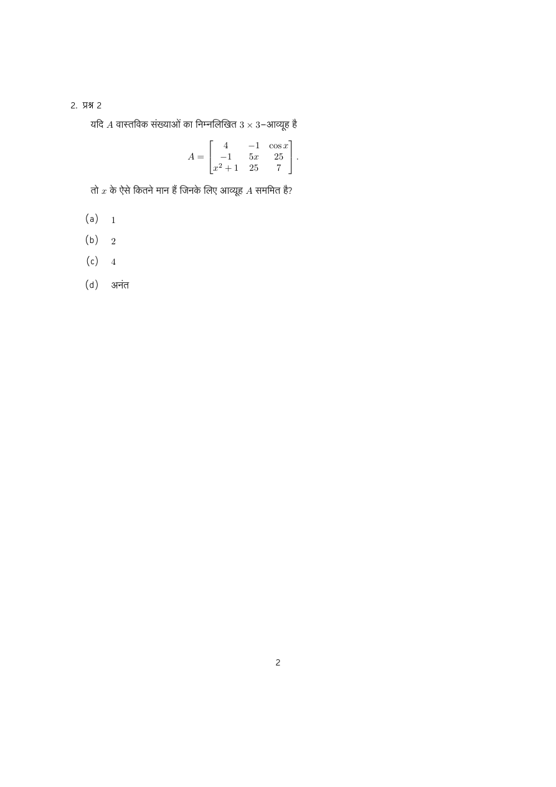

## PDF page 34

[Open original PDF at page 34](../pdf/IAT_2025_Hindi_paper.pdf#page=34)

### Searchable text - OCR draft (hin+eng)

```text
3. प्रश्न 3

मान लीजिए कि # = $°(-i)" °C, (

40

r=0

सत्य है?

(a) # संख्या 5 से विभाज्य है
(७) # संख्या 6 से विभाज्य है
(०) #» संख्या 8 से विभाज्य है
(०५) # संख्या 9 से विभाज्य है

202

3

) है 32" है। निम्नलिखित में से कौन सा कथन
```

### Original page image

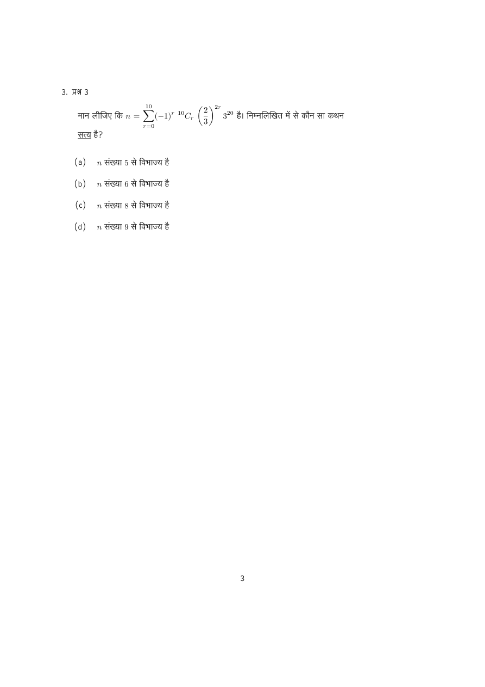

## PDF page 35

[Open original PDF at page 35](../pdf/IAT_2025_Hindi_paper.pdf#page=35)

### Searchable text - OCR draft (hin+eng)

```text
4. प्रश्न 4

wert f:R -> R@® f(x) = cos(tan! x) से परिभाषित कीजिए। निम्नलिखित में से
कौन सा कथन सत्य है?

(a) ४ > 0 के लिए फ़लन / हासमान है
(७) » < 0 के लिए फ़लन / हासमान है
(८) RWW / हासमान है

(५) अंतराल (—, ) पर फ़लन / हासमान है
```

### Original page image

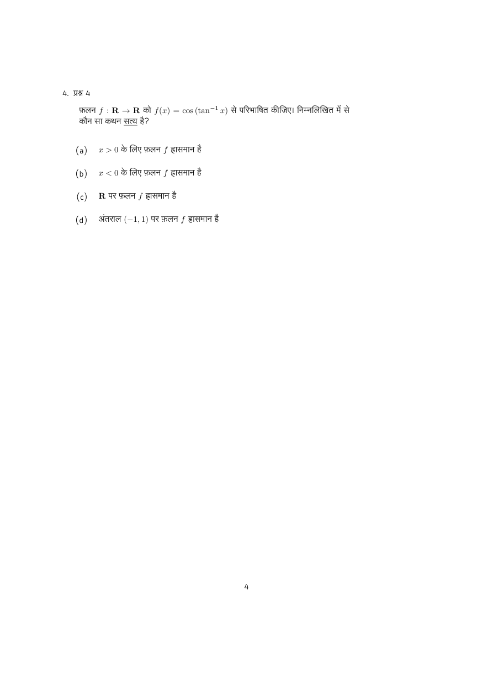

## PDF page 36

[Open original PDF at page 36](../pdf/IAT_2025_Hindi_paper.pdf#page=36)

### Searchable text - OCR draft (hin+eng)

```text
5. प्रश्न 5
समुच्चय
A= {« ER | —3l < तल 3 हि | < 20}

पर विचार कीजिए। निम्नलिखित में से कौन सा कथन सत्य है?

(a) A

(-2,2]
(b) A= (-2,2)
(०0 A=[-2,2)

(०) A=[-2,2]
```

### Original page image

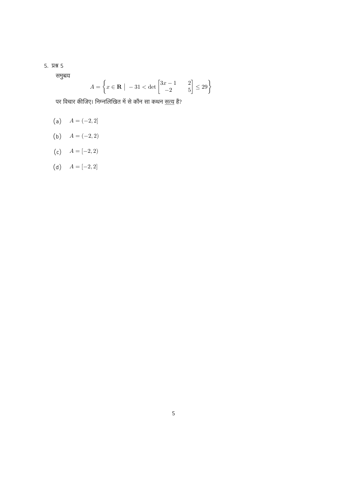

## PDF page 37

[Open original PDF at page 37](../pdf/IAT_2025_Hindi_paper.pdf#page=37)

### Searchable text - OCR draft (hin+eng)

```text
6. प्रश्न 6

मान लीजिए कि सम्मिश्र संख्यायें 2 , 22, तथा ४3 समीकरणों

25 |2०| ८ |७-॥|८|७+ | 5 गद्य + छा

को संतुष्ट करती हैं। GEM |4z, + ४2 + ४3| का मान क्या है?

(a) 8
(b) 4
l
(c) 4
l
(d) 8
```

### Original page image

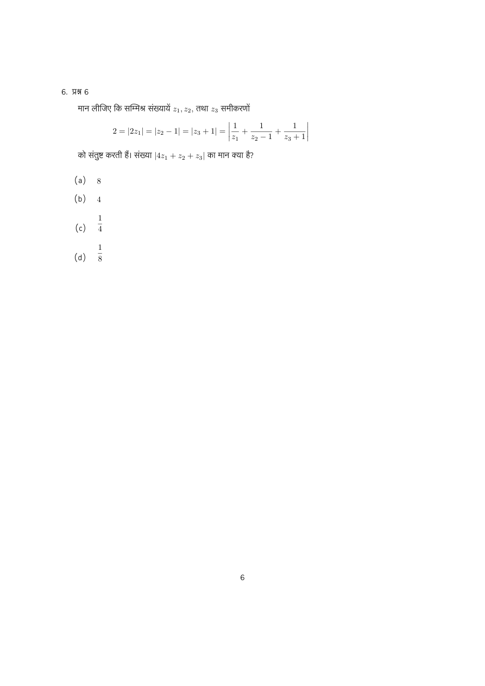

## PDF page 38

[Open original PDF at page 38](../pdf/IAT_2025_Hindi_paper.pdf#page=38)

### Searchable text - OCR draft (hin+eng)

```text
उ. प्रश्न 7

फ़लन f:R -> छे. को f(x) = |x? - 32|[2] से परिभाषित कीजिए, जहाँ [x] से हमारा
मतलब ऐसे महत्तम Guia से है जो # से छोटा या उसके बराबर हो। निम्नलिखित मे से कौन सा
कथन सत्य है?

(a) प्रत्येक अशून्य पूर्णाक फ़लन / का असांतत्य बिंदु है
(७) फ़लन | प्रत्येक वास्तविक संख्या पर सतत है
(०) प्रत्येक पूर्णाक फ़लन / का असांतत्य बिंदु है

(४५) 0,£V3 के अतिरिक्त प्रत्येक वास्तविक संख्या पर फ़लन / सतत है
```

### Original page image

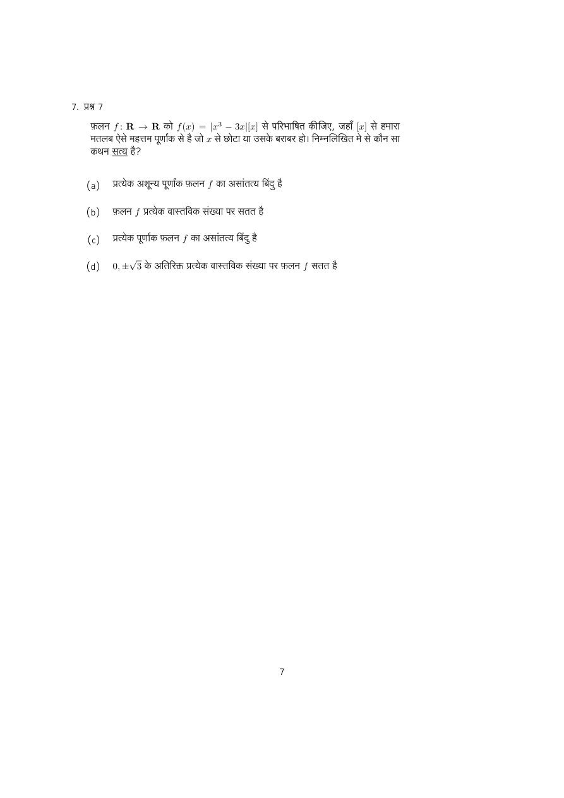

## PDF page 39

[Open original PDF at page 39](../pdf/IAT_2025_Hindi_paper.pdf#page=39)

### Searchable text - OCR draft (hin+eng)

```text
8. प्रश्न 8

मान लीजिए £ दीर्घ॑व्रत्त 2? + l6y? = 4 की बिंदु (: ; v3 ) पर स्पर्शरेखा है। / के लंबवत व

बिंदु (2, 0) से गुजरने वाली रेखा का समीकरण क्या होगा?
(a) ४७4७3(%-2)

(७) ४८2५/3(४-2)

(८) ४८ ४३(४- 2)

(०) 4५३४८ (४-2)
```

### Original page image

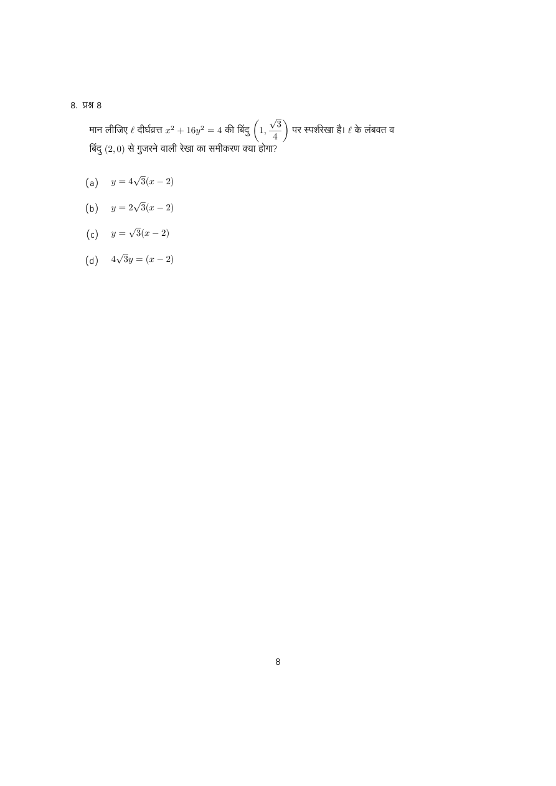

## PDF page 40

[Open original PDF at page 40](../pdf/IAT_2025_Hindi_paper.pdf#page=40)

### Searchable text - OCR draft (hin+eng)

```text
9. प्रश्न 9
मान लीजिए कि सदिश ढ तथा 8 इस प्रकार के हैं कि |॥ + b| = 5 और

a@ x ($- 47 + 5k) = (38 - 47 + 5k) xb

Bl तो [(॥+ 9) - (2 + 39 + £)| का मान क्या है?

3
(a) 0)
(b) 0
(०) v2
(५) 3
```

### Original page image

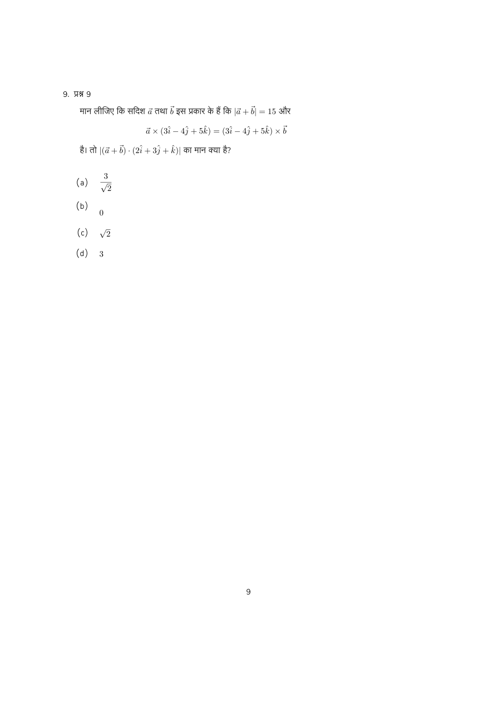

## PDF page 41

[Open original PDF at page 41](../pdf/IAT_2025_Hindi_paper.pdf#page=41)

### Searchable text - OCR draft (hin+eng)

```text
0. W420

WOH log(sin? x) का sin x & सापेक्ष अवकलज क्या है?

(a) 2 cosec x

(b)  sin2ar

(c) 4 cosec 2x
(d) cot x cosec 2a

i0
```

### Original page image

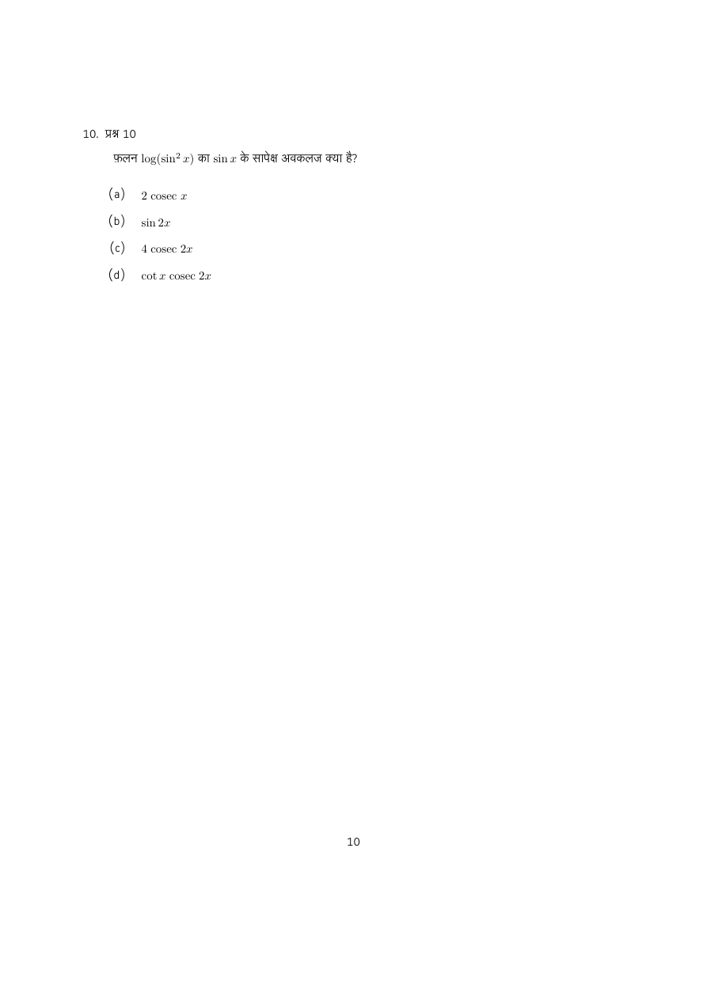

## PDF page 42

[Open original PDF at page 42](../pdf/IAT_2025_Hindi_paper.pdf#page=42)

### Searchable text - OCR draft (hin+eng)

```text
2. 44 2

मान लीजिए ५, श्रेणी ay, a2,03,... के प्रथम n पदों का योगफ़ल है। यदि प्रत्येक # के लिए
5%+3 - Sn = 3n +7, Haig - aio का मान क्या है?

(a) 3
(b)  37
(c) 46
(d) 42

वव
```

### Original page image

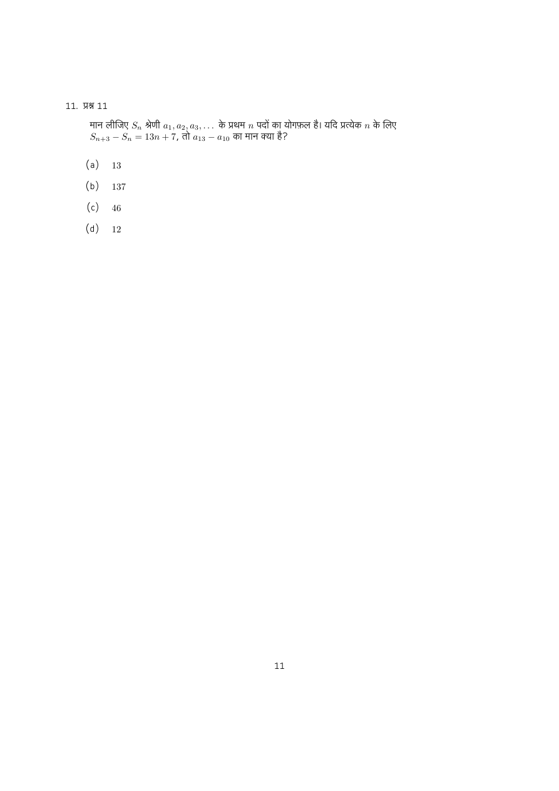

## PDF page 43

[Open original PDF at page 43](../pdf/IAT_2025_Hindi_paper.pdf#page=43)

### Searchable text - OCR draft (hin+eng)

```text
2. प्रश्न 2
पाँच खरे fae (fair coins) Cada रूप से उछाले जाते हैं। कम से कम दो चित्त आने की

प्रायिकता क्‍या है?
3
(a) 7
7
(७) पह
वि
(८) पढ़
वा
(५) पह

i2
```

### Original page image


## PDF page 44

[Open original PDF at page 44](../pdf/IAT_2025_Hindi_paper.pdf#page=44)

### Searchable text - OCR draft (hin+eng)

```text
3. WA 33

फ़लन f: ROR की परिभाषा निम्न है

w—de—-5 यदि x >i,
F(z) = { यदि # <i.

निम्नलिखित में से कौन सा कथन सत्य है?
(a) Wert / आच्छादी है परंतु एकैकी नहीं है
(b) फ़लन / एकैकी है परंतु आच्छादी नहीं है
(८) Wert f ना तो एकैकी है और ना ही आच्छादी है
(d) Wort / एकैकी है और आच्छादी भी है

i3
```

### Original page image

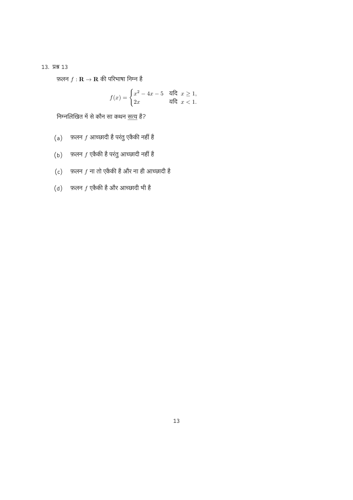

## PDF page 45

[Open original PDF at page 45](../pdf/IAT_2025_Hindi_paper.pdf#page=45)

### Searchable text - OCR draft (hin+eng)

```text
4. WI 4

अवकल समीकरण 4
oe +9xy =a (जहाँ x > 0),

का हल क्या होगा, यदि दिया हुआ हो कि & = Wy =0 है?

: है
(a) l= we 7

(b) ly=a' 9

4
```

### Original page image

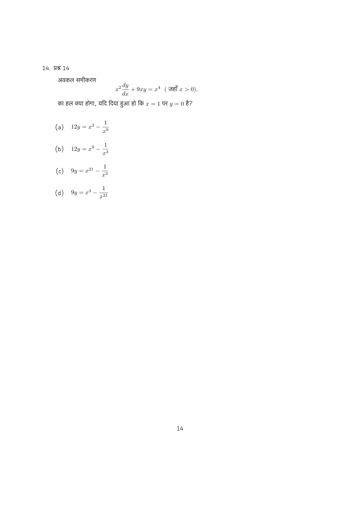

## PDF page 46

[Open original PDF at page 46](../pdf/IAT_2025_Hindi_paper.pdf#page=46)

### Searchable text - OCR draft (hin+eng)

```text
5. WH5

समाकल ॥ z|cos2|sina da का मान क्या है?

NIA

| ने

६8

Ola

0

T

a5
```

### Original page image

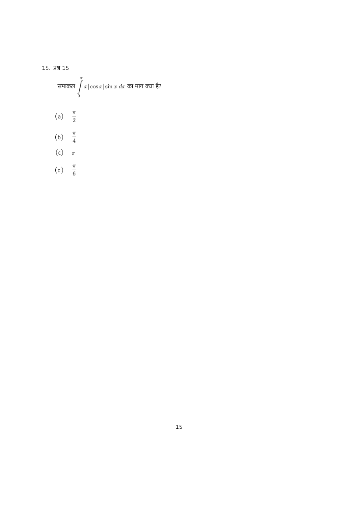

## PDF page 47

[Open original PDF at page 47](../pdf/IAT_2025_Hindi_paper.pdf#page=47)

### Searchable text - OCR draft (hin+eng)

```text
भौतिक विज्ञान

l. Wal

समान दिशा में विचरण कर रहे दो एकसमान द्रव्यमान के कणों A और B & बीच प्रत्यास्थ dag
की परिघटना पर विचार करें। कण A वेग vy तथा कण BA vp से विचरण कर रहा है। गहरी
रेखाएँ संघट्ट के पूर्व तथा बिन्दुवार रेखाएँ उसके उपरांत की स्थिति को दर्शाती हैं। निम्न में से
कौन सा आरेख दोनों कणों की स्थिति एवं चाल को सटीकतम रूप से दर्शाता है?

४५ a v
A
> E==
t t
(a)
x a 0
‘A
t > t E
(b)
(c)
E=
B B
: aa ; sesseenneseee
‘A
t > t >
(d)
```

### Original page image

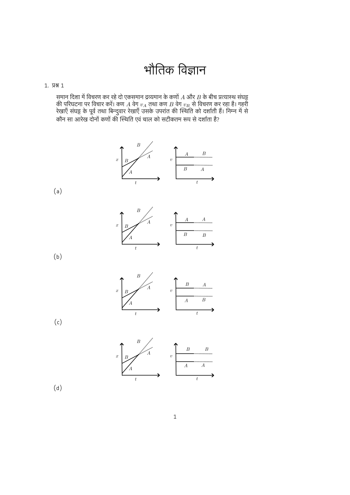

## PDF page 48

[Open original PDF at page 48](../pdf/IAT_2025_Hindi_paper.pdf#page=48)

### Searchable text - OCR draft (hin+eng)

```text
2. प्रश्न 2

द्रव्यमान M का एक गुटका, जो स्प्रिंग नियतांक # के एक द्रव्यमान रहित स्प्रिंग से जुड़ा है, किसी
घर्षण रहित सतह पर विरामावस्था में है। द्रव्यमान m वाली एक गोली क्षैतिज दिशा में वेग v से
चलते हुए गुटके में धस जाती है जैसा कि चित्र में दिखाया गया है। यह मानते हुए कि स्प्रिंग पूर्ण

रूप से संपीडित नहीं होता है, गोली के आघात से स्प्रिंग में अधिकतम संपीडन क्या होगा?

k 0)
T0004 M [७78

(a)
(७) \"

(me
() | *
(०)
```

### Original page image

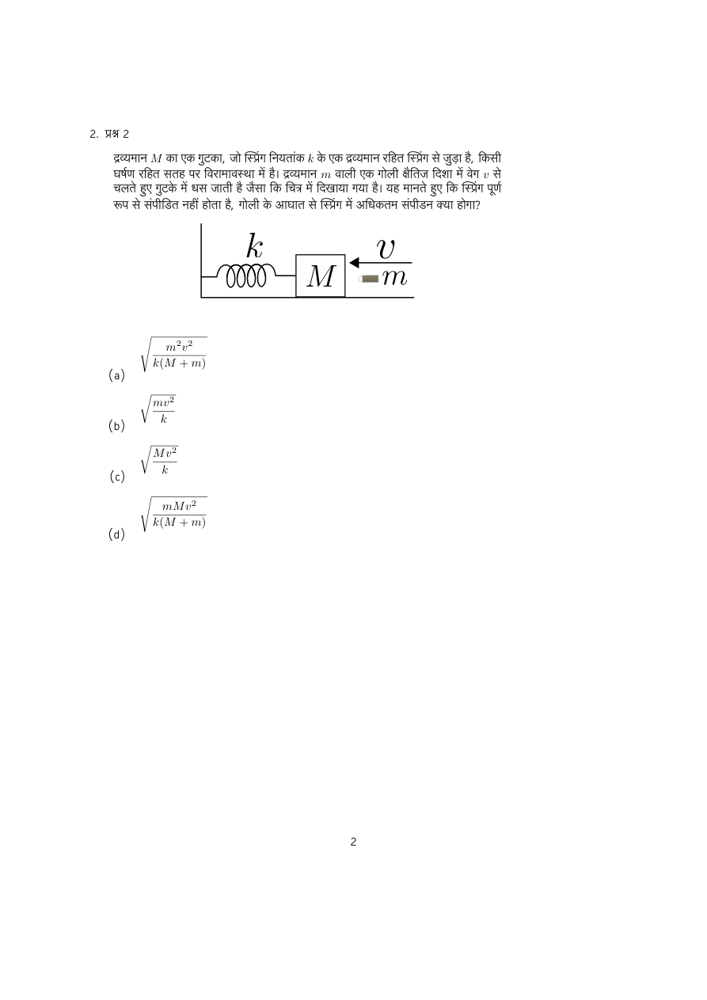

## PDF page 49

[Open original PDF at page 49](../pdf/IAT_2025_Hindi_paper.pdf#page=49)

### Searchable text - OCR draft (hin+eng)

```text
3. प्रश्न 3

द्रव्यमान M के किसी वाहन को aor रहित पथ के उच्चतम बिन्दु 4 से छोड़ा जाता है जैसा
कि चित्र में प्रदर्शित है। यह वाहन इस पथ पर विचरण करते हुये त्रिज्या R वाले एक अर्द्धवृत्तीय
हिस्से DBC में प्रवेश कर जाता है। भूमि से बिन्दु 4 और 7 की ऊँचाईयाँ क्रमश: hy और hy
हैं। यह सुनिश्चित करने में कि वाहन का पथ से सम्पर्क कभी न टूटे, निम्न में से किस राशि की
कोई भूमिका नहीं है?

(a) M

hy

he
```

### Original page image

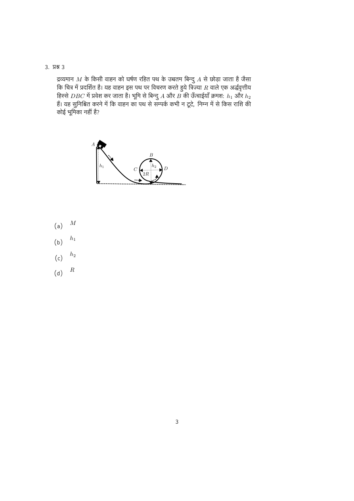

## PDF page 50

[Open original PDF at page 50](../pdf/IAT_2025_Hindi_paper.pdf#page=50)

### Searchable text - OCR draft (hin+eng)

```text
4. प्रश्न 4

द्रव्यमान M और त्रिज्या R वाली एक चकती इसके तल के लम्बवत एवं इसके केन्द्र से गुजरने
वाली एक अक्ष के परित: कोणीय वेग « से दक्षिणावर्ती दिशा में घूम रही है। किसी समय t = 0
पर, उसी अक्ष की ओर एक आधूर्ण 7' चकती के घूर्णन का विरोध करने के लिये लगाया जाता
है। आघूर्ण लगाये जाने के समय से मापने पर, चकती का वह अधिकतम कोणीय विस्थापन 6
(दक्षिणावर्ती दिशा में) क्या होगा जिसके उपरांत चकती वामावर्ती दिशा में घूमना शुरु कर दे?

p= w?M R?
(a) 4T

p= w?M R?
(b) 8T

9 = MR?
(० को

pa w*MR?
(4) 8T
```

### Original page image

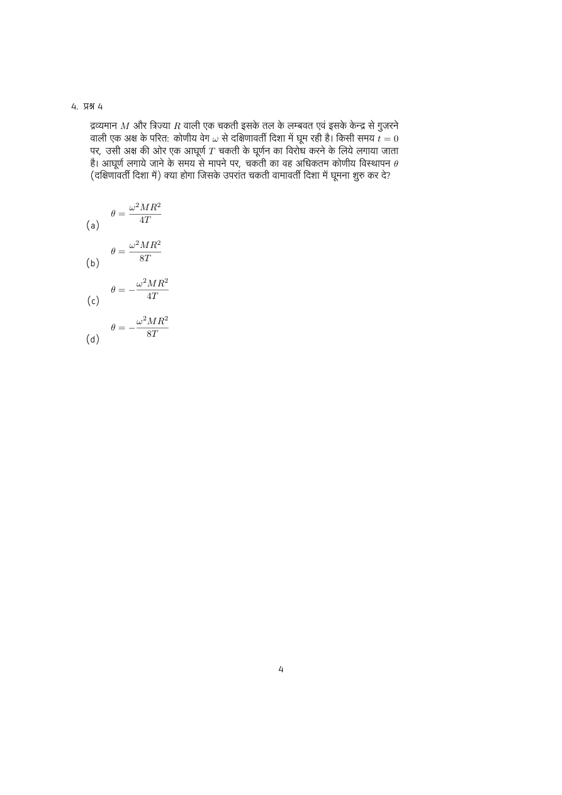

## PDF page 51

[Open original PDF at page 51](../pdf/IAT_2025_Hindi_paper.pdf#page=51)

### Searchable text - OCR draft (hin+eng)

```text
5. प्रश्न 5

धातु का एक घन जिसे प्रारंभ में तापमान 7' पर रखा है, शक्ति 7? (प्रति क्षण उत्सर्जित ऊर्जा) से
कृष्णिका विकिरण उत्सर्जित करता है। यदि 7' को % से बढ़ाया जाए तो प्रति क्षण उत्सर्जित
ऊर्जा ?? में 4.5 % की वृध्दि होती है। इस प्रक्रिया में घन के आयतन में लगभग कितने प्रतिशत
की वृध्दि हो रही है?

0.75 %
5 %
(७) 0.50 %
.56 x 0-° %

25 —6
(4) 6.25 x 0 /
```

### Original page image

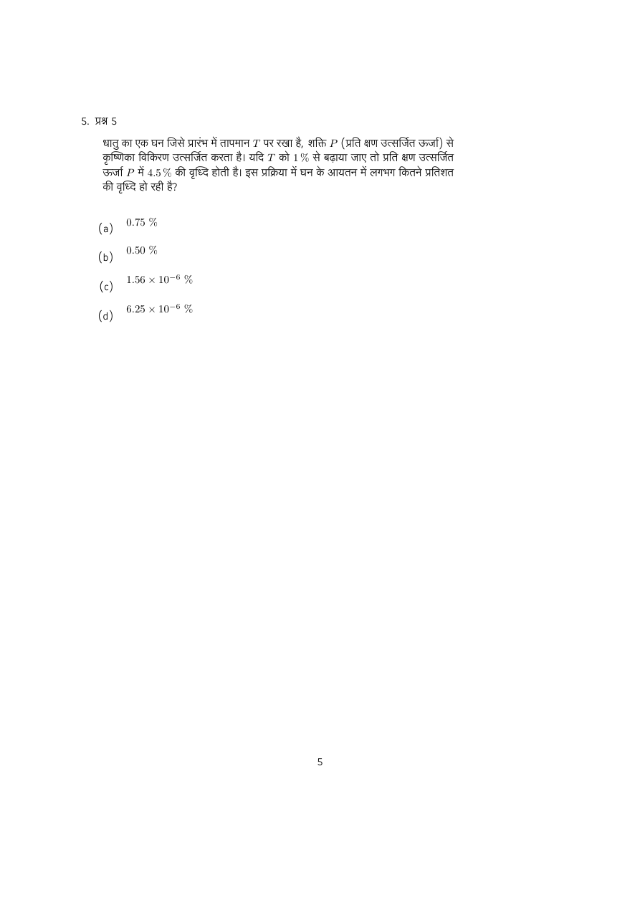

## PDF page 52

[Open original PDF at page 52](../pdf/IAT_2025_Hindi_paper.pdf#page=52)

### Searchable text - OCR draft (hin+eng)

```text
6. प्रश्न 6

दो एकसमान लम्बाई के पाइपों A और Bo विचार करें। पाइप A का एक सिरा बन्द है तथा
एक सिरा खुला है। पाइप B & दोनों सिरे खुले हैं। पाइपों को आयतन 0 के आदर्श गैस से भरे
बंद चैंबरों में YHA जाता है। पाइप 4 वाले चैंबर का तापमान Ty तथा पाइप B वाले चैंबर का
तापमान Tp है। पाइप 4 के ng गुणावृत्ति की अनुनादी आवृत्ति तथा पाइप 7 के %# गुणावृत्ति
की अनुनादी आवृत्ति समान हैं। इनके तापमानों के बीच क्या संबंध होगा?

Ta=(—2) Ts
```

### Original page image


## PDF page 53

[Open original PDF at page 53](../pdf/IAT_2025_Hindi_paper.pdf#page=53)

### Searchable text - OCR draft (hin+eng)

```text
[No text recovered; use the original page image below.]
```

### Original page image


## PDF page 54

[Open original PDF at page 54](../pdf/IAT_2025_Hindi_paper.pdf#page=54)

### Searchable text - OCR draft (hin+eng)

```text
8. प्रश्न 8

आवेश 4 = le का एक कण गतिज ऊर्ज़ा KH साथ दो | लम्बाई के WAAR प्लेटों के द्वारा
स्थापित एक विद्युत क्षेत्र में प्रवेश करता है, जैसा चित्र में प्रदर्शित है। प्लेटों के बीच विभवान्तर
7 एवं दूरी ८ है। गतिज ऊर्ज़ा K की ev इकाई में वह न्यूनतम मात्रा क्या होगी जिसके लिये
यह कण प्लेटों से नहीं टकरायेगा? [८ selects का आवेश है।]

]/
जाना 2
d B a
m
OV

(a) 2d?
a
(0) 2?
(2
(०) 7
a
(a) ?
```

### Original page image


## PDF page 55

[Open original PDF at page 55](../pdf/IAT_2025_Hindi_paper.pdf#page=55)

### Searchable text - OCR draft (hin+eng)

```text
9. प्रश्न 9

प्रदर्शित परिपथ के बिन्दुओं ।? और Q के बीच fara कितना होगा जब सभी संधारित्र
पूर्णतय: आवेशित हों?

(a) 4V
(b) OV
(c) 8V

(०) 2V
```

### Original page image


## PDF page 56

[Open original PDF at page 56](../pdf/IAT_2025_Hindi_paper.pdf#page=56)

### Searchable text - OCR draft (hin+eng)

```text
0. W420

द्रव्यमान m तथा आवेश 4 का एक कण जो AF = (i+ j—h से गति कर रहा है को
एकसमान चुंबकीय क्षेत्र B= Bo(it+j-+hk) में रखा जाता है। कण त्रिज्या r तथा चूड़ी अंतराल
(pitch) # के कुंडलीनुमा पथ में गति करने लगता है। निम्नलिखित में से कौन सा विकल्प सही

है?

re 2v2muy तथा 9 = हर
3qBo 9G Bo
(a)
mvo 2rmvo
r= 3qBo तथा p = 3qBo
(०)
re 2v2muo तथा 9 = AV2axmu
८ 3qBo 3qBo
(०)
re ame तथा p = were
Po 34730
(०)

i0
```

### Original page image


## PDF page 57

[Open original PDF at page 57](../pdf/IAT_2025_Hindi_paper.pdf#page=57)

### Searchable text - OCR draft (hin+eng)

```text
2. 44 2

एक आवेशित कण किसी चुंबकीय क्षेत्र में त्रिज्या # की कक्षा में कोणीय आवृत्ति « से घूम रहा
है। इस कक्षा की तल को एक ऐसे बड़े धात्विक वृत्ताकार फ्रेम के अंदर समान तल में रखा गया
है जिसकी त्रिज्या धीरे-धीरे कम हो रही है। यह मानते हुए कि कण इस फ्रेम के बाहर कभी नहीं
जाता है, फ्रेम के सिकुड़ते जाने से कण के पथ में क्या परिवर्तन आयेगा?

कण के कक्षा की त्रिज्या धीरे-धीरे कम होगी तथा आवृत्ति धीरे-धीरे बढ़ेगी।
कण के कक्षा की त्रिज्या धीरे-धीरे बढ़ेगी तथा आवृत्ति धीरे-धीरे कम होगी ।
कण के कक्षा की त्रिज्या नहीं बदलेगी किन्तु आवृत्ति धीरे-धीरे बढ़ेगी।

कण के कक्षा की त्रिज्या तथा अवृवृत्ति दोनों में कोई परिवर्तन नहीं होगा।

वव
```

### Original page image


## PDF page 58

[Open original PDF at page 58](../pdf/IAT_2025_Hindi_paper.pdf#page=58)

### Searchable text - OCR draft (hin+eng)

```text
2. WA2

एक समभुज प्रिज्म जिसका अपवर्तनांक .5 है को एक अपवर्तनांक 2.0 के समानांतर बठफलक
के साथ चित्र में दिखाए अनुसार व्यवस्थित किया जाता है ताकि उनके आसन्न पृष्ठ एक दूसरे के

समानांतर है। एक प्रकाश किरण हवा से प्रिज्म में ऐसे आपतित कोण से प्रवेश करती है कि वह
प्रिज्म के अन्दर उसके आधार के समानांतर चलती है। निर्गत कोण ७ का मान क्या होगा?

थांए 7 (3/4)
sin7!(/3)
sin~! (I/2)

sin7! (3/2)

i2
```

### Original page image


## PDF page 59

[Open original PDF at page 59](../pdf/IAT_2025_Hindi_paper.pdf#page=59)

### Searchable text - OCR draft (hin+eng)

```text
3. WA 33

एक स्रोत Ly तीव्रता का प्रकाश Gor उत्तपन्न करता है जो कि #-अक्ष की दिशा में ध्रुवित है। इस
Go को 2-अक्ष की दिशा में भेजा जाता है। यह पुंज एक पोलरॉइड Pi, जिसका ध्रुवण-अक्ष
yaa की दिशा में है, से गुजारा जाता है जिससे कि प्रकाश पोलरॉइड से बाहर नहीं निकलता
है। जब एक अन्य पोलरॉइड P2 को स्रोत तथा Pi के बीच में रखा जाता है तो Pi से निकलने
वाले प्रकाश की तीव्रता 375 /26 मापी जाती है। निम्न में से ध्रुवण-अक्ष तथा #-अक्ष के बीच के
कोण ७ का संभावित मान कौन सा होगा?

L. A
2 to Q Jo /6,
y Polarisation of
P2 Pl

incident light

i3
```

### Original page image


## PDF page 60

[Open original PDF at page 60](../pdf/IAT_2025_Hindi_paper.pdf#page=60)

### Searchable text - OCR draft (hin+eng)

```text
4. WI 4

हाइड्रोजन परमाणु का एक इलेक्ट्रॉन जो कि निम्नतम ऊर्जा 77 की अवस्था में है एक E, ऊर्जा
के फ़ोटॉन को अवशोषित करके उच्च्तर ऊर्जा अवस्था में चला जाता है जिसकी मुख्य क्वांटम
संख्या # है। # का मान क्या होगा?

(कह
i+
Vine,

+ - Ea

(a)

(७)

4
```

### Original page image


