# IAT 2026 - English - provisional key paper

Original PDF: [IAT_2026_English_provisional_key.pdf](../pdf/IAT_2026_English_provisional_key.pdf)

- Acquisition: SciAstra CloudFront mirror; not downloaded from the official server.
- Downloaded: 28 October 2026. PDF pages: 62.
- Exact download/source URL: https://d2aaa7ts7sm3bp.cloudfront.net/pdfs/01KTGTQAD252G5RDSV6169726M.pdf
- PDF SHA-256: `807154d9092f07059d47d2b12b84da58bdbe93c75440cd4d437fad8610309e28`
- This is a search/accessibility copy of an existing paper, not newly authored mock content.
- Text is mechanically extracted or OCR-derived and has not been proofread character by character. Equations, option letters, chemical bonds, tables and Hindi OCR can contain errors. The PDF and page images are authoritative.
- Figure descriptions are explanatory annotations, not official answers or complete structural/formula transcriptions. Use the linked image to resolve exact labels, values and stereochemistry.

**Provisional status:** the PDF cover is dated 07-06-2026 and explicitly says option (a) is correct for all listed questions. This is an answer-key ordering, not evidence of the examination display order. This file has not been verified against a final key.

## Visual guide

- [English PDF page 3](#pdf-page-3): Biology Q2: a table links dicot/monocot roots and stems to their vascular-bundle arrangements. Preserve labels P-S and i-iv across the columns.
- [English PDF page 4](#pdf-page-4): Biology Q3: three population-versus-time panels compare P alone, Q alone and P+Q together. Each isolated population rises to a plateau; in the combined panel Q remains high while P rises briefly and then declines.
- [English PDF page 6](#pdf-page-6): Biology Q5: enzyme-velocity plots (a) and (b) mark Vmax and substrate concentration [S]. Both rise towards saturation, but have different substrate concentrations at half the maximum velocity. More choices continue on page 7.
- [English PDF page 7](#pdf-page-7): Continuation of Biology Q5: velocity-versus-substrate plots (c) and (d), each with a dashed Vmax line, different saturation levels and different curvature. The question specifies Km=20.
- [English PDF page 10](#pdf-page-10): Biology Q8: two antiparallel DNA strands show 5-prime/3-prime labels, a terminator at the left and promoter/transcription-start annotations near the right. The written bases are shown between them; direction matters when identifying a coding strand.
- [English PDF page 13](#pdf-page-13): Biology Q11: four lac-operon schematics labelled i-iv arrange promoter/operator, regulatory gene i and structural genes z, y and a differently. Small segment labels are part of the question, not a decorative gene cartoon.
- [English PDF page 15](#pdf-page-15): Biology Q13: candidate nucleic-acid molecules include a base-paired RNA duplex, a single RNA sequence and a DNA-like sequence with T instead of U. Base-pairing bars and strand identity distinguish the options.
- [English PDF page 16](#pdf-page-16): Biology Q14: a large pedigree spans several generations. Filled symbols denote affected people; open symbols are unaffected; circles and squares distinguish sex. Trace parent-to-child links and affected sexes to compare inheritance models.
- [English PDF page 23](#pdf-page-23): Chemistry Q6: tert-butyl bromide reacts with hydroxide in ethanol, giving an alcohol and bromide. Structural drawings show the tertiary carbon and the bond being replaced.
- [English PDF page 24](#pdf-page-24): Chemistry Q7: four cyclic molecular drawings use solid wedges, dashed bonds and stereocentre substituents to test chirality. Ring connectivity alone is insufficient; preserve the stereochemical markings.
- [English PDF page 25](#pdf-page-25): Chemistry Q8: a silica-gel TLC plate has a baseline at 0 cm, solvent front at 5 cm, compound B spot at 1.25 cm and compound A spot at 3.75 cm. A central vertical line and dashed height guides locate the spots.
- [English PDF page 26](#pdf-page-26): Chemistry Q9: an aromatic compound carrying aldehyde groups reacts with concentrated NaOH to intermediate X, then excess HCl to P. Four answer pairs show different carboxylate/alcohol or cyclic-ester arrangements.
- [English PDF page 27](#pdf-page-27): Chemistry Q10: four aniline-derived amines P-S differ in methyl groups attached to nitrogen. Their N-H bonds and number of methyl substituents must be distinguished for the pKb comparison.
- [English PDF page 29](#pdf-page-29): Chemistry Q12: four pairs of thermodynamic variables compare solid isothermal and dotted adiabatic curves/lines. Axes include P-V, U-V and T-V style plots, with one pressure-related inverse-volume plot; read each axis from the source image.
- [English PDF page 48](#pdf-page-48): Physics Q1: a spring fixed to the left wall pushes a cube that touches a sphere on a smooth horizontal floor. The sphere can strike a separate rigid right wall; the arrangement sets up contact, separation and collision stages.
- [English PDF page 49](#pdf-page-49): Physics Q2: a concave mirror and a double-convex lens face one another on a common principal axis. Their common focal-point arrangement and the 50 cm mirror-to-lens separation are labelled.
- [English PDF page 61](#pdf-page-61): Physics Q14: three infinite charged sheets are drawn as parallel vertical lines separated by d/2. A spherical Gaussian surface crosses the middle region and has a marked centre; its left and right hemispheres are distinguished. The sheet charge densities are labelled sigma, sigma and 2sigma.

## Page index

[p1](#pdf-page-1) | [p2](#pdf-page-2) | [p3](#pdf-page-3) | [p4](#pdf-page-4) | [p5](#pdf-page-5) | [p6](#pdf-page-6) | [p7](#pdf-page-7) | [p8](#pdf-page-8) | [p9](#pdf-page-9) | [p10](#pdf-page-10) | [p11](#pdf-page-11) | [p12](#pdf-page-12) | [p13](#pdf-page-13) | [p14](#pdf-page-14) | [p15](#pdf-page-15) | [p16](#pdf-page-16) | [p17](#pdf-page-17) | [p18](#pdf-page-18) | [p19](#pdf-page-19) | [p20](#pdf-page-20) | [p21](#pdf-page-21) | [p22](#pdf-page-22) | [p23](#pdf-page-23) | [p24](#pdf-page-24) | [p25](#pdf-page-25) | [p26](#pdf-page-26) | [p27](#pdf-page-27) | [p28](#pdf-page-28) | [p29](#pdf-page-29) | [p30](#pdf-page-30) | [p31](#pdf-page-31) | [p32](#pdf-page-32) | [p33](#pdf-page-33) | [p34](#pdf-page-34) | [p35](#pdf-page-35) | [p36](#pdf-page-36) | [p37](#pdf-page-37) | [p38](#pdf-page-38) | [p39](#pdf-page-39) | [p40](#pdf-page-40) | [p41](#pdf-page-41) | [p42](#pdf-page-42) | [p43](#pdf-page-43) | [p44](#pdf-page-44) | [p45](#pdf-page-45) | [p46](#pdf-page-46) | [p47](#pdf-page-47) | [p48](#pdf-page-48) | [p49](#pdf-page-49) | [p50](#pdf-page-50) | [p51](#pdf-page-51) | [p52](#pdf-page-52) | [p53](#pdf-page-53) | [p54](#pdf-page-54) | [p55](#pdf-page-55) | [p56](#pdf-page-56) | [p57](#pdf-page-57) | [p58](#pdf-page-58) | [p59](#pdf-page-59) | [p60](#pdf-page-60) | [p61](#pdf-page-61) | [p62](#pdf-page-62)

## PDF page 1

[Open original PDF at page 1](../pdf/IAT_2026_English_provisional_key.pdf#page=1)

### Searchable text - PDF text layer

```text
English Answer Key for IAT 2026 (Provisional)

                      07-06-2026


Important Note: This document serves as the (provisional) answer
key. For all the multiple-choice questions listed below, option (a) is the
correct answer.
```

### Original page image


## PDF page 2

[Open original PDF at page 2](../pdf/IAT_2026_English_provisional_key.pdf#page=2)

### Searchable text - PDF text layer

```text
Biology
1. Question 1
   Which of the following processes result in development of a proton gradient
     across the thylakoid membrane during photosynthesis?

       i.  Release of protons into the lumen of the thylakoid by plastoquinone
       ii.  Consumption of protons in the stroma during the reduction of NADP+
       iii. Release of protons into the lumen of the thylakoid by ATP synthase
     iv. Release of protons into the lumen of the thylakoid by water splitting
         reaction


                i, ii and iv
    (a)
                ii, iii and iv
    (b)
                i, iii and iv
    (c)
                i, ii and iii
    (d)


                                1
```

### Original page image

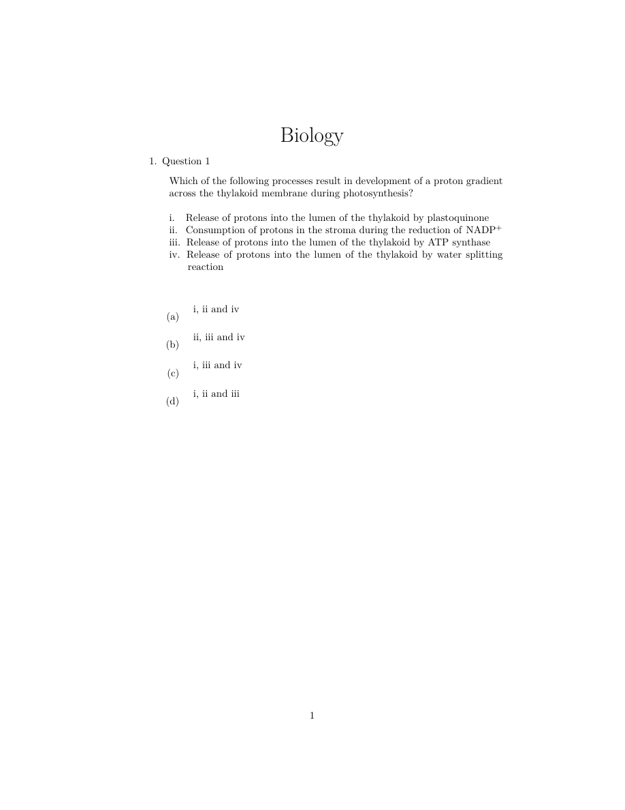

## PDF page 3

[Open original PDF at page 3](../pdf/IAT_2026_English_provisional_key.pdf#page=3)

### Visual description

Biology Q2: a table links dicot/monocot roots and stems to their vascular-bundle arrangements. Preserve labels P-S and i-iv across the columns.

### Searchable text - PDF text layer

```text
2. Question 2
   Which one of the following choices matches the organs in column I with
     their vascular system arrangement described in column II?


      P - (i); Q - (ii); R - (iii); S - (iv)
    (a)
      P - (ii); Q - (i); R - (iv); S - (iii)
    (b)
      P - (iii); Q - (iv); R - (i); S - (ii)
    (c)
      P - (iv); Q - (iii); R - (ii); S - (i)
    (d)


                                2
```

### Original page image

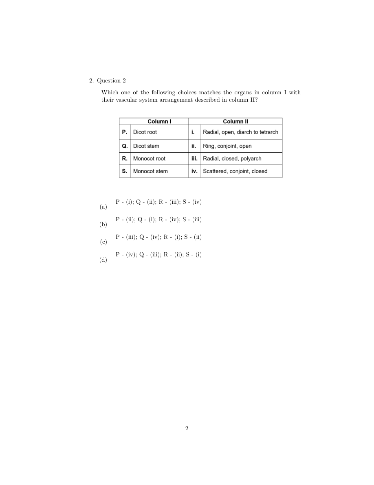

## PDF page 4

[Open original PDF at page 4](../pdf/IAT_2026_English_provisional_key.pdf#page=4)

### Visual description

Biology Q3: three population-versus-time panels compare P alone, Q alone and P+Q together. Each isolated population rises to a plateau; in the combined panel Q remains high while P rises briefly and then declines.

### Searchable text - PDF text layer

```text
3. Question 3
   The graphs below depict the number of individuals of two organisms, named
   P and Q, when grown independently, and together. Based on these growth
     patterns, which one of the following statements is correct?


      Q is a predator of P
    (a)
      P and Q exhibit mutualism
    (b)
      P is a parasite of Q
    (c)
      Q is a commensal of P
    (d)


                                3
```

### Original page image

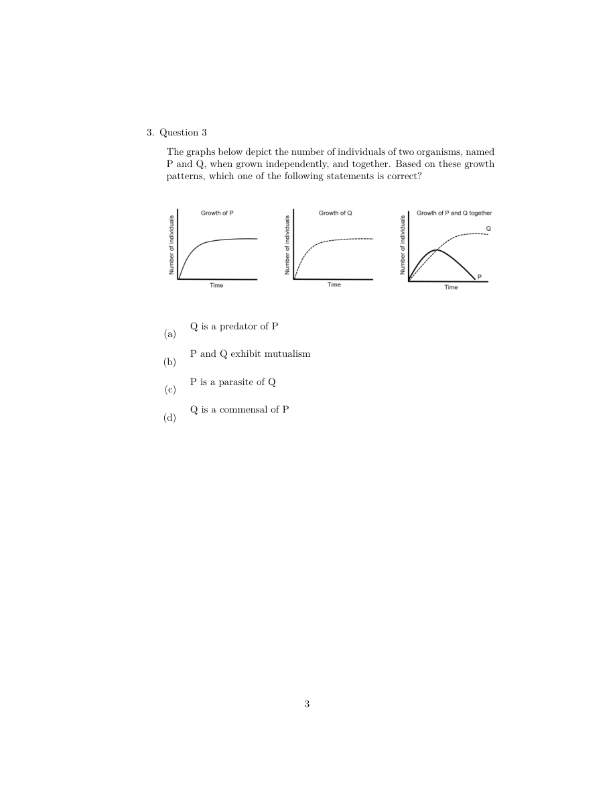

## PDF page 5

[Open original PDF at page 5](../pdf/IAT_2026_English_provisional_key.pdf#page=5)

### Searchable text - PDF text layer

```text
4. Question 4
   The pBR322 cloning vector has genes coding for tetracycline and ampicillin
     resistance. A foreign DNA to be cloned is inserted into the tetracycline
     resistance gene and the recombinant plasmid is then transformed into E.
     coli cells. Which one of the following choices is the most likely outcome of
     this cloning reaction?

        The  cells with the recombinant plasmid can grow in the presence  of
          ampicillin but not tetracycline
    (a)
        The cells with the recombinant plasmid can grow in the presence of both
          ampicillin and tetracycline
    (b)
        The cells with the non-recombinant plasmid can grow in the presence of
          ampicillin but not tetracycline
    (c)
        The cells with the non-recombinant plasmid can grow in the presence of
          tetracycline but not ampicillin
    (d)


                                4
```

### Original page image

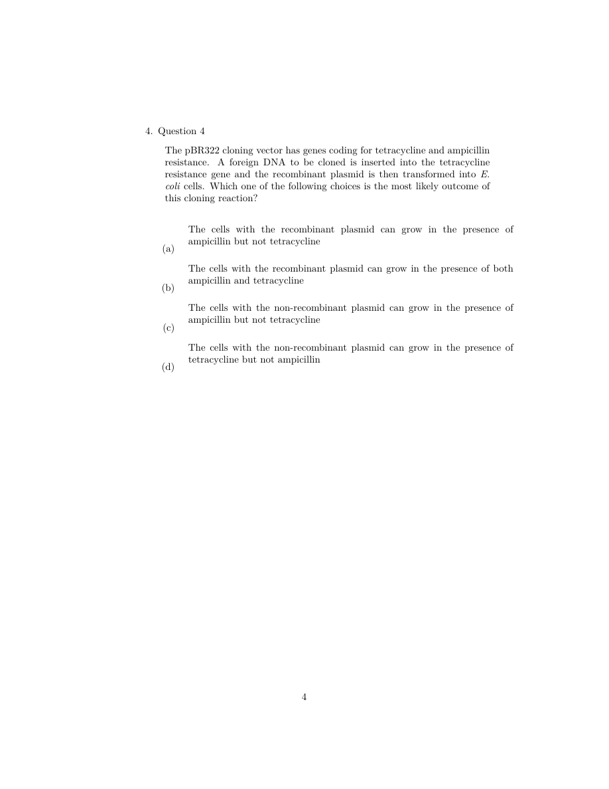

## PDF page 6

[Open original PDF at page 6](../pdf/IAT_2026_English_provisional_key.pdf#page=6)

### Visual description

Biology Q5: enzyme-velocity plots (a) and (b) mark Vmax and substrate concentration [S]. Both rise towards saturation, but have different substrate concentrations at half the maximum velocity. More choices continue on page 7.

### Searchable text - PDF text layer

```text
5. Question 5
    For which one of the following enzyme activity plots, will the Km of the
    enzyme for substrate ‘S’ be 20? [S] indicates substrate concentration.


    (a)


    (b)


                                5
```

### Original page image

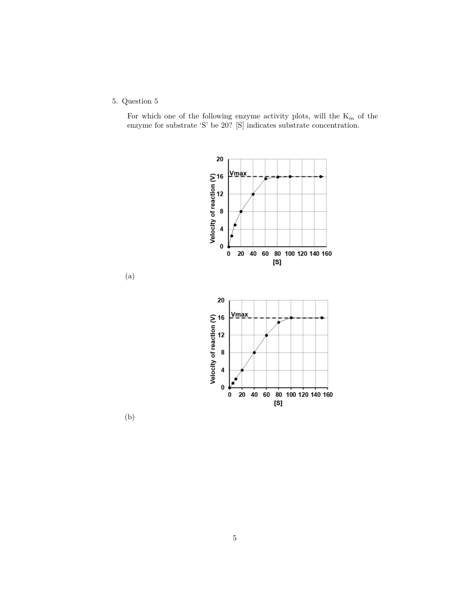

## PDF page 7

[Open original PDF at page 7](../pdf/IAT_2026_English_provisional_key.pdf#page=7)

### Visual description

Continuation of Biology Q5: velocity-versus-substrate plots (c) and (d), each with a dashed Vmax line, different saturation levels and different curvature. The question specifies Km=20.

### Searchable text - PDF text layer

```text
(c)


(d)


                            6
```

### Original page image

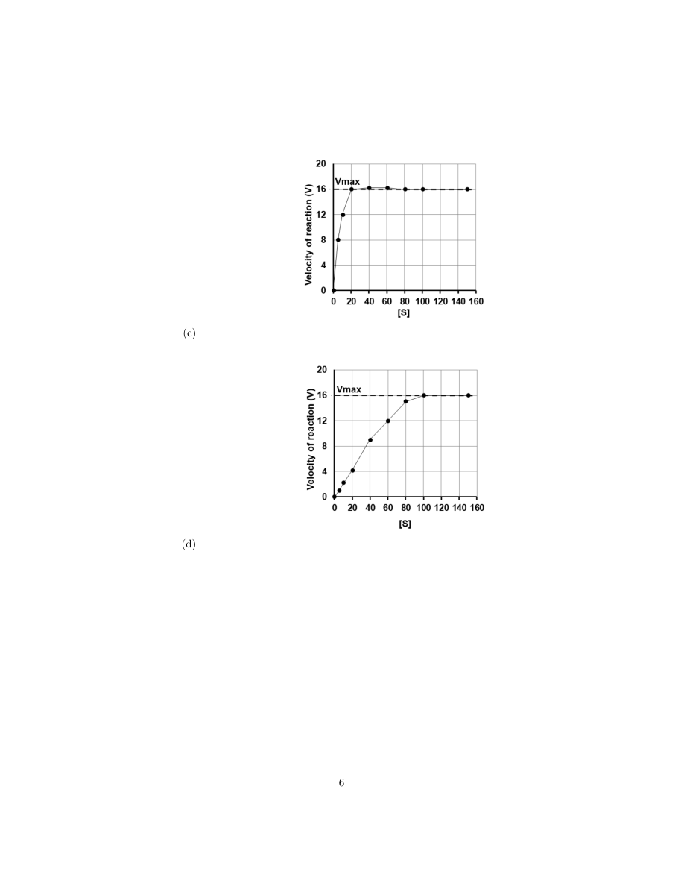

## PDF page 8

[Open original PDF at page 8](../pdf/IAT_2026_English_provisional_key.pdf#page=8)

### Searchable text - PDF text layer

```text
6. Question 6
   Which one of the following correctly describes the mode of action of Follicle
    Stimulating Hormone (FSH) and estrogen?

       FSH interacts with membrane-bound receptor and generates cyclic AMP,
          while estrogen interacts with  intracellular receptor and regulates gene
          expression
    (a)
       FSH interacts with intracellular receptor and generates cyclic AMP, while
          estrogen interacts with membrane-bound receptor and regulates cellular
         metabolism    (b)
        Both FSH and estrogen regulate gene expression via intracellular receptors
    (c)
        Both FSH and estrogen regulate cellular metabolism via membrane-bound
          receptors
    (d)


                                7
```

### Original page image

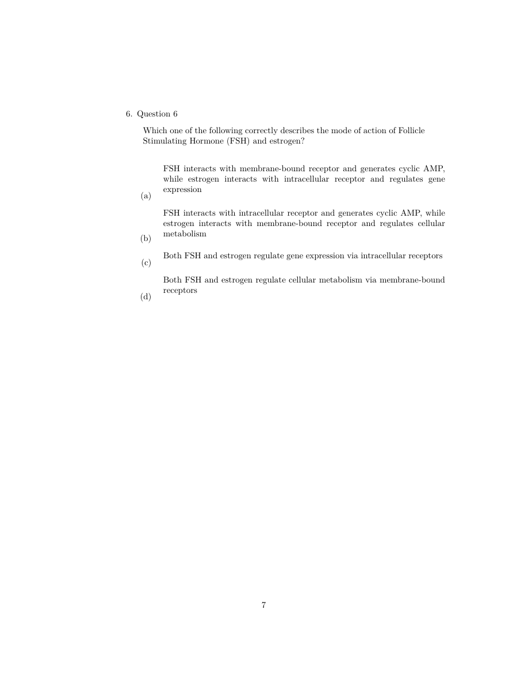

## PDF page 9

[Open original PDF at page 9](../pdf/IAT_2026_English_provisional_key.pdf#page=9)

### Searchable text - PDF text layer

```text
7. Question 7
      If cell wall was used as the only criterion for classifying organisms, then
    Mycoplasma would have belonged to which one of the following groups?

        Animals    (a)
         Plants    (b)
         Fungi
    (c)
          Protists    (d)


                                8
```

### Original page image

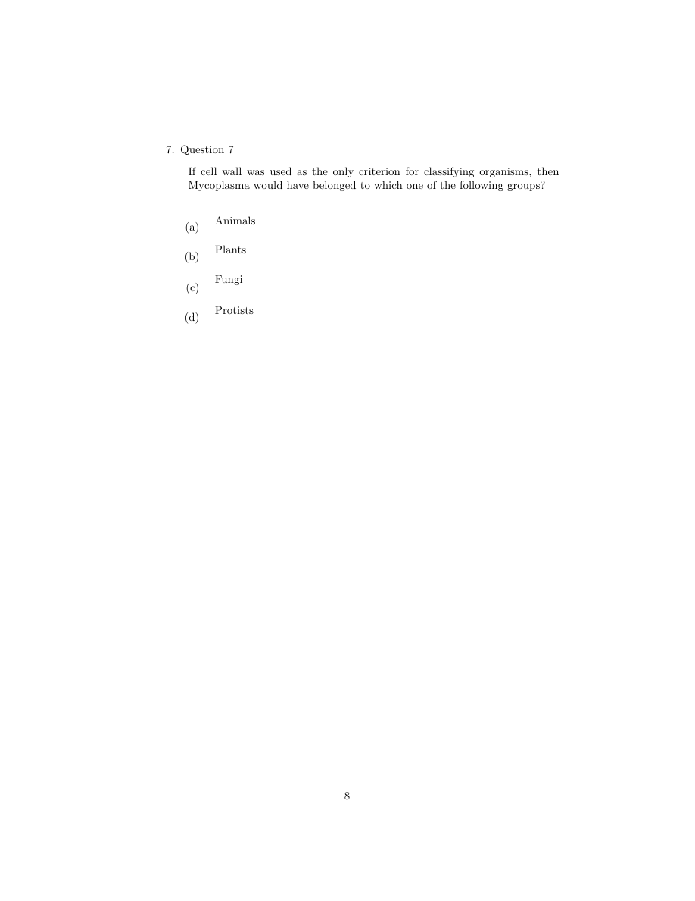

## PDF page 10

[Open original PDF at page 10](../pdf/IAT_2026_English_provisional_key.pdf#page=10)

### Visual description

Biology Q8: two antiparallel DNA strands show 5-prime/3-prime labels, a terminator at the left and promoter/transcription-start annotations near the right. The written bases are shown between them; direction matters when identifying a coding strand.

### Searchable text - PDF text layer

```text
8. Question 8
   Which one of the following is the correct sequence of the coding strand of
    the given gene?


           5’ GTGCTGTAACGGCTTCAC 3’    (a)
           5’ CACTTCGGCAATGTCGTG 3’    (b)
           5’ GTGAAGCCGTTACAGCAC 3’    (c)
           5’ CACGACATTGCCGAAGTG 3’    (d)


                                9
```

### Original page image

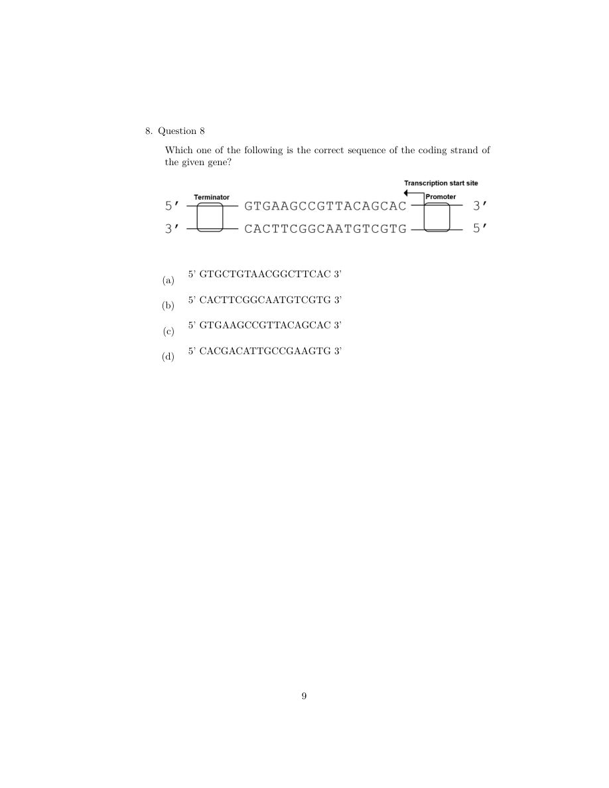

## PDF page 11

[Open original PDF at page 11](../pdf/IAT_2026_English_provisional_key.pdf#page=11)

### Searchable text - PDF text layer

```text
9. Question 9
   Which one of the following correctly describes the sequence of events leading
    to muscle contraction following acetylcholine release at the neuromuscular
    junction?

          Increase of Ca++ in sarcoplasm, unmasking of active sites for myosin, ‘Z’
           lines pulled inwards
    (a)
          Increase of Ca++ in sarcoplasm, masking of active sites for myosin, ‘Z’ lines
          pulled inwards
    (b)
          Increase of Ca++ in sarcoplasm, unmasking of active sites for myosin, ‘Z’
           lines pulled outwards
    (c)
         Decrease of Ca++ in sarcoplasm, masking of active sites for myosin, ‘Z’ lines
          pulled inwards
    (d)


                               10
```

### Original page image

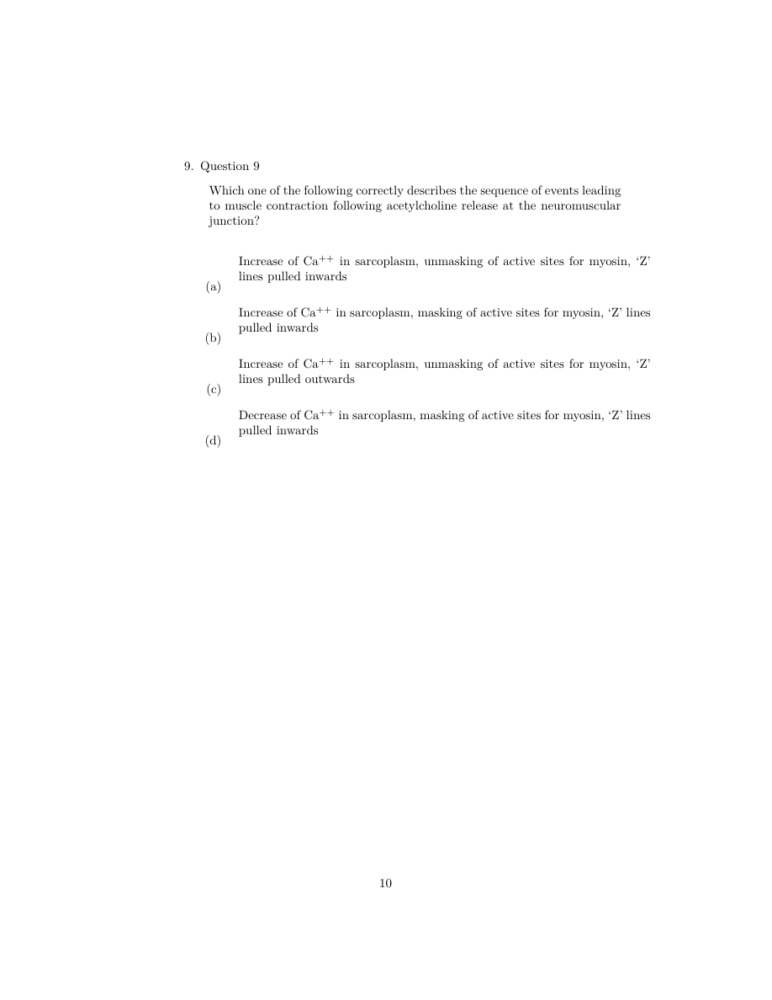

## PDF page 12

[Open original PDF at page 12](../pdf/IAT_2026_English_provisional_key.pdf#page=12)

### Searchable text - PDF text layer

```text
10. Question 10
     In which one of the following cases, will an anti-Rh antibody treatment
     prevent erythroblastosis foetalis?

         Anti-Rh antibody to the Rh-negative mother after delivery of the  first
           Rh-positive child
     (a)
         Anti-Rh antibody to the Rh-positive mother after delivery of the  first
          Rh-negative child
     (b)
         Anti-Rh antibody to the Rh-negative mother after delivery of the  first
          Rh-negative child
      (c)
         Anti-Rh antibody to the Rh-positive mother after delivery of the  first
           Rh-positive child
     (d)


                                11
```

### Original page image

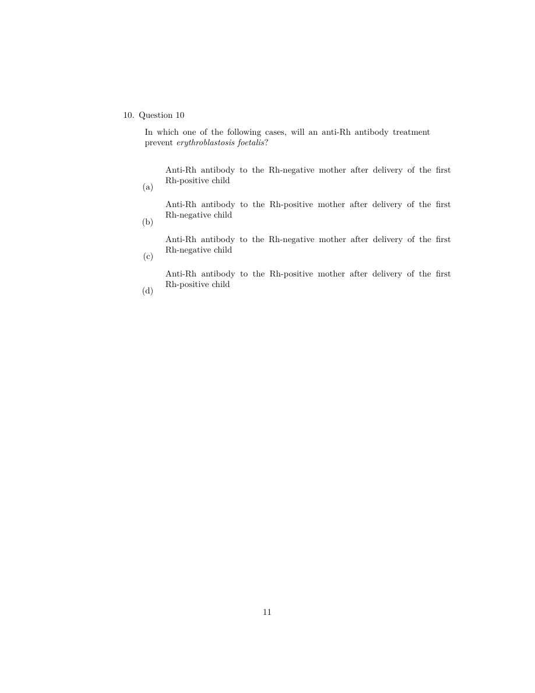

## PDF page 13

[Open original PDF at page 13](../pdf/IAT_2026_English_provisional_key.pdf#page=13)

### Visual description

Biology Q11: four lac-operon schematics labelled i-iv arrange promoter/operator, regulatory gene i and structural genes z, y and a differently. Small segment labels are part of the question, not a decorative gene cartoon.

### Searchable text - PDF text layer

```text
11. Question 11
    Which of the following schematics correctly depict a lac operon that can be
      negatively regulated?


                 i and iii     (a)
                 i and ii     (b)
                 ii and iv      (c)
                 iii and iv     (d)


                                12
```

### Original page image

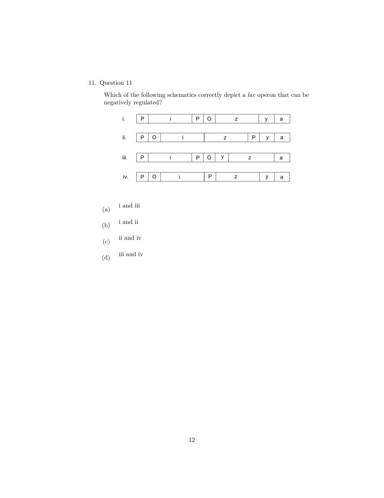

## PDF page 14

[Open original PDF at page 14](../pdf/IAT_2026_English_provisional_key.pdf#page=14)

### Searchable text - PDF text layer

```text
12. Question 12
     For which one of the following parents, their children will NOT have the
     same blood group phenotype as either of the parents?

           Father: AB; Mother: O
     (a)
           Father: A; Mother: O
     (b)
           Father: AB; Mother: A
      (c)
           Father: O; Mother: B
     (d)


                                13
```

### Original page image

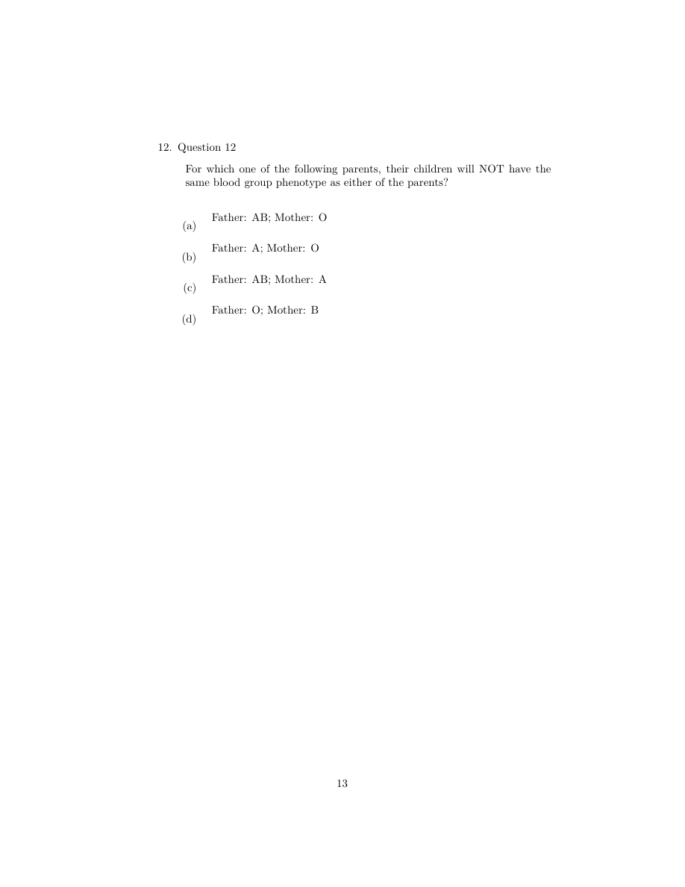

## PDF page 15

[Open original PDF at page 15](../pdf/IAT_2026_English_provisional_key.pdf#page=15)

### Visual description

Biology Q13: candidate nucleic-acid molecules include a base-paired RNA duplex, a single RNA sequence and a DNA-like sequence with T instead of U. Base-pairing bars and strand identity distinguish the options.

### Searchable text - PDF text layer

```text
13. Question 13
    Which one of the following molecules can be used for RNA interference?


     (a)


     (b)


      (c)


     (d)


                                14
```

### Original page image

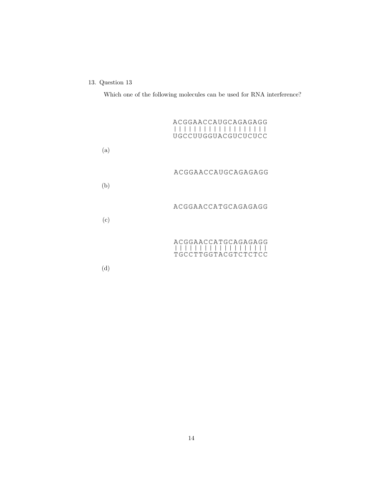

## PDF page 16

[Open original PDF at page 16](../pdf/IAT_2026_English_provisional_key.pdf#page=16)

### Visual description

Biology Q14: a large pedigree spans several generations. Filled symbols denote affected people; open symbols are unaffected; circles and squares distinguish sex. Trace parent-to-child links and affected sexes to compare inheritance models.

### Searchable text - PDF text layer

```text
14. Question 14
    The following pedigree diagram shows the inheritance of a rare genetic
      disorder in a family (filled shapes depict affected individuals). Which one
      of the following is the most likely pattern of inheritance of the disorder?


          X-linked dominant     (a)
          X-linked recessive     (b)
          Y-linked      (c)
          Mitochondrial     (d)


                                15
```

### Original page image

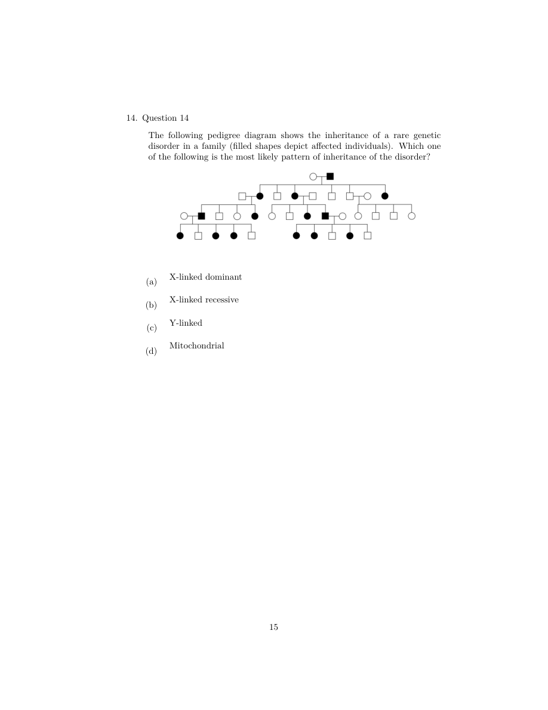

## PDF page 17

[Open original PDF at page 17](../pdf/IAT_2026_English_provisional_key.pdf#page=17)

### Searchable text - PDF text layer

```text
15. Question 15
   A female child is born with all the primary oocytes required during her
      lifetime.  At which one of the following stages of cell division are these
     oocytes found at birth?

          Prophase I
     (a)
         Metaphase I
     (b)
         Anaphase I
      (c)
          Telophase I
     (d)


                                16
```

### Original page image

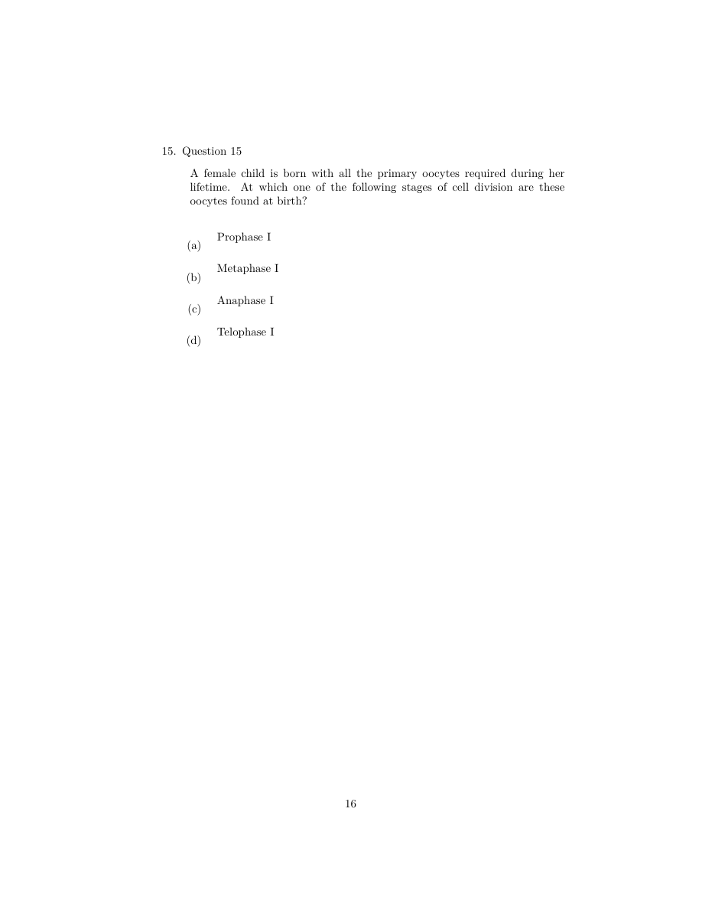

## PDF page 18

[Open original PDF at page 18](../pdf/IAT_2026_English_provisional_key.pdf#page=18)

### Searchable text - PDF text layer

```text
Chemistry
1. Question 1
    Which one of the following octahedral complexes has the highest spin-only
    magnetic moment?

         [Cr(H2O)4(OH)2]
    (a)
         [V(H2O)4I2]+
    (b)
         [Fe(NH3)4(CN)2]+
    (c)
         [Co(NH3)4Cl2]
    (d)


                                1
```

### Original page image

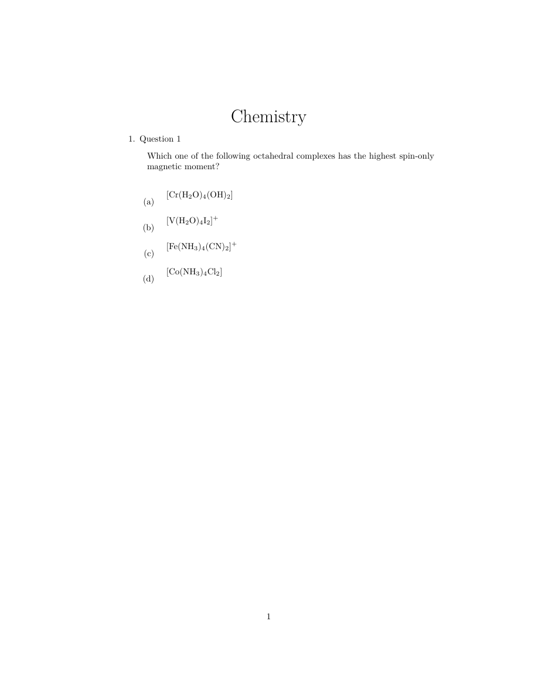

## PDF page 19

[Open original PDF at page 19](../pdf/IAT_2026_English_provisional_key.pdf#page=19)

### Searchable text - PDF text layer

```text
2. Question 2
   What are the numbers of protons (H+) and electrons (e−), respectively,
     required for the reduction of [Cr2O7]2−to Cr3+ under an aqueous acidic
     condition?

          14, 6
    (a)
           6, 14
    (b)
           7, 3
    (c)
           7, 6
    (d)


                                2
```

### Original page image

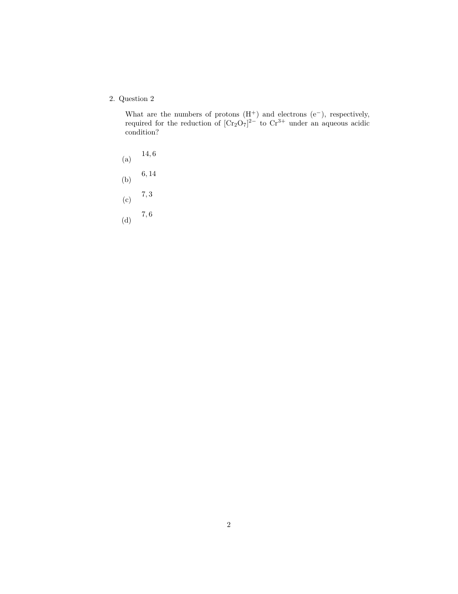

## PDF page 20

[Open original PDF at page 20](../pdf/IAT_2026_English_provisional_key.pdf#page=20)

### Searchable text - PDF text layer

```text
3. Question 3
    Which one of the following molecules shows an increase in bond order after
     loss of an electron from the highest occupied molecular orbital?

        F2    (a)
        N2    (b)
        C2    (c)
        B2    (d)


                                3
```

### Original page image

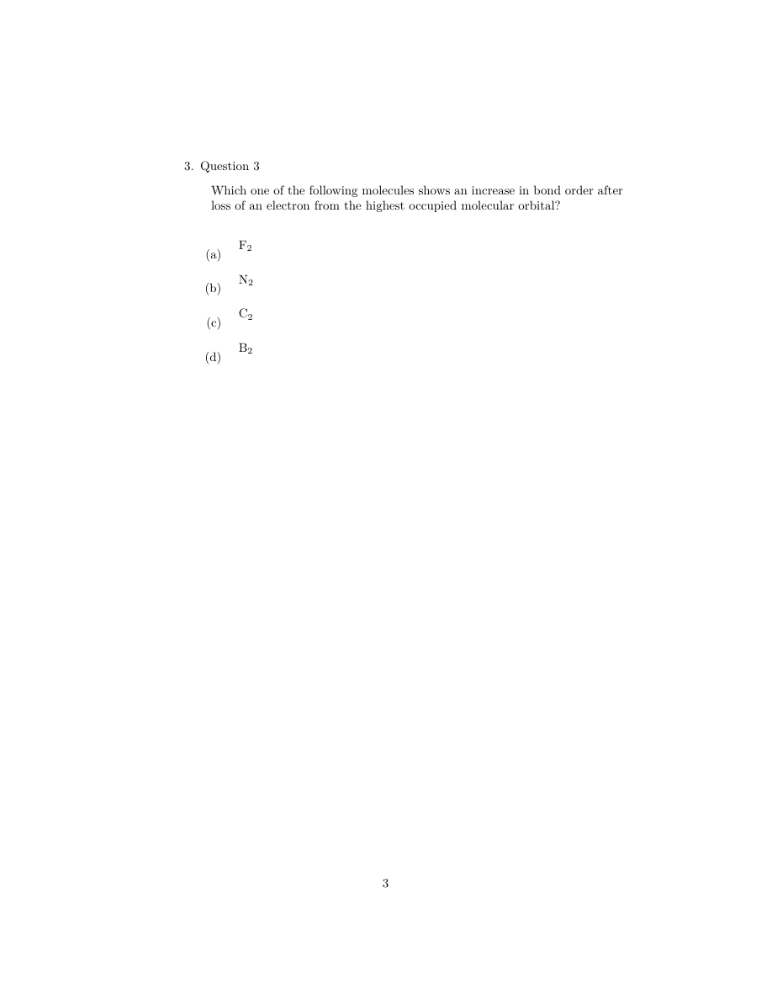

## PDF page 21

[Open original PDF at page 21](../pdf/IAT_2026_English_provisional_key.pdf#page=21)

### Searchable text - PDF text layer

```text
4. Question 4
     Metal-ligand π-bond  formation  in Mn2(CO)10 and [MnO4]−requires
     electron-pair donation between metal and ligand orbitals. Which one of
     the following represents the direction of electron-pair donation?

        Mn2(CO)10: metal orbital →ligand orbital
        [MnO4]−: ligand orbital →metal orbital    (a)
        Mn2(CO)10: ligand orbital →metal orbital
        [MnO4]−: ligand orbital →metal orbital    (b)
        Mn2(CO)10: metal orbital →ligand orbital
        [MnO4]−: metal orbital →ligand orbital    (c)
        Mn2(CO)10: ligand orbital →metal orbital
        [MnO4]−: metal orbital →ligand orbital    (d)


                                4
```

### Original page image

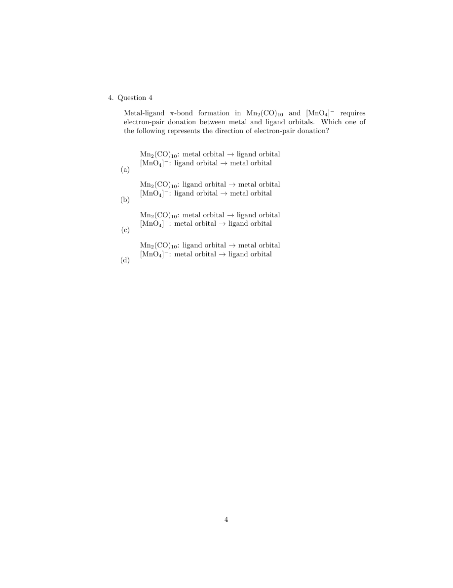

## PDF page 22

[Open original PDF at page 22](../pdf/IAT_2026_English_provisional_key.pdf#page=22)

### Searchable text - PDF text layer

```text
5. Question 5
   What is the order of bond energy between C=S & C=Te, and between Cl–Cl
   & F–F?

      C=S > C=Te and Cl–Cl > F–F    (a)
       C=Te > C=S and Cl–Cl > F–F    (b)
       C=Te > C=S and F–F > Cl–Cl    (c)
      C=S > C=Te and F–F > Cl–Cl    (d)


                                5
```

### Original page image

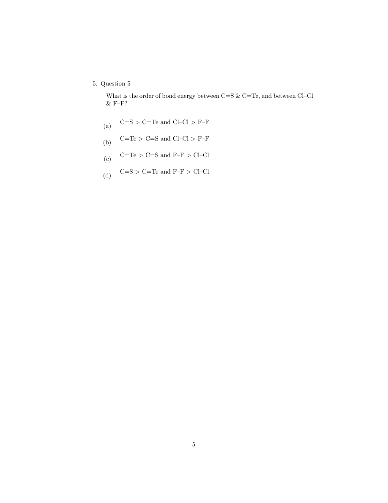

## PDF page 23

[Open original PDF at page 23](../pdf/IAT_2026_English_provisional_key.pdf#page=23)

### Visual description

Chemistry Q6: tert-butyl bromide reacts with hydroxide in ethanol, giving an alcohol and bromide. Structural drawings show the tertiary carbon and the bond being replaced.

### Searchable text - PDF text layer

```text
6. Question 6
    Which one  is an INCORRECT statement with regard to the following
     reaction?


        The reaction rate decreases upon changing the solvent from ethyl alcohol to
          1:1 mixture of ethyl alcohol and water.
    (a)
        The reaction rate does not change upon increasing the concentration of
         hydroxide ion.
    (b)
        The rate determining step is the dissociation of tert-butylbromide.
    (c)
        The reaction rate is proportional to the concentration of tert-butylbromide.
    (d)


                                6
```

### Original page image

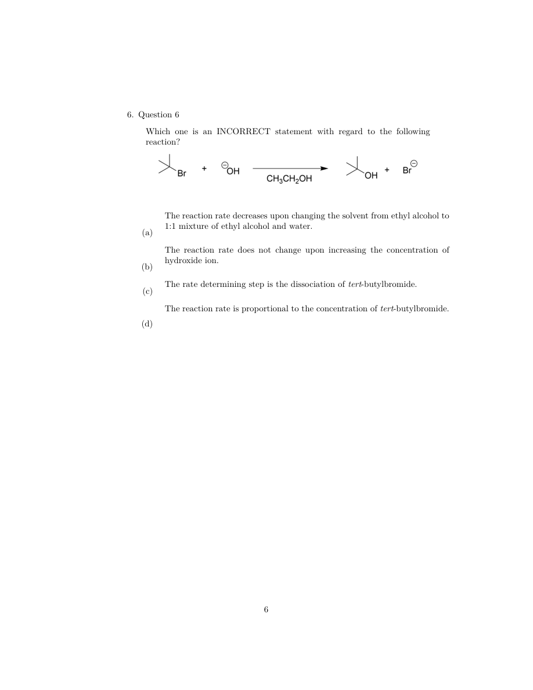

## PDF page 24

[Open original PDF at page 24](../pdf/IAT_2026_English_provisional_key.pdf#page=24)

### Visual description

Chemistry Q7: four cyclic molecular drawings use solid wedges, dashed bonds and stereocentre substituents to test chirality. Ring connectivity alone is insufficient; preserve the stereochemical markings.

### Searchable text - PDF text layer

```text
7. Question 7
    Which one of the following molecules is chiral?


    (a)


    (b)


    (c)


    (d)


                                7
```

### Original page image

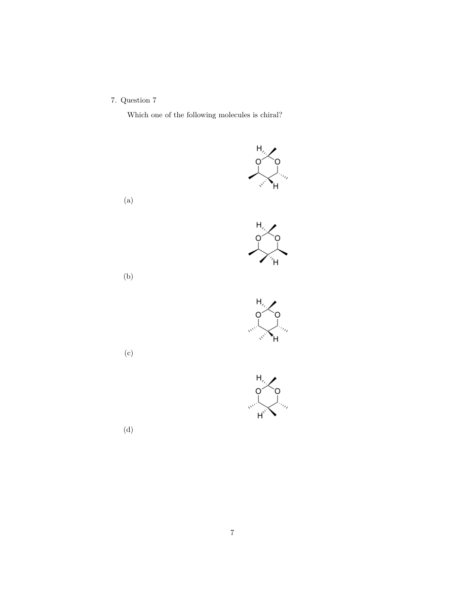

## PDF page 25

[Open original PDF at page 25](../pdf/IAT_2026_English_provisional_key.pdf#page=25)

### Visual description

Chemistry Q8: a silica-gel TLC plate has a baseline at 0 cm, solvent front at 5 cm, compound B spot at 1.25 cm and compound A spot at 3.75 cm. A central vertical line and dashed height guides locate the spots.

### Searchable text - PDF text layer

```text
8. Question 8
    Consider  the  following  silica-gel  based  thin-layer  chromatogram  of
    compounds A and B. Which one of the following statements is correct?


     B is more polar than A; A has Rf = 0.75.
    (a)
     B is more polar than A; A has Rf = 0.25.
    (b)
     A is more polar than B; B has Rf = 0.33.
    (c)
     B is less polar than A; B has Rf = 0.75.
    (d)


                                8
```

### Original page image

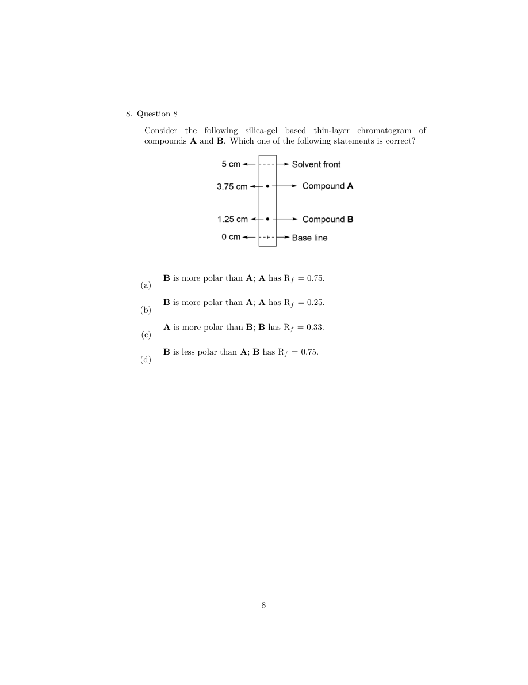

## PDF page 26

[Open original PDF at page 26](../pdf/IAT_2026_English_provisional_key.pdf#page=26)

### Visual description

Chemistry Q9: an aromatic compound carrying aldehyde groups reacts with concentrated NaOH to intermediate X, then excess HCl to P. Four answer pairs show different carboxylate/alcohol or cyclic-ester arrangements.

### Searchable text - PDF text layer

```text
9. Question 9
   What are X and P in the following reaction sequence?


    (a)


    (b)


    (c)


    (d)


                                9
```

### Original page image

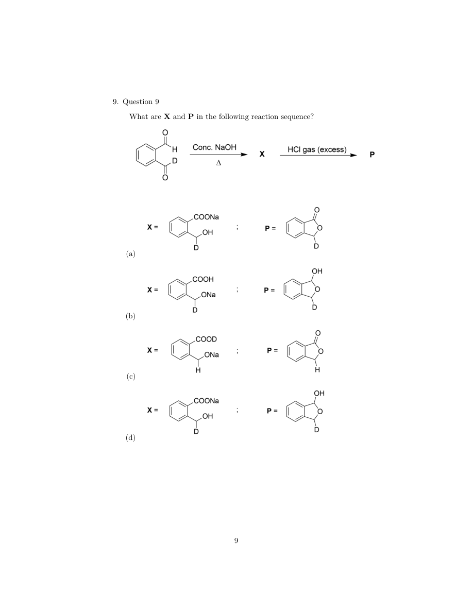

## PDF page 27

[Open original PDF at page 27](../pdf/IAT_2026_English_provisional_key.pdf#page=27)

### Visual description

Chemistry Q10: four aniline-derived amines P-S differ in methyl groups attached to nitrogen. Their N-H bonds and number of methyl substituents must be distinguished for the pKb comparison.

### Searchable text - PDF text layer

```text
10. Question 10
    What is the order of pKb for the following molecules in an aqueous medium?


      P < R < Q < S
     (a)
      P < Q < R < S
     (b)
        S < P < R < Q
      (c)
        S < P < Q < R
     (d)


                                10
```

### Original page image

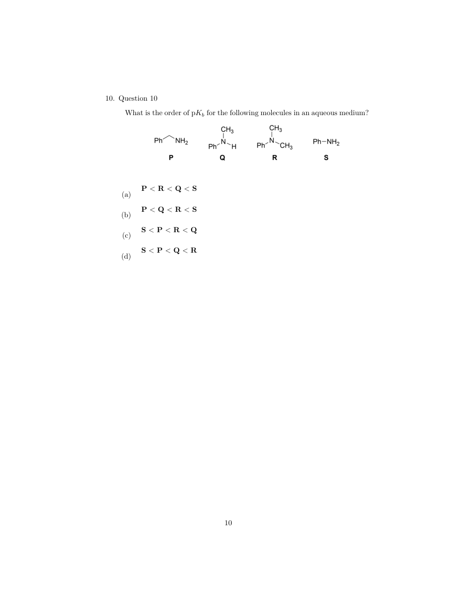

## PDF page 28

[Open original PDF at page 28](../pdf/IAT_2026_English_provisional_key.pdf#page=28)

### Searchable text - PDF text layer

```text
11. Question 11
     100 mL of 1.0 M aqueous NaOH solution was diluted to 1.0 L by adding
      water. Half of this solution was discarded. A new 100 mL of 0.5 M aqueous
    NaOH solution was added to the remaining solution. What is the concen-
      tration of the final aqueous NaOH solution?

           0.17 M     (a)
           0.10 M     (b)
           0.50 M      (c)
           0.33 M     (d)


                                11
```

### Original page image

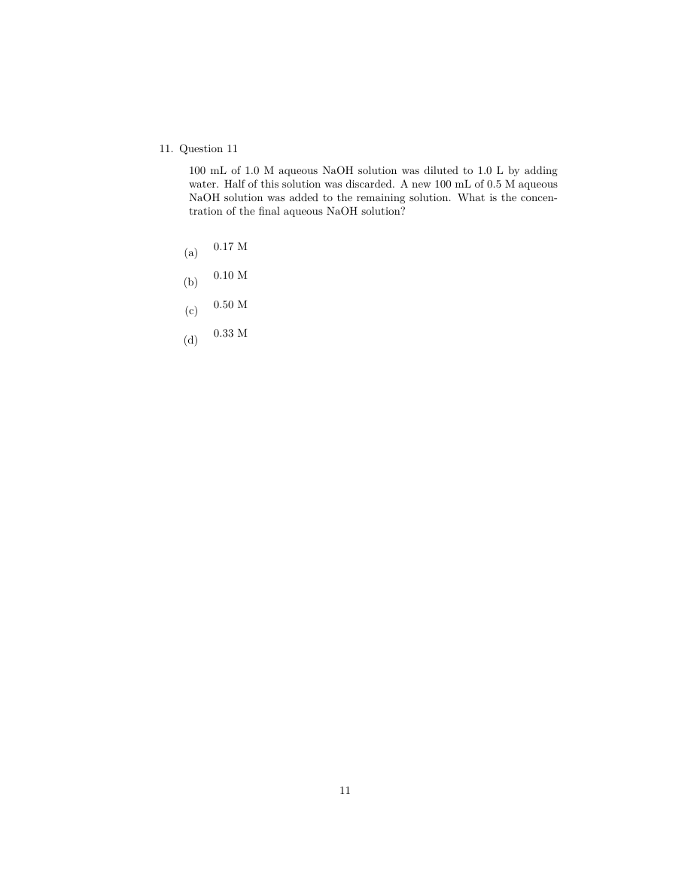

## PDF page 29

[Open original PDF at page 29](../pdf/IAT_2026_English_provisional_key.pdf#page=29)

### Visual description

Chemistry Q12: four pairs of thermodynamic variables compare solid isothermal and dotted adiabatic curves/lines. Axes include P-V, U-V and T-V style plots, with one pressure-related inverse-volume plot; read each axis from the source image.

### Searchable text - PDF text layer

```text
12. Question 12
    An ideal gas goes through a reversible isothermal expansion (solid line)
      followed by a reversible adiabatic expansion (dashed line). Which of the
      following diagram(s) closely depict(s) the entire process?


              (i) and (iii) only
     (a)
              (i) only
     (b)
               (ii) and (iv) only
      (c)
               (i), (ii), and (iii) only
     (d)


                                12
```

### Original page image

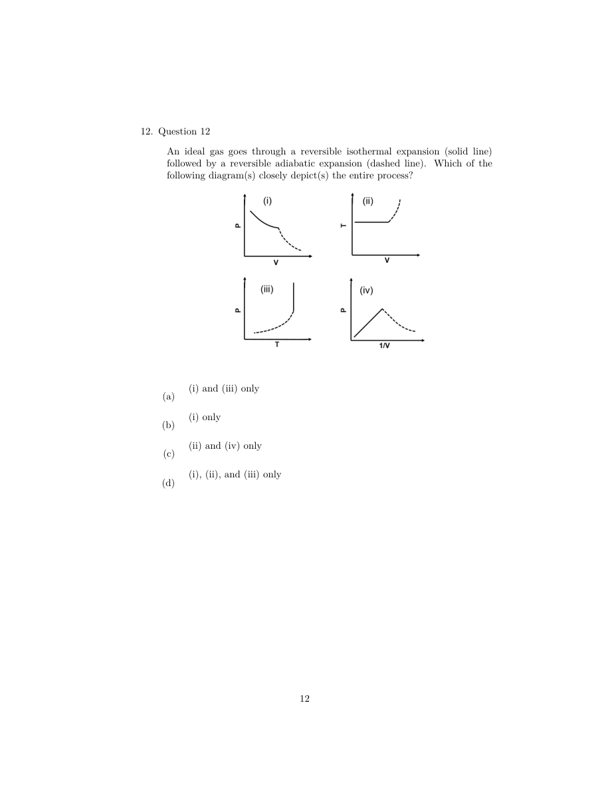

## PDF page 30

[Open original PDF at page 30](../pdf/IAT_2026_English_provisional_key.pdf#page=30)

### Searchable text - PDF text layer

```text
13. Question 13
    What is the ratio of the velocity of an electron in the fourth orbit of Be3+
      to the velocity of the electron in the second orbit of He+?

           1:1     (a)
           1:2     (b)
           3:2      (c)
           6:1     (d)


                                13
```

### Original page image

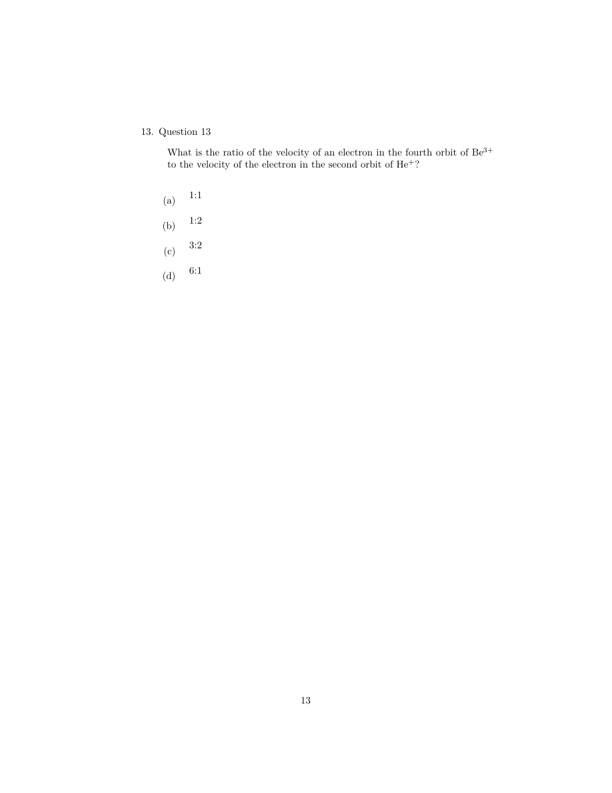

## PDF page 31

[Open original PDF at page 31](../pdf/IAT_2026_English_provisional_key.pdf#page=31)

### Searchable text - PDF text layer

```text
14. Question 14
     For two pure volatile liquids X and Y, attractive intermolecular interactions
       of both X-X and Y-Y are weaker than those of X-Y. The total vapour
      pressure of an equimolar solution of X and Y is ptotal. The vapour pressure
       of pure X and pure Y are p0X and p0Y, respectively.  Which one of the
      following relations is correct?

              ptotal < (p0X + p0Y)/2     (a)
              ptotal = (p0X + p0Y)/2     (b)
              ptotal = p0X + p0Y      (c)
              ptotal > (p0X + p0Y)/2     (d)


                                14
```

### Original page image

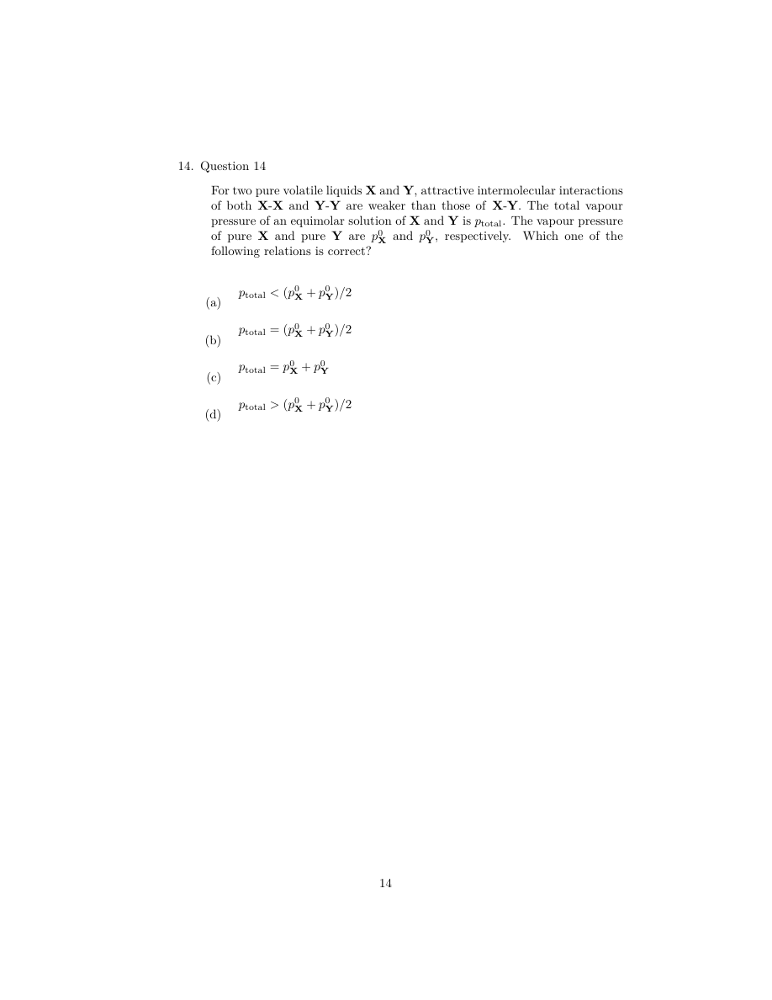

## PDF page 32

[Open original PDF at page 32](../pdf/IAT_2026_English_provisional_key.pdf#page=32)

### Searchable text - PDF text layer

```text
15. Question 15
     The rate constant of a reaction at 600 K with an activation energy of
      191.47 kJ mol−1  is 5.0   10−5 s−1. What is the temperature at which                 ×      the half-life of the reaction becomes 152 s? [Consider pre-exponential fac-
      tor and activation energy to be independent of temperature. R = 8.314 J
     K−1mol−1]

          680 K     (a)
          640 K     (b)
          760 K      (c)
          720 K     (d)


                                15
```

### Original page image

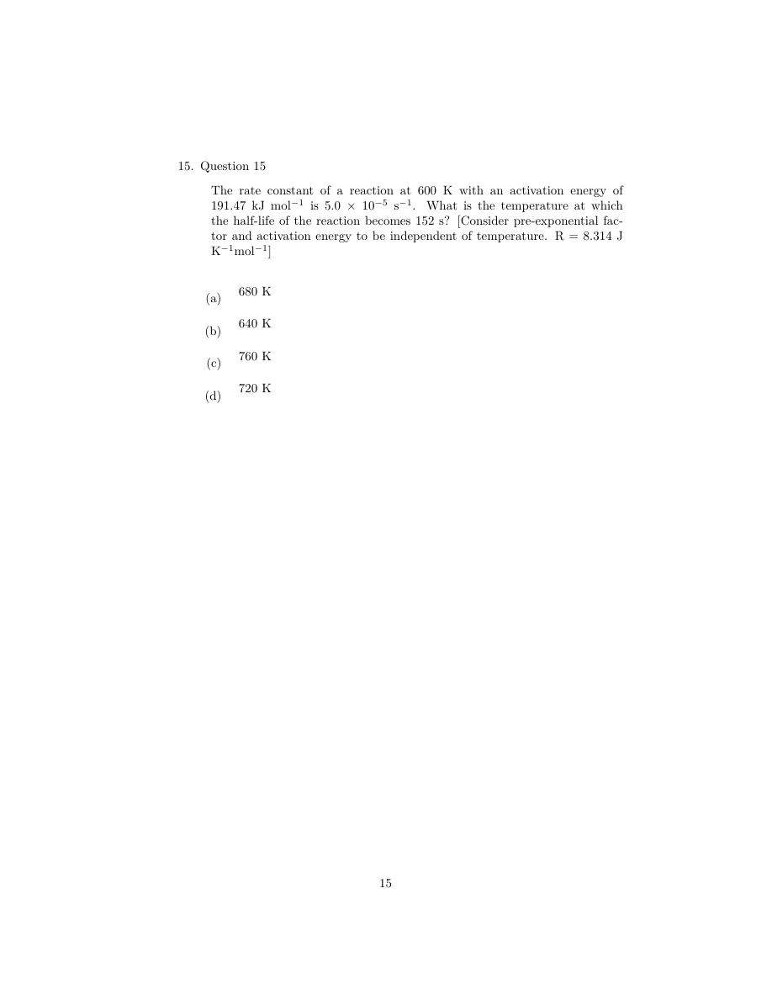

## PDF page 33

[Open original PDF at page 33](../pdf/IAT_2026_English_provisional_key.pdf#page=33)

### Searchable text - PDF text layer

```text
Mathematics
1. Question 1

                                                   What is    Let p(x) be a quadratic polynomial such that p(1) = p(−1) = 0.    the coefficient of x in p(x)?

    (a)  0
    (b)  1
    (c)  −1
    (d)  2


                                            1
```

### Original page image

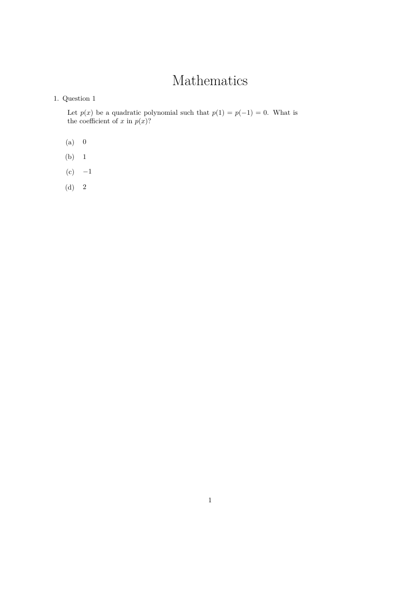

## PDF page 34

[Open original PDF at page 34](../pdf/IAT_2026_English_provisional_key.pdf#page=34)

### Searchable text - PDF text layer

```text
2. Question 2

    Consider the following sets of points in the complex plane
             {  (2nπ )     (2nπ )     }
                                                  and                    + i sin          A =  cos                                                                                : n ∈Z                           5                                        5
             {  (2n )     (2n )     }
                                                                                            .          B =  cos                    + i sin                                                                            : n ∈Z                           5                                       5

   Which of the following statements is TRUE?

    (a)  A is finite but B is infinite.

    (b)  A is finite and B is also finite.

    (c)  A is infinite but B is finite.

    (d)  A is infinite and B is also infinite.


                                            2
```

### Original page image

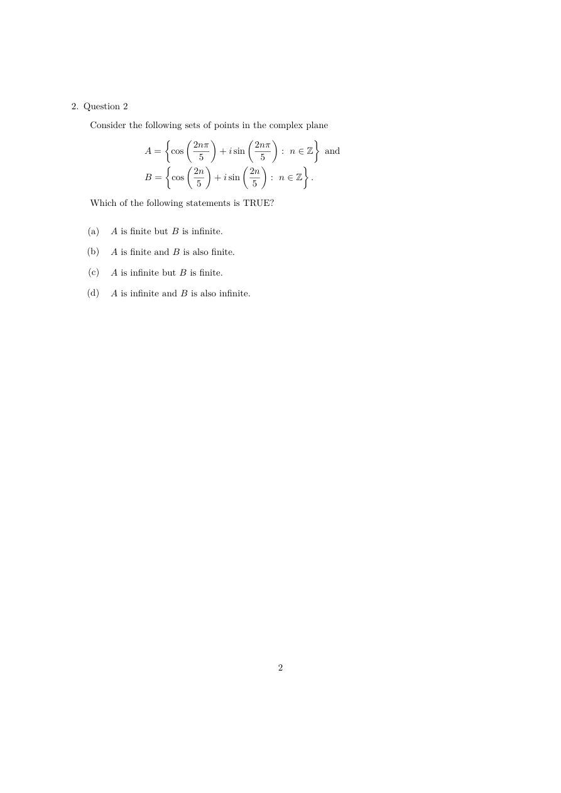

## PDF page 35

[Open original PDF at page 35](../pdf/IAT_2026_English_provisional_key.pdf#page=35)

### Searchable text - PDF text layer

```text
3. Question 3

                                                      Which of    Consider the points A(4ˆi + ˆj + 3ˆk), B(2ˆj) and C(−4ˆi + 3ˆj −3ˆk).    the following statements is TRUE?

    (a)  A, B and C are collinear.
    (b)  AB−−→ + 3−−→BC is perpendicular to AC.−→
    (c)  AB−−→  BC−−→ = ˆi + ˆj + ˆk.        ×
    (d)  AB,−−→ BC−−→ and CA−→ are mutually perpendicular.


                                            3
```

### Original page image

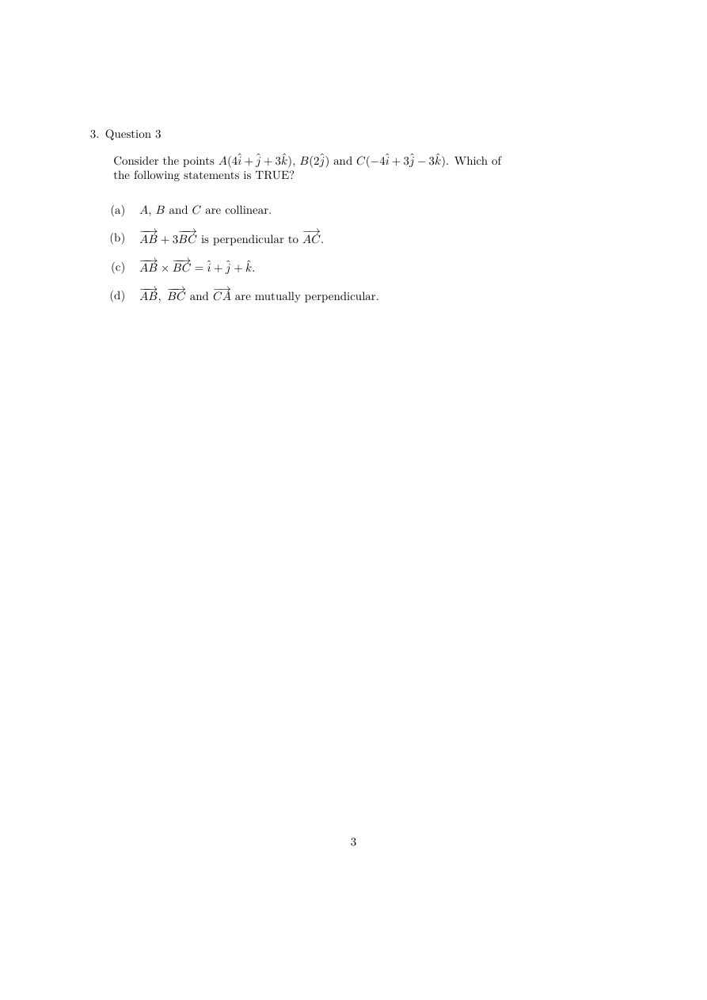

## PDF page 36

[Open original PDF at page 36](../pdf/IAT_2026_English_provisional_key.pdf#page=36)

### Searchable text - PDF text layer

```text
4. Question 4
    Let l1 be the line joining (1, 1, 1) and (3, 1, 3) and let l2 be the line joining
            and (2, 0, 3). What is the angle between l1 and l2?     (0, 2, −1)

    (a)   30o

    (b)   60o

    (c)   45o

    (d)   90o


                                            4
```

### Original page image

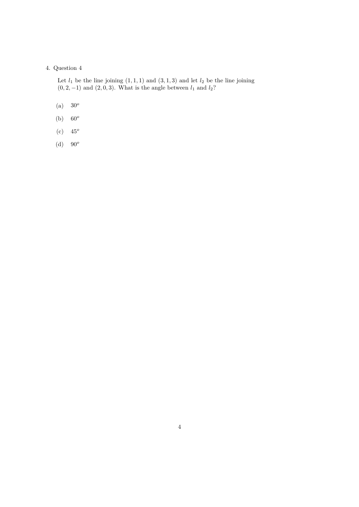

## PDF page 37

[Open original PDF at page 37](../pdf/IAT_2026_English_provisional_key.pdf#page=37)

### Searchable text - PDF text layer

```text
5. Question 5

                                    What is the total number of    Let r, l be two integers such that r ≥l ≥3.    functions
                        f : {1, 2,                                                        . . . , r} →{1, 2,                                                                                . . . , r}
    such that f(1), f(2), . . . , f(l) are all distinct?

    (a)   rr−l+1(r −1)(r −2) · · · (r −l + 1)
    (b)   rr−l(r −1)(r −2) · · · (r −l + 1)
    (c)   r(r −1)(r −2) · · · (r −l + 1)
    (d)   rr


                                            5
```

### Original page image

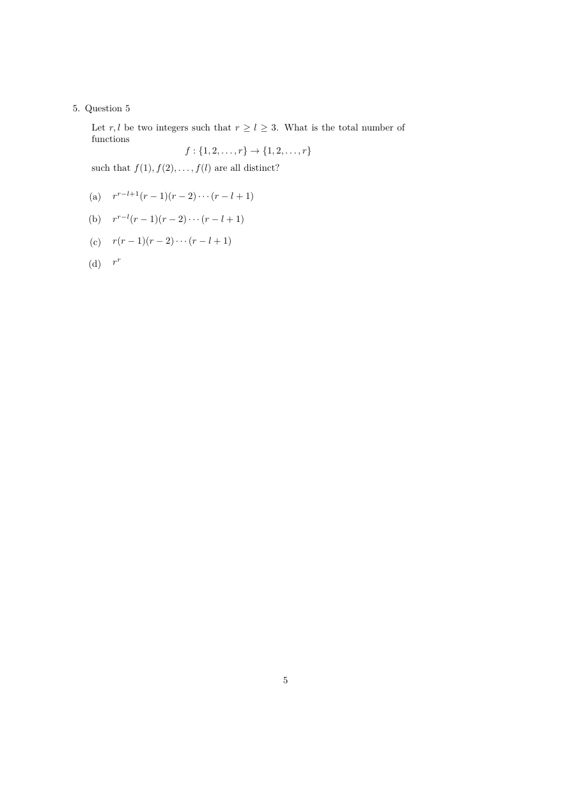

## PDF page 38

[Open original PDF at page 38](../pdf/IAT_2026_English_provisional_key.pdf#page=38)

### Searchable text - PDF text layer

```text
6. Question 6
    Let C be the set of all the circles in a plane. If
            =     C2)        C1 and C2          R   {(C1,   ∈C × C |             intersect},
    then which of the following statements is TRUE?

    (a)       is reflexive and symmetric but not transitive.     R
    (b)       is reflexive and transitive but not symmetric.     R
    (c)       is symmetric and transitive but not reflexive.     R
    (d)       is not a relation.     R


                                            6
```

### Original page image

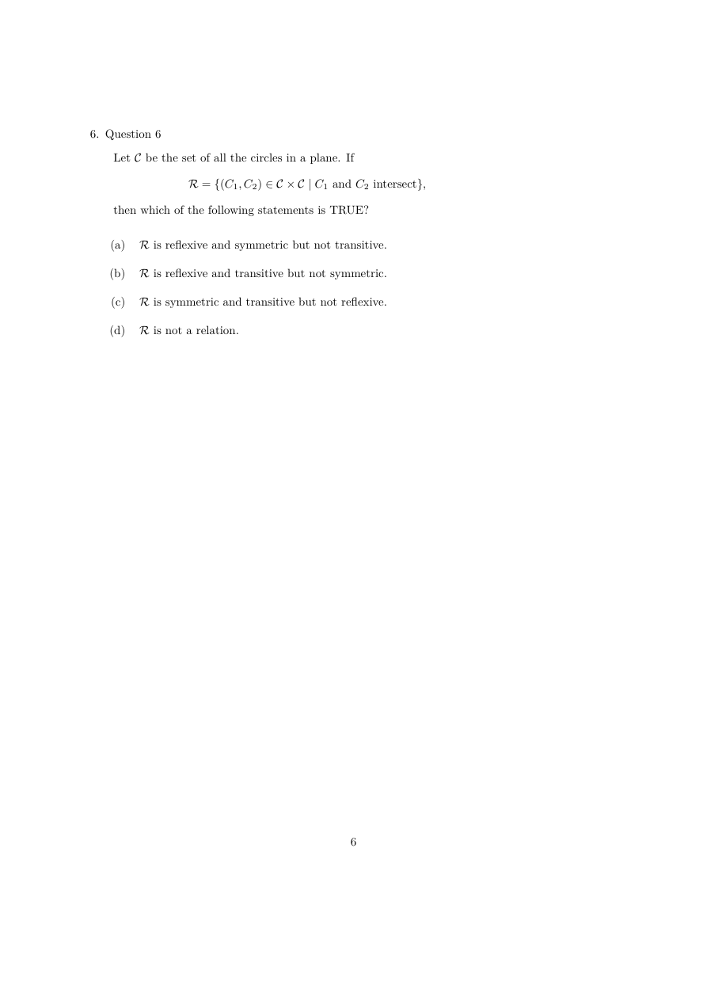

## PDF page 39

[Open original PDF at page 39](../pdf/IAT_2026_English_provisional_key.pdf#page=39)

### Searchable text - PDF text layer

```text
7. Question 7
                ∫2
   What is the value of                                         dx?                        min{1 −x, 1 −x3}                       −1
    (a)  −1
    (b)  0
    (c)  1
    (d)  2


                                            7
```

### Original page image


## PDF page 40

[Open original PDF at page 40](../pdf/IAT_2026_English_provisional_key.pdf#page=40)

### Searchable text - PDF text layer

```text
8. Question 8

    Consider the data of scores obtained by students in an examination. If the
     score of every student is increased by 2 marks, then which of the following
    statements is TRUE?

    (a)  The mean deviation about the mean does not change.

    (b)  The mean deviation about the mean is increased by 2.

    (c)  The mean deviation about the median is increased by 2.

    (d)  The variance is increased by 2.


                                            8
```

### Original page image

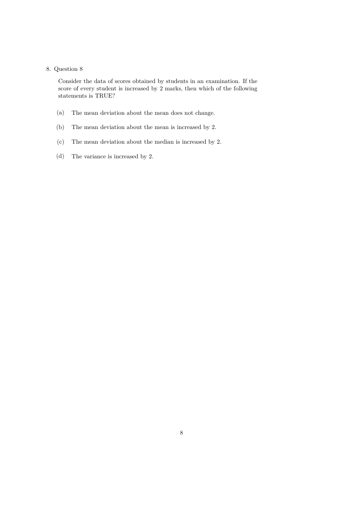

## PDF page 41

[Open original PDF at page 41](../pdf/IAT_2026_English_provisional_key.pdf#page=41)

### Searchable text - PDF text layer

```text
9. Question 9
    Consider the function f  : R →R                                       defined by f(x) = sin2(7x) −sin2(5x).   Which of the following statements is NOT TRUE?
                   (3π  )    (a)  f is increasing on         , 2π   .                           2
                      (    )
    (b)  f(x) > 0, for all x     0, π   .                  ∈    48
        (    )
    (c)  f  x + π            + f(x) = 0, for all x ∈R.               2
        (  )
    (d)  f  π  = 0           12


                                            9
```

### Original page image

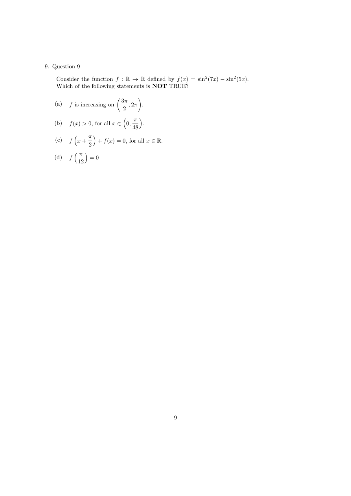

## PDF page 42

[Open original PDF at page 42](../pdf/IAT_2026_English_provisional_key.pdf#page=42)

### Searchable text - PDF text layer

```text
10. Question 10

                                                              given by     For real numbers a and b, consider the function f : R →R
                
                −ax −b     if x < −1,
                      f(x) =  5x + 1        if                        −1 ≤x ≤1,                             a2x + 3b     if x > 1.

    How many pairs (a, b) are there for which f is continuous at every point of
    R?

     (a)  0
     (b)  1
      (c)  2
     (d)   infinitely many


                                             10
```

### Original page image

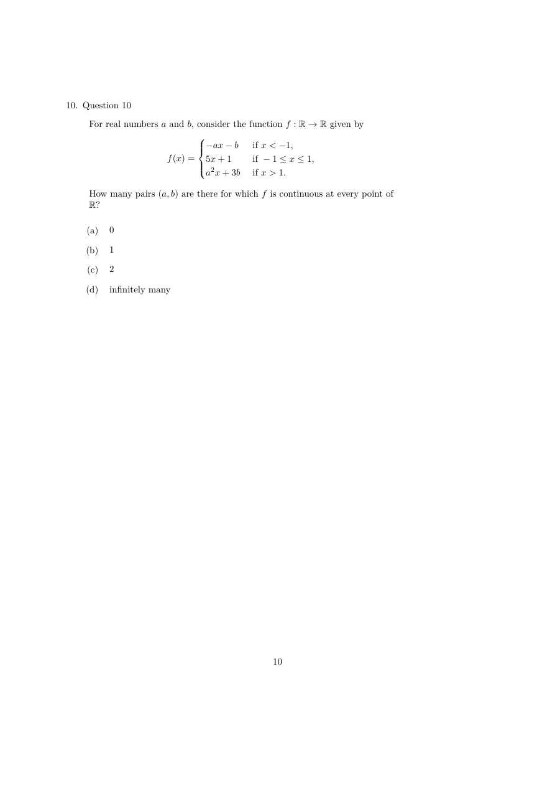

## PDF page 43

[Open original PDF at page 43](../pdf/IAT_2026_English_provisional_key.pdf#page=43)

### Searchable text - PDF text layer

```text
11. Question 11
     For a 2  2 matrix A, whose elements are real numbers, denote by Am the        ×     product AA            A                                    , where m is a positive integer.  Define x0 = 0, x1 = 1,              |  {z                     }                             · · ·
          m times
     xn =   +       for all n    and         xn−1   xn−2,     ≥2
                           xn+1   xn                  An =                        , for all n                            xn               ≥1.                                 xn−1

    Which of the following statements is TRUE for all m                                       ≥3?
     (a)  Am1 = Am−11  + Am−21
     (b)  det(Am) = −1     ]       ]                      [1  0    [0  0
      (c)  Am1 −Am−11  + 0  1 =  0  0
                      [1  0 ]   [0  0 ]     (d)  Am           =         −Am−1 − 0  1     0  0


                                             11
```

### Original page image

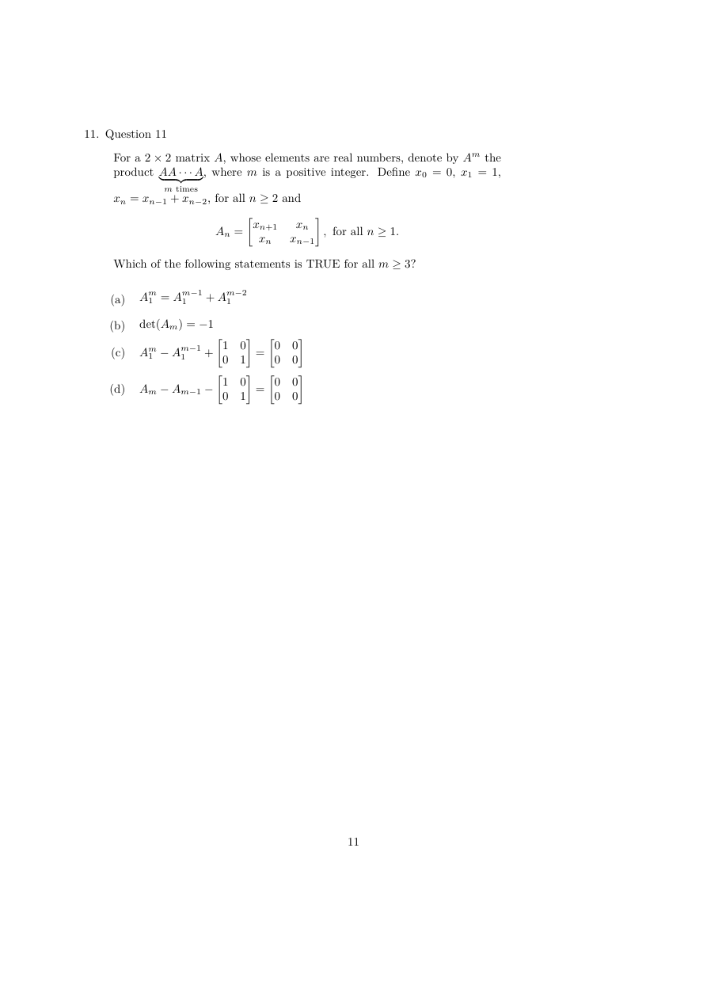

## PDF page 44

[Open original PDF at page 44](../pdf/IAT_2026_English_provisional_key.pdf#page=44)

### Searchable text - PDF text layer

```text
12. Question 12

     Let a1, a2, a3, . . . be a geometric progression of positive integers such that
                           an+1 for all positive integers n. What is the value     a1 = 3 and an+2 −2an =      of a1 + a2 + a3 + a4 + a5?

     (a)  93
     (b)  120
      (c)  255
     (d)  99


                                             12
```

### Original page image

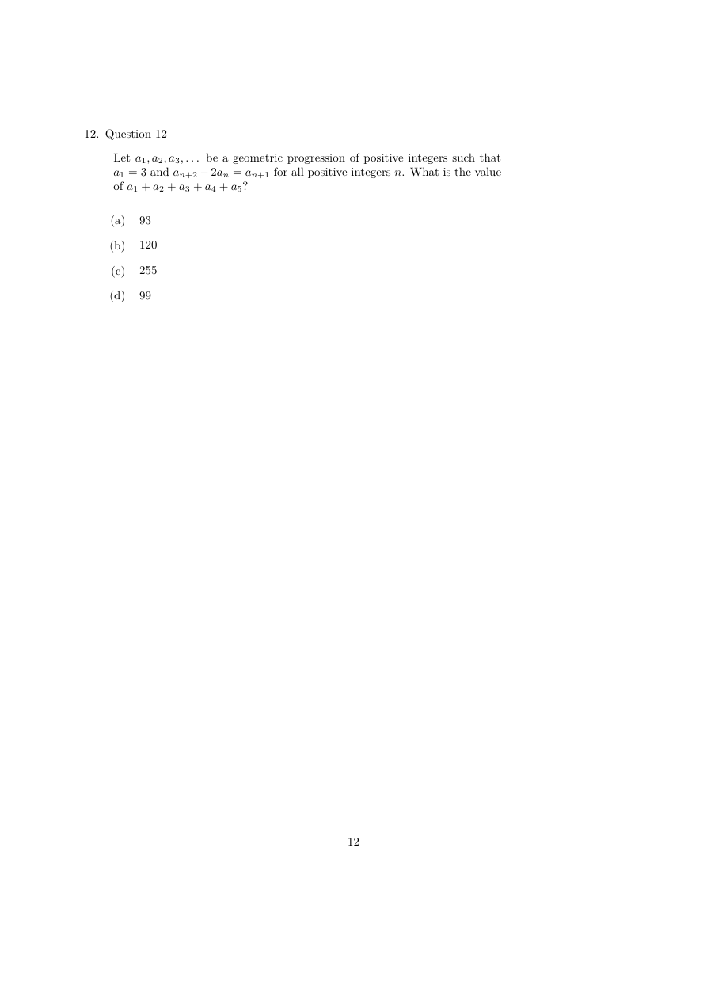

## PDF page 45

[Open original PDF at page 45](../pdf/IAT_2026_English_provisional_key.pdf#page=45)

### Searchable text - PDF text layer

```text
13. Question 13
     Let n = 2026. What is the remainder when 49n + 41n + 10n is divided by
     100?

     (a)  2
     (b)  1
      (c)  90
     (d)  49


                                             13
```

### Original page image

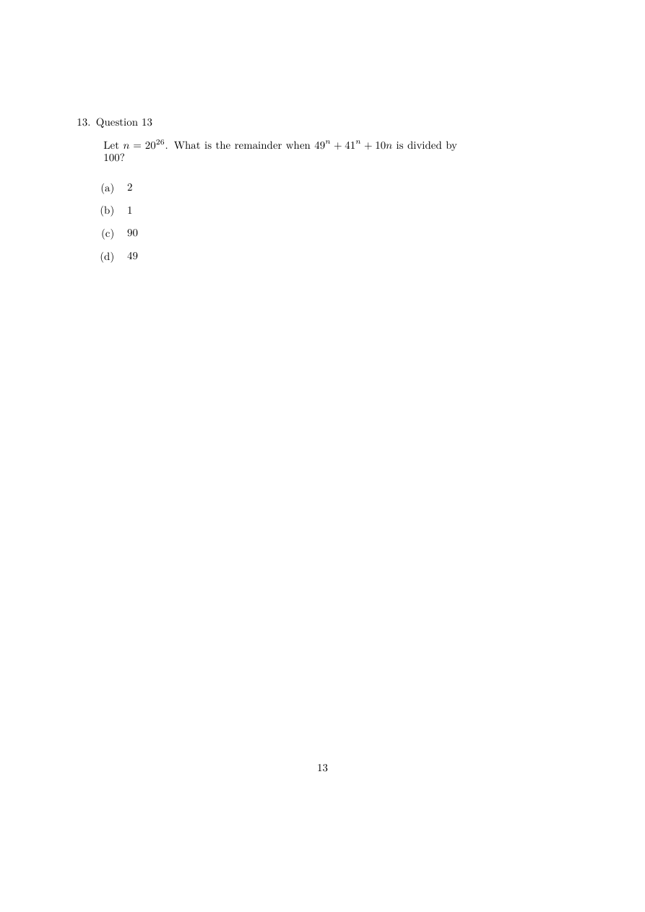

## PDF page 46

[Open original PDF at page 46](../pdf/IAT_2026_English_provisional_key.pdf#page=46)

### Searchable text - PDF text layer

```text
14. Question 14
     Suppose there are two boxes B1 and B2, each having 3 red and 4 black
      balls. One ball is drawn at random from B1. If it is red, 4 red balls are put
      into B2, otherwise 3 black balls are put into B2. Then one ball is randomly
     drawn from B2. If this ball is red, what is the conditional probability that
     the ball drawn from B1 was also red?

     (a)   35
          57
     (b)   99
          257
      (c)   3
          7
     (d)   33
          53


                                             14
```

### Original page image

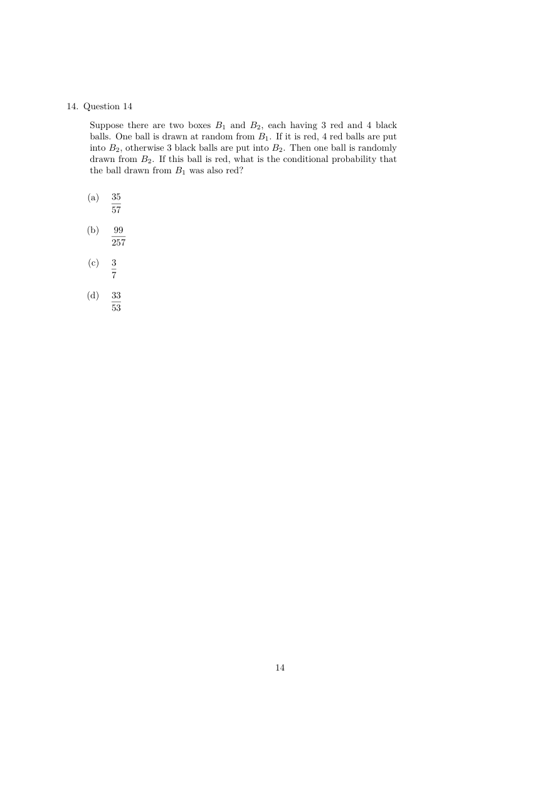

## PDF page 47

[Open original PDF at page 47](../pdf/IAT_2026_English_provisional_key.pdf#page=47)

### Searchable text - PDF text layer

```text
15. Question 15

                  be the function given by     Let f : R →R
                     f(x) =    +     +                    .                                |x −2|   3|x −1|   ||x −2| −1|
    What is the number of points where f is NOT differentiable?

     (a)  2
     (b)  1
      (c)  0
     (d)  3


                                             15
```

### Original page image

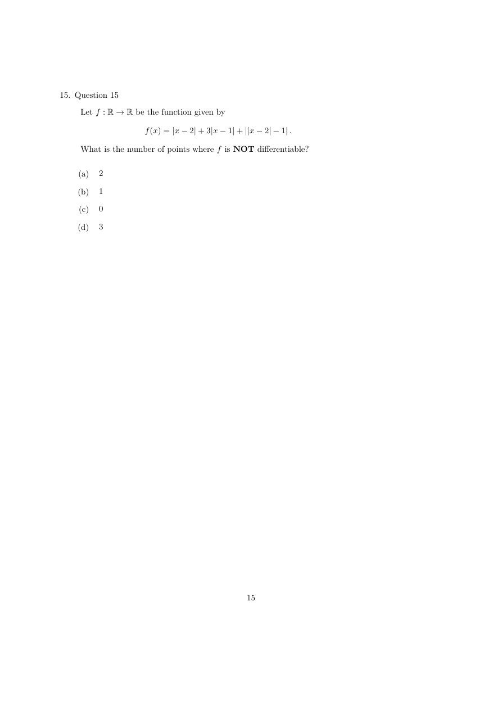

## PDF page 48

[Open original PDF at page 48](../pdf/IAT_2026_English_provisional_key.pdf#page=48)

### Visual description

Physics Q1: a spring fixed to the left wall pushes a cube that touches a sphere on a smooth horizontal floor. The sphere can strike a separate rigid right wall; the arrangement sets up contact, separation and collision stages.

### Searchable text - PDF text layer

```text
Physics
1. Question 1
   A sphere and a cube of equal masses on a horizontal frictionless floor, are
    confined between two vertical walls, as shown in the figure. The cube is
    attached to the wall by a massless spring. At the equilibrium position of
    the spring, the sphere just touches the cube. The cube is moved towards
    the left by a small amount ℓfrom its equilibrium position, compressing the
    spring and is released at t = 0. The system keeps returning to its initial
    configuration as that of t = 0 with a time period T. If all the collisions are
     elastic, which of the following statements is correct?


             If ℓincreases, T decreases.
    (a)
             If ℓincreases, T does not change.
    (b)
             If ℓincreases, T increases.
    (c)
        The sphere never moves.
    (d)


                                            1
```

### Original page image

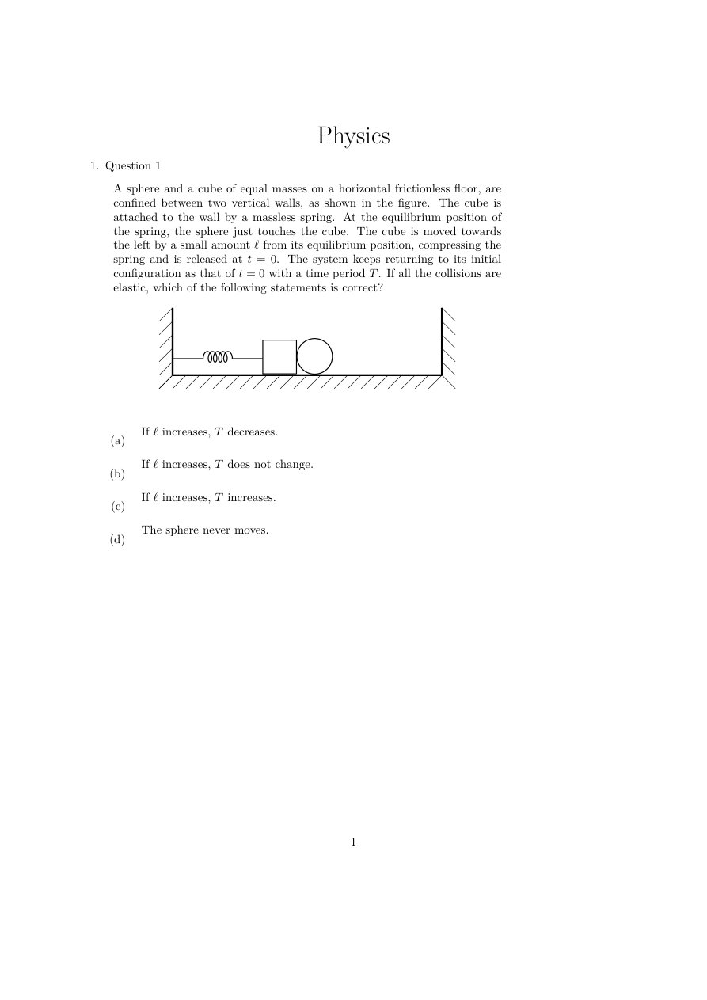

## PDF page 49

[Open original PDF at page 49](../pdf/IAT_2026_English_provisional_key.pdf#page=49)

### Visual description

Physics Q2: a concave mirror and a double-convex lens face one another on a common principal axis. Their common focal-point arrangement and the 50 cm mirror-to-lens separation are labelled.

### Searchable text - PDF text layer

```text
2. Question 2
   A spherical concave mirror of focal length 10 cm and a double convex lens
     of focal length 5 cm are arranged on the common principal axis as shown in
    the figure. A small object is placed on the principal axis between the focal
    points F1 and F2 of the mirror and the lens, respectively.  If two real and
    mutually inverted images are formed by the lens at the same location on
    the principal axis, what is the distance of the object from the mirror on the
     principal axis?


                       F1                 F2

                               50 cm


         20 cm    (a)
         30 cm    (b)
         25 cm    (c)
         12 cm    (d)


                                            2
```

### Original page image

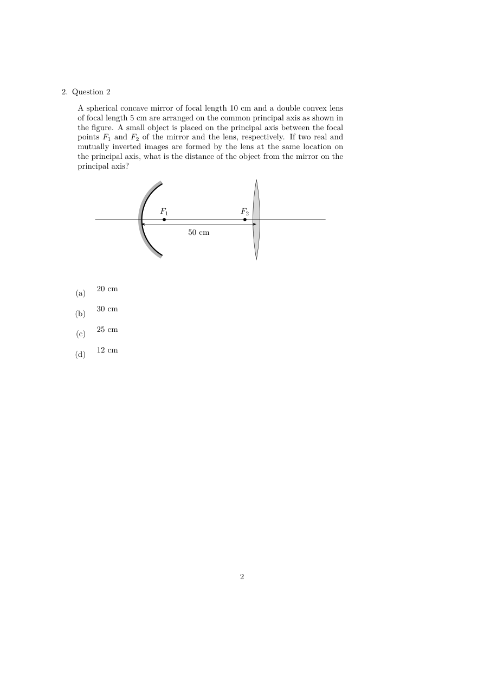

## PDF page 50

[Open original PDF at page 50](../pdf/IAT_2026_English_provisional_key.pdf#page=50)

### Searchable text - PDF text layer

```text
3. Question 3
   A simple pendulum of length L, mass m and electric charge q on its bob
      is oscillating with a time period T under uniform gravity which is in the
    −ˆz direction. Upon applying a uniform electric field |E|ˆn (where ˆn is a    unit vector in the plane of oscillation), the time period of the pendulum
     decreases. Which of the following statements is NOT correct?

          q is positive and ˆn = ˆz
    (a)
          q is positive and ˆn = −ˆz    (b)
          q is negative and ˆn = ˆz
    (c)

          q is positive and ˆn                        √2                                              ·                                              ˆz = −1    (d)


                                            3
```

### Original page image

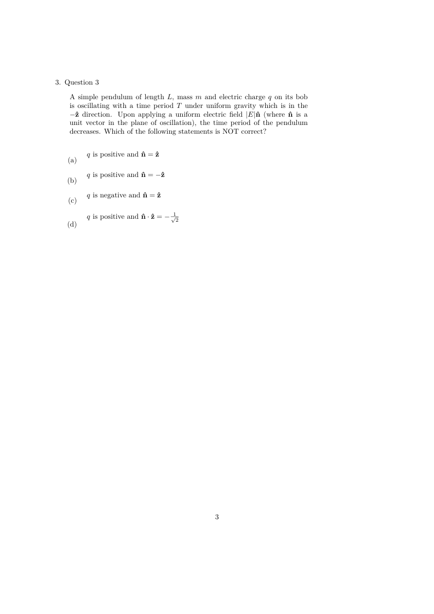

## PDF page 51

[Open original PDF at page 51](../pdf/IAT_2026_English_provisional_key.pdf#page=51)

### Searchable text - PDF text layer

```text
4. Question 4
   A particle of mass m1 and electric charge q starts from rest under the
     influence of a uniform external electric field E to travel a distance d in time
     t1.  If the particle had mass m2, it would take time t2 to travel the same
     distance. What is the ratio t1 ?
                                      t2

     rm1
         m2
    (a)
     rm2
         m1
    (b)

       m2
       m1    (c)

       m1
       m2    (d)


                                            4
```

### Original page image

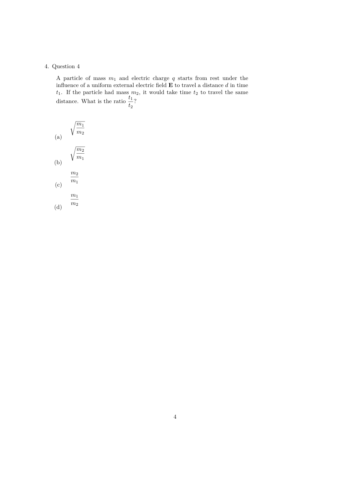

## PDF page 52

[Open original PDF at page 52](../pdf/IAT_2026_English_provisional_key.pdf#page=52)

### Searchable text - PDF text layer

```text
5. Question 5
   An exotic spherical jellyfish has a bulk modulus B. Close to the surface of
    the sea (depth d=0), its radius is R. When it dives to a depth d (d ≫R), its    radius is reduced by ∆R > 0. Given the density of the incompressible sea
    water ρ, and the uniform acceleration due to gravity g such that ρgd ≪B,       ∆R    what is     ?
        R


                           1/3
          1    1   B       −   −ρgd
    (a)

                           2/3
          1    1   B       −   −ρgd
    (b)

                       2/3
           1 + ρgdB   −1
    (c)

                       1/3
           1 + ρgdB   −1
    (d)


                                            5
```

### Original page image

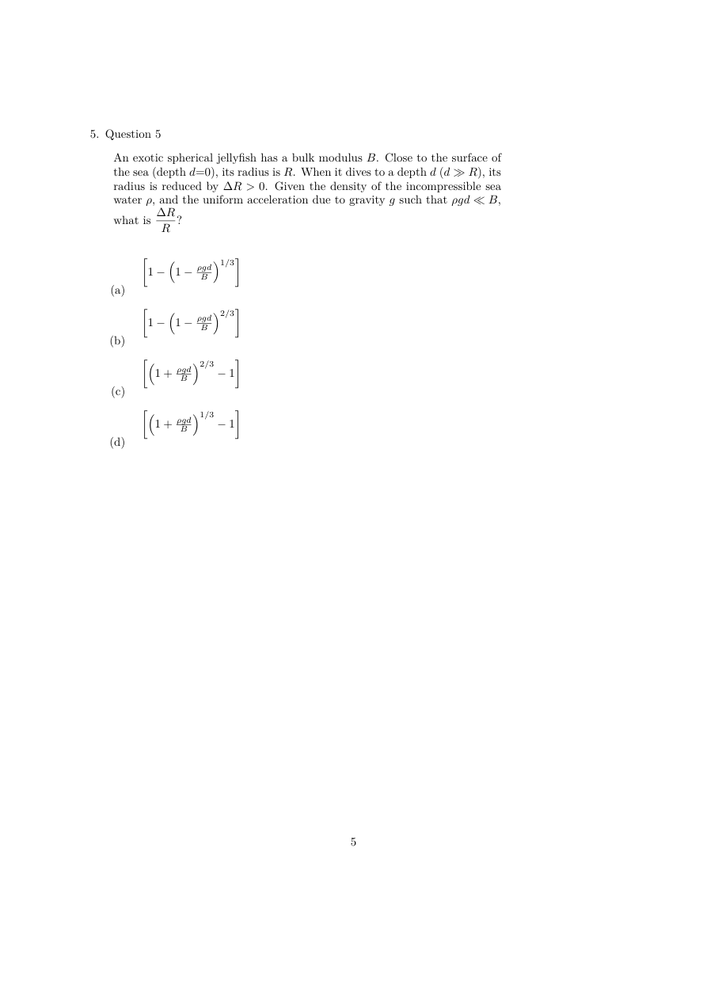

## PDF page 53

[Open original PDF at page 53](../pdf/IAT_2026_English_provisional_key.pdf#page=53)

### Searchable text - PDF text layer

```text
6. Question 6
   A planet is revolving in a circular orbit with a time period T around the
    center of a star solely under the gravity of the star. Suppose the distance
    between the star and the planet is halved.  The individual radii of the
     star and the planet are also halved, keeping their uniform mass densities
    unchanged. What will be the time period of the new orbit of the planet?

    (a)  T
        2T    (b)

        T
         2    (c)

        T
         4    (d)


                                            6
```

### Original page image


## PDF page 54

[Open original PDF at page 54](../pdf/IAT_2026_English_provisional_key.pdf#page=54)

### Searchable text - PDF text layer

```text
7. Question 7
   The position of a particle of mass 1 kg at time t is given by r = tˆi+ ˆj+2 t2 ˆk,
    where t is in seconds and the coefficients have the proper units for r to be
     in metres. What is the component of the angular momentum (with respect
    to the origin) in kg m2 s−1 along the vector (ˆi +ˆj)?


            1
       √2(4t −2t2)    (a)

       √            12(4t + 6t2)
    (b)

          4t    (c)    −2t2
          4t + 6t2    (d)


                                            7
```

### Original page image


## PDF page 55

[Open original PDF at page 55](../pdf/IAT_2026_English_provisional_key.pdf#page=55)

### Searchable text - PDF text layer

```text
8. Question 8
   A long solenoid of initial radius R0 is put in a region of uniform magnetic
     field B with the axis of the solenoid aligned along the magnetic field. The
     solenoid is a part of a closed circuit that has no initial current running
    through it. If the radius of the solenoid starts increasing at a uniform rate,
   how do the magnetic field strength Bin and the associated magnetic energy
    Uin inside the solenoid change?

        Bin decreases, Uin decreases.
    (a)
        Bin increases, Uin decreases.
    (b)
        Bin increases, Uin increases.
    (c)
        Bin decreases, Uin increases.
    (d)


                                            8
```

### Original page image


## PDF page 56

[Open original PDF at page 56](../pdf/IAT_2026_English_provisional_key.pdf#page=56)

### Searchable text - PDF text layer

```text
9. Question 9
   The acceleration of a point particle is given by the equation
                           d2x    x     dx                     = α   + β
                                                 dt                                 dt2      |x|7
    where x denotes position and t denotes time.  Which of the following
     relations show the correct dimensions for α and β?


                                          [α] = [M 0L7T −2]
                                           [β] = [M 0L0T −1]
    (a)

                                          [α] = [M 1L6T −2]
                                           [β] = [M 0L0T −3]
    (b)

                                          [α] = [M 0L6T −1]
                                           [β] = [M 0L1T −2]
    (c)

                                          [α] = [M 0L7T −2]
                                           [β] = [M 0L0T 0]

    (d)


                                            9
```

### Original page image


## PDF page 57

[Open original PDF at page 57](../pdf/IAT_2026_English_provisional_key.pdf#page=57)

### Searchable text - PDF text layer

```text
10. Question 10
     Consider normal incidence of a monochromatic beam of photons of power
    P on a flat surface. Of the incident beam, 10% gets absorbed, 10% gets
     transmitted, and the rest is reflected by the flat surface. If c is the speed of
       light, what is the force exerted on the flat surface by the beam?

           1.7 Pc     (a)
           1.8 Pc     (b)
           1.6 Pc      (c)
           0.9 Pc     (d)


                                             10
```

### Original page image


## PDF page 58

[Open original PDF at page 58](../pdf/IAT_2026_English_provisional_key.pdf#page=58)

### Searchable text - PDF text layer

```text
11. Question 11
    An experimental study of the photoelectric effect involves a metal of work
      function ϕ0. What is the smallest wavelength of the incident photon to
     photoemit an electron of mass m which has the same de Broglie wavelength
      as that of the incident photon? [Given h is the Planck’s constant, c is the
     speed of light, and ϕ0 ≪mc2]

         r      !−1
         h   1 +  1        mc       −2ϕ0mc2
     (a)
         r      !−1
         h   1    1        mc  −   −2ϕ0mc2
     (b)
         r      !−1
         h   1    1        mc  −  −ϕ0mc2
      (c)
         r      !−1
         h   1 +  1        mc     −ϕ0mc2
     (d)


                                             11
```

### Original page image


## PDF page 59

[Open original PDF at page 59](../pdf/IAT_2026_English_provisional_key.pdf#page=59)

### Searchable text - PDF text layer

```text
12. Question 12
    The three numbers: (number of protons, number of neutrons, the radius)
      characterize a nucleus. What is the value of r1 for two nuclei characterized
                                                    r2
     by (1, 0, r1) and (4, 4, r2)?

          1
          2     (a)
          2     (b)
          8      (c)
          1
          8     (d)


                                             12
```

### Original page image


## PDF page 60

[Open original PDF at page 60](../pdf/IAT_2026_English_provisional_key.pdf#page=60)

### Searchable text - PDF text layer

```text
13. Question 13
   A jar is filled with two monoatomic non-interacting gases A and B with
      total masses MA and MB, respectively. The molar mass of A is double the
     molar mass of B.  If the jar is kept at temperature T, what is the ratio of
     the total pressure of the combined gas to the partial pressure due to the gas
    A?

          1 + 2MB
         MA     (a)
             1 MB          1 +             2 MA     (b)
             1 MA          1 +             2 MB      (c)

          1 + 2MA
         MB     (d)


                                             13
```

### Original page image


## PDF page 61

[Open original PDF at page 61](../pdf/IAT_2026_English_provisional_key.pdf#page=61)

### Visual description

Physics Q14: three infinite charged sheets are drawn as parallel vertical lines separated by d/2. A spherical Gaussian surface crosses the middle region and has a marked centre; its left and right hemispheres are distinguished. The sheet charge densities are labelled sigma, sigma and 2sigma.

### Searchable text - PDF text layer

```text
14. Question 14

     Three infinite plane sheets which have uniform positive surface charge
      densities σ, σ and 2σ, are arranged parallel to each other with a separation
      of d as shown in the figure. A spherical Gaussian surface S of radius d/2 has
       its center on the middle sheet. Which of the following statements regarding
     the electric flux ΦL through the left hemisphere and the electric flux ΦR
     through the right hemisphere of the Gaussian surface is correct?

                         σ      σ      2σ
                                 d      d
                              S

                                      d/2


                                     Left     Right


        ΦL > ΦR.     (a)
        ΦL < ΦR.     (b)
        ΦL = ΦR.      (c)
        ΦL = 2ΦR.     (d)


                                             14
```

### Original page image


## PDF page 62

[Open original PDF at page 62](../pdf/IAT_2026_English_provisional_key.pdf#page=62)

### Searchable text - PDF text layer

```text
15. Question 15
     Consider two Carnot engines of efficiencies η1 and η2.  The first engine
     absorbs heat Q1 from a heat reservoir A and releases heat Q2 to a heat
      reservoir B. The second engine takes heat Q2 from B and releases heat Q3
      to a heat reservoir C.  If Q1 > Q2 > Q3, what is the net efficiency of this
     combination of the two Carnot engines?

           η1 + η2     (a)        −η1η2
           η1 + η2 + η1η2     (b)

           η1η2      (c)
           η1 + η2     (d)


                                             15
```

### Original page image


