# IAT 2026 - Hindi - provisional key paper

Original PDF: [IAT_2026_Hindi_provisional_key.pdf](../pdf/IAT_2026_Hindi_provisional_key.pdf)

- Acquisition: SciAstra CloudFront mirror; not downloaded from the official server.
- Downloaded: 28 October 2026. PDF pages: 62.
- Exact download/source URL: https://d2aaa7ts7sm3bp.cloudfront.net/pdfs/01KTGTQYRTGAC999ZSH1HVA2MY.pdf
- PDF SHA-256: `6801bf208dd48964b18daf0a053adc9689275dcacea6225a0849a3933cb6a09c`
- This is a search/accessibility copy of an existing paper, not newly authored mock content.
- Text is mechanically extracted or OCR-derived and has not been proofread character by character. Equations, option letters, chemical bonds, tables and Hindi OCR can contain errors. The PDF and page images are authoritative.
- Figure descriptions are explanatory annotations, not official answers or complete structural/formula transcriptions. Use the linked image to resolve exact labels, values and stereochemistry.

**Provisional status:** the PDF cover is dated 07-06-2026 and explicitly says option (a) is correct for all listed questions. This is an answer-key ordering, not evidence of the examination display order. This file has not been verified against a final key.

## Visual guide

The following descriptions refer to **PDF page numbers in the English companion**, because Hindi pagination can differ. The Hindi page images below retain every original diagram; identical embedded images are additionally cross-linked where matched by image digest.

- [English PDF page 3](IAT_2026_English_provisional_key.md#pdf-page-3): Biology Q2: a table links dicot/monocot roots and stems to their vascular-bundle arrangements. Preserve labels P-S and i-iv across the columns.
- [English PDF page 4](IAT_2026_English_provisional_key.md#pdf-page-4): Biology Q3: three population-versus-time panels compare P alone, Q alone and P+Q together. Each isolated population rises to a plateau; in the combined panel Q remains high while P rises briefly and then declines.
- [English PDF page 6](IAT_2026_English_provisional_key.md#pdf-page-6): Biology Q5: enzyme-velocity plots (a) and (b) mark Vmax and substrate concentration [S]. Both rise towards saturation, but have different substrate concentrations at half the maximum velocity. More choices continue on page 7.
- [English PDF page 7](IAT_2026_English_provisional_key.md#pdf-page-7): Continuation of Biology Q5: velocity-versus-substrate plots (c) and (d), each with a dashed Vmax line, different saturation levels and different curvature. The question specifies Km=20.
- [English PDF page 10](IAT_2026_English_provisional_key.md#pdf-page-10): Biology Q8: two antiparallel DNA strands show 5-prime/3-prime labels, a terminator at the left and promoter/transcription-start annotations near the right. The written bases are shown between them; direction matters when identifying a coding strand.
- [English PDF page 13](IAT_2026_English_provisional_key.md#pdf-page-13): Biology Q11: four lac-operon schematics labelled i-iv arrange promoter/operator, regulatory gene i and structural genes z, y and a differently. Small segment labels are part of the question, not a decorative gene cartoon.
- [English PDF page 15](IAT_2026_English_provisional_key.md#pdf-page-15): Biology Q13: candidate nucleic-acid molecules include a base-paired RNA duplex, a single RNA sequence and a DNA-like sequence with T instead of U. Base-pairing bars and strand identity distinguish the options.
- [English PDF page 16](IAT_2026_English_provisional_key.md#pdf-page-16): Biology Q14: a large pedigree spans several generations. Filled symbols denote affected people; open symbols are unaffected; circles and squares distinguish sex. Trace parent-to-child links and affected sexes to compare inheritance models.
- [English PDF page 23](IAT_2026_English_provisional_key.md#pdf-page-23): Chemistry Q6: tert-butyl bromide reacts with hydroxide in ethanol, giving an alcohol and bromide. Structural drawings show the tertiary carbon and the bond being replaced.
- [English PDF page 24](IAT_2026_English_provisional_key.md#pdf-page-24): Chemistry Q7: four cyclic molecular drawings use solid wedges, dashed bonds and stereocentre substituents to test chirality. Ring connectivity alone is insufficient; preserve the stereochemical markings.
- [English PDF page 25](IAT_2026_English_provisional_key.md#pdf-page-25): Chemistry Q8: a silica-gel TLC plate has a baseline at 0 cm, solvent front at 5 cm, compound B spot at 1.25 cm and compound A spot at 3.75 cm. A central vertical line and dashed height guides locate the spots.
- [English PDF page 26](IAT_2026_English_provisional_key.md#pdf-page-26): Chemistry Q9: an aromatic compound carrying aldehyde groups reacts with concentrated NaOH to intermediate X, then excess HCl to P. Four answer pairs show different carboxylate/alcohol or cyclic-ester arrangements.
- [English PDF page 27](IAT_2026_English_provisional_key.md#pdf-page-27): Chemistry Q10: four aniline-derived amines P-S differ in methyl groups attached to nitrogen. Their N-H bonds and number of methyl substituents must be distinguished for the pKb comparison.
- [English PDF page 29](IAT_2026_English_provisional_key.md#pdf-page-29): Chemistry Q12: four pairs of thermodynamic variables compare solid isothermal and dotted adiabatic curves/lines. Axes include P-V, U-V and T-V style plots, with one pressure-related inverse-volume plot; read each axis from the source image.
- [English PDF page 48](IAT_2026_English_provisional_key.md#pdf-page-48): Physics Q1: a spring fixed to the left wall pushes a cube that touches a sphere on a smooth horizontal floor. The sphere can strike a separate rigid right wall; the arrangement sets up contact, separation and collision stages.
- [English PDF page 49](IAT_2026_English_provisional_key.md#pdf-page-49): Physics Q2: a concave mirror and a double-convex lens face one another on a common principal axis. Their common focal-point arrangement and the 50 cm mirror-to-lens separation are labelled.
- [English PDF page 61](IAT_2026_English_provisional_key.md#pdf-page-61): Physics Q14: three infinite charged sheets are drawn as parallel vertical lines separated by d/2. A spherical Gaussian surface crosses the middle region and has a marked centre; its left and right hemispheres are distinguished. The sheet charge densities are labelled sigma, sigma and 2sigma.

## Page index

[p1](#pdf-page-1) | [p2](#pdf-page-2) | [p3](#pdf-page-3) | [p4](#pdf-page-4) | [p5](#pdf-page-5) | [p6](#pdf-page-6) | [p7](#pdf-page-7) | [p8](#pdf-page-8) | [p9](#pdf-page-9) | [p10](#pdf-page-10) | [p11](#pdf-page-11) | [p12](#pdf-page-12) | [p13](#pdf-page-13) | [p14](#pdf-page-14) | [p15](#pdf-page-15) | [p16](#pdf-page-16) | [p17](#pdf-page-17) | [p18](#pdf-page-18) | [p19](#pdf-page-19) | [p20](#pdf-page-20) | [p21](#pdf-page-21) | [p22](#pdf-page-22) | [p23](#pdf-page-23) | [p24](#pdf-page-24) | [p25](#pdf-page-25) | [p26](#pdf-page-26) | [p27](#pdf-page-27) | [p28](#pdf-page-28) | [p29](#pdf-page-29) | [p30](#pdf-page-30) | [p31](#pdf-page-31) | [p32](#pdf-page-32) | [p33](#pdf-page-33) | [p34](#pdf-page-34) | [p35](#pdf-page-35) | [p36](#pdf-page-36) | [p37](#pdf-page-37) | [p38](#pdf-page-38) | [p39](#pdf-page-39) | [p40](#pdf-page-40) | [p41](#pdf-page-41) | [p42](#pdf-page-42) | [p43](#pdf-page-43) | [p44](#pdf-page-44) | [p45](#pdf-page-45) | [p46](#pdf-page-46) | [p47](#pdf-page-47) | [p48](#pdf-page-48) | [p49](#pdf-page-49) | [p50](#pdf-page-50) | [p51](#pdf-page-51) | [p52](#pdf-page-52) | [p53](#pdf-page-53) | [p54](#pdf-page-54) | [p55](#pdf-page-55) | [p56](#pdf-page-56) | [p57](#pdf-page-57) | [p58](#pdf-page-58) | [p59](#pdf-page-59) | [p60](#pdf-page-60) | [p61](#pdf-page-61) | [p62](#pdf-page-62)

## PDF page 1

[Open original PDF at page 1](../pdf/IAT_2026_Hindi_provisional_key.pdf#page=1)

### Searchable text - OCR draft (hin+eng)

```text
IAT 2026 के लिए उत्तर कुंजी (प्रावधिक)
07-06-2026

महत्वपूर्ण टिप्पणी: यह दस्तावेज़ (प्रावधिक) उत्तर कुंजी (answer key) के
रूप में कार्य करता है। नीचे दिए गए सभी syfaarcuhy WH (multiple-choice
question) के लिए, विकल्प (a) ही सही उत्तर है।
```

### Original page image

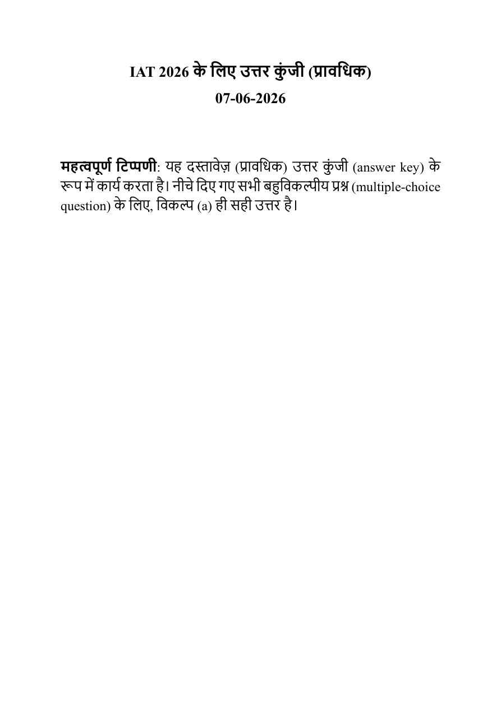

## PDF page 2

[Open original PDF at page 2](../pdf/IAT_2026_Hindi_provisional_key.pdf#page=2)

### Searchable text - OCR draft (hin+eng)

```text
जीव विज्ञान

d. प्रश्न 4

निम्नलिखित A से कौन सी प्रक्रियाएं प्रकाश संश्लेषण के दौरान थाइलेकोडड
झिल्ली के आर-पार प्रोटॉन प्रवणता के विकास में क्रियान्वित होती हैं?

i. प्लास्टोक्विनीन द्वारा थाइलेकोइड की अवकाशिका मे viciew की मुक्ति

ii, एनएडीपी+ (NADP+) के अपचयन के दौरान पीठिका में प्रोटॉन्स का उपभोग
ii, एटीपी eta द्वारा थाइलेकोइड की अवकाशिका में icles की मुक्ति

iv. Stet विघटन प्रतिक्रिया द्वारा थाइलेकोइड की अवकाशिका में प्रोटॉन्स की मुक्ति

i, ii एवं iv

(a)

(b)

i, iii एवं iv

(०)

i, ii एवं iii

(4)
```

### Original page image

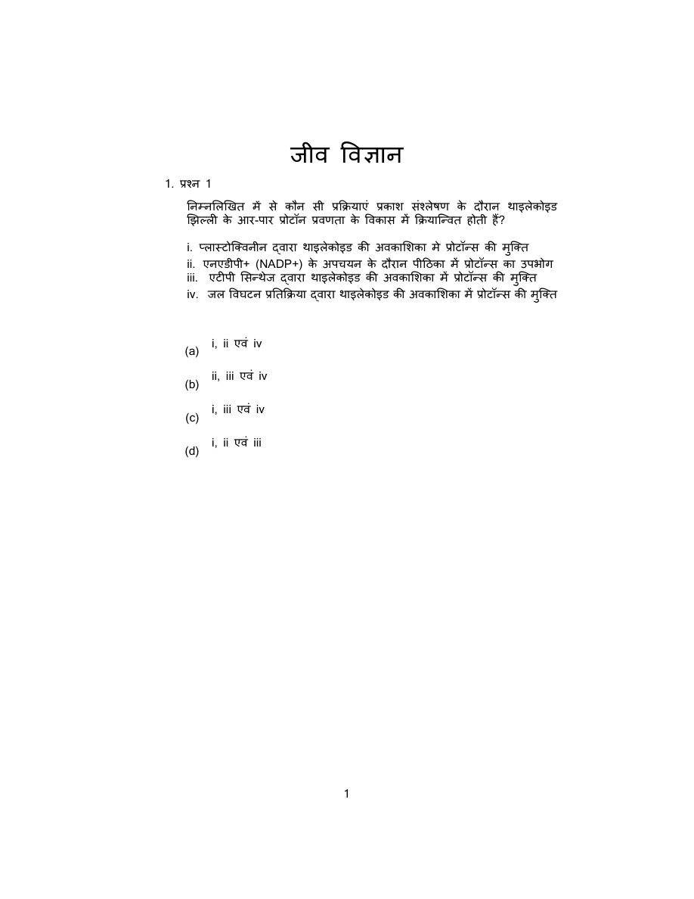

## PDF page 3

[Open original PDF at page 3](../pdf/IAT_2026_Hindi_provisional_key.pdf#page=3)

### Searchable text - OCR draft (hin+eng)

```text
2. प्रश्न 2

निम्नलिखित में से कौन सा विकल्प स्तम्भ | में दिए गए अंगों को स्तम्भ ॥ में
विवरणित उनके संवहनी तंत्र की व्यवस्था से मेल करता है?

स्तम्भ। स्तम्भ ॥
le. | . | द्विबीजपत्री मूल i. | अरीय, खुला, द्वि-आदिदारुक से चतुर्‌-आदिदारुक
la. | द्विबीजपत्री तना ii, | छल्ला, संयुक्त, खुला

ir | एकबीजपत्री मूल ii, | अरीय, बंद, बहु-आदिदारुक

5. | एकबीजपत्री तना iv. | बिखरा हुआ, संयुक्त, बंद

? - (i); Q - (ii); R - (ili); $ - (iv)

(9)

७) 7 00 9 - 0) R= Gy; 8 - Gi
Po Midi 9 - ER - 0; 9 - 0)
a POM QE १ - 0) 9 =
```

### Original page image

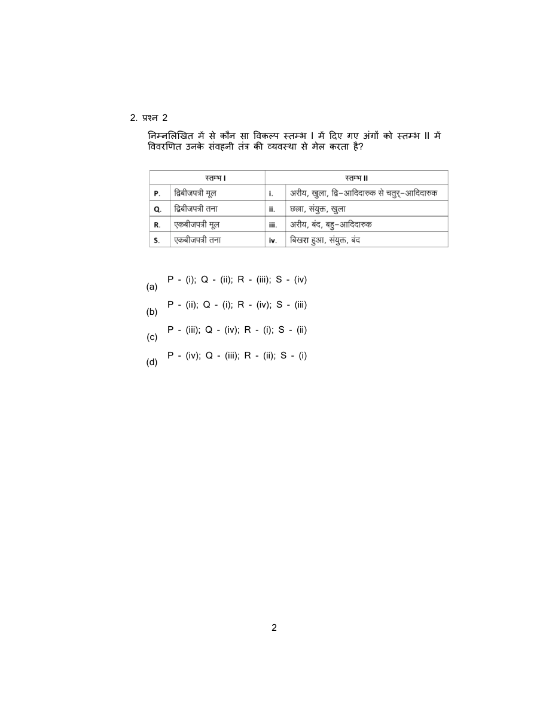

## PDF page 4

[Open original PDF at page 4](../pdf/IAT_2026_Hindi_provisional_key.pdf#page=4)

### Searchable text - OCR draft (hin+eng)

```text
3. प्रश्न 3

निम्नलिखित आरेख दो जीवों, नामानुसार ? और 0, के अकेले और साथ-साथ
में वृद्धि के प्रतिरूप को प्रदर्शित करते हैं। इन वृद्धि प्रतिरूप के आधार पर
निम्नलिखित में से कौन सा वक्तव्य सही है?

गा a ~

व्यष्टियों की संख्या
व्यष्टियों की संख्या

समय समय समय

(a) Q परभक्षी है ? का

(b) P और Q सहोपकारिता प्रदर्शित करते हैं

(०) P परजीवी है Q का

(०) (० सहभोजी है ? का
```

### Original page image

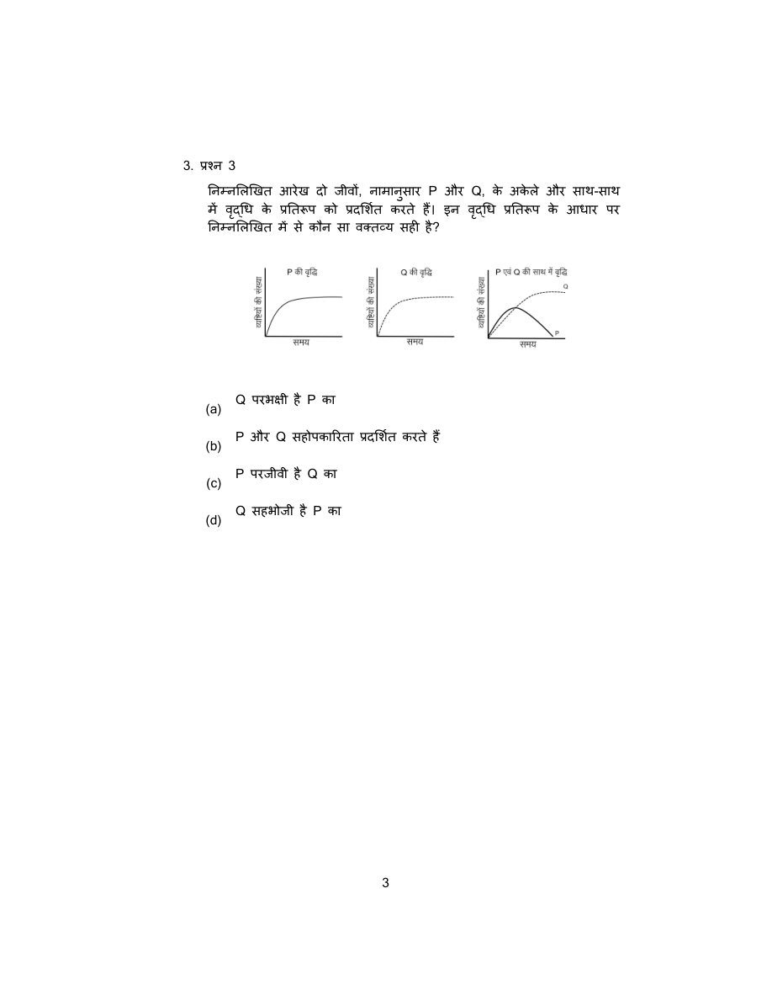

## PDF page 5

[Open original PDF at page 5](../pdf/IAT_2026_Hindi_provisional_key.pdf#page=5)

### Searchable text - OCR draft (hin+eng)

```text
4. प्रश्न 4

pBR322 क्लोनिंग संवाहक में, टेट्रासाइक्लीन एवं एम्पीसिलिन प्रतिरोध को
कुटलेखित करने के जीन हैं। एक बाहरी डीएनए जिसे क्लोन करना है, उसे

टेट्रासाइक्लीन प्रतिरोधी जीन के बीच में अंतर्स्थापित किया जाता हैं और पुनर्योगज

प्लाजमिड
में से

(a)

(b)

(c)

(4)

मिड को ई.कोलाई कोशिकाओं A स्थानांतरित कर दिया जाता है। निम्नलिखित
कौन सा विकल्प इस क्लोनिंग प्रक्रिया का प्रतिफल होगा?

पुनर्योगज प्लाजमिड वाली कोशिकाएं एम्पीसिलिन की उपस्थिति में वर्धन कर
सकती हैं ना कि टेट्रासाइक्लीन की उपस्थिति में

पुनर्योगज प्लाजमिड वाली कोशिकाएं एम्पीसिलिन एवं टेट्रासाइक्लीन दोनों की
उपस्थिति में वर्धन कर सकती हैं

अपुनर्योगज प्लाजमिड वाली कोशिकाएं एम्पीसिलिन की उपस्थिति में वर्धन कर
सकती हैं ना कि टेट्रासाइक्लीन की उपस्थिति में

अपुनर्योगज प्लाजमिड वाली कोशिकाएं टेट्रासाइक्लीन की उपस्थिति में वर्धन कर
सकती हैं ना कि एम्पीसिल्रिन की उपस्थिति में
```

### Original page image

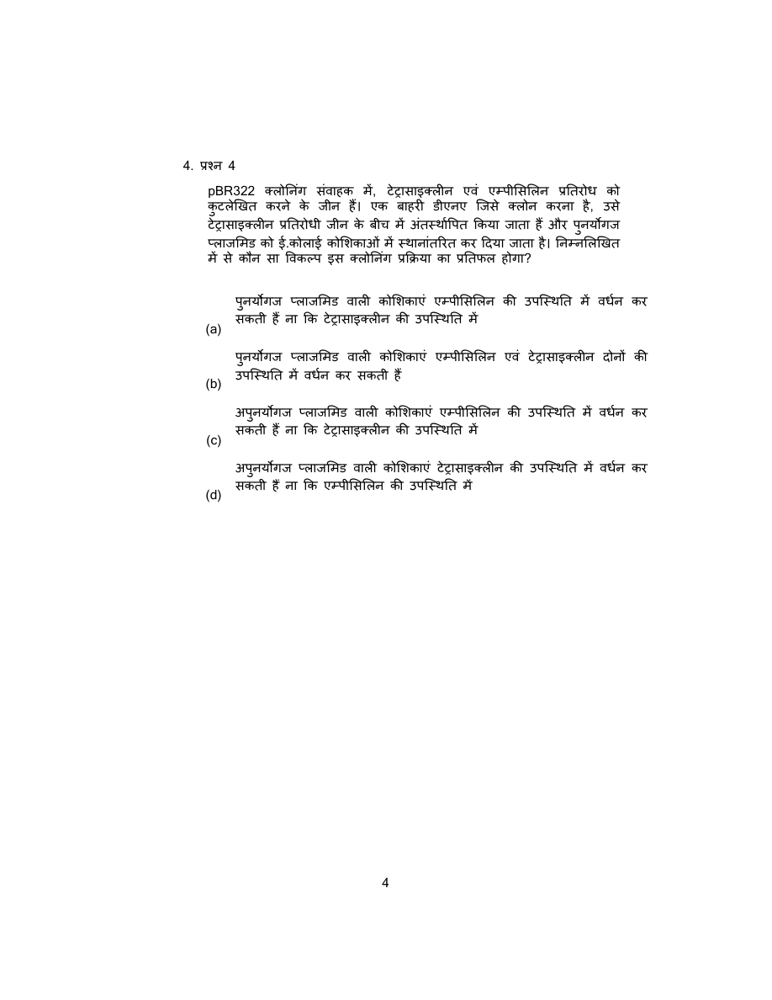

## PDF page 6

[Open original PDF at page 6](../pdf/IAT_2026_Hindi_provisional_key.pdf#page=6)

### Searchable text - OCR draft (hin+eng)

```text
5. प्रश्न 5

निम्नलिखित में से कौन से एंजाईम क्रियाविधि आरेख में fae ‘Ss’ के लिए
एंजाईम का Km 20 होगा? [3] क्रियाधार की सांद्रता को इंगित करता है।

0 20 40 60 80 400 420 440 460
[s]

(a)

EE

पु
0 20 40 60 80 400 420 440 460
[s]

(b)
```

### Original page image

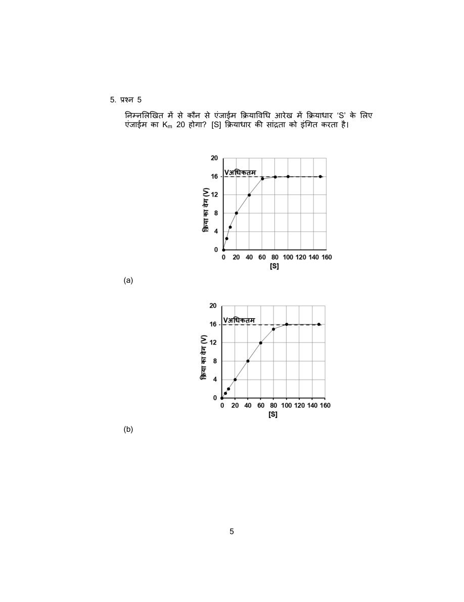

## PDF page 7

[Open original PDF at page 7](../pdf/IAT_2026_Hindi_provisional_key.pdf#page=7)

### Searchable text - OCR draft (hin+eng)

```text
at

0 20 40 60 80 400 420 440 460
[s]

—
0 20 40

60 80 400 420 440 460
[s]
```

### Original page image

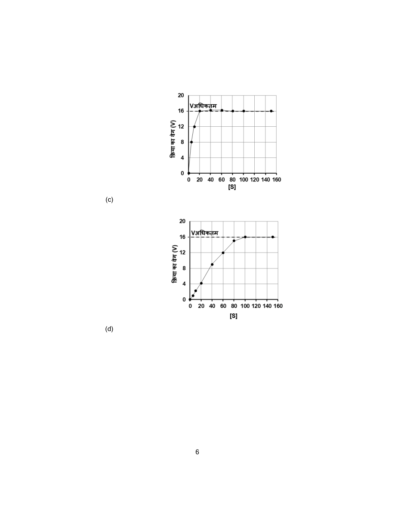

## PDF page 8

[Open original PDF at page 8](../pdf/IAT_2026_Hindi_provisional_key.pdf#page=8)

### Searchable text - OCR draft (hin+eng)

```text
6. प्रश्न 6

निम्नलिखित मे से कौन सा विकल्प पुटिका प्रेरक हार्मोन एवं एस्ट्रोजेन के कार्य
करने के तरीके को सही ढंग से विवरणित करता है?

पुटिका प्रेरक हार्मोन झिल्ली योजित ग्राहियों से क्रिया करता है और चक्रीय AMP

का उत्पादन करता है, जबकि एस्ट्रोजेन अंतरकोशिकीय ग्राहियों से क्रिया करता है
और जीन की अभिव्यक्ति का नियमन करता है

(9)
पुटिका प्रेरक हार्मोन अंतरकोशिकीय ग्राहियों से क्रिया करता है और चक्रीय AMP

का उत्पादन करता है, जबकि एस्ट्रोजेन झिल्ली योजित ग्राहियों से क्रिया करता है
और कोशिकीय उपापचय का नियमन करता है

(0)

पुटिका प्रेरक हार्मोन एवं एस्ट्रोजेन, दोनों ही अंतरकोशिकीय ग्राहियों के माध्यम से
(० जीन अभिव्यक्ति का नियमन करते हैं

पुटिका प्रेरक हार्मोन एवं एस्ट्रोजेन, दोनों ही झिल्ली योजित ग्राहियों के माध्यम से

(०) कोशिकीय उपापचय का नियमन करते हैं
```

### Original page image

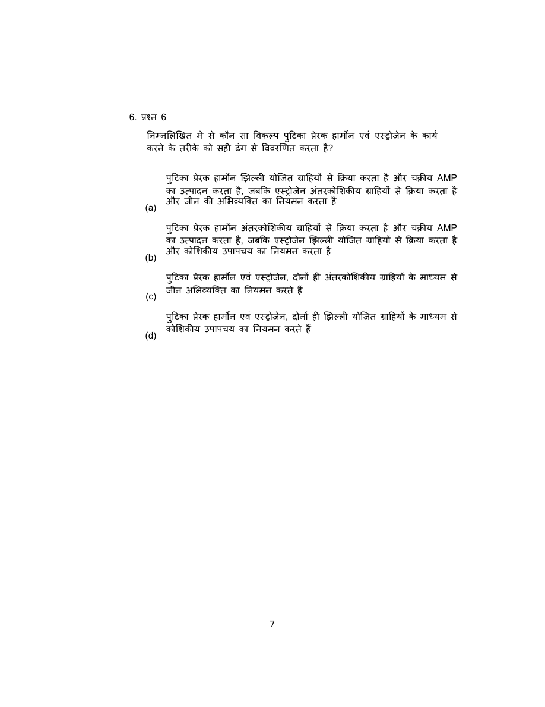

## PDF page 9

[Open original PDF at page 9](../pdf/IAT_2026_Hindi_provisional_key.pdf#page=9)

### Searchable text - OCR draft (hin+eng)

```text
[No text recovered; use the original page image below.]
```

### Original page image

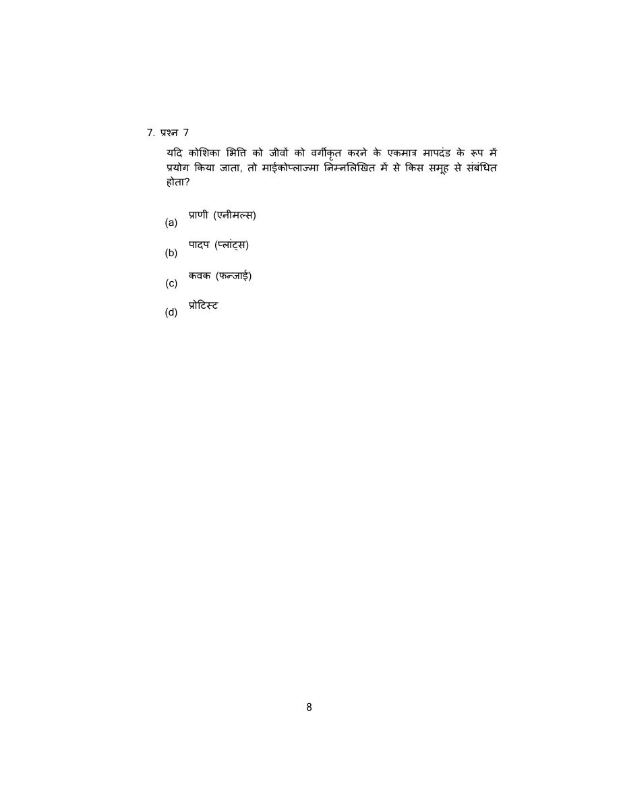

## PDF page 10

[Open original PDF at page 10](../pdf/IAT_2026_Hindi_provisional_key.pdf#page=10)

### Searchable text - OCR draft (hin+eng)

```text
8. प्रश्न 8

निम्नलिखित में से कौन सा विकल्‍प दिए गए जीन के कूटलेखक रज्जु का सही
अनुक्रम है?

अनुलेखन आरंभ स्थान
5 समापक aon उन्‍नायक
’ GTGAAGCCGTTACAGCAC 37
37 LL CACTTCGGCAATGTCGTG 5’

(a) 5’ GTGCTGTAACGGCTTCAC 3’

(b)
(c)
(७)

5’ CACTTCGGCAATGTCGTG 3'

5’ GTGAAGCCGTTACAGCAC 3’

5’ CACGACATTGCCGAAGTG 3’
```

### Original page image

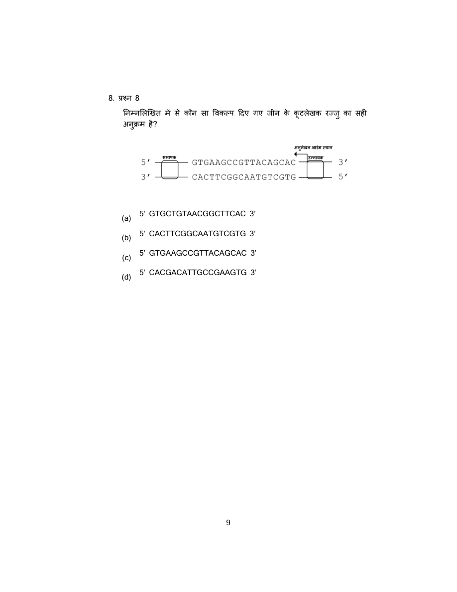

## PDF page 11

[Open original PDF at page 11](../pdf/IAT_2026_Hindi_provisional_key.pdf#page=11)

### Searchable text - OCR draft (hin+eng)

```text
9. प्रश्न 9

निम्नलिखित में से कौन सा विकल्प तंत्रिका-पेशीय संगम मेँ एसिटिल कोलिन के
मुक्त होने के उपरांत होने वाली पेशीय संकुचन में घटनाओ के सही क्रम को दर्शाता

है?

(a)

(b)

(c)

(4)

सकप्लास्म A Ca++ की वृद्धि, मायोसिन के लिए सक्रिय स्थानों का खुलना,

रेखा अंदर की तरफ खिंच जाती है

सककप्लास्म में ०४++ की वृद्धि, मायोसिन के लिए सक्रिय स्थानों का ढकना,

रेखा अंदर की तरफ खिंच जाती है

सककप्लास्म A Ca++ की वृद्धि, मायोसिन के लिए सक्रिय स्थानों का खुलना,

रेखा बाहर की तरफ खिंच जाती है

सकप्लास्म A Ca++ की कमी, मायोसिन के लिए सक्रिय स्थानों का ढकना,

रेखा अंदर की तरफ खिंच जाती है

i0
```

### Original page image

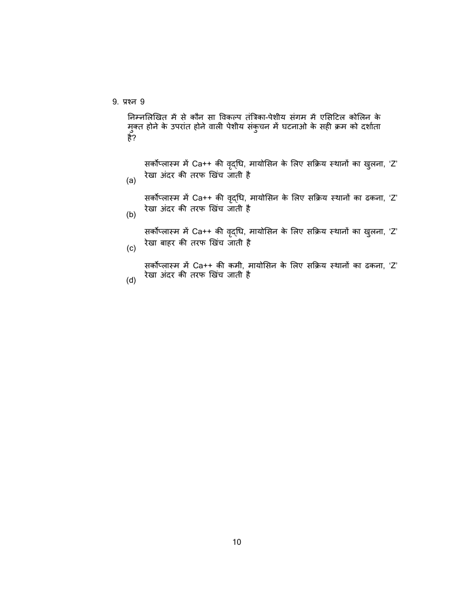

## PDF page 12

[Open original PDF at page 12](../pdf/IAT_2026_Hindi_provisional_key.pdf#page=12)

### Searchable text - OCR draft (hin+eng)

```text
I0. Wet 0

निम्नलिखित A से कौन A विकल्प में प्रति-२॥ प्रतिरक्षी (ऐन्टीबाडी) उपचार
ईरिश्रोब्लास्टोसिस फिटैलिस (गर्भ Leary] कोरकता) का निवारण कर सकता है?

@) प्रति-॥ प्रतिरक्षी Rh रहित माँ को प्रथम Rh सहित शिशु के जन्म के उपरांत
a

) प्रति-॥ प्रतिरक्षी Rh सहित माँ को प्रथम Rh रहित शिशु के जन्म के उपरांत

ufa-Rh प्रतिरक्षी Rh रहित माँ को प्रथम Rh रहित शिशु के जन्म के उपरांत
(०)

(0) प्रति-॥ प्रतिरक्षी Rh सहित माँ को प्रथम Rh सहित शिशु के जन्म के उपरांत

4
```

### Original page image

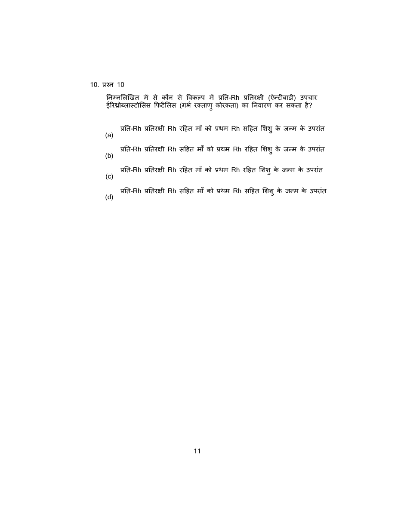

## PDF page 13

[Open original PDF at page 13](../pdf/IAT_2026_Hindi_provisional_key.pdf#page=13)

### Searchable text - OCR draft (hin+eng)

```text
44. Weert 47

निम्नलिखित A से कौन सी संरचनाएं एक लैक (lac) ओपेरान को सही से दर्शाती
हैं जो कि ऋणात्मक नियमित हो सकते हैं?

i [P| | i || |? | Lo | z y | 8 |
ii | P | |० | | i || z | P | y | a |
iii. [? | | | |? | Lo | y Zz [a |
iv. | P | |० | | oi |? | z y | a |

(a) i एवं iii

(b) i Ue ii

(०) ii एवं iv

(d) iii एवं iv

2
```

### Original page image

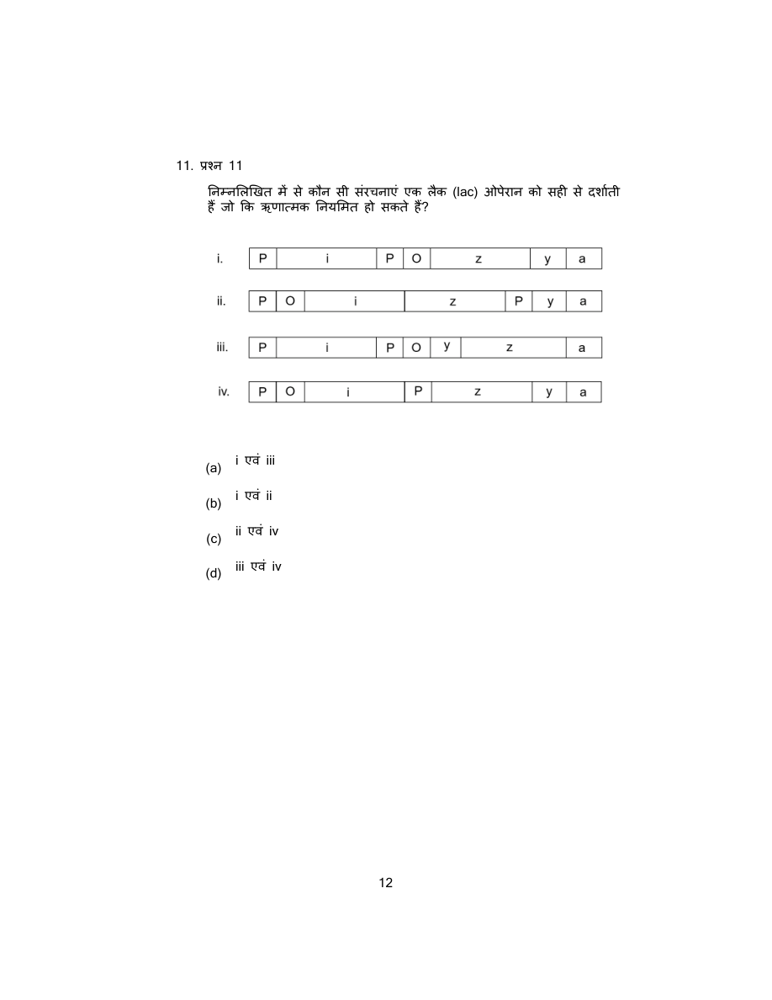

## PDF page 14

[Open original PDF at page 14](../pdf/IAT_2026_Hindi_provisional_key.pdf#page=14)

### Searchable text - OCR draft (hin+eng)

```text
(2. प्रश्न 2

fara में से कौन से जनकों की संतानों का रुधिर वर्ग उनमें से किसी भी जनक
के समान नहीं होगा?

पिता: AB; माता: 0
(9)

पिता: A; माता: 0
(0)

पिता: AB; माता: A
(०)

पिता: 0; माता: 8
(d)

43
```

### Original page image

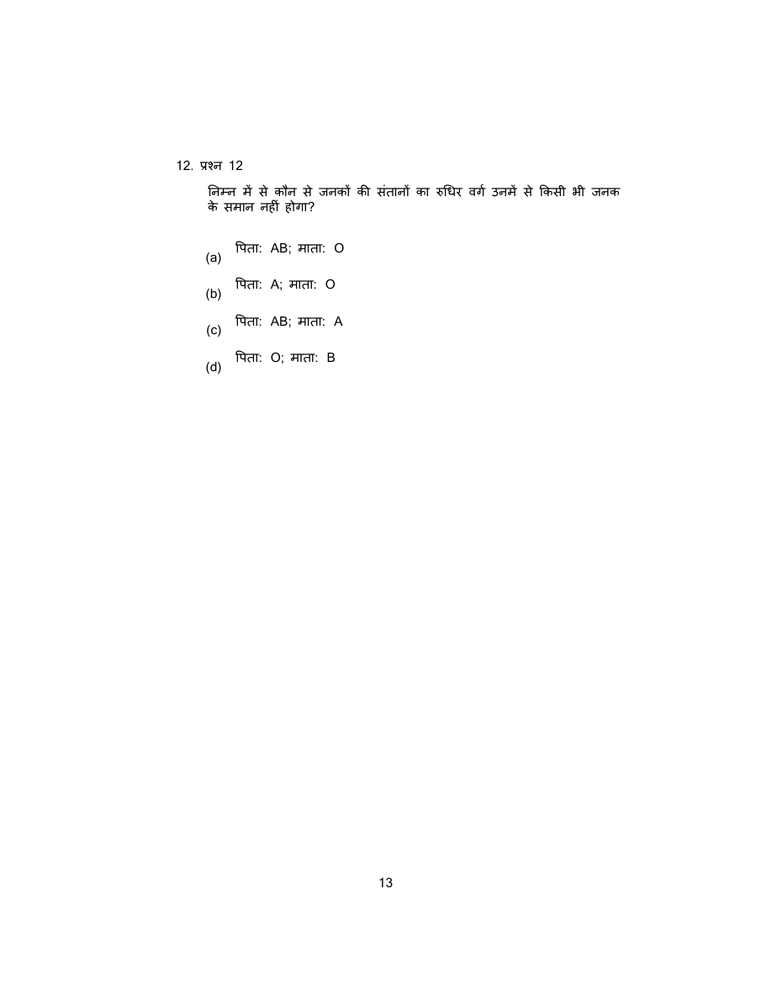

## PDF page 15

[Open original PDF at page 15](../pdf/IAT_2026_Hindi_provisional_key.pdf#page=15)

**Matching embedded figure, English PDF page 15:** Biology Q13: candidate nucleic-acid molecules include a base-paired RNA duplex, a single RNA sequence and a DNA-like sequence with T instead of U. Base-pairing bars and strand identity distinguish the options.

### Searchable text - OCR draft (hin+eng)

```text
43. प्रश्न 3

निम्नलिखित में से कौन सा HU], आरएनए अंतरक्षेप (RNA इन्टरफेरेन्स) के लिए
उपयोग मे आ सकता है?

ACGGAACCAUGCAGAGAGG
| | | | | | | | | | | | | | | | | | |
UGCCUUGGUACGUCUCUCC

ACGGAACCAUGCAGAGAGG
ACGGAACCATGCAGAGAGG

MTEL LLE ETL
TGCCTTGGTACGTCTCTCC

4
```

### Original page image

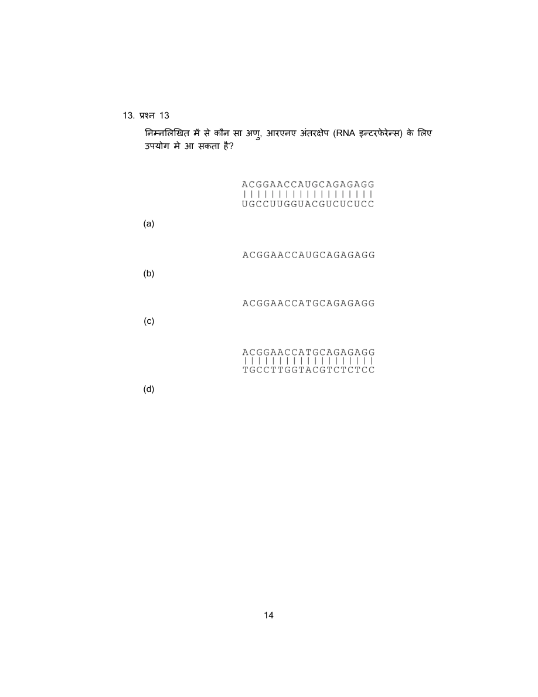

## PDF page 16

[Open original PDF at page 16](../pdf/IAT_2026_Hindi_provisional_key.pdf#page=16)

**Matching embedded figure, English PDF page 16:** Biology Q14: a large pedigree spans several generations. Filled symbols denote affected people; open symbols are unaffected; circles and squares distinguish sex. Trace parent-to-child links and affected sexes to compare inheritance models.

### Searchable text - OCR draft (hin+eng)

```text
4. Weet 74

निम्न वंशावली विष्लेषण आरेख एक परिवार A एक विरल आनुवंशिक विकार
की वंशागति को प्रदर्शित करता है (भरी हुई आकृतियाँ प्रभावित लोगों को दर्शाती
हैं)। निम्नलिखित विकल्पों में से कौन इस विकार की वंशागति का बहु-संभावित
प्रतिकृति है?

व कवि
ob ea abac thane
0०4२० ६4057

(a) X- लग्न प्रभावी

X- लग्न अप्रभावी
(0)

(०) Y- लग्न

(0) सूत्रकणिकीय (माईटोकॉड्रियल)

45
```

### Original page image

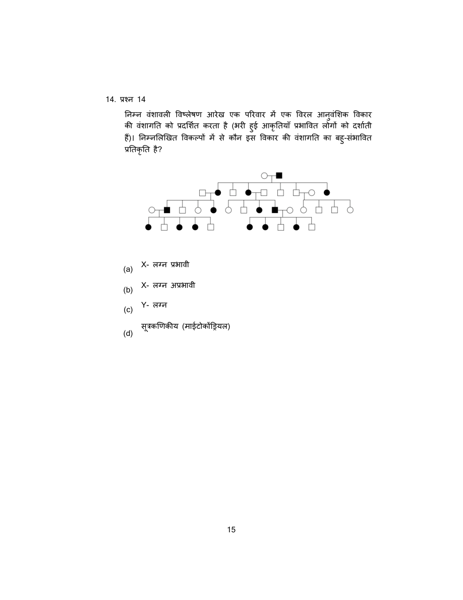

## PDF page 17

[Open original PDF at page 17](../pdf/IAT_2026_Hindi_provisional_key.pdf#page=17)

### Searchable text - OCR draft (hin+eng)

```text
I5. Wet 5

एक बच्ची उसके सम्पूर्ण जीवनकाल A आवश्यक सभी प्राथमिक अंडकों (प्राइमरी

ऊसाईटस) के साथ जन्म लेती है | जन्म के समय ये प्राथमिक अंडक कोशिका
विभाजन की किस अवस्था में पाए जाते हैं?

पूर्वावस्था 7
(a)

मध्यावस्था 7
(0)

पश्चावस्था I
(०)
(a) अँत्यावस्था 7

46
```

### Original page image

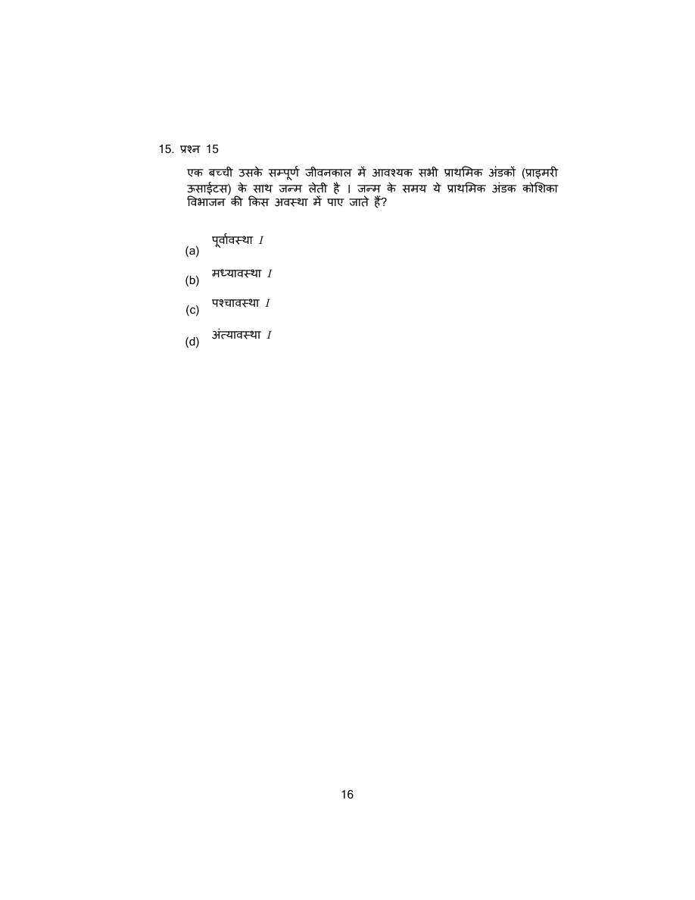

## PDF page 18

[Open original PDF at page 18](../pdf/IAT_2026_Hindi_provisional_key.pdf#page=18)

### Searchable text - OCR draft (hin+eng)

```text
रसायन विज्ञान

T. प्रश्न I
निम्नलिखित अष्टफलकीय संकुलों में किस का 'केवल-प्रचक्रण' (spin only)
चुम्बकीय sept सर्वाधिक होगा?

@) [Cr(H20)4(OH)2]

) [V(H20)4lo]*

[Fe(NH3)4(CN)o]*

(d) [Co(NH3)4Clo]
```

### Original page image

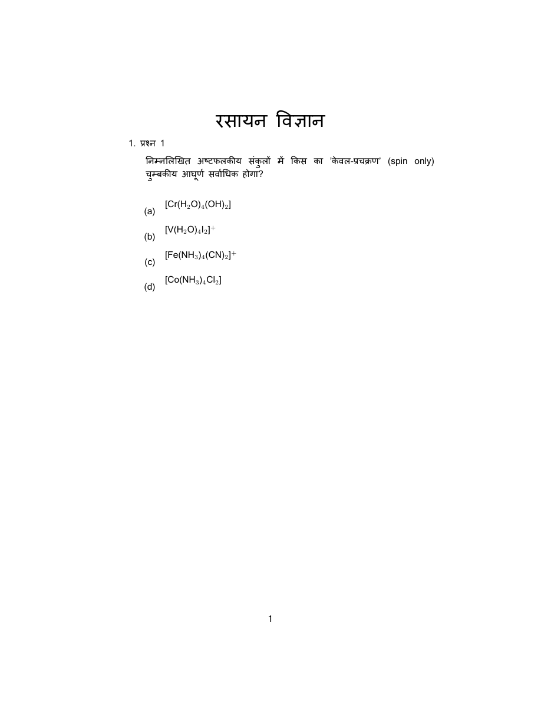

## PDF page 19

[Open original PDF at page 19](../pdf/IAT_2026_Hindi_provisional_key.pdf#page=19)

### Searchable text - OCR draft (hin+eng)

```text
2. प्रश्न 2

जलीय अम्लीय माध्यम में, [0020.]?- का Cet में अपचयन करने के लिए
क्रमश: कितने प्रोटोनों (H+) एवं एलेक्ट्रोनों (७०) की आवश्यकता होगी?

(a) 4,6

6, 4
(0)

©) 7,3

@ °°
```

### Original page image

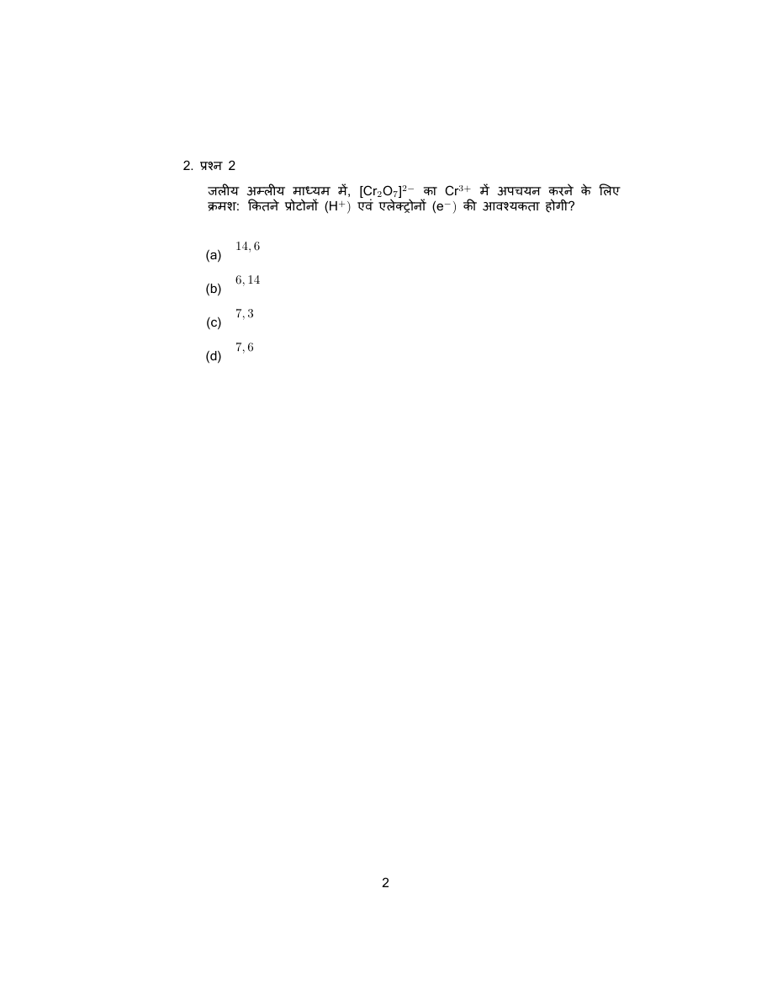

## PDF page 20

[Open original PDF at page 20](../pdf/IAT_2026_Hindi_provisional_key.pdf#page=20)

### Searchable text - OCR draft (hin+eng)

```text
3. प्रश्न 3

निम्नलिखित अणुओं में से कौन A अणु का आबंध कोटि (bond order) इसके

उच्चतम अधिग्रहित आण्विक कक्षक (highest occupied molecular orbital) से
इलेक्ट्रॉन के निकलने पर बढ़ जायेगा?
```

### Original page image

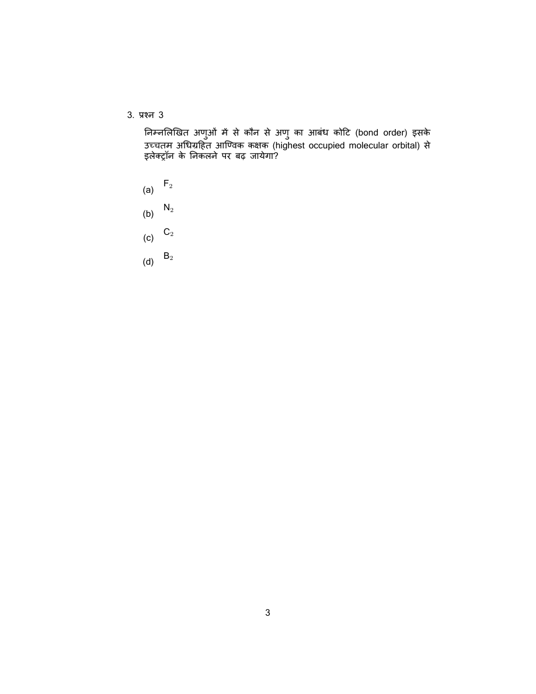

## PDF page 21

[Open original PDF at page 21](../pdf/IAT_2026_Hindi_provisional_key.pdf#page=21)

### Searchable text - OCR draft (hin+eng)

```text
4. प्रश्न 4

Mn2(CO)io एवं [MnO,]- में, धातु-लिगन्ड #-आबंध बनने के लिए धातु एवम्‌
लिगन्ड के बीच इलेक्ट्रॉन युगल का दान आवश्यक होता है। निम्न में से कौन सा
विकल्‍प इलेक्ट्रॉन युगल दान की दिशा को सही से दर्शाता है ?

Mn2(CO)i9: धातु कक्षक — लिगन्ड कक्षक

[MnO,]-: लिगन्ड कक्षक — धातु कक्षक
(9)

Mn2(CO),o: लिगन्ड कक्षक -> धातु कक्षक
) [MnO,]-: fetes कक्षक -> धातु कक्षक

Mn(CO)io: धातु कक्षक -> लिगन्ड कक्षक

© [MnO,]-: धातु कक्षक — लिगन्ड कक्षक
Cc

Mn2(CO)i0: लिगन्ड कक्षक -> धातु कक्षक

@) [MnO,]-: धातु कक्षक — लिगन्ड कक्षक
```

### Original page image

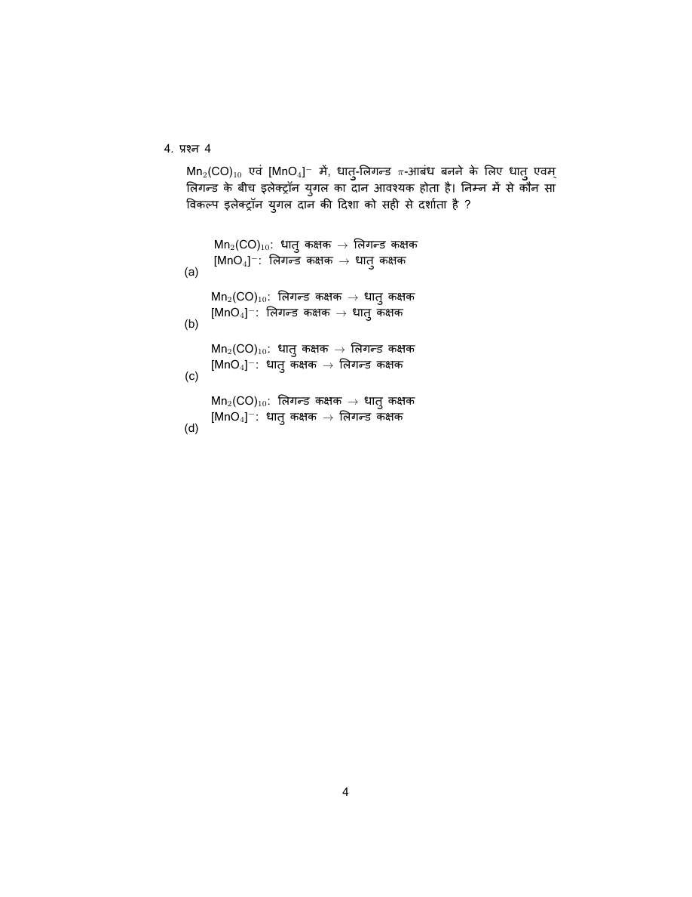

## PDF page 22

[Open original PDF at page 22](../pdf/IAT_2026_Hindi_provisional_key.pdf#page=22)

### Searchable text - OCR draft (hin+eng)

```text
5. प्रश्न 5

055 & C=Te A परस्पर तथा CLC! & FF A परस्पर आबंध ऊर्जा का सही
क्रम क्‍या होगा?

(a) C=S > C=Te तथा 6-06 > F-F

(b) C=Te > C=S तथा 6-06 > F-F

(०) C=Te > C=S तथा F-F > CCl

(d) C=S > C=Te तथा F-F > CCI
```

### Original page image

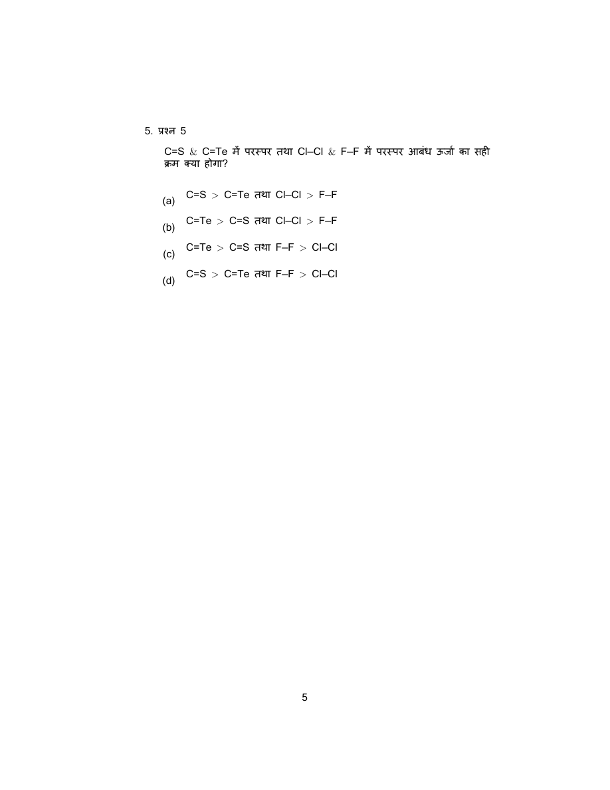

## PDF page 23

[Open original PDF at page 23](../pdf/IAT_2026_Hindi_provisional_key.pdf#page=23)

**Matching embedded figure, English PDF page 23:** Chemistry Q6: tert-butyl bromide reacts with hydroxide in ethanol, giving an alcohol and bromide. Structural drawings show the tertiary carbon and the bond being replaced.

### Searchable text - OCR draft (hin+eng)

```text
[No text recovered; use the original page image below.]
```

### Original page image

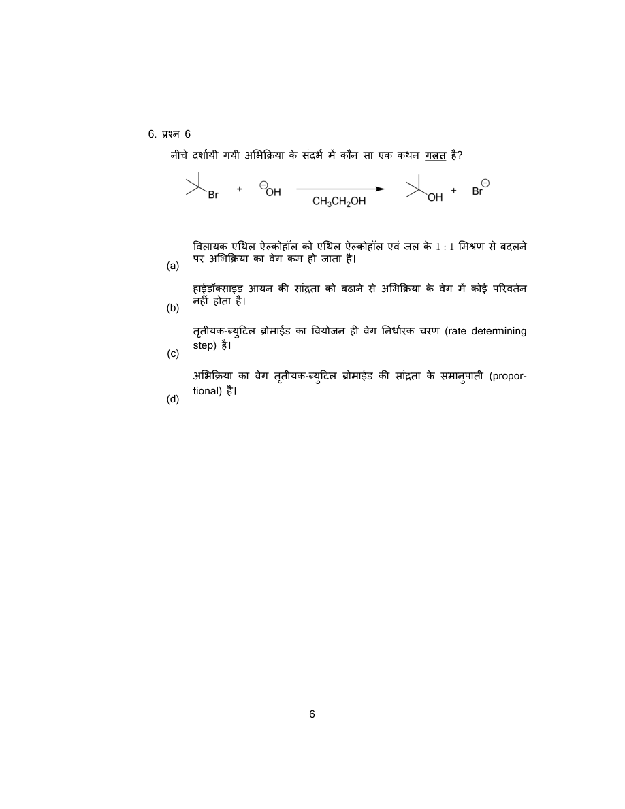

## PDF page 24

[Open original PDF at page 24](../pdf/IAT_2026_Hindi_provisional_key.pdf#page=24)

**Matching embedded figure, English PDF page 24:** Chemistry Q7: four cyclic molecular drawings use solid wedges, dashed bonds and stereocentre substituents to test chirality. Ring connectivity alone is insufficient; preserve the stereochemical markings.

### Searchable text - OCR draft (hin+eng)

```text
7. प्रश्न 7

निम्न में से कौन सा एक अणु He है?

0 0

जद

wa

H ८
Oo” 0
“~~
(b)
H
Ll

0 0

SCH

=x

(c)

H WL
fe)

0

पर
(७)
```

### Original page image

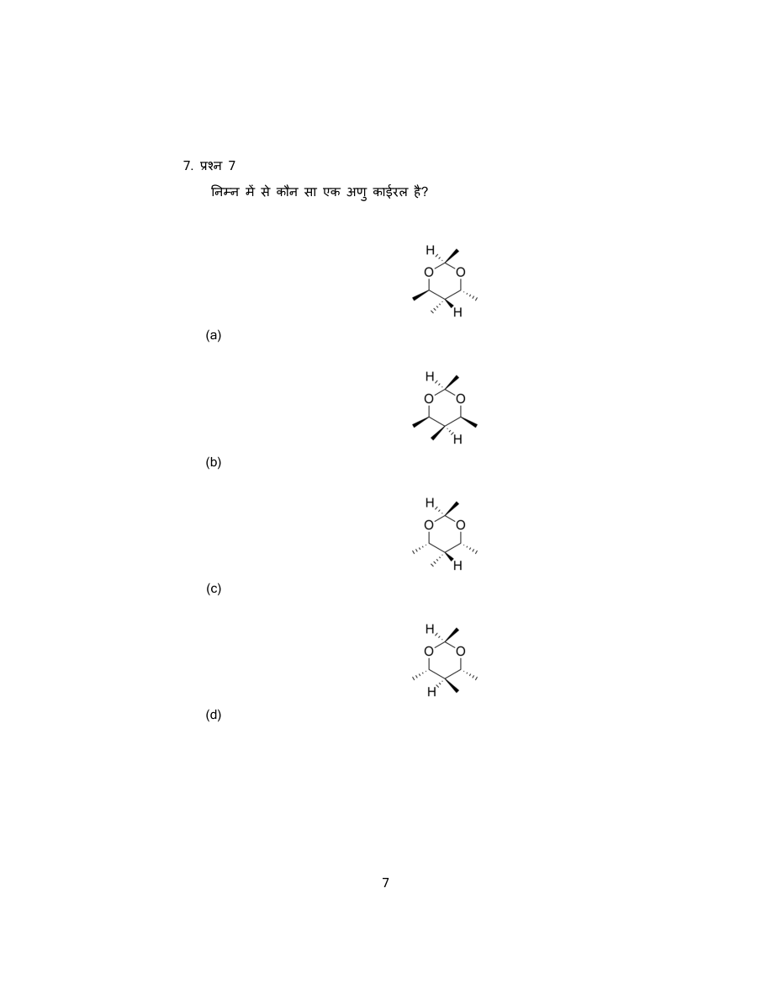

## PDF page 25

[Open original PDF at page 25](../pdf/IAT_2026_Hindi_provisional_key.pdf#page=25)

**Matching embedded figure, English PDF page 25:** Chemistry Q8: a silica-gel TLC plate has a baseline at 0 cm, solvent front at 5 cm, compound B spot at 1.25 cm and compound A spot at 3.75 cm. A central vertical line and dashed height guides locate the spots.

### Searchable text - OCR draft (hin+eng)

```text
8. प्रश्न 8

योगिकों A एवम्‌ 8 के लिए नीचे दिये गये सिलिका-जेल पर आधारित पतली-परत
क्रोमाटोग्राम (3॥08-989॥ based thin-layer chromatogram) के संदर्भ में कौन
सा कथन सही है?

5 cm ~<— } ---}-» Solvent front

3.75 cm <+ ¢4—> Compound A

4.25 cm | ९ +—> Compound 8

0 cm~=— |} -+---» Base line

@) 8, A से अधिक ध्रुवीय है; A का Ry = 0.75 है।
a

) 8, A से अधिक धरुवीय है; A का RR, = 0.25 है।

A, 8 से अधिक gaa है; 8 का R, - 0.33 है।

@) 8, A से कम ध्रुवीय है; 8 का Ry =0.75 है।
```

### Original page image

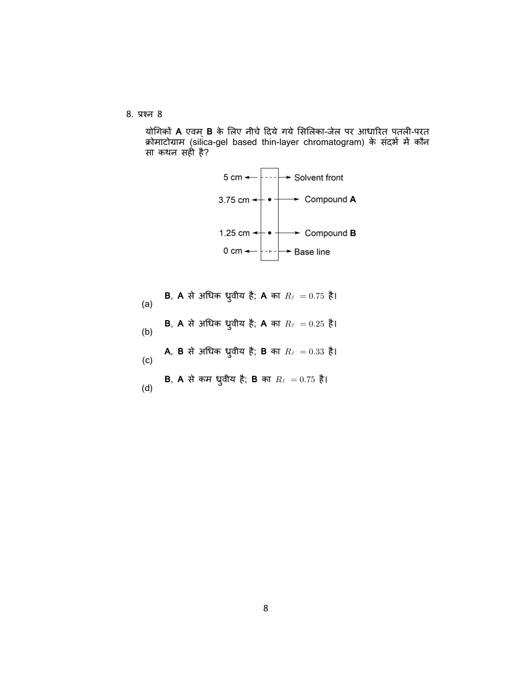

## PDF page 26

[Open original PDF at page 26](../pdf/IAT_2026_Hindi_provisional_key.pdf#page=26)

**Matching embedded figure, English PDF page 26:** Chemistry Q9: an aromatic compound carrying aldehyde groups reacts with concentrated NaOH to intermediate X, then excess HCl to P. Four answer pairs show different carboxylate/alcohol or cyclic-ester arrangements.

### Searchable text - OCR draft (hin+eng)

```text
9. प्रश्न 9
नीचे दी गयी अभिक्रिया क्रम में » और P क्‍या हैं?

0
॥. 0००. NaOH x HCI gas (excess)
————— —- फक)फफ्)्ता्््ज्‌
D A
0

fe)
x ce \000Na
~ WA on P= 9
D D
ce ~ COOH .
X= Ud ona Ps
D
oe 0000
X= | Z ONa ’ P=
H
“ oe \COONa ५ os
का , 7 9
D D
```

### Original page image

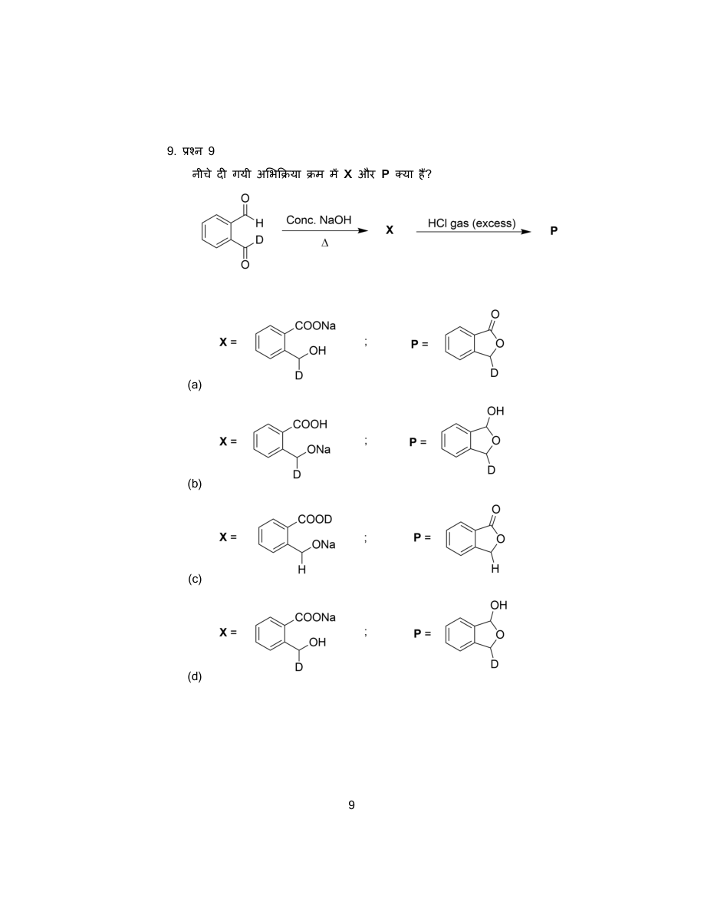

## PDF page 27

[Open original PDF at page 27](../pdf/IAT_2026_Hindi_provisional_key.pdf#page=27)

**Matching embedded figure, English PDF page 27:** Chemistry Q10: four aniline-derived amines P-S differ in methyl groups attached to nitrogen. Their N-H bonds and number of methyl substituents must be distinguished for the pKb comparison.

### Searchable text - OCR draft (hin+eng)

```text
(0. प्रश्न 0
नीचे दिए गये अणुओं का जलीय माध्यम A 975 का सही क्रम क्‍या होगा?

CHs CHs
“nN
N _
Ph~ ~NH> proNsH ph’ NScH, Ph—NH,
P Q R s

P<R<Q<S
(a)

(b) P<Q@<R<S

§$<P<R<Q
(c)

s<P R
(d) <P<Q<

0
```

### Original page image

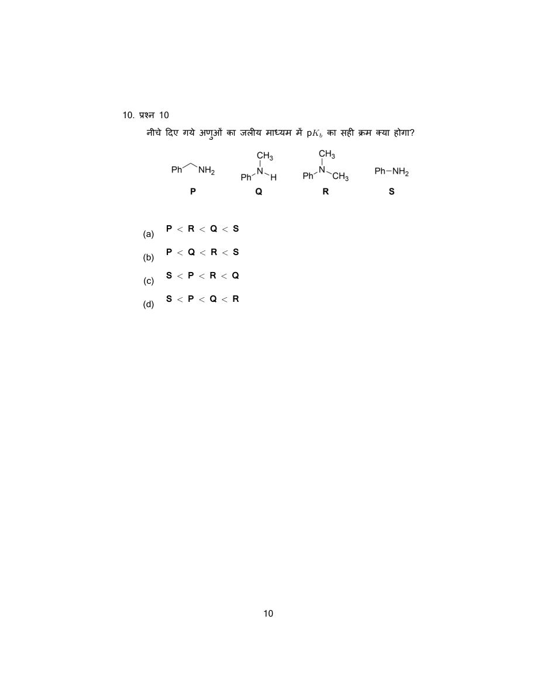

## PDF page 28

[Open original PDF at page 28](../pdf/IAT_2026_Hindi_provisional_key.pdf#page=28)

### Searchable text - OCR draft (hin+eng)

```text
44. Weert 47

.0 M NaOH के जलीय वित्रयन के 00 mL को जल मित्राकर .0 | तक तनु
किया जाता है। इस विल्नयन का आधा हिस्सा फेंक दिया जाता है। बचे हुए विलयन

में एक नए 0.5 M NaOH के जलीय facet का i00 mL face जाता है।
इस अंतिम NaOH के जलीय विल्यन की सांद्रता क्या होगी?

(a) 0.i7 M

(b)
(c)

0.i0 M
0.50 M

(d) 0.33 M

4
```

### Original page image

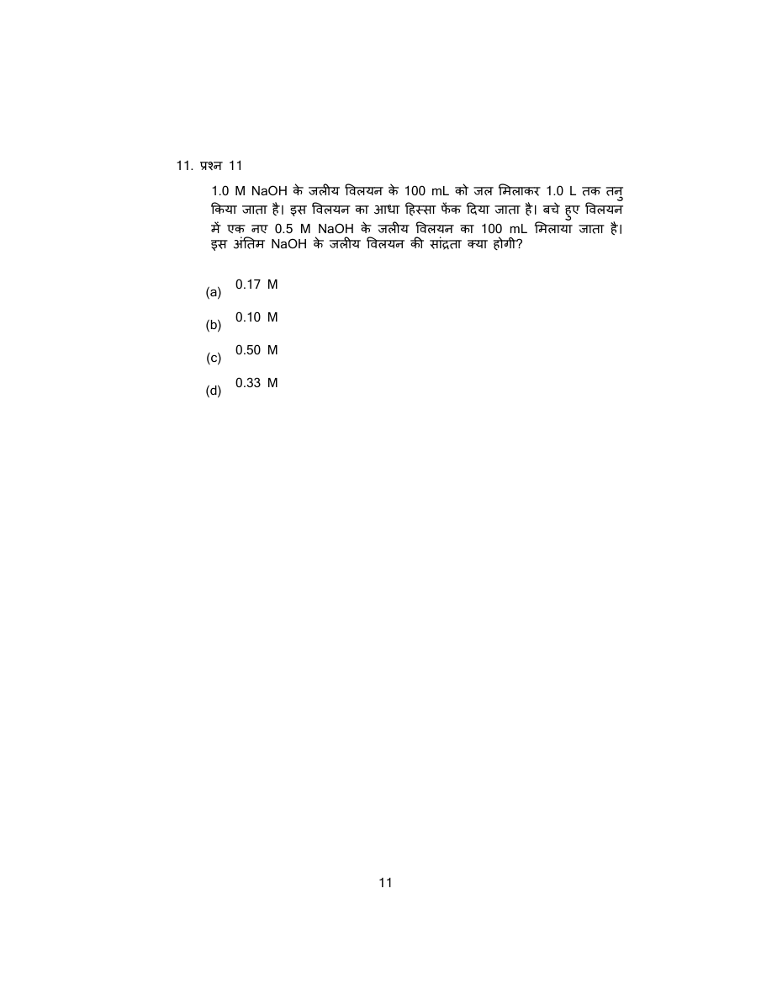

## PDF page 29

[Open original PDF at page 29](../pdf/IAT_2026_Hindi_provisional_key.pdf#page=29)

**Matching embedded figure, English PDF page 29:** Chemistry Q12: four pairs of thermodynamic variables compare solid isothermal and dotted adiabatic curves/lines. Axes include P-V, U-V and T-V style plots, with one pressure-related inverse-volume plot; read each axis from the source image.

### Searchable text - OCR draft (hin+eng)

```text
(2. प्रश्न 2

एक आदर्श गैस पहले एक उत्क्रमणीय समतापीय WERT (reversible isothermal
expansion) (सॉलिड रेखा) से गुजरती है। तत्पश्चात वही आदर्श गैस उत्क्रमणीय

रुधोष्म प्रसरण (reversible adiabatic expansion) (बिन्दुयुक्त रेखा) से गुजरती

है। नीचे दिए गए रेखा चित्राचित्रों में से कौन से इस समस्त प्रक्रम को बारीकी से
दर्शाता है।दर्शाते हैं?

Vv Vv
we (iii) | Va (iv)
— प्राए
(a) केवल (i) तथा (iii)
(०) केवल (४)
केवल (ii) तथा (iv)
(०)
(०0) केवल (i), (&) तथा (iii)

2
```

### Original page image

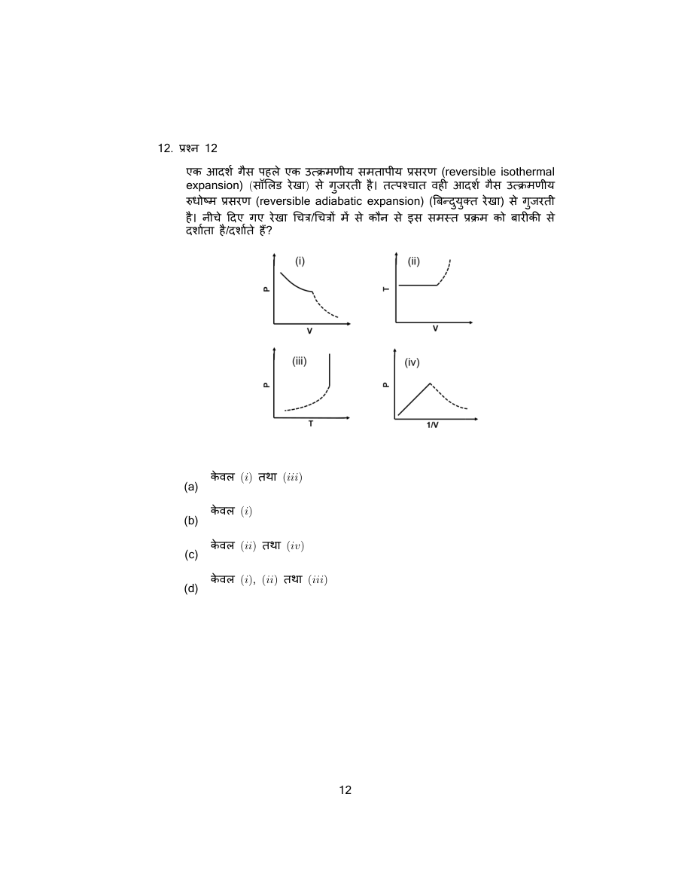

## PDF page 30

[Open original PDF at page 30](../pdf/IAT_2026_Hindi_provisional_key.pdf#page=30)

### Searchable text - OCR draft (hin+eng)

```text
43. प्रश्न 73

86%+ के चतुर्थ कक्ष में एक इलेक्ट्रॉन के वेग तथा Het के द्वितीय कक्ष में एक
इलेक्ट्रान के वेग का अनुपात FA होगा?

43
```

### Original page image

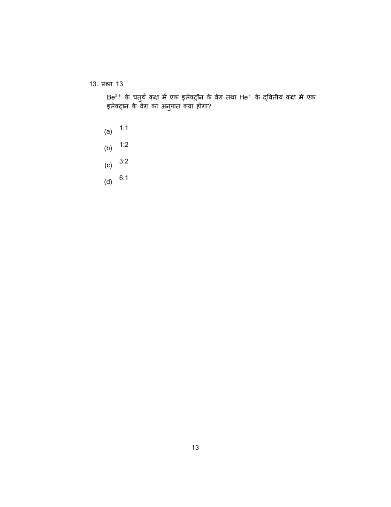

## PDF page 31

[Open original PDF at page 31](../pdf/IAT_2026_Hindi_provisional_key.pdf#page=31)

### Searchable text - OCR draft (hin+eng)

```text
4. Weet 74

दो शुद्ध वाष्पशील gal X एवं ४ के लिए, X-X और ४-४ दोनों की अंतरआण्विक

are HetiraPare (attractive intermolecular interactions) X-Y की
तुलना A कम हैं। X एवं ४ के एक सममोलर विलयन का कुल वाष्पदाब prota है।

शुद्ध X एवम्‌ शुद्ध ४ का वाष्पदाब क्रमश: pl और py है। नीचे दिए गये संबंधों
में से कौन सा एक विकल्प सही है?

Protal < (pX + py)/2

(a)

(b) Ptotal = (pX + py) /2
(०) Ptotal = PX + Py

(d) Ptotal > (vx + py)/2

4
```

### Original page image

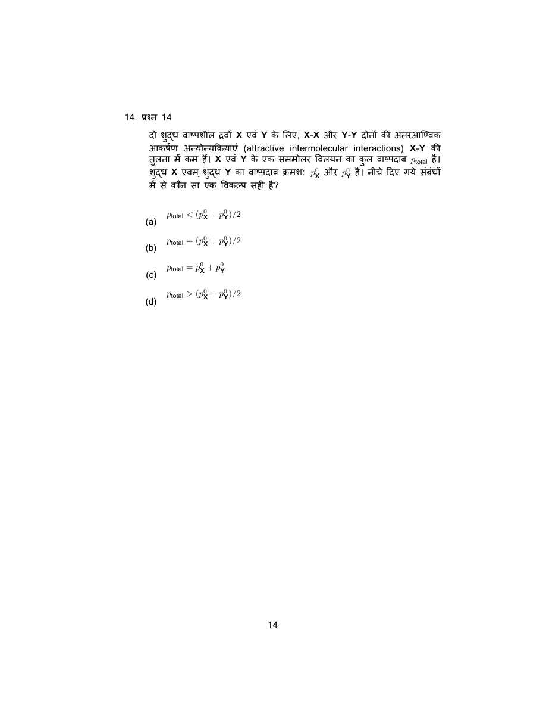

## PDF page 32

[Open original PDF at page 32](../pdf/IAT_2026_Hindi_provisional_key.pdf#page=32)

### Searchable text - OCR draft (hin+eng)

```text
I5. Wet 5

600 K पर, 94.47 kJ mol! की सक्रियण ऊर्जा के साथ एक अभिक्रिया का
वेग स्थिरांक 5.0 x 05 57 है। किस तापमान पर इस अभ्िक्रिया की अर्धायु

52 s होगी? [पूर्व-चरघातांकी गुणक तथा सक्रियण ऊर्जा को तापमान पर निर्भर
नहीं मानिए। R = 8.344 J ॥€ mol]

(a) 680 K

(b)
(c)

640 K
760 K

(d) 720 K

i5
```

### Original page image

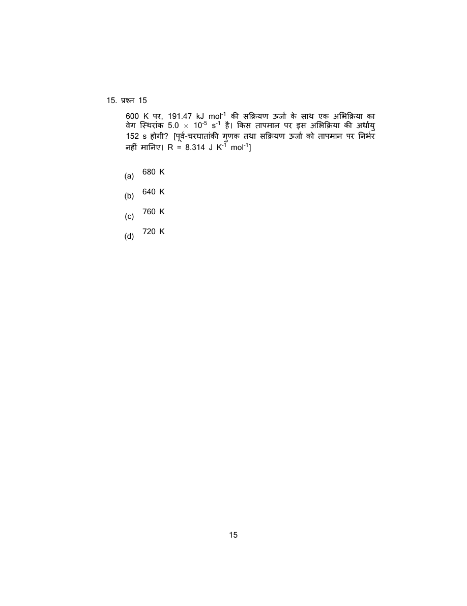

## PDF page 33

[Open original PDF at page 33](../pdf/IAT_2026_Hindi_provisional_key.pdf#page=33)

### Searchable text - OCR draft (hin+eng)

```text
गणित

4. प्रश्न 4
यदि p(x) एक ऐसा द्विघातीय बहुपद है जिसके लिए pl) = p(-l) = 0%, तो p(x) Fax
का गुणांक क्या है?
(9) 0
b) ।
(८
(d

=

)
)
```

### Original page image

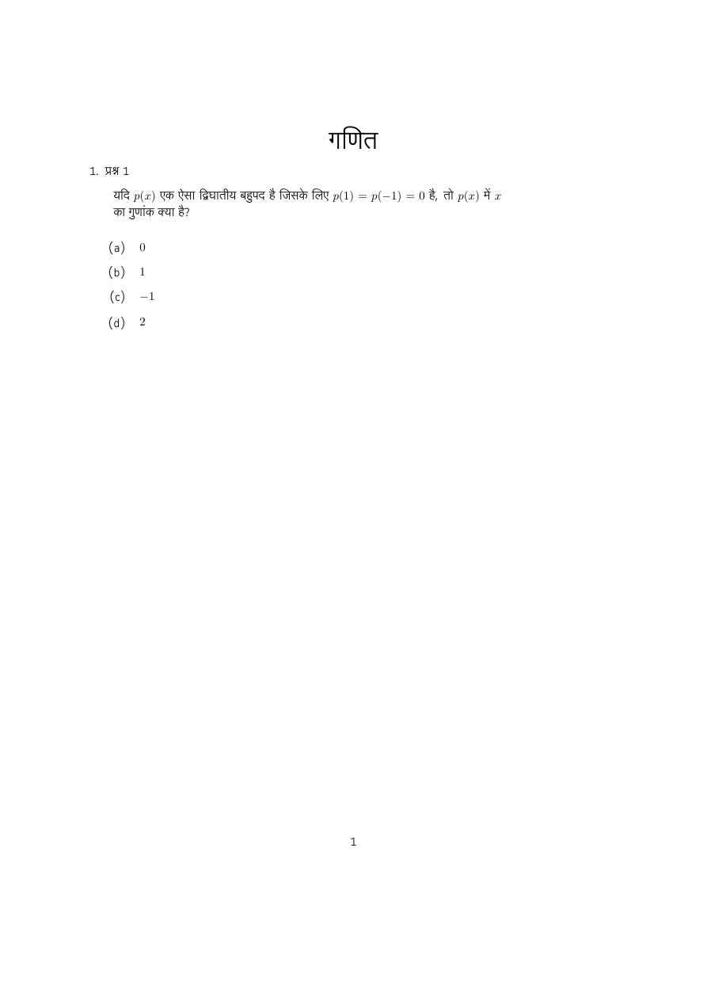

## PDF page 34

[Open original PDF at page 34](../pdf/IAT_2026_Hindi_provisional_key.pdf#page=34)

### Searchable text - OCR draft (hin+eng)

```text
2. प्रश्न 2
सम्मिश्र संख्याओं के तल में निम्न समुच्चयों पर विचार कीजिए:

A= {os CS) + isin CS ) ne z} तथा
5 5

B= {os (=) + isin (=) ; का z} :
5 5

निम्न कथनों में से कौन सा कथन सत्य है?

(a) 4 परिमित है परन्तु B अपरिमित है।
(b) 4 परिमित है और 7 भी परिमित है।
(०) 4 अपरिमित है परन्तु 9 परिमित है।
(५) 4 अपरिमित है और B भी अपरिमित है।
```

### Original page image

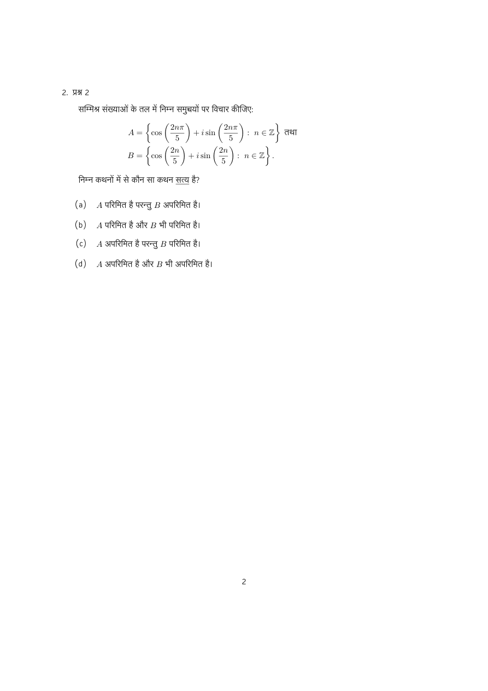

## PDF page 35

[Open original PDF at page 35](../pdf/IAT_2026_Hindi_provisional_key.pdf#page=35)

### Searchable text - OCR draft (hin+eng)

```text
3. प्रश्न 3

बिन्दु A(4i + 3 + 3k), 2(2)) तथा C(—4i + 3) - 3k) & संदर्भ में निम्न कथनों में से
कौन सा कथन सत्य है?

(a) 4, 7 व ८? समरैखिक हैं।
(७) 4B+43BC व AC लम्बवत हैं।
(०) ABx BC =i+j+h.

(०) AB, BC तथा CA परस्पर लम्बवत हैं।
```

### Original page image

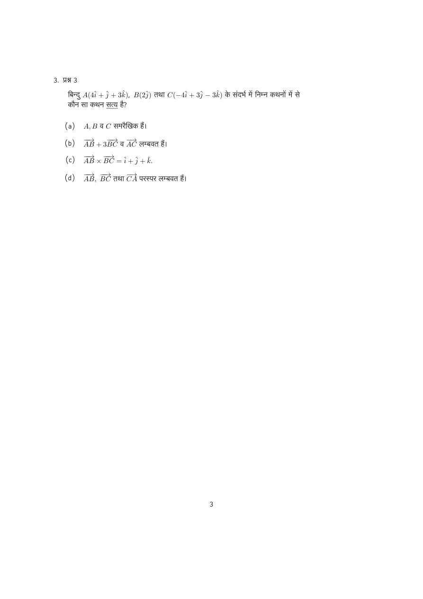

## PDF page 36

[Open original PDF at page 36](../pdf/IAT_2026_Hindi_provisional_key.pdf#page=36)

### Searchable text - OCR draft (hin+eng)

```text
4. प्रश्न 4

यदि रेखा ॥ बिन्दु (4, , ) व बिन्दु (3, ,3) को जोड़ती है तथा रेखा Ly बिन्दु (0, 2, -) व
बिन्दु (2, 0, 3) को जोड़ती है, तो रेखा Ly तथा Lo के बीच का कोण क्या है?

(a) 30%

=

b) 60°
(c
(d

) 45°
)

90°
```

### Original page image

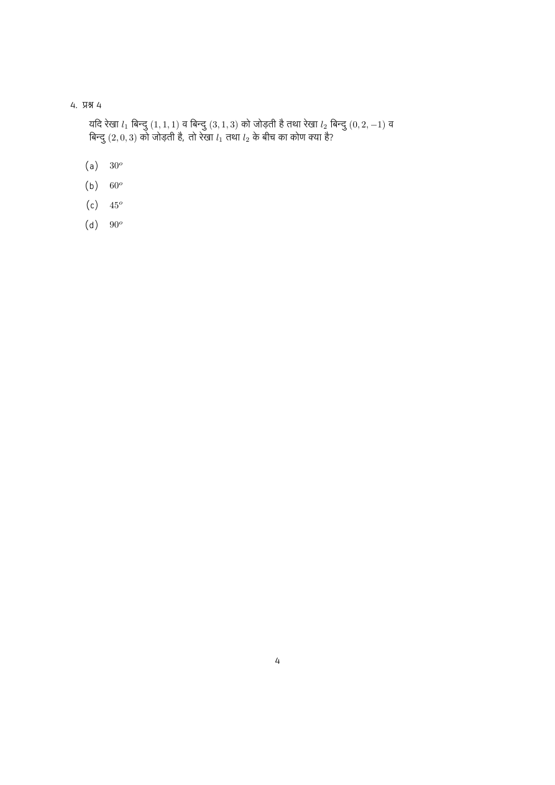

## PDF page 37

[Open original PDF at page 37](../pdf/IAT_2026_Hindi_provisional_key.pdf#page=37)

### Searchable text - OCR draft (hin+eng)

```text
5. प्रश्न 5
दो पूर्णाक r व / लीजिए जिनके लिए r > / > 3 है। ऐसे कितने फलन
f: {2,2,...r} > {,2,...r}

हैं जिनके लिए f(2), /(2), . .. ,/(!) सर्वथा अलग-अलग हैं?

(a) rr? (r —)(r —2)---(r-I4+2)
(b) rr —I)(r -2)---(r -I+)
(०) r(r—l)(r—2)---(r-I+])

(d) 7
```

### Original page image

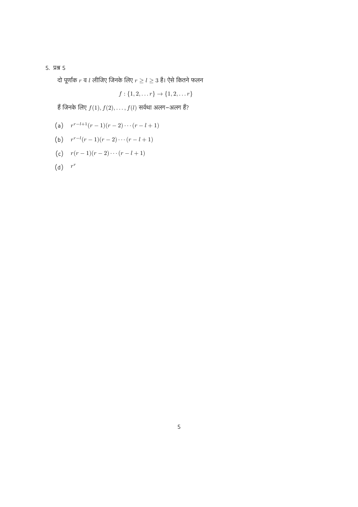

## PDF page 38

[Open original PDF at page 38](../pdf/IAT_2026_Hindi_provisional_key.pdf#page=38)

### Searchable text - OCR draft (hin+eng)

```text
6. प्रश्न 6

एक तल में स्थित सभी वृत्तों के समुच्चय को 2 से निरूपित कीजिए। उपसमुच्रय 72 CC x CH
निम्न द्वारा परिभाषित कीजिए:

R= {(Ci, C2) EC » 2 | CO) व Co एक दूसरे को प्रतिच्छेद करते हैं).
निम्न में से कौन सा कथन सत्य है?
(a) 72 एक स्वतुल्य व सममित संबंध है किन्तु संक्रामक नहीं है।
(०) RVG स्वतुल्य व संक्रामक संबंध है किन्तु सममित नहीं है।
(०) 72 एक सममित व संक्रामक संबंध है किन्तु स्वतुल्य नहीं है।

(५) 7२ एक संबंध नहीं है।
```

### Original page image

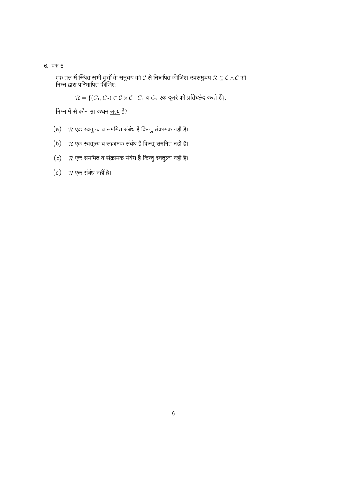

## PDF page 39

[Open original PDF at page 39](../pdf/IAT_2026_Hindi_provisional_key.pdf#page=39)

### Searchable text - OCR draft (hin+eng)

```text
उ. प्रश्न 7

2
[ min{l — ०, । - 23} dx का मान क्या है?
J हक

(a) -l
(७) 0
(c) I
(०) 2
```

### Original page image

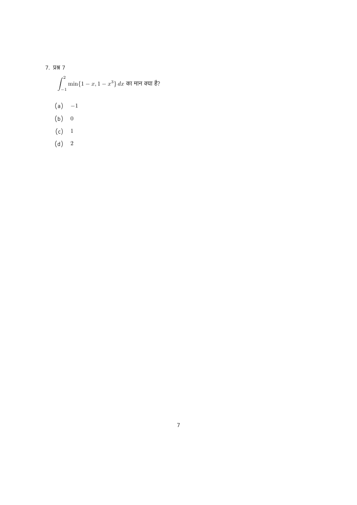

## PDF page 40

[Open original PDF at page 40](../pdf/IAT_2026_Hindi_provisional_key.pdf#page=40)

### Searchable text - OCR draft (hin+eng)

```text
8. प्रश्न 8

एक परीक्षा में विद्यार्थियों द्वारा प्राप्त अंकों के आँकड़ों पर विचार कीजिए। यदि प्रत्येक विद्यार्थी के
अंकों को 2 अंकों से बढ़ा दिया जाए तो निम्न में से कौन सा कथन सत्य है?

(a) माध्य के सापेक्ष माध्य विचलन नहीं बदलेगा।

(७) माध्य के सापेक्ष माध्य विचलन 2 से बढ़ जाएगा।
(०) माध्यिका के सापेक्ष माध्य विचलन 2 से बढ़ जाएगा।

(०) प्रसरण 2 से बढ़ जाएगा।
```

### Original page image

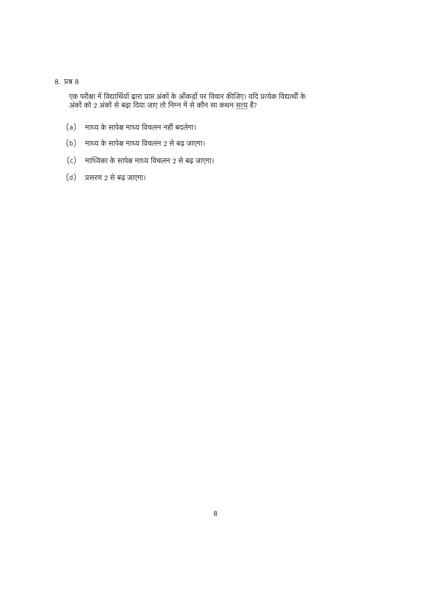

## PDF page 41

[Open original PDF at page 41](../pdf/IAT_2026_Hindi_provisional_key.pdf#page=41)

### Searchable text - OCR draft (hin+eng)

```text
9. प्रश्न 9

फलन / : 8 -> [४ को f(x) = sin?(7x) - sin?(52) से परिभाषित करें। निम्न में से कौन
सा कथन सत्य नहीं है?

(०) अंतराल डर 2n) पर वर्धमान है।
(b) f(z) > 0, सभी & € (0. यह) के लिए।

(०) f (« + 5 ) + f(x) =0, सभी #» € RS लिए।
```

### Original page image

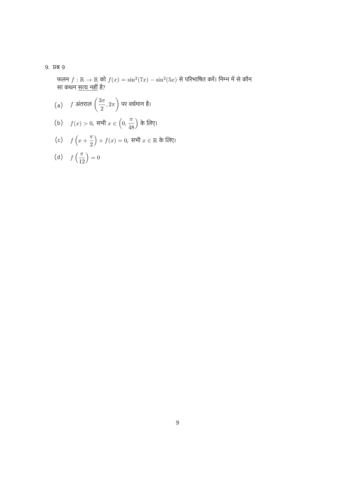

## PDF page 42

[Open original PDF at page 42](../pdf/IAT_2026_Hindi_provisional_key.pdf#page=42)

### Searchable text - OCR draft (hin+eng)

```text
0. W420

वास्तविक संख्याओं a तथा 9 के लिए निम्न फलन f : RO Rw विचार कीजिए

-ax—b यदिऋद -] ;
f(v)=e5a+l यदि -l<2<,
ax+3b afee>.

ऐसे कितने युग्म (७, ७) संभव हैं जिनके लिए / सभी बिंदुओं पर सतत है?

(a) 0
b) I
(c
(d

=

) 2
)

अनंत

i0
```

### Original page image

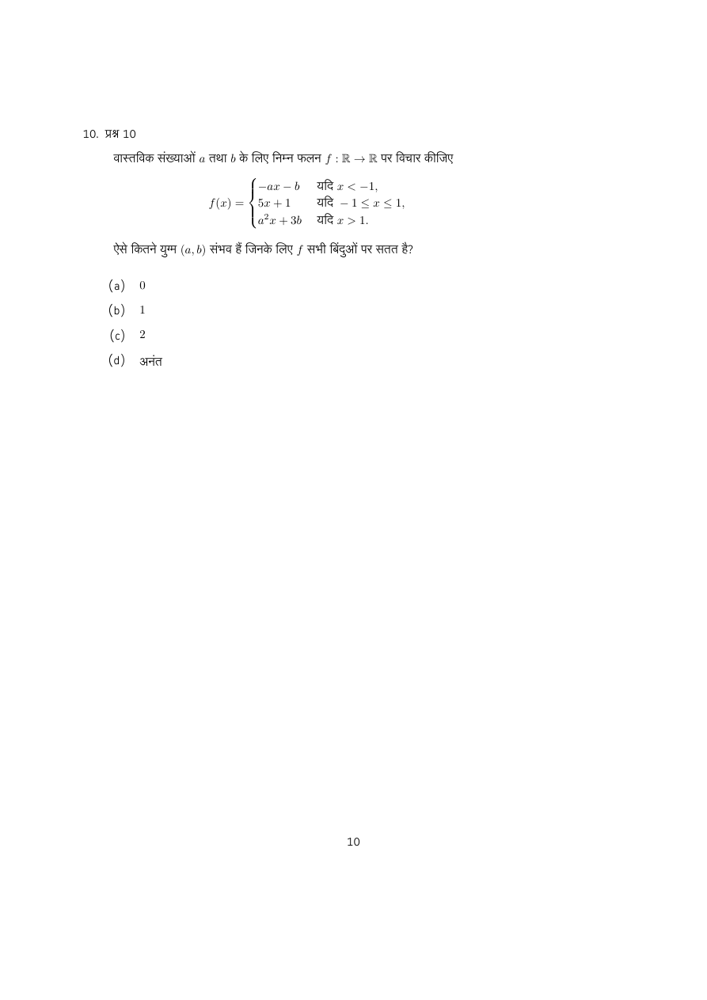

## PDF page 43

[Open original PDF at page 43](../pdf/IAT_2026_Hindi_provisional_key.pdf#page=43)

### Searchable text - OCR draft (hin+eng)

```text
2. 44 2

एक 2x2 आव्यूह A जिसके अवयव वास्तविक संख्याएं हैं, के लिए गुणनफल AA. -- A, जबकि

‘m times
7४ एक धनात्मक पूर्णाक है, को A™ द्वारा निरूपित कीजिए। मान लीजिए कि xo = 0, 2 =
है तथा सभी # > 2 के लिए x, = ry-7 + »»-2 है। परिभाषित कीजिए

4 n= काका In
In का

| , सभी # > ] के लिए।
निम्न में से कौन सा कथन सभी m > 3 के लिए सत्य है?

(a) 4!" 4 + am-2

(b) det(Am) = +।

c m m-l 4 0; _Jj0 0
omar ग-ह g

(०) Am - Ama — ॥ हि f "

वव
```

### Original page image

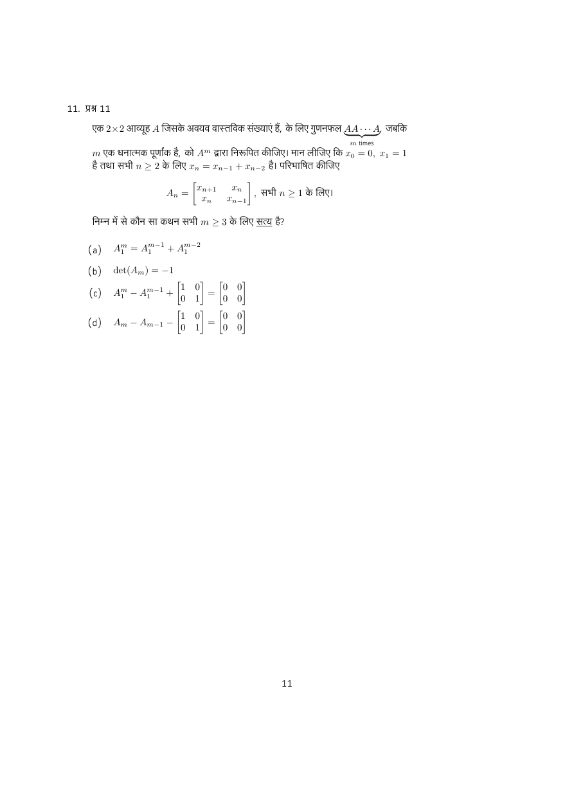

## PDF page 44

[Open original PDF at page 44](../pdf/IAT_2026_Hindi_provisional_key.pdf#page=44)

### Searchable text - OCR draft (hin+eng)

```text
2. WA2

मान लीजिए कि a), ५०, ५३, - - - धनात्मक पूर्णाकों की एक गुणोत्तर श्रेणी है। यदि a, = 3 है,
तथा सभी धनात्मक पूर्णाकों # के लिए ७,, ५ —2an = 4५+ है, Way +62+०3 +०4 + 45
का मान क्या होगा?

93

श्र
o

20

ow
oF

99

=~
a >

i2
```

### Original page image

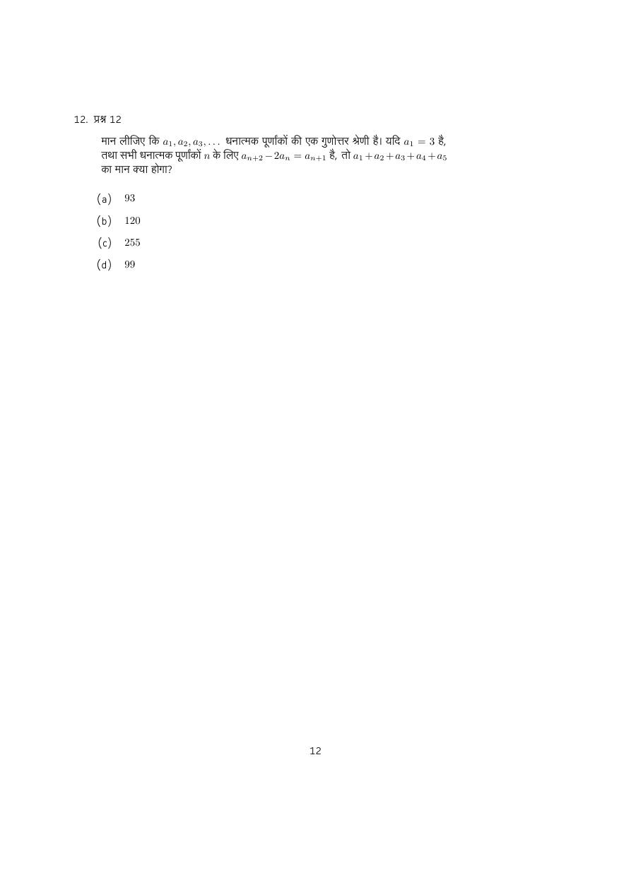

## PDF page 45

[Open original PDF at page 45](../pdf/IAT_2026_Hindi_provisional_key.pdf#page=45)

### Searchable text - OCR draft (hin+eng)

```text
3. WA 33

मान लीजिए कि n = 206 है। यदि 49" + 4" + 0n को 00 से भाग दें तो शेषफल कितना
होगा?

(9) 2
(७) ।
(०) 90
(d) 49

i3
```

### Original page image

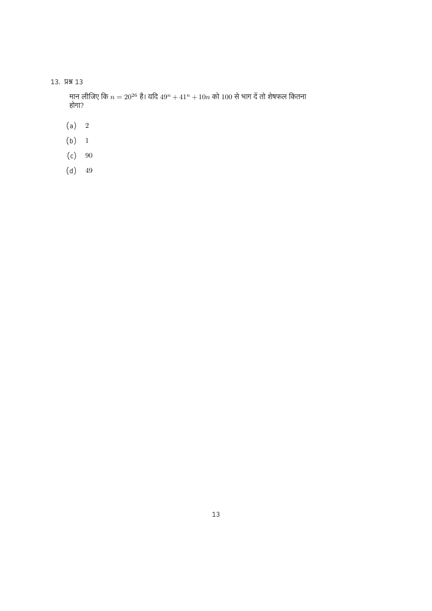

## PDF page 46

[Open original PDF at page 46](../pdf/IAT_2026_Hindi_provisional_key.pdf#page=46)

### Searchable text - OCR draft (hin+eng)

```text
4. WI 4

दो डब्बों B, और Bo, WAG A 3 3 लाल और 4 काली गेंदें हैं। B, से एक गेंद यादृच्छिक रूप से
चुनी जाती है। यदि वह गेंद लाल है तो B, में 4 लाल गेंदे और डाल दी जाती हैं, अन्यथा By में
3 काली गेंदें और डाल दी जाती हैं। इसके बाद Bo में से एक गेंद यादृषच्छिक रूप से चुनी जाती
है। यदि यह गेंद लाल है तो इस बात की सप्रतिबंध प्रायिकता क्या है कि B, से चुनी गई गेंद भी

लाल थी?
(a) ऊ
57
(b) 99
257
(c) 3
7
(4) 33
53

4
```

### Original page image

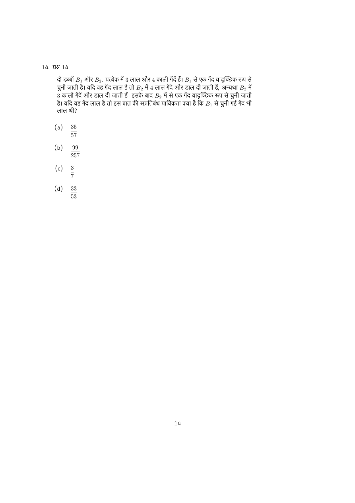

## PDF page 47

[Open original PDF at page 47](../pdf/IAT_2026_Hindi_provisional_key.pdf#page=47)

### Searchable text - OCR draft (hin+eng)

```text
45. WH 5
फलन / : R > R निम्न द्वारा परिभाषित है:
f(a) = |x — 2|+3|2 - ] + ||a - 2)-I].

ऐसे कितने बिन्दु हैं जिन पर / अवकलनीय नहीं है?

(a) 2
b) l
(c) 0
(d

=

)
)

a5
```

### Original page image

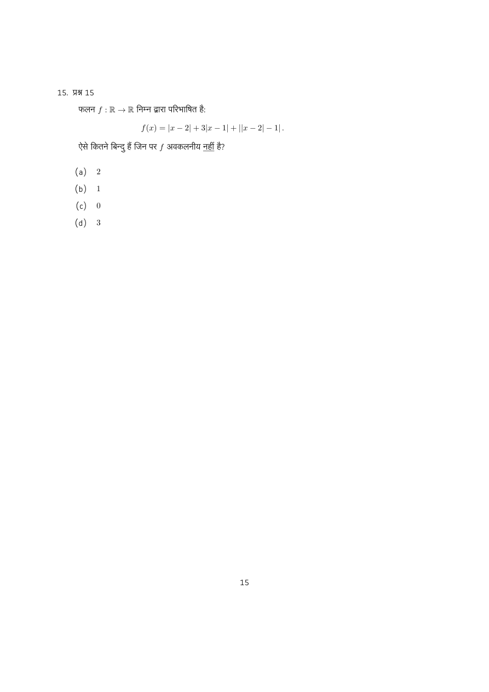

## PDF page 48

[Open original PDF at page 48](../pdf/IAT_2026_Hindi_provisional_key.pdf#page=48)

### Searchable text - OCR draft (hin+eng)

```text
भौतिक विज्ञान

l. Wal

समान द्रव्यमान वाले एक गोले और एक घन को at Geater दीवारों के बीच एक घर्षणरहित
Afar सतह पर चित्र में प्रदर्शित व्यवस्था के अनुसार रखा गया है। घन एक भार रहित स्प्रिड़ की
सहायता से एक दीवार से जुड़ा हुआ है। fey की साम्यावस्था में गोलक घन को स्पर्श करता
है। इस घन को अपनी साम्यावस्था से बाँयी दिशा में एक लघु दूरी / से स्प्रिड़ को संपीड़ित करते
हुये विस्थापित किया जाता है और ¢ = 0 पर मुक्त कर दिया जाता है। यह समूचा प्रबन्धन अपनी
t = 0 वाली अवस्था में आवर्तकाल 7' के साथ पुनः लौटता रहता है। यदि सारे संघट्ट प्रत्यास्थ
हों तो निम्नलिखित कथनों में से कौन सा कथन सही है?

यदि ¢ बढ़े तो 7' घटेगा।
यदि ¢ बढ़े तो 7' में बदलाव नहीं आयेगा।
यदि ¢ बढ़े तो 7' बढ़ेगा।

गोला कभी भी विचलित नहीं होगा।
```

### Original page image

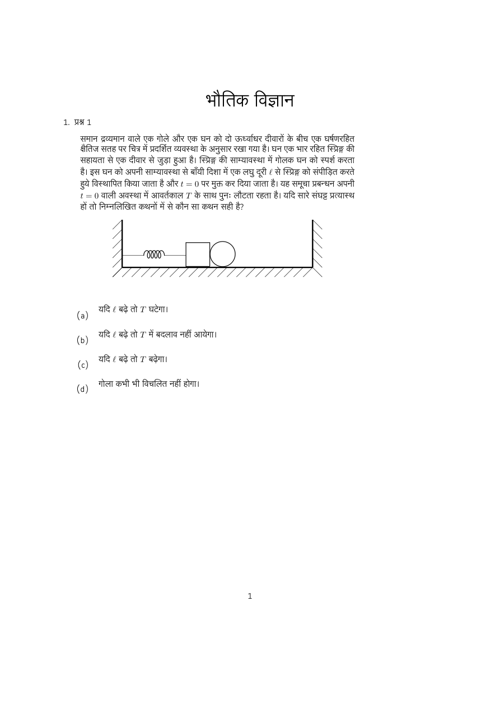

## PDF page 49

[Open original PDF at page 49](../pdf/IAT_2026_Hindi_provisional_key.pdf#page=49)

### Searchable text - OCR draft (hin+eng)

```text
2. प्रश्न 2

0 cm की फ़ोकल दूरी वाला एक अवतल गोलीय दर्पण एवं 5 cm की फ़ोकल दूरी वाला एक
उभयोत्तल ART अपने पारस्परिक मुख्य अक्ष पर चित्र में दशाये व्यवस्था के अनुसार संयोजित
हैं। इस मुख्य अक्ष पर किसी fara को दर्पण एवं लेन्स के फ़ोकस बिन्दुओं, क्रमशः F, और Fy
के बीच रखा गया है। यदि इस स्थिति में लेन्स के द्वारा दो वास्तविक एवं परस्पर see प्रतिबिम्ब
मुख्य अक्ष के एक ही बिन्दु पर बनते हैं तो बिम्ब की दर्पण से दूरी कितनी होगी?

हर 0 cm

(a) 20 cm
(b) 30 cm
(c) 25 cm
(०) 2 cm
```

### Original page image

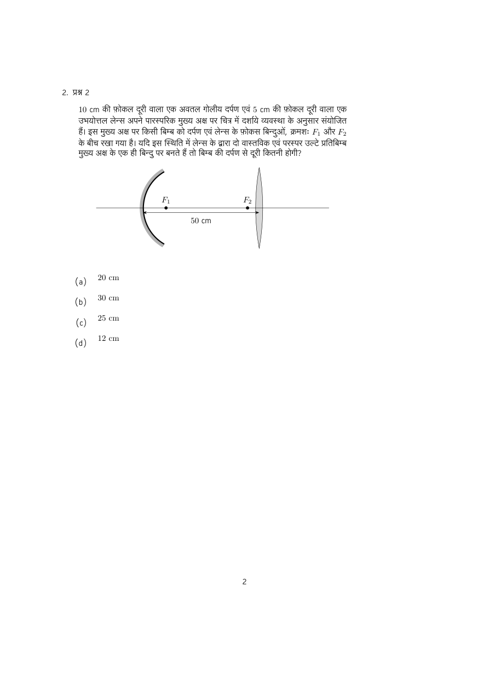

## PDF page 50

[Open original PDF at page 50](../pdf/IAT_2026_Hindi_provisional_key.pdf#page=50)

### Searchable text - OCR draft (hin+eng)

```text
3. प्रश्न 3

लम्बाई 7, द्रव्यमान m तथा विद्युत आवेश g से आवेशित गोलक वाला एक सरल लोलक
आवर्तकाल 7' के साथ -& की दिशा में स्थित एकसमान गुरुत्व के प्रभाव में दोलन कर रहा है।
इस लोलक को एकसमान विद्युत क्षेत्र |7|9 (जहां A दोलन-तल में एक इकाई सदिश है) में
स्थापित करने पर दोलन का आवर्तकाल घट जाता है। निम्न में से कौन सा कथन गलत है?

4 धनात्मक है तथा A = £

(a)

q धनात्मक है तथा A = -&

(७)

4 ऋणात्मक है तथा A = 2

(०)

4 धनात्मक है तथा A. = - Ws
(d)
```

### Original page image

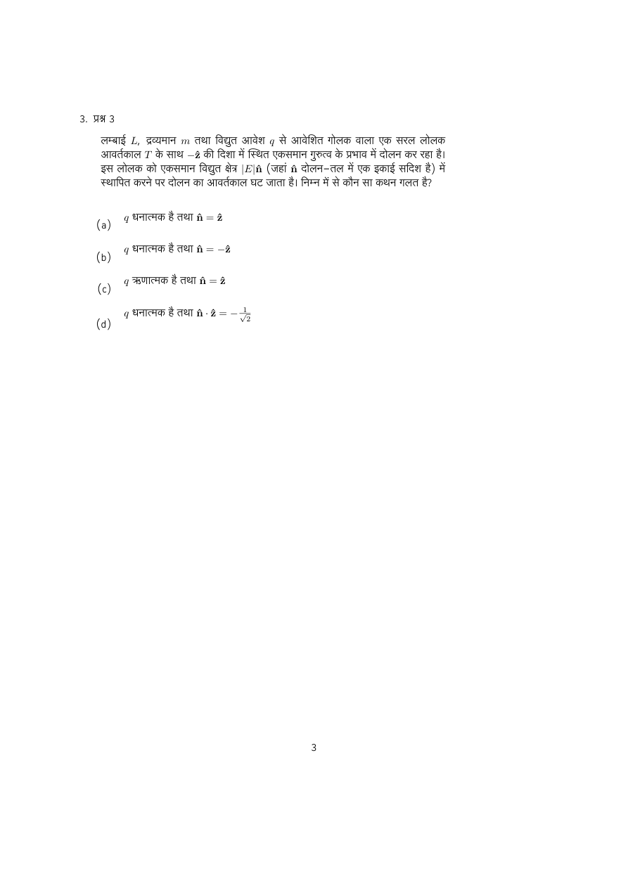

## PDF page 51

[Open original PDF at page 51](../pdf/IAT_2026_Hindi_provisional_key.pdf#page=51)

### Searchable text - OCR draft (hin+eng)

```text
4. प्रश्न 4
द्रव्यमान m, व विद्युत आवेश 4 का एक कण, एकसमान बाह्न विद्युत क्षेत्र 72 में, विरामावस्था से
प्रारंभ कर 4 tt, समय में तय करता Bl यदि कण का द्रव्यमान my हो तो वही दूरी तय करने

में t
में ४; समय लगता है। दर का अनुपात FAT होगा?
(2

(०) Vie
(०) Ve
(0 ™
(0 ™
```

### Original page image


## PDF page 52

[Open original PDF at page 52](../pdf/IAT_2026_Hindi_provisional_key.pdf#page=52)

### Searchable text - OCR draft (hin+eng)

```text
5. प्रश्न 5

एक अनूठी गोलाकार जेलीफ़िश का आयतन गुणांक B है। जब जेलीफ़िश समुद्र की ऊपरी सतह
(गहराई d = 0) पर हो तो उसकी त्रिज्या R है। समुद्र के भीतर 4 (d > R) की गहराई पर
जाने पर sad Ae AR > 0 से सिकुड़ जाती है। यदि असम्पीड्य समुद्री जल का घनत्व p

AR
हो, एकसमान गुरुत्वीय त्वरण g हो और pgd < B, तो Sp ही मान क्या होगा?

aus
(2) ree)
बट
(b) (07%)
nis
(० हक)
aus
(०) हक)
```

### Original page image


## PDF page 53

[Open original PDF at page 53](../pdf/IAT_2026_Hindi_provisional_key.pdf#page=53)

### Searchable text - OCR draft (hin+eng)

```text
6. प्रश्न 6

एक ग्रह किसी तारे के केन्द्र के परितः, पूर्ण रूप से तारे के गुरुत्वीय प्रभाव के अधीन हो कर,
आवर्तकाल 7' वाले वृत्ताकार कक्षा में परिक्रमा कर रहा है। कल्पना करें कि तारे एवं ग्रह के बीच
की दूरी आधी हो जाती है। साथ ही तारे एवं ग्रह की निजी त्रिज्याएँ भी इस तरह से आधी कर दी
जाती हैं कि उनके निजी घनत्व (जो कि एकसमान रूप से वितरित हैं) अपरिवर्तित रहते हैं। इस
स्थिति में ग्रह के नए कक्ष का आवर्तकाल क्या होगा?

(a) 7
(o) 77
r
(0 ?
r
4
```

### Original page image


## PDF page 54

[Open original PDF at page 54](../pdf/IAT_2026_Hindi_provisional_key.pdf#page=54)

### Searchable text - OCR draft (hin+eng)

```text
उ. प्रश्न 7

किसी समय ४ पर द्रव्यमान | kg वाले एक पिण्ड की स्थिति # - +74 J+22 kA निरुपित
की जाती है, जहां # सेकंडों में दिया गया है और प्रत्येक गुणांक अपनी उचित इकाइयों में इस
तरह से दिये गये हैं कि # मीटर की इकाई में निरुपित हो सके। केन्द्र के सापेक्ष मापे गये पिण्ड
के कोणीय संवेग का घटक, सदिश (7 +9) के अनुदिश, kg ॥257! की मापन इकाई में कितना
होगा?

Ww (46 — 2t?)

(a)

(०) Ww (4t + 6t?)
(c) At — 26

(०) At + 6t?
```

### Original page image


## PDF page 55

[Open original PDF at page 55](../pdf/IAT_2026_Hindi_provisional_key.pdf#page=55)

### Searchable text - OCR draft (hin+eng)

```text
8. प्रश्न 8

प्रारम्भिक त्रिज्या 770 वाली एक लंबी परिनालिका एकसमान चुंबकीय क्षेत्र BA ऐसे रखी गयी है
कि इसका अक्ष चुंबकीय क्षेत्र की दिशा में है। यह परिनालिका एक बंद परिपथ का हिस्सा है जिसमें
प्रारंभ में कोई विद्युत धारा प्रवाहित नहीं हो रही है। यदि परिनालिका की त्रिज्या एकसमान दर
से बढ़नी शुरु हो जाए तो परिनालिका में मौजूद चुंबकीय क्षेत्र की तीव्रता 9७, एवं उससे संबद्ध
चुंबकीय ऊर्जा 0, में क्या बदलाव आयेगा?

Bin घटेगा, 0७ घटेंगा।
Bin FOU, Vin घटेगा।
Bin TSM, Vin बढ़ेगा।

Bin FEM, Ujn बढ़ेगा।
```

### Original page image


## PDF page 56

[Open original PDF at page 56](../pdf/IAT_2026_Hindi_provisional_key.pdf#page=56)

### Searchable text - OCR draft (hin+eng)

```text
9. प्रश्न 9
एक कण का त्वरण निम्नलिखित समीकरण से व्यक्त होता है:

ax x 4 glx
oF = ge + BS
dt? जा "di

जहां x स्थिति और t समय को दशति हैं। निम्न में से कौन से Sere a Bik ,8 की सही विमाएं
दशति हैं?

a] = [M°L'T~?
8] = [MeL°T-!
(a)
a] = [MI LST?
8] = [400४४
(७)
a] = [00077
8) =
(०)
a] = (M°L'T~?
8) =
(५)
```

### Original page image


## PDF page 57

[Open original PDF at page 57](../pdf/IAT_2026_Hindi_provisional_key.pdf#page=57)

### Searchable text - OCR draft (hin+eng)

```text
0. W420

एक समतल सतह पर अभिलम्बतः आपतित, संचरित क्षमता P वाले, फोटॉनों के एकवर्णी किरण
Gor का विचार करें। इस आपतित पुंज का 0% भाग अवशोषित हो जाता है, 0% भाग पारगमित
हो जाता है और शेष भाग सतह के द्वारा परावर्तित हो जाता है। यदि प्रकाश का वेग ८ हो तो इस
सतह पर पुंज के द्वारा कितना बल लग रहा है?

(a) 72
(७) i8f

.62
(0
(०) 0.92

i0
```

### Original page image


## PDF page 58

[Open original PDF at page 58](../pdf/IAT_2026_Hindi_provisional_key.pdf#page=58)

### Searchable text - OCR draft (hin+eng)

```text
2. 44 2

प्रकाश विद्युत प्रभाव के किसी प्रायोगिक अध्ययन में कार्य फ़लन ७0 वाले एक धातु का प्रयोग
किया जा रहा है। आपतित फोटॉन का वह लघुतम तरंगदैर्घ्य क्या होगा जिससे कि द्रव्यमान

m वाले उत्सर्जित इलेक्ट्रॉन का दे ब्रोग्ली तरंगदै््य, आपतित फोटॉन के दे ब्रोग्ली तरंगदैर्घ्य के
समान हो जाए? [# प्लांक का स्थिरांक है, ८ प्रकाश का वेग है और ७0 < me?]

h कि
7 [+-
me Mec
(a)
me न
me Mec
(b)
I जज न
fy he oo
me Mec
(c)
I = न
fig /- 2
me Mec
(d)

वव
```

### Original page image


## PDF page 59

[Open original PDF at page 59](../pdf/IAT_2026_Hindi_provisional_key.pdf#page=59)

### Searchable text - OCR draft (hin+eng)

```text
2. WA2

तीन संख्याएं: (प्रोटॉनों की संख्या, न्यूट्रॉनों की संख्या, त्रिज्या) एक नाभिक की पहचान बताती
€) (4,0,r:) और (4, 4, re) से निरुपित दो नाभिकों के लिये _+ का मान क्या होगा?

79

प्‌
(a) ?
(b) ?
(0) 8
पु
(a) 8

i2
```

### Original page image


## PDF page 60

[Open original PDF at page 60](../pdf/IAT_2026_Hindi_provisional_key.pdf#page=60)

### Searchable text - OCR draft (hin+eng)

```text
3. WA 33

एक जार एकल परमाणु वाली अक्रिय गैसों A और 7 से भरा हुआ है, जिनके कुल द्रव्यमान
क्रमशः My और Mp है। A का मोलर द्रव्यमान 7 के मोलर द्रव्यमान का दुगुना है । यदि जार
तापमान 7' पर रखा हो तो जार पर पड़ रहे कुल दबाव और गैस 4 के द्वारा जार पर डाले जा रहे
आंशिक STS का अनुपात FAT होगा?

i3
```

### Original page image


## PDF page 61

[Open original PDF at page 61](../pdf/IAT_2026_Hindi_provisional_key.pdf#page=61)

### Searchable text - OCR draft (hin+eng)

```text
[No text recovered; use the original page image below.]
```

### Original page image


## PDF page 62

[Open original PDF at page 62](../pdf/IAT_2026_Hindi_provisional_key.pdf#page=62)

### Searchable text - OCR draft (hin+eng)

```text
[No text recovered; use the original page image below.]
```

### Original page image


